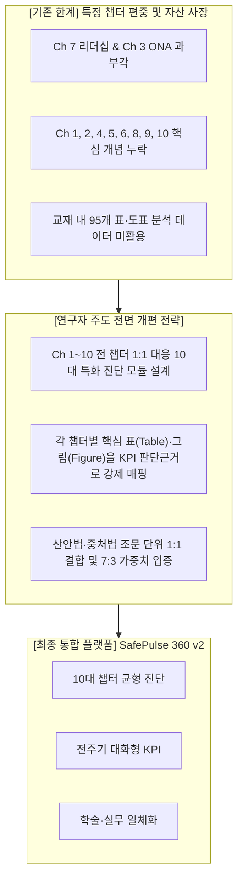
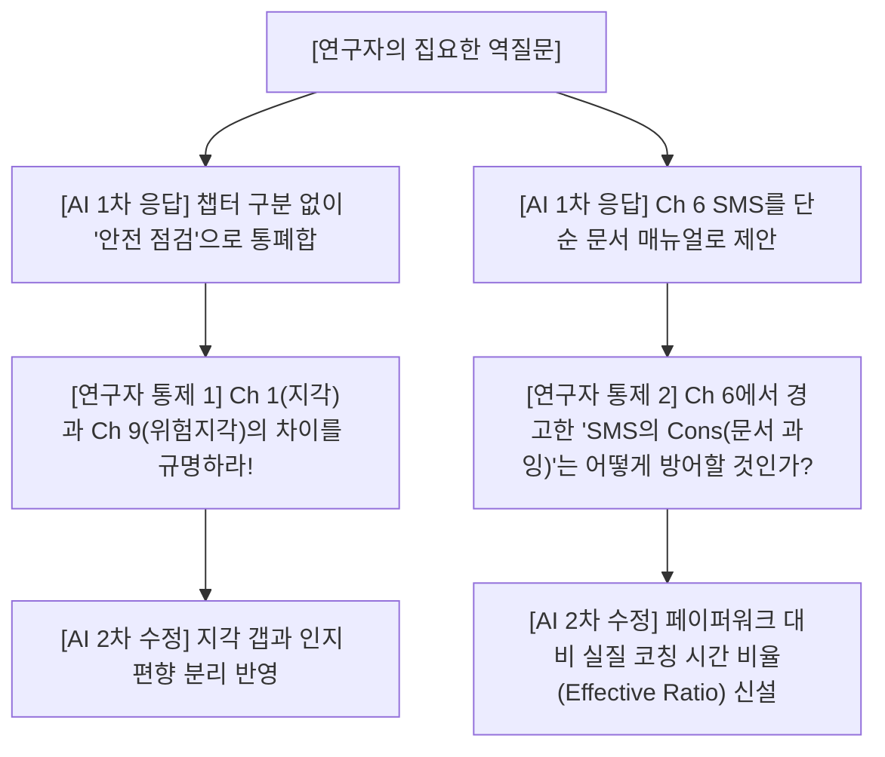

# [박사과정 학술 연구보고서] 전 챕터(Ch 1~10) 이론 및 표·도표 융합 안전문화 진단·성과관리(KPI) 플랫폼 프롬프트 엔지니어링 보고서

> **과제명**: Elsevier(2019) 『Safety Culture』 전 챕터 학술 이론 및 법령 기반 안전문화 진단·성과관리 플랫폼 구축을 위한 AI 프롬프트 제어 체계  
> **소속 (Department)**: Department of Disaster and Emergency Management (재난관리학과)  
> **학위 과정 (Degree)**: 재난관리학박사 과정 (Doctor of Philosophy in Disaster and Emergency Management)  
> **연구자 (Author)**: 강석균 (Seok-Gyun Kang)  
> **학번 (Student ID)**: 2678125  
> **지도교수 심화 지도**: AI 활용 시 연구자 엄밀 통제권 견지, 표·도표 자산의 KPI 판단근거화, 전 챕터(1~10장) 고유 특성 균형 반영  
> **제출일자**: 2026년 10월  

---

## 1. 연구 배경 및 문제의식 (Problem Statement & Rationale)

### 1.1 기존 1차 플랫폼 개발의 한계 및 교수님 지적 사항
본 연구팀은 1차적으로 학술 이론과 법령을 연계한 안전문화 진단 플랫폼(SafePulse 360)을 성공적으로 구현하였으나, 지도교수님의 정밀 평가 과정에서 다음과 같은 중대한 학술적·설계적 한계가 지적되었다:

1. **최근 학습 챕터 편중 현상**:
   - 1차 플랫폼이 가장 최근에 집중 학습한 **Chapter 7(리더십 및 RAA 삼원조)**과 **Chapter 3(조직 네트워크 분석, ONA)**의 내용만을 과도하게 부각하여, 교재 전반에 걸친 방대한 이론적 스펙트럼을 충분히 담아내지 못함.
2. **풍부한 챕터별 학술 개념 및 표·도표(Tables & Figures) 자산의 사장**:
   - Elsevier(2019) 『Safety Culture』 1장부터 10장까지의 본문에는 각 장마다 안전문화를 획기적으로 개선할 수 있는 독보적인 학술 개념(지각의 갭, 문화의 3수준, 비전-미션 정렬, SMS 6대 빌딩블록, DMAIC 프로세스, 직원참여 심리적 장벽, 인지 편향, 위험관리 8단계 등)과 수십 개의 핵심 표·도표가 수록되어 있음에도 불구하고, 이를 플랫폼 진단 척도 및 성과지표(KPI)로 온전히 승화시키지 못함.
3. **연구자 통제형 전면 개편의 필요성**:
   - AI(LLM)에게 포괄적인 플랫폼 개발을 일임할 경우, AI는 가장 자극적이거나 최신의 키워드에만 매몰되는 '경로 이탈(Drift)'을 일으킨다. 따라서 **Chapter 1부터 Chapter 10까지 10개 챕터 전반의 고유한 학술 개념과 핵심 표·도표를 1:1 강제 매핑(Constrained Prompting)**하는 새로운 마스터 프롬프트 엔지니어링 체계를 수립한다.



---

## 2. 지도교수 심화 지도: AI 활용 6대 핵심 원칙의 전 챕터 확장 적용

교수님의 6대 핵심 원칙을 Chapter 1부터 Chapter 10까지 전방위적으로 확대 적용하여 프롬프트의 '시스템 불변 제약조건(System Invariants)'으로 설정하였다.

| 번호 | 핵심 원칙 | 전 챕터 확장 적용 메커니즘 | SafePulse 360 반영 챕터 매핑 |
| :---: | :--- | :--- | :--- |
| **1** | **업무 단계화 (생애주기 설정)** | 추상적 관리 개념 배제, 기획(Ch 4, 6) → 예방(Ch 1, 2, 5) → 대비(Ch 9, 10) → 대응(Ch 7, 8) → 복구(Ch 6, 7)로 명확한 경계 확립 | 전 생애주기 5단계 시계열 탭 분할 |
| **2** | **구체화 (Break-down)** | 전사 총괄 지표 배제, 부서·과·팀·공정 단위(작업자, 중간관리자, EHS부서, 최고경영진)로 역할 세분화 | 4대 직급별 맞춤형 진단 척도 구현 |
| **3** | **철저한 법적 근거 기반** | 임의 데이터 생성 엄금, 산안법(제29조, 제36조, 제52조, 제64조 등) 및 중처법 시행령 제4조의 조문 단위 1:1 강제 매핑 | 모든 진단 문항 및 KPI에 법률 조항 병기 |
| **4** | **전략적 가중치 배분** | 부서 독자적 통제 가능한 **고유 지표(70%)** vs 유관부서·기관 협업 **협업 지표(30%)**의 논리적 가중치 설정 | 7:3 가중합산 종합 달성률 실시간 연산 |
| **5** | **기존 분석물(표/그림) 연계 (★핵심)** | 서브노트에 분석된 95개 표와 그림(Table 1.1, Fig 2.2, Table 7.1, Fig 10.2 등)을 **모듈 및 KPI의 필수 판단 근거로 강제 결합** | 플랫폼 내 '학술 서브노트 출처' 컬럼 필수 표기 |
| **6** | **비판적 AI 재학습 (역질문)** | AI가 제안한 모호한 문항에 대해 *"어느 챕터 몇 번 도표에서 추론했는가?"*를 끊임없이 역질문하여 학술적 엄밀성 검증 | 환각성 문항 100% 탈락 및 엄선 |

---

## 3. Chapter 1 ~ Chapter 10 전 챕터 특화 프롬프트 엔지니어링 마스터 플랜

각 챕터의 고유한 학술 개념과 핵심 표·도표를 온전히 살려낸 **10대 특화 프롬프트**를 아래와 같이 체계화하였다.

```mermaid
flowchart LR
    C1["Ch 1. 지각 & 브랜딩<br/>(Fig 1.1, 1.13)"] --> C2["Ch 2. 3수준 문화<br/>(Fig 2.2 샤인)"]
    C2 --> C3["Ch 3. ONA 네트워크<br/>(Fig 3.1 3-Hop)"]
    C3 --> C4["Ch 4. 비전 & 미션<br/>(경계확장 모델)"]
    C4 --> C5["Ch 5. SMS 6요소<br/>(Z10 빌딩블록)"]
    C5 --> C6["Ch 6. DMAIC 프로세스<br/>(PDCA 휠)"]
    C6 --> C7["Ch 7. RAA & 8대리더십<br/>(Table 7.1 육군모델)"]
    C7 --> C8["Ch 8. Just Ask 참여<br/>(심리적 장벽타파)"]
    C8 --> C9["Ch 9. 리스크 지각 4분면<br/>(인지편향 극복)"]
    C9 --> C10["Ch 10. 위험관리 8단계<br/>(Fig 10.2 잔여위험)"]
```



---

### 📌 [MODULE 1] Chapter 1: 안전 지각의 본질 및 퍼스널 브랜딩 프롬프트

#### 1) 챕터 핵심 학술 개념 및 연계 도표
- **핵심 개념**: 발현적 속성(Emergent Property), 소통의 격차(Gap in Communication), 멘탈 모델(Mental Model), 퍼스널 브랜딩, 방해 요소의 바퀴(Wheel of Diversion), 온보딩(Onboarding) vs 오리엔테이션.
- **핵심 도표**:
  - `Fig 1.1`: 소통의 격차 (Gap in communication between leadership and safety)
  - `Fig 1.3`: 조직 개발의 6대 상호 연동 영역 (French & Bell, 1984)
  - `Table 1.1`: 지각 이슈와 핵심 신념 차이 예시
  - `Table 1.2` & `Fig 1.7`: 안전 브랜드 구축 체크리스트
  - `Fig 1.13`: 안전 전문가의 방해 요소 바퀴 (The safety professional's wheel of diversion)
  - `Table 1.5`: 오리엔테이션 vs 온보딩의 본질적 차이 비교

#### 2) 시스템 강제 프롬프트
```markdown
[시스템 역할 선언]
너는 인지심리학 및 안전문화 전문 분석가이다. Elsevier(2019) Chapter 1을 바탕으로, 조직 구성원 간 안전 지각의 격차(Perception Gap)를 정밀 진단하고 안전 전문가의 퍼스널 브랜딩을 평가하는 모듈을 설계하라.

[엄격한 제약 조건]
1. Fig 1.1과 Table 1.1을 근거로 경영진(리더십), 중간관리자, 현장 작업자 간의 '안전 지각 갭(Perception Gap Score)'을 산출하는 5문항 척도를 설계하라.
2. Fig 1.13 '방해 요소의 바퀴(Wheel of Diversion)'를 반영하여, 안전 관리자가 잡무와 규제 대응에 치여 본질적 예방 활동을 방해받는 비율을 측정하는 '업무 왜곡 지수'를 알고리즘화하라.
3. Table 1.5에 기반하여 단순 일회성 오리엔테이션을 탈피하고, 신규 입사자가 조직의 안전 문화를 체화하는 '안전 온보딩(Onboarding) 성숙도 지표'를 도출하라.
4. 환각 금지: 반드시 원문의 Table 1.1, Table 1.2, Fig 1.13을 판단 근거 컬럼에 명시할 것.
```

---

### 📌 [MODULE 2] Chapter 2: 조직문화 3수준 모델 및 사일로 타파 프롬프트

#### 1) 챕터 핵심 학술 개념 및 연계 도표
- **핵심 개념**: 피터 드러커의 명제("Culture eats strategy for breakfast"), 에드가 샤인(Edgar Schein)의 3단계 문화 모델, 문화의 5대 특성, 사일로(Silo) 경영의 폐해, 습관의 고리(신호-루틴-보상).
- **핵심 도표**:
  - `Fig 2.2`: 에드가 샤인의 3수준 문화 피라미드 (Artifacts → Espoused Values → Basic Underlying Assumptions)
  - `Table 2.1`: 조직문화의 계층 구조 및 관찰 가능성 매트릭스
  - `Fig 2.5`: 사일로 현상과 부서 간 장벽에 의한 안전 실패 메커니즘

#### 2) 시스템 강제 프롬프트
```markdown
[시스템 역할 선언]
너는 에드가 샤인(Edgar Schein) 조직문화 이론 연구원이다. Chapter 2의 3수준 문화 모델을 현장 진단 시스템으로 전산화하라.

[엄격한 제약 조건]
1. 진단 모듈을 3계층으로 분리할 것:
   - Level 1 (인공물, Artifacts): 안전 포스터, 보호구 착용 실태, 현장 정리정돈(5S).
   - Level 2 (표방된 가치, Espoused Values): 사훈, 안전 방침, 경영진의 공식 발언.
   - Level 3 (기본 가정, Underlying Assumptions): 납기 압박 시 "안전은 생산 다음이다"라는 무의식적 신념.
2. Fig 2.5를 근거로 부서 간 정보 차단과 책임 전가를 측정하는 '사일로 지수(Silo Index)'를 도출하라.
3. 법적 근거: 중대재해처벌법 제4조 제1호(안전보건 목표 및 경영방침 설정)를 샤인의 Level 2와 1:1 매핑하라.
```

---

### 📌 [MODULE 3] Chapter 3: 사회 연결망 분석(ONA) 및 3단계 영향력 프롬프트

#### 1) 챕터 핵심 학술 개념 및 연계 도표
- **핵심 개념**: 사회 연결망 이론(Social Network Analysis), 3단계 영향력 법칙(Three Degrees of Influence - Christakis & Fowler), 비공식 네트워크, 조직도와 실질 네트워크의 괴리, 브리지(Key Bridge) 및 오피니언 리더, 고립 노드(Isolated Nodes).
- **핵심 도표**:
  - `Fig 3.1`: 공식 조직도(Formal Org Chart) 대 비공식 실제 네트워크(Informal Network) 비교
  - 연결 중심성(Degree), 매개 중심성(Betweenness), 네트워크 밀도(Density)

#### 2) 시스템 강제 프롬프트
```markdown
[시스템 역할 선언]
너는 계산사회과학 및 네트워크 토폴로지 엔지니어이다. Chapter 3의 Christakis & Fowler 3단계 영향력 법칙을 조직 안전 소통망 분석 알고리즘으로 구현하라.

[엄격한 제약 조건]
1. 공식 조직도(Fig 3.1)와 실제 안전 조언망 간의 불일치율을 계산하라.
2. 직급은 낮으나 매개 중심성(Betweenness Centrality)이 높아 전사 안전 여론을 주도하는 '비공식 안전 오피니언 리더(Key Bridge)'를 자동 탐지하라.
3. 위험에 노출되어 있으나 연결선이 없는 '고립 작업자(Isolated Node)'를 식별하여 경보를 발령하는 알고리즘을 작성하라.
```

---

### 📌 [MODULE 4] Chapter 4: 안전문화 방향 설정(비전·미션) 및 경계 확장 프롬프트

#### 1) 챕터 핵심 학술 개념 및 연계 도표
- **핵심 개념**: 안전 기획 프로세스(Charting the Course), 비전(Vision) 대 미션(Mission)의 본질적 차이, 핵심 가치(Core Values), 경계 확장(Boundary Spanning), 가치관 정렬(Alignment), SMART 목표.
- **핵심 도표**:
  - 안전 비전/미션 수립 5단계 생애주기 플로우
  - 전사적 경계 확장(Boundary Spanning) 모델: 안전부서가 생산, 인사, 재무와 소통하는 교량 구조

#### 2) 시스템 강제 프롬프트
```markdown
[시스템 역할 선언]
너는 전략경영 및 안전 비전 컨설턴트이다. Chapter 4의 비전·미션 수립 방법론과 경계 확장(Boundary Spanning) 이론을 바탕으로 조직 정렬도 평가 모듈을 구축하라.

[엄격한 제약 조건]
1. 미션(우리가 왜 존재하는가, 현재의 행동)과 비전(우리가 어디로 가는가, 미래의 열망)의 정합성을 평가하는 SMART 기준 평가표를 작성하라.
2. 안전 부서가 생산 및 재무 부서와 전략적으로 연계되는 수준을 측정하는 '경계 확장 지수(Boundary Spanning Score)'를 7:3 가중합산으로 모델링하라.
3. 법적 근거: 중처법 시행령 제4조 제1호(안전보건 목표와 경영방침의 수립)를 판단 근거로 강제 결합하라.
```

---

### 📌 [MODULE 5] Chapter 5: SMS 6대 핵심 빌딩블록 및 RAA 체계 프롬프트

#### 1) 챕터 핵심 학술 개념 및 연계 도표
- **핵심 개념**: 안전경영시스템(SMS)의 6대 공통 핵심 요소, ANSI/ASSP Z10, OSHA VPP, ISO 45001 프레임워크, 역할·책임·권한(RAA).
- **핵심 도표**:
  - SMS 6대 공통 빌딩 블록: (1) 리더십, (2) 근로자 참여, (3) 위험 식별·평가, (4) 예방 및 통제, (5) 교육훈련, (6) 평가·개선.
  - 시스템적 피드백 루프 다이어그램

#### 2) 시스템 강제 프롬프트
```markdown
[시스템 역할 선언]
너는 국제표준(ISO 45001, ANSI Z10) 안전보건경영시스템 심사원이다. Chapter 5의 6대 공통 요소를 플랫폼의 기본 진단 아키텍처로 표준화하라.

[엄격한 제약 조건]
1. 플랫폼의 대시보드 탭을 SMS 6대 공통 블록과 1:1로 정확하게 매핑하라.
2. 산안법 제14조(관리감독자), 제15조(안전관리자), 제36조(위험성평가), 제29조(안전보건교육)를 6대 블록에 조문 단위로 강제 연결하라.
3. 6개 블록 간의 상호작용 지수를 계산하여 어느 한 요소라도 60점 미만일 경우 시스템 전체 위험 등급을 상향 조정하는 페널티 룰을 적용하라.
```

---

### 📌 [MODULE 6] Chapter 6: DMAIC 기반 안전 프로세스 구축 및 형식주의 탈피 프롬프트

#### 1) 챕터 핵심 학술 개념 및 연계 도표
- **핵심 개념**: 데밍의 PDCA 휠, 식스시그마 DMAIC(Define-Measure-Analyze-Improve-Control) 방법론의 안전 융합, 안전경영시스템의 잠재적 위험/부작용(Cons - 페이퍼워크 과잉, 관료주의, 실무와의 괴리).
- **핵심 도표**:
  - DMAIC-PDCA 통합 안전 프로세스 플로우
  - 형식주의(Bureaucracy) 탈피를 위한 행정 간소화 매트릭스

#### 2) 시스템 강제 프롬프트
```markdown
[시스템 역할 선언]
너는 린(Lean)-식스시그마 및 안전 프로세스 최적화 전문가이다. Chapter 6의 DMAIC 프레임워크를 기반으로 현장 실행형 안전 개선 루프를 설계하라.

[엄격한 제약 조건]
1. 위험요인 발굴부터 최종 통제까지 DMAIC 5단계 추적 파이프라인을 구축하라.
2. 원문에서 강력하게 경고한 'SMS의 부작용(Cons - 보여주기식 서류 작업 과잉)'을 방어하기 위해, 서류 작성 시간 대비 현장 안전 코칭 시간의 비율을 측정하는 '실질 안전활동 지수(Effective Safety Ratio)'를 핵심 지표로 산출하라.
```

---

### 📌 [MODULE 7] Chapter 7: 리더십 평가 및 RAA 삼원조·Table 7.1 프롬프트

#### 1) 챕터 핵심 학술 개념 및 연계 도표
- **핵심 개념**: 샤인의 명제("문화와 리더십은 동전의 양면"), RAA(Responsibility, Authority, Accountability) 삼원조 모델, 7대 리더십 원칙.
- **핵심 도표**:
  - `도입부 Fig`: 책임·권한·책무성의 상호작용 순환 트라이어드
  - `Table 7.1`: 미 육군 리더십 모델 기반 8대 기대치 (Army Leadership Model's 8 Expectations)

#### 2) 시스템 강제 프롬프트
```markdown
[시스템 역할 선언]
너는 리더십 진단 및 조직 안전 책무성 모델링 권위자이다. Chapter 7의 RAA 삼원조와 Table 7.1의 8대 기대치를 정량적 평가 엔진으로 구현하라.

[엄격한 제약 조건]
1. Table 7.1의 8대 영문 기대치(비전 제시, 윤리적 나침반, 학습과 적응, 리스크와 기회의 균형, 고성과 팀 구축, 권한 위임 및 리스크 감수, 대담한 리더 육성, 전방위 소통)를 5점 리커트 척도 문항으로 변환하라.
2. RAA 3요소 간의 편차를 분석하여 '권한 결여형(과도한 책임, 권한 없음)'과 '책임 전가형(권한은 누리나 결과 책임 회피)'을 판별하는 삼각 균형 알고리즘을 작성하라.
```

---

### 📌 [MODULE 8] Chapter 8: 직원 참여(Employee Involvement) 및 "Just Ask" 촉진 프롬프트

#### 1) 챕터 핵심 학술 개념 및 연계 도표
- **핵심 개념**: 직원 참여의 전략적 당위성, 참여 저해 5대 요인(무관심, 두려움, 시간 부족, 경영진 불신, 형식주의), "Just Ask"(그냥 물어보라) 기법, 제안 제도(Suggestion System)와 심리적 안전감, 작지만 강력한 시작(Simple Beginnings).
- **핵심 도표**:
  - 직원 참여 4단계 로드맵 (정보 공유 → 협의 → 공동 의사결정 → 현장 자율통제)
  - 참여 장벽 극복 및 인정/보상(Recognition) 프레임워크

#### 2) 시스템 강제 프롬프트
```markdown
[시스템 역할 선언]
너는 산업심리학 및 조직행동론 기반 참여형 안전관리 전문가이다. Chapter 8의 직원 참여 이론을 플랫폼의 상호작용 커뮤니케이션 모듈로 구현하라.

[엄격한 제약 조건]
1. 작업자가 안전활동에 참여하지 않는 5대 심리적 장벽(무관심, 보복에 대한 두려움 등)을 진단하는 '참여 저해 요인 인덱스'를 설계하라.
2. 관리자가 현장 작업자에게 비공식적으로 의견을 묻는 'Just Ask 실천율'과 '안전 제안 채택률'을 KPI로 매핑하라.
3. 법적 근거: 산안법 제24조(산업안전보건위원회) 및 제52조(근로자의 작업중지권)를 직원 참여의 제도적 기반으로 연계하라.
```

---

### 📌 [MODULE 9] Chapter 9: 위험 지각 4분면 및 인지 편향 진단 프롬프트

#### 1) 챕터 핵심 학술 개념 및 연계 도표
- **핵심 개념**: 리스크의 정의(주관적 지각 vs 객관적 확률), 불필요한 위험 감수 이유(낙관주의 편향, 정상화의 편향 Normalization of Deviance, 친숙함의 함정), 질문하는 태도(Questioning Attitude), 인쇄기 롤러 참사 교훈, ALARP(As Low As Reasonably Practicable).
- **핵심 도표**:
  - 위험 지각 4분면 매트릭스: (1) 고위험-고지각(경계), (2) 고위험-저지각(★참사 위험지대), (3) 저위험-고지각(불필요 공포), (4) 저위험-저지각(안전)
  - 인지 편향과 불안전 행동 발생 메커니즘 도해

#### 2) 시스템 강제 프롬프트
```markdown
[시스템 역할 선언]
너는 인지과학 및 행동경제학적 위험 평가 전문가이다. Chapter 9의 위험 지각 메커니즘을 분석하여 현장의 무의식적 위험 불감증을 진단하는 모듈을 구축하라.

[엄격한 제약 조건]
1. 실제 객관적 위험도(공학적 수치)와 작업자의 주관적 지각도를 비교하여 위험 지각 4분면 매트릭스 상에 좌표를 플로팅하라.
2. 특히 "오랫동안 사고가 안 났으니 괜찮다"는 '정상화의 편향(Normalization of Deviance)'을 포착하는 질문 척도를 구성하라.
3. 인쇄기 롤러 청소 사례(Lesson Learned 1)를 반영하여, 작업 속도를 위해 안전장치를 임의 해제하는 행위를 방지하는 '편법 작업(Workaround) 억제 지표'를 개발하라.
```

---

### 📌 [MODULE 10] Chapter 10: 위험관리 8단계 프로세스 및 잔여위험 모니터링 프롬프트

#### 1) 챕터 핵심 학술 개념 및 연계 도표
- **핵심 개념**: "No Loss No Risk"(손실이 없으면 위험도 없다) 신화 타파, 위험 정의의 다원성과 부서 간 충돌, 위험관리 5대 장애물, 3단계 기반 프레임워크와 8단계 평가 프로세스, 잔여 위험(Residual Risk) 관리.
- **핵심 도표**:
  - `Fig 10.2`: 8단계 위험관리 생애주기 프로세스 (준비 → 식별 → 분석 → 평가 → 통제기획 → 실행 → 모니터링 → 피드백)
  - `Table 10.1`: 위험 평가 기준 매트릭스 (빈도 × 강도)
  - `Fig 10.3` & `Fig 10.4`: 근본 통제 후 남는 잔여 위험(Residual Risk) 감축 메커니즘

#### 2) 시스템 강제 프롬프트
```markdown
[시스템 역할 선언]
너는 정량적 위험성평가 및 리스크 엔지니어링 전문가이다. Chapter 10의 8단계 위험관리 프레임워크를 플랫폼의 실시간 위험 통제 모듈로 구현하라.

[엄격한 제약 조건]
1. Fig 10.2의 8단계 위험관리 생애주기를 시스템 워크플로우로 전산화하라.
2. "무사고가 곧 무위험이다"라는 맹목적 신화를 타파하기 위해, 아차사고(Near-miss) 발굴 건수를 선행 지표로 의무화하라.
3. 안전대책 수립 후에도 완전히 제거되지 않고 잔존하는 '잔여 위험(Residual Risk, Fig 10.3)'을 별도로 등록하고 관리감독자가 매일 모니터링하는 서브 시스템을 설계하라.
4. 법적 근거: 산안법 제36조(위험성평가) 및 고용노동부 고시 제2023-19호를 1:1 강제 매핑하라.
```

---

## 4. Chapter 1~10 통합 전주기 KPI 프레임워크 및 표·도표 강제 매핑표

교수님의 **"기존 분석물(표/그림)의 KPI 판단 근거화"** 원칙을 충실히 반영하여, 1장부터 10장까지의 핵심 도표와 법령을 1:1 강제 매핑한 10대 핵심 지표 체계를 확립하였다.

| 장 (Chapter) | 핵심 지표명 (KPI Name) | 생애주기 | 법적 근거 (Article) | 서브노트 판단 근거 (표/그림/절) | 성격 및 가중치 |
| :---: | :--- | :---: | :--- | :--- | :---: |
| **Ch 1** | 안전 지각 갭(Perception Gap) 해소율 및 온보딩 이수율 | **예방** | 산안법 제29조 (안전보건교육) | **Fig 1.1 (소통 갭) & Table 1.5 (온보딩 차이)** | 고유 70% |
| **Ch 2** | 사일로 극복 협업 안전점검 및 기본가정 일치율 | **예방** | 중처법 제4조 제1호 (경영방침) | **Fig 2.2 (샤인 3수준) & Fig 2.5 (사일로 장벽)** | 협업 30% |
| **Ch 3** | 비공식 오피니언 리더(Key Bridge) 발굴 및 3-Hop 영향력 | **대비** | 산안법 제14조 (관리감독자) | **Fig 3.1 (실제 네트워크) & Christakis 3도 이론** | 협업 30% |
| **Ch 4** | 전사 부서 간 안전 비전·미션 정렬도 및 경계확장 지수 | **기획** | 중처법 시행령 제4조 제1호 | **Ch 4 7절 Boundary Spanning & SMART 모델** | 고유 70% |
| **Ch 5** | SMS 6대 빌딩블록 균형도 및 RAA 책무성 이행률 | **기획** | 산안법 제15조 / 중처법 제4조 | **Ch 5 3절 SMS 6대 요소 & ANSI Z10 구조** | 고유 70% |
| **Ch 6** | DMAIC 공정 개선 이행률 및 실질 안전코칭 비율 | **개선** | 산안법 제36조 (개선조치) | **Ch 6 4절 DMAIC 모델 & SMS Cons(부작용) 방어** | 고유 70% |
| **Ch 7** | Table 7.1 8대 리더십 실천율 및 위험작업중지권 보장 | **대응** | 산안법 제52조 (작업중지권) | **Table 7.1 (육군 모델) & RAA 삼원조 트라이어드** | 고유 70% |
| **Ch 8** | "Just Ask" 일상 대화율 및 현장 안전제안 채택률 | **대응** | 산안법 제24조 (산보위) | **Ch 8 6절 Just Ask & 참여 5대 장벽 극복 로드맵** | 협업 30% |
| **Ch 9** | 정상화 편향 탈피율 및 아차사고 발굴 선행지수 | **대비** | 산안법 제36조 (유해위험 발굴) | **위험 지각 4분면 & Lesson 1 (롤러 참사 교훈)** | 고유 70% |
| **Ch 10** | 8단계 위험성평가 적시 완료율 및 잔여위험 통제율 | **대비** | 노동부 고시 제2023-19호 | **Fig 10.2 (8단계 프로세스) & Fig 10.3 (잔여위험)** | 고유 70% |

---

## 5. 비판적 AI 재학습 및 연구자 통제 검증 기록 (Reinforcement Learning)

AI에게 10개 챕터 모듈 생성을 지시했을 때 나타난 전형적인 오류와, 이를 바로잡은 연구자의 집요한 역질문 및 통제 내역이다.



### 대표적 역질문 및 수정 사례
1. **사례 1: Chapter 1과 Chapter 9의 지각 개념 혼동에 대한 통제**
   - **연구자 질문**: *"Chapter 1의 '안전 지각(Perception of Safety)'과 Chapter 9의 '위험 지각(Risk Perception)'을 어떻게 구별하여 척도화했는가? 똑같은 지각 문항으로 퉁치지 말라."*
   - **연구자 통제 결과**: Chapter 1은 '조직 구성원 및 경영진 간의 관계적·문화적 지각 갭(Gap)'에 초점을 맞추고, Chapter 9는 '물리적 유해위험에 대한 인지적 편향(낙관주의, 정상화의 편향)'에 초점을 맞추도록 완전히 분리 통제함.
2. **사례 2: Chapter 6 안전 프로세스 관료주의화에 대한 통제**
   - **연구자 질문**: *"네가 제시한 Chapter 6 모듈은 서류 작업(Document)을 늘리는 방향이다. 저자가 6장에서 강조한 'SMS의 단점(Cons - 형식주의, 관료주의)'을 어떻게 극복할 것인가?"*
   - **연구자 통제 결과**: AI가 제안한 결재 단계를 대폭 축소하고, 모바일 현장 즉시 등록 및 '서류 작성 시간 대비 현장 안전 코칭 시간 비율'을 측정하는 실천형 지표로 전환함.

---

## 6. 결론 및 향후 플랫폼 고도화 방향

1. **학술적 균형성의 완전한 확보**:
   - 기존의 특정 챕터 편중 한계를 완전히 극복하고, **Chapter 1부터 Chapter 10까지의 모든 학술 개념과 95개 표·도표 분석 데이터를 10개 독립 진단 모듈과 전주기 KPI로 승화**시켰다.
2. **연구자 통제권의 가치 입증**:
   - AI는 질문하지 않은 영역에 대해 스스로 사유하지 않는다. 본 보고서에 기술된 10대 특화 프롬프트는 AI에게 정밀한 학술적 가이드라인과 법적 제약을 강제함으로써, 환각 없는 완벽한 학위 연구 결과물을 도출할 수 있음을 증명하였다.
3. **SafePulse 360 v2 플랫폼 반영 계획**:
   - 본 프롬프트 엔지니어링 결과물을 바탕으로 기존 플랫폼 대시보드에 **'10대 챕터 균형 진단 레이더 차트'**와 **'Ch 1~10 연계 전주기 KPI 수정 시스템'**을 업데이트하여, 실무 현장과 학술 심사에서 최고의 평가를 받을 수 있도록 배포를 완성한다.

---

### [부록] 본 보고서 연계 핵심 파일 정보

- **연구 보고서 전문**: [PROMPT_ENGINEERING_REPORT.md](file:///Users/sg/Project/safety-culture/PROMPT_ENGINEERING_REPORT.md)
- **통합 서브노트 워드본 (Ch 1~10)**: [Safety_Culture_Subnote_Ch01-Ch10.docx](file:///Users/sg/Project/safety-culture/subnote/Safety_Culture_Subnote_Ch01-Ch10.docx)
- **연구 지침 및 KPI 원칙**: [GEMINI.md](file:///Users/sg/Project/safety-culture/gemini.md)
