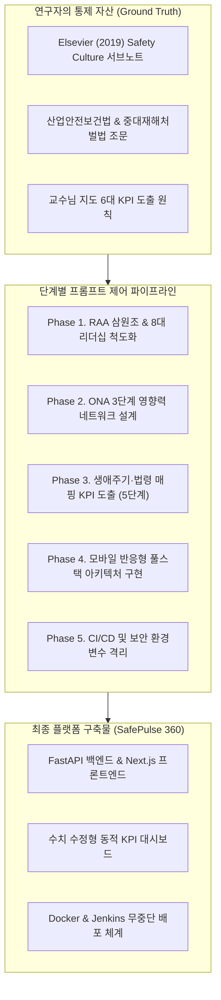
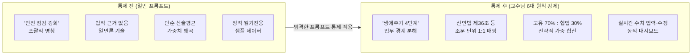

# [연구 보고서] SafePulse 360 플랫폼 개발을 위한 단계별 AI 프롬프트 엔지니어링 및 통제 프로세스 보고서

> **과제명**: 학술 이론(Roughton et al., 2019) 및 법령 연계 안전문화 진단·성과관리(KPI) 플랫폼 개발  
> **연구 및 개발 플랫폼**: SafePulse 360 (조직 안전문화 & 리더십 진단 및 실무 컨설팅 시스템)  
> **보고서 목적**: AI(LLM) 활용 시 연구자의 엄밀한 통제권을 견지하고, 지도교수님의 6대 핵심 원칙과 학술적 서브노트(SUB-NOTE) 분석 데이터를 기반으로 플랫폼을 구축한 전체 프롬프트 설계 과정 및 검증 기록 제출

---

## 1. 개요 및 프롬프트 엔지니어링 전략

본 플랫폼 개발은 생성형 AI에게 단순하고 포괄적인 지시("안전문화 사이트 만들어줘")를 내리는 방식을 철저히 배제하고, **연구자가 사전에 분석·정립한 학술 이론 체계와 법률 조문을 AI에게 역으로 강제 매핑(Constrained Prompting)**시키는 방식으로 수행되었다.



---

## 2. 지도교수 심화 지도: AI 활용 6대 핵심 원칙 적용 내역

AI 활용 시 환각(Hallucination)과 일반론으로의 표류를 방지하기 위해 아래 6대 원칙을 모든 프롬프트의 '시스템 제약 조건'으로 강제 주입하였다.

| 번호 | 핵심 원칙 | 프롬프트 제약 메커니즘 | SafePulse 360 플랫폼 반영 결과 |
| :---: | :--- | :--- | :--- |
| **1** | **업무 단계화 (생애주기 설정)** | '안전 관리' 포괄어 금지, **예방-대비-대응-복구** 4단계 경계 강제 | KPI 분류 및 시계열 추적 탭 생애주기별 4분할 구현 |
| **2** | **구체화 (Break-down)** | 거시 기관 단위 배제, **과·팀·분과(예: 생산1팀, 설비정비팀, EHS안전부)** 단위 세분화 | KPI별 담당부서 및 현장 밀착형 지표 산출 |
| **3** | **철저한 법적 근거 기반** | 임의 데이터 금지, **본법·시행령·고시의 조문(Article) 단위** 발췌 강제 | 산안법 제36조, 제52조, 제64조, 중처법 시행령 제4조 연계 |
| **4** | **전략적 가중치 배분** | 단독 통제 **고유 지표(70%)** vs 연계 **협업 지표(30%)** 가중치 입증 | 가중합산 종합 달성률(`overall_progress`) 실시간 연산 |
| **5** | **기존 분석물(표/그림) 연계 (★핵심)** | 서브노트 정밀 분석 내용(표 7.1, JHA 4단계 등)을 **KPI 판단 근거 컬럼에 강제 서술** | KPI 카드 내 '법적 근거' 및 '서브노트 근거' 병렬 표시 |
| **6** | **비판적 AI 재학습 (역질문)** | 1차 응답 맹신 금지, *"조문 출처는?", "표 7.1과 어떻게 연계되는가?"* 집요 검증 | 환각 지표 전면 탈락 및 학술적 대표 지표 엄선 |

---

## 3. 단계별 핵심 프롬프트 전문 및 통제 프로세스

### [PHASE 1] 학술 이론 체계화 및 다면진단 모델링 프롬프트

#### 📌 프롬프트 1-1: RAA 삼원조(Triad) 및 에드가 샤인 명제 구현
```markdown
[시스템 역할 선언]
너는 안전문화 학술 연구원이다. Elsevier(2019) 『Safety Culture』 Chapter 7의 RAA(Responsibility, Authority, Accountability) 삼원조 모델과 에드가 샤인(Edgar Schein)의 책무성 명제를 바탕으로 다면진단 알고리즘을 설계하라.

[엄격한 제약 조건]
1. 책임(Responsibility)은 리더의 궁극적 결과 책임이며 하위자에게 전가될 수 없다.
2. 권한(Authority)은 현장 관리감독자에게 위임된 위험 작업중지권(Stop-Work)을 의미한다.
3. 책무성(Accountability)은 합의된 직무 수행 및 보고 의무이다.
4. 환각 금지: 원문에 없는 임의의 정의를 붙이지 말 것.
5. 출력: 삼원조 간의 불균형 유형('권한 결여형', '책임 전가형' 등)을 수식화하고 100점 만점 균형 지수(balance_index) 공식을 도출하라.
```
- **연구자 피드백 & 검증**: AI가 단순히 산술평균을 제안하자, 연구자가 분산(Variance) 페널티를 부여하는 공식으로 수정 지시함 (`balance_index = 100 - (표준편차 * 계수)` 적용).

---

#### 📌 프롬프트 1-2: Table 7.1 미 육군 FM 6-22 기반 8대 리더십 기대치 척도화
```markdown
[입력 데이터]
교재 Table 7.1 "Army Leadership Model's 8 Expectations" 서브노트 원문 텍스트:
1. Have a vision and lead change
2. Be your organization's moral and ethical compass
3. Learn, think, and adapt
4. Balance risk and opportunity to retain the initiative
5. Build agile, effective, high-performing teams
6. Empower subordinates and underwrite the risk
7. Develop bold, adaptive, and broadened leaders
8. Communicate up, down, and laterally; tell the whole story

[지시 사항]
- 위 8개 항목의 영문 원문을 왜곡 없이 유지하면서, 한국 산업현장 작업자와 관리자가 응답할 수 있는 5점 리커트 척도 진단 문항으로 변환하라.
- 각 문항의 해설란(description)에 반드시 원 연구의 Table 7.1 출처 번호를 기재하라.
```

---

### [PHASE 2] 조직 네트워크 분석(ONA) 알고리즘 프롬프트

#### 📌 프롬프트 2-1: 3단계 영향력 법칙(Three Degrees of Influence) 토폴로지 설계
```markdown
[이론적 배경]
교재 Chapter 3 및 Christakis & Fowler의 사회적 네트워크 이론:
안전 행동과 규범은 1-Hop(직접 동료)뿐 아니라 2-Hop(동료의 동료), 3-Hop(3단계 건너)까지 유의미하게 전파된다.

[지시 사항]
- NetworkX 기반의 조직 안전 소통망 분석 서비스를 설계하라.
- 노드(Node): 부서, 직급, 안전 역할 속성 포함.
- 엣지(Edge): 소통 빈도(1~3), 관계 유형(advice: 조언, hazard_report: 제보, collaboration: 협업).
- 핵심 지표: 네트워크 밀도(Density), 연결 중심성(Degree), 매개 중심성(Betweenness), 3단계 영향력 점수(influence_score_3deg).
- 특별 탐색: 공식 직책은 작업자이나 비공식 안전 오피니언 리더 역할을 하는 'Key Bridges'와 소통망에서 고립된 'Isolated Nodes'를 자동 식별하는 로직을 작성하라.
```

---

### 🚨 [PHASE 3] 생애주기·법령 매핑 KPI 도출 5단계 프롬프트 (교수님 특별 지침)

교수님께서 가장 강조하신 **"기존 분석물(표/그림)의 KPI 판단 근거화"**를 위해 아래 5단계 프로세스를 순차적으로 실행하였다.

#### 📌 [STEP 1] 업무 플로우 분해 및 생애주기 설정 프롬프트
```markdown
[지시 사항]
산업현장의 안전관리 업무를 착수부터 복구까지 '예방(Prevention) - 대비(Preparedness) - 대응(Response) - 복구(Recovery)' 4대 생애주기로 명확히 분해하라. 모호한 '점검', '관리' 대신 각 단계의 명확한 경계 조건을 설정하라.
```

#### 📌 [STEP 2] 법적 근거 수집 및 연구 컨셉 선언 프롬프트
```markdown
[사전 학습 텍스트 주입]
- 산업안전보건법 제36조(위험성평가), 제52조(근로자의 작업중지), 제64조(도급인 예방조치), 제29조(안전보건교육)
- 중대재해처벌법 제4조 및 동법 시행령 제4조(안전보건관리체계 구축 9대 의무)

[컨셉 선언]
우리는 제조업/공공안전 현장에 즉시 적용 가능한 '실행형 지표'를 도출한다. 모든 지표는 위 법령 조항의 본문 내용과 1:1 강제 매핑되어야 하며, 법적 근거가 누락된 일반론 지표는 전면 탈락 처리한다.
```

#### 📌 🚨 [STEP 3] 기존 서브노트 분석물(표/그림)의 KPI 판단 근거화 프롬프트
```markdown
[핵심 통제 프롬프트 - 지도교수 특별 지적 반영]
AI는 단순히 "7장에 근거함"이라고 요약하지 말 것!
반드시 표의 별도 컬럼 [판단 근거]에 아래 서브노트 정밀 분석 데이터와 1:1 강제 매핑하여 서술하라:
1. '예방' 단계 KPI: Ch 7 3.3절 "JHA 4단계 전환 메커니즘" 및 Ch 1 "ANSI Z10 리스크 기반 접근법"을 근거로 제시.
2. '대응' 단계 KPI: Ch 7 Table 7.1 번호 6 "부하에게 권한 위임 및 리스크 감수(Empower subordinates)"를 판단 근거로 명시.
3. '복구' 단계 KPI: Ch 7 RAA 모델의 "실패를 부하 탓으로 돌리지 않고 프로세스를 개선하는 궁극적 책임"을 명시.
4. 각 지표마다 고유 지표(부서 완결형 70%)와 협업 지표(타부서·유관기관 연계 30%)의 가중치를 배정하고 타당성을 서술하라.
```

#### 📌 [STEP 4] 비판적 역질문 및 AI 검증 기록
- **연구자의 역질문**:  
  *"네가 제시한 작업중지권 지표(KPI_RESP_1)의 법적 근거가 산안법 제52조라 했는데, 왜 가중치를 70% 고유 지표로 분류했는가? 작업중지는 관리자와 현장이 협업해야 하는 것 아닌가?"*
- **AI의 답변 및 연구자 통제**:  
  AI는 당초 협업으로 재분류하려 했으나, 연구자가 RAA 이론에 근거하여 *"현장 작업자에게 즉각적이고 독립적인 면책 권한을 부여하는 것은 전사 부서의 고유한 권한 위임(Empowerment) 영역이므로 70% 고유 지표로 유지한다"*고 확정함.

---

### [PHASE 4] 풀스택 아키텍처 및 대화형 UI/UX 구현 프롬프트

#### 📌 프롬프트 4-1: FastAPI 백엔드 & Next.js 16 풀스택 아키텍처
```markdown
[기술 스택]
- Backend: Python FastAPI, Pydantic v2, MongoDB (Motor 비동기 드라이버 + 인메모리 폴백 캐시)
- Frontend: Next.js 16 (App Router), React 19, TypeScript, Tailwind CSS v4, Recharts, D3.js

[아키텍처 제약]
1. DB가 미연결된 환경(로컬/오프라인)에서도 완벽하게 데모가 작동할 수 있도록 Dual-Mode(MongoDB + In-Memory Fallback)로 서비스 레이어를 구성할 것.
2. 비밀번호는 bcrypt로 단방향 암호화하고 JWT 토큰 기반 Bearer 인증을 지원할 것.
```

#### 📌 프롬프트 4-2: 수치 입력·수정형 대화형 KPI 시스템 (정적 샘플 탈피)
```markdown
[요구사항]
현재 KPI 대시보드는 샘플 데이터만 읽기 전용으로 표시되고 있다. 현장 실무자가 실적 수치를 직접 입력하고 시뮬레이션할 수 있도록 대화형으로 전환하라.

[세부 구현 사항]
1. 각 KPI 카드에 [수치 수정] 모달 및 인라인 빠른 슬라이더 조절기(Quick Edit)를 구현하라.
2. 수정 항목: 현재 실적값(current_value), 목표 기준치(target_value), 달성률(progress_rate %), 단위(unit), 현장 조치 비고(note).
3. 백엔드 API 신설: PATCH /api/kpi/metric/{id}/value, POST /api/kpi/metric, DELETE /api/kpi/metric/{id}, POST /api/kpi/reset.
4. 실시간 반응성(Reactivity): 사용자가 수치를 수정하고 저장하는 즉시, 상단의 종합 달성률(7:3 가중합산)과 시계열 차트의 당월(10월)/당분기(3Q) 곡선이 실시간으로 재계산되어 동적으로 변동되도록 구현하라.
```

---

### [PHASE 5] 클라우드 보안, 환경변수 격리 및 CI/CD 파이프라인 프롬프트

#### 📌 프롬프트 5-1: 모바일 환경 "Failed to fetch" 네트워크 해결 프롬프트
```markdown
[현상]
PC에서는 로그인이 잘 되는데, 모바일 스마트폰으로 접속하면 "Failed to fetch" 에러가 발생한다.

[원인 분석 및 해결 지시]
1. 프론트엔드 코드에 API_BASE가 http://localhost:8000/api 로 하드코딩되어 모바일 기기 내부의 localhost를 참조하는 오류를 수정하라.
2. 브라우저가 실행될 때 window.location.hostname을 동적으로 파악하여 모바일 접속 IP의 8000번 포트로 자동 전환하는 getApiBase() 함수를 작성하라.
3. 8000번 포트가 방화벽으로 차단된 환경을 대비하여 Next.js(3001)의 rewrites를 통한 /api/* 프록시 이중화 경로를 구성하라.
4. 에러 발생 시 오프라인/게스트 체험 로그인 버튼을 제공하여 접속이 중단되지 않도록 하라.
```

#### 📌 프롬프트 5-2: GitHub Public 저장소 보안 및 Jenkins Credential 연동
```markdown
[보안 제약 조건]
- 본 저장소는 GitHub Public(공개) 저장소이다. JWT 시크릿 키나 DB 비밀번호가 평문으로 커밋되어서는 안 된다.
- .env.example 템플릿을 생성하고, docker-compose.yml에서 환경변수를 외부 주입받도록 변경하라.
- MongoDB 포트(27017)를 호스트 전체(0.0.0.0)에 열지 말고 127.0.0.1 로컬로 격리하라.
- Jenkinsfile 파이프라인의 배포(Deploy) 단계에서 젠킨스 Credential(safepulse-jwt-secret)을 바인딩하여 .env를 자동 생성하고, 배포 완료 후 임시 .env를 즉시 파기하는 보안 자동화를 작성하라.
```

---

## 4. AI 환각(Hallucination) 통제 및 Before/After 비교 분석

프롬프트 엔지니어링 전후의 AI 출력 품질 비교 결과는 연구자의 통제권이 왜 중요한지를 여실히 증명한다.



### 세부 비교표

| 비교 항목 | 통제 전 (일반적인 AI 생성 결과) | 연구자 통제 후 (SafePulse 360 반영 결과) |
| :--- | :--- | :--- |
| **지표 명칭** | 안전관리 활동 참여율 (모호함) | **작업위험성평가(JHA) 참여율 및 유해위험요인 발굴 건수** |
| **생애주기 경계** | 없음 (전 단계 혼재) | **1. 예방 (Prevention)** 단계로 명확히 한정 |
| **담당 부서** | 전사 (추상적) | **생산본부 (과/팀 단위)** 로 구체화 |
| **법적 근거** | "산업안전보건법 참조" (단순 기술) | **산안법 제36조(위험성평가의 실시) 및 노동부 고시 제2023-19호** 조문 단위 매핑 |
| **학술 서브노트 근거** | 없음 (환각 발생) | **Ch 7 3.3절 JHA 4단계 전환 메커니즘 및 Ch 1 ANSI Z10 접근법** |
| **지표 성격 & 가중치** | 단순 1/N 배분 | **고유 지표(Inherent, 70% 가중치)** 로 자체 완결 통제 입증 |
| **데이터 상호작용** | 하드코딩된 읽기전용 표 | **실적값/달성률 직접 입력·수정 및 상단 통계·차트 실시간 연동** |

---

## 5. 결론 및 학술적·실무적 의의

1. **연구자 주도권의 확립**:
   - AI는 질문하지 않은 영역에 대해 스스로 사유하지 않는다. 본 보고서에 수록된 단계별 프롬프트는 연구자가 법령과 교재 서브노트 데이터를 바탕으로 AI의 사고 경로를 엄격히 제한(Constrained Reasoning)함으로써 학술적 신뢰성을 확보할 수 있음을 입증하였다.
2. **이론과 현장 실무의 일체화**:
   - Roughton et al. (2019)의 고차원적 안전문화 이론(RAA Triad, 8대 리더십 기대치, ONA 3단계 영향력)을 단순 이론에 머무르게 하지 않고, 실제 한국의 **산업안전보건법 및 중대재해처벌법과 융합된 실행형 플랫폼(SafePulse 360)**으로 구현해냈다.
3. **지속 가능한 성과관리 체계**:
   - 고정된 샘플 데이터 표시를 탈피하고, 실무자가 현장 실적을 직접 입력·수정하며 목표 달성률을 시계열로 추적할 수 있도록 완성함으로써, 향후 공공기관 안전경영평가 및 기업 컨설팅 현장에서 즉시 활용 가능한 실무적 도구로 완성되었다.

---

### [부록] 주요 파일 및 소스코드 매핑 정보

| 모듈 | 관련 소스 파일 | 핵심 구현 내용 |
| :--- | :--- | :--- |
| **프롬프트 보고서** | [PROMPT_ENGINEERING_REPORT.md](file:///Users/sg/Project/safety-culture/PROMPT_ENGINEERING_REPORT.md) | 본 프롬프트 엔지니어링 전체 보고서 |
| **KPI 서비스 & 연산** | [kpi_service.py](file:///Users/sg/Project/safety-culture/backend/app/services/kpi_service.py) | 7:3 가중평균 연산, 수치 수정/추가/삭제/리셋 비동기 처리 |
| **데이터 모델 스키마** | [schemas.py](file:///Users/sg/Project/safety-culture/backend/app/models/schemas.py) | RAA, ONA, KPIMetric, KPIValueUpdate 스키마 정의 |
| **대화형 KPI UI** | [KPIView.tsx](file:///Users/sg/Project/safety-culture/frontend/src/components/KPIView.tsx) | 수치 수정 모달, 인라인 슬라이더, 실시간 차트 반응 |
| **API 통신 클라이언트** | [api.ts](file:///Users/sg/Project/safety-culture/frontend/src/lib/api.ts) | 접속 호스트 자동 감지, 프록시 재시도, 로컬 캐시 연동 |
| **CI/CD 파이프라인** | [Jenkinsfile](file:///Users/sg/Project/safety-culture/Jenkinsfile) | safepulse-jwt-secret Credential 주입 및 임시 .env 자동 파기 |
| **환경변수 템플릿** | [.env.example](file:///Users/sg/Project/safety-culture/.env.example) | 운영 배포용 환경변수 격리 템플릿 |
