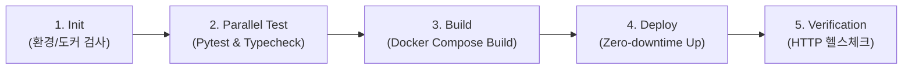

# 🛡️ SafePulse 360
### 조직 안전문화 & 리더십 다면진단 및 컨설팅 풀스택 플랫폼

> **기반 교재**: Elsevier (2019) 『Safety Culture』 (저자 James Roughton, Nathan Crutchfield 등) Chapters 1 ~ 9  
> **핵심 설계 원칙**: 교재 원문 및 서브노트 엄밀 준수, RAA 삼원조 진단, ONA 3단계 영향력 법칙, 법령 연계 KPI 6대 원칙, 공정 결과관리(Consequence Management)

---

## 🌟 주요 기능 모듈

### 0. 회사별 온보딩 & 산업 분야 맞춤형 자가진단 (NEW!)
* **회사 등록 및 산업 분야 선택**:
  * `제조업`, `건설업`, `화학·석유화학`, `운송·물류`, `공공·소방·방재`, `서비스·기타` 등 6개 업종 선택
  * 업종별 벤치마크 점수 및 중점 관리 위험(끼임, 추락, 화재폭발, 충돌 등) 자동 매핑
* **모바일 & 웹 동시 최적화 반응형 설문 마법사 (Survey Wizard)**:
  * **상단 고정 Sticky Bar**: 실시간 진행률(%), 현재 문항 번호, 회사명 뱃지, `중간 임시저장` 버튼 상시 노출
  * **대형 터치 친화적 1~5점 카드**: 모바일에서 엄지손가락으로 쉽게 선택하고 자동 스무스 스크롤 이동
  * **중간 임시저장 및 이어하기**: 언제든 창을 닫고 다시 접속해도 이전 답변과 단계 완벽 복원
* **진단 완료 후 맞춤형 종합 진단 보고서 (Company Report)**:
  * [회사명]의 동종 업계 평균 벤치마크 대비 성숙도 비교 게이지
  * RAA 삼원조 레이더 차트 & 8대 리더십 기대치 성과 분석
  * 업종 특화 법령 조문 및 3단계(30-90-180일) 안전문화 처방전 자동 생성 및 원클릭 PDF 출력

### 1. RAA 삼원조(Triad) 및 360° 리더십 다면진단 (Chapter 7)
* **에드가 샤인 명제 및 RAA 트라이어드**:
  * **궁극적 책임(Responsibility)**: 리더십의 불가피한 결과 책임 (부하 직원에게 전가 불가)
  * **하향 위임 권한(Authority)**: 현장 관리감독자 및 작업자의 위험 작업중지권(Stop-Work Authority)
  * **직무 책무성(Accountability)**: 합의된 직무 수행 및 해명 의무
* **삼원조 불균형 조기 감지**:
  * `권한 결여형 (Authority Deficit)`: 과중한 책임 대비 권한 위임 부재
  * `책임 전가형 (Blame Culture)`: 실패를 부하 탓으로 돌리는 병리적 조직
* **미 육군 FM 6-22 8대 리더십 기대치 평가 (Table 7.1)**:
  * 비전 수립, 윤리적 나침반, 학습/적응, 위험/기회 균형, 고성과 팀, 권한 위임, 차세대 리더 육성, 전방위 투명 소통
* **관리자(환원주의·통제) vs 리더(전체론·비전) 역할 비율 진단**

### 2. 조직 네트워크 분석 (ONA - Chapter 3)
* **3단계 영향력의 법칙 (Three Degrees of Influence - Christakis & Fowler)**:
  * 1-Hop(직접 동료), 2-Hop(동료의 친구), 3-Hop(친구의 동료)까지 파급되는 안전 규범 영향력 점수 산출
* **D3.js 기반 인터랙티브 토폴로지 시각화**:
  * 비공식 안전 오피니언 리더(Opinion Leaders) 및 정보 소통 브릿지(Key Bridges) 탐색
  * 안전 소통망에서 소외된 고립 노드(Isolated Nodes, 협력사/신임 직원) 감지 및 경고

### 3. 생애주기·법령 매핑 현장 KPI 빌더 (교수님 6대 원칙)
* **생애주기 단계화**: 예방(Prevention) - 대비(Preparedness) - 대응(Response) - 복구(Recovery)
* **조문 단위 법적 근거 강제 매핑**: 산업안전보건법(제36조, 제52조, 제64조 등) 및 중대재해처벌법 시행령 제4조 연계
* **전략적 가중치 배분**: 고유 지표(Inherent 70%) vs 협업 지표(Collaborative 30%)
* **서브노트 표/그림 판단 근거 연계**: Ch 7 Table 7.1, JHA 4단계 전환 메커니즘 직접 바인딩

### 4. 공정한 결과관리(Consequence) 및 3단계 로드맵 (Chapter 7)
* **긍정적 결과관리(Positive Reinforcement)**: 잠재위험 선제 제보 및 안전 코칭 인정 포상
* **시정 및 교정적 피드백(Constructive Feedback)**: 휴먼 에러 무조건 징계 금지 및 근본 원인 분석(RCA) 의무화
* **단계별 액션 플랜**: 30일 즉시 실행(Quick Wins), 90일 체계 정착, 180일 문화 내재화 로드맵

---

## 🛠️ 기술 스택 (Tech Stack)

* **Frontend**: Next.js 16 (App Router, React 19) + TypeScript + Tailwind CSS v4
  * **차트 및 시각화**: Recharts (Radar / Bar Charts), D3.js (Force-Directed Graph)
  * **아이콘**: Lucide React
* **Backend**: FastAPI (Python 3.11+)
  * **네트워크 분석**: NetworkX
  * **데이터 검증**: Pydantic v2
* **개발 서버 통합 제어**: Shell Script (`dev.sh`)

---

## 🚀 빠른 시작 가이드 (Quick Start)

### 1. 로컬 개발 서버 실행
```bash
./dev.sh
```
* **프론트엔드 개발 포털**: `http://localhost:3000`
* **백엔드 대화형 API 문서 (Swagger)**: `http://localhost:8000/docs`

---

## 🐳 Docker 컨테이너 배포 및 운영

### 1. 컨테이너 빌드 및 백그라운드 가동
```bash
# 도커 컴포즈 빌드 & 실행
docker compose up -d --build
```
* **프론트엔드 서비스**: `http://localhost:3001` (Next.js Standalone Runner)
* **백엔드 서비스**: `http://localhost:8000` (FastAPI + Uvicorn)
* **헬스체크 확인**:
  ```bash
  docker compose ps
  ```

### 2. 컨테이너 중지 및 로그 확인
```bash
# 실시간 컨테이너 로그 확인
docker compose logs -f

# 서비스 안전 종료
docker compose down
```

---

## 🔄 Jenkins CI/CD 자동화 파이프라인

루트 디렉토리에 **산업 표준 Declarative Pipeline(`Jenkinsfile`)**이 구축되어 있습니다.



### 파이프라인 단계별 세부 수행 내용:
1. **Init**: Docker 및 Docker Compose 버전 확인
2. **Parallel Test**:
   - `Backend`: `pytest tests/test_api.py -v` (RAA 삼각점수, ONA 3단계 영향력, KPI, 로드맵 자동 검증)
   - `Frontend`: `npx tsc --noEmit` (TypeScript 정적 타입 유효성 검증)
3. **Docker Build**: 멀티스테이지 Dockerfile을 통해 캐시 최적화 빌드
4. **Deploy**: `docker compose up -d` 컨테이너 자동 재배포
5. **Verification**: 백엔드(8000) 및 프론트엔드(3001) HTTP 200 응답 헬스체크 (최대 10회 재시도)
6. **Post Cleanup**: 빌드 성공 알림 및 미사용 댕글링(Dangling) 이미지 자동 정리

### 젠킨스 서버 로컬 기동 (선택 사항)
로컬에서 젠킨스 파이프라인을 테스트하려면 제공된 `docker-compose.jenkins.yml`을 실행할 수 있습니다:
```bash
docker compose -f docker-compose.jenkins.yml up -d
```
* **젠킨스 웹 콘솔**: `http://localhost:8080` (호스트의 docker.sock 마운트 지원)

