# Chapter 1 Defining the Perception of Safety (안전 지각의 정의) 서브노트

> *"조직문화는 대단히 중요하다. 경영진이 구성원을 대우하기로 선택하는 방식은—좋든 나쁘든—모든 것에 직접적인 영향을 미친다."*  
> — **사이먼 시넥 (Simon Sinek)**  
> 
> *"사물을 바라보는 방식을 바꾸면, 당신이 바라보는 사물이 바뀐다."*  
> — **웨인 W. 다이어 (Wayne W. Dyer)**  
> 
> *출처: Safety Culture (Elsevier, 2019, pp. 3-33), PART I Laying the Foundation, Chapter 1*  
> *DOI: https://doi.org/10.1016/B978-0-12-814663-7.00001-7*

---

## 1. INTRODUCTION (도입)

조직의 안전문화(Safety Culture)를 확립하고 지속적으로 개선하기 위해서는 안전한 작업 환경을 보장하기 위한 잠재력을 향상시키는 **다학제적 접근(Multidiscipline Approach)**이 필수적입니다. 리더십은 달성해야 할 과업에 대한 명확한 비전을 제시하고, 안전을 위한 바람직한 조직 분위기(Organizational Climate)를 달성하기 위해 공통 목표에 집중함으로써 **안전에 대한 지각(Perception of Safety)**을 주도적으로 견인할 수 있습니다.

### 1.1 안전문화 구축을 위한 실행 활동 영역
안전문화 향상을 위한 구체적 실행 방법은 다음과 같은 광범위하고 체계적인 활동들을 망라합니다:
* **안전경영시스템(SMS, Safety Management System)의 선정 및 적용**
* **인적 오류 성과(Human Error Performance)의 정밀 측정 및 분석**
* **다계층 소통(Multilevel Communication) 체계의 지속적 개선**
* **위험(Hazard) 및 손실(Loss) 분석, 종합적 리스크 평가(Risk Analysis)**
* **법적 규제 및 규정 준수(Regulatory Compliance) 모니터링**

### 1.2 안전의 '브랜드(Brand)' 가치와 인식 전환의 필요성
* 안전문화가 성공적으로 뿌리내리고 유지되기 위한 가장 중요한 전제조건은 **경영 리더십 팀과 현장 직원 모두가 "안전이 무엇을 수반하는지"에 대해 긍정적인 지각(Positive Perception)과 깊이 있는 이해**를 갖추는 것입니다.
* 안전은 조직 내부에서 고유한 **'브랜드(Brand)'**를 형성하고 있습니다. 경영진과 직원들이 안전이라는 브랜드를 현재 어떻게 지각하고 있는지를 객관적으로 규명해야 합니다.
* 안전문화 혁신의 핵심 과제는 바로 **기존에 고착화된 안전 브랜드를 비판적으로 재검토하고 도전(Challenge)하여 새롭게 재정립하는 것**입니다.

---

### [Observation 1] 동적 조직과 전통적 안전 프로세스의 충돌, 그리고 패러다임 전환

* **동적 조직 vs. 정적 프로세스의 충돌**:  
  조직은 결코 정적(Static)이지 않으며 끊임없이 요동치고 변화(Flux and change)합니다. 반면, 전통적인 안전 프로세스는 불변의 안정성(Stability)을 지향하며 영구적이고 변하지 않는 규칙 체계를 구축하려는 경향이 있습니다. 그 결과, 조직 내부에서 안전에 대한 지각은 **'개선과 성공을 지지하는 조력자(Advocate for improvement)'**가 아니라 **'변화와 발전을 가로막는 반대자(Opponent of change)'**로 각인되기 쉽습니다. 이러한 대립 구도는 안전 전문가와 경영 리더십 팀 사이에 적대적 관계(Adversarial relationship)를 형성하는 근본 원인이 됩니다.
* **"규칙만 따르면 안전하다"는 편협한 통념의 한계**:  
  심층적인 '안전의 문화'를 구축하는 것은 대단히 복잡하며 명확히 정의하기 어렵습니다. 현장의 보편적인 지각은 "단순히 규정과 수칙만 잘 지키면 안전을 달성할 수 있다"는 수준에 머물러 있습니다.  
  > *"안전 규칙이 사람을 안전하게 만들어준다는 막연한 믿음이 존재하지만, 정작 사고 위험을 줄여주는 실체는 규칙 자체가 아니라 **'규칙을 실행하고 준수하는 실제 행동(the act of following the rules)'**이다."*  
  > — **포터 (Potter, 2018)**
* **안전 전문가의 전략적 역할 전환 (Shift in Function)**:  
  과거에는 안전 전문가가 단순히 안전 관련 규정이나 정보를 전달하는 '안전 정보 자원(Safety Information Resource)'에 머물렀다면, 현대의 안전 전문가는 **안전경영시스템을 능동적으로 배포하고 조직을 이끄는 '전략적 플레이어(Strategic Player)'**로 전환되어야 합니다.
* **고대 중국 속담 (Maimonides, 2018)**:  
  > *"물고기 한 마리를 주면 하루를 먹여 살릴 수 있지만, 물고기 잡는 법을 가르쳐주면 평생을 먹여 살릴 수 있다."*  
  > *(If you give a man a fish, you feed him for a day. If you teach a man to fish, you feed him for a lifetime.)*
* **정보 유통 환경의 변화와 신속 대응 커뮤니케이션망의 필요성**:  
  오늘날 인터넷 검색 엔진과 소셜 미디어의 발달로 누구나 안전 정보를 즉시 검색할 수 있으며, 불만이나 위험 징후가 SNS를 통해 외부로 순식간에 확산될 수 있습니다. 따라서 심각한 유해위험요인과 리스크 정보를 의사결정권자에게 신속·정확하게 전달하고 즉각 대응하는 소통 네트워크 구축이 안전 프로세스의 절대적 핵심 요소로 부상했습니다.
* **'무손실 무위험(No Loss No Risk)' 멘탈 모델의 오류 탈피**:  
  많은 조직이 과거 손실이나 부상 빈도가 낮다는 이유만으로 위험이 존재하지 않는다고 착각하는 **'무손실 = 무위험(No Loss No Risk)' 멘탈 모델**(Mental model, 2018)에 갇혀 있습니다. 그러나 잠재적 위험은 상존합니다. 따라서 과거 손실이나 부상 통계치에만 의존하는 사후적 방식을 벗어나, **ANSI Z10-2012(Occupational Health & Safety Management Systems)**가 권고하는 **리스크 기반 접근법(Risk-based approach)**으로 전면 전환해야 합니다.
* **멘탈 모델(Mental Model)의 정의**:  
  > *"멘탈 모델은 우리 주변의 세상으로부터 유입되는 수많은 자극과 정보를 단순화하고 구조화할 수 있게 해주는 지적 구조(Intellectual structures)이다. 이는 우리의 사고, 의사결정, 견해, 가치관, 신념을 형성하고 지지한다."*  
  > — **코크 (Koch, 2007)**

---

### 1.3 제1장의 4대 핵심 학습 목표

본 장을 학습한 후 안전 전문가는 다음 4가지 핵심 과제를 논의하고 현장에 적용할 수 있어야 합니다:
1. **'안전(Safety)'에 대한 자신만의 실무적 작동 정의(Personal working definition)를 수립할 수 있다.**
2. **지각(Perception)이 안전문화 형성에 결정적으로 중요한 이유를 논의할 수 있다.**
3. **조직 내부에서 안전이 현재 어떻게 지각되고 있는지 파악하고, 그것이 조직 전체에 미치는 긍정적·부정적 파급 효과를 식별할 수 있다.**
4. **안전에 대해 보편적으로 형성된 공통된 지각들과, 그러한 인식을 형성하게 만든 근본 원인을 규명할 수 있다.**

---

## 2. DEFINING SAFETY (안전의 정의)

안전의 정의는 안전문화를 개발하고 유지하는 데 가장 근본적인 영향을 미치는 핵심 쟁점입니다. 조직 내 모든 구성원이 '안전'이라는 단어와 그 쓰임새를 명확히 이해하고 있을 것이라는 막연한 가정은 사실과 다릅니다.

### 2.1 사전적 정의의 한계와 실무적 정의의 필요성
모호하거나 파편화된 안전 개념은 안전문화를 개선할 가능성을 심각하게 저하시킵니다. 다수의 안전 정의가 추상적이고 분석 불가능한 '본질(Essence)'만을 서술하고 있습니다. 안전은 누구나 직관적·실무적으로 이해할 수 있는 **작동 용어(Operational Terms)**로 명확히 정의되어야 합니다.

* **기존 일반 사전적 정의 (Safety, 2018)**:
  * *"안전이란 (1) 안전한 상태의 특성; (2) 위험이나 부상의 리스크로부터의 자유."*
  * *"안전이란 상해, 부상, 손실을 겪거나 초래하지 않는 안전한 상태."*
  * ➔ **한계**: 안전을 설명하기 위해 안전이라는 단어를 순환 참조(Circular definition)하고 있으며, "보면 안다(You know when you see it)"는 식의 직관에 의존하여 안전이 수반하는 본질을 규명하는 데 아무런 통찰을 제공하지 못합니다.
* **원문에서 제시하는 개선된 실무적 정의 (Safety, 2018)**:
  > *"고의적이든 사고에 의해서든 인명과 재산에 가해지는 위험, 리스크, 유해요소의 위협, 부상 또는 손실로부터의 **상대적 자유(Relative freedom)**."*
* **ANSI/ASSE Z590.3 (2011, Prevention through Design)의 공학적 정의**:
  * **안전(Safety)**: **"수용 불가능한 위험으로부터의 자유(Freedom from unacceptable risk)"**
  * **리스크(Risk)**: "유해위험요인과 관련된 사건이나 노출이 발생할 확률에 대한 추정치(An estimate of the probability of a hazard-related incident or exposure occurring)"
  * **유해위험요인(Hazard)**: "피해를 입힐 수 있는 잠재성(The potential for harm)"

### 2.2 상대적 위험 수용성 (Acceptable Risk)
ANSI Z590.3의 정의는 현실 실무에서 **상대적 수준의 위험 수용(Relative level of risk acceptance)**을 인정합니다. 강도 높은 위험 통제 조치를 취한 후에도 특정 직무나 과업에는 본질적인 위험 요소가 잔존할 수밖에 없습니다.
* **사례**: 소방관, 경찰관, 우주비행사, 군인, 석유/가스/광산 산업 종사자, 카레이서 등.
* 이들 직종의 위험은 사회적으로 필수적이거나 바람직한 활동의 목적을 달성하기 위해 사회적으로 수용 가능한 것으로 간주됩니다.
* 그러나 위험이 사회적으로 용인된다 하더라도, 가능한 모든 보호 장치와 정책 및 절차를 가동하여 **리스크를 가능한 최고 수준으로 지속 평가하고 통제해야 할 책임**은 면제되지 않습니다.

---

### [Observation 2] 윌리엄 몬탄테(William Montante)의 안전 정의와 현장 조사

리스크 통제 컨설턴트 윌리엄 몬탄테는 교육 과정 도입부에서 관리자들에게 안전의 정의를 묻곤 했습니다. 이는 윌리엄 라우런스(William W. Lowrance, 1976)의 고전 『Of Acceptable Risk』의 문제의식에 기반합니다:
> *"안전의 본질에 대해 널리 퍼진 혼란은 '안전'이라는 용어의 의미가 명확해질 때 비로소 해소될 것이다. **어떤 대상은 그 리스크가 '수용 가능한(Acceptable)' 것으로 판단될 때 비로소 안전하다.**"*  
> — **윌리엄 W. 라우런스 (Lowrance, 1976)**

* **몬탄테의 안전 정의 (Montante, 2006)**:
  > *"안전이란 리스크와 그로부터 파생된 유해위험요인이 **수용 가능하거나(Acceptable) 통제 하에 있다(In control)**고 판단되는 존재 상태(State of being)이다."*
* **단일 조직 내 안전 리더 130인의 응답 분석**:
  * 사고 또는 부상 예방
  * 위해나 상해로부터의 자유
  * 안전한 상태 유지
  * 주변 환경에 대한 경각심 유지
  * 다치지 않는 것
  * 안전이 제1의 가치(It's number one)
  * 절차와 규칙 준수
  * 마음가짐/존재 상태
  * 서로를 챙겨주는 것
  * OSHA 법규 준수
  * 출근했을 때 모습 그대로 퇴근하는 것
* **몬탄테의 핵심 결론 및 패러다임 전환**:
  * *"단순히 말해, 안전은 특정 시점에 수행하고 있거나 향후 수행하기로 선택한 행동에 내재된 **유해위험요인과 리스크를 허용 가능한 수준으로 제어하고 있다는 상태 또는 판단** 그 이상도 이하도 아니다."*
  * *"‘안전 제일(Safety First)’, ‘안전을 생각하자(Think Safety)’, ‘안전은 당신의 책임이다(Safety is your responsibility)’와 같은 **전통적 구호(Mantra)를 과감히 폐기하라.**"*
  * 대신 조직의 각 **'유해위험요인 제어 관리자(Hazard Control Manager)'**가 자신과 회사가 위험을 어떻게 완벽히 통제하고 있는지 확신을 갖고 입증할 수 있는 **개인적·조직적 숙달(Mastery)**을 지향해야 합니다.

### 2.3 안전 문제의 이면에 숨겨진 조직적 결함
안전이 올바르게 정의되면, 조직 내부의 숨겨진 구조적 문제점을 진단하는 강력한 렌즈가 됩니다:
1. 계획 수립의 부재 또는 부실
2. 현장 직원의 애로사항 및 우려에 대한 이해 부족
3. 소통(Communication) 부실 및 정보 단절
4. 비효율적인 교육훈련 구조 및 방식
5. 부실한 운영 유지보수(Operational maintenance)
6. 품질 저하, 기술적 결함 등

---

### [그림 1.1 및 그림 1.2 상세 분석] 소통 단절과 조직 퍼즐의 완성도

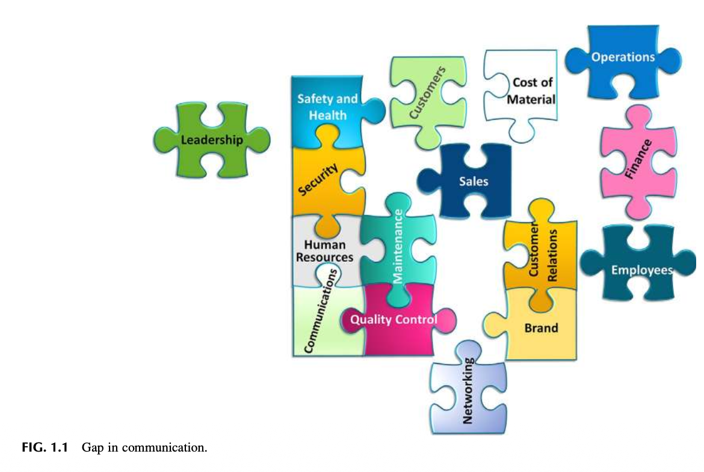

> **[그림 1.1 상세 보충설명: 소통의 단절로 해체된 조직 퍼즐]**
> * **이미지 구조 분석**: 조직을 구성하는 다양한 기능들이 퍼즐 조각으로 표현되어 있으나, 서로 완벽히 맞물리지 못하고 틈새(Gap)가 발생하여 해체된 상태를 보여줍니다.
>   * **분리·고립된 핵심 요소들**: **리더십(Leadership)**이 퍼즐 본체와 완전히 분리되어 좌측에 홀로 떠 있으며, 우측 외곽에는 **운영(Operations)**, **재무(Finance)**, **직원(Employees)** 퍼즐 조각이 바깥으로 밀려나 표류하고 있습니다.
>   * **파편화된 기능 조각들**: 안전보건(Safety and Health), 보안(Security), 인사(HR), 소통(Communications), 유지보수(Maintenance), 품질관리(Quality Control), 고객(Customers), 자재비용(Cost of Material), 영업(Sales), 고객관계(Customer Relations), 브랜드(Brand), 네트워킹(Networking) 등이 서로 유기적으로 결합하지 못하고 있습니다.
> * **핵심 이론적 의미**: 소통에 단절과 간극(Gap)이 발생하면 조직의 최고 의사결정권자인 리더십과 현장 직원, 운영 부서가 안전 프로세스로부터 완전히 고립됩니다. 안전문화가 유지되려면 조직 내 소통에 단 하나의 틈새도 존재해서는 안 됩니다.

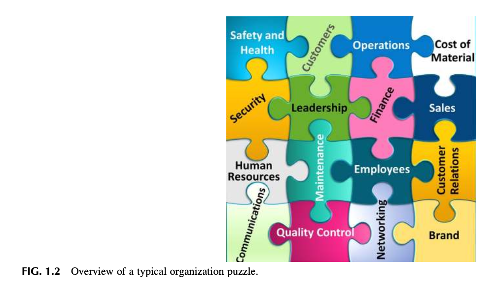

> **[그림 1.2 상세 보충설명: 완벽하게 맞물린 전형적인 조직 퍼즐]**
> * **이미지 구조 분석**: 그림 1.1에서 분리되었던 모든 퍼즐 조각들이 단 하나의 간극(Gap)도 없이 완벽하게 결합된 사각형 구조를 이룹니다.
>   * **리더십의 중심적 위치**: **리더십(Leadership)** 퍼즐 조각이 조직의 정중앙에 자리 잡아, 상부의 고객(Customers) 및 운영(Operations), 좌측의 보안(Security), 우측의 재무(Finance), 하부의 유지보수(Maintenance) 및 직원(Employees)과 빈틈없이 맞물려 있습니다.
>   * **안전보건의 통합**: 안전보건(Safety and Health)이 조직의 최상단에서 보안(Security) 및 고객(Customers)과 직결되어 전체 운영 시스템의 기초를 이룹니다.
> * **핵심 이론적 의미**: 고품질의 서비스와 제품을 생산하고 확고한 안전문화를 정착시키기 위해서는, 안전보건을 포함한 조직의 모든 요소가 소통을 매개로 유기적 사슬을 형성해야 함을 시각화합니다.

---

## 3. SAFETY AS AN EMERGENT PROPERTY (발현적 속성으로서의 안전)

저자들은 안전을 조직 전체 문화 내에서 발생하는 **'발현적 속성(Emergent Property)'**으로 정의합니다. 안전은 조직 내 수많은 상호연관된 프로세스와 하위 요소들이 결합되고 상호작용하는 과정에서 도출되는 최종 결과물입니다.

### 3.1 발현적 속성(Emergent Property)의 학술적 개념
* **정의 (Emergent Property, 2018)**:  
  *"하위 구성 요소들이 상호 제약적 관계(Constraining relations) 속에서 결합하여 상위 수준의 복합 객체를 '구성'할 때 새롭게 '출현(Emerge)'하는 독특한 속성이며, 두 개 이상의 단순 구성 요소 결합으로부터 예측 불가능하게 발생하는 새로운 특성."*
* **조직문화와의 연계**:  
  조직 구성원들이 어떻게 반응하고, 어떻게 협력하며, 무엇을 믿고, 어떻게 소통하는지에 따라 **'안전한 환경'이 발현될 수도 있고, 반대로 '불안전한 환경'이 발현될 수도 있습니다.**

### 3.2 웬델 프렌치 & 세실 벨(French & Bell, 1984)의 6대 연동 영역 모델 (FIG. 1.3)

프렌치와 벨은 고전 명저 『Organizational Development: Behavioral Science Interventions for Organizational Improvement』에서 조직 개선을 위한 6대 상호 연동 영역을 제시했습니다:

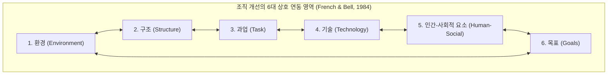

> **[그림 1.3 상세 보충설명: 조직 개발의 6대 상호 연동 영역 (French & Bell, 1984)]**
> * **6대 핵심 구성 요소**:
>   1. **환경 (Environment)**: 외부 규제, 시장 경쟁, 사회적 요구 등 거시적 외부 환경
>   2. **구조 (Structure)**: 조직도, 권한 배분, 공식적 책임 및 의사소통 라인
>   3. **과업 (Task)**: 조직이 수행하는 구체적인 직무, 작업 공정 및 절차
>   4. **기술 (Technology)**: 설비, 기계, 컴퓨터 시스템, 생산 도구
>   5. **인간-사회적 요소 (Human-Social)**: 가치관, 대인관계, 규범, 태도, 동기부여
>   6. **목표 (Goals)**: 조직의 공식 비전, 미션, 전략적 운영 목표
> * **발현적 안전 모델의 함의**: 이 6대 영역 간에 단 하나라도 **정렬 불일치(Misalignment)**나 결손된 관계(Missing relationships)가 발생하고 여기에 고유 위험(Inherent hazards)이 결합하면, 치명적인 간극(Gap)이 발생하여 손실 초래 사고의 확률이 급격히 증가합니다.

### 3.3 안전 전문가 역할의 근본적 패러다임 변화
* **과거**: 단순한 법적 규제 프로그램 관리, 개별적인 전통 안전 프로그램 수립에 치중.
* **현대(발현적 속성 모델)**: 조직 전체 관점에서 고유 위험과 관련 리스크가 **'수용 가능한 제어 상태(State of Acceptable Control)'**를 유지하도록 시스템 전체를 설계·개선하는 조직적 접근법(Organizational approach)으로 전환.
* **심화 성찰 질문**:  
  *"수용 가능한 제어(Acceptable Control)란 무엇인가? 그리고 그것은 누구의 관점인가? 내부? 외부? 조직의 각 계층? 지역사회? 정치적 관점? 엔지니어링? 영업?"*

---

## 4. THE PERCEPTION OF SAFETY (안전 지각)

조직의 경영진과 관리자들은 조직의 성공을 달성하기 위해 끊임없이 의사결정을 내립니다. 리더십의 의사결정은 조직 안팎에서 유입되는 방대한 정보의 지속적 흐름(Data stream)에 기반합니다.

### 4.1 리더십 의사결정 스트림과 안전 정보의 통합
* 리더십이 내리는 결정은 유입되는 정보에 기반하며, 이는 비즈니스 상황과 안전 노력에 대한 인식을 형성합니다.
* **안전경영시스템(SMS)에서 생성된 정보가 이 의사결정 데이터 스트림에 필수적으로 포함되어야** 유해위험요인과 리스크를 허용 한도 내로 유지할 수 있습니다.
* 만일 리더십의 관심이 지속적인 위험성평가가 아니라 **'과거 손실 통계(Loss history)'**에만 머물러 있다면, 심각한 대형 손실의 잠재력을 과소평가하게 됩니다.
* 한정된 시간과 예산 속에서 리더십은 현재 비즈니스 목표를 달성하는 데 가장 적합하다고 판단되는 활동에만 주의(Attention)를 집중합니다.

---

### [그림 1.4 상세 분석] 리더십의 주의를 끄는 경쟁 구도

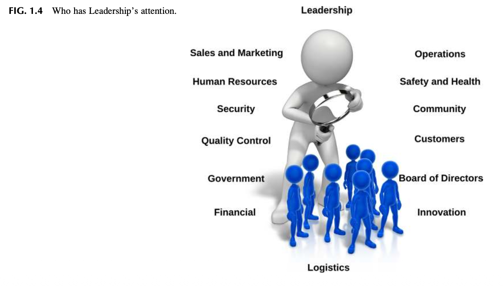

> **[그림 1.4 상세 보충설명: 리더십의 관심과 자원을 차지하기 위한 조직 간 각축]**
> * **이미지 구조 분석**: 거대한 리더십 인물이 돋보기(Magnifying glass)를 들고 하단의 수많은 조직 부서 인물들을 내려다보고 있습니다.
>   * 리더십의 시선을 끌기 위해 경쟁하는 부서들: 영업 및 마케팅(Sales and Marketing), 인사(Human Resources), 보안(Security), 품질관리(Quality Control), 정부 규제(Government), 재무(Financial), 운영(Operations), **안전보건(Safety and Health)**, 지역사회(Community), 고객(Customers), 이사회(Board of Directors), 혁신(Innovation), 물류(Logistics).
> * **핵심 이론적 의미**: 한정된 자원과 시간 속에서 각 부서는 자신의 요구가 최우선이라고 확신합니다. 안전 전문가는 데이터와 의사결정의 소용돌이 속에서 다른 모든 전문 분야들과 경쟁하며 리더십의 관심을 이끌어내야 합니다. 이를 위해서는 위험과 리스크에 관한 핵심 정보가 왜곡 없이 조직 네트워크를 통해 신속히 전달되도록 소통 구조를 설계해야 합니다.

### 4.2 지각(Perception)의 정의와 직무기술서의 한계
* **지각의 정의 (Schermerhorn, Hunt, Osborn, & Osborn, 2004)**:  
  > *"인간이 주변 세상으로부터 들어오는 정보를 선택(Select), 조직화(Organize), 해석(Interpret), 검색(Retrieve), 그리고 반응(Respond)하는 인지적 과정."*
* **"모든 안전 활동은 안전 관리자의 책임"이라는 지각의 왜곡**:  
  조직 내에는 여전히 안전 관리자가 조직의 모든 '안전' 활동을 도맡아 해야 한다는 잘못된 인식이 팽배합니다. 통상적인 직무기술서는 안전 관리자가 수행해야 할 방대한 기술 목록만 나열할 뿐, 정작 필수적인 **공식 권한(Authority)과 리더십 역할**을 명시하지 않습니다.
* 그러나 앞서 규명했듯 **안전이 조직의 발현적 속성(Emergent Property)이라면, 단 한 사람의 개인이 조직 전체의 안전문화를 온전히 책임질 수는 없습니다.**

---

### [Observation 3 & 그림 1.5] 에잇볼 뒤에 갇힌 안전 관리자

* **현장 관찰**: 저자 제임스는 아무런 지침이나 오리엔테이션도 없이 안전 관리자로 갓 승진하여 "알아서 알아내라(Figure it out)"는 통보를 받은 동료 안전 관리자의 고충을 접했습니다. 그는 자신이 **'에잇볼 뒤에 갇힌 상태(Behind the 8 ball: 절망적이고 불리한 패배의 포지션)'**에 놓여 있다고 호소했습니다. 이는 산업 현장의 안전 관리자들에게 매우 흔하게 발생하는 현실입니다.

> **[그림 1.5 상세 보충설명: 불리한 코너에 몰린 신임 안전 관리자 (Behind the Eight Ball)]**
> * **비유적 배경**: 당구 경기에서 목적구를 칠 수 없게 검은색 8번 공 뒤에 가로막힌 매우 불리한 상황(In a bad situation, in a losing position)을 뜻하는 관용구입니다.
> * **실무적 함의**: 권한과 지침 없이 막중한 안전 책임만 떠안은 신임 안전 관리자가 조직 내에서 겪는 고립무원과 구조적 취약성을 극명하게 보여줍니다.

---

## 5. HOW IS THE SAFETY PROFESSIONAL PERCEIVED IN AN ORGANIZATION? (안전 전문가는 조직에서 어떻게 지각되는가?)

### 5.1 직업적 고정관념(Stereotype)과 부정적 이미지
은행원, 엔지니어, 교사, 경찰관 등 대부분의 직업에는 고유한 고정관념이 따릅니다. 그러나 '안전 관리자(Safety Manager)'라는 직함은 역사적으로 오랜 세월 누적된 **부정적 이미지의 고정관념**을 즉각 소환합니다.

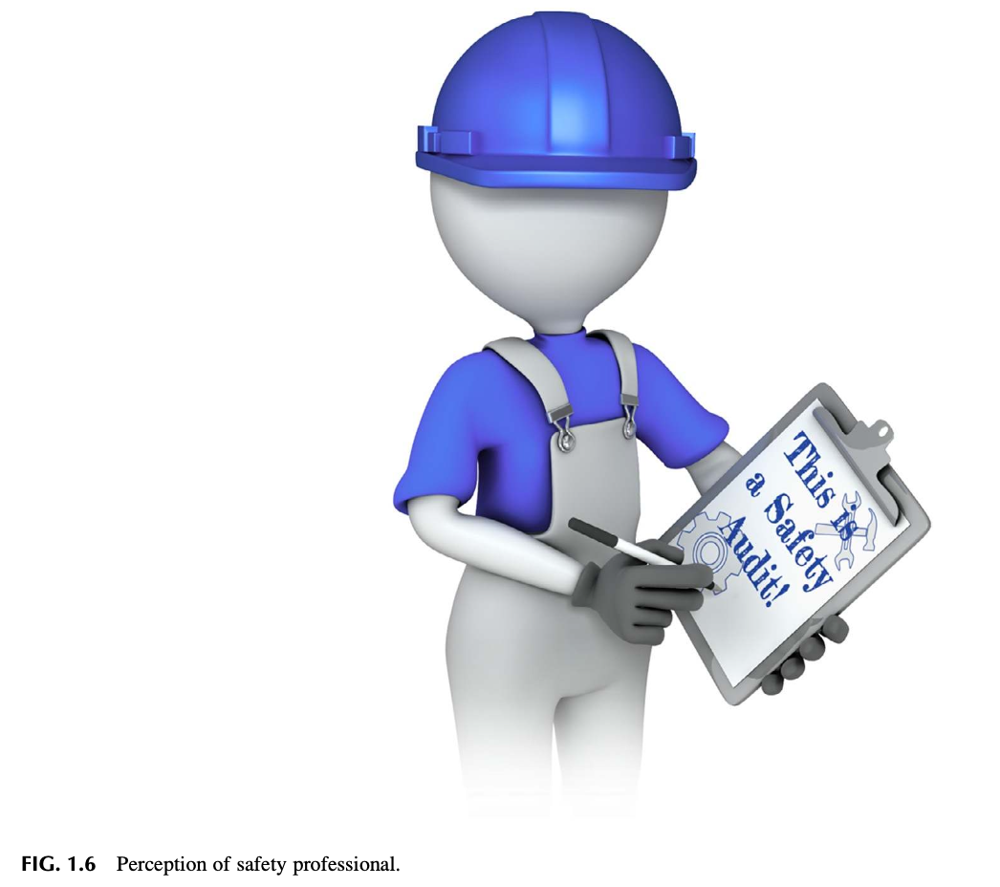

> **[그림 1.6 상세 보충설명: 안전 전문가에 대한 고착된 고정관념 이미지]**
> * **이미지 구조 분석**: 파란색 안전모를 쓰고 작업 멜빵바지를 입은 캐릭터가 클립보드를 들고 서 있습니다. 클립보드에는 **"This is a Safety Audit! (이것은 안전 감사다!)"**라는 문구와 망치, 렌치 등 작업 공구 아이콘이 그려져 있습니다.
> * **부정적 고정관념의 본질**: 현장을 어슬렁거리며 불안전한 행동이나 결함을 적발하고, 규정을 달달 외우며 오로지 개인보호구(PPE) 착용만을 강요하는 사람으로 각인되어 있습니다.
> * **극복 과제**: 개인보호구 착용을 독려하고 현장 상태를 메모하는 것 자체가 틀린 것은 아니지만, 인식이 여기에만 머문다면 경영진은 안전 전문가가 제공할 수 있는 장기적인 **전략적 가치(Strategic Value)**를 결코 인정하지 않게 되며, 안전 전문가는 조직 내에서 영원히 적대적(Adversarial) 위치에 머물게 됩니다.

---

### [Observation 4] 언어 불일치와 경영 컨설턴트의 질문

* **경영 컨설턴트가 저자 네이선에게 던진 질문**:  
  *"기업에서 손쉽게 따르고 적용할 수 있는 안전 알고리즘이 있습니까? 우리가 관리하는 고객사의 안전 관리자들이 고위 임원직으로 승진했을 때 큰 문제가 발생합니다. **그들은 다른 경영진들과 같은 언어(Business Language)를 구사하지 못합니다.** 최고경영진이 우리에게 묻습니다. '도대체 저 사람들이 무슨 말을 하는 겁니까? 우리는 그들이 하는 말을 전혀 이해할 수 없습니다!'”*
* **교훈**: 안전 전문가가 조직의 비즈니스 언어와 경영진의 소통 방식을 체득하지 못하면, 아무리 전문성이 뛰어나도 조직의 핵심 리더십으로 수용될 수 없습니다.

---

## 6. PERCEPTION COMES FIRST (지각이 최우선이다)

사람이 방에 들어서거나, 회의를 주재하거나, 보고서를 제출할 때 풍기는 전문적 이미지(Professional Image)는 그가 제시하는 아이디어와 개념이 어떻게 수용될지를 직접적으로 결정합니다.

### 6.1 이그제큐티브 프리젠스 (Executive Presence)
> *"이그제큐티브 프리젠스는 직관적이고 명확히 규정하기 어렵지만, 궁극적으로는 **성숙한 자신감(Mature self-confidence)**을 보여줄 수 있는 능력으로 귀결된다. 즉, 어렵고 예측 불가능한 상황을 통제하고, 적시에 결단을 내리며, 경영진의 재능 있고 고집 센 다른 임원들과 당당히 어깨를 나란히 할 수 있는 역량이다."*  
> — **비슨 (Beeson, 2012)**

---

### [표 1.1 상세 분석] 안전 목표와 리더십 목표 간의 핵심 신념 차이

이전 안전 담당자가 남겨놓은 잔존 이미지(Lingering image)는 극복해야 할 장애물이 되기도 합니다. 표 1.1은 안전 부서와 경영진 간의 인식 차이를 정밀하게 대비합니다:

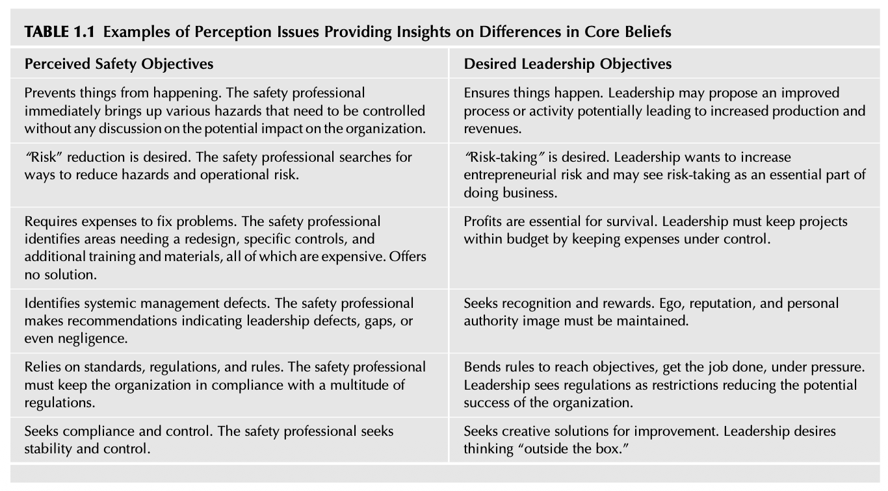

| 번호 | 안전 측면에서 지각된 목표 (Perceived Safety Objectives) | 경영진이 지향하는 실제 목표 (Desired Leadership Objectives) |
| :---: | :--- | :--- |
| **1** | **사건의 발생을 사전에 방지(Prevents)한다.** 안전 전문가는 조직에 미칠 경영상 파급효과는 고려하지 않고 즉각 통제해야 할 유해위험요인만 꺼내 든다. | **일이 되게끔 만든다(Ensures things happen).** 리더십은 잠재적으로 생산성과 매출을 증대시킬 수 있는 개선된 공정과 활동을 추진하고자 한다. |
| **2** | **'리스크 감축(Risk Reduction)'을 갈망한다.** 안전 전문가는 잠재적 위험요소와 운영상의 리스크를 어떻게든 줄일 방법만 모색한다. | **'위험 감수(Risk-Taking)'를 원한다.** 리더십은 기업가적 리스크를 감수하고자 하며, 위험 감수를 비즈니스 수행의 본질적 요소로 인식한다. |
| **3** | **문제 해결을 위해 막대한 비용 지출(Expenses)을 요구한다.** 공정 재설계, 특수 방호장치, 추가 교육훈련 등 막대한 비용이 드는 점만 지적하고 대안적 해결책을 제시하지 못한다. | **생존을 위해 수익성(Profits) 확보가 절대적이다.** 리더십은 비용을 엄격히 통제하여 프로젝트가 예산 범위 내에서 운영되도록 관리해야 한다. |
| **4** | **체계적인 관리적 결함(Management Defects)을 들춰낸다.** 경영진의 과실이나 시스템 결손을 부각하는 권고사항을 남발한다. | **인정과 보상(Recognition and Rewards)을 추구한다.** 자신의 명성과 권위, 대외적 이미지를 유지·보호받기를 원한다. |
| **5** | **표준, 법적 규정, 사내 규칙에만 전적으로 의존한다.** 수많은 법적 규제에 조직을 억지로 끼워 맞추려고만 한다. | **목표 달성과 압박 속에서 규칙을 유연하게 조정(Bends rules)하고자 한다.** 규제를 조직의 잠재적 성공을 저해하는 번거로운 제약으로 여긴다. |
| **6** | **규정 준수(Compliance)와 안정적 통제(Control)를 지향한다.** 현상의 안정성과 엄격한 통제만을 고수한다. | **개선을 위한 창의적 해결책(Creative solutions)을 추구한다.** 틀에서 벗어난 사고(Outside the box)와 혁신을 원한다. |

> **[표 1.1 상세 보충설명: 핵심 신념의 간극이 초래하는 오해]**  
> 안전 전문가가 위험 감수, 수익성, 창의적 대안이라는 비즈니스 현실을 이해하지 못하고 일방적인 '제약(Prevention/Cost/Rule)'의 논리만 들이댈 때, 경영진과의 깊은 불신과 갈등이 촉발됩니다.

---

## 7. PERSONAL BRANDING (퍼스널 브랜딩)

조직의 브랜드가 고객에게 전달하는 가치와 인식을 결정하듯, 조직 내 개인 역시 직급과 무관하게 고유한 퍼스널 브랜드를 갖습니다.

### 7.1 안전 브랜드의 가치
* **세스 고딘 (Seth Godin, 2009)의 브랜드 정의**:  
  > *"브랜드란 소비자가 특정 제품이나 서비스를 다른 것 대신 선택하게 만드는 기대치, 기억, 스토리, 관계의 총체이다. 소비자가 기꺼이 웃돈을 지불하지 않거나, 선택하지 않거나, 입소문을 내지 않는다면 그 소비자에게 브랜드 가치는 존재하지 않는다."*

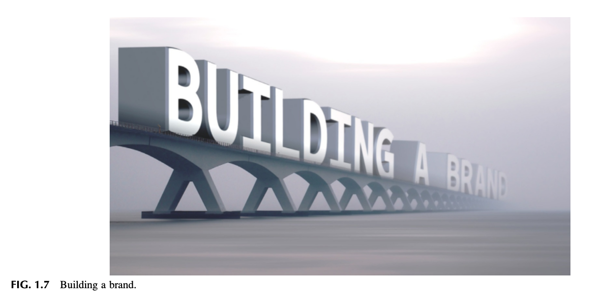

> **[그림 1.7 상세 보충설명: 브랜드 구축 (Building a Brand)]**
> * 거대한 다리(교량) 구조물 위에 웅장한 대형 입체 글자로 **"BUILDING A BRAND"**라는 문구가 끝없이 뻗어 있는 모습을 보여줍니다.
> * 퍼스널 브랜드를 구축하는 일은 하루아침에 이루어지는 것이 아니며, 견고한 교량을 건설하듯 지속적인 역량과 신뢰를 축적하여 조직과 연결 통로를 놓는 장기적 과정임을 상징합니다.

---

### [표 1.2 상세 분석] 안전 브랜드 점검 체크리스트

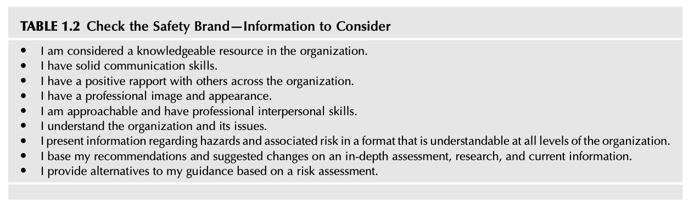

| 번호 | 안전 브랜드 자가 점검 항목 (Table 1.2) | 실무적 평가 기준 |
| :---: | :--- | :--- |
| **1** | 나는 조직 내에서 지식과 전문성을 갖춘 자원(Knowledgeable resource)으로 인정받는가? | 단순한 규정 전달자가 아닌 신뢰받는 지식 허브 역할 수행 여부 |
| **2** | 나는 탄탄하고 명확한 소통 역량(Solid communication skills)을 갖추고 있는가? | 상하좌우 모든 계층과 원활하고 명료하게 소통하는지 여부 |
| **3** | 나는 조직 전반의 다양한 사람들과 긍정적인 라포(Positive rapport)를 형성하고 있는가? | 타 부서 및 현장 작업자와의 신뢰 관계 구축 여부 |
| **4** | 나는 프로다운 이미지와 단정한 외모(Professional image and appearance)를 견지하는가? | 리더십에 걸맞은 단정함과 프로페셔널한 외양 유지 여부 |
| **5** | 나는 다가가기 쉽고(Approachable) 성숙한 대인관계 기술을 발휘하는가? | 현장 직원이 고충을 편안히 털어놓을 수 있는 태도 견지 여부 |
| **6** | 나는 조직 전체와 현재 직면한 경영 이슈(Issues)를 깊이 이해하고 있는가? | 비즈니스 생태계와 회사의 당면 경영 과제 파악 여부 |
| **7** | 나는 유해위험요인과 리스크 정보를 모든 직급이 이해할 수 있는 포맷으로 제시하는가? | 기술적 용어를 비즈니스 및 현장 용어로 가공하여 전달하는지 여부 |
| **8** | 나의 권고와 개선 제안은 심층 평가, 철저한 조사, 최신 데이터에 근거하는가? | 주관적 느낌이 아닌 객관적·과학적 데이터 기반 제안 여부 |
| **9** | 나는 리스크 평가에 근거하여 실현 가능한 복수의 대안(Alternatives)을 제공하는가? | 일방적 금지가 아닌 합리적 선택지를 경영진에 제공하는지 여부 |

---

### [Observation 5] 슈퍼맨 복장을 입었던 전임 안전 관리자

* **사례**: 저자 중 한 명이 새로운 안전 관리자 직책에 부임했을 때, 직원이 다가와 물었습니다. *"어떤 슈트를 입으실 건가요?"* 의아해하는 저자에게 직원은 답했습니다. *"전임 안전 관리자는 안전 행사 때마다 **슈퍼맨 슈트**를 입었습니다. 특별 안전 회의 때 어떤 옷을 입으실 건가요?"* 저자의 단호한 대답은 **"아무것도 안 입습니다(NONE!)"**였습니다.
* **시사점**: 광대 같은 이벤트나 유치한 전시성 복장은 안전 관리자의 전문적 브랜드를 완전히 훼손하며, 경영진과 직원들이 안전을 전문 경영 기능으로 진지하게 대우하지 못하게 만듭니다.

---

## 8. ORGANIZATIONAL FRICTION? (조직 내 마찰)

### 8.1 조직 마찰의 본질
* **마찰의 정의**:
  * *"서로 다른 생각, 희망 등으로 인해 사람들 사이에 발생하는 불화나 갈등(Dissension or conflict)"* (Friction, 2018)
  * *"사람들이 인생에서 성취하고자 하는 것을 가로막는 모든 장애물"* (Rosenblum & Berg, 2017)
* **발생 원인**: 부서마다 전문성, 철학, 우선순위가 상충되기 때문에 조직 마찰은 자연스럽게 발생합니다. 정렬되지 않은 목표를 추구할 때 마찰은 극대화됩니다.
* 안전 부서, 경영진, 현장 직원이라는 3대 주체가 안전에 대해 서로 다른 인식을 가질 때 조직 전체에 극심한 마찰이 발생합니다.

---

### [그림 1.8 상세 분석] 3대 주체의 톱니바퀴와 마찰 감소 오일캔

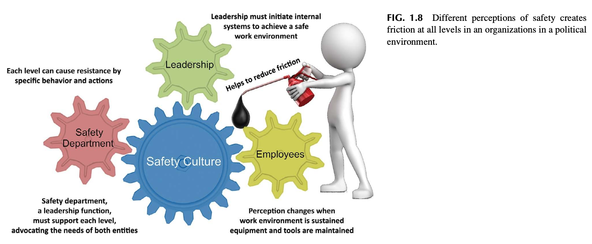

> **[그림 1.8 상세 보충설명: 정치적 환경에서 상이한 안전 인식이 유발하는 조직 마찰과 윤활 메커니즘]**
> * **이미지 구조 분석**:
>   * **3대 구동 톱니바퀴 (Gears)**:
>     1. **리더십 (Leadership - 녹색 기어)**: *"리더십은 안전한 작업 환경을 달성하기 위한 내부 시스템을 솔선하여 시작해야 한다."*
>     2. **안전 부서 (Safety Department - 분홍색 기어)**: *"리더십의 핵심 기능 중 하나인 안전 부서는 양쪽 주체(경영진과 직원)의 요구를 모두 대변하며 각 계층을 지원해야 한다."*
>     3. **직원 (Employees - 노란색 기어)**: *"작업 환경이 안정적으로 유지되고 장비와 공구가 정비될 때 안전에 대한 직원들의 인식이 긍정적으로 변화한다."*
>   * **중앙의 중심 톱니바퀴**: 세 기어가 맞물려 회전시키는 중앙의 거대한 파란색 기어는 **안전문화 (Safety Culture)**입니다.
>   * **마찰과 저항**: *"각 계층은 특정 행동과 조치를 통해 저항(Resistance)을 유발할 수 있다."*
>   * **오일캔을 든 인물 (윤활유 공급)**: 우측의 캐릭터가 주유기(Oil can)를 들고 톱니바퀴 접점에 검은색 기름을 주입하고 있습니다: **"마찰을 줄이는 데 도움을 준다 (Helps to reduce friction)."**
> * **핵심 이론적 의미**: 세 주체가 소통과 상호 이해를 통해 마찰을 줄이지 않으면 기어는 맞물려 돌아가지 않고 부서집니다. 리더십의 확고한 지원과 열린 소통이 바로 톱니바퀴의 회전을 부드럽게 만드는 윤활유 역할을 합니다.

---

## 9. WHAT IS THE ORGANIZATION’S MENTAL MODEL FOR SAFETY? (안전에 대한 조직의 멘탈 모델은 무엇인가?)

멘탈 모델은 외부 자극을 조직화하는 내면의 지적 구조입니다.
* **피터 센게 (Peter Senge, 2006 『The Fifth Discipline Handbook』)**:  
  *"멘탈 모델이란 우리 자신, 타인, 조직, 그리고 세상의 모든 측면에 대해 우리 머릿속에 품고 있는 이미지, 가정, 그리고 스토리들이다."*
* **제이 라이트 포레스터 (Jay Wright Forrester)**:  
  *"우리 머릿속에 담고 있는 세상의 이미지는 단지 모델일 뿐이다. 머릿속에 현실의 전체 시스템을 그대로 담고 있는 사람은 없다. 단지 몇 가지 선택된 개념과 그들 간의 관계를 바탕으로 현실 시스템을 표상할 뿐이다."*

### 9.1 안전 관리 스타일과 멘탈 모델 진단 질문
1. 주요 관심사가 오로지 법적 규제 준수, 규칙, 규정에만 머물러 있는가?
2. 필요한 경우에만 최소한으로 대응하는 소극적 안전 접근법인가?
3. 리더십이 주도하는 조율되고 통일된 접근법을 따르고 있는가?
4. 현재의 안전 프로세스가 조직의 비전 및 미션과 충돌하는 것으로 인식되고 있는가?

---

### [Observation 6] 거짓말 탐지기를 동반한 안전 부서의 비극

* **현장 사례**: 저자 중 한 명이 근무했던 기업의 본사 안전 부서는 '기업 보안(Security)' 업무를 겸임하고 있었습니다. 안전 요원들은 제품 도난 사건을 조사하기 위해 공장을 방문하여 **직원들을 대상으로 거짓말 탐지기 심문**을 벌였고, 거짓말이 드러난 직원을 해고했습니다. 그리고 며칠 뒤 같은 요원들이 다시 공장을 방문하여 *"개선이 필요한 안전 사항에 대해 솔직한 의견을 달라"*며 안전 평가 면담을 시도했습니다.
* **결과**: 현장 직원 중 누구도 안전 요원에게 입을 열지 않았으며, 그 어떤 협조도 거부했습니다. 신뢰가 붕괴된 멘탈 모델 속에서는 안전 소통이 완전히 마비됩니다.

---

## 10. SAFETY, A MULTIDISCIPLINARY PROFESSION (다학제적 전문 직무로서의 안전)

안전 전문가는 조직의 규모와 범위에 따라 다양한 모자(Many hats)를 바꿔 써야 하는 다학제적 전문가입니다.

---

### [그림 1.9 상세 분석] 긴급대응지휘체계(ICS) 기반 안전경영 조직 구조도

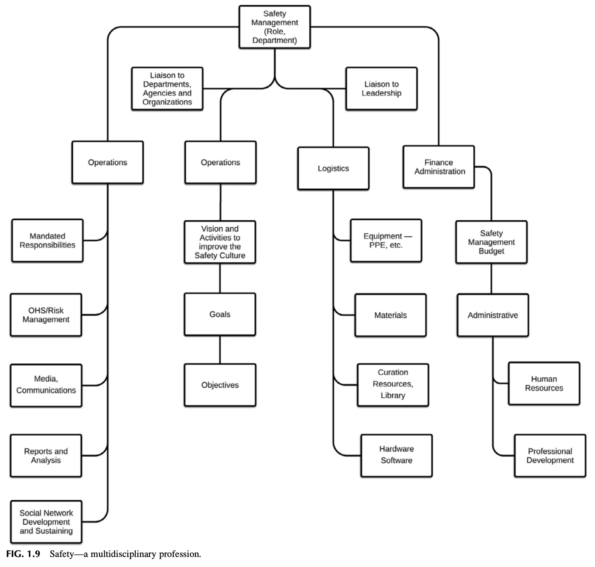

> **[그림 1.9 상세 보충설명: FEMA 재난현장지휘체계(ICS)를 차용한 안전경영의 다학제적 기능 분화]**
> * **이미지 구조 분석**: 연방긴급관리국(FEMA)의 일반 참모 기능(General Staff Function) 및 현장지휘체계(ICS) 모델을 안전경영 직무에 투영한 조직도입니다.
> * **최상위 컨트롤 타워**: **Safety Management (Role, Department)**
>   * **대외 협력 라인**: 각 부처·기관·외부 단체 연락 담당 (**Liaison to Departments, Agencies and Organizations**)
>   * **대내 협력 라인**: 최고경영진 연락 담당 (**Liaison to Leadership**)
> * **4대 핵심 기능 분과**:
>   1. **운영 1 분과 (Operations - 집행·위험관리)**:
>      * 법적 의무 책무 (Mandated Responsibilities)
>      * 안전보건/리스크 관리 (OHS/Risk Management)
>      * 미디어 및 대내외 소통 (Media, Communications)
>      * 보고 및 정밀 분석 (Reports and Analysis)
>      * 사회적 네트워크 구축 및 유지 (Social Network Development and Sustaining)
>   2. **운영 2 분과 (Operations - 전략·비전)**:
>      * 안전문화 개선을 위한 비전과 실천 활동 (Vision and Activities to improve the Safety Culture)
>      * 전략적 목표 수립 (Goals)
>      * 구체적 실행 과업 (Objectives)
>   3. **군수/물류 분과 (Logistics - 자원 관리)**:
>      * 장비 및 개인보호구 (Equipment — PPE, etc.)
>      * 안전 자재 (Materials)
>      * 정보 큐레이션 자원 및 전문 도서관 (Curation Resources, Library)
>      * 하드웨어 및 소프트웨어 IT 시스템 (Hardware Software)
>   4. **재무/행정 분과 (Finance Administration - 자원 조달 및 인재 개발)**:
>      * 안전경영 예산 (Safety Management Budget)
>      * 일반 행정 (Administrative)
>      * 인사 관리 (Human Resources)
>      * 전문 역량 개발 (Professional Development)
> * **실무적 함의**: 안전 관리는 현장 순찰에 국한되지 않으며, 기획, 리스크 통제, 대외 소통, 물류, 예산 관리 등 기업 경영 전반을 아우르는 고도의 종합 시스템 관리 역량을 요구합니다.

---

## 11. LESSON LEARNED 1 (교훈 1: 채용 시장에서의 키워드 매칭 전략)

과거의 구직 활동은 매우 어려웠으며, 오늘날에도 이력서 정보가 어떻게 선별·처리되는지 그 방식으로 인해 여전히 까다로운 도전 과제입니다.

* **키워드 매칭의 원리**:  
  오늘날 인터넷과 소셜 미디어의 발달로 채용 프로세스가 간소화되었지만, 이력서 검토 시스템(ATS)은 웹사이트나 제품을 검색할 때와 마찬가지로 **알고리즘 기반의 키워드 검색(Keyword Search)** 방식으로 작동합니다.
* **실무적 시사점**:  
  이력서 내에 직무 공고(Job Posting)와 부합하는 핵심 전문 키워드의 빈도와 적합성을 전략적으로 높여야만 검색 알고리즘에 필터링되지 않고 채용 담당자의 눈에 띌 수 있는 가시성(Visibility)과 인터뷰 성사 확률을 극대화할 수 있습니다 (제16장 부록 16.2 소셜 미디어 도구 활용법 연계).

---

## 12. LESSON LEARNED 2 (교훈 2: 직무 갭 분석 양식과 SWOT 매트릭스 활용)

직무기술서(Job Description)를 검토한 후 실제 지원서를 제출할 때는, 면접 후보자 매칭에 사용될 구체적 키워드가 포함된 **'직무 갭 분석 및 상호작용 양식(Job Gap Analysis and Interaction Form)'**을 적극 활용해야 합니다.

* **직무 갭 분석과 SWOT의 결합**:  
  자신의 역량과 회사의 요구 요건 간의 간극(Gap)을 객관적으로 분석하고, **강점·약점·기회·위협(SWOT) 매트릭스**를 체계적으로 수립하여 서류 제출 및 인터뷰에서 긍정적인 평가와 피드백을 이끌어내야 합니다.
* **참조 링크**:  
  직무 갭 분석 양식 및 구체적 작성법은 **부록 1.2**를 참조하며, SWOT 매트릭스의 심화 실무 도구 활용법은 **제6장 부록 6.5**를 참조하십시오.

---

## 13. USING A TIME MANAGEMENT MATRIX (시간 관리 매트릭스의 활용)

안전 관리자는 사방에서 쏟아지는 자잘한 일에 매몰되어 정작 안전경영시스템의 핵심 목표를 상실하는 **'활동의 덫(Activity Trap)'**을 경계해야 합니다.

> *"중요한 것은 거의 긴급하지 않고, 긴급한 것은 거의 중요하지 않다."*  
> — **드와이트 D. 아이젠하워 (Dwight D. Eisenhower)**  
> 
> *"본질적으로 숙달(Mastery)이란 끊임없는 실천이다. 숙달이란 올바른 길 위에 머무는 것이다."*  
> — **조지 레너드 (George Leonard)**

---

### [Observation 7] 오버헤드 컨베이어 부상 해결과 부서 간 협업

* **상황 배경**: 식품 통조림 가공 공장에서 작업자가 오버헤드 컨베이어의 빈 캔 걸림 현상을 해결하려다 어깨 부상을 당함.
* **현장 엔지니어링 분석**: 지상 2.5m 높이에 위치한 컨베이어는 인체공학적으로 안전한 접근이 불가능한 구조였음.
* **부서 간 협업을 통한 근원적 해결**:
  * 안전 관리자는 단독으로 판단하지 않고 **설비 유지보수팀, 설비 엔지니어링팀, 현장 반장, 라인 작업자**와 다학제 협의체를 구성함.
  * 3주간의 현장 관찰을 통해 '캔이 특정 곡선 구간에서 레일에 걸려 정체'되는 현상을 규명.
  * 유지보수팀이 캔 가이드 레일의 장력을 재조정하고 모터 진동을 흡수하는 완충 장치를 설계·장착함으로써 걸림 현상을 100% 원천 제거함.
* **핵심 교훈**: 안전 문제는 안전 부서만의 힘으로 해결할 수 없으며, 타 부서와의 **다학제적 협업(Collaboration)**을 통해서만 근원적 해결이 가능합니다.

---

### [표 1.3 및 그림 1.10 상세 분석] 시간 관리 및 경영 의사결정 매트릭스

스티븐 코비(Stephen Covey, 1990)의 시간 관리 매트릭스를 안전 관리에 투영하여 업무의 질적 전환을 도모해야 합니다.

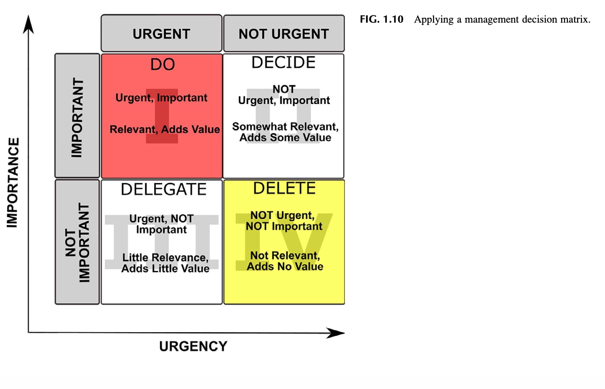

| 구분 | **긴급함 (Urgent)** | **긴급하지 않음 (Not Urgent)** |
| :---: | :---: | :---: |
| **중요함 (Important)** | **[제1분면: 위기 및 소방수]** • 중대재해 및 급박한 사고 대응 • 마감 직전의 법적 보고서 제출 • 설비 긴급 고장 및 생산 중단 안전 조치 • 고객사 긴급 감사 대응 | **[제2분면: 프로액티브 핵심 전략 (★지향점)]** • 안전문화 로드맵 수립 및 평가 • 근원적 위험성평가(JHA) 및 표준 개정 • 예방적 현장 멘토링 및 리더십 코칭 • 전문 역량 개발 및 네트워크 구축 |
| **중요하지 않음 (Not Important)** | **[제3분면: 기만과 방해]** • 불필요하고 잦은 긴급 호출 • 타 부서의 단순 행정 업무 대행 • 목적이 불분명한 일상 회의 참석 • 우선순위 낮은 불필요한 현장 민원 | **[제4분면: 낭비와 도피]** • 목적 없는 서류 정리 및 파일 정리 • 형식적이고 반복적인 이메일 확인 • 단순 시간 때우기식 사무실 체류 • 실효성 없는 일회성 캠페인 집착 |

> **[그림 1.10 상세 보충설명]**
> * 안전 관리자가 매일 1분면(화재진압형)과 3분면(단순 호출 대응)에만 갇혀 있으면 안전문화 혁신은 불가능합니다.
> * 진정한 고성과 안전 전문가는 **제2분면(예방, 계획 수립, 관계 형성, 역량 개발)의 비중을 의도적으로 확장**하여 위기 발생 자체를 사전에 억제합니다.

---

## 14. SAFETY AT A CROSSROAD (기로에 선 안전)

안전 관리는 조직 내 모든 활동이 교차하는 교차로(Crossroad)에 위치합니다. 안전 전문가의 궁극적 목표는 경영진과 전 직원으로부터 **'신뢰받고 지식을 갖춘 해결사(Trusted, knowledgeable go-to person)'**로 인정받는 것입니다.

### 14.1 안전 전문가에게 요구되는 5대 핵심 실천 역량
1. 리더십 및 조직 모든 계층에서 제기되는 안전 문제를 적극적으로 해결한다.
2. 안전 관련 입장과 결론을 뒷받침하는 전문 정보를 **큐레이션(Curation)**하고 활용한다 (제15장 연계).
3. 전 계층과 긍정적인 소통 채널을 유지하며, 긴급한 위험 정보는 공식 채널을 단축하여 전달한다.
4. 실제적·인식적 유해위험요인과 관련 리스크를 철저히 분석한다.
5. 안전경영시스템의 권고사항을 실행에 옮길 수 있는 **전문적 영향력(Professional influence)**을 발휘한다.

### 14.2 사내 정치(Internal Politics)의 이해
* **정치(Politics)의 정의 (Politics, 2014)**: *"경쟁하는 이익 집단이나 개인들 간의 권력 및 리더십 획득을 둘러싼 경쟁"*
* **안전과 정치의 필연적 만남**: 조직 내 안전문화를 바꾸기 위해서는 사내 정치와 대인관계 메커니즘을 외면해서는 안 됩니다. 각 부서는 한정된 자원(시간, 예산, 인력)을 차지하기 위해 경영진의 주의(Attention)를 두고 치열하게 경쟁합니다. 안전 전문가는 안전이 조직에 실질적 부가가치(Value-added)를 창출함을 입증하여 의사결정에 전략적 영향력을 행사해야 합니다.

---

### [그림 1.11 상세 분석] 래드포드(Radford, 1988)의 의사결정 모델: 리더십과 안전 부서의 갈등 기제

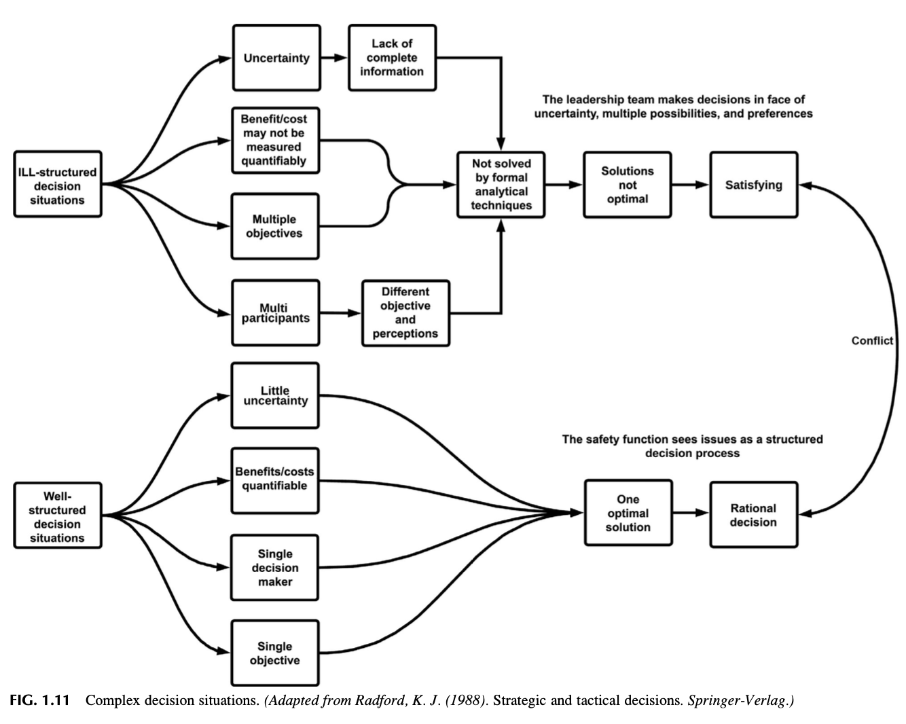

> **[그림 1.11 상세 보충설명: 리더십과 안전 전문가의 근본적 갈등 구조 분석]**
> * **상단: 리더십의 복합·비구조화된 의사결정 (ILL-Structured Decision Situations)**:
>   * 높은 불확실성과 불완전한 정보 속에서 의사결정 수행.
>   * 정량화하기 어려운 비용/편익 및 상충하는 다중 목표 추구.
>   * 다자간 이해관계자와의 정치적 타협을 통한 **'만족화(Satisficing) 기준 결정'** 추구.
> * **하단: 전통적 안전 부서의 구조화된 의사결정 (Well-Structured Decision Situations)**:
>   * 단일 의사결정권자, 단일 목표(무사고, 규정 준수).
>   * 명확한 인과관계 가정: *"규정 X를 준수하면 사고 Y는 발생하지 않는다"*.
>   * 공식적·합리적 최적해(Optimal Solution)만을 고집.
> * **충돌과 함정**:
>   * 안전 관리자가 경영진을 설득할 때 단순히 *"예산을 주지 않으면 노동부/소방서로부터 벌금을 맞는다"*는 식의 **규제 단속 위협(Regulatory Penalties Trap)**에만 의존하면, 경영진과 적대적 관계가 형성되고 안전문화의 신뢰도는 치명적으로 추락합니다.

---

## 15. DO SAFETY AND LEADERSHIP SPEAK THE SAME LANGUAGE? (안전과 리더십은 같은 언어로 말하는가?)

안전 전문가는 현장의 위험을 기술적 용어나 단순 규제 조항으로만 설명하지 않고, 경영진이 이해할 수 있는 **'비즈니스 언어(Business Language)'**로 번역하여 소통해야 합니다.

---

### [표 1.4 상세 분석] 조직의 안전 지각을 파악하기 위한 정보 출처

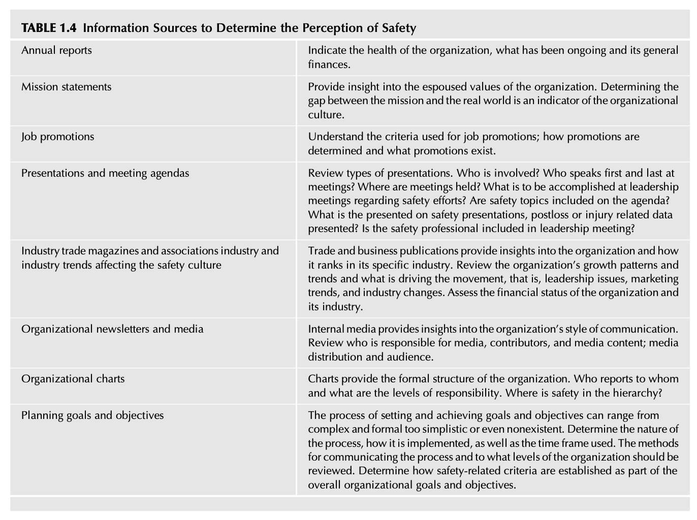

| 정보 출처 (Source) | 핵심 확인 및 진단 내용 | 실무적 평가 함의 |
| :--- | :--- | :--- |
| **비공식 네트워크 (Informal Network)** | 일상 대화, 휴게실 소통, 소문, 안전 관리자에 대한 동료들의 솔직한 피드백 | 조직 구성원들이 체감하는 안전의 실질적 위상과 진정성 파악 |
| **안전보건위원회 (Safety Committee)** | 정기 회의 안건 내용, 노사 간 토론 수준, 권고사항에 대한 경영진의 실행률 | 안전에 대한 조직의 공식적 지원 의지와 참여 수준 측정 |
| **인사/노무 기록 (HR Records)** | 이직률, 고충 처리 접수 건수, 출근율, 안전 관련 징계 및 포상 이력 | 심리적 안전감 및 작업 환경의 전반적인 건강성 평가 |
| **공식 안전 보고서 (Safety Reports)** | 사고 조사 보고서의 품질, 근본 원인 분석 수준, 후속 조치 완료율 | 조직이 사고를 통해 학습하는 역량과 투명성 검증 |
| **경영진 회의록 (Leadership Minutes)** | 이사회 및 경영 회의 의제에서 안전이 다루어지는 빈도 및 우선순위 | 최고경영진의 안전 최우선 가치 실천 여부 확인 |

---

## 16. FROM STARTUP TO STATUS QUO (스타트업에서 현상 유지까지)

조직은 고정되어 있지 않으며, 스타트업 창업기부터 성숙·현상 유지 단계에 이르기까지 끊임없이 변화합니다. 긍정적 지각에 기반하여 조직의 구조 깊숙이 직조된 유연한 안전경영시스템만이 다음과 같은 거대한 환경 변화의 충격 속에서도 파괴되지 않고 **회복탄력성(Resilience)**을 발휘할 수 있습니다:

### 16.1 조직 환경 변화의 9대 핵심 요인
1. **리더십의 성향, 철학 및 태도 변화** (Leadership personalities, philosophies, and attitudes)
2. **노사 관계 및 대내외 소통 방식의 변화** (Employee relations and communication)
3. **운영 방식 변화에 따른 조직 내 유해위험요인 및 리스크의 변화** (Risk and hazards through operational change)
4. **일상적 루틴을 뒤흔드는 위기 상황 발생** (직장 내 괴롭힘/폭력, 화재, 중대재해, 자연재해 등)
5. **법적·제도적 교육훈련 요구 증대** (Increased training demands)
6. **기업 인수합병(M&A)** 및 조직 통폐합
7. **경영진의 부실한 계획 수립 및 의사결정 오류** (Poor planning and decision making)
8. **기술 혁신 및 신기술 도입** (Technology change)
9. **기타 조직에 영향을 미치는 잠재적 복합 위기 요인들**

안전경영시스템은 경직된 매뉴얼에 갇혀 있어서는 안 되며, 조직의 진화 과정과 비즈니스 요구에 발맞추어 유연하고 적응력(Flexible & Adaptable) 있게 진화해야 조직문화의 생존력을 보장할 수 있습니다 (제5장 연계).

---

## 17. UNDERSTANDING AND MANAGING THE CIRCLE OF DIVERSION (방해 요소의 순환고리 이해와 관리)

안전 전문가는 마치 여러 개의 공을 동시에 공중에 띄우고 저글링을 하는 곡예사처럼 매일 수많은 방해 요소와 돌발 변수에 직면합니다 (FIG. 1.12 저글러 참조).

### 17.1 디버전(Diversion, 방향 전환/방해 요소)의 개념
* **정의**: *"정상적인 경로, 활동, 혹은 정해진 용도로부터 이탈하거나 방향을 전환하는 행위"* (Diversion, 2018).
* **마티스(Mathis, 2014)의 경고**: *"디버전이란 관리자들이 다른 우선순위 업무로 인해 너무 바빠지거나 압도당하여, 안전이 성공할 수 있도록 충분한 주의를 기울이지 못하는 현상이다."*
* 디버전은 조직 환경의 본질적 일부이며, 이를 리드하고 조절하는 능력 자체가 안전경영시스템의 핵심 책무입니다.

---

### [그림 1.12 & 1.13 상세 분석] 디버전의 수레바퀴 (Wheel of Diversion)

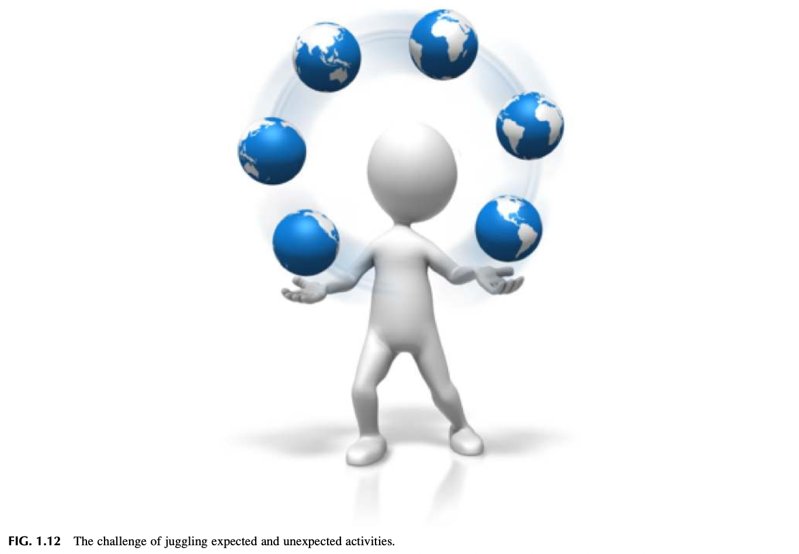
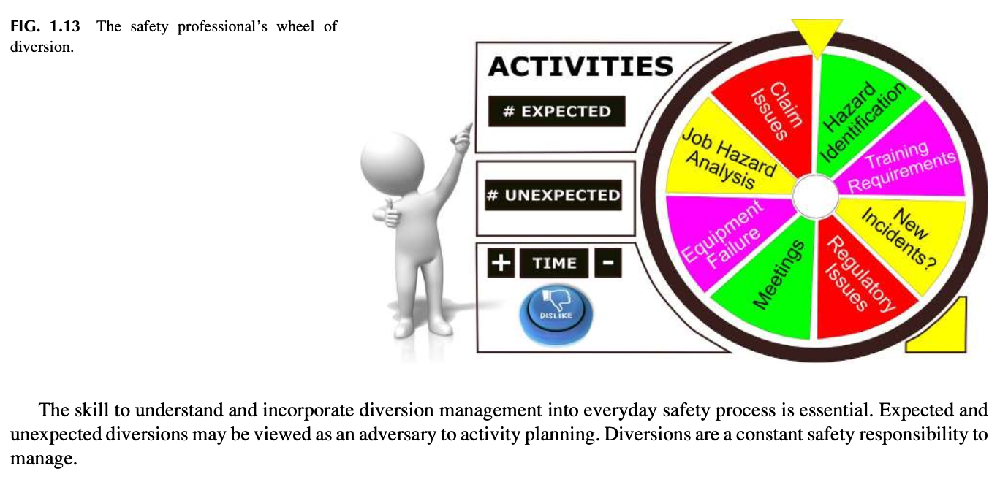

> **[그림 1.13 상세 보충설명: 계획된 활동과 돌발 활동의 회전판]**
> * **회전판의 구조**: 안전 전문가의 시간과 주의를 빨아들이는 수많은 활동들이 팽이처럼 맞물려 회전합니다.
>   * **계획된 예상 활동 (Expected Activities)**:
>     * 위험성평가 및 작업안전분석 (JHA)
>     * 유해위험요인 발굴 (Hazard Identification)
>     * 정기 안전 회의 (Meetings)
>     * 법정 안전 교육훈련 (Training)
>   * **예상치 못한 돌발 활동 (Unexpected Activities)**:
>     * 산재 보상 청구 이슈 (Claim Issues)
>     * 핵심 생산 설비 고장 및 결함 (Equipment Failure)
>     * 신규 사고 발생 및 현장 긴급 조사 (New Incidents / Accident Investigation)
>     * 규제 기관 단속 및 법적 이슈 (Regulatory Issues)
>     * 예정에 없던 경영진 긴급 호출 회의 (Unscheduled Meetings)
> * **디버전 진단 6대 질문**:
>   1. 당일 수립한 안전 목표와 계획이 주변 상황에 의해 얼마나 자주 무산되는가?
>   2. 안전 전문가 혼자만 모든 문제를 해결하느라 역량이 지나치게 분산(Spread too thin)되어 있는가?
>   3. 경영진이 안전 전문가를 안전 시스템 본연의 목적과 무관한 잡무에 동원하고 있는가?
>   4. 조직 내에 너무 많은 '위기'가 상존하는가? 이것이 변화에 대한 조직적 저항 때문은 아닌가?
>   5. 디버전 현상은 조직의 안전문화에 대해 무엇을 시사하고 있는가?
>   6. 디버전은 조직의 '안전에 대한 지각'에 어떤 영향을 미치고 있는가?

---

### [Observation 8] 직원의 안전 요청 지연이 주는 치명적 신호

* **상황**: 현장 직원이 중요한 안전 우려 사항을 제기했을 때, 안전 관리자가 명확한 사유 설명 없이 *"지금 바쁘니 나중에 시간 날 때 보겠다"*고 무심코 넘겨버린다면, 직원은 안전이 조직에서 뒷전이라는 강한 부정적 신호를 받게 됩니다. 디버전을 다루는 태도 자체가 조직의 안전 지각을 형성합니다.

---

## 18. CHANGING THE PERCEPTION OF THE SAFETY PROFESSIONAL (안전 전문가에 대한 지각 바꾸기)

단순한 현장 단속자(Safety Guy)에서 벗어나 신뢰받는 리더로 거듭나기 위해서는 체계적인 **자기 평가 인벤토리(Safety Professional Perception Inventory)**를 통해 자신의 전문 브랜드를 객관적으로 점검해야 합니다.

* **자기 진단의 필요성**:  
  조직 내에서 단순히 '지적질하는 사람'으로 인식되고 있다면, 스스로의 행동 양식과 전문성 전달 방식을 진단하는 자기 평가 체크리스트를 실행해야 합니다.
* **조직 안전문화와의 연계**:  
  개인 인벤토리 분석은 안전 전문가의 역할에 대해 조직이 어떤 인식을 가지고 있는지 통찰을 제공하며, 조직 전체의 안전문화 수준을 가늠하는 바로미터가 됩니다.
* **전문가 브랜드 재정립**:  
  이 인벤토리는 장애물을 극복하고 조직 내에서 신뢰받는 전문 브랜드(Professional Brand)를 구축하도록 설계되었습니다 (구체적 실천 도구는 **부록 1.3** 참조).

---

## 19. ORIENTATION VS. ONBOARDING (오리엔테이션 대 온보딩)

조직의 안전 지각을 바꾸는 가장 결정적인 출발점은 신규 입사자 및 전환 배치 직원을 맞이하는 **오리엔테이션과 온보딩 프로세스**입니다.

### 19.1 개념의 근본적 차이
* **오리엔테이션(Orientation)**: 입사 첫날 인사부서에서 복리후생, 주차, 회사 규정 등을 일방적으로 전달하는 **단발성 교실 행사(One-time event)**입니다. 많은 경우 안전에 대한 심층적 내용은 배제됩니다.
* **온보딩(Onboarding)**: 채용 합격 순간부터 완전한 성과를 창출하는 구성원으로 안착할 때까지 수개월에서 1년 이상 지속되는 **전략적·체계적 육성 프로세스**입니다.

---

### [표 1.5 상세 분석] 오리엔테이션과 온보딩의 체계적 비교

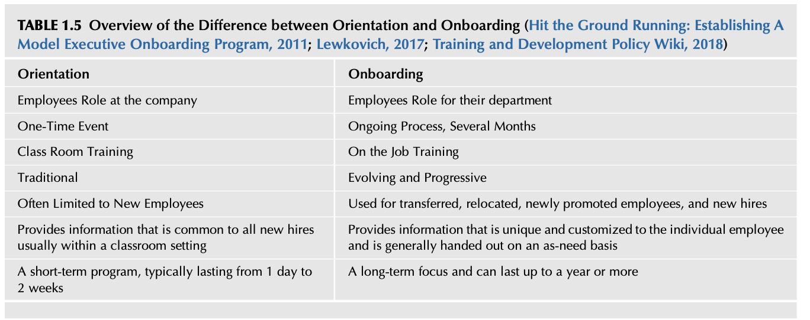

| 비교 항목 | 오리엔테이션 (Orientation) | 온보딩 (Onboarding) |
| :--- | :--- | :--- |
| **직원의 역할 범위** | 회사 전체 차원에서의 일반적 역할 인식 | **소속 부서 및 팀 단위에서의 구체적 실무 역할 인식** |
| **진행 형태 및 기간** | 1회성 단발 이벤트 (보통 1일 ~ 2주 이내) | **수개월에서 1년 이상 지속되는 점진적·지속적 프로세스** |
| **교육 방식** | 전통적인 강의실 집체 교육 (Classroom Training) | **현장 직무 교육 (On-the-Job Training, OJT) 및 실무 멘토링** |
| **프로그램 성격** | 정적이고 전통적인 정보 전달 방식 | **진화하고 점진적으로 발전하는 맞춤형 방식** |
| **적용 대상** | 주로 신규 채용 직원에게만 국한 | **신규 입사자, 전환 배치자, 전보 발령자, 신임 승진자 전체** |
| **제공 정보의 특성** | 모든 신입사원에게 공통 적용되는 일반 규정 정보 | **개인별·직무별 필요에 따라 맞춤형으로 제공되는 고유 정보** |
| **초점과 지향점** | 단기적 적응 및 행정 서류 처리에 집중 | **장기적 조직 몰입, 역량 발휘, 안전문화 내재화에 집중** |

### 19.2 신규 직무 배정 첫날의 행동 수칙과 MBWA
* **사령탑의 당당한 태도 (Command Presence)**:  
  미 육군 리더십 교범(FM 6-22, 2015)이 강조하는 권위와 전문성을 겸비한 단정한 태도로 첫인상을 확립해야 합니다.
* **현장 순회 경영 (MBWA: Management By Wandering Around)**:  
  톰 피터스(Tom Peters & Austin, 1999)의 조언대로 주간 근무뿐만 아니라 야간 교대조까지 현장을 직접 찾아가 경청해야 합니다.
  * **★ 핵심 경청 수칙**: 현장 작업자의 이야기를 들을 때는 **수첩을 꺼내 적지 말고 온전히 경청(Listen)에만 집중**하십시오! 대화가 끝난 직후 메모를 남겨야 현장 직원의 진솔한 신뢰를 얻을 수 있습니다.

---

## 20. SUMMARY (요약 및 결론)

1. **안전문화는 안전경영시스템 자체를 통째로 교체한다고 개선되는 것이 아니며, 조직 내 '안전에 대한 지각(Perception of Safety)'을 근본적으로 전환함으로써 비로소 고도화됩니다.**
2. 안전은 고립된 프로그램이 아니라, 조직의 6대 영역(환경, 구조, 과업, 기술, 인간-사회, 목표)이 유기적으로 맞물려 작동할 때 비로소 드러나는 **'발현적 속성(Emergent Property)'**입니다.
3. 조직은 영구적으로 변화하는 동적 실체이므로, 안전 프로세스 역시 정적 안정성에 안주하지 말고 **동적이고 회복탄력적인(Resilient) 시스템**으로 스스로를 끊임없이 혁신해야 합니다.
4. 리더십과의 언어적 일치(Business language)를 이루고, 2분면 중심의 시간 관리와 디버전 통제를 통해 안전 전문가의 전문적 브랜드를 확립해야 합니다.

---

## 21. CHAPTER REVIEW QUESTIONS (복습 문제 12문항 분석)

제1장에서 다룬 핵심 이론과 개념을 평가하고 현장 실무에 적용하기 위한 12대 핵심 복습 질문입니다:

1. **안전문화에 영향을 미치는 지각의 역할**: 조직 내에서 안전이 어떻게 인식되는지가 안전문화 형성과 정착에 어떤 결정적 영향을 미치는가?
2. **사전적 정의와 수용 가능한 위험(Acceptable Risk)**: 단순한 사전적 무사고 정의를 넘어, 몬탄테가 제시한 '상대적 위험 수용성'이 실무적으로 왜 중요한가?
3. **발현적 속성(Emergent Property)으로서의 안전**: 프렌치 & 벨의 조직 6대 연동 영역 모델에서 안전이 왜 시스템 전체의 상호작용 결과물로 나타나는가?
4. **리더십의 주의를 끌기 위한 타 부서와의 경쟁**: 마케팅, 생산, 재무 부서와 비교하여 안전 부서가 자원 배분 경쟁에서 밀리는 근본 원인은 무엇인가?
5. **에잇볼(Eight-Ball) 뒤에 갇힌 안전 관리자의 고립**: 수동적이고 지시만 기다리는 안전 관리자가 겪게 되는 조직적 딜레마는 무엇인가?
6. **안전 전문가의 직업적 고정관념 극복 방안**: '안전 경찰(Safety Cop)'의 부정적 이미지를 탈피하고 '협업적 조력자'로 거듭나기 위한 실천 방안은?
7. **이그제큐티브 프리젠스(Executive Presence)와 비즈니스 언어**: 경영진을 설득하기 위해 안전 전문가는 어떤 소통 태도와 재무/경영 언어를 구사해야 하는가?
8. **퍼스널 브랜딩(Personal Branding)의 가치**: 안전 관리자 개인의 평판과 신뢰 자산이 안전 정책의 집행력에 미치는 영향은?
9. **조직 마찰(Friction)과 윤활 메커니즘**: 노사 간, 부서 간 마찰을 줄이기 위해 안전 부서가 오일캔(윤활유) 역할을 수행하는 구체적 방법은?
10. **시간 관리 매트릭스(2분면)와 디버전(Diversion) 관리**: 쏟아지는 돌발 업무(Wheel of Diversion) 속에서 예방적·전략적 업무 비중을 어떻게 방어할 것인가?
11. **래드포드(Radford)의 의사결정 모델과 사내 정치의 이해**: 경영진의 만족화(Satisficing) 의사결정 기제를 이해하고 규제 위협 함정을 피하는 전략은?
12. **오리엔테이션(Orientation)과 온보딩(Onboarding)의 전략적 차이**: 단순 서류 전달을 넘어 신입 및 전환 직원의 안전 지각을 내재화하는 체계적 온보딩 설계 방안은?

---

## 22. [APPENDIX 1.1] EXAMPLE OF A TYPICAL SAFETY MANAGER JOB DESCRIPTION, DUTIES, AND REQUIREMENTS (전형적인 안전 관리자 직무기술서, 책무 및 자격 요건)

### 22.1 공고 요약 및 주요 책무 목록
* **직무 개요**: 대규모 제조·산업 시설에서 안전보건 규정 준수를 총괄하고, 위험성평가, 사고 조사, 임직원 안전 교육을 주도하는 관리자 직무.
* **핵심 책무**:
  * OSHA, EPA 등 법적 규제 준수 체계 수립 및 정부 기관 대응
  * 작업장 유해위험요인 발굴(JHA) 및 리스크 저감 대책 실행
  * 사고 근본 원인 조사(RCA) 및 재발 방지 대책 보고서 작성
  * 전사 안전보건위원회 운영 및 안전문화 개선 활동 전개

### 22.2 자격 요건 (Qualifications)
* 안전공학, 산업위생, 환경공학 등 관련 학사 학위 이상
* CSP(미국 공인안전전문가), CIH 등 전문 자격증 보유자 우대
* 5년 이상의 제조/플랜트 현장 안전관리 실무 경력
* 뛰어난 다계층 소통 역량 및 프로젝트 관리 역량

### 22.3 직무 공고 분석에 관한 성찰 과제
전통적 공고는 여전히 '규정 준수(Compliance)'와 '법적 처벌 방어'에 치중되어 있습니다. 현대의 안전 전문가는 이러한 정적 직무기술서의 한계를 뛰어넘어 비즈니스 파트너로서의 전략적 가치를 스스로 증명해야 합니다.

---

## 23. [APPENDIX 1.2] SUGGESTED JOB GAP ANALYSIS AND INTERACTION FORM (직무 갭 분석 및 상호작용 양식과 SWOT 분석)

### 23.1 직무 갭 분석 및 상호작용 양식 (Job Gap Analysis Form)
구직 공고의 요구조건과 자신의 보유 역량을 1:1로 대조하여 부족한 간극(Gap)을 파악하고, 이를 메우기 위한 구체적 행동 계획을 수립하는 도구입니다.

| 직무 공고 요구 항목 (Job Requirement) | 본인의 현재 역량 수준 (Current Capability) | 역량 갭 (Gap Identified) | 갭 극복 전략 및 키워드 보강 계획 |
| :--- | :--- | :--- | :--- |
| ISO 45001 시스템 구축 경험 | 내부 심사원 수료 및 보조 참여 | 주도적 인증 심사 총괄 경험 부족 | 전문 심사원 과정 이수 및 모의 심사 프로젝트 포트폴리오 구축 |
| 전사 위험성평가(JHA) 총괄 | 기본 정성적 평가 수행 가능 | 정량적 위험성평가 툴 미숙 | 화학물질 정량 위험평가 소프트웨어 교육 수료 및 키워드 추가 |
| 경영진 리스크 브리핑 역량 | 팀 내 보고 경험 다수 | 임원진 대상 비즈니스 ROI 보고 경험 부족 | 재무적 안전 손실 비용 분석 모델 학습 및 프레젠테이션 연습 |

### 23.2 취업 및 면접 대비 SWOT 분석 매트릭스
* **강점 (Strengths)**: 현장 밀착형 소통 역량, 법률 규정 및 현장 엔지니어링 지식, 열정적 리더십
* **약점 (Weaknesses)**: 대관 업무 경험 부족, 최신 IT/AI 기반 안전관리 솔루션 실무 경험 미흡
* **기회 (Opportunities)**: 중대재해처벌법 등 안전보건 규제 강화로 인한 최고경영진의 안전 투자 의지 급증
* **위협 (Threats)**: 경기 침체로 인한 긴축 예산 기조, 타 부서의 안전 책임 회피 풍조

---

## 24. [APPENDIX 1.3] SAFETY PROFESSIONAL PERCEPTION INVENTORY, AN OPPORTUNITY (안전 전문가 지각 자기평가 인벤토리)

단순한 '안전 경찰'에서 '가치 창출 파트너'로 거듭나기 위한 10대 핵심 자가 진단 문항:

1. 나는 조직 내에서 '안전을 핑계로 생산을 멈추는 사람'이 아니라 '생산이 안전하게 지속되도록 돕는 해결사'로 지각되고 있는가?
2. 최고경영진과 대화할 때 규제 벌금 위협 대신 비즈니스 언어와 투자 대비 가치(ROI)로 설득하고 있는가?
3. 현장 작업자들은 나를 '감시자'가 아니라 '위험을 함께 해결해 주는 든든한 조력자'로 신뢰하는가?
4. 나의 하루 일과는 1분면(소방수식 위기 대응)에 휘둘리지 않고 2분면(예방적 안전문화 로드맵)을 계획대로 방어하고 있는가?
5. 타 부서 관리자들과 정기적으로 협력 채널을 가동하고 상호 윈-윈(Win-Win) 관계를 맺고 있는가?
6. 새로운 안전 규칙을 도입할 때 일방적 통보가 아닌 현장 구성원들과의 의미구성(Sensemaking) 과정을 거치는가?
7. 조직의 비공식 네트워크와 소통 채널을 정확히 파악하고 긴급한 위험 정보를 신속히 전달할 수 있는가?
8. 돌발 업무(Diversion)가 발생했을 때 직원의 안전 요청을 가볍게 넘기지 않고 진정성 있게 피드백하는가?
9. 신입 및 전환 직원이 조직에 들어왔을 때 단발성 오리엔테이션에 그치지 않고 체계적인 온보딩 멘토링을 제공하는가?
10. 나는 안전 전문가로서의 명확한 '퍼스널 브랜드(Personal Brand)'를 구축하고 이를 일관되게 행동으로 증명하고 있는가?

---

## 25. [APPENDIX 1.4] ORIENTATION VS. ONBOARDING (오리엔테이션 대 온보딩 심화 및 첫 30일 실무 지침)

### 25.1 온보딩의 전략적 심화
* 온보딩은 신규 입사자뿐만 아니라 기존 숙련 직원의 재교육 및 부서 전환 시에도 필수적입니다.
* 안전 온보딩 프로그램의 품질은 조직이 안전을 얼마나 진정성 있게 대하는지를 보여주는 가장 강력한 지표입니다.

### 25.2 신임 안전 관리자의 첫 30일 생존 및 안착 행동 수칙
1. **첫 10일 (경청과 파악)**:
   * 섣부른 지적이나 규칙 변경을 절대 금지할 것.
   * 현장 순회(MBWA)를 통해 주간/야간 조 작업자들의 목소리를 경청할 것 (노트에 적지 말고 온전히 들을 것).
   * 조직의 비공식 권력 구조와 소통 네트워크를 파악할 것.
2. **11일 ~ 20일 (관계 구축 및 갭 분석)**:
   * 생산, 유지보수, 인사, 재무 부서장들과 1:1 티타임을 갖고 그들이 안전 부서에 바라는 고충과 기대를 파악할 것.
   * 회사의 과거 사고 이력 및 아차사고 보고서를 검토하여 숨겨진 취약점을 도출할 것.
3. **21일 ~ 30일 (작은 성공 경험 창출 및 로드맵 제시)**:
   * 현장에서 가장 오래 방치되었던 사소하지만 불편했던 안전 문제 하나를 타 부서와 협력하여 신속히 해결해 줄 것 (신뢰 획득).
   * 향후 1년간 추진할 '제2분면 중심의 안전문화 혁신 로드맵' 초안을 수립하여 경영진에게 보고할 것.

---

## 26. BIBLIOGRAPHY (참고 문헌)

* Covey, S. R. (1990). *The 7 Habits of Highly Effective People: Powerful Lessons in Personal Change*. Free Press.
* FM 6-22. (2015). *Leader Development*. Headquarters, Department of the Army.
* French, W. L., & Bell, C. H. (1984). *Organization Development: Behavioral Science Interventions for Organization Improvement* (3rd ed.). Prentice-Hall.
* Lawton, R. (2014). *Onboarding: The First Step in Safety*. Occupational Health & Safety.
* Mathis, T. L. (2014). *Overcoming Safety Diversions*. EHS Today.
* Montante, W. M. (2014). *Safety: An Emergent Property of a Complex System*. Professional Safety, 59(12), 40-47.
* Peters, T. J., & Austin, N. (1999). *A Passion for Excellence: The Leadership Difference*. Profile Books.
* Radford, K. J. (1988). *Strategic and Tactical Decisions: Emerging Concepts and Methods*. Springer-Verlag.
* Radford, K. J. (1991). *Individual and Multi-Person Decision Making*. Springer-Verlag.
* Sinek, S. (2014). *Leaders Eat Last: Why Some Teams Pull Together and Others Don't*. Portfolio/Penguin.
* Yario, M. (2017). *Building a Resilient Safety Culture in Dynamic Business Environments*. Journal of Safety Management, 44(3), 112-125.
