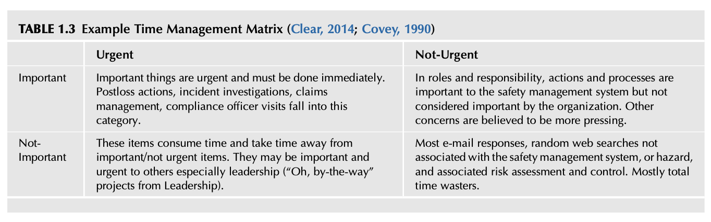

# Chapter 1 Defining the Perception of Safety

Corporate culture matters. How management chooses to treat its people impacts everything - for better or for worse. Simon Sinek

Change the way you look at things and the things you look at change. Wayne W. Dyer

Safety Culture. https://doi.org/10.1016/B978-0-12-814663-7.00001-7

## INTRODUCTION
An organizational safety culture requires a multidiscipline approach to improve the potential for ensuring a safe work environment. Leadership can drive the perception of safety through a clear vision of what is to be done and provide focus on common goals to achieve the desired organizational climate for safety. The method entails implementing an array of activities ranging from, for example, selecting a safety management system; measuring human error performance; improving multilevel communication, risk and loss analysis, and monitoring regulatory compliance. Most importantly, the leadership team and employees must have a positive perception and understanding of what safety entails for a safety culture to be developed and sustained. Safety has its own unique “brand” within the organization. How the brand is perceived by the leadership team and employees is what must be determined. How the safety brand must be challenged becomes an important part of improving the safety culture.

### Observation 1
Organizations are not static! There is always some degree of flux and change. To the contrary, a traditional safety process desires stability and to build processes that are permanent and unchanging. The perception of safety is one of being an opponent of change instead of an advocate for improvement and success. This opposition many times sets up an adversarial relationship between the safety professional and the leadership team. Implementing an in-depth “culture of safety” is complicated and not well defined. The general perception of “Safety” is that it can be achieved by just following the rules! Even trying to define a mutually agreed upon definition of what safety means remains a problem given the many aspects required for a safe work environment. “There is a feeling that safety rules make people safe, but it is the act of following the rules that reduce the risk of an event…” (Potter, 2018). The overall current perception of safety must be better defined to build a case for the organization’s leadership team for an improved or enhanced safety culture to flourish. A complex network of multiple business skills, psychological, scientific, and engineering interactions must align with the organization’s internal and external disciplines and resources. Improving the safety culture is further dependent on the safety professional’s sphere of influence within an organization and how well they communicate with the leadership team and network with their peers. The authors believe a shift is occurring where the safety professional’s function is moving from the position of being primarily a safety information resource to a strategic player in the deploying a safety management system. If you give a man a fish, you feed him for a day. If you teach a man to fish, you feed him for a lifetime. Ancient Chinese proverb (Maimonides, 2018) Safety information can be readily found using internet search engines by anyone in the organization. Issues and problems can be quickly published on social media sites as evidenced by employees or customers postings on various media. This has created the need for a rapid, effective, and efficient response to complaints or perceived concerns. A communication network designed to quickly assess and relay severe hazard and risk-related issues rapidly to decision makers is now a critical component of a safety process. Many organizations continue to use a “No Loss No Risk” (Mental model, 2018), even though a potential risk remains constant, whereas low injury/illness frequency rates are expected and acknowledged by leadership. Using this concept, a safety process that only uses injury or historical loss data should consider using a risk-based approach as advocated in the safety management systems, ANSI Z10-2012 (Occupational Health & Safety Management Systems, 2012). Mental models are intellectual structures that enable us to simplify and organize the mirrored inputs we get from the world around us. The shape and support our thinking, decision-making, opinions, values, and beliefs. Koch (2007) When this chapter is completed, you should be able to:
* Develop a personal working definition of “Safety.”
* Discuss why perception is important for the safety culture.
* Identify how safety is perceived in the organization and the positive or negative impact on the organization.
* Identify common perceptions about safety and reasons shaping those perceptions.

## DEFINING SAFETY
The definition of safety is a core issue impacting the development of a safety culture. The general assumption is that everyone in the organization understands the term “safety,” and how the term is used within the organization. This is not always necessarily accurate. Multiple definitions or vague concepts about safety reduce the potential for improving the safety culture. Many safety definitions are ambiguous, uncertain, and describe more of an “essence,” something not quite definable and subjected to analysis. Do not send ambiguous messages when it comes to defining the word safety. Safety must be defined in operational terms that everyone can understand the concepts. A definition of the term “safety” is needed for a safety culture to be developed or sustained. A quick review shows that, after decades, a clear, concise definition of safety is still undetermined in written literature. Several dictionary definitions of safety include:
* “Safety—(1) The quality of being safe; (2) freedom from danger or risk of injury.”
* “Safety: the condition of being safe from undergoing or causing hurt, injury, or loss” (Safety, 2018).
These definitions define safety regarding itself and imply safety is something you know when you see it. They provide little or no insight into understanding or determining what safety entails. A better definition to consider is: Relative freedom from danger, risk, or threat of harm, injury, or loss of personnel and property, whether caused deliberately or by accident. Safety (2018) ANSI/ASSE Z590.3, 2011, Prevention through Design, defines the word Safety as “freedom from unacceptable risk” with risk defined as “An estimate of the probability of a hazard-related incident or exposure occurring.” Hazard is defined as, “The potential for harm” (Fledscher, 2014; Prevention through Design Guidelines for Addressing Occupational Hazards and Risks in Design and Redesign Processes, 2011; Prevention through Design, Plan For the National Initiative, 2017). These definitions from ANSI Z590 for hazard and risk allow for a relative level of risk acceptance as a practical matter. A risk may be acceptable as some jobs or tasks retain an element of risk even after intense efforts are made to mitigate or control their risks. For example, firefighters, police, astronauts, military, oil/gas/mining industries, race car drivers, and so on, where the risk is considered acceptable by society to achieve a goal by a necessary or desired activity. Even when considered acceptable, risk must be evaluated and controlled to the degree possible to ensure that all possible protective devices, policies, and procedures are in place and effective. Refer Chapters 9 and 10 for a detailed discussion of the concepts of risk perception.

### Observation 2
A risk control colleague and consultant, William Montante, asked supervisors and managers to define safety at the beginning of training classes and presentations. His reasoning for the asking is based on comments in William W. Lowrance’s classic book, “Of Acceptable Risk” (Lowrance, 1976). Lowrance wrote that “much of the widespread confusion about the nature of safety…would be dispelled if the meaning of the terms safety were clarified.” Lowrance’s definition of safety is “A thing is safe if its risks are judged to be acceptable” (Lowrance, 1976). Montante defines safety as “Safety is that state of being when risk and the hazards derived from it are judged acceptable or in control” (Montante, 2006). Montante has collected dozens of definitions for safety. For example, he listed responses from 130 safety leaders within just one organization. The responses include:
* Preventing accidents or injuries.
* Freedom from harm or injury.
* Being safe.
* Being aware of your surroundings.
* Not getting hurt.
* It’s number one.
* Following procedures and rules.
* It is a state of being.
* Looking out for each other.
* Complying with OSHA.
* Going home the same way you came to work.
Montante states, “Simply put, safety is no more and no less than a condition or judgment of acceptable control over hazards and risk inherent in what one is doing at a point in time or chooses to do at some future point. That state of being can be personal or a reflection of the business culture” (Montante, 2006). Montante further suggests that safety is defined to better align with a definition of safety emphasizing hazard and associated risk. “Replace the traditional mantras of ‘Safety first,’ ‘Think Safety,’ and ‘Safety is your responsibility.’ Strive for the personal and organizational mastery where each “hazard control manager” can state with confidence and certainty that s/he intimately knows safety and how s/he and the company manage to control” (Montante, 2006). Safety, when defined appropriately, can provide insights into problems stemming from hidden issues within the organization. Safety problems develop within a culture allowing:
* Lack of or poor planning.
* Lack of understanding of employee concerns.
* Poor communication.
* Ineffective training structure or methods.
* Poor operational maintenance.
* Poor quality, technology problems, and so on.
For a safety culture to be sustained, there can be no gaps in the organization’s communication. Refer Fig. 1.1 for an example of an incomplete puzzle with gaps in communication. The safety profession has long recognized the association between these many elements to promote a safe work environment and development of a Safety Management System. All pieces of the puzzle must be linked together so that no “gap” exists. Refer Fig. 1.2, for an “overview of a typical organization puzzle.” The puzzle represents a basic outline of organizational elements which must fit together to produce quality services and products.

FIG. 1.1 Gap in communication.

FIG. 1.2 Overview of a typical organization puzzle.

## SAFETY AS AN EMERGENT PROPERTY
The authors have presented a case for safety to be considered as an “emergent property” within an organization’s overall culture. Safety results from the engagement and intertwining of a multitude of interrelated processes and elements of the organization. Emergent property—any unique property that “emerges” when component objects are coupled in constraining relations to “construct” a higher level aggregate object, a novel property that unpredictably comes from a combination of two simpler constituents (Emergent Property, 2018). One role of the safety professional is to improve personal and professional relationships between all aspects of the organization through an in-depth understanding of its overarching culture. Understanding the culture requires understanding how people react, work together, what they believe, and how they communicate. Either a safe or unsafe environment can emerge depending on how the organization fits together. An organizational model by Wendell French and Cecil Bell from their classic book, “Organizational Development, Behavioral Science Interventions for Organizational Improvement,” (French & Bell, 1984) provides a model which consists of six interlocking areas, “environment, technology, task, human-social, structure, and goals.” Refer Fig. 1.3 for an overview of the “six interlocking areas of organizational improvement.” If there are any misalignments or missing relationships, plus any inherent hazards, there may be a “gap” that can create an increased probability of a loss-producing event to occur.
FIG. 1.3 Six interlocking areas of organizational development.
This “emergent” property model changes the primary role of the safety professional. It provides a narrow emphasis on just developing various traditional safety programs to an organizational approach. This approach ensures that elements within the organization have their inherent hazards and associated risk kept within a state of acceptable control. The effort shifts from just managing regulatory programs to ensuring that processes are designed with an understanding of the strengths and weaknesses of the organization. Acceptable Control? What is acceptable and from what perspective? Internal? External? From each level of the organization? Community? Political? Engineering? Sales?

## THE PERCEPTION OF SAFETY
An organization’s leadership team, management, and supervisors at all levels are always making decisions believed to best achieve success for the organization. If not, the organization may eventually fail. Leadership decisions can be considered a continuous flow of information from inside and outside of an organization. Decisions are made based on this information and feed the perceptions about the state of the business and safety efforts. Information from the safety management system must be included in this data stream if the organization is to keep hazards and risk within acceptable limits. If the focus is the loss history and not ongoing risk assessment, decisions may underestimate the potential for severe loss. As time and budgets are finite, attention can only be focused on actions that appear to be best suited to meet current business goals and objectives. Actions and decisions are based on leadership experience and expertise, preconceptions, and personal opinions developed from the data streaming from core functions. The importance of leadership preconceptions about the definition of safety cannot be overstressed. Refer Fig. 1.4 for an overview of who has Leadership’s attention. The safety professional’s task is to keep the leadership team aware of the scope of the hazards and associated risk inherent in operations. Within a swirl of data and decisions, efforts must go into influencing leadership decisions in a forum where many other disciplines believe their needs have priority. Understanding how communication is structured and flows within an organization better ensures how important critical information about hazards and risk travels quickly through the network without distortion. Perception: The process by which people select, organize, interpret, retrieve, and respond to information from the world around them (Schermerhorn, Hunt, Osborn, & Osborn, 2004). The perception still exists that the safety professional is responsible for all “safety” activities in the organization. Usually, job descriptions define the safety manager as the primary individual doing all activities related to “safety” with

FIG. 1.4 Who has Leadership’s attention.
a lengthy list of skills required. The job descriptions are normally absent of any defined authority and leadership role. If safety, as defined, is an emergent property of an organization, no one individual can be truly held responsible for the overall safety culture that may exist. For a detail discussion on the value of developing and implementing written job descriptions, refer Chapter 7.

### Observation 3
Recently, James was discussing safety efforts with another safety professional. In this discussion, this individual shared their experience as being a newly promoted safety manager with no guidance. The individual was told to figure it out. The individual stated that they felt they were behind the 8 ball “In a bad situation, in a losing position” (Behind the Eight Ball, 2018) (refer Fig. 1.5). Based on discussion with many individuals, this seems to be common in the workplace. James also remembers this situation when he was first asked to lead the safety effort at his organization.

FIG. 1.5 Behind the Eight Ball.

## HOW IS THE SAFETY PROFESSIONAL PERCEIVED IN AN ORGANIZATION?
The Perception Most professions have a stereotype, for better or worse, that is associated with them. Think of what comes to mind with titles such as, “banker,” “engineer,” “teacher,” “police officer,” “coach,” “politician,” and so on. The imagery can imply what the expected behavior of a person in that role should be and reinforces the norms, habits, and behaviors about a specific role.

FIG. 1.6 Perception of safety professional.
The problem is that the title “Safety Manager,” “Safety Leader,” or “Safety Coordinator,” immediately brings a long history of negative imagery which has developed about the role of the safety professional. Most people will visualize the Safety Professional as a person that is wearing a hard hat and carrying a clipboard (refer Fig. 1.6). The image of the safety professional is a person walking around a work environment looking for unsafe things, who quotes regulations or only stresses the use of personal protective equipment. While the image portrays one side of the role of the safety professional, it remains the dominant image. This image has become the accepted symbol of the safety profession. It is an image that has been fostered by various publications and traditions over time. Nothing is implicitly wrong with this perception. Advocating the use of personal protective equipment and taking notes about work conditions is appropriate under the right circumstances. If the perception stops there, leadership will not have a full understanding of the long-term strategic value of a safety professional’s role in the organization. Unless this image is changed, the safety professional is placed in an adversarial role within the organization. To change this perception, this image of the safety professional must be reviewed differently as a professional who has the leadership skills needed to shape the safety culture and provide value to the organization.

### Observation 4
The following question was posed to Nathan, “Do you have a safety algorithm that can easily be followed and implemented by a corporation?” The management consultants who asked the question went on to clarify why they were asking this question. "We have an issue with safety managers. We have had client safety managers promoted to senior management positions. They do not speak the same language as the other managers. We are being asked by the client leadership, What are these people talking about? We don’t understand what they are saying!” What does this observation say about the need for the safety professional to understand the language and communication styles of an organization?

## PERCEPTION COMES FIRST
Consider the perception when someone enters a room, holds a meeting, submits an oral report or written presentation, and so on. The professional image a person exhibit has a direct impact on how ideas and concepts are received. Does the person have a professional image reflecting the style and quality of the organization’s leadership? Does the image convey to peers, employees, and the leadership team a clear, concise, confident individual who knows what they are talking about without being condescending or abrasive? Does the image portray a person who can be trusted? Although executive presence is highly intuitive and difficult to pin down, it ultimately boils down to your ability to show mature selfconfidence. A sense that you can take control of difficult, unpredictable situations; make tough decisions in a timely way and hold your own with other talented and strong-willed members of the executive team. Beeson (2012) The impact of any previous safety person may have created a lingering image to be overcome, depending on the strength of the appearance or presence of the former safety person (refer Table 1.1). Why are there questions regarding the role of the safety professional such as: Why doesn’t leadership listen to me? Or Why doesn’t leadership see the importance of what I do? Why does the leadership imply that the role of safety is perceived as separate from the rest of the organizations? Few organizations oppose a safe work environment, but given the multiple actions to be balanced, a strong case providing the value or importance of the specific safety issue is always necessary.

## PERSONAL BRANDING
An organization’s brand defines how they are perceived and the value they bring to their customers. This concept, in the same way, applies to individuals irrespective of their position in the organization. When beginning the process of developing or improving a safety culture, an initial assessment must be made on how safety is perceived, that is, what is its “brand.” Reviewing a personal “brand” within the organization’s overall culture begins the process of change at both the personal and the professional levels. If the brand brings no value, then the leadership and employees will not take the safety function seriously (refer Fig. 1.7 and Table 1.2).

TABLE 1.1 Examples of Perception Issues Providing Insights on Differences in Core Beliefs Perceived Safety Objectives Desired Leadership Objectives Prevents things from happening. The safety professional immediately brings up various hazards that need to be controlled without any discussion on the potential impact on the organization. Ensures things happen. Leadership may propose an improved process or activity potentially leading to increased production and revenues. “Risk” reduction is desired. The safety professional searches for ways to reduce hazards and operational risk. “Risk-taking” is desired. Leadership wants to increase entrepreneurial risk and may see risk-taking as an essential part of doing business. Requires expenses to fix problems. The safety professional identifies areas needing a redesign, specific controls, and additional training and materials, all of which are expensive. Offers no solution. Profits are essential for survival. Leadership must keep projects within budget by keeping expenses under control. Identifies systemic management defects. The safety professional makes recommendations indicating leadership defects, gaps, or even negligence. Seeks recognition and rewards. Ego, reputation, and personal authority image must be maintained. Relies on standards, regulations, and rules. The safety professional must keep the organization in compliance with a multitude of regulations. Bends rules to reach objectives, get the job done, under pressure. Leadership sees regulations as restrictions reducing the potential success of the organization. Seeks compliance and control. The safety professional seeks stability and control. Seeks creative solutions for improvement. Leadership desires thinking “outside the box.”

FIG. 1.7 Building a brand.

TABLE 1.2 Check the Safety Brand—Information to Consider I am considered a knowledgeable resource in the organization. I have solid communication skills. I have a positive rapport with others across the organization. I have a professional image and appearance. I am approachable and have professional interpersonal skills. I understand the organization and its issues. I present information regarding hazards and associated risk in a format that is understandable at all levels of the organization. I base my recommendations and suggested changes on an in-depth assessment, research, and current information. I provide alternatives to my guidance based on a risk assessment. A brand is the set of expectations, memories, stories, and relationships that, taken together, account for a consumer’s decision to choose one product or service over another. If the consumer (whether it’s business, a buyer, a voter or a donor) doesn’t pay a premium, make a selection or spread the word, then no brand value exists for that consumer. Godin (2009) The question: Does a personal and professional brand indicate a well-rounded professional image and meet the expectations of leadership, employees, and all individuals who work with the safety department?

### Observation 5
After accepting a safety management position, one of the authors was asked, “Which suit will you be wearing?” “Suit?" He replied. "Yes, the previous safety managers wore a Superman suit. What kind of suit will you be wearing for special safety meetings and celebrations?” “NONE!” was his response. What was the brand of a safety manager at this facility? Was the brand inspiring a professional approach to safety management?

## ORGANIZATIONAL FRICTION?
Friction in an organization can cause “dissension or conflict between persons,…because of differing ideas, wishes… ” (Friction, 2018). “Friction” is typical in organizations, no matter the makeup of leadership and employees. Different Leadership and employee perceptions of the safety process can create organizational friction spreading throughout many levels of the organization. Friction is anything that gets in the way of what people want to accomplish in life. Rosenblum and Berg (2017) What is Organizational Friction? At times business teams have different priorities due to conflicting philosophies, specialties, and expertise. The result of this natural occurrence is organizational friction crisscrossing the entity. When groups are working on goals which are misaligned, team conflict rises, reducing goal success, thus increasing organizational friction (Is Organizational Friction Killing Your Firm’s Productivity?, 2014). Safety perception differences at organizational levels can cause resistance to specific behaviors and actions. Safety leadership must understand naturally occurring friction can be the result of conflicting safety and business team goals. To achieve a safe environment, safety leadership must support prioritizing and sustaining its goals with each level of an organization. Consider a safety system composed of three functions, the safety department, leadership, and employees. If these system functions have different perceptions of safety, this difference creates friction in an organization. These organizational functions may have no empathy for the safety component. “They only have heightened expectations” (Rosenblum & Berg, 2017). With leadership’s support, organizational safety goals and perceptions can circumvent internal friction and increase the potential for a safe environment when communication and mutual expectations agree (refer Fig. 1.8).

## WHAT IS THE ORGANIZATION’S MENTAL MODEL FOR SAFETY?
Mental Models are intellectual structures that enable us to simplify and organize the myriad inputs we get from the world around us. They shape and support our thinking, decision making, opinions, values, and beliefs (Koch, 2007). Perceptions and Mental Models are similar. Peter Senge in the “Fifth Discipline Handbook” defined mental models as the “images, assumptions, and stories which we carry in our minds of ourselves, other people, institutions, and every aspect of our World” (Senge, 2006). Developing this understanding requires careful discussions with all levels of leadership and employees. That is, the world is made up of billions of self-interested individuals who provide for one another by pursuing their self-interests. If an individual or business fails to provide for others, then it will fail in providing for itself. Walling (2008)

FIG. 1.8 Different perceptions of safety creates
friction at all levels in an organizations in a political environment. A perception may exist based on the mental models held by safety management and how the process was managed. What has been the management style used with safety-related issues in the past and what methods are now used?
* Is the primary concern only about regulatory compliance, rules, or regulations?
* Is the safety approach only a minimal effort allowing things to happen with the intent of making a change only when
necessary?
* Is an established safety process mandated by leadership? Are efforts coordinated or following a unified approach?
* Do discussions and observations imply the current safety process is viewed as conflicting with the organizational vision
or mission? The style of safety management in use, as well as the personalities involved, may have skewed the perceptions about safetyrelated criteria. They must be understood to determine the impact on the safety culture and what steps are needed to change perceptions. Jay Wright Forrester defined general mental models as: “The image of the world around us, which we carry in our head, is just a model. Nobody in his head imagines all the world, government or country. He has only selected concepts, and relationships between them, and uses those to represent the real system” (Mental model, 2018).

### Observation 6
One of the authors worked with a corporate safety department that had security responsibilities. Many organizations overlap or combine these functions, and they can normally be coordinated. In this situation, the safety staff would arrange for a security visit and conduct lie detector interrogations for theft of product. If individuals were found lying, the guilty personnel might be fired. On other visits, they might complete a safety evaluation, asking employees for their candid opinions about what improvements were needed. The result of these actions was no one would talk to the safety staff or volunteer any assistance.

## SAFETY, A MULTIDISCIPLINARY PROFESSION
Safety professionals may be tasked with an array of responsibilities, wearing many hats, depending on the size and scope of an organization. To illustrate our discussion of the perception of the safety professional, refer Appendix 1.1, for examples of duties and responsibilities. The job description provides insights on what some organizations believe a safety professional must undertake. This is a typical Safety Manager Job description as posted on an internet job-related site. This posted job description illustrates how a safety manager is viewed by many organizations. As you read this job description, responsibilities, and duties and qualifications, we would like for you to think about several things:
* How do you think that a safety professional in this position can achieve all of the listed requirements and be
successful?
* How is the leadership team going to be able to match potential employees with the information as listed?
* If you decide to apply for this position, how are you going to convince the interviewer that your expertise matches the
stated requirements? As these job descriptions indicate, a safety professional needs to have the knowledge of numerous disciplines which is essential to working across all boundaries within an organization (refer Fig. 1.9; General Staff Function, 2017; Incident Command Model—Position Titles, 2008).

FIG. 1.9 Safety—a multidisciplinary profession.

## LESSON LEARNED 1
The authors remember having several opportunities to search for a new safety position. The frustrating part of this process was trying to match one’s resume with the job posting. Today, access to the internet and other social media has streamlined this process. The job search practice was difficult in the past and is still challenging today because of how resume information is sorted and processed. The resume building process is similar to conducting a keyword search when looking for a particular website or product on the internet. Refer Chapter 16, Appendix 16.2, Social Media Tools for the Professional for a discussion regarding the use of keywords. Using a method to increase the number of keywords on one’s resume will aid visibility and increase the likelihood of the resume matching the job posting.

## LESSON LEARNED 2
Based on what is reviewed in any job description, it is suggested that a Job Gap Analysis and Interaction Form be considered when submitting for a job position, as this form will include specific keywords that will be used to match prospective interviewees. Refer Appendix 1.2 for a discussion regarding a Suggested Job Gap Analysis and Interaction Form and a Strengths, Weaknesses, Opportunities, and Threats (SWOT) matrix that can help to achieve a positive response from a resume submittal. For additional information regarding the Strengths, Weaknesses, Opportunities, and Threats (SWOT) matrix, refer Chapter 6, Appendix 6.5, Selected Process Tools to help Enhance the Safety System for a short discussion on the use of the matrix.

## USING A TIME MANAGEMENT MATRIX
Covey discussed the drain of attention and focused on important/nonurgent activities in his classic “Seven Habits of Highly Successful People” (Covey, 1990). Assigned roles and responsibilities can cause a drift away from the primary goals and objectives of a safety management system. What is important is seldom urgent, and what is urgent is seldom important. Dwight D. Eisenhower

### Observation 7
James remembers resolving a safety problem when various disciplines collaborated as a team on a production issue. Employees were injuring their shoulders trying to remove parts from an overhead conveyor. The conveyor was used to feed five production lines with multiple parts to assemble a product. The investigation of this multiple injury concern discovered that industrial engineers (IE) were manually synchronizing this conveyor to feed a production line. When it was time to make the line change, an IE and maintenance placed colored tags on designated hooks, so each product would be synchronized to reach a specific place at the precise time. The IE would evaluate the success of the change and note gaps during the next shift. This engineering production modification would require about 1 week to get the conveyors synchronized. As stated, placing and removing the production parts created the potential for injury. In collaboration with a computer programmer, a program was written to improve the synchronization of the conveyor line change as well as reduce the potential for injury. This event describes how other disciplines and the safety professional could reach agreement on a computer-based solution to increase production and reduce employee injuries. The outcome of this multidisciplinary approach to problem-solving activity changed the perception of safety at this production facility. Dwight D. Eisenhower is known for his decision making strategy for acting and organizing his tasks using a simple Time Management Matrix which can be applied to the curation process, as we will discuss in Chapter 15. This statement parallels the Covey time management grid which is an effective method of organizing specific priorities (Covey, 1990). Beware of Activity Traps! At the heart of it, mastery is practice. Mastery is staying on the path. George Leonard The key is that you want to make a quick and solid impression, demonstrating to your leadership team that you have got what it takes to get the job done. There is no problem with this, except, If you do not have an established purpose for your process, you can get caught up in the “activity trap,” doing a lot of things, but accomplishing little toward your goals (refer Table 1.3). For starters, you need to keep thinking about the “process,” “what can I do to help to establish a Safety Management System that links to the Safety Culture to the mission, not just to a specific tasks.” The use of a four-quadrant matrix, as described as follows, is based on the Eisenhower or Covey matrix and can assist in determining priorities of a task.
* Quadrant I—Urgent & Important activities and information. These include activities or data important or constantly
needed. These are relevant to the task at hand and add value to the organization.

TABLE 1.3 Example Time Management Matrix (Clear, 2014; Covey, 1990) Urgent Not-Urgent Important Important things are urgent and must be done immediately. Postloss actions, incident investigations, claims management, compliance officer visits fall into this category. In roles and responsibility, actions and processes are important to the safety management system but not considered important by the organization. Other concerns are believed to be more pressing. Not- Important These items consume time and take time away from important/not urgent items. They may be important and urgent to others especially leadership (“Oh, by-the-way” projects from Leadership). Most e-mail responses, random web searches not associated with the safety management system, or hazard, and associated risk assessment and control. Mostly total time wasters.
* Quadrant II—Not Urgent & Important activities, long-term strategizing and development or data that may be important
later. These activities have a due date for completion or are somewhat relevant to the task at hand and add some value to the organization.
* Quadrant III—Urgent & Not Important activities, time-pressured distractions. This information or activity is not
important. Support may be requested for information or activity, but the information or an activity has little relevancy and adds little value to the organization. These types of information or activity can be delegated to others to get accomplished.
* Quadrant IV—Not Urgent & Not Important activities or information create little or no value to the organization
(Clear, 2014; Covey, 1990; Eisenhower’s Urgent/Important Principle, Using Time Effectively, Not Just Efficiently, 2018; Koort, 2014; Moon, 2017; Roughton & Crutchfield, 2016; Savara, 2018; The Time Management Grid, Covey’s Time Management Grid, 2014; Thomas, 2012; Time Management for a Small Business, 2018) (refer Fig. 1.10). As an example, risk assessment, job hazard analysis, and emergency planning are vital fundamental elements of a safety management system. They are important but not seen as urgent per se, that is, no immediate crisis. “Other crises, pressing problems and deadline driven projects” take precedent (Covey, 1990). They receive a secondary priority even when their importance is well documented.

FIG. 1.10 Applying a management decision matrix.
Covey believed long-term achievement is attained in the “Important/Not Urgent” quadrant. The Important/Urgent Quadrant can waste immediate time and is not typically part of any planning process (Covey, 1990). Quadrants in the nonimportant areas take time away from the development of the safety culture which resides in the important/not urgent quadrant. To utilize the matrix, begin by making an inventory of all collected information no matter how relevant or irrelevant it is believed to be. Once collected, review each piece of information and place the appropriate information into one of the four quadrants by priority. Once categories are defined, the list of items will provide a picture of what information has the highest priority. This “up front” decision process combined with an ongoing review will continue to refine the information requiring curation. After figuring out what matters and which issues need to be addressed, you need to find the time to deal with these tasks. Koort (2014)

## SAFETY AT A CROSSROAD
Safety management resides at the crossroad of all activities within an organization. The Influence of the safety professional potentially increases when efforts are aligned with the overall organizational culture. The goal of any safety professional is to be viewed as a trusted, knowledgeable “go-to” person who can:
* Address reported safety concerns coming from leadership and any level or part of the organization.
* Curate and access information that supports the position and conclusions on safety-related issues. The concept will be
discussed in more detail in Chapter 15.
* Keep communication channels open and positive with all levels of an organization. Where necessary, use a social
network to “short circuit” the formal communication channels to communicate critical risk and hazard issues. Chapter 4 discusses the importance of understanding how communication flows.
* Analyze concerns regarding actual or perceived hazards and associated risk.
* Be professionally influential to get action taken on safety management system issues and recommendations.
The safety culture cannot be changed without an understanding of the internal “politics” and interpersonal relationships in the organization. This understanding is essential for better positioning safety as an important component of the organization and influence leadership decisions. Without an awareness of the interpersonal “politics” involved in any human endeavor, a shortsighted perspective is one that considers the needs of the safety management system. Politics: political affairs or business; especially: competition between competing for interest groups or individuals for power and leadership (as in a government) (Politics, 2014). The role of a safety professional is to help influence and shape the safety message to demonstrate to the leadership team that it is beneficial and adds value to the organization. The strength of this influence can increase the potential for core safety-related criteria being maintained during organizational change, changes in operations, changes in leadership, and so on. The safety culture must be robust enough to withstand ongoing pressures and stress as an organization evolves and changes under different business conditions (Yario, 2017). As presented in Fig. 1.4, each of the professional disciplines in an organization is competing for the attention of the decision makers who allocate resources. The departments, locations, specialties, and support units are all requesting resources to maintain their own specific mandated or desired programs. They each believe they should have a priority on time and budgets established by leadership. These other departments and groups are competing and in possible conflict with safety management. Each has a vested interest in the allocation of resources. Time and again, leadership decisions are based on limited information and uncertainty, believing their actions are correct for the problem being addressed. Leaders must deal with uncertainty as the results may or may not be achieved given possible unintended consequences of their actions. Opposite this approach, safety professionals traditionally use a method where conclusions are reached on qualitative benefits, that is, “If we implement policy X, then Y incident will not happen.” The difference in how situations are interpreted and decisions are made one of the reasons that conflict can develop between the leadership team and safety professionals (refer Fig. 1.11; Radford, 1988, 1991).

FIG. 1.11 Complex decision situations. (Adapted from Radford, K. J. (1988). Strategic and tactical decisions. Springer-Verlag.)
In most cases, leadership understands all elements of an organization are important. The problem is that leadership must determine how to allocate finite resources best. The traditional argument used by safety professionals has been to raise the issue that “government regulatory agencies may cite and penalize us if I don’t get my budget.” While true to some degree, use of only this approach sets up an adversarial relationship with leadership. It does not add value to the safety position and degrades the overall perception of the safety culture. This approach should not be the only reason for having a safety management system. It does not provide any visible path to improvement where leadership can factor risk information into its overall decision process. A safety culture should not need to use threats to attain its goals and objectives.

## DO SAFETY AND LEADERSHIP SPEAK THE SAME LANGUAGE?
A common language determines how peers, leadership, and employees receive communication. An essential step is to determine if the safety process uses the same business language as the organization. Communication is through daily actions, solid presentations, positive attitude, style, and the professional presence constantly on view. Ideas must be sold and the case for safety constantly and consistently made. Do not assume because safety efforts may be considered an espoused value (Espoused Values, 2018); it will get the desired full resources. The “game” is to set a strategy which can consistently show the safety process and its programs are effective and efficient. What must be done is to determine how to present the best case for leadership with hazards and associated risk made tangible in the same business language and terminology used by the organization.

TABLE 1.4 Information Sources to Determine the Perception of Safety Annual reports Indicate the health of the organization, what has been ongoing and its general finances. Mission statements Provide insight into the espoused values of the organization. Determining the gap between the mission and the real world is an indicator of the organizational culture. Job promotions Understand the criteria used for job promotions; how promotions are determined and what promotions exist. Presentations and meeting agendas Review types of presentations. Who is involved? Who speaks first and last at meetings? Where are meetings held? What is to be accomplished at leadership meetings regarding safety efforts? Are safety topics included on the agenda? What is the presented on safety presentations, postloss or injury related data presented? Is the safety professional included in leadership meeting? Industry trade magazines and associations industry and industry trends affecting the safety culture Trade and business publications provide insights into the organization and how it ranks in its specific industry. Review the organization’s growth patterns and trends and what is driving the movement, that is, leadership issues, marketing trends, and industry changes. Assess the financial status of the organization and its industry. Organizational newsletters and media Internal media provides insights into the organization’s style of communication. Review who is responsible for media, contributors, and media content; media distribution and audience. Organizational charts Charts provide the formal structure of the organization. Who reports to whom and what are the levels of responsibility. Where is safety in the hierarchy? Planning goals and objectives The process of setting and achieving goals and objectives can range from complex and formal too simplistic or even nonexistent. Determine the nature of the process, how it is implemented, as well as the time frame used. The methods for communicating the process and to what levels of the organization should be reviewed. Determine how safety-related criteria are established as part of the overall organizational goals and objectives. To determine what the current perception of safety is within an organization requires observation, discussions with other departments, and researching the overall business environment. Refer Table 1.4 for a brief overview of information sources that offer insights into the perception of safety.

## FROM STARTUP TO STATUS QUO
The potential for maintaining a safety culture can potentially increase as it is woven into the fabric of the organization based on a positive perception. A well-designed flexible safety management system can enhance the safety culture and have a better probability of being resilient and resist being shattered by events as:
* Changes in leadership personalities, philosophies, and attitudes.
* Changes in employee relations and communication.
* Changes in organizational risk and hazards through operational change.
* Crises that alter routines. For example, workplace violence, fire, severe injury, natural disaster, and so on.
* Increased training demands.
* Mergers and acquisitions.
* Poor planning and decision making.
* Technology change.
* Other potential complications impacting the organization.
Refer Chapter 5 for a detail discussion. A safety management system must be flexible and adaptable to rapid changes as organizational and business conditions evolve. It must be designed to be flexible and able to operate within the needs of the organization to improve the potential for survival under the demands of the overall organizational culture.

## UNDERSTANDING AND MANAGING THE CIRCLE OF DIVERSION
In reality, a safety professional is faced with many diversions that occur each day and needs to keep many balls in the air at one time, just like a juggler (refer Fig. 1.12). There are many diversions that must be understood when developing any safety process. What is a diversion? A diversion has been described as “The act or an instance of diverting or straying from a course, activity, or use… ” (Diversion, 2018). Mathis states, “…diversion is when managers simply get busy or overwhelmed with other priorities and fail to give safety enough attention to succeed” (Mathis, 2014). Diversions are part and parcel of the organizational setting. Diversions are part of safety’s responsibilities, and their leadership considered part of the safety management system. A “Wheel of Diversion Score Card” is one way to visualize how time can or must be spent. Refer Fig. 1.13 for an example of “the safety professional’s wheel of diversion.” The wheel shows two types of activities: Expected Activities which are part of the plan, goals, and objectives and the Unexpected Activities mandated by leadership or some developing issue or concern to be immediately acted on. The Wheel represents a short list of expected and unexpected activities a safety professional may encounter. Which of these activities must get the time and attention can appear to feel like a spinning wheel? The “Wheel of Diversion Score Card” is based on an ever-changing environment of requests and obligations which can overwhelm even the best planners. Time management, setting priorities, use of the Four Quadrant Time Matrix as discussed, planning, and so on, provides a wide array of tools and methods and can be used in getting the most out of available time. Time and planning methods are usually beneficial and should be used to the best possible degree. Note the items on the Wheel. Some activities are planned and expected, for example, job hazard analysis, hazard identifications, meetings, and training. Others activities are defined by some unexpected issue, equipment failure, accident investigation, regulatory issues, and unscheduled meetings. A mind-set of maintaining flexibility in dealing with the expected and unexpected is essential.

FIG. 1.12 The challenge of juggling expected and unexpected activities.

FIG. 1.13 The safety professional’s wheel of
diversion. The skill to understand and incorporate diversion management into everyday safety process is essential. Expected and unexpected diversions may be viewed as an adversary to activity planning. Diversions are a constant safety responsibility to manage.

### Observation 8
For example, an employee may have a safety-related concern and ask for assistance to have the question researched. To that person, it is an important issue needing immediate attention. If a message is inadvertently reviewed that the request has a low priority (“I’ll get to it later when I have time”) without a detailed clarification as to why a delay, a negative signal is sent. We will provide a discussion on how this is perceived in Chapter 3. How diversion is approached leads to further questions:
* How often are the day’s objectives and planning dropped or changed by circumstances?
* Is the role of the safety professional spread too thin, requiring constant problem-solving, that is, no one else is capable or
understands the issues?
* Does leadership use the safety professional for activities not directed at the administration and maintaining the safety
management system?
* Are too many “crises” happening? Could this be due to some form of organizational resistance to change? What is the
underlying cause?
* What do diversions say about the organizational safety culture?
* What do diversions imply about the perception of safety?
Diversions and how they are managed should be a part of the assessment of the safety culture.

## CHANGING THE PERCEPTION OF THE SAFETY PROFESSIONAL
If you are currently considered the “Safety Guy,” in the organization, as discussed in this chapter, and you want to change this perception, you should conduct a personal assessment and develop a personal self-inventory of the areas that you can change the perception. Based on the authors’ experience, an assessment checklist can be used to assess the safety professional. This personal inventory may provide insights into the perceptions held regarding the role of the safety professional and give indications about the overall safety culture. This inventory is designed to help define a professional brand within the organization. The purpose of the inventory is to help overcome specific obstacles and allow a safety professional to reflect on how one believes they are perceived by their organization. Refer Appendix 1.3, for an example of a self-assessment Safety Professional Perception Inventory.

## ORIENTATION VS. ONBOARDING
To meet the challenge of changing the safety perception, whether you are a seasoned professional or new to the organization is to understand that there are several processes that are a vital part of changing the overall perception of the role of any profession. We tend to forget that there may be new, transferred, or relocated employees that will be hired for your organization and need an introduction to the safety process and other opportunities. The orientation should include an overview of the general facility, job-related roles, and the overall safety culture as defined by your organization (How to Onboard and Train Employees into a Safety Culture, 2018). This is why it is important that the seasoned safety professional be part of the ongoing process. The safety professional is the best person to deliver this message to ensure that everyone understands the rules that apply according to the safety process. First impressions are important since they establish the basis for everything that follows. Orientation is important because it lays a foundation for the employee. Without orientation, employees sometimes feel uncomfortable in his/her new position and take longer to reach his/her full potential (Why is Orientation Important?, 2018). The safety onboarding program says a lot about your organization and the importance it gives to safety (Lawton, 2014). The first few days on the job are a crucial time to ensure that the employees are getting the right message by conveying essential safety information and establishing a proper orientation to safety efforts (Lawton, 2014). Some organization think of onboarding as only for new employees. It is important to understand that onboarding is also important for retaining and engaging seasoned employees (How to Onboard and Train Employees into a Safety Culture, 2018). To help with this process, Appendix 1.4 will provide a brief overview of the differences between orientation and the Onboarding process. Also, some important areas that are provided on the Safety Professional Perception Inventory as provided in Appendix 1.3 will be expanded to provide more details as to expectations.

## SUMMARY
Various perceptions were discussed affecting the sustaining and continued improvement of the safety culture. Perceptions are based on current opinions about the Leadership of the safety process, what has occurred in the past regarding previous Leadership styles, and how safety-related criteria were communicated. As discussed safety is an emerging property evolving out of an ever-changing environment. By accepting change as a given trait of all organizations, the potential for maintaining a safe culture increases. Improving the safety culture is not accomplished by replacing the safety management system, but by shifting the perception of safety. Safety responsibilities span across the organization and in doing so, multiple issues, concerns, and conflicts can develop and need addressing. Time demands come from all directions, from the dictates of leadership to requests from employees and each one must be addressed. As the workday progresses, diversions begin to appear, and changes to one’s plans become necessary. The dynamics of an organization are forever changing. Change in ownership, leadership, employees, technology, projects, and priorities modify the operations. Given these likely scenarios, the safety management system many times remains in a perpetual start-up mode to deal with organizational change. In effect, the safety management system has to reinvent itself as conditions mandate. Understanding the importance of a resilient safety management system and repetitively communicating the value of safety offsets this changing environment. Accepting a dynamic approach to safety management systems rather than a static approach advances the development of the safety process. Organizations are not static; they are always in a state of change. Given this reality, safety management cannot become static. A safety management system provides stability yet must have processes flexible enough to meet new demands of the business environment. Situations develop as a simple matter of course as conditions shift and change. James has been through many organizational changes that did not seem to be the best fit for the organization. Changes are a way of life. There is one statement that is mostly true. “If you do not like the change, wait six months, it will change again.” For example:
* Turnover of employees brings inexperience into the workplace and different potential perspectives about safety.
* Different levels of skills and education may require new training methods.
* Hazards and associated risks can evolve as new processes are brought online.
* Operational changes may be increasing the probability of loss-producing situations.
* Communication styles may change when leadership changes.
A primary safety management objective is to assist and advise the organization on effective methods and concepts designed to sustain the safety culture. An understanding of the work environment is essential and determines how to approach and communicate with leadership and employees. An understanding of the current perception the organization has about the role of safety defines opportunities for improving the safety culture. Expected and unexpected diversion management is a constant process as the safety professional must actively address a wide array of issues daily. The nature and style of safety communication can improve or degrade the perception of safety. A primary safety management objective is to assist and advise the organization on effective methods and concepts designed to sustain the safety culture. An understanding of the work environment is essential and determines how to approach and communicate with leadership and employees. An understanding of the current perception the organization has about the role of safety defines opportunities for improving the safety culture. In Chapter 2 we will discuss in detail how to analyze the organizational culture and how understanding the organization’s culture is necessary for increasing the potential for effective development and implementation of a safety management system. We will demonstrate how safety can be considered an “espoused” value in most organizations. Espoused means the formal public, visible communication, and expressions about safety. The espoused values of the organization must be aligned as close as possible to the actual values driving the organization. Espoused values are those values that are adopted and supported by a person or organization. Information about espoused values can be obtained by asking questions about the things that you observe or feel. Espoused values are those values that people say that they support. Values are preferred states about the way things should be. Safety Culture in Nuclear Installations (2002) and Safety Culture in the Nuclear Power Industry: Attributes for Regulatory Assessment (2004) To meet the challenge of changing the safety perception is to understand that there are several processes that are a vital part of changing the overall perception of the role of any profession. This can be accomplished through safety orientation and onboarding.

## CHAPTER REVIEW QUESTIONS
1. Explain why developing and sustaining an organization’s safety culture requires a multidisciplinary approach.
2. Define the term Safety Culture.
3. Define the term Emergent Property and explain how it is used in the safety culture.
4. Discuss the importance of a positive perception of safety.
5. Explain the value of developing and implementing written job descriptions. List seven benefits of a well-written job
description.
6. Discuss why perceptions are indicators of the safety culture of an organization.
7. Discuss Table 1.1, Example Perception Issues.
8. Explain and provide examples of Mental Models.
9. Identify the elements of a Time Management Matrix.
10. Discuss the problems associated with not speaking the same language of leadership.
11. Discuss the importance of understanding why having a safety brand is important.
12. Discuss why understanding the Wheel of Diversion is important.

## APPENDIX 1.1 EXAMPLE OF A TYPICAL SAFETY MANAGER JOB DESCRIPTION, DUTIES, AND RESPONSIBILITIES
Strategy without tactics is the slowest route to victory. Tactics without strategy are the noise before defeat. Sun Tzu You may ask yourself why is this information included in this book. The reason, as discussed in this chapter, is that there is a history of imagery that has been developed about the role of the Safety Professional fostered by tradition. Case in point, If you tell someone that you are a safety professional, the first reaction is, What is that? And then the reaction may be, you are the “OSHA Guy.” As stated in this Chapter, this is where most people visualize the safety professional as a person that is wearing a hard hat and carrying a clipboard. The problem is that this image has become the accepted symbol of the safety profession where they conduct audits, advocating the use of personal protective equipment, and taking notes about work conditions. If the perception stops here, leadership will not have a full understanding of the long-term strategic value of the Safety professional. The aim is to provide some tools that can help to change the perception of the Safety Professional.

### Typical Job Posting
Job Description:
* Coordinating and managing all the activities involved in maintaining the safety of the company.
* Develop, maintain, and implement environmental, health, and safety policies and programs to include: IIPP, Accident
Reporting and Investigation, Workers’ Compensation Claim Management, Emergency Action/Response Plan, Fire Prevention, Forklift Operation, Hazardous Communication, Hearing Conservation, Lockout/Tagout, Machine Safety and Equipment Usage, Personal Protective Equipment, Safety Committee meetings, Safety Training, Record Keeping and Posting. Responsibilities and Duties:
* Industrial Illness Prevention Program (IIPP). Maintain and implement the various elements of the company’s IIPP.
* Accident/Exposure Reporting and Investigation. Manage and implement the Accident/Exposure Reporting and Investigation
program. Ensure the program prescribes methods and practices for reporting and investigating accidents/exposures.
* Workers’ Compensation Claim Management. Review, monitor, and manage the claims process. Manage the early return to
work and modified duty program, monitor and analyze accident and injury trends, identify areas for increased training and emphasis of accident prevention.
* Emergency Response Plan. In conjunction with Facilities, ensure company’s Emergency Response Plan is current and implemented. Ensure appropriate individuals are trained in the processes and procedures should the plan be activated.
* Fire Prevention. In conjunction with Facilities and Engineering, review, revise, and implement the fire prevention program
including building evacuation procedures and training.
* Forklift Operation. Ensure the company forklift operation program is compliant. Oversee forklift training, track and monitor
forklift certification training records and licenses, ensure daily forklift inspections are being conducted and documented, ensure employees are wearing the appropriate PPE.
* Hazardous Communication. In conjunction with Facilities and Engineering, review, revise, and implement the Hazardous
Communication program. Ensure the program and company practices comply with CalOSHA standards.
* Hearing Conservation. Develop, implement, and maintain the Hearing Conservation Program.
* Lockout/Tagout. In conjunction with Facilities and Engineering review, revise, and maintain the Lockout/Tagout program.
* Machine Safety and Equipment Usage. Ensure the company has a current and functioning Machine Safety and Equipment Usage
program. Ensure the program is communicated to employees and provide training as required.
* Personal Protective Equipment. Assess need for PPE by job, identify appropriate PPE that are compliant with applicable regulations, ensure employees are trained on the use and purpose of PPE, ensure employees are consistently and correctly wearing
the appropriate PPE for the job being performed.
* Tail gate meetings—ensure notes are kept of meetings, maintain meeting records, train appropriate individuals in the purpose
and role of a safety leader
* Safety Training. Develop and implement an annual safety training program to include classroom training, tailgates, and written
materials. Safety Training is to support the overall safety program and the IIPP.
* Record Keeping and Posting Requirements. Ensure documentation concerning the safety function is current and maintained per
mandated record retention regulations. Generate the OSHA 300 and 300A log and post annually per OSHA regulations.
* Facility and job site Inspections.
* Handle other safety-related issues as needed.
Qualifications: Education, Experience, and Certifications:
* Bachelor’s degree in safety management, occupational environmental health and safety, or a related field and 5 years previous
experience as the lead Safety professional in construction.
* Two years college-level coursework and 8 years directly related work experience as the lead Safety professional in construction
will be considered in lieu of a Bachelor’s degree.
* Construction Health and Safety Technician (CHST) or Certified Safety Professional (CSP) is preferred.
* OHSA 500.
* Aerial Operator Trainer/ASME Rigging Trainer.
* CPR/ First Aid Instructor.
* Knowledge of local, Cal OHSA regulations.
* Strong verbal and written communication skills.
* Strong interpersonal/human relations skills.
* Strong organizational and planning skills.
* Demonstrated ability to design, implement, and control a safety program.
* Ability to conduct safety inspections in the field and fabrication facility.
* Demonstrated ability to effectively manage and influence management to set the culture of a safe working environment.
There is a typical ending on any job posting, for example, If you are interested, please e-mail your resume and/or cover letter, subject: Safety Manager. Please indicate your expected salary in your resume. For your review and further guidance, we have provided several resources where potential employers obtain job descriptions for job postings. Many organizations merely mimic these job descriptions for simplicity, as many organization do not understand the role of a Safety Professional. We encourage everyone to review other jobs as listed on various web resources to understand the nature of the way that the safety professional is perceived by organizations. Understanding and being able to adapt to these gaps can help the safety professional to enhance leadership skills as discussed throughout this book.
### Dictionary of Occupational Titles
Various job Duties and Responsibilities (Occupational Information Network, Safety Manager, Code: 012.167-058, 2015). Safety Manager Job Description Template. This website stated the following “This Safety Manager Job Description template is optimized for posting on online job boards or careers pages and easy to customize for your company” (Safety Manager Job Description Template, 2017). List of Job Titles—Database analysts and data administrators (NOC 2172-A). The website stated “…each job title (real-world job titles that people use every day) belongs to a grouping of different titles. This Web site uses these groupings as the basis to attach different information from its different partners” (Government of Canada Job Bank, 2018).
## APPENDIX 1.2 SUGGESTED JOB GAP ANALYSIS AND INTERACTION FORM
The process of discovery begins when we observe, often vaguely, a gap between what is and what could be Koch (2007) As anyone who has recently applied for a job knows that the art of hiring a candidate has changed dramatically in recent years. In many cases, job applications are submitted online, and applicants rarely talk to anyone during the hiring process (Cappelli, 2012). Given this current environment of social media and job search websites, when submitting a standard resume to a job search engine, without providing specific keywords, you may miss an opportunity to bid on the posted position. Why? In many cases, a computer algorithm may be used to search for certain keywords to match a candidate to a specific job requirement. If there is a match, you have a higher probability of getting an interview. This does not guarantee any job. The question is “…where do humans fit if recruiting and hiring become automated? Data is just one tool for recruiters to use…” (Miller, 2015). For example, “…recruiters search …LinkedIn member database to find candidates who have the specific set of qualifications and keywords in their Profile” ( Joyce, 2018).
### Job Gap Analysis and Interaction Form
By using the methods as proposed in this appendix and adding the actual Job Description from the posting and your matching requirements as a supplement will help. Information from Appendix 1.1, Example of a Typical Safety Manager Job description, Duties and Responsibilities was used to populate The Gap Analysis Form to demonstrate the intent of the information that is needed. For simplicity, a few of the elements of the job posting have been added to the form to demonstrate how the form works. The idea is to list each job requirement on a different line under the Job Description and Requirements section and then make a comparison under the heading “My Expertise and Accomplishments.” This provides an opportunity for you as a job searcher to be able to match specific requirements that you may have with the given job requirements. Note: If you do not agree with parts of the Job Description and Requirements highlight this on the Gap Analysis Form and then discuss the issues with the interviewer, as applicable. The two-column form suggested in this appendix is intended to help close the gap between professional experience and the job requirements offered by employers. Using this form, the prospective employer can quickly compare personal expertise and accomplishments. This form simplifies the process of the reviewer, not having to read a job profile and matching it to a resume to understand specific qualifications. For a more detailed discussion on keyword, refer Chapter 16, Appendix 16.2, Social Media Tools for the Professional. This column is used to list the job description and requirements as posted. This column is used to list your expertise and accomplishments as presented in the job post. Job Description and Requirements My Expertise and Accomplishments Coordinating and managing all the activities involved in maintaining the safety of the company. Develop, maintain, and implement environmental, health, and safety policies and programs to include: IIPP, Accident Reporting and Investigation, Workers’ Compensation Claim Management, Emergency Action/Response Plan, Fire Prevention, Forklift Operation, Hazardous Communication, Hearing Conservation, Lockout/Tagout, Machine Safety and Equipment Usage, Personal Protective Equipment, Safety Committee meetings, Safety Training, Record Keeping and Posting.
### Lesson Learned 3
James has had many opportunities to conduct a job search throughout his career. He always was looking for a method to increase the chances to be successful in any search. He could not find a way that would help with the process. In the beginning, social media and job search sites did not exist. This is why the Job Gap Analysis and Interaction Form was developed to satisfy the requirement as presented on internet job posting sites. Also, the use of the SWOT analysis helps to identify the Strengths, Weaknesses, Opportunities for improvement. James has shared this method with other individuals who have had success in getting in front of the hiring manager.
### SWOT Analysis
The next step in helping you to define your Strengths, Weaknesses, Opportunities, and Threats (SWOT) before a job interview is the use of the SWOT Analysis matrix. The SWOT analysis is a great tool to helps you to evaluate your Strengths, Weaknesses, Opportunities, and Threats (SWOT) before a job interview. A SWOT analysis can help you gain insights into the past and think of possible solutions to existing or potential problems based on your education and experience (SWOT Analysis, A Tool for Making Better Business Decisions, 2008). By completing a SWOT analysis matrix, you can take corrective measures to transform a weakness into a strength (Fehr, 2018). Once you have analyzed your strengths, weaknesses, opportunities, and threats, you can now take the information to the next level and apply it to the Job Gap Analysis. As you start the process, you should ask several questions
* How can we maximize our strengths?
* How can we overcome the identified threats?
* How can we overcome the identified weaknesses?
* How can we take advantage of our opportunities? (Conducting an Environmental Scan and SWOT Analysis, 2008)
If you have ever been in an interview process, you will recognize some of the sample interview questions that you need to have a good response.
* What are your greatest strengths and weaknesses?
* Tell Me About A Time When You Failed.
* What Is Your Five-Year Plan?
* Why do you think you are suitable for this role?
* What is your greatest achievement?
* Describe an occasion when you have had to communicate complex information.
* What is the biggest challenge that you have faced and how did you handle it?
(Mason, 2017) The SWOT is a great tool to answer some of the interview questions that may be asked. By completing the matrix, you will be much better prepared for these types of questions. Caution: There are considerations to avoid when developing a SWOT. Individual strengths, weaknesses, and so on, may not be assessed for the degree of impact, that is, some Weaknesses may be more important than some Strengths. A typical SWOT may have a smaller number of Weaknesses than Strengths does not carry any significance (SWOT Analysis, 2009). Strength Weaknesses Internal factors Attributes of the organization that may be helpful in achieving the objective. Aspects that will help achieve outcomes and Critical Success Factors. Attributes of the organization that may be harmful to achieving the objective. Aspects that will impede the ability to achieve outcomes and Critical Success Factors. Opportunities Threats External factors Conditions which may be helpful to achieving the objective. Events/happenings that may help achieve outcomes and Critical Success Factors. Conditions that could do damage to the improvements. Events/happenings that may impede achievement of outcomes and Critical Success Factors.
## APPENDIX 1.3 SAFETY PROFESSIONAL PERCEPTION INVENTORY, AN OPPORTUNITY
TO CONSIDER EVALUATING YOUR PERCEPTION Assessing Yourself Comments Organization
* Where are you in the hierarchy of the organization, that is, where are you on the
organizational chart?
* Who do you report to in the Organization?
* What department are you in?
Where is your office?
* Is it in or near the area associated with leadership?
* In a separate building from leadership?
* Is the office equipped with the same quality of equipment and furnishings as other
personnel offices?
* Is the office in an area accessible to personnel needing to discuss a safety issue?
* Does the office location restrict employees and visitors?
* Is the office adequate for the activities of the safety office?
* Is the office well organized with adequate file and storage areas?
How well organized are you?
* Does the office present a professional appearance?
* Is your office well organized as to filing procedures, resources, manuals, and so on?
* What does your office and how you are organized say about you as a professional?
Technology
* Are you technology knowledgeable?
* Do you have access to the latest technology and is it kept up to date?
* Do you have access to the Internet Access? What are the rules?
Planning and Budget
* Is your budget adequate for the mandates and needs of the safety management system?
* Are you involved in business planning sessions?
Writing and speaking skills
* Are you providing timely information in a form and style the Leadership team
understands?
* Are you comfortable in making a presentation to leadership and employees?
* Do you have solid writing skills?
* Do Safety and Leadership Speak the Same Language?
What is your image?
* Is the dress attire, business or casual?
* Do you dress and look professional?
* When others see you, do they view you as a peer, professional, and leader?
What is your reputation in the company?
* Are you seen as a person who can solve problems?
* Considered prompt in responding to questions and requests?
* Considered approachable?
* Considered knowledgeable?
Communications
* How well networked are you in the organization?
* What is your communication style?
* Does it parallel the communication style of the organization and the leadership team?
* Are you included in business communications and leadership team meetings?
* Are you acquainted with the Office Administrative Staff?
## APPENDIX 1.4 ORIENTATION VS. ONBOARDING
### What is the Difference Between Orientation and Onboarding?
The terms “orientation” and “onboarding” is sometimes used interchangeably, they are in fact, notably different. Nevertheless, both are critical processes in the successful assimilation of new hires (Training and Development Policy Wiki, 2018). When you take the time to review the difference between an Orientation And Onboarding, you can see just how different, and important, orientation and onboarding are to your newly hired employees and your company as a whole (Lewkovich, 2017).
### Orientation
When you start with a new organization, everyone will go through an orientation which usually lasts a day, sometimes more. An orientation is a one-time event and is an opportunity for Human Resources to share a ton of information that new employees need to know. So much information is presented that it is very difficult to remember everything. The orientation is one piece of the onboarding process. Employee orientation delivers information that all new hires need to know including things like company policies, benefit options, where to park, when it’s OK to eat lunch, and more. It tends to be a one-time thing, lasting anywhere from a few hours to a full day, during which new hires are welcomed to your company. In many cases, safety is not included in these orientations.
### What is Employee Orientation?
During the orientation is when new hires are introduced to your organization’s culture, vision, mission, and values. This orientation should be conducted within the first few days of employment, if not before the new hire’s first day of work (Lewkovich, 2017). The exact content will vary by organization. The following is a basic overview of what is normally covered during new employee orientation:
* Welcome and introduction to the company culture, vision, mission, and values.
* Required paperwork.
* Overview of benefit plans.
* Review of administrative procedures (time off, sick days, expected hours of work, absenteeism, parking, computer
systems logins, etc.).
* Review of safety, health, and other important policies (Lewkovich, 2017).
The problem with a basic orientation is that it is not interactive and does not help the new employee after it is over (Baker, 2013). Although each employee is provided an introduction to the organizations, culture, vision, mission, and values, they will not understand how these align with the organization expectation until they are in their job function.
### What is Onboarding?
Onboarding is a longer process than an orientation. A good onboarding process should begin when the job offer is extended and ends when the new hire is determined to be a fully functioning employee. The onboarding process helps new employees understand what they will need to do to succeed in their new job. This process should break down what is expected on a daily basis and explain how their work contributes to the organization as a whole (Deutsch, 2016). In many organizations it takes place both before and after an employee is hired and could last weeks or months. Onboarding is an attempt to introduce and ingrain in each new hire, the company culture and way of working. It should reinforce everything the new hire was told in the recruiting interview and incentivize new hires to do their best work until they can do better (Baker, 2013). Many organizations take a strategic approach to onboarding. It is during the onboarding process that new employees are introduced to their managers, coworkers, and support staff. They participate in meetings and work on projects with coworkers, thus beginning to learn about the company’s goals and culture. It is recommended that managers check in with new employees regularly throughout the onboarding process to cultivate the new relationship to ensure that the new hires are up to speed and becoming productive members of the team (Lewkovich, 2017). To further drive home the differences, refer Table 1.5. This table provides a side-by-side comparison to demonstrate some important distinctions between the two processes.
### The First Days in a New Job Assignment
Anyone new, transferred, relocated to a new job, surviving the first days can be a challenge, but a rewarding experience at the same time. There will also be some level of grief, headaches, and trouble trying to remember everything that you are exposed (Sewell, 2007). The following are some areas for consideration. The first thing that you need to do is to familiarize yourself with the organization or company and job expectations. It is important to understand how you will add value to the organization (Sewell, 2007). You can accomplish this by meeting with your immediate manager to reconfirm and define your mission and current objectives that are considered important to

TABLE 1.5 Overview of the Difference between Orientation and Onboarding (Hit the Ground Running: Establishing A Model Executive Onboarding Program, 2011; Lewkovich, 2017; Training and Development Policy Wiki, 2018) Orientation Onboarding Employees Role at the company Employees Role for their department One-Time Event Ongoing Process, Several Months Class Room Training On the Job Training Traditional Evolving and Progressive Often Limited to New Employees Used for transferred, relocated, newly promoted employees, and new hires Provides information that is common to all new hires usually within a classroom setting Provides information that is unique and customized to the individual employee and is generally handed out on an as-need basis A short-term program, typically lasting from 1 day to 2 weeks A long-term focus and can last up to a year or more the leadership team. In this initial meeting, you can confirm your job duties, responsibilities, and authority to understand if they are the same as you expected? At this point you need to make sure you have a clear understanding of your mission. Most of what may be discussed with your immediate manager may sound like it is obvious, but the first days are critical to your success with the organization. Whether you were promoted to this position, new to the company, moved to a new department, or you were moved down the hallway, there is still much to learn and do. You may have researched the company extensively before applying for the position. Now it is time to gather a new perspective on the size, shape, and nature of the organization. Do not assume that your research provided you all of the details. It is time to review organizational charts if available. If you do not find one, develop a simple chart to map where you are in the organization and who has responsibility for what. Charts like these have fallen out of favor with many companies. The idea is to try and keep a chart up to date for your purposes. This will be discussed in more detail in Chapter 3. As you move through various areas of the organization and meet people, you will be, whether you like it or not, judged by how you dress, act, talk, and respond. This is your first impression. Remember to introduce yourself to your new Acquaintances, and try to recall their names (Sewell, 2007). This is where you begin to set the image of how people perceive and interact with you. These discussions will set much of the tone for the rest of your time with this organization. It is called having a command presence, “a professional image of authority” (Leadership Development, Field Manual, 6-22, 2015; Medal of Honor, 2008). Explore if the safety department and leadership speak the same language? Walk and Listen and Look! Tom Peters suggested the “MBWA” process or Management By Wandering Around in his first book (Peters & Austin, 1999). Review each shift to meet supervisors and employees. Do not forget the night shift if you have one. Spend time listening. Have a note pad ready but do not use it while LISTENING! Write items down shortly after the conversations as memory triggers. If problems are discussed, begin taking action and communicate back to the person(s) with the issue. At this stage, if you want to be seen as a team member and a “go to” person, this is critical. As you build a picture of what’s been happening, the history, and employee concerns, you gain insights on where previous safety efforts were stymied, failed, or stopped developing. You also gain insight and rapport with the employees who know what has worked and what has not. Continue to ensure that your manager knows what you are doing. Do not blow off the administrative side. The safety professional, as well as those in other service type professions, tends to believe that what we are doing in and of itself has merit (it does!). And that everyone knows how the importance of what we do. This is not always true. You need to constantly communicate the safety message. This appendix has provided a very brief overview of the differences between orientation and the Onboarding process. Also, some important areas that are provided on the Safety Professional Perception Inventory as provided in Appendix 1.3 regarding the first days in a new job assignment were briefly discussed. Good luck with understanding the organization.

## BIBLIOGRAPHY
Baker, S. (2013). The difference between orientation and on-boarding. Acacia HR Solutions. Retrieved from: http://bit.ly/2x94uyd. Beeson, J. (2012). Deconstructing executive presence. Harvard Business Review. Retrieved from: http://bit.ly/2z4U7v4. Behind the Eight Ball. (2018). Urban Dictionary. Retrieved from: http://bit.ly/2seiAsv. Cappelli, P. (2012). How to get a job? Beat the machines. Retrieved from: https://ti.me/2skHOVT. Clear, J. (2014). Use the ‘Eisenhower Box’ to stop wasting time and be more productive. Entrepreneur Retrieved from: http://bit.ly/2i8JzS6. Conducting an Environmental Scan and SWOT Analysis. (2008). State of Alaska, Department of Administration, Division of Personnel & LaborRelations. Public Domain. Retrieved from: http://bit.ly/2ktRhH9. Covey, S. R. (1990). The 7 habits of highly effective people: powerful lessons in personal change. In A fireside book (p. 151): Simon and Schuster, Inc. Retrieved from: http://amzn.to/WsCA5g. Deutsch, L. (2016). Onboarding best practices, part 3: How orientation differs from onboarding and why it matters. EKsystems Inc. Retrieved from: http://bit.ly/2scgEAK. Diversion. (2018). Merriam-Webster, Incorporated. Retrieved from: http://bit.ly/2CMA5nv. Eisenhower’s Urgent/Important Principle, Using Time Effectively, Not Just Efficiently. (2018). MindTools. Retrieved from: http://bit.ly/2mXfd9F. Emergent Property. (2018). Dictionary.com. Retrieved from: http://bit.ly/YQRNKT. Espoused Values. (2018). Businessdictionary.com. Retrieved from: http://bit.ly/1Is3iVJ. Fehr, J. (2018). The SWOT analysis: Putting it all together. The Hartford, Business Owner’s Playbook. Retrieved from: http://bit.ly/2J9mfCo. Fledscher, N. A. (2014). Prevention through design, ANSI Z590.3. In American Society of Safety Engineers, safety 2014 conference. French, W., & Bell, C. (1984). Organizational development: Behavioral science interventions for organizational movement. Englewood Cliffs, NJ: Prentice-Hall. Friction. (2018). Dictionary.com. Retrieved from: http://bit.ly/2ziimWk. General Staff Function. (2017). FEMA, Emergency Management Institute. Unit 5. Retrieved from: http://bit.ly/2hmPrX7. Godin, S. (2009). Define brand. Retrieved from: http://bit.ly/XJ6vnX. Government of Canada Job Bank. (2018). Government of Canada. Retrieved from: http://bit.ly/2s9Y6kx. Hit the Ground Running: Establishing A Model Executive Onboarding Program. (2011). United State Office of Personnel Management Employee Services, Public Domain. How to Onboard and Train Employees into a Safety Culture. (2018). Travelers. Retrieved from: https://travl.rs/2KldV3Q. Incident Command Model—Position Titles. (2008). Incident Command System. Retrieved from: http://bit.ly/2wqzCbE. Is Organizational Friction Killing Your Firm’s Productivity?. (2014). The Manager’s Resource Handbook. Retrieved from: http://bit.ly/2h5rJhA. http:// bit.ly/2sF7JYv. Joyce, S. P. (2018). Guide to being found by recruiters: Improve your LinkedIn profile ranking (personal LinkedIn SEO). Job Hunt. Retrieved from http://bit.ly/2GVVagS. Koch, C. G. (2007). The science of success: How market-based management built the world’s largest private company. John Wiley & Sons. Retrieved from: https://amzn.to/2xeuvMs. Koort, K. (2014). A simple handbook for achieving maximum at work. weekdone.com. Retrieved from: http://bit.ly/2zEr6V1. Lawton, P. (2014). Safety onboarding: a crucial part of an employee’s first few days. EHS Daily Advisor. Retrieved from: http://bit.ly/2Kjinjn. Leadership Development, Field Manual, 6-22. (2015). Headquarters, Department of the Army. Public Domain. Retrieved from http://bit.ly/2iX1V8n. Lewkovich, A. (2017). Employee onboarding vs. employee orientation: What’s the difference?. Training and eTracking Solutions. Retrieved from: http:// bit.ly/2sbSGpj. Lowrance, W. (1976). Of acceptable risk: Science and the determination of safety. Los Altos, Calif: W. Kaufmann. Maimonides. (2018). Give a man a fish and you feed him for a day; teach a man to fish and you feed him for a lifetime. Brainy Quotes. Retrieved from: http://bit.ly/2ImmCEY. Mason, D. (2017). Example questions and answers. Prospects. Retrieved from: http://bit.ly/2slUewZ. Mathis, T. L. (2014). When site managers undo corporate safety. ProAct Safety. Retrieved from: http://bit.ly/2CMBSck. Medal of Honor. (2008). Major Bruce P. Crandall. Retrieved from: http://bit.ly/2kJxXpy. Mental model. (2018). Oxford Reference. Retrieved from: http://bit.ly/2hcU1qk. Miller, C. C. (2015). Can an algorithm hire better than a human? The New York Times, Retrieved from: https://nyti.ms/2skXRmE. Montante, W. M. (2006). The essence of safety—what’s in your mental model? Professional Safety, November, 36 39. Moon, L. (2017). The Eisenhower matrix productivity method. In Using Trello at work. Retrieved from: http://bit.ly/2hZdpf0. Occupational Health & Safety Management Systems. (2012). The American Society of Safety Engineers. ANSI/AIHA/ASSE Z10. Retrieved from: http:// bit.ly/1MsT6MG. Occupational Information Network, Safety Manager, Code: 012.167-058. (2015). Photius Coutsoukis and Information Technology Associates, Public Domain, Based on Information as Presented and Adapted for Use. Retrieved from: http://bit.ly/2sUILpA. Peters, T., & Austin, N. (1999). Doing MBWA. In J. A. Shtogren (Ed.), Skyhooks for leadership, a new framework that brings together five decades of thought, from Maslow to Senge. New York, USA: Amacom, American Management Association. Politics. (2014). Merriam Webster.com. Retrieved from: http://bit.ly/15HqUzF. Potter, C. (2018). Do we need better safety rules?. Potter and Associates International, Inc. Retrieved from: http://bit.ly/2DFRx11. Prevention through Design Guidelines for Addressing Occupational Hazards and Risks in Design and Redesign Processes. (2011). American Society of Safety Engineers. ANSI/ASSE Z590.3—Secretariat. Prevention through Design, Plan For the National Initiative. (2017). Centers for Disease Control and Prevention, National Institute for Occupational Safety and Health (NIOSH). Public Domain. Retrieved from: http://bit.ly/2AjDlWW. Radford, K. J. (1988). Strategic and tactical decisions. Springer-Verlag. Radford, K. J. (1991). Tactic selection in a complex decision situation. 1984 1988, vol. 3. https://doi.org/10.1109/ICSMC.1991.169635. Rosenblum, J., & Berg, J. (2017). Friction, passion brands in the age of disruption. powerHouse Books. Retrieved from: http://amzn.to/2igjlNf. Roughton, J., & Crutchfield, N. (2016). Job hazard analysis: A guide for voluntary compliance and beyond (2nd ed.). Massachusetts: Elsevier/Butterworth- Heinemann. (Elsevier/Butterworth-Heinemann, Ed.) Chemical, Petrochemical & Process. 30 Corporate Drive, Suite 400. Retrieved from: http://amzn. to/VrSAq5. Safety. (2018). The Free Dictionary by Farlex. Retrieved from: http://bit.ly/2wC6OZ7. Safety Culture in Nuclear Installations. (2002). International Atomic Energy Agency (IAEA), Guidance for use in the Enhancement of Safety Culture. International Atomic Energy Agency (IAEA), IAEA-TECDOC-1329. Retrieved from: http://bit.ly/V1KsKt. Safety Culture in the Nuclear Power Industry: Attributes for Regulatory Assessment. (2004). U.S. Nuclear Regulatory Commission Advisory Committee on Reactor Safeguards. Safety Manager Job Description Template. (2017). Workable. Retrieved from: http://bit.ly/2toflkw. Savara, S. (2018). Time management matrix by Stephen Covey—Urgent vs important. Bog Post. Retrieved from: http://bit.ly/1BwgCQs. Schermerhorn, J. R., Hunt, J. G., Osborn, R., & Osborn, R. (2004). Core concepts of organizational behavior. Hoboken, NJ: Wiley. Senge, P. M. (2006). The fifth discipline: the art & practice of the learning organization. In A currency book: Crown Publishing Group. Sewell, G. F. (2007). Effective points to surviving your first 30 days on the job. WC Career Journal, 4(4). Retrieved from: http://bit.ly/2JbHfF7. SWOT Analysis. (2009). Scottish energy study volume 4: Issues SWOT analysis. Retrieved from: http://bit.ly/2J9I6ti. SWOT Analysis, A Tool for Making Better Business Decisions. (2008). United States Department of Agriculture Risk Management Agency. Public Domain. Retrieved from: http://bit.ly/2kuUNkw. The Time Management Grid, Covey’s Time Management Grid. (2014). U.S. Department of the Interior, U.S. Geological Survey. Retrieved from: http://on. doi.gov/1FIhe9A. Thomas, M. N. (2012). Personal productivity secrets. Hoboken, NJ: John Wiley & Sons, Inc. Time Management for a Small Business. (2018). U.S. Small Business Administration (SBA), Financial Education Curriculum, Instructor Guide. Public Domain. Retrieved from: http://bit.ly/2sFMztk. Training and Development Policy Wiki. (2018). U.S. Office of Personnel Management, Public Domain. Retrieved from: http://bit.ly/2sdR0eC. Walling, A. (2008). Spontaneous order revealed. Marketing-based management institute. Retrieved from: http://bit.ly/WrEsMa. Why is Orientation Important?. (2018). Oregon State University. Retrieved from: http://bit.ly/2KnwrII. Yario, J. (2017). 2017 training survey, safety + health asks: How much do you spend on safety training? Safety + health magazine. National Safety Council. Retrieved from: http://bit.ly/2hwZAAS. FURTHER READING Ferrazzi, K., & Raz, T. (2014). Never eat alone: And other secrets to success, one relationship at a time. Doubleday. Heath, C., & Heath, D. (2008). Made to stick: Why some ideas survive and others die. New York: Random House. Recommended Practices for Safety and Health Programs General Industry. OSHA 3885. (2016). Occupational Safety and Health Administration (OSHA), Public Domain. Retrieved from:. http://bit.ly/2ke6ZZM.
