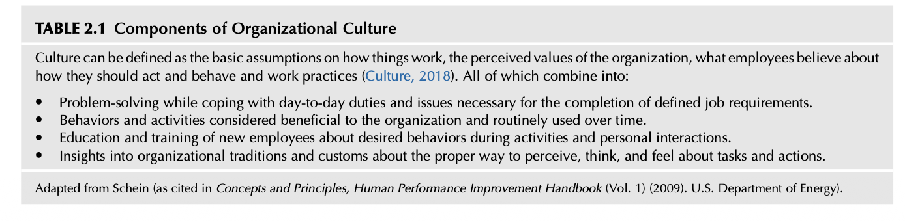
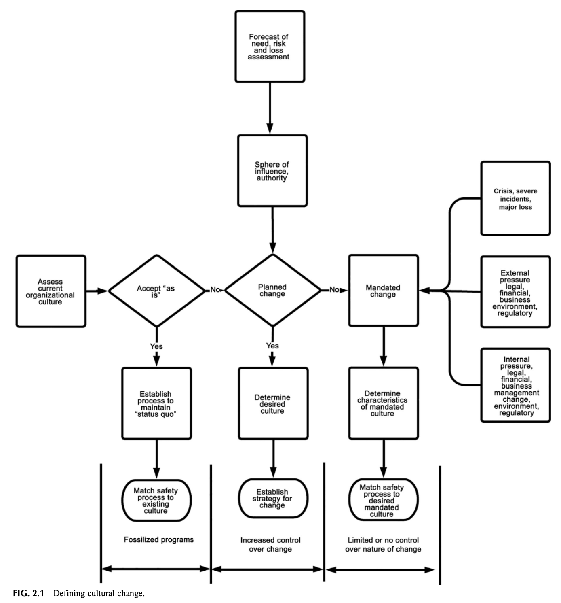
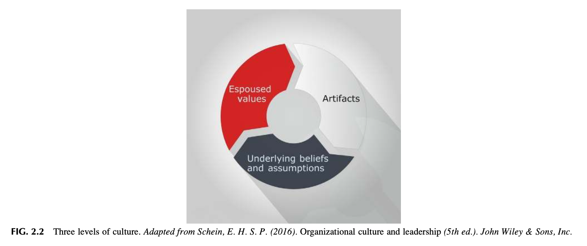
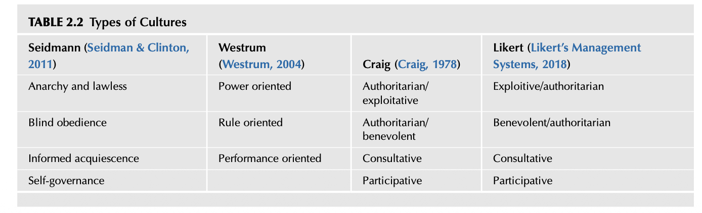
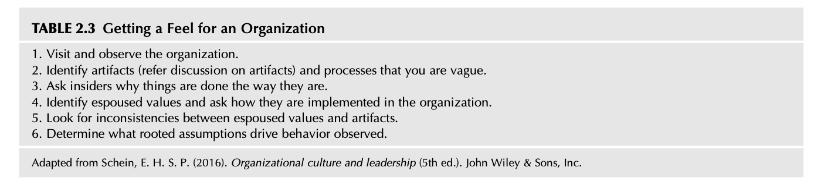
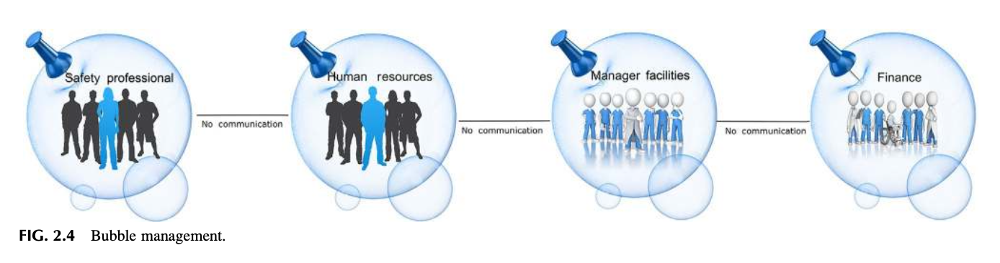
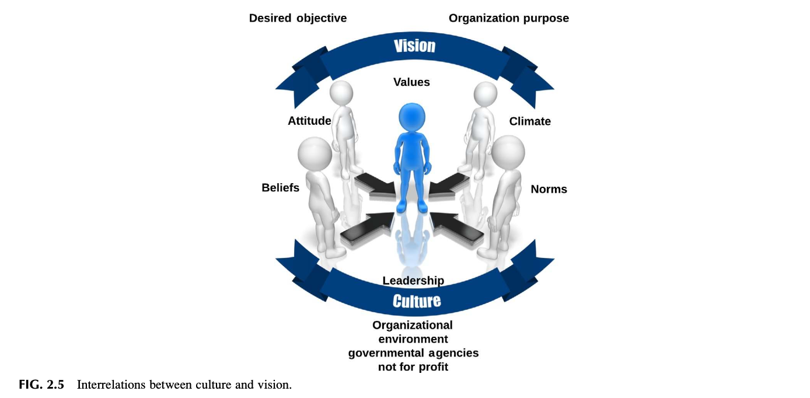
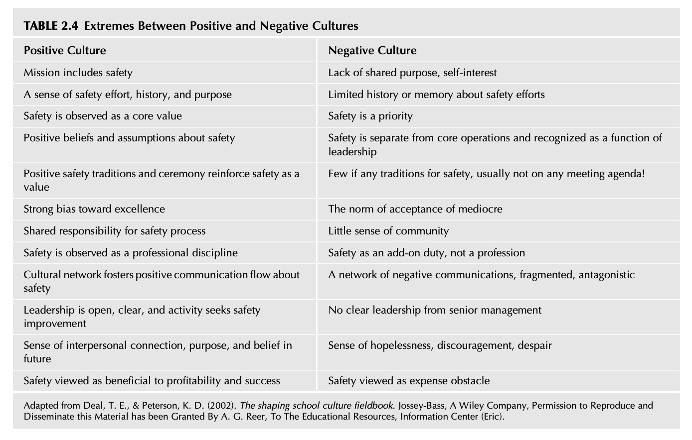

# Chapter 2 Analyzing the Organizational Culture
Cultural legacies are powerful forces. They have deep roots and long lives. They persist, generation after generation, virtually intact, even as the economic and social and demographic conditions that spawned them have vanished, and they play such a role in directing attitudes and behavior that we cannot make sense of our world without them. Gladwell (2008)

## INTRODUCTION
Understanding the culture of an organization increases the potential for the effective development of a safety management system. Organizational cultures develop under different conditions, and this history creates a unique style and personality. These characteristics need different approaches to be used when deploying and sustaining a safety management system. An organization, whether public or private, large, or small, is constantly adjusting to its environment to meet internal and external pressures and demands. To understand an organization’s safety culture, defining how the safety management system is to work within this environment of constant change is the first step. To maintain resilience, programs and actions must be aligned with how an organization solves problems, makes decisions, and supports internal and external relationships. Safety Culture. https://doi.org/10.1016/B978-0-12-814663-7.00002-9 Culture is both a dynamic phenomenon that surrounds us at all times, being constantly enacted and created by our interactions with others and shaped by leadership behavior, and a set of structures, routines, rules, and norms that guide and constrain behavior. Schein (2016) Considerable research has been developed concerning the definition of organizational culture. The last thing a fish would ever notice would be water. Linton (2018) Ralph Linton’s statement is true and can be directly applied to culture. Without an understanding of the culture of an organization, efforts to shape the safety culture can be limited by hidden constraints and boundaries. Starting with an understanding of the culture gives the advantage of knowing how to change and fine-tune a safety process to work within specific constraints. On completion of this chapter, you should be able to:
* Identify the elements of organizational culture.
* Identify and discuss the three levels of organizational culture.
* Define and discuss the elements of a safety culture.
* Identify the possible types of organizational cultures.
* Identify ways to change a culture.
* Identify the nine “red flags.”

## WHAT IS ORGANIZATIONAL CULTURE?
What is organizational culture? Why is understanding culture essential to the development of an effective safety management system? Dr. Edgar Schein, the leading expert on the study of organizational culture, provides a definition “…a pattern of shared basic assumptions that the group learned as it evolved its problems of external adaptation and internal integration. Over time this pattern of shared assumptions has worked well enough to be considered valid and, therefore, to be taught to new members as the correct way you perceive, think, and feel about those problems” (as cited in Concepts and Principles, Human Performance Improvement Handbook, 2009). The basic components, values, norms, beliefs, and practices can work for sustaining a safety culture or can become a barrier to improving that culture. Daily feedback from the leadership strengthens positive assumptions about safety and ingrains them into the fabric of the organization. Refer Chapters 8 and 11 for insights on how to strengthen feedback. Refer Table 2.1 for a discussion of the components of organizational culture. When it comes to personalities, one size does not fit all. Even when they are all in the same situation, some individuals will be more sociable, or nervous, or talkative, or active than others. And when the situation changes, those difference are still all there. Funder (2016) The general assessment of readiness for implementing a safety management system entails determining the general organizational environment. First, does the organization want to change? If the “status quo” is initially healthy and until conditions can change, then the system should fit the current organizational culture. Second, the organization may be open to change and wishes to improve the work environment. The system can now evolve and conform to the new culture (refer Fig. 2.1).

TABLE 2.1 Components of Organizational Culture Culture can be defined as the basic assumptions on how things work, the perceived values of the organization, what employees believe about how they should act and behave and work practices (Culture, 2018). All of which combine into: Problem-solving while coping with day-to-day duties and issues necessary for the completion of defined job requirements. Behaviors and activities considered beneficial to the organization and routinely used over time. Education and training of new employees about desired behaviors during activities and personal interactions. Insights into organizational traditions and customs about the proper way to perceive, think, and feel about tasks and actions. Adapted from Schein (as cited in Concepts and Principles, Human Performance Improvement Handbook (Vol. 1) (2009). U.S. Department of Energy). A severe loss, such as faced by the National Aeronautics and Space Administration (NASA), makes the need for change evident. Change and the nature of the system are mandated, and there is limited flexibility on how things will be implemented. Assumption, “an assuming that something is true” (Assumption, 2018). Are employees listening to what the “system” is telling them? In both the Challenger and Columbia accidents: “The machine was talking to us, but nobody was listening.” Deviations from requirements had become the normal business for the National Aeronautics and Space Administration (NASA). The Columbia Accident Investigation Board (CAIB) report referred to this as the “normalization of deviations.” (Lessons Learned from the Columbia Space Shuttle Accident and Davis-Besse Reactor Pressure-Vessel Head Corrosion Event, 2005). It is not just employees. Leadership can be lulled into not acting when signals are sent that something is not right. An organization may be forced into changing its culture due to the crisis and extreme external pressures. As a classic example, the U.S. Department of Energy’s findings on the Challenger Disaster and Davis Besse Reactor Pressure-Vessel Head Corrosion Event outline the following: Organizational culture refers to the basic values, norms, beliefs, and practices that characterize the functioning of a particular institution. At the most basic level, organizational culture defines the assumptions that employees make as they carry out their work. An organization’s culture is a powerful force that persists through reorganizations and the departure of key personnel. Lessons Learned from the Columbia Space Shuttle Accident and Davis-Besse Reactor Pressure-Vessel Head Corrosion Event (2005)

## RECENT HISTORY
In more recent times the Tenerife disaster on the 27th of March 1977 remains the deadliest accident in aviation history with the highest number of airliner passenger fatalities. In this disaster, 583 people died when a KLM Boeing 747 attempted take-off and collided with a taxiing Pan Am 747 at Los Rodeos. Pilot error, communications problems, fog, and airfield congestion (due to a bombing and a second bomb threat at another airport) all contributed to this catastrophe. Safety Culture and Safety Management Systems in Ireland (2011) Developing attributes within the overall culture is essential in keeping hazards and associated risk visible. As an example, a resilient safety culture retains a history of the nature and scope of hazards and associated risks to guide leadership decisions. The importance of properly communicating the scope of risk is a critical function of the safety management system. Refer Appendix 2.1, Safety Culture Traits, and Indicators, 2.2, Do you Know Your Safety Culture, and 2.3, DOE Columbia Quote for insights on culture traits, A Basic Checklist on how well you Know Your Safety Culture, and potential impact. Acceptance of known hazards and associated risk can become part of the organization’s belief system and become the norm! In effect, putting one’s self at risk of injury is acceptable if the task gets done and may even be rewarded in some fashion. “When excellence in safety is measured by zero failures, a self-limiting organizational viewpoint and very dangerous employee belief are created:” “If safety means no incidents, then anything that I do that doesn’t result in an incident or get me hurt, must be safe.” When this occurs, the risk will be overlooked, complacency will set in, an important and healthy degree of vulnerability of risk will be lost, and organizations will be surprised by an incident that occurs out of nowhere. Leadership dialogue will often sound like: “I can’t believe an experienced, well-trained employee did that,” or, “How did we miss that?” (Galloway, 2012)
## THREE LEVELS OF CULTURE DEFINED
An understanding of what constitutes an organizational culture provides a foundational approach to reviewing a culture. In the book, Organizational Culture, and Leadership, Schein describes culture as having three primary levels, Artifacts, Espoused Values, and Underlying Assumptions (Schein, 2016). The following discussion provides insights on how these levels can be used to assess the depth and scope of the safety culture.
### ARTIFACTS
The first level consists of Artifacts, the visible organizational structures and processes. These are the tangible things seen in facilities or review of the environment of the organization. For example, general housekeeping, that is, the general

FIG. 2.1 Defining cultural change.
orderliness of work areas, the appearance of equipment and its maintenance, the visible work environment including the type and design of facilities, warning signage, written safety material, policies, training rooms, and dress codes indicate what the underlying assumptions and beliefs are in the organization. Artifacts indicate the nature and style of the organizational culture. As an example, in going through the corporate office of a client, Nathan noted that each cubicle was occupied by not one but two employees that shared one telephone and one file cabinet. What would you surmise about the nature of the leadership? Authoritarian/exploitative type? Leadership did not see the need for designing an efficient, pleasant work environment, and had a low opinion of its employees. With no capital budget for a decent corporate office, could a budget for safety-related materials and programs be expected from this leadership team?
### Observation 1
Nathan visited a client on a training project to help outline the basics of controlling risk. On leaving the session, he noted a large display that told employees to take the risk! Risk has several definitions that can send different signals opposed to each other.
### ESPOUSED VALUES
The second level of culture involves the espoused values, consisting of the content of various strategies, goals, and core philosophies used by the leadership to guide the organization. What does the organization say about itself? These espoused values can be expressed in forms of safety slogans, mission statements, and various communications made with regards to safety and the value of employees. The activity-based safety process will be discussed in Chapter 11. The chapter details the importance of preshift meetings to set the tone for each workday. Other techniques designed to shift the perception of safety at the employee level are discussed in detail.
### UNDERLYING ASSUMPTIONS AND UNSPOKEN RULES
The third level of culture is invisible but must be addressed if a safety culture is to be developed by an organization. These are the underlying norms and unspoken rules followed by leadership and employees of the organization. This invisible level may be at odds with the espoused values. By observing artifacts and reviewing how well expressed espoused values are followed, the underlying beliefs and values that drive the organization might be determined. Evaluation is not an easy task. The organization may espouse “safety as a value,” yet the underlying belief is safety is not even a high priority (Concepts and Principles, Human Performance Improvement Handbook, 2009; Schein, 2016).
### Observation 2
All the authors have experienced the gap between what companies espouse as a value and what observations (artifacts) show as the real norms and rules. Refer Fig. 2.2 for a summary of three levels of culture.

FIG. 2.2 Three levels of culture. Adapted from Schein, E. H. S. P. (2016). Organizational culture and leadership (5th ed.). John Wiley & Sons, Inc.

## SAFETY CULTURE DEFINED
A safety culture goes beyond providing the means for required regulatory compliance programs. In the authors’ experience, the test of an organization’s safety management system is in how it is sustained during times of ongoing change. Leadership changes, new personnel, budgetary crisis, mergers, and other situations can have either a positive or negative impact on all aspects of an organization. Safety programs or activities can quickly disappear unless the organization has fully internalized the concepts necessary to keep inherent operational hazards and associated risk within acceptable control. The first mention of “Safety Culture” is found in the incident report completed following the Chernobyl nuclear plant disaster of in 1986. The term “Safety Culture” was first introduced in the International Atomic Energy Agency’s (INSAG) Summary Report on the Post- Accident Review Meeting on the Chernobyl Accident (Safety Culture Series, 1986). And further expanded on in Basic Safety Principles for Nuclear Power Plants, Safety Series No.75-INSAG-3, issued in 1988 (Safety Culture Series, 1988). Since the publication of these two reports, the term Safety Culture has been used increasingly in the literature in connection with nuclear plant safety. The meaning of the term open to interpretation and on how a successful Safety Culture could be assessed. The stated reports deal with the concept of Safety Culture as it relates to organizations and individuals engaged in nuclear power activities and provides a basis for judging the effectiveness of Safety Culture in specific cases to identify potential improvements (Safety Culture Series, 1991). The International Atomic Energy Agency defined the universal features of a safety culture which have been further defined as Safety Management Systems were developed (Safety Culture Series, 1991). Universal Features of Safety Culture In all types of activities, for organizations and individuals at all levels, attention to safety involves many elements as outlined in the Safety Culture Series:
* An individual’s awareness of the importance of safety.
* Knowledge and competence, conferred by training and instruction of personnel and by their self-education.
* Commitment, requiring demonstration at the senior management level of the high priority of safety and adoption by individuals
of the common goal of safety.
* Motivation, through leadership, the setting of objectives and systems of rewards and sanctions, and through individuals’ selfgenerated attitudes.
* Supervision, including audit and review practices, with readiness to respond to individuals’ questioning attitudes.
* Responsibility, through the formal assignment and description of duties and their understanding by individuals.
Safety Culture has two general components. The first is the necessary framework within an organization and is the responsibility of the management hierarchy. The second is the attitude of staff at all levels in responding to and benefiting from the framework (Safety Culture Series, 1991).
### Observation 3
The authors have reviewed organizations to help them to jump-start safety efforts which evaporated when the organizational change occurred. In many cases, a safety manager had left the company, and the safety process stopped as it was kept only by the strength of one individual who was the only one responsible for safety. The safety process was not part of the organizational “fabric” and not a value. While the fundamental concepts of various safety management systems can be similar, how a safety process is deployed and sustained will vary based on the organization’s culture. Program elements, safety-related activities, and so on, that work in one operation, department, or even sister companies may or may not be practical elsewhere.
### Observation 4
Mike presents an interesting analogy for safety culture. He equates safety culture to “terroir,” the environmental conditions, such as soil and climate, in which grapes are grown and gives to wine its unique flavor and aroma, and so on. Terroir forms the characteristics of the wine. The correlation is safety culture develops from all the various environments, work conditions, organizational politics, management philosophy, personnel, industry characteristics, and so on, and determines the safety culture.

## ASSESSING THE CURRENT SAFETY CULTURE
Safety culture is also an amalgamation of values, standards, morals, and norms of acceptable behavior. These are aimed at supporting a selfdisciplined approach to the enhancement of safety beyond legislative and regulatory requirements. Therefore, safety culture must be inherent in the thoughts and actions of all the individuals at every level in an organization. The leadership provided by top management is crucial. Management of Safety, Safety Culture, and Self Assessment (2000)
### Observation 5
As part of underwriting studies for insurance placement, Nathan visited prospective companies to discuss their safety process to determine their overall risk status. In retrospect, what he was doing was an attempt to determine through observation of the various artifacts and discussions about the espoused values, as evidenced by mission statements, policies, procedures, and so on, the status and strength of the safety culture. In these reviews, the underwriters want to know: “Is this prospective Insured maintaining a safe work environment and is it serious about keeping hazards and associated risk under control?” If the observed artifacts indicate that issues exist that increased the potential for loss-producing events and did not reflect the espoused values, then the underlying belief system was different from the espoused values. An example, an espoused value was inspections to be done routinely and deficiencies immediately corrected. If observations were noted that there were maintenance and housekeeping problems, then the real belief was inspections were not considered significant. An organization with a good safety culture relies on the close interdependence between fundamental safety and organizational processes. In practice, a high level of safety culture means the systematic organization and implementation of activities aimed at creating high quality technical, human, and organizational systems. Management of Safety, Safety Culture, and Self Assessment (2000)
### Observation 6
James advocates combining a walk-through of a facility making visual observations with employees and supervision interviews to best identify and target gaps in the safety culture. This observation is based on 30 plus years of experience reviewing facilities and implementing safety management systems as a safety professional.

## HABITS AS PART OF THE CULTURE
Habits are defined as “an acquired behavior pattern regularly followed until it has become almost involuntary, i.e., the habit of looking both ways before crossing the street” (Habit, 2018). As culture involves patterns of behavior, unless old beliefs that allow at-risk behaviors to be acceptable are eliminated, unsafe activities become habitual norms and will continue to exist. Duhigg suggests that an understanding of what he calls “keystone habits” is needed. Keystone habits have the “power to start a chain reaction, changing other habits as they move through an organization.” Duhigg states that these keystone habits “start a process that, over time, transforms everything” (Duhigg, 2012). Duhigg believes that “the habits that matter most are the ones that, when they start to shift, dislodge, and remake other patterns” (Duhigg, 2012). Changing a keystone habit impacts the culture and in turn, changes an entire organization. Duhigg used the example of how Alcoa began changing its overall culture in the late 1980s. The new CEO, Paul O’Neill, wanted to improve the way Alcoa did business by improving its quality and methods of production. O’Neill used a strong emphasis on Alcoa’s safety program to create keystone habits to change poor organizational traits that impacted the entire corporation. Alcoa built a robust safety process that in turn improved the overall performance of its operations. During this period, safety became an ingrained habit and underlying value that remained in place long after O’Neill left Alcoa. As of 2013, Alcoa’s safety and health programs remain healthy and robust (Benton, 2017; Cable, 2014; Ross, 2012). Cultures grow out of the Keystone habits in every organization, whether leaders are aware of them or not…. Keystone habits transform us by creating cultures that make clear the values that, in the heat of a difficult decision or a moment of uncertainty, we might otherwise forget. Charles Duhigg, “Power of Habit” (Duhigg, 2012) In this case, the CEO went straight to the core of Alcoa’s assumptions and beliefs. An assumption existed that safety was unrelated to other issues impacting the success of the organization. By realizing safety-related matters touched on all areas of the organization he was able to begin the process of changing underlying beliefs by creating a different series of key habits.
## POSSIBLE CHARACTERISTICS OF A CULTURE
When determining the nature of organizational culture, each aspect of the culture must be assessed to determine the driving characteristics of the organization and how they are interconnected. With this understanding, the potential for shaping the safety culture is enhanced, and the required time frame for change may be decreased. This will be discussed in more detail in Chapter 4. Knowing the type of management style provides insights on how to approach and work with leadership. Refer Table 2.2 for an outline of the types of cultures suggested by several authors. The styles followed by each of these authors appear to have similar characteristics and support an overall theme. After understanding the type of culture, the safety management system is designed to match the culture. This further understanding aides in a more proficient communication approach to leadership. For example, developing an employee participative approach has less chance of success if the leadership culture is authoritarian. As a cautionary note, these definitions represent a spectrum of types and are not hard and fast boundaries. A further complication is that general styles may change as leadership or conditions evolve or also change.
### LESSON LEARNED 1
Nathan worked with a safety manager whose immediate boss had recently changed. The previous manager was in the performance/ consultative style. He would provide complete details of what he was doing and provided lengthy memos. His next manager was more in the style of benevolent authoritarian. The new manager did not want details or discussion, but brief bullet points of safety activities which deemphasized the safety manager’s role. The shift in style impacted more than just memos, and the safety manager left the organization.
### Observation 7
Another organization had an unwritten rule that managers were to come in early, well before official office hours and work late every day. Each manager was also required to spend at least half of each Saturday in their office, even if they did not have anything to do! The CEO believed that their presence and long work hours proved their dedication and were oblivious to the rules’ negative impact.

TABLE 2.2 Types of Cultures Seidmann (Seidman & Clinton, 2011) Westrum (Westrum, 2004) Craig (Craig, 1978) Likert (Likert’s Management Systems, 2018) Anarchy and lawless Power oriented Authoritarian/ exploitative Exploitive/authoritarian Blind obedience Rule oriented Authoritarian/ benevolent Benevolent/authoritarian Informed acquiescence Performance oriented Consultative Consultative Self-governance Participative Participative
### LESSON LEARNED 2
James was involved with a diverse team of employees from several departments who was tasked with solving general safety-related issues. The team was provided a budget to implement their findings and did not have to ask permission of the leadership team to spend any funds. They were trusted to accomplish their mission and act responsibly. This is an example of a participative or consultative type of culture.
## COMMUNICATION
From a hazard and associative risk standpoint, the objective is to ensure that safety-related issues and concerns get communicated to decision makers as quickly as possible without barriers. The design of risk communication will vary with the type and style of the culture. The participative type may allow sharing of information more manageable as employees are considered trusted professionals and expected to communicate. Decisions on future actions do not necessarily require a senior level involvement, just consensus on potential solutions to the problem fixed first and discussed later for proper follow-up. The problem is that these cultural types and styles may produce communication barriers and screening of information. Mid-level leaders and employees may not want to pass along “bad news” or problems, given they might be held accountable or punished in some way. Refer Table 2.3 for a list of areas that will help the safety professional to get a feel for an organizations behavior.
### Observation 8
James, during mergers, would call plant managers to discuss their process so that he could assess their knowledge of their safety system. He would record the date and time he called and when and if the phone call was returned. The time the person took to return the call was a good indicator of the level of interest and level of priority that would be given to the safetyrelated visit. The lesson learned: the plant managers that returned James phone call, promptly, were more apt to discuss safety efforts at their plant location and request a plant visit to review their safety system. A meet and greet session.
## SILO MANAGEMENT
A significant problem with many organizational safety cultures is that the safety management criteria are not communicated effectively to divisions, departments, leadership teams, and employees. In various cases, safety professionals are “challenged with implementing an effective safety management system, yet have to overcome the ‘silo mentality’” (Howell, 2015). “Silos are destructive organizational barriers that result in department inefficiencies and lack of crossfunctional solutions” (Dorn, 2015). What is a silo? A mind-set present when certain departments or sectors do not wish to share information with others in the same company. This type of mentality will reduce efficiency in the overall operation, reduce morale, and may contribute to the demise of productive company culture. Silo Mentality (2018) An organizational silo can “isolate, one system, process, department, etc., from others” (Silo, 2018). Where silos exist, they are not healthy for an organization as they stifle relationships and communications between different departments and individuals. “With a silo mentality, each division or department tends to focus on its primary objectives, rather than wider organizational goals”(Health, Safety, and Silo working, 2012). Refer Fig. 2.3 that represents silo management.

TABLE 2.3 Getting a Feel for an Organization
1. Visit and observe the organization.
2. Identify artifacts (refer discussion on artifacts) and processes that you are vague.
3. Ask insiders why things are done the way they are.
4. Identify espoused values and ask how they are implemented in the organization.
5. Look for inconsistencies between espoused values and artifacts.
6. Determine what rooted assumptions drive behavior observed.
Adapted from Schein, E. H. S. P. (2016). Organizational culture and leadership (5th ed.). John Wiley & Sons, Inc.

FIG. 2.3 Silo management.
The effects of a silo mentality reduce efficiency in providing an overall safe operation and contribute to the degrading of the safety culture. As the safety professional must span across the organization, the safety management system can help break down barriers by sharing and encouraging communication once the silo mentality has been broken down. The solution we devised was a “team of teams,” an organization within which the relationships between constituent teams resembled those between individuals on a single team: teams that had traditionally resided in separate silos would now have to become fused to one another vis trust and purpose. McChrystal, Fussell, Collins, and Silverman (2015)

FIG. 2.4 Bubble management.
### Observation 9
James encountered a silo mentality when he was put in charge of several new plants after a merger. When dealing with the gaps existing between the plants, he used the term “bubble management,” as bubbles are sometimes lacking firmness, solidity, or reality (Bubble, 2018). He observed individual groups choosing not to communicate with each other, trying to remain isolated from any changes in the organization. A “bubble” type of relationship can result in several different types of safety culture created by not supporting each other similar to the silo mentality (refer Fig. 2.4).

## NATIONAL AND OCCUPATIONAL CULTURES
Two other aspects of culture must be considered. First, the tendency is to expect people from different cultures to think and behave in similar ways. The assumption is made that what is said and how the world is perceived is the same in various regions, nations, and business cultures. Each region and country has a prevailing culture. How power is shared, class and hierarchy, relationships allowed, and so on, will vary. What may work in one country (or industry or company) may not be accepted in another (The Hofstede Centre, 2018). While organizational culture can vary from company to company and department to department, a further complication is with international enterprises now the norm. International understanding of diverse cultures is essential as variations in traditions, language, and mannerisms impact perceptions held by leadership and the organization. Second, the various specialty areas of an organization have their own cultures. As previously discussed, an image, type of personality, egos, perceived beliefs, style of communication; the level of trust, desired status, and so on, shades of how individuals are viewed. As a point of interest, what images immediately pops into your mind with the following positions? Banker, Car Salesperson, Politician, Engineer, Cowboy, Miner, “Blue-collar” Worker, Oilman, Pilot, and Military Officer. These stereotypes are reinforced by media, stories, and expected norms and can give insights into the behavior that might be expected when safety programs are introduced and deployed (Schein, 2016). Stereotype “to repeat without variation,” “to develop a mental stereotype about” (Stereotype, 2018). Further, stereotypes provide shorthand information, for better or worse, about the expected occupational culture of each of the groups as discussed. A person is viewed by an occupational culture stereotype. Safety professionals are expected to have specific ways of behaving as well as assumptions about how a safety process is supposed to work. These assumptions can taint organizational opinions and perceptions about what must be accomplished and how to go about managing the safety process. This stereotype must be considered as the overall organizational culture expects a certain way for a safety professional to act. For example, when trying to shift an organization away from the “No Loss No risk” mind-set, resistance to change can be expected as it goes against the stereotype of what is expected. After all, nothing has happened so why the need for risk assessment?

## SAFETY CULTURE AS MISSION-ESSENTIAL BUSINESS PRIORITY
Leadership sets the business priorities for the many activities necessary to accomplish its primary organizational mission, which is survival in its niche in the marketplace. Leadership must focus on “mission-essential” activities to the highest

FIG. 2.5 Interrelations between culture and vision.
degree possible. Because of the stereotype held about safety, an ongoing effort must be made for it to be considered “mission-essential.” Goals and objectives should be mission-essential as will be discussed in Chapter 4. Mission-essential activities are the designated actions and criteria that ensure the vision or intent of the organization has the highest possible chance of being accomplished. To understand if the safety process meets the meaning of Mission-Essential, ask the following questions:
* What are you doing each day that moves and aligns your efforts with the organization’s vision, goals, and objectives?
* What safety management system mission-essential priorities are being pushed instead of other organizational projects? Why are
those projects given precedent? Refer Fig. 2.5 for an overview of the interrelationship between culture and vision.

## CAN A CULTURE BE CHANGED?
What activities are currently being stressed that is not mission-essential to the safety management system? Refer Table 2.4 for the extremes that might be found between positive and negative cultures. Although these elements are written with a school in mind, a similar thought holds for general industry: A key question is, can culture be shaped by leadership, or is it so amorphous and unalterable that it has a life of its own? Although school culture is deeply embedded in the hearts and minds of staff, students, and parents, it can be shaped by the work of leaders. As this book demonstrates, one of the key tasks of leaders is shaping culture through a myriad of daily interactions, careful reflection, and conscious efforts. Deal and Peterson (2002)

## CONDUCTING A BASIC GAP ANALYSIS
A strategy is needed on how to present finding for improving the safety management system to the leadership team. An understanding of the overall “political” climate is needed which is why a detailed review of the current history of the safety process is necessary. What actions can be taken immediately to increase the potential to shape the safety culture of an organization? A gap analysis will describe the current organizational culture, its characteristics, and traits. The following questions must be addressed before attempting to modify or change the safety culture:

TABLE 2.4 Extremes Between Positive and Negative Cultures Positive Culture Negative Culture Mission includes safety Lack of shared purpose, self-interest A sense of safety effort, history, and purpose Limited history or memory about safety efforts Safety is observed as a core value Safety is a priority Positive beliefs and assumptions about safety Safety is separate from core operations and recognized as a function of leadership Positive safety traditions and ceremony reinforce safety as a Few if any traditions for safety, usually not on any meeting agenda! value Strong bias toward excellence The norm of acceptance of mediocre Shared responsibility for safety process Little sense of community Safety is observed as a professional discipline Safety as an add-on duty, not a profession Cultural network fosters positive communication flow about A network of negative communications, fragmented, antagonistic safety Leadership is open, clear, and activity seeks safety improvement No clear leadership from senior management Sense of interpersonal connection, purpose, and belief in Sense of hopelessness, discouragement, despair future Safety viewed as beneficial to profitability and success Safety viewed as expense obstacle Adapted from Deal, T. E., & Peterson, K. D. (2002). The shaping school culture fieldbook. Jossey-Bass, A Wiley Company, Permission to Reproduce and Disseminate this Material has been Granted By A. G. Reer, To The Educational Resources, Information Center (Eric).
* What does the organization value?
* How are priorities established within the organization?
* What is the status of the current safety culture? Gather as much information about the organization as possible as well as
the perception, effectiveness, and inclusion of safety-related activities?
* Does the perception and assessment of the current safety culture match that of organizational leadership?
* Does a gap exist between what the employees and leadership believe?
* What are the “mandates” of leadership?
* What is the safety process mission? Does it develop, sustain, or improve the safety culture?
* What structures and processes are needed to ensure that the safety culture can be maintained in the organization?
* How are quality, production, finance, human resources, and so on, managed within the organization? Is safety managed
similarly?
* How are employees trained, educated, and oriented to the desired norms and values of the organizations? Is training
adequate for the scope of risk and hazards?
* Are safety concepts considered part of these norms and values?
* How are safety responsibilities and expected behaviors communicated and enforced within the organization?
* Is information about critical, uncontrolled hazards or associated risks communicated to the leadership team in a format
that matches their current communication style?
* Does the leadership team understand what is being communicated and its potential consequences?
* Are hazards and associated risk accepted too low in the organization?
The gap analysis should include a thorough understanding of the organization’s current culture’s state and the desired future state of the culture. From this assessment, a strategy for change can be developed. Depending on the leadership mandate, an initial strategy would be to continue to maintain the existing safety process and its programs while communications are established, and the information is gathered on what is needed to be changed. Nonetheless, action should be taken when severe or life-threatening conditions are found that need immediate change. The challenge is ensuring that serious and life-threatening situations are immediately communicated to those making decisions.
## NINE WARNING FLAGS FACTORS THAT DEFEAT CONTROL
According to a study conducted by the Institute for Nuclear Power Operations (INPO) as cited in the DOE Human Performance Manual (Concepts and Principles, Human Performance Improvement Handbook, 2009), nine common weaknesses can serve as “warning flags” that may degrade a safety culture. The INPO concluded, “that these latent conditions are conducive to the degradation and accumulation of flawed controls and human-performance-related events” (Concepts and Principles, Human Performance Improvement Handbook, 2009). Use the nine flags as another way to evaluate the organization. Look for indications or signs of the following:
1. Overconfidence: The organization has begun to believe that since there are no losses, the risk is low. The organization’s
history of injury and loss-producing events is good as compared to its industry, and no significant loss events have occurred. Safety meetings, inspections, policies, and procedures, and so on, are not followed as routinely as once before. Indications of safety issues and problems are not reviewed or analyzed.
2. Isolationism: Interactions with other organizations, professional groups, regulatory, and industry groups are rare or nonexistent. Benchmarking is seldom done. Changes in best management practices are not implemented in incident investigation reports, employee feedback, and hazard and associated risk issues identified by other organizations. The
organization lags the industry in many areas of performance and may be unaware of the real scope of hazards and associated risk. No risk assessment is in place to detect a high probability of a loss-producing event.
3. Defensive and Adversarial Relationships: The mind-set toward the regulatory agencies or professional groups is
defensive. Recommendations are met with the comment “Is this required by the Occupational Safety and Health Agency (OSHA), or another regulatory body)” The main thrust of safety activity is to “do the minimum.” Employees are not involved in the safety process and are not listened to when they communicate concerns about potentially hazardous conditions. The safety function is viewed as adversarial to productivity and profitability, as poor relationships limit open communication.
4. Informal Operations and Weak Engineering: Standard operating procedures, formal approaches to maintenance, housekeeping, and quality are weak. Discipline is lacking, and a lackadaisical atmosphere toward safety is present. Other
organizational factors such as changes in leadership, new initiatives, and special projects overshadow the intended vision/mission, goals, and objectives. Engineering is weak, and design criteria do not consider safety criteria as an organizational priority. Maintenance reporting systems do not put unsafe conditions as a higher priority.
5. Production Priorities: Important machine and equipment problems such as machine guarding defects, electrical system
corrections, and other repairs are postponed, keeping production going. Focus on safety is not stressed in employee interactions and site communication.
6. Inadequate Change Management: Organizational changes, staff reductions, retirement programs, relocations are initiated before their impact or unintended consequences are considered. The new hire process includes orientation, and
training, but are not used to compensate for the operational change. Processes and procedures have not been adjusted following leadership and operational changes.
7. Plant Operational Events: Loss-producing events are unrecognized or underplayed. Reactions to such events and
unsafe conditions are low level or limited in scope and do not reach the attention of the leadership team. Causal factors of loss-producing events are not explored in depth and a systematic manner.
8. Ineffective Leaders: Leadership is poor, defensive when problems are identified, limited in team skills, or are weak
communicators in all areas. The leadership team is not involved in operations and does not exercise accountability or follow up on safety-related issues. Leadership has limited operational knowledge or experience and is not actively learning.
9. Lack of Self-Criticism: The audit or assessment of the organization is limited by a lack of an unbiased outside view. The
assessment system is not formal, and any results are not part of the leadership team’s internal review. These observations can detect disconnects between operating conditions and the existing self-assessment. Problems remain unidentified, unreported, or not addressed (Roughton & Crutchfield, 2010; Concepts and Principles, Human Performance Improvement Handbook, 2009). The importance of organizational networking in the developing of an effective safety culture will be discussed in Chapter 3. The discussion will be centered around how organizational networking importance cannot be overstated. Concepts will suggest that an organization is considered a complex web of personal and professional networks. How a personal network allows the sending and receiving of information about the safety culture; the organizational environment; and its related issues, problems, or concerns.

## SUMMARY
The implementation, sustaining, or improvement of a safety culture requires an almost Sherlock Holmes-like ability to use observation and logic to identify what, where, and how underlying organizational characteristics and traits impact the safety management system. Just as the fictional character Sherlock Holmes (Sherlock Holmes, 2018). Culture is the result of the long-term experience of the organization regarding successful problem-solving, various personalities, conditions related to both past and present. If the leadership team desires to improve the safety process, it must ensure that its message has been defined by clear intent and expectations. Safety is the interaction that results from:
* Organizational beliefs, values, and structure.
* Processes and operational elements.
* Skills and knowledge of the people hired to use those processes and operational elements.
* The leadership team and its desires and goals.
* The social and physical environment necessary to reach its stated goals. The reason for its existence.
The safety management system should be evaluated for overall efficient design and structure that matches the organization’s overall operational structure with its inherent hazards and associated risks. An understanding of how “Culture” is defined and the application of this understanding provides insights on how all the aspects of the organization fit together as discussed in Chapter 1.

## CHAPTER REVIEW QUESTIONS
1. Explain why understanding the organizational culture is essential to increase the potential for the effective development and implementation of a safety process.
2. What is organizational culture? Why is it considered essential to the development of an effective safety management
system?
3. Discuss the components of organizational culture as outlined in Table 2.1. Explain why they are important to the safety
management system.
4. Compare and contrast the three levels of culture. Explain why it is important to understand these concepts.
5. Explain the patterns of behavior that create habits in a safety culture.
6. Determine the nature of a culture you have worked in. Consider each aspect of the culture that is involved in driving
personalities and characteristics of the organization and how they are interconnected.
7. Refer Table 2.3, Getting a Feel for an Organization, and list the elements that are discussed. Provide some additional
items to this list based on your experience. Explain how this influences the safety management system and the safety culture.
8. Organizational cultures can vary from department to department, even from a plant to plant. A further complication
occurs when a company has various international entities. Explain how cultural misunderstandings might develop.
9. Leadership sets the business priorities for the many activities necessary to accomplish its primary organizational
mission which is survival in its niche in the marketplace. Explain why this is important to define the “missionessential” safety activities.
10. List the nine warning flag factors that can defeat successful implementation of a safety management system. What
strategy would you follow to overcome them? Where would you begin?

## APPENDIX 2.1 SAFETY CULTURE TRAITS AND INDICATORS
The final safety culture policy statement issued by the U.S. Nuclear Regulatory Commission (NRC) in January 2012 provides the following traits of a positive safety culture: (1) (2) Leadership Safety Values and Actions—Leaders demonstrate a commitment to safety in their decisions and behaviors; Problem Identification and Resolution—Issues potentially impacting safety are promptly identified, fully evaluated, and promptly addressed and corrected commensurate with their significance; (3) (4) (5) Personal Accountability—All individuals take personal responsibility for safety; Work Processes—The process of planning and controlling work activities is implemented so that safety is maintained; Continuous Learning—Opportunities to learn about ways to ensure safety are sought out and implemented; (6) (7) (8) (9) Environment for Raising Concerns—A safety conscious work environment is maintained where personnel feel free to raise safety concerns without fear of retaliation, intimidation, harassment, or discrimination; Effective Safety Communication—Communications maintain a focus on safety; Respectful Work Environment—Trust and respect permeate the organization; and. Questioning Attitude—Individuals avoid complacency and continuously challenge existing conditions and activities in order to identify discrepancies that might result in error or inappropriate action. The NRC defines trait as a pattern of thinking, feeling, and behaving that emphasizes safety, particularly in goal conflict situations, for example, production, schedule, and the cost of the effort versus safety (The Safety Culture Policy Statement, 2012).
## APPENDIX 2.2 DO YOU KNOW YOUR SAFETY CULTURE: A BASIC CHECKLIST
Safety culture is difficult to measure. “Organizational culture refers to the basic values, norms, beliefs, and practices that characterize the functioning of a particular institution” (Department of Energy, Lesson Learned from the Columbia Space Shuttle Accident and Davis-Besse Reactor Pressure-Vessel Head Corrosion Event, 2005; Promoting a positive culture, A guide to health and safety culture, 2015). The following is a basic checklist to help assess your safety management system and safety culture. If you can answer yes to most of these, you are on a pathway to success (Middlesworth, 2018). Safety Culture Question Yes No Do you observe visible leadership commitment at all levels of the organization? Do all employees throughout the organization exhibit a working knowledge of safety topics? Is there a clear definition of the desired culture the organization wishes to achieve? Are there competing priorities for safety activities? Is safety thought of as a priority? Is there visible evidence of a financial investment in safety? Are there opportunities for improvement identified and resolved before a problem occurs? It there a regular, facility-wide communication on safety topics? Is there a fair discipline system is in place for all employees? Is there meaningful involvement in safety from everyone in the organization? Does the Leadership team spend an adequate amount of time out on the shop floor talking to employee about safety issues? Is there a high rate of participation in safety activities at an all-time high, indicating that employees are highly motivated, and the marketing of safety improvements are effective? Are employees actively engaged in safety activities, producing tangible results? Do employees report high job satisfaction due to the company’s commitment to their well-being? Is safety the first item on the agenda of every meeting? Do employees feel comfortable reporting safety issues to members of the Leadership team? Are there regular scheduled, detailed audits of the company’s safety program by an external auditor? Is safety a condition of employment? Does the Leadership team positively to safety issues that are raised? Are safety efforts viewed as an investment, not a cost? Does a high standard exist for accurate and detailed reporting of injuries—nothing is swept under the rug? Is there a concrete definition of what success looks like for the safety program? Are safety issues dealt with in a timely and efficient manner? Are all employees throughout the organization empowered with the necessary resources and authority to find and fix problems as they see them? If you do not have a positive response for each question, do not be discouraged, culture change takes time.

## APPENDIX 2.3 NASA CULTURE AS AN ORGANIZATIONAL FLAW
The Columbia Accident Investigation Board determined that organizational failures were as much to blame as technical failures for the Columbia accident. They identified the NASA culture as an organizational flaw that led to unintentional blind spots, group think, and silent safety. NASA’s organizational structure for the Space Shuttle Program (SSP) utilized matrixed work forces and complex, geographically separated operations that hindered effective communication. The SSP’s pyramid leadership structure allowed unqualified SSP Managers to waive any/all technical requirements. In particular, the organizational structure and hierarchy blocked effective communication of technical problems, and was not conducive to up channeling concerns over foam/debris strike on launch. Signals were overlooked, people were silenced, and useful information and dissenting views on technical issues did not surface at higher levels. What was communicated to parts of the organization was that foam debris strikes were not a problem. Often key decisions were made based on abbreviated PowerPoint briefings, not on thorough, data-supported research. Organizational structure had similar impacts at Davis-Besse. At the Davis-Besse nuclear power station, management did not follow up to ensure that industry and NRC-mandated surveillances of vessel head integrity were conducted properly. The plant executive management team apparently relied too heavily on NRC’s resident inspectors to identify issues rather than conduct their own in-depth follow-up of operational data, work orders, and maintenance. The NRC inspectors did not communicate plant surveillance discrepancies to their management. The Davis-Besse independent oversight function did not identify the deteriorating condition of RPV heads as evidenced by the presence of boric acid deposits over a period of years. System engineers failed to assimilate the secondary effects that were indicative of a serious problem with leakage of primary coolant. Neither the Davis-Besse Quality Assurance organization nor the independent Davis-Besse Nuclear Safety Review Board was effective in detecting or identifying adverse trends that were indicative of a deteriorating situation. Lessons Learned from the Columbia Space Shuttle Accident and Davis-Besse Reactor Pressure-Vessel Head Corrosion Event (2005), Department of Energy, Lesson Learned from the Columbia Space Shuttle Accident and Davis-Besse Reactor Pressure-Vessel Head Corrosion Event (2005), Rogers (2005), and Report of Columbia Accident Investigation Board (2003)

## BIBLIOGRAPHY
Assumption. (2018). Merriam-Webster. Retrieved from: http://bit.ly/2Kg78UO. Benton, J. (2017). Safety leadership explained by former Alcoa CEO Paul O’Neill. Linkedin. Retrieved from: http://bit.ly/2fsGPwX. Bubble. (2018). Merriam-Webster. Retrieved from: http://bit.ly/2BDCi4y. Cable, J. (2014). Alcoa reports ‘safest, most environmentally efficient year on record. EHSToday. Retrieved from: http://bit.ly/2y8tjd9. Concepts and Principles, Human Performance Improvement Handbook, Vol. 1, (2009). U.S. Department of Energy. Craig, D. P. (1978). Hip pocket guide to planning & evaluation. Learning Concepts. Culture. (2018). Merriam-Webster. Retrieved from: http://bit.ly/2KcUndO. Deal, T. E., & Peterson, K. D. (2002). The shaping school culture fieldbook. Jossey-Bass, A Wiley Company, Permission to Reproduce And Disseminate This Material Has Been Granted By A. G Reer, To The Educational Resources, Information Center (Eric). Department of Energy, Lesson Learned from the Columbia Space Shuttle Accident and Davis-Besse Reactor Pressure-Vessel Head Corrosion Event (2005). U.S. Department of Energy, Public Domain, Based on Information as Presented On and Adapted for Use. Retrieved from: http:// bit.ly/2tpWIww. Dorn, D. (2015). Breaking down the silos to manage health and safety. DORN Companies. Retrieved from: http://bit.ly/2AMB7Tj. Duhigg, C. (2012). The power of habit: Why we do what we do in life and business. Canada: Doubleday. Funder, D. C. (2016). The personality puzzle (7th ed.). Retrieved from: http://amzn.to/2jgZ9KZ. Galloway, S. M. (2012). Zero incident goals motivate risk-taking, not excellence. ProactSafety.com. Retrieved from http://bit.ly/UYdfkn. Gladwell, M. (2008). Outliers: The story of success. Brown: Little. Habit. (2018). Dictionary.com. Retrieved from: http://bit.ly/XUTpm1. Health, Safety, and Silo working (2012). Croner-i Ltd. Retrieved from: http://bit.ly/2i7NtKi. Howell, C. (2015). Aviation safety mangers battling organizational silos. SMS Pro. Retrieved from http://bit.ly/2Ap1Jqx. Lessons Learned from the Columbia Space Shuttle Accident and Davis-Besse Reactor Pressure-Vessel Head Corrosion Event (2005). Department of Energy—Columbia/Davis-Besse Action Plan. Public Domain. Retrieved from: http://bit.ly/2J5t5tc. Likert’s Management Systems (2018). Management Study Guide. Retrieved from: http://bit.ly/2xthvRG. Linton, R. (2018). The last thing a fish would ever notice would be water. Quotefancy. Retrieved from: http://bit.ly/2sECRbH. Management of Safety, Safety Culture, and Self Assessment (2000). International conference nuclear energy in Central Europe 2000. Retrieved from: http://bit.ly/15HpFQT. McChrystal, S., Fussell, C., Collins, T., & Silverman, D. (2015). Team of teams: New rules of engagement for a complex world. Penguin Publishing Group. Retrieved from: http://amzn.to/2huRcRL. Middlesworth, M. (2018). 25 Signs you have an awesome safety culture. Ergonomics Plus (Permission to Reprint). Retrieved from http://bit.ly/Uw9C2u. Promoting a positive culture, A guide to health and safety culture. (2015). Institution of Occupational Safety and Health (IOSH). Report of Columbia Accident Investigation Board (2003). National Aeronautics and Space Administratin (NASA). (Vol. I), Retrieved from: https://go. nasa.gov/2ttlkFv. Rogers, D. E. W. (2005). Building a Healthy Learning Organization at the NASA Goddard Space Flight Center. NASA Goddard Space Flight Center. Retrieved from: https://go.nasa.gov/2sVkGz6. Ross, M.-C. (2012). Is this the best CEO safety speech ever? Digicast Productions. Retrieved from: http://bit.ly/2k3iVNS. Roughton, J., & Crutchfield, N. (2010). Nine warning flags, factors that defeat controls. Ezine Articles. Retrieved from: http://bit.ly/2xc9LBx. Safety Culture and Safety Management Systems in Ireland (2011). Irish Avation Authority (IAA). Retrieved from http://bit.ly/2B5kPRx. Safety Culture Series. (1986). Vienna: International Atomic Energy Agency (IAEA). Safety Series No. 75-INSAG-3. Retrieved from: http://bit.ly/ 2JmDRb2. Safety Culture Series. (1988). Vienna: International Atomic Energy Agency (IAEA). Safety Series No. 75-INSAG-3. Retrieved from: http://bit.ly/ 2JmDRb2. Safety Culture Series. (1991). Vienna: International Atomic Energy Agency (IAEA). Safety Series No. 75-INSAG-3. Retrieved from: http://bit.ly/ 2JmDRb2. Schein, E. H. S. P. (2016). Organizational culture and leadership (5th ed.). John Wiley & Sons, Inc. Seidman, D., & Clinton, B. (2011). How: Why how we do anything means everything. Wiley. Sherlock Holmes. (2018). Merriam-Webster. Retrieved from: http://bit.ly/2hdOVtP. Silo. (2018). Dictionary.com. Retrieved from: http://bit.ly/2ALef6x. Silo Mentality (2018). BusinessDictionary. Retrieved from: http://bit.ly/2AozWWY. Stereotype. (2018). Collins English Dictionary. Retrieved from: http://bit.ly/2wWQuqU. The Hofstede Centre. (2018). Geert Hofstede. Retrieved from: http://geert-hofstede.com/. The Safety Culture Policy Statement (2012). US Nuclear Regulatory Commission, Public Domain. Retrieved from: http://1.usa.gov/ZuAPCN. Westrum, R. (2004). A typology of organisational cultures. Quality and Safety in Health Care, 13(Suppl. 2), ii22 ii27.
