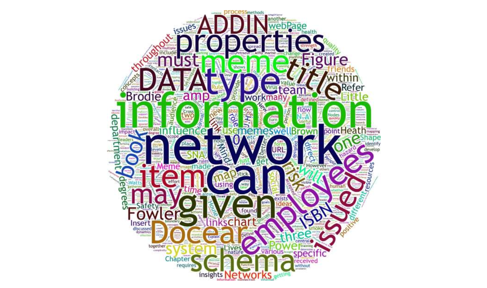
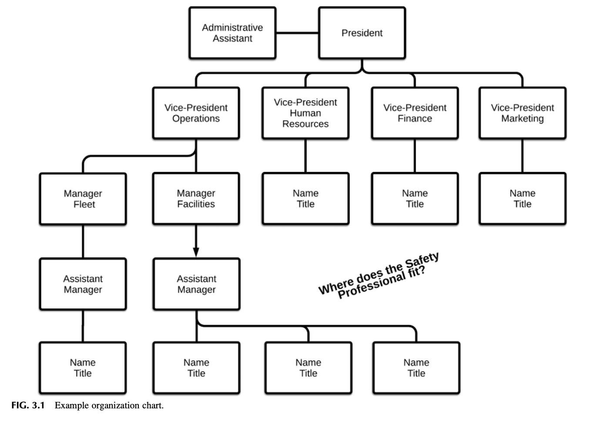
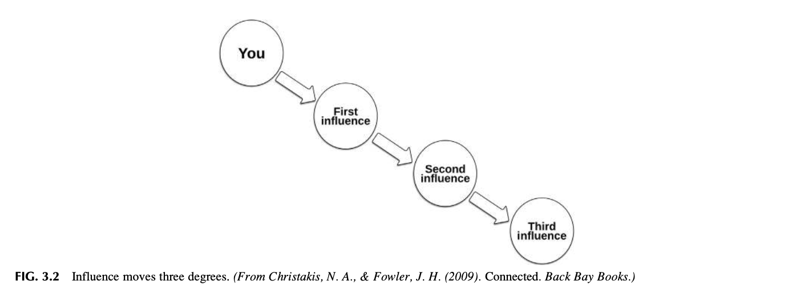
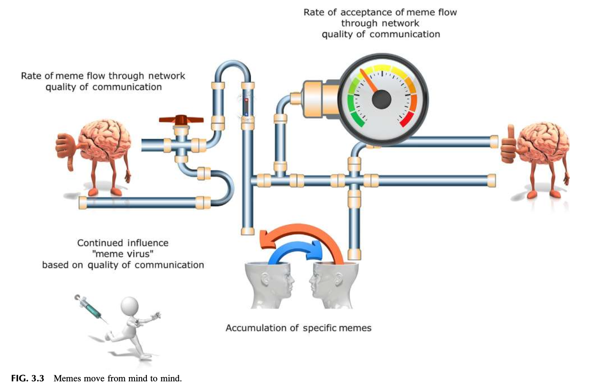
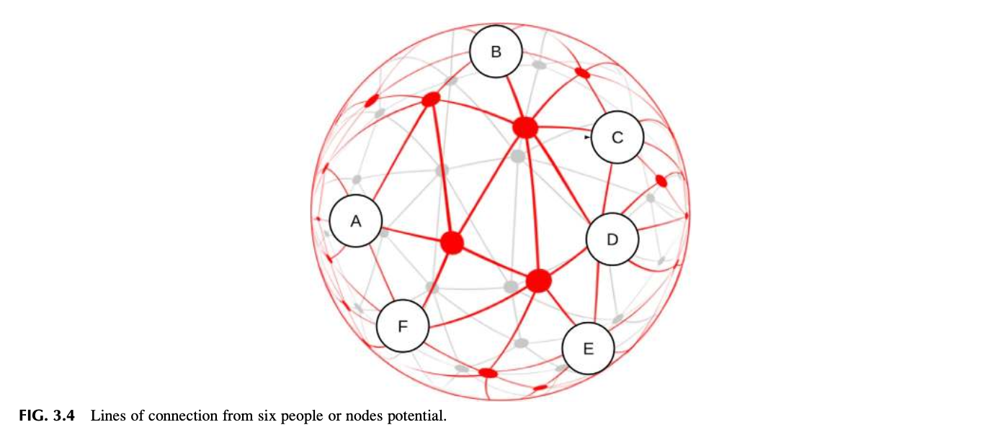
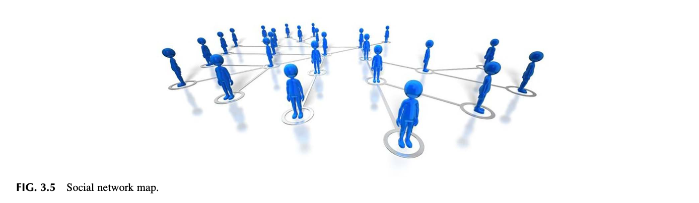
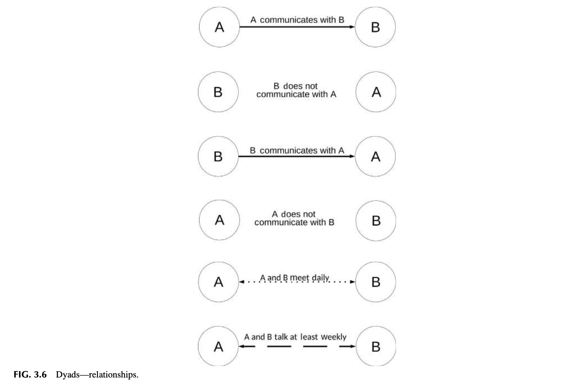
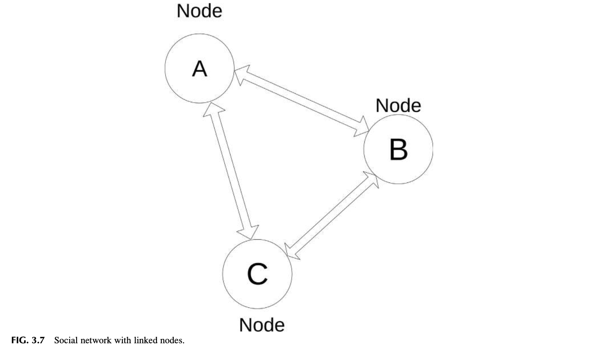
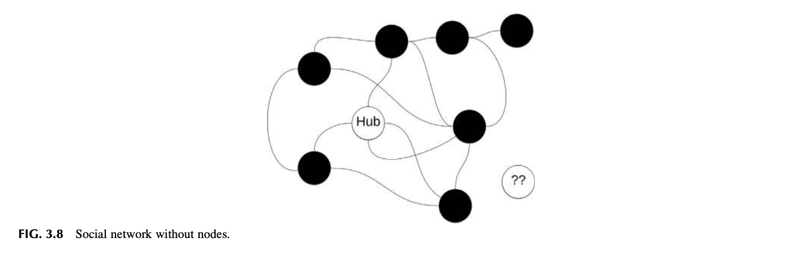
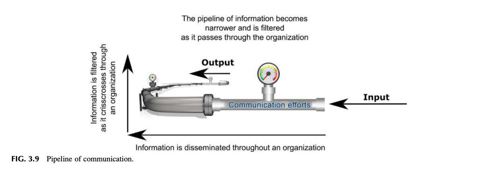

# Chapter 3 Analyzing and Using Your Network

Finally, it is important to consider culture - both occupational and organizational- because it can override collaborative behaviors encouraged by the formal design. In one sense, culture is generated and transmitted through social networks. Cross and Parker (2004) I defined a leader as follows: anyone who influences anyone else in a social setting, such as a team or organization. Mezick (2012)

## INTRODUCTION
The importance of organizational networking and the developing of a positive safety culture cannot be overstated. Organizations are a complex web of personal and professional networks. Networks establish how information is sent and received from the safety culture and the organizational environment. The safety professional uses researched information to guide the safety management system to best match the needs of the organization. It is important to define both personal and professional networks when developing a safety culture. Concepts for assessing the communication through network mapping will identify how information flows to the leadership team and throughout the organization. Safety Culture. https://doi.org/10.1016/B978-0-12-814663-7.00003-0 In this chapter, the importance of defining both personal and professional networks for the development of a safety culture is discussed. Concepts for assessing communications through network mapping will identify how information flows to the leadership team and throughout the organization. At the end of this chapter, you should be able to:
* Define the importance of networking.
* Analyze an organizational chart for networking.
* Define methods to transmit safety information.
* Define different components of a network map.

## THE IMPORTANCE OF NETWORKING
Networking has been informally used for centuries and is not a new concept. It has been used to bypass bureaucracy, gain access to influence or favors, search for jobs, identify expertise, and resources for as long as society has existed. Politicians and sales executives maintain extensive networks of contacts and resources. Successful networking builds mutually beneficial relationships which can result in links to additional useful contacts with valuable expertise or knowledge. The foundation of a safety management system is its safety vision and mission. Understanding how networks are formed and how they connect people can improve the quality of communication. The complexity and design of a network determine the speed and quality of information provided to the leadership team and employees. Vision and mission must be communicated throughout an organization, and the effectiveness requires managing personal and professional networks. A well-designed safety process may be developed and yet fail when safety information becomes filtered, diluted, ignored, or blocked as it moves through the various formal and informal networks of an organization. Watts believes that “networks are dynamic objects and not just because things happen in Network Systems, but because the networks themselves are evolving and changing in time, driven by the activities or decisions of those very components” (Watts, 2004). Networking…allows you to be seen, be heard and be remembered by people and gives you the chance to promote yourself as well as your company image. Networking (2018)

## INFORMAL NETWORKS
A grapevine, “an informal person-to-person means of circulating information or gossip” (Grapevine, 2018), word-ofmouth, exists in most organizations which moves informal information through “hidden” networks in an organization. These networks which spread information can be both positive and negative depending on the nature of the organization. In the old sailing ship days, sailors would gather around a cast of water and exchange gossip which lead to the term “Scuttlebutt” (Scuttlebutt, 2018), another term for gossip. The modern scuttlebutt equivalent is the office break room where employees do the same, exchange gossip. Various websites such as Facebook, Twitter, and LinkedIn now provide the same purpose in digital form as well as being used for personal and professional networking. An informal network can be faster than the formal organizational communication system. The transmitted information may or may not be true, accurate, or valid. Organizations must spend considerable effort attempting to reduce leaks that can cause damage to morale, public relations, brand image, and so on. The discipline of crisis management is built on the premise of controlling rumors, doubtful truths, misunderstandings, and misinformation while providing as accurate picture as possible on the nature of events. Hidden networks operate on a, “who knows who,” basis, a key individual knows someone who heard about a situation, change in status, or some gossip. What may be confidential, or nonfactual, is “leaked,” spreading to both internal and external contacts. A quick review of political campaigns, news media, and business history can provide insights on how leaks create information problems. One of the authors knew a risk manager who had a plant situation where several employees had similar health issues. A local newspaper published a story about nuclear waste contaminated materials that had come into the state. A rumor began in the plant that radiation had been detected from dirt and rock that had been brought in to build a new parking lot. Employees began to believe that their health issues were related to the parking lot fill dirt. A final factor came from an unexpected source. A popular TV drama told the fictional story of a company that denied its hazardous products were causing employee health issues. Now the “rumor” became “the health issues were caused by nuclearcontaminated waste under the parking lot, and leadership is not telling the true story.” The risk manager brought in health experts, industrial hygienists, and specialists to show employees no radiation was present. Even with additional expert information, employee/management relations remained permanently strained. Organizations have had to establish guidelines on the use of smartphones, tablets, and other devices that can transmit videos and pictures directly to social media. This type of risk has dramatically increased the release of inaccurate or confidential information before vetting or reviewed by an organization.

## ANALYZING THE ORGANIZATIONAL CHART TO ASSESS A NETWORK
Understanding the organizational structure is the first step in determining key individuals whose position in the organization is essential for improving the safety culture. Organizations use a formal structure to define its official network of authority and responsibility. This network is usually presented in the form of an organizational chart showing the various departments, leadership, staffing, and reporting relationships. The organizational chart defines the hierarchy of the organization, graphically shows who reports to who, the various job titles, and where leadership is located within the organization. The organizational charts are, in turn, linked to job descriptions. Refer Fig. 3.1 for an example of an organizational chart.

FIG. 3.1 Example organization chart.
The location of safety professionals on an organizational chart indicates how safety activities are viewed within the organization. The line distance from senior leadership and how far down into the organizational hierarchy the safety professional resides can be an indication as to the overall influence of the safety position. An organizational chart review is part of the analysis of reporting relationships and useful in establishing communication flow. The following outlines some areas for consideration:
* Do safety responsibilities reside in an operational or a support function? In many organizations, the role of safety
is found in departments supporting operations such as human resources, training, or risk management and not considered a line or operational function. From a networking point of view, the potential exists that a safety professional is viewed by operations as “not one of us” and in conflict with production. If in a support role, building trust and improving communications becomes a priority for operational acceptance of a safety management system.
* To whom does the person designate to provide administration of the safety management system report? Ideally, safety
management should go to a senior manager who understands the value of a direct line of communication between safety and leadership. The organizational chart provides names and titles within its hierarchy allowing discussions and insights to be gathered on the various individuals within the chart. These individuals can be positive allies helping the safety process improve, supportive, obstructive, or too inflexible to getting things done. Who are the control freaks, who is “by the book,” who will be an obstacle, who will be most helpful, and so on? The key is that an array of individual personalities exists and must be woven into a network.
* Does the organizational structure act as an aid or an obstacle to safety communication, its goals, and objectives? Organizational structures are not standardized and not, in many cases, formally designed. Many organizations use a multidirectional or matrix approach where reporting relationships can be a “solid line” to one leader and have multiple
“dotted line” reports spread across different levels of the organization? For example, the reporting structure could be to separate entities ranging from the general manager, human resources, engineering, maintenance, and so on. Understanding how relationships are connected gives insights into the dynamics of communication and interactions within an organizational network.
* What is the relationship between various departments and where safety responsibilities are located? As discussed in
Chapter 2, this could be considered Silo or bubble Management, as communication barriers may exist between departments. These barriers may be present due to conflicts between the individual personalities, the rank of the individuals within the organizations, perceptions about safety, skill sets, ego, and so on. An organization is not a machine but the sum of its human characteristics, frailties, and faults.
* Are duplicate safety roles in place? The organizational structure may have evolved reporting and responsibilities for
safety into separate parts of the organization. The organizational chart may indicate where overlapping authorities have created communication issues.
### Observation 1
Experience has provided an insight on the impact of divided responsibility for safety management between departments. In one organization, corporate risk management was in the finance department and safety management in the human resources department. Each department had assigned, parallel safety responsibilities, and each thought they had priority. Communication was poor. The managers of these departments did not have a high opinion of each other, to the point where they did not talk to each other resulting in constant conflict. In one example, a subsidiary human resources manager received an award for achieving an excellent safety record from the risk manager while at the same time received a letter from the safety department reporting the safety record was marginal and unacceptable. Neither department was held in high regards by field operations and ignored because of this internal conflict. The organizational chart speaks only to the formal structure of the organization and provides the reporting relationships. A senior leader may have allowed their responsibilities to be taken over by a strong personality and be only a figurehead. An administrative person may be the actual go-to person used to get a message directly to a specific leader. The old cliche, the power behind the throne, “someone who does not have an official position in a government or organization but who secretly controls it” (The Power Behind the Throne, 2018). This has been used to express who is essentially running an organization and would be considered when network mapping is begun.

## NETWORKING CONSIDERATIONS
Further insights on what to look for in assessing a network can be found in Gladwell’s classic book “The Tipping Point” (Gladwell, 2000), Gladwell provides three rules for reaching a tipping point and can be used to assess communications and their flow in an organization. He defines three rules associated with a tipping point, the “Law of the Few,” “The Stickiness Factor,” and the “Power of Context.” A tipping point is “the critical point in a situation, process, or system beyond which a significant and often unstoppable effect or change takes place” (Tipping Point, 2018). This is a point where an epidemic explodes exponentially after spreading slowly at first. The goal of improving the safety culture is to get communications to move, going “viral” through the organization. What Gladwell refers to as “Law of the Few” is divided into three sectors—Connectors, Mavens, and Sales (Gladwell, 2000). Mavens are the specialist or experts in each field. A safety professional would be considered a maven in their area of expertise and is a value being brought to the organization. A connector is just what it says, someone who “connects” other people together. An overarching safety management goal is to be well connected throughout the organization. Multiple connections are necessary to have better access to all areas of the organization to communicate hazard and risk control information. Expertise and connection are of no value unless the intended message for safety cannot be “sold” as a value, that is, the ability to sell ideas to the organization. Network analysis identifies who in the organization has the necessary connections, expertise, and communications skills to intensify the efforts for improvement. The “Stickiness Factor” is how well a message will stick with the intended audience. This factor involves an understanding of the media style and content a message must have to be remembered and utilized by its audience, in this case, leadership and employees. A message must be designed and presented in a way the intended audience understands and can demonstrate their knowledge of the content (Gladwell, 2000). The power of context is concerned with the nature of the environment and culture of the intended audience. The power of context determines how receptive the audience will be to the message. A message must be presented at the correct time and place considering the conditions under which people are working. The materials used for the intended message may be great, but if not presented at the proper time, the message will not stick (Gladwell, 2000). For example, if production is behind schedule and a request for training time is made, the leadership team will be puzzled about priorities, especially if the training is on a topic where no visible problem exists, or it does not aid in improving production. The request for time away from production would probably be denied in most cases and the safety effort viewed as a negative or obstructive endeavor. This is not to imply that safety takes a secondary role or is to be bypassed or ignored. An understanding of what concerns and problems an organization are having must be considered and the effort made to find better techniques to get the required information communicated. This can only be accomplished through a robust network that picks up information about concerns of leadership and employees. The importance of networking cannot be overlooked. “If you strip business down to its basics, it’s still about people selling things to other people. Ultimately, making it your mark as a connector means contributing…by making the best use of your contacts and talents” (Ferrazzi & Raz, 2014). In essence, networking is critical to obtaining valid information and technical assistance or professional expertise.
### Observation 2
Establishing a network requires a knowledge of how people interact. For example, how many people do you directly know within your organization? How many employees’ names do you know as well as any additional, personal or professional, information about them? Do you know about their issues or problems as related to the organization? This type of understanding gives depth to the work environment state of mind. Knowing who to go to is an essential part of networking. Have you heard in conversation, “Make sure you go to X for assistance? X is the best for getting your information.” Or conversely, “Don’t go to a certain individual for advice or help, they are all talk, unreceptive to new ideas or negative.” Comments imply whether an individual has a helpful network or one who has put up barriers to communication. Which type of person do you want to be seen as being? Which perception will best aid in getting safety goals and objectives completed? These questions should be considered when building or analyzing a network.
### Observation 3
In one example, a safety/risk manager would routinely take departmental supervisors or individuals to lunch. The manager’s intent was twofold. First, the event took those individuals away from the day-to-day work environment, allowing for a better chance of establishing team rapport. Second, the safety/risk manager was able to gauge whether communication was open, received, and the team members understood the issues to be addressed in a neutral environment. Something to consider, do you associate with the same peers or employees every day or do you try to meet with different employees, nonpeers, and others outside your department or immediate social circle? If the organization is a multishift operation, how often do you visit with the various work shifts?

## REALITY CHECK INDICATOR
Information useful in developing a network can be found in all interactions with employees and leadership. When going into a break room or approaching a group of employees, what response might be expected? Do employees express a sense of camaraderie? Or does the room go silent? The type of response may indicate whether an individual is accepted into the informal employee network or considered an outsider who must be approached with caution.
### LESSON LEARNED 1
An industrial hygienist was completing a noise study at a poultry processing plant. He noticed every time he entered the employee cafeteria; all the employees stopped talking. When he asked “why?” an employee told him, “Everyone thinks you are recording their conversations.” It was discovered that the safety department had security responsibility and recently completed a theft investigation, giving lie detector tests to the employees. Employees thought the hygienist’s sound level dosimeters were recording their discussions. This example points out the perception of the leadership team and safety staff employees held. The plant had visible communication and trust issues.

## DEFINING THE BASICS OF NETWORKING THEORY
Christakis and Fowler define a network community as “a group of people who are much more connected to one another than they are to other groups of connected people found in other parts of the network”(Christakis & Fowler, 2009). Their definition provides useful insights for organizing and understanding the analysis of social networks. They proposed the theory “three degrees of influence,” explaining any action or communication tends to ripple through a network and impact three degrees of separation. The influence of the source ceases to effect beyond “three degrees.” Christakis and Fowler developed rules they believed defined the nature and scope of a network. These rules include:
* Rule One, We shape our network. Individuals decide how many people they want to connect with, what they desire to
influence, and how central they are to the overall network.
* Rule Two, Our network shapes us. Where in a network and how centrally located within the network shapes individual
actions and behaviors. Being more central makes you more susceptible to whatever is flowing within the network.
* Rule Three, Our friends affect us. Think personal and professional associations. Connections offer opportunities to
influence and be influenced. People become what their friends are, and in turn, impact them.
* Rule Four, Our friends, friends, and friends affect us. This is their Three Degree Rule suggesting influence goes out to
approximately three levels or degrees. When spreading influence throughout a network an important item to understand is how far the message can spread.
* Rule Five, The network has a life of its own. Organizations have emerging properties and networks evolve and change
as the organization changes (Christakis & Fowler, 2009). Communication involves multiple layers of interactions, not just the one-on-one with the person immediately involved in the discussion or activity. Emphasis should be on developing a personal style and maintaining a sense of presence, that is, personal communication techniques, mannerism, image, and so on. Essentially, a sense of presence assumes one is always “on camera.”

FIG. 3.2 Influence moves three degrees. (From Christakis, N. A., & Fowler, J. H. (2009). Connected. Back Bay Books.)
A Safety Professional’s positions must be perceived as professional and trustworthy. A network can be destroyed in one brief, unguarded moment of anger or being found to be unreliable. Politicians and actors have destroyed their careers in a matter of seconds by making a comment or gesture revealing their real character. Refer Fig. 3.2, for an example of how influence moves three degrees. Everything we do or say tends to ripple through our network, having an impact on our friends (one degree), our friends’ friends (two degrees), and even our friends’ friends (three degrees). Our influence gradually dissipates and ceases to have a noticeable effect on people beyond…three degrees of separation. Christakis and Fowler (2009)

## THE SAFETY INFORMATION PACKET—EPIDEMICS, VIRUSES, AND MEMES
The goal of a network is to be able to transmit reliable, proven, and validated safety concepts and techniques through an organization in a manner that enhances the safety culture. An analogy is to view communication as taking the form of a virus that can be carried throughout the organizational body. Additional, safety communications should match the style and format used by the organization if the information is to engage employees and the leadership team. Brodie outlines a concept of thoughts and messages being viewed as a virus in his book “Virus of the Mind” (Brodie, 2009). According to Dawkins (2006), a meme is a packet of information providing a short burst of information understood by the intended audience (Solon, 2013). Communication should be regarded as an attempt to develop a meme. The meme or specific packet of information, once accepted, can then be further transmitted to others or if rejected, not go anywhere, mainly allowed to die by the recipient. “A meme is a unit of information in a mind whose existence influences events such that more copies of itself get created in other minds” (Brodie, 2009). and validated? What safety memes can you identify? Do we have resilient safety memes which persist even though they have not been proven In safety management, memes tell people what to do and how to complete specific procedures and methods. When work conditions remain the same, hazards and associated risk may stay under control using a series of memes that quickly tell people what to do. Obsolete memes may continue to be used even when they no longer work in the current work environment or culture. A meme that works for one organization, a location, or department may or may not be followed by another similar entity. According to Brodie, several types of memes exist. A “distinctive meme” is one that describes, classifies, or labels something (Brodie, 2009). A safety meme and at-risk behavior meme labels something as safe versus unsafe. The word “safety” is an example of an information packet carrying specific information. “Be Safe” transmits a range of suggested behaviors depending on the work environment. A safety meme has such incredible strength; it may not be clearly defined given everyone assumes they know what is meant by “safety.” The safety meme may or may not have the same connotation between individuals, groups, or organizations. If a safety meme is to have influence, it must be replicable, become a mind virus, and be collectively defined. Ideally, employees without coercion readily transfer their safety knowledge to other employees if a safety meme is present. The second type of meme discussed is the “Strategy Meme” (Brodie, 2009). The strategy meme transmits information about what to do under specific conditions. If a certain behavior is necessary to prevent an injury, a “cause and effect” is created, for example. If “X” is done this specific way, then the task will remain “safe,” as defined by the strategy meme. Another kind of meme is a strategy. A kind of floating rule of thumb that tells you what to do when you come across an applicable situation to achieve some desired result. Brodie (2009) An existing meme will continue to stress the use of previously acceptable behavior that may be no longer “safe.” Some examples include new procedures for startup of new equipment, starting a different production process, driving a new or different vehicle. The old meme defining how to do the task may still be mentally in effect and increase the potential for injury or damage. For example, after moving into a new house and going into a room, the operative meme signals to reach for a light switch on the left, only to find the switch is not there. In the new house, the switch is in a different location. The light switch meme from the old house is still in active use in your mind. Brodie’s “Association Meme” links various memes together (Brodie, 2009). When the information in one packet of information is activated, it activates other information. An example of how this can create an unsafe situation is the meme, “Where there’s smoke, there’s fire.” For Example, When people make assumptions, a meme is driving the action. When searching for the source of “smoke,” the immediate thought is “Where there’s smoke, there’s fire?” What if it’s not smoke but a harmful chemical vapor? Inhalation of chemical vapors can cause serious physical injury or possibly long-term health effects. The meme sets up the assumption, “smoke equals fire.” What appears to be “smoke” may be something else. Brodie suggests a good meme is spread without difficulty throughout a population. He suggests three ways to get a meme to penetrate and take hold (Brodie, 2009):
* Conditioning, Repetition of the same message. A form of this type of conditioning is used in the Activity-Based Safety
System (ABSS) which will be discussed in detail in Chapter 11. ABSS consist of safety procedures, preshift reviews, or work activity such as daily, weekly, and monthly activities, all intended to help instill a specific conditioned response necessary to help with hazard and associated risk controls. The idea is to be consistent with the message.
* Cognitive Dissonance, “Creates mental pressure and resolving it.” Building a case for an improved safety culture
creates a dissonance between where the organization is now in an undesirable condition and a vision of where it could be. Cognitive Dissonance, “In modern psychology, cognitive dissonance is the feeling of discomfort when simultaneously holding two or more conflicting cognitions: ideas, beliefs, values, or emotional reactions” (Cognitive dissonance, 2018; Foster, 2018). Defining and establishing a vision and mission of what the safety culture could be and setting goals and objectives creates cognitive dissonance, mental pressure. If the safety meme is strong enough, it replaces the old memes that accepted lower standards and at-risk habits or behavior.
* Trojan Horse, Is a leading meme and when publicized it triggers the advancement of several obscured memes. For
example, as we discussed in Chapter 2, Alcoa used a safety meme as the mechanism to improve its culture of quality, creativity, and customer relations (Duhigg, 2012). Refer Fig. 3.3 as an example of memes move from mind to mind.

## REALITY VERSUS PERCEPTION
To change a safety meme about current perceptions about safety, a toolbox of concepts is needed from which the proper “tool” is available for the issue or problem to be addressed. For example, if a production meme, distinction meme, says “keep equipment running” then a machine operator will try to work on running equipment and is subjected to a higher probability of getting caught in moving equipment. Introducing a risk perception meme of “Stop, Think, and Ask before reaching into equipment” replaces the “Keep it running hands in

FIG. 3.3 Memes move from mind to mind.
equipment ok” meme. A risk perception meme replaces the need to take a risk in this example. This concept will be discussed in more detail in Chapter 9. Strong memes encompassing employee involvement, training, job hazard analysis, and so on, as well as the overall safety management system are necessary.
## COMMON SAFETY MEMES
Listed as follows are safety memes, as we discussed in Chapter 1, which still is used by organizations today as a basis to achieve desired employee behaviors and decision making: Safety First. Safety is # 1. Zero Accidents is our Goal. For every 1 recordable injury, there are 10 first aid, 30 property damage, 300 600 near misses. No injuries no hazards or risks. All accidents are preventable. You are the key to safety. These popular safety memes used on banners, motivational themes, concepts or embroidered on clothing, and are rarely if ever tested for effectiveness on incident prevention or outcomes. Changing a meme requires ensuring that communication and its content have a higher chance of sticking with the intended audience. The Heath brothers discuss how to make a message stick by using a blend of the following elements when communicating a message (Heath & Heath, 2008):
* Simple. To the degree possible, keep the message simple. Can employees readily quote the safety vision/mission
statement? Most organizations have a lengthy policy statement usually signed by a senior leader. The document is sometimes more than one page and most employees cannot remember the content. A better approach is a short, simple, brief statement conveying the overall intent of a policy activating an “association” meme. Simplicity applies to safety rules and guidelines designed to support the policy and define desired actions and behaviors. Policy statements should be designed for ease of use by leadership and employees and readily understandable.
* Unexpected. The objective is to get and keep the attention of the intended target audience. An unexpected shift opens a
gap in knowledge or provides a unique way to close a gap in knowledge.
* Concrete. All the concepts and ideas about the safety management system and what is desired in a safety culture must be
made visible and provide a clear understanding of actions to be taken
* Credible. The message must have credibility. The warning of “OSHA may visit us” is used too often as a crutch and sets
the perception of safety as only minimum regulatory compliance. It limits developing and using a hazard and associated risk approach as the focus is only on compliance. The key is to build on data and valid research to improve the potential for the safety message to be accepted. The perception of safety and the professional safety image and capabilities plays into the development of the safety culture.
* Emotional. Heath & Heath suggest a message to carry merit; it must compassionately view people (Heath & Heath,
2008). It is not just the importance of engineering and design but the assurance to all employees that the organization is sincere in its approach. Messages about being safe for family and community can work when combined with a total approach using a safety management system. Caution must be taken as too much use of emotion in a message can be counterproductive and diminish the intended goal.
* Story. Use stories to explain or share experiences. Not long winded or over the top, but direct and personal stories that
paint a picture of what is to be accomplished. Adapted from “Made to Stick” by Heath and Heath (2008). Improving how to integrate a personal message into communication efforts can enhance getting the safety culture meme to “stick” in the minds of the leadership team employees. Once the concepts of devising and developing the messaging on how to improve the safety culture, the next step is to launch it properly into the organization (Harrell, 2010). Launching is not simply an e-mail broadcast, newsletter, or other media. The process begins by understanding how communication travels through the organization.
## SOCIAL NETWORK ANALYSIS
Social Networking Analysis has not been effectively used to the degree needed to ensure information is communicated throughout a system. A more formal approach to networking analysis can lead to more effective safety culture development as the flow of information and obstruction of communication is made visible. Social Network Analysis is a method used to understand the dynamics of an organization better. As all organizations consist of networks of individuals, departments, units, or groups, a Social Network Analysis provides insights on how individuals are connected and the potential effect on the behavior of the organization. It can be used to assess connectivity over a wide range of organizational levels with insights on how the organization sends and receives information. Social network analysis…Allows analysts to identify and portray the details of a network structure. It shows how a…networked organization behaves and how that connectivity affects its behavior. SNA allows analysts to assess the network’s design, how its member may or may not act autonomously, where the leadership resides or how it is distributed among members, and how hierarchical dynamics may mix or not mix with network dynamics. Petraeus and Amos (2006) The safety culture requires understanding how to establish and use personal networks that will allow useful safety memes to be developed. This understanding will help to improve a greater potential for improved communication to consistently move rapidly through the organization. If adequately conveyed and received promptly, acceptance of a message has a higher probability of being accepted. The formula for determining the number of network connections is (T2 T)/2. If six people are trying to communicate, the number of connections between them is 6 6 minus 6, all divided by 2 which equals 15 pairs of connections, since these connections can be two-way communication, 30 directions of communicating exist. Refer Fig. 3.4, for an example of lines of connections from six people, or nodes (Metcalfe’s law, 2018). Social Network Analysis can assist in determining the quality and scope of personal and professional interactions. Interactions can be graphically displayed and used to assess a variety of communication elements and map such items as:

FIG. 3.4 Lines of connection from six people or nodes potential.
* Who talks to whom.
* The direction of the communication (one way or two way).
* Quality of the communication.
* Whether the communication is positive or negative.
* How the message is sent and received internally and externally (face to face, e-mails, memos, newsletters, etc.).
* Structure and style of a message to reach different audiences
Methods on the use of selected social network tools useful in searching for resources and information to benefit the safety culture will be discussed in Chapters 15 and 16. While Social Network Analysis can be very detailed, even a rudimentary analysis can uncover gaps, not just in the message and to whom it is sent, but in the quality and nature of how the message is being conveyed. Networks of social information…are important not just because they help us make better individual decisions but also because they allow things that have caught on in one set to spill over into another. Watts (2004)

## SOCIAL NETWORK MAPPING
A Social Network Map connects topics, individuals and ideas, and relationships. A map is developed using three components as building blocks. Social Network Analysis shows individuals or groups and the connections between them (refer Fig. 3.5). The following is an overview of some basic definitions for mapping:
* A node represents one entity or individual. A node can be a specific group or department to be mapped. Nodes can be
individuals connecting with other people; each considered a node. If department interrelations are to be analyzed, a map is developed showing how individuals are connected, who communicates with who, and the type and direction of communications between them.
* The connection between Nodes is a “Link.” Connection to other people is a link. For example, when talking to another
person, a “link” is developed for them. When conducting face-to-face discussions, daily preshift reviews are made, weekly or monthly meetings are held, area walk-throughs completed, or reviews of specific safety checklist are made with employees, a direct link exists. Refer Chapter 11 for a detail discussion. Through these links, a message is directly communicated to the employees in every activity. Where no direct connection is shown, information is not flowing.

FIG. 3.5 Social network map.

FIG. 3.6 Dyads—relationships.
The Social Network Analysis graphically shows not just how a direct link to one employee exists but how that employee is in turn linked to other employees. Influence can travel across three degrees of separation before it is weakened, that is, the employees directly in the communication link will, in turn, talk to other employees, who in turn, will talk to other employees. This proves that a message travels quickly throughout an organization as discussed previously on how a “grapevine,” word of mouth, exists in most organizations which move informal information quickly in an organization. After three degrees away from other nodes, the message will have faded away (Christakis & Fowler, 2009). How far people are from the initial source of a message and the influential strength of its sender provides insights on the message’s potential impact.
* The connection between two nodes is called a “Dyad,” which consists of two different nodes with a link that represents
the relationship between the two nodes (refer Fig. 3.6).
* The lines between the nodes of the dyad as shown in Fig. 3.6 have arrowheads that represent the direction of the flow of
information between two nodes. In this example, one- and two-way communications are shown. A link can be used to

FIG. 3.7 Social network with linked nodes.
specify other characteristics of the link between the nodes. The communication might be daily or weekly, whether it is a positive or negative relationship or any other characteristics that are to be evaluated. Individuals in a network are called actors or nodes. (Actor and node are often used interchangeably.) The contacts between nodes are called links. The basic elements of a social network graph are the dyad. A dyad consists of two nodes and a single link. In the simplest form of a network, the two nodes represent people and the link represents a relationship between them. Petraeus and Amos (2006) and Knoke (2006) Building a network map is completed by connecting nodes. The network map can be used to represent the scope and complexity of both internal and external connections. In addition to a direct personal network, the process of identifying the next levels of links can be developed. If communication is a direct link to a vice president, how the vice president links with other members of the leadership team and employees can be determined. The social network analysis can continue to be built as additional nodes and links are identified throughout the entire organizational network (refer Fig. 3.7). Before completing a social network analysis, check to see if the organization is already using social network analysis software or another program that might serve the same purpose. The authors have experienced occasions where various software programs are in use and knowledge of their existence is localized to the point of almost secrecy. A “Hub” is a node that links between multiple nodes. It is the same concept as a bicycle wheel that has a hub connected to the rim by many spokes. Without the nodes successfully connected, the network, like a bicycle wheel, does not work (refer Fig. 3.8). If nodes are not linked together, information does not flow through the network successfully. A network analysis, like a road map, shows the direction and destination of information. An assessment of how well the “road” (a link) is designed can be made, where intersections (Hubs) are, can provide alternative routes allowing movement around roadblocks (leaders or employees resistive to change to improve the safety culture). A network map identifies positive, influential leaders, and employees who can contribute to getting the safety message transmitted throughout the organization. As discussed earlier, Christakis and Fowler’s Rule Number 4 (Christakis & Fowler, 2009) suggests that if the message can get within three degrees of the senior leadership team with information or messages structured in style used by leadership, the probability of acceptance of the communication

FIG. 3.8 Social network without nodes.
increases. Refer Chapter 2, for a discussion regarding Analyzing the Organizational Culture which details a discussion of ways to approach the different types of corporate cultures.

## DEFINING THE ROLES IDENTIFIED BY THE NETWORK MAP
When developing and analyzing a personal network and the organizational structure, the role of individuals with safety responsibilities requires their crossing virtually all the many areas of an organization. This role by its definition must be able to provide in-depth knowledge on an array of subjects and topics specific to inherent operational hazards and risk. Social network analysis provides a method to identify leaders and employees who can assist in the safety process, as they are nodes occupying positions making them important linkages in the movement of information. Their role may act as a hub that can push the message to all levels of the organization.

### Central Connectors
“Central Connectors” are leaders and employees who act as hubs with multiple links to many other nodes (Christakis & Fowler, 2009). The safety management system requires the role of safety professional to become the central connector for the safety management system as it must interact with leaders and employees (Christakis & Fowler, 2009). In the beginning phase of developing a safety culture, those assigned safety management responsibilities are the “glue” that holds the safety management system together. This responsibility must last until a transition is made to an open and participative network where the leadership team and employees internalize the value of the intended safety culture.

### Boundary Spanners
The boundary spanner moves across and through all areas of the organization without restriction (Christakis & Fowler, 2009). As discussed in Chapter 1, a reporting structure places safety responsibility in one specific department, such as operations or human resources, yet the individual must interface with all sections or parts of the organization. If a network has been successfully developed that communicates competence and trust, the capability of being a boundary spanner is created with a higher probability of establishing further positive relationships within the organization.
### LESSON LEARNED 2
On many occasions, the authors have experienced both directly and indirectly the safety personnel acting as a boundary spanner. Questions and issues develop from every nook and cranny of an organization requiring knowledge, research, or relationship skills beyond what is experienced by many professional disciplines. All facets of an organization will look at some point cross paths with safety personnel. A review of safety management systems such as ANSI Z10 states the overall complexity of safety responsibilities (Occupational Health & Safety Management Systems, 2012).

### Information Broker
The safety function is a specialized discipline providing a depth and scope of knowledge and information of central benefit to the entire organization. As both a boundary spanner and a central connector, it is an essential role as the “Information Broker,” an information provider, mentor, resident expert, and advisor for the organization (Christakis & Fowler, 2009). The role acts as a “go-between” node connecting people by sharing information specific to the safety management system, the safety culture, and the overall risks to the organization.
### Observation 4
Information has been gathered about a serious safety-related topic that has a potentially significant impact on operations. A solution is located and must be transmitted beyond the affected employee or department. The solution must be quickly sent throughout the organization to areas with similar exposure to the hazard or potential risk. If a quality safety management system is in place, it will increase the probability that there would be no gaps in the flow of communications to all areas. No one is left out.

### Peripheral People
In completing a social network map, an effort is made to discover “Peripheral People,” Individuals outside direct networks or, while part of the organization, considered “Mavericks” operating independently outside the organizational network norm (Christakis & Fowler, 2009). As they are outside the normal flow of information, these individuals may not be using up-to-date risk information and be following outdated safety criteria. The basic nature and type of questions asked include:
* Does your network map show or imply communication gaps?
* Do you have links in place with each level of the leadership team?
* Are all employees able to quickly link with you?
* Can a critical hazard or associated risk message rapidly get to the level of leadership appropriate to the potential severity which
must be addressed? (Catastrophic examples from history include the Challenger and Columbia space shuttles, the BP Gulf Horizon.) Literature will show the failure of the communication flow created a catastrophic loss.
* What are the primary types of communication used by the organization?
* What is the strength of your relationship with the leadership team and employees?
* Are all your communications positive and two way?
* What actions can you take to improve or how can the relationship be repaired and improved?
* Are you centrally located and directly connected to leadership by no more than three degrees of separation?
### Observation 5
A social network analysis was used with a safety professional who had good personal and technical skills and was beginning the revitalization of a safety program. A network map was developed that showed the links existing with other managers and supervisors in the organization as well as their links to other personnel. In a matter of minutes, serious communication gaps were discovered with linkage issues that immediately needed to be addressed. Instances were found where the key leader was not linked to the safety manager with a little direct contact in place. An issue with the style of communication was identified and points found where only one-way communication were in place needs to be modified.

## PIPELINE OF COMMUNICATION
Risk and hazard information can be visualized as flowing through a pipeline which becomes narrower as it passes through an organization. Individuals in each area may filter or distort the information based on bias, concerning the potential risk

FIG. 3.9 Pipeline of communication.
event or not understanding its relative importance. A perilous situation can develop if the risk assessment information becomes changed or filtered as it travels through the organization. When organizations analyze risks or risk events, the information gathered is disseminated throughout the organization to leadership, engineering, departments being impacted, safety professionals, and other specialist and technical experts. The organizational culture, strength of the safety culture, as well as accumulated knowledge, beliefs, experiences, opinions, lessons learned, and observations formulate the basis of risk perception. The value and acceptance of the received message determine its importance. A risk may be assumed to be acceptable creating a degree of possibility for the loss to remain hidden in the organization (refer Fig. 3.9). Risk perception is based upon one’s experience, social, environmental judgments (Lowrance, 1976). In Chapter 4, we will continue our discussion on how a planning process can be used to set goals and objectives when trying to improve, develop, or ensuring that a safety management system can be sustained. The planning process ranges from daily, weekly, monthly, annual, and multiyear planning. A planning process ensures the safety culture is consistently maintained and the safety process is effective and efficient.

## SUMMARY
The safety culture is dependent on how well safety information is communicated. Personal and organizational networks determine the quality of safety management system information and how quickly it can move through an organization. The quality of information and its value to the leadership team and employees establishes the perception of safety and its influence on the safety culture. An organizational chart provides a road map of describing the hierarchy of reporting relationships and responsibilities, who reports to who, where they are, what they do. The organizational chart can be in constant change as personnel is promoted, operational structure changes completed, and new responsibilities assigned. It needs to update routinely. Designing and improving both personal and organizational networks to better communicate information increases the potential of a quality safety culture. The goal of a network is to be able to rapidly transmit reliable, proven, and validated safety concepts and techniques through an organization in a manner that enhances the safety culture. An analogy is to view communication as taking the form of a virus that can be carried throughout the organizational body. A Social Network Map connects topics, individuals and ideas, and relationships. A map is developed using three components as building blocks. Social network analysis shows individuals or groups and the connections between them. The safety function is a specialized discipline providing a depth and scope of knowledge and information of significant benefit to the entire organization.

## CHAPTER REVIEW QUESTIONS
1. Explain why we are all part of a complex web of personal and professional networks.
2. Why is it important to develop a network? Explain in detail, how this will affect interactions within an organization.
3. Explain ways to analyze an organizational chart to determine how an existing network operates.
4. Define an organizational network. Explain the importance of the organizational network.
5. Explain methods that can be used to check the reality of where safety management fits into an organization.
6. Explain the basics of networking theory.
7. Explain how a network can transmit reliable, proven, and validated safety concepts and techniques through an organization to enhance the safety culture.
8. Explain the difference between safety reality and perception.
9. Explain what a “meme” is and what methods can be used to change the “meme.”
10. Define Social Network Analysis and why it is important in analyzing communication in an organization.
11. What are the elements of social network mapping?
12. How can a network map be used to improve a safety culture?

## BIBLIOGRAPHY
Brodie, R. (2009). Virus of the mind: The new science of the meme. Hay House. Christakis, N. A., & Fowler, J. H. (2009). Connected: The surprising power of our social networks and how they shape our lives. Little, Brown. Cognitive dissonance. (2018). Dictionary.com, LLC. Retrieved from: http://bit.ly/2kNvwC6. Cross, R., & Parker, A. (2004). The hidden power of social networks (1st ed.). Harvard Business School Press. Dawkins, R. (2006). The selfish gene: With a new introduction by the author. UK: Oxford University Press. (Originally published in 1976). Duhigg, C. (2012). The power of habit: Why we do what we do in life and business. Canada: Doubleday. Ferrazzi, K., & Raz, T. (2014). Never eat alone: And other secrets to success, one relationship at a time. Doubleday. Foster, C. (2018). Social psychology—Conflicting beliefs. Organisation Development. Retrieved from: http://bit.ly/2jaEHzA. Gladwell, M. (2000). The tipping point: How little things can make a big difference. Current Affairs/Business. Little, Brown. Grapevine. (2018). Merriam-Webster. Retrieved from: http://bit.ly/2Kgkcd4. Harrell, C. (2010). Tips on how and where to send your manuscript. First Time Authors-Here’s The Key To Getting Published. Retrieved from: http://bit.ly/2iEw6B8. Heath, C., & Heath, D. (2008). Made to stick: Why some ideas take hold and others come unstuck. Random House. Knoke, D. (2006). It takes a network?: The rise and fall of social network analysis in U.S. Army Counterinsurgency Doctrine. Minnesota: Department of Sociology, University of Minnesota Minneapolis. Lowrance, W. (1976). Of acceptable risk: Science and the determination of safety. Los Altos, CA: W. Kaufmann. Metcalfe’s law. (2018). BusinessDictionary. Retrieved from: http://bit.ly/2w5v1Yo. Mezick, D. (2012). The culture game: Tools for the agile manager. New Technology Solutions, Incorporated. Networking. (2018). Merriam-Webster, Incorporated. Retrieved from: http://bit.ly/WYIbMF. Occupational Health & Safety Management Systems. (2012). The American Society of Safety Engineers. ANSI/AIHA/ASSE Z10. Retrieved from: http://bit.ly/1MsT6MG. Petraeus, D., & Amos, J. F. (2006). The US Army/Marine Corps Counterinsurgency Field Manual, FM 3-24, MCWP 3-33.5. Approved for Public Release, Headquarters Department of the Army, Public Domain. Retrieved from: http://bit.ly/105MvMj. Scuttlebutt. (2018). Merriam-Webster, Incorporated. Retrieved from: http://bit.ly/2kNJiEI. Solon, O. (2013). Richard Dawkins on the Internet’s hijacking of the word ‘meme. Wired. Retrieved from: http://bit.ly/2J9HnZV. The Power Behind the Throne. (2018). Cambridge Dictionary. Retrieved from: http://bit.ly/2IlllOw. Tipping Point. (2018). Merriam-Webster. Retrieved from: http://bit.ly/2IkYS4p. Watts, D. J. (2004). Six degrees: The science of a connected age. W. W. Norton. Science (W.W. Norton).
