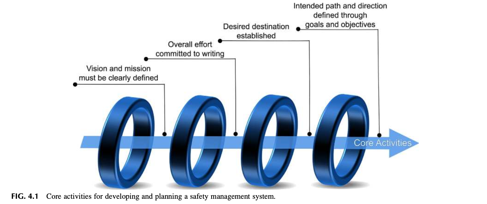
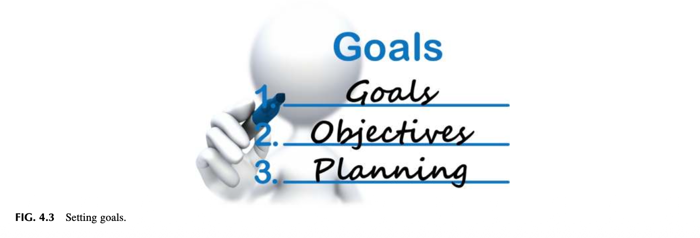
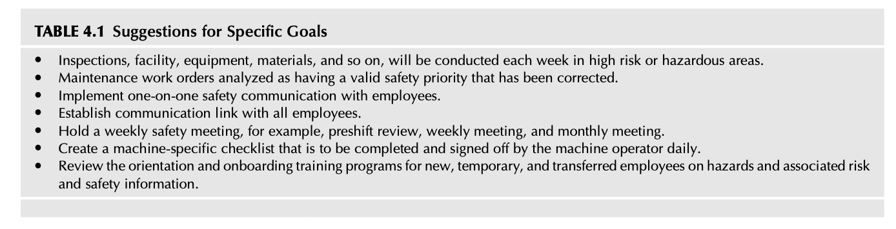
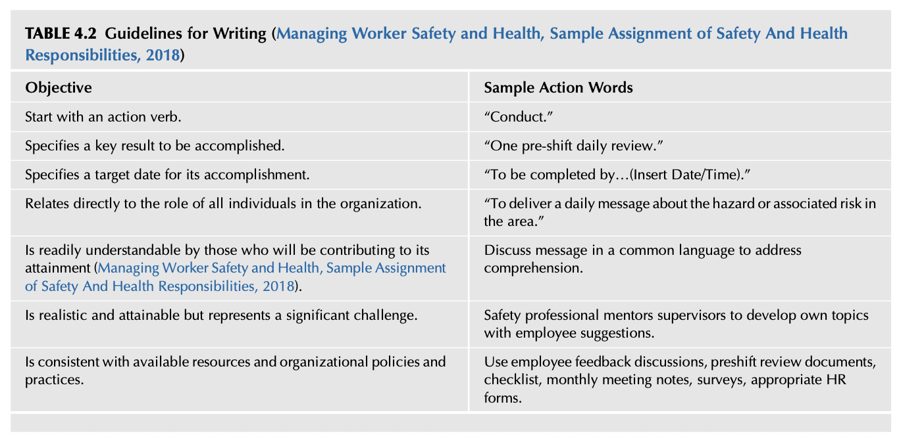

# Chapter 4 Establishing the Direction for the Safety Culture
A goal without a plan is just a wish. Antoine de Saint-Exupery If you can clearly articulate the dream or the goal, start. Simon Sinek Safety Culture. https://doi.org/10.1016/B978-0-12-814663-7.00004-2

## INTRODUCTION
A function of leadership is to establish a planning process for improving the designated safety management system. The planning process should be designed or selected to best match the general culture of an organization. A planning process should define the safety management system goals and objectives, schedule specific activities around daily, weekly, monthly and in some cases, multiyear planning. Short- and long-range planning provides the strategic benchmarks required to ensure the safety management system is operating as designed. Knowing the work environment may change when new operational hazards and associated risk are created, the safety management system process must be flexible and continuously monitored. The work environment may vary over time requiring altering existing safety management system planning, goals, and objectives. The objective of this chapter is to provide concepts designed to keep a safety management system on track. A safety planning process addresses the “Why” of the safety process and outlines the vision for the overall safety mission. The goals and objectives necessary to support critical program elements and the intended safety culture are defined. The process determines who is to be involved; the key required activities and specialties, required materials, and methods of communication to ensure the process is aligned with other organizational plans, goals, and objectives. After completing this chapter, you should be able to:
* Develop a vision and mission statements.
* Define organizational scope drift.
* Explain how to communicate a safety policy statement.
* Develop goals and objectives using “SMART” principles.
* Define the differences between a goal and an objective.
* Know why it is important to develop a plan of action for activities.

## CHARTING THE COURSE—THE PLANNING PROCESS
The goal of planning for the safety management system is to communicate coherently to everyone in the organization an overall vision and mission through safety policies and objectives. When a vision and mission are thoughtfully constructed, their probability of acceptance, support, and commitment from the leadership team and employees is strengthened. Various core activities must be accomplished when developing and planning for a safety management system and can include:
* Defining the overall vision of what results are expected.
* Defining the mission as to what is to be accomplished.
* Committing and defining the vision and mission, detailing why the effort is needed.

FIG. 4.1 Core activities for developing and planning a safety management system.
* Establishing the desired depth and scope of what results are expected for the various safety activities over the period of
the planning process, the intended goals, and objectives which define the actions necessary to get the safety management system fully implemented. The answer to “WHY” the safety management system effort is necessary becomes the core of a safety policy statement for determining its vision, the intent of its mission, and the safety management system to be implemented (refer Fig. 4.1). The greater danger for most of us lies not in setting our aim too high and falling short; but in setting our aim too low, and achieving our mark. Michelangelo (2018)
### LESSON LEARNED 1
Are various words or phrases used by the organization turning people off to new projects or new endeavors? James noted specific terms or phases routinely used that had become unknowingly negative with employees. When employees heard the statement, “We are rolling out a new XXX next month and…,” eyes would roll back, and employees began glancing around the room with a strange look on their face. The general reception was, “Here comes another flavor of the month, do not get too excited, it’ll go away in six months if we just wait it out. Do just enough to keep them happy.” The term “roll out” had become toxic. James saw the need to find better ways to introduce initiatives for a positive employee perception. A new approach was developed to communicate the value of any desired change or effort better. By just simply replacing the phrase “roll out” with “introduce,” initiatives had a higher probability of acceptance from employees.

## VISION AND MISSION, MAJOR TRAITS OF LEADERSHIP
Vision and Mission are not the same. The vision statement defines the direction and future status desired for the safety management system. Vision provides the conditions Covey suggests in his classic book, The Seven Habits of Highly Effective People: “To begin with the end in mind means to start with a clear understanding of your destination…so that you better understand where you are now and so that steps you take are always in the right direction” (Covey, 1990). The development of a safety management system must begin with a vision of what the system is to achieve. A welldefined, clear future state or condition drives the day-to-day decisions as well as the establishment of goals and objectives necessary to make that vision come true. The vision statement becomes a compass by providing the direction to be maintained when the day-to-day demands exert their pull away from the desired destination. By having a clear vision, the “Why” of a safety management system can be better expressed (Sinek, 2009). It aids in answering questions asked by leadership and employees about the need for a safety management system and why specific activities and processes are necessary. Developing a new vision statement can be a two-edged sword. An organizational assessment may show the need for a new vision. Leadership may believe safety activities are adequate, and no changes are required. Leadership must be given the status of the current safety culture concerning gaps or deficiencies in the existing safety process to overcome this belief. If leadership agrees changes are necessary, resources, time, and budget may be allocated with the expectation that the vision will bring improvement to the safety management system.

## MISSION VS.VISION STATEMENT
What is the difference between mission and vision statements? “A mission statement explains the company’s (or department’s) purpose and focus. It describes the company (or department), what it does and its overall intention. The mission statement supports the vision and serves to communicate purpose and direction to employees, customers, vendors and other stakeholders. The mission can change to reflect a company’s (or department’s) priorities and methods to accomplish its vision” (Mission Statements: Human Resources Mission Statement Examples, 2011; Mission & Vision Statements: What is the difference between mission, vision and values statements?, 2012).

## EXAMPLE VISION STATEMENTS
The following are several examples of vision statements and their criteria (30 Example Vision Statements—Definition, 2018): “A one-sentence statement describing the clear and inspirational long-term desired change resulting from an organization or program’s work.” Key Findings of 30 Example Vision Statements: The best visions are inspirational, clear, memorable, and concise. The average length of the full 30 organizations listed here is only 14.56 words (excluding brand references) The average length of the first 15 organizations is just 10.5 words (excluding brand references). The shortest contains only three words (Human Rights Campaign) The longest includes 32 words (Amnesty International) For example: Veterans of Foreign Wars: “Ensure that veterans are respected for their service, always receive their earned entitlements, and are recognized for the sacrifices they and their loved ones have made on behalf of this great country” (No One Does More for Veterans, 2018). Smithsonian: Shaping the future by preserving our heritage, discovering new knowledge, and sharing our resources with the world (2018) Habitat for Humanity: A world where everyone has a decent place to live? (2018)

## MISSION STATEMENT
The Mission Statement provides an overview of what the safety management system is directed to do. It provides the framework for the administration and structure of the safety management system and a clear understanding of what is to be accomplished or has been mandated by leadership. It establishes a shared promise of the direction and decisions whereby the safety process can be beneficial to the organization.
### Example Mission Statement
The United States Army Band “Pershing’s Own” will provide musical support for the leadership of the United States, to include all branches of government, and to a wide spectrum of national and international events in support of Soldiers and their Families, public diplomacy, community and international relations, recruiting initiatives, and music education programs; in order to instill in our forces the will to fight and win, to foster the support of our citizens, and to promote our national interests at home and abroad. Mission Statement (2018)
### Action Needed for Developing a Vision and Mission Statements
Begin by developing an organizational assessment to determine what safety management system and actions are needed:
* What is the current state of the safety culture?
* What are the desired results to be achieved?
* What does leadership expect to be accomplished? The leadership team may not fully understand the true nature of operational
hazards, their associated risks, and control requirements. An assessment of the leadership team’s knowledge must be considered.
* What are the ongoing and supported regulatory compliance activities?
* What activities are needed to address risk management and control efforts for areas not covered by regulatory compliance?
* What time are constraints placed upon individuals designated to be involved in the assessment? Are they allowed the necessary
time away from their regular tasks to work on projects?
* What type of budget or resources are needed for implementing a comprehensive plan of action?
* What are the critical items or actions necessary for meeting the desired goals and objectives given a budget, time constraints,
skill levels, and so on?
* How will the plan of action be communicated?
(Safety and Health Management Basics, Module Eight: Evaluating The Safety Management Systems, 2018)

FIG. 4.2 Which way do I want to go.
As the vision and mission are created, decisions must be made to guide and determine the overall planning process:
* Is the mission to focus on just compliance with regulatory requirements? Or
* Does an organizational vision want to build a safety culture to sustain itself and have a long-term impact beyond
regulatory compliance? The authors have noted, in many cases that leadership’s general perception of the safety mission is its primary focus, regulatory compliance as a minimal accepted criteria. A compliance-driven vision and its accompanying mission can result in meeting government-mandated regulations. An organization’s safety process will be narrowed to meeting minimum federal or state Occupational Safety and Health Administration (OSHA) requirements through specific programs that are considered a stand-alone and not part of a comprehensive system. A well-defined vision and mission provide a point of reference and help to maintain efforts for staying on course to the desired safety culture destination. This leadership thinking creates a potential obstacles that must be overcome if a comprehensive safety culture is desired. Refer Fig. 4.2, for a representation of understanding, which way do I want to go.
### Observation 1
Smartphones, tablets, and other devices are now the primary methods used to navigate on highways, in cities, and so on. Map applications provide directions and assist in avoiding traffic jams, obstacles, or providing shortcuts by generating new routes. Travel time and distance are usually included. The ability to orient and go in the right direction is assisted by a voice correcting or directing around road issues by providing route changes. The navigation applications are routinely updated as new highways and roads are modified or added. In one sense, a safety management system is like having an organizational Google Map or similar Application Navigation service, such as a Global Positioning System (GPS) to help navigate the safety process. The vision and mission provide the correcting voice to guide the system. As with maps which become obsolete as roads change, vision and mission can become obsolete when an organization changes, leaving its safety culture on autopilot with its guiding voice and map no longer trusted. The question: Which way do I want to go? After a clear vision and the mission have been established and mutually agreed upon, a sense of purpose can be used in communication efforts as to how they are to be met and accomplished. An answer can be provided without any doubt or delay when safety activities are questioned. The Why of the activities can be communicated throughout the entire organization. With the Why (Vision) and What (Mission) defined, the How things will be done becomes apparent as goals and objectives can be more efficiently developed (Sinek, 2009).
### Organizational Scope Drift
As the safety management system is developed through the planning of goals and objectives, one of the potential concerns to be managed is “Scope Drift.” Scope Drift is a rifle sighting term describing the condition where the telescope is not aligned with the rifle barrel. When aiming at a target through an unaligned rifle scope, you will miss your target every time. Organizational scope drift creates a gradual movement away from the safety culture as safety goals and objectives are not aligned with the established vision and mission. Incremental change can be experienced as different responsibilities are assigned, business conditions shift, the new leadership has different priorities, mergers with different organizations each creating turmoil in the overall culture. Once off target, it can be hard to realign the desired safety goals and objectives. Theodore Roosevelt found this the case when organizing the Rough Riders for the Spanish-American War: “On the last occasion, when I came up in triumph with the needed order, the worried office head, who bore me no animosity, but who did feel that fate had been very unkind, threw himself back in his chair and exclaimed with a sigh: “Oh, dear! I had this office running in such good shape—and then along came the war and upset everything!” His feeling was that war was an illegitimate interruption to the work of the War Department” (Roosevelt, Lodge, & Bishop, 2017). It is easy to dive into a project without a full understanding of its needs and complexity, thinking, the taking of any action is the best course. Cautionary writings about starting a project without planning have been around for several thousand years: For which of you, intending to build a tower, sitteth not down first, and counteth the cost, whether he have sufficient to finish it? Luke 14:28-30, King James version (2018) Scope Drift can be attributed to the following:
* Beginning with no written plan with defined goals and objectives for improving the safety culture. A written plan, no
matter how simple, provides consistency and a foundation for change as conditions change. What is to be accomplished can be lost when changes occur unless goals and objectives are in writing.
* Becoming entranced by a cool project that has nothing to do with the overall vision and mission. Covey described these
types of projects as “Unimportant and Not Urgent” (Covey, 1990). A project in this quadrant provides a false sense of accomplishment and perception of value even if those projects have no relevance to the safety management system. Always ask the question, does the project add value to the safety culture and the safety management system. This was discussed in detail in Chapter 1. Refer Fig. 1.10 for a management decision matrix.
* Mandated agendas are not consistent with the intended plan and its goals. Some organizations use a structure of management where overlapping reporting lines are used. One person may have two or more supervisors/managers who may
or may not be coordinating with each other. Depending on the lines of responsibility and authority, a clash of priorities can occur. It requires a combination of patience and political savvy to resolve such issues.
### Observation 2
Several such cases the authors have seen include:
* Corporate safety and security departments are rolling out priority projects simultaneously requiring considerable time and effort
for data gathering by personnel not reporting to them. Neither department had assessed the personnel and time requirements nor coordinated with each other or the various affected entities before the project rollouts.
* Corporate Safety is mandating special training for employees and not developing an understanding of the impact on subordinate
staffing and current approved plans and budgets. In the case of conflicting agendas, maintaining a questioning attitude will be necessary to understand the internal and possible external politics as well as the leadership reasoning to get the full intention and desired objective of the leadership’s agenda (Concepts and principles, human performance improvement handbook, 2009).
### LESSON LEARNED 2
In the authors’ experience, foremost is to do what you are mandated to do to meet the primary mandates of leadership, that is, completing the core requirements of the formal job description as hired to do. Personal perception and leadership’s perception of what is to be accomplished may be different. Unless full authority to make significant changes to an existing safety process is granted, the first step is to learn how the current operations function. At this initial stage, an understanding of the organization’s communication network and methods used to respond to problems is critical. Unless conditions are dangerous to life and health are present, only after completing an assessment should suggesting or making changes be recommended. These should be based on specific gaps and deficiencies in the safety management system, existing hazards, and associated risk severity.

## BOUNDARY SPANNING AND THE MISSION
The role of the safety professional requires being a “boundary spanner” operating across all areas of an organization. This was discussed in detail in Chapter 3. The role also entails operating as a major information hub as discussed in Chapter 2. These roles can pull against the desired mission as the job requires responding to leadership and employee immediate safety concerns, problems, or issues. A schedule may be set, and a manager stops by the safety office and states “Oh, by the way, I just came from a meeting and please do ‘X’ immediately.” The request changes the day’s agenda, and a new activity is mandated to be accomplished.

## THE SAFETY POLICY STATEMENT, EVIDENCE A VISION HAS BEEN ESTABLISHED
Many safety policy statements consist of multiple pages, consequently becoming too complicated and lengthy to be remembered. The intent of leadership’s message is to convey its purpose for all employees to be on the same page with minimal chance for misinterpretations. A lengthy safety policy/vision statement may become a forgotten artifact in the organization. If a policy has lengthy explanations and interpretation as if a legal document, it has far less potential to be understood. The safety policy statement must be concise, readable, and understood through the spoken word and any media format used irrespective of the size of the organization. The safety policy statement is different from formal overall safety procedures and guidelines. Safety procedures provide the in-depth details about who, what, where, when, and how of the safety administration. They define responsibilities and describe the approach to be taken for maintaining a safe work environment. A safety policy can be considered a cultural “artifact” reflecting the espoused values of the organization. How well the policy is implemented and followed will indicate the values held by the organization. As discussed, a safety policy statement should be a brief, concise sentence conveying the essence of the desired policy which helps to drive employee action and long-term behavior. An effective safety policy statement should contain the following elements:
* A written declaration of the leadership team’s commitment to safety efforts.
* Goals and objectives of the safety management system (Building an Effective Health and Safety Management
System, 2015). A well-written safety policy statement establishes leadership’s intent and makes clear to everyone in the organization what to do when a conflict arises between a safety issue and operational priorities. Refer to Appendix 4.1 for a Sample Safety Policy. Any actions used to introduce the safety policy statement should be done after a thorough review of current and past policies and activities. Also, if other operational policies have not been enforced, then the safety policy statement may also follow the same fate. Resistance to following a policy can be observed in the form of cynical or negative comments by employees. Such comments can indicate a lack of acceptance or even rejection of safety-related efforts. A safety policy statement is built on assurance and trust. First and foremost, if implemented with employee involvement the safety policy has a better chance of being followed. Involving employees in periodic policy reviews better ensures the statement remains relevant. Once a policy is developed, management should set a goal for safety and health, and then build objectives that will allow employees to reach the goal. The goal should be a realistic one, so as not to discourage employees from striving for the goal. Each employee should be able to see his or her work activities moving toward the goal, thus allowing him/her to meet the objectives. Safety Pays for Everyone (2018) The leadership team must demonstrate commitment and support the safety management system for a safety culture to become ingrained into the organization. If leadership breaks its safety policy promise, the statement becomes dismissed as deceptive hypocrisy.

## COMMUNICATING THE SAFETY POLICY STATEMENT
After the safety policy statement is written, approved, and signed by the leadership team, it must be communicated to all employees through a series of organizational-wide meetings or communications such as the preshift safety review, weekly and monthly meetings. As part of keeping the policy statement visible, it should be posted on bulletin boards or electronic bulletin boards throughout the organization. A variety of Informational media can be used to broadcast its message, that is, newsletters, memos, safety manuals, and so on. The safety policy statement must be:
* Presented in a brief, transparent manner in the language of the employees.
* Consistent with its transmission of the intended message. Everyone should receive the same content and message regardless of
how it is delivered, multimedia, training sessions, orientations, and so on.
* Used as a point of reference when a safety-related issue or project conflict with operational priorities.
* Supported by the leadership team through involvement in the safety management system by routine guidance and the
enforcement of established hazards and associated risk control, safety rules, and work practices. For example, it should be reviewed for new hires, relocated employees, and contractor orientation and re-enforced during the on-boarding process. If the organization has a visitor or outside vendor guidelines, the policy should be included in those materials. The following examples provide simple, brief policy or vision statements that convey an easily remembered leadership message:
* “Our most important responsibility is the safety of our employees.”
* “Everyone in our organization will have a safe place to work.”
* “Everything we do will be done safely.”
* “If a task is not safe, do not do it.”
Statements such as these may appear trite, but their objective is to devise a format used in anchoring the policy/vision in the memory of all employees in the organization.

## COMMUNICATE BY ACTION
How the safety policy statement is presented is crucial to its acceptance. What is done, or failed to be done, speaks louder than words in communicating the message. A nod or gesture, one’s body language at a critical point in the discussion can communicate the perception that what is being said is not really to be taken seriously. The tone and method used to introduce the statement signals whether the message should be taken seriously by employees.
### Observation 3
Nathan worked with an organization rolling out a national motivational and quality program for all its employees. An array of items with a slogan, coffee cups, tee-shirts, audio tapes, and other items were to be given out on a designated celebration day. Teams were to be set up and considerable time and effort leading up to the big day. This internal marketing campaign was sent to all employees describing the company expected benefits from this campaign. The day arrived, and employees heard only silence. No handouts, no tee-shirts, nothing. The designated person assigned to lead and manage the endeavor was found in his office and asked what was happening, where’s the program? A pile of boxes and materials were in the corner of the office. His response, “What celebration? Was that stuff to be handed out today?” The program died and was no longer considered of worth by employees even after monies, resources, and time were spent on developing this endeavor.

## ALIGNING WITH THE ORGANIZATION
Demonstrating commitment and concern is not enough for the safety culture to take hold and evolve. The safety culture improves or degrades depending on the committing of the essential resources for control and improvement of the workplace. It is dependent on how well leadership is organized and addresses issues beyond just regulatory compliance. When the safety policy statement is viewed from the standpoint of how its influence expands and travels throughout an organization, it can be seen how imperative it is to manage and routinely review for the policy remains positive and comprehensible. The written statement is the actual intent of the leadership team. It remains to be demonstrated by the actions of the leadership team and to become ingrained into the organizational culture. The real policy is the attitude of the leadership team and employees in dealing with safety issues.

## DEFINING GOALS AND OBJECTIVES
In most organizations, a planning process is in place for quality improvement and the setting of annual personal and professional goals and objectives. If the organization has planning tools in place, those planning formats and guidelines are to be used. An organization’s formal planning process ensures consistency with the rest of the organization. Safety management goals and objectives should be designed to provide strategies that will address problems and issues. A goal defines where the process is to be at a future point in time. Objectives are benchmarks setting the desired destination for a particular time frame. It provides insights into the path to be followed for implementing the safety management system and enhancing a safety culture. Also, the timelines and budgets of the safety management system goals and objectives are defined after the safety vision, and mission statement has been developed (Safety Pays for Everyone, 2018) (refer Fig. 4.3).

## DEFINING GOALS THAT IMPROVE THE SAFETY MANAGEMENT SYSTEM
Goals are general guidelines explaining what needs to be achieved. Goals are usually long term and represent an overall vision (Define Goals and Objectives, Step 2, 2003). The purpose of goals is not just to manage programs but to deliver to the leadership team guidance and timely status of decisions and actions in tune with the desired safety culture. “Would you tell me, please, which way I ought to go from here?” “That depends on a good deal on where you want to get to,” said the Cat. “I don’t much care where–” said Alice. “Then it doesn’t matter which way you go,” said the Cat. “–so long as I get SOMEWHERE,” Alice added as an explanation. “Oh, you’re sure to do that,” said the Cat, “if you only walk long enough.” Alice’s Adventures in Wonderland (Carroll, 2018)

FIG. 4.3 Setting goals.
According to Oregon OSHA’s, Safety and Health Management Basics, “Goals are easy to write. They are nothing more than wishes.” (Safety and Health Management Basics, Module One: Management Commitment, 2017; Safety and the Supervisor, Instructor Guide, 2018). Goals are nothing but a wish until an action plan is written and implemented. The problem is that there is a tendency to go in one of two directions. Overplanning to get the process perfect with nothing getting done, or just to start doing something without even a rudimentary outline or plan on what is to be accomplished. “Scope drift,” as discussed earlier, can develop and lead to meandering from focused to unfocused activities. Without goals and objectives and a “bias to action,” the results are “busy work,” becoming caught up in an “activity trap” or ineffective multitasking which mask the reality of hazards and associated risks. Various planning models are available and vary in scope and complexity. The first step is to make use of the designated formats provided by the organization before independently developing or using a model. The safety planning format should conform and blend into what is used by the organization and familiar to leadership and employees. One planning format used and proven over time is the “SMART” model. It meets the criteria of being relatively simple and straightforward. The acronym, “SMART,” stands for “Specific, Measurable, Attainable, Realistic, and Timely” (Meyer, 2003). The following is an overview of the “SMART” definitions:
### Specific
Data and measurements are subject to influence from conditions and elements beyond the safety management system’s control and can negate what on the surface may appear to be a successful accomplishment. The reduction of the Total Case Incident Rate (TCIR) may or may not be an indication of a functioning safety culture or if the Safety Management System is effective. The reduction may shield insights about the existence of unknown high risks where conditions have not yet come together to create a significant loss. The five W’s plus H can be used, Who, What, When, Where, Why, and one H (How), to establish the core information required. This step requires the identification and coordination of designated individuals, locations, reasoning, and time frames which are tangible. To better define and establish a goal, answer the five “W’s” and one “How” questions: Why: Specific reasons, purpose, or benefits of accomplishing the goal. Who: Who is involved? What: What do I want to accomplish? When: Establish a time frame. Where: Identify a location. How: Define the requirements and constraints. After developing answers to these questions, the next goal setting stage will be to determine if the goal is measurable.
### Measurable
In the measurable stage, a defined set of criteria is developed for measuring progress toward the goal established. To determine if a goal is measurable, ask the “How” question: “How will I know when the goal has been officially completed or accomplished?” (McDonald, 2014; Meyer, 2003). What precisely is being measured must be relevant to both the organization and to those individuals who will be affected by what is measured. Attention to the selection of what is to be measured must target organizational improvement or success. A decision to measure the wrong goals could result in resistance to the use of measuring performance. Wrong goals can also result in celebrating their success when the goals have had no real impact on reducing TCIR. Consequently, what appears to be improvements in both TCIR and workers’ compensation injuries, were due to organizational changes reducing exposures by shifting from permanent employees to contractors or temporary employees. Technology changes, mergers, and operational changes can also change the injury trends and patterns. Poor goal setting leaves operational hazards and associated risk still having the potential for severe loss.
### LESSON LEARNED 3
When James was working on his Six Sigma Black Belt Certification, he researched goal setting to map out his required certification project. The project was initially designed using 5 years of Total Case Incident Rates (TCIR) as a measuring device as calculated from the OSHA 300 log. As he conducted his research and tried to validate the data collected, he found the TCIR data did not capture all the information needed. He challenged the project team to find out why the data would not correlate. Although a traditional goal for overall TCIR reduction had been set, it was invalid as it did not provide the essential information to identify where to focus the project. Use of TCIR does not consider all the different types of injuries not being recorded in the OSHA log. Only after developing a more in-depth analysis was the team able to target a specific injury reduction goal. Using injury data alone creates the false impression of risk being under adequate control. The earlier lesson learned provides insight on an issue that directly affects goal setting and performance measurements. In the absence of a systematic data collection consisting of analysis of hazards, risk assessment tools, and loss data, an understanding of the actual situation may not be possible. Poor data collection leads to an erroneous gap resulting in setting goals that do not address the exact underlying safety-related issues. Refer to Appendix 4.2 for an overview of Numerical and Descriptive Goals. After a goal is defined as measurable, the next stage is to determine if it can be achieved or is attainable.
### Attainable Goals
One of the things often forgotten is to assess whether the intended goal is attainable. Unattainable great goals can cause harm to the safety management system. For example, a goal may be to train all employees in first aid in the current year. The assessment will determine the number of classes, class size, instructors required, cost of training, operational disruptions to be worked around, the general requirements in time, expertise needed, budget, materials, and so on. Only after a complete assessment is conducted can the potential for goal attainment be established. If the goal cannot be attained then alternatives must be developed to meet the goal objective. Only when goals have been established and are considered to add value to the safety process, can the process of selecting supportive activities and resources be initiated. Attainable - When you identify goals that are most important to you, you begin to figure out ways you can make them come true. You develop the attitudes, abilities, skills, and financial capacity to reach them. Meyer (2003) As stated in the lesson learned, many organizations base their safety performance data on incident rates as the sole measurement of the safety process. For example, if a goal is set to reduce the number of injuries by 10% and reduce the TCIR by 25% during the current year, what does the rate represent? The problem is that incident frequency rates are downstream measurements. Measuring postloss results parallels trying to inspect the quality of a product after it has been assembled, an activity thought very ineffective by quality control concepts. Establishing hazard and risk control parallels controlling quality during an assembly process provides a much more efficient approach. A goal of controlling or reducing exposures to hazards and their associated risk is necessary to change potential outcomes. Loss-producing incidents may have simple underlying causation or represent a complex series of interactions needing to be identified and analyzed. Using the TCIR alone without identifying upstream activities and their loss potential presents a false sense of hazards and associated risk being in control when, in effect, they are not. The analytical change of piggybacking upstream activities onto TCIR will resolve the question: Is a goal measurable and attainable?
### LESSON LEARNED 4
A safety manager expressed concern about an annual corporate safety audit. The corporate goal was to encourage continuous improvement by “raising the bar” through more rigid scoring and new criteria for safety objectives each year. Plant leadership and safety staff worked very hard to remove hazard control deficiencies and issues as determined by the audit. The problem is that the annual change adding new audit criteria never allowed the safety audit scores to show improvement. Scores were either flat or lower, and their efforts were never enough or even recognized by corporate. The plant leadership was never able to pass the audit and finally gave up trying. The attitude toward the audit became, “Whatever,” and consequently was considered of little value. If goals are set too high, they may be impossible to attain. If goals are set too low, they may be attainable but achieving them results in no recognizable improvement in the safety management system or the safety culture. The organization will lose interest if the goal is too easy and become frustrated if the goal is too high. If a goal is not attainable and pressures exist for its completion, such as monetary bonuses, merit raises, awards, and so on, then human nature will find a way to reach the goal. Finding ways to earn credit for attaining the goal may result in the unintended consequences of “pencil whipping,” the act of falsifying documents for work that was in fact not done at all (Pencilwhip, 2016). These consequences, hiding of claims, exaggeration of data, and adverse activities can severely degrade a safety culture. Taking individuals away from their defined jobs and duties requires someone else to take their place or the item dropped from a schedule. Understanding time constraints and conflicts prevent goals from becoming unattainable. Proper time planning increases the probability that goals will be accepted and supported by all those involved in the process.
### Realistic
A goal must represent something of value that leadership and employees can fully support and are willing to find the required time and put in the effort for its completion. Each goal must be relevant to both the organization and the safety process and evaluated to ensure it brings value to the safety culture. Realistic, A realistic goal must represent an objective toward which you are both willing and able to work. A goal can be both high and realistic; you are the only one who can decide just how high your goal should be. Your goal is probably realistic if you truly believe that it can be accomplished. Meyer (2003) The value a goal brings to the organization determines if it is worth the effort considering the personnel, time, budgets, material costs, skills required, and communication needs. A goal will have a higher probability of being unattainable if the requirements for its success are not prioritized and fully disclosed.
### LESSON LEARNED 5
Nathan encountered an issue where a goal was recommended to provide literacy classes to employees. Given the facility, employees had low literacy rates. The intent was to get employees to have better reading skills so they could understand safety handouts and manuals. While a worthy goal, it was unrealistic given the nature of the organization, employee turnover, the production process, and other organizational constraints. Once goals are determined to be realistic, the time necessary for their achievement must be established.
### Time and Goal Setting
Time is one of the most important and probably least appreciated part of goal setting. A goal should identify the specific time frame needed for its completion. Without being tied to a time frame, no sense of urgency is present to set it as a priority. Setting a goal schedule should be done in close coordination with all the participants necessary for its attainment, the leadership team, operations, training, human resources, and other departments as warranted. As each participant has its assigned goals and objectives, the safety goals must be considered within their planning time frames and capabilities. Time Bound - A goal must have a target date. If you desire to make a million dollars but don’t set the timeline for it, it won’t be motivating. A deadline too far in the future is too easily put off. A goal set too close is not only unrealistic, but it’s discouraging. Meyer (2003)
### LESSON LEARNED 6
A good idea recommended by a safety/security manager was to develop and maintain a “Collision Calendar.” This calendar tracked all of the various organizational and personal events, training, holidays, meetings, mandated activities, and so on, and was used to prevent overlap with other departments established and scheduled events. Once “collisions” were identified, the options exist for alternate dates or to negotiate the desired date or time with the department with the scheduling conflict. The collision calendar allowed a review with the leadership team of potential over scheduling employees with too many mandates and issues. An additional concern to be considered when setting a goal completion time is, does it involve a severe hazard control issue or high associated risk? Potential hazard or risk-related goals must be given priority and the time requirement set to ensure corrective action is implemented. For example, to improve an organization’s safety management system and safety culture, the goal process begins by determining what activities will be necessary to implement the various sections of the selected safety management system. Using the “SMART” format, as discussed, each safety management system section is reviewed for its specific criteria, and a measurement method is determined. ANSI Z10-2012 notes that “…because of the risks, organizational structure, culture, and other characteristics of each organization is unique, and each organization has to define its specific measures of performance” (Occupational Health & Safety Management Systems, 2012). Refer Table 4.1 for some suggestions on identifying specific goals. An assumption is made that the leadership team knows and understands the intent of the safety goals and objectives. A discussion with the leadership team is essential to communicate the reasoning for, as well as, how each goal can be attained and its relevant value to the overall organization (Grodin, 2014).

## DEFINING OBJECTIVES
For each established goal, objectives must be developed that provide the essential steps or actions necessary to accomplish the stated goal. For example:
* Goal: Each supervisor in department X will complete a Job Hazard Analysis (JHA) on two designated jobs by January 31.
* Objective 1, Select two designated jobs based on the risk severity and loss-producing potential analysis, initial
hazard/risk assessment, and employee interviews to complete.
* Objective 2, Discuss two selected jobs with supervisors and address how the JHA will be developed, the time requirements, and the resources needed to complete.

TABLE 4.1 Suggestions for Specific Goals Inspections, facility, equipment, materials, and so on, will be conducted each week in high risk or hazardous areas. Maintenance work orders analyzed as having a valid safety priority that has been corrected. Implement one-on-one safety communication with employees. Establish communication link with all employees. Hold a weekly safety meeting, for example, preshift review, weekly meeting, and monthly meeting. Create a machine-specific checklist that is to be completed and signed off by the machine operator daily. Review the orientation and onboarding training programs for new, temporary, and transferred employees on hazards and associated risk and safety information. "Goals can only be achieved by setting objectives. Objectives are the specific paths you will follow to achieve a goal. They are statements of results or performance. They are short, positive steps along the way to your organization’s goals” (Safety Pays for Everyone, 2018). Objectives take a little more thought than writing goals. “Well written objectives should have the following elements present:
* Start with an action verb. (Decrease, increase, improve, etc.).
* Specify a key result to be accomplished.
* Quantifiable. Uses numbers to measure the desired change, for example, 50% increase)
* Specifies a target date for accomplishment.”
(Safety and Health Management Basics, Module One: Management Commitment, 2017) Objectives can be quantified to provide information on what has worked and what does not work.

## WRITING OBJECTIVES
Each goal and objectives should be clear and concise: what is to be achieved, by whom, to what degree, and by when. Goals and objectives must be communicated throughout the organization so all employees can understand how each goal was developed. Employees should understand their level of involvement, the reasoning, and purpose of the goal and how they fit into the overall achievement of the safety management system. Effective goals and objectives must be in writing and follow a structure allowing for their tracking and monitoring. Depending on the complexity of the goal, tracking can be completed using any number of tools, such as project management software, mind maps, spreadsheets, and so on. The key is to write down even small goals and each objective to reduce the potential for confusion or misunderstanding. Refer Table 4.2 for some general guidelines on how to write objectives. Goals and objectives should be cross-checked against the safety policy statement and whether they bring value to the safety culture. Goals and Objectives should target areas with highest hazard severity potential and associated risk to achieve maximum benefit from investment in time and resources. This topic will be discussed in Chapter 7. A review of the status of the goals and objectives using milestones or benchmarks set to ensure that each goal and objective is in process. The evaluation determines if they have been attained and remain implemented. A combination of formal reviews and discussions with the leadership team and employees is used to confirm if objectives have been completed and the desired goals reached.

TABLE 4.2 Guidelines for Writing (Managing Worker Safety and Health, Sample Assignment of Safety And Health Responsibilities, 2018) Objective Sample Action Words Start with an action verb. “Conduct.” Specifies a key result to be accomplished. “One pre-shift daily review.” Specifies a target date for its accomplishment. “To be completed by…(Insert Date/Time).” Relates directly to the role of all individuals in the organization. “To deliver a daily message about the hazard or associated risk in the area.” Is readily understandable by those who will be contributing to its attainment (Managing Worker Safety and Health, Sample Assignment of Safety And Health Responsibilities, 2018). Discuss message in a common language to address comprehension. Is realistic and attainable but represents a significant challenge. Safety professional mentors supervisors to develop own topics with employee suggestions. Is consistent with available resources and organizational policies and practices. Use employee feedback discussions, preshift review documents, checklist, monthly meeting notes, surveys, appropriate HR forms.

## COMMUNICATING GOALS AND OBJECTIVES
Goals and objectives may have been achieved, but discussions and safety management reviews indicate that conditions have not changed. This can be evidenced by loss-producing events not declining or only minor improvement in hazardous recognition and control. If this is the case, an in-depth review and assessment of the goals and objectives for their attainability should be completed. To be effective, once you have defined your goals and objectives, they must be communicated to all employees to ensure that everyone understands the level of expectation desired. As with the safety policy statement, goal communication will reaffirm the leadership team’s commitment to safety. Safety Pays for Everyone (2018) Failure to meet goals and objectives to improve the safety culture and work environment may occur from many issues. They may have been set too low to create conditions for improvement. The wrong goals may have been set and work completed on nonvalue producing activities. The initial introduction of the goals was not effective and resulted in little or no buy-in from the leadership team and employees to name a few possibilities. An item which can stall any attainment of goals and the underlying objectives is to have organizational conditions change after the goals have been established. The desired intent of the process may no longer be valid as organizational changes in the leadership, structure, ownership, and managing philosophies negate potential success. When significant change happens in an organization, past plans, commitments, and mandates will need to be assessed to see how new systems will be implemented. If feasible, given the changes, an immediate “face-to-face, sit-down” meeting with the current leadership team should be requested to correct/refine and reestablish the commitment to the planned goals and objectives. The new organizational environment may entail reassessing time requirements, resources, employee involvement, and so on. If you find that the goals and objectives are not being met, conditions, resources, production requirements, etc., may have changed and are impacting the potential for achievement. Safety Pays for Everyone (2018) Goals and objectives must be kept as visible and consistent as possible. Putting objectives in writing allows for clarifying specific meanings and the overall intent of what is to be accomplished. Videos, audio, and other media can be quickly developed and economically customized with readily available devices and software. These would be used for brief presentations for employee review and to communicate a specific message. As objectives are completed and goals achieved, such videos or media can be updated to show the completion status. As questions develop, the goals and objectives can be reviewed in various media formats provided they are properly retained and curated for ease of retrieval.

## REVIEWING OBJECTIVES
Periodic reviews or evaluations of objectives are prepared to ensure a plan is on track to meet goals and the desired objectives. For example, a department completes an assigned safety goal and its objective to reduce or eliminate specific hazards identified as causing injuries. The department continues to have loss-producing events. A reassessment of the initial hazard and risk data is necessary with the goal and objective reset. Employees may need clarification as to their assigned responsibilities and what is to be accomplished. The status of assigned employee safety objectives can be communicated in writing and verbally. The following should be considered when communicating the status to employees:
* An evaluation is an opportunity to provide encouragement, update training, and allow for more employee involvement.
Unacceptable safety performance should be identified and corrected as quickly as possible.
* As the goals and objectives should have been communicated clearly and checked for understanding, the employees
being evaluated should not be surprised regarding what was expected. Employees may need further explanation of what is expected with additional training required. If it is found a misunderstanding through personal or organizational “scope drift” has developed, the goals and objectives should be modified to ensure they are still Specific, Measurable, Attainable, Realistic, and Timely as discussed.
* The evaluation of objectives should be considered an opportunity for the leadership team and employees to
explore new ways of improving the safety management system. It should not become a “gotcha” or exercise in casting blame.
* The outcome of the evaluation session should be to encourage leadership and employee responsibility. During evaluation, positive reinforcement and feedback for each goal and objective completed are essential.
After the evaluation is completed, the agreed-upon changes are incorporated into the revised objectives. Evaluation systems can break down when leadership fails to integrate and implement new or modified agreed-upon tasks and activities. Tasks and activities can be monitored based on a specific event designed to support the evaluation. For example, if quality incident investigations are an objective, following up on a supervisor’s incident investigation process after any loss-producing event is continued until the supervisors have developed the desired investigation skills.

## RESISTANCE TO GOALS AND OBJECTIVES
Establishing goals and objectives may appear to be a simple process. They may require a change in the organization to influence current norms, beliefs, or habits. Making recommendations or suggesting any change can in many cases meet with resistance by leadership and employees. The specific need for change must be defined and its critical importance and value to the organization communicated. The case must be made for the change, as change requires resources and time. The safety management system can quickly come into conflict with other departments who do not understand the importance of the desired safety-related goals and objectives. If the goals and objectives are not considered of specific operational value, employees and leadership may feel their time and resources are being diverted to nonproductive projects or activities. Resistance to change may be developed and expressed by procrastination on the implementation of any change. Overcoming resistance requires a careful, wellthought-out approach to ensure that all parties involved know the value of desired objectives and that they are “not change just for change sake.”
### LESSON LEARNED 7
The authors have experienced the situation where a corporate initiative is “rolled out” to locations without it having been communicated to local leadership and employees as to why it is important. During a meeting, one of the authors heard a participant tell the meeting facilitator, “I have many goals, and their objectives are being set for me by various corporate departments. Every one of them is labeled critical, and I am to give each a priority over all the others. Could we have a moratorium on initiatives because I can either try to do your stuff or do my real job?” None of the mandates helped the person become better at what they were tasked to do! As goals and objectives are set, it is crucial to ensure consideration is given to all other goals and objectives that might potentially be in process. When setting goals and objectives, understanding interactions within a social network can identify the nature and scope of how and where influence operates within the network. Knowing where influence exists, aids in finding the best approach to establish goals and objectives. In Chapter 3 we discussed developing and using network mapping to find ways around obstacles and resistance to change. Involving all levels of the organization to participate in setting objectives creates a more dynamic safety culture. An atmosphere of buy-in, acceptance, and commitment is established. In turn, a stronger level of trust can be created in which objectives have an increased potential for attainment and by determining what is working and what is not working. Experience has found that very candid discussions can be held if individuals know they are trusted, can speak freely without fear, and can actively be involved in the process.

## THE PLAN
After the safety management system and safety culture have been assessed and a gap analysis completed, the stage is set for developing an overall formal plan detailing the specific goals and objectives of the organization. As a historical example, the Spanish-American War was brief, but many soldiers were lost due to the failure of proper planning and organization. Theodore Roosevelt made a note of the Army planning process when he was organizing the 1st Volunteer Cavalry (Photo for Everyone, 2018). “As regards finding out what the plans of the War Department were, the task was simple. They had no plans. Even during the final months before the outbreak of hostilities very little was done in the way of efficient preparation” (Roosevelt et al., 2017). As a starting point, the initial plan is typically developed by the leadership team. Once the initial plan is completed, soliciting input begins from the broadest possible network to gain the necessary buy-in. A check within the network ensures concerns, obstacles, and communication from diverse opinions are considered and incorporated into the plan. The more individuals involved in reviewing the plan, the better the chance of getting it accepted when it is finally complete and introduced to the organization. A plan serves as the visual road map, the physical representation of intent to improve the safety culture from its current state to a new desired state (Knowing What to Do Isn’t Enough for Cultural Change, 2016). A good plan defines the steps to be taken and determines the priority of each goal and in what order each objective is undertaken.

## THE CRITICAL PART OF PLANNING
An overlooked aspect of planning is a determination of what is needed to sustain the system. A safety plan must take into consideration all the safety management system elements in place and identify necessary actions requiring ongoing change and improvement as the organization changes. The consequences of achieving a goal without establishing the means for sustaining it, waste resources, time, and energy. Poor planning harms the morale of individuals who are trying to achieve the intended goal but are stymied by poorly designed planning. Maintaining a process requires the safety culture to have the fundamental norms and beliefs in place for the long-term employee buy-in needed to sustain the safety management system.
### Observation 4
Safety professionals, as with other disciplines, are subject to production pressure. This pressure to find a quick solution results in short-term solutions made by throwing resources at perceived problems, a “Dartboard Approach.” If enough “solution” darts are thrown at a “dartboard of problems,” some will hopefully hit the board and a problem resolved. The problem is: solution may never be known. Refer Fig. 4.4, which represents a dartboard effect. Routinely using a structured, proven problem-solving process increases the probability of correcting the causes of problems. During his Six Sigma Black Belt training, James learned the importance of using a structured process, first collecting data, then developing a baseline, trusting and letting the data lead to solutions, and then arriving at a conclusion for fixing a problem. These simple four steps increased the chance of finding the root cause(s) of an identified issue and actions to prevent the problem from reoccurring. In Chapter 5, we will discuss how a safety management system can be a structured approach for managing and administrating the various components required to identify and control potential operational hazards and associated risk. We will define how a safety management system guides planning, managing, and establishing the appropriate controls needed for its work environment, a term used to refer to a comprehensive business management system designed to manage safety elements in the workplace.

## SUMMARY
The primary goal of the safety management system is to articulate the overall vision, mission, safety policy statement, and stated goals and objectives to everyone in the organization. An understanding of how to develop effective plans, goals, and objectives increases the potential for shaping the safety culture by influencing decisions of the leadership team. Goals should be designed to bring value to the organization’s overall strategic planning. The leadership team is dependent on the guidance provided by well-thought-out safety management system goals and objectives.

FIG. 4.4 Dartboard effect.
Goals define the desired results or target necessary gaps in the safety management system. Objectives are the steps and activities designed to reach goals. It is critical for as much data, and information as possible be gathered about the current state of the organization safety culture to compare it to a desired future state. A review of goals and objectives should address the following:
* Goals and objectives specifically are chosen to improve the safety management system and, in turn, the safety culture.
* “SMART” concepts are used to evaluate goals and objectives.
* Responsibility for each goal and its objectives has been assigned.
* The time required for assigned actions has been reviewed based on an assessment of time and budget constraints.
* Resources have been determined regarding the need for people, money, media, materials, and equipment.
* Goals and Objectives have been communicated, tracked, and evaluated.
* “Course corrections” have been made to keep the plan is effectively implemented.
* Requirements for sustaining achieved goals has been evaluated and implemented.
A safety culture is the result of a well-organized safety management system, leadership, training, quality improvement, communications, structure, and other organizational functions working together in concert. A safety culture improves when organizational hazard control/associated risk criteria are incorporated into the decision-making process. Poorly designed plans harm the morale of individuals who are trying to achieve the intended goal but unfortunately are stymied by deficiently written strategies.

## CHAPTER REVIEW QUESTIONS
1. Discuss how following the planning process in use by an organization can increase the potential for acceptance of
safety management system goals and objectives.
2. Define Vision and Mission. How do they differ?
3. How does personal and organizational “Scope Drift” impact the attainment of goals and objectives?
4. What is a safety policy statement? Write an example safety policy statement for use in an organization.
5. What is the difference between a safety policy statement and a safety policy? Provide an example.
6. What methods can be used to communicate a safety policy statement?
7. Why is it important for a safety policy statement to be aligned with existing organization policies?
8. Define goals and objectives?
9. List the steps of the “SMART” process.
10. Explain why resistance to goals and objectives can develop.

## APPENDIX 4.1 SAMPLE SAFETY POLICY
Insert Company Name is committed to the Safety Management System that protects our employees, contractors, and visitors. Employees at all levels of the organization are responsible and accountable for their safety. Active involvement by all employees, at all times, and in every job is necessary for a successful safety system. The leadership team will set an example and provide the necessary leadership in safety by developing safety policies and procedures, the appropriate level of training, equipment, and adequate resources to perform the job safely. All employees will follow all plantwide safety rules, policies, and procedures, and cooperate with the leadership team in working toward improved safety in the organization. Our goal is an injury-free workplace for all employees. By working together, we can achieve this goal (DRAFT Sample Written Basic Health And Safety Program For Compliance With Wyoming General Rules and Regulations, 2014). ____________________________________ __________________ Name, Title, Highest Level of Management Date_________

## APPENDIX 4.2 NUMERICAL AND DESCRIPTIVE GOALS
Goals can be either descriptive or numerical that can be measured in the form of numbers.
### Numerical Goals
Numerical goals have the advantage of being easy to measure. Numerical goals require a full assessment of the time, resources, and budget if they are to be both attainable and comprehensive enough to serve as a milestone. The difficulty is in removing the element of luck and understanding how probability you just a roll of the dice. We routinely see a goal about reducing injuries to a specific number. A goal of a certain number of injuries and illnesses is not feasible. It ignores the latent human error-related hazards that have not yet resulted in an injury and the “near miss” incidents that could have resulted in greater severity or other loss-producing events that by circumstance did not involve human injury. For example, if you set a goal of reducing your injury rate or TCIR by 10% or 20% or 30%, you may think this may be a good objective. But given the many variables that must be considered to obtain the type of objective. The reason is that the TCIR measurements is based on the number of work hours, and a number of injuries and any fluctuation of these number could change your goals drastically. If a goal of zero hazards at any time is established, again, depending on the work environment, it may be difficult to reach depending on the factors of hazard identification skills and the complexity of the operation. If incentive or recognition awards are being used based on unachievable goals, employees will become disillusioned long before they can be reached (Managing Worker Safety and Health, Public Domain, 1994; Safety and Health Management Basics, Module One: Management Commitment, n.d.). Goals and quotas can be so arbitrary. Improve productivity by 10%. How? Most spout out numbers with no plans to reach them. Natural fluctuations in the right direction are interpreted as success. Fluctuations in the opposite direction resulting in a series of fire drills that create more problems and much more frustration. Deming’s Point 11, Eliminate Numerical Quotas (2010) and Eliminate numerical quotas for the workforce and numerical goals for management (Deming’s point 11) (1994) Deming doesn’t like quotas and goals because they focus on the outcome rather than the process. He argues that half the workers will be above average and half will be below no matter what you do. If you have a stable system, then there is no use for specifying a goal. You’ll get whatever the system will deliver. If a goal is set beyond the capacity of the system, it will not be reached. If you don’t have a stable system, there is no reason to set a goal, because you have absolutely no way of telling what the system will produce. Deming’s Point 11, Eliminate Numerical Quotas (2010) and Eliminate numerical quotas for the workforce and numerical goals for management (Deming’s point 11) (1994)
### Descriptive Goals
Descriptive Goals are those that involve something being implemented or deployed. These goals are not numerical but can also be sufficiently inclusive and still attainable. In the review process, a numerical score is used for descriptive goals to determine the depth of their implementation and or quality. Descriptive Goals are used in establishing the overall safety management system. ANSI Z10-2005 has 21 categories each of which could be defined as a goal that defines and is intended to assure that each element of ANSI Z10 is fully implemented (Occupational Health and Safety Systems, ANSI/AIHA Z10, 2012). These goals are not directly quantifiable. Scoring systems can be used to establish a scale that describes the scope and depth of implementation. For example, a goal of “vehicle drivers will receive safe driver training by December 31” is easily measurable as a numerical goal. Its success can be determined by finding out how many drivers were trained and what percent of the total is considered success. A descriptive goal would be “a driver training program will be selected, and implemented by June 31.” This descriptive goal will define objectives needed—evaluating various driver safety programs, selecting the program, defining training schedules, and so on. It should not be difficult to evaluate objectives and program results against this goal (Safety and Health Management Basics, Module Eight: Evaluating The Safety Management Systems, 2018). Descriptive goals are assessed using Objectives that are numerical to make their attainment more tangible. Nathan tells the story of providing a supervisory safety training class covering basic criteria (hazard identification, accident investigation, inspection, etc.). This was at the request of the risk manager as the plant had a serious injury history. The audience consisted of long-term supervisors, and the goal was to have all supervisors training in core safety principles. After several sessions, a supervisor spoke out. “This is a waste of time. We already know this stuff! We know what the problem is. We identify hazards, do good inspections, and spend extra time on accident inspections. Nothing is ever done about our efforts, and we never get any feedback.” His comments lead to a very candid discussion. It turned that a key middle manager was not on board and simply filed their work and ignored their efforts. The lesson learned spoke to the need for a SMART-type format (Meyer’s, 2003). Nathan was charged as well since he was under the impression that the need for the class had been fully assessed and he was providing one element in an overall plan which turned out to be the case. Never assume an assessment has been made— always ask for it or assure that one has been completed.

## BIBLIOGRAPHY
30 Example Vision Statements—Definition. (2018). Top Nonprofits, Retrieved from: http://bit.ly/2IUeNL4. A world where everyone has a decent place to live?. (2018). Habitat for Humanity. Retrieved from: http://bit.ly/2xWJriL. Building an Effective Health and Safety Management System. (2015). Partnerships in Health and Safety Program, Partnerships in Injury Reduction (Partnerships), Public Domain. Retrieved from: http://bit.ly/WsHteC. Carroll, L. (2018). Alice’s adventures in wonderland. Sparktnotes. (Chapter 6). Retrieved from: http://bit.ly/2kNhi4p. Concepts and principles, human performance improvement handbook: (Vol. 1). (2009). U.S. Department of Energy. Covey, S. R. (1990). The 7 habits of highly effective people: Powerful lessons in personal change (p. 151). A Fireside Book, Simon and Schuster, Inc. Retrieved from: http://amzn.to/WsCA5g. Define Goals and Objectives, Step 2. (2003). Michigan State Government. Public Domain. Retrieved from: http://1.usa.gov/WlIGEa. Deming’s Point 11, Eliminate Numerical Quotas. (2010). Strategic Inventory Management, Retrieved from: http://bit.ly/2sWmwiU. DRAFT Sample Written Basic Health And Safety Program For Compliance With Wyoming General Rules and Regulations, 2014, 4. Eliminate numerical quotas for the workforce and numerical goals for management (Deming’s point 11) (1994). Total Quality Management, 5(1 2), 95 98. Retrieved from: http://bit.ly/2ssiP0S. Grodin, C. (2014). Ditch the big words during TV news broadcasts. Daily News. Knowing What to Do Isn’t Enough for Cultural Change. (2016). Human Synergistics International. Retrieved from: http://bit.ly/2ii7wWw. Luke 14:28-30, King James version. (2018). Bible Gateway. Retrieved from: http://bit.ly/2zflBeL. Managing Worker Safety and Health, Public Domain. (1994). U.S. Department of Labor, Office of Cooperative Programs Occupational Safety and Administration (OSHA). Managing Worker Safety and Health, Sample Assignment of Safety And Health Responsibilities. (2018). Missouri Occupational Safety and Health Administration (OSHA), Office of Cooperative Programs. Public Domain, Based on Information as Presented and Adapted for Use. Retrieved from: http://on. mo.gov/2tdaySb. McDonald, N. H. (2014). Setting SMART goals: Finding new ways to implement a popular mnemonic. CompTIA, Inc. Retrieved from: http://bit.ly/ 2zP7kFv. Meyer, P. J. (2003). What would you do if you knew you couldn’t fail? Creating SMART goals. In Attitude Is everything: If you want to succeed above and beyond. Meyer’s, P. J. (2003). What would you do if you knew you couldn’t fail? Creating S.M.A.R.T. Goals, “Attitude Is Everything” (p. 1) . Michelangelo. (2018). The greater danger for most of us lies not in setting our aim too high and falling short; but in setting our aim too low, and achieving our mark. Brainy Quote. Read more at: https://www.brainyquote.com/quotes/michelangelo_108779. Retrieved from: http://bit.ly/2IoLtYP. Mission & Vision Statements: What is the difference between mission, vision and values statements? (2012). SHRM—Society for Human Resource Management. Retrieved from: http://bit.ly/2kIJoR6. Mission Statement. (2018). The U.S. Army Band “Pershing’s Own”? Retrieved from: http://bit.ly/2ybmRBT. Mission Statements: Human Resources Mission Statement Examples. (2011). SHRM, Society for Human Resource Management. Retrieved from: http:// bit.ly/2z9qxCd. No One Does More for Veterans. (2018). VFW.org. Retrieved from: http://bit.ly/2jPOCqe. Occupational Health & Safety Management Systems. (2012). The American Society of Safety Engineers. ANSI/AIHA/ASSE Z10. Retrieved from: http:// bit.ly/1MsT6MG. Occupational Health and Safety Systems, ANSI/AIHA Z10 (2012). The American Industrial Hygiene Association. Pencilwhip. (2016). Urban Dictionary. Retrieved from: http://bit.ly/2yguwOT. Photo for Everyone. (2018). Unsplash. Retrieved from: http://bit.ly/2y4GMDS. Roosevelt, T., Lodge, H. C., & Bishop, J. B. (2017). Theodore Roosevelt—Ultimate collection: Memoirs, history books, biographies, essays, speeches & executive orders: America and the World War, The Ancient Irish Sagas, The Naval War of 1812, Hero Tales From American History, Winning of the West, Through the Brazilian Wilderness, History as Literature…. Madison & Adams Press. Retrieved from: https://books.google.com/books? id Q101DwAAQBAJ. Safety and Health Management Basics, Module Eight: Evaluating The Safety Management Systems. (2018). Oregon Occupational Safety and Health Division (Oregon OSHA), Online Course 100, Public Domain, Modified and Adapted as Necessary. Retrieved from: http://bit.ly/UVLJj0. Safety and Health Management Basics, Module One: Management Commitment. (2017). OSHA’s Voluntary Safety and Health Program Management Guidelines, Modified Adapted as Necessary. Retrieved from: http://bit.ly/2J8xknY. Safety and Health Management Basics, Module One: Management Commitment. (n.d.). Oregon OSHA Public Domain, Published With Permission. Safety and the Supervisor, Instructor Guide. (2018). Oregon OSHA, Department of Consumer and Business Services, Public Domain. Retrieved from: http://bit.ly/2J8xknY. Safety Pays for Everyone. (2018). Oklahoma Department of Labor, Maine Department of Labor, Safety Works, Public Domain. Retrieved from: http://bit. ly/1C6eQd7. Shaping the future by preserving our heritage, discovering new knowledge, and sharing our resources with the world. (2018). Smithsonian. Retrieved from: https://s.si.edu/2JuoLzP. Sinek, S. (2009). Start with why: How great leaders inspire everyone to take action. Penguin. Retrieved from: http://bit.ly/1Lfs2zr.
