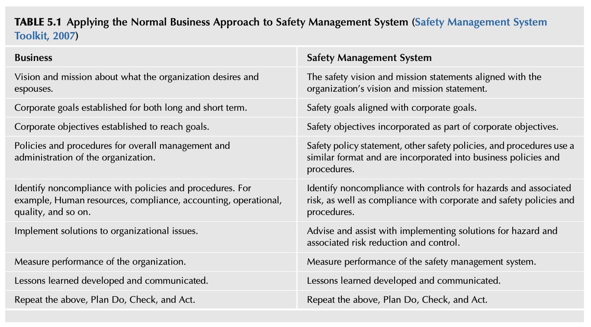
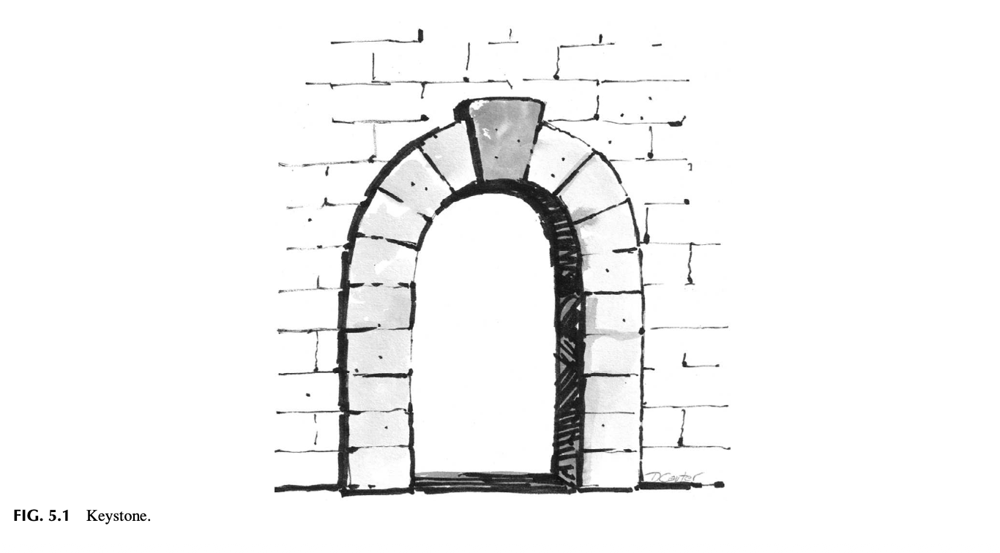
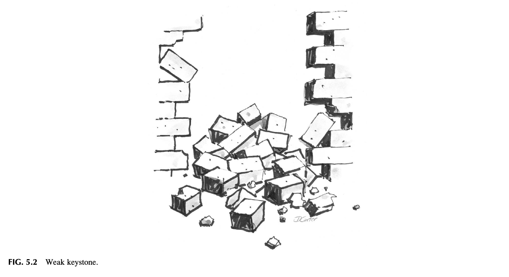
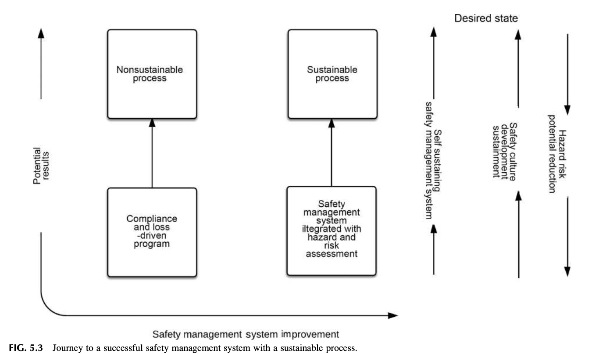
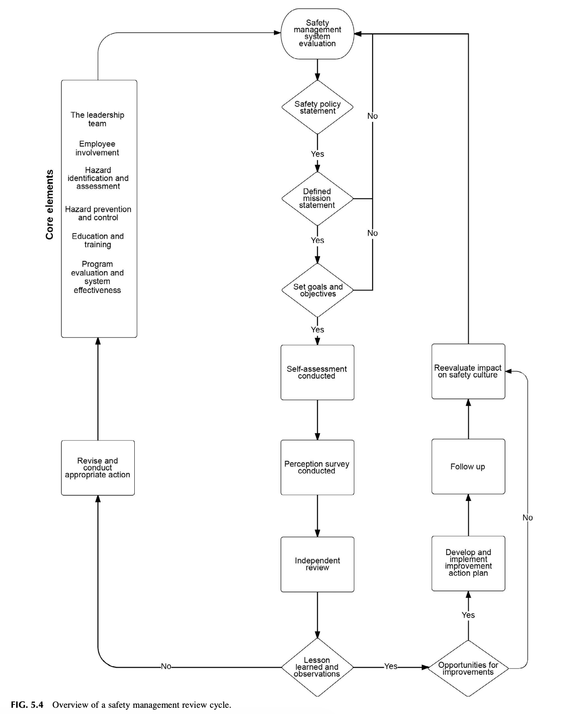
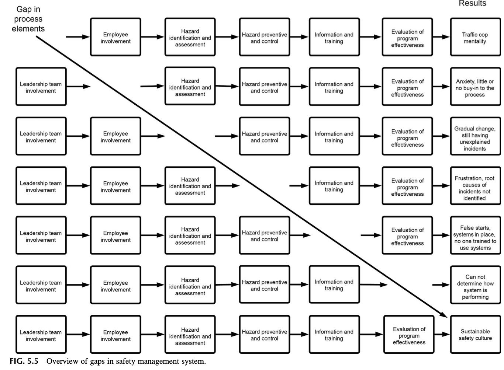
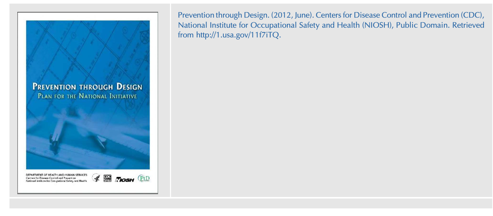

# Chapter 5 Overview of Basic Safety Management Systems
Management is doing things right; leadership is doing the right things. Peter Drucker
## INTRODUCTION
A safety management system is a structured approach for managing and administrating the various components required to identify and control potential operational hazards and associated risk. A safety management system provides guidance for planning, managing, and establishing the appropriate controls needed for its work environment, a term used to refer to a comprehensive business management system designed to manage safety elements in the workplace. Safety Culture. https://doi.org/10.1016/B978-0-12-814663-7.00005-4 If a safety management system structure is used, decisions on potential hazards and associated risk assessment controls can be given the correct priority needed to ensure the organization and all employees are protected. The objective of this chapter is to present the essential safety management system elements. It discusses the organizational safety culture benefits of selecting and implementing a structured process. After completing this chapter, you should be able to:
* Discuss the common elements found in various safety management systems.
* Contrast leadership and employee involvement in a safety management system.
* Discuss why defining specific roles and responsibilities are critical to the success of any safety management system.
* Discuss the importance of hazard and risk identification, assessment, prevention, and control.
* Discuss how a safety professional should interact with other departments.
* Discuss why safety performance criteria should be kept as simple as possible.
* Discuss why the implementation of a safety management system is instrumental in the development of the organization’s safety culture.
## THE COMMON LINK BETWEEN SAFETY MANAGEMENT SYSTEMS
A safety management system provides an organizational structure designed to aid in meeting its safety goals and objectives as discussed in Chapter 4, Establishing the Direction for the Safety Culture. It establishes the process for measuring the effectiveness of actions used to reach or maintain a safety-related vision and mission. Some government agencies, volunteers, international, and regulatory entities have defined what constitutes a safety management system as follows:
* The U.S. Federal Aviation Administration (FAA) defines safety management system as “the formal, top-down,
organization-wide approach to managing safety risk and assuring the effectiveness of safety risk controls. It includes systematic procedures, practices, and policies for the management of safety risk” (What Is a Safety Management System (SMS)?, 2017).
* International Organization for Standardization (ISO) 45001 “An organization’s OH&S (Occupational Health and
Safety) management system can translate its intentions to prevent incidents into a systematic and ongoing set of processes, supported by the use of appropriate methods and tools, and can reinforce the organization’s commitment to proactively improving its OH&S performance” (ISO 45001 Briefing, 2016).
* The National Safety Council defines a safety management system as “a systematic, explicit and comprehensive process
for managing safety risks for goal setting, planning, and measurement of performance against defined criteria. A formal method of measuring and evaluating individual and organizational safety performance with an emphasis on continuous improvement” (Elements of an Effective Safety Management System, 2018). Safety management systems revolve around several necessary criteria and should include the following:
* “Express the leadership team’s commitment to safety and clearly state the policies, objectives, and requirements of the
safety management system.
* Define the structure of the safety management system as well as the responsibilities and authority of key individuals in
the leadership team.
* Define each element of the safety management system.
* Communicate the expectations and objectives of the safety management system to all employees” (Safety Management
System Toolkit, 2007). The suggested elements and components of a safety management system can vary by industry. A fundamental safety process is designed to accomplish four essential endeavors:
* Provide a comprehensive formal structure for the management and administration of operational hazards and
associated risk.
* Establish specific leadership, administrative methods, and corrective actions for controlling operational hazards and
associated risk.
* Provide methods for instructing and informing the importance of safety procedures to protect themselves and others.
* Ensure all leadership and employees in the organization can recognize and understand real or potential hazards and their
associated risk (Safety Management System Toolkit, 2007).

TABLE 5.1 Applying the Normal Business Approach to Safety Management System (Safety Management System Toolkit, 2007) Business Safety Management System Vision and mission about what the organization desires and espouses. The safety vision and mission statements aligned with the organization’s vision and mission statement. Corporate goals established for both long and short term. Safety goals aligned with corporate goals. Corporate objectives established to reach goals. Safety objectives incorporated as part of corporate objectives. Policies and procedures for overall management and administration of the organization. Safety policy statement, other safety policies, and procedures use a similar format and are incorporated into business policies and procedures. Identify noncompliance with policies and procedures. For example, Human resources, compliance, accounting, operational, quality, and so on. Identify noncompliance with controls for hazards and associated risk, as well as compliance with corporate and safety policies and procedures. Implement solutions to organizational issues. Advise and assist with implementing solutions for hazard and associated risk reduction and control. Measure performance of the organization. Measure performance of the safety management system. Lessons learned developed and communicated. Lessons learned developed and communicated. Repeat the above, Plan Do, Check, and Act. Repeat the above, Plan Do, Check, and Act. The safety management system parallels the concepts and formats used in a general business management approach. Its intent mirrors the overall business strategy objective and is designed to be a part of the operational philosophy used by an organization. A safety management system intends to protect the human and physical assets allowing the leadership to focus on what the business intends to accomplish with its products and services. Refer Table 5.1 for a comparison of safety management system content that can apply to the normal business approach to the safety system.
## SAFETY MANAGEMENT SYSTEMS DEFINED
A designated person or group has traditionally been given the primary responsibility for managing the safety process. The overall “safety” of an organization cannot be the sole responsibility of one person or group. The safety management system is comprised of the interactions of all components or elements of the organization, so one individual would be overwhelmed by the complexity. A goal of the safety management system is to become a part of the leadership team’s general management process. The safety professional, through networking, professional presence, and general understanding of the organization, should evolve into this position. As a result of this process, they can influence and shape the organization’s perception of safety. After reviewing various safety management systems and comparing their elements side by side, six basic core principles appear to be the vital elements for developing and sustaining a safety management system. These elements are used to design and implement a structure and provide the foundation for sustaining a safety culture.
* Management leadership.
* Employee Involvement.
* Risk and Hazard identification and assessment.
* Hazard prevention and control.
* Education and training.
* Performance & Measurement.
(Managing Worker Safety and Health, Sample Assignment of Safety and Health Responsibilities, 2018) The safety management system structure provides the communication framework for risk and hazard information. Communication is the essential component for improving the potential for successful development and implementation of a safety process. The quality, depth, and scope of a communication network are crucial. Understanding how communication flows through an organization ensures the intended hazard, risk, and control messages are transmitted to the correct decision makers and affected employees. The leadership team and employees gain core information from a shared, collaborative process and the safety management system becomes more effective as a result of the increased personal involvement (Building an Effective Health and Safety Management System, 2015).
## MANAGEMENT LEADERSHIP
Leadership is the “keystone” of a safety management system. The keystone is located at the top of a masonry arch. It keeps the whole structure of an arch from collapsing by allowing the arch to bear weight. Leadership as a keystone is the central supporting element for all the elements required for an organization to sustain its mission. It allows an organization to maintain its structure as different pressures for performance impact it. If a keystone is weak, has decayed, or is not in place, a catastrophic collapse will occur. The development of individual “keystone” leaders is essential for organizational success (McIntyre, 2014). The keystone is the most important stone (in an arch), and that’s why this word is also used figuratively to mean the most important part of anything. Keystone (2018) Refer Fig. 5.1, which represents a Keystone of an arch that holds everything together. If the system does not work in the way it is intended, the system fails. Fig. 5.2 shows the results of any management failure. Refer Fig. 5.2, for an example of a weak keystone. Management commitment forms the thread of responsibility from top leadership down through all levels of the organization. The term, “Leadership Team,” will be used to define all levels of management and supervision. The Leadership Team’s commitment is considered the driving force behind all successful safety management systems.

FIG. 5.1 Keystone.

FIG. 5.2 Weak keystone.
The Leadership Team provides the vision or future state of the safety management system and establishes the mission of achieving the vision. After the vision and mission are defined, appropriate resources are allocated to ensure that the safety management system is provided the personnel, time, and budget. A dynamic safety management system can be developed and sustained when the leadership team demonstrates a commitment to providing the motivating factors and the needed resources. Consistent with safety management systems, the leadership team may include, but not be limited to the following elements:
* Establishing responsibilities for managers, supervisors, and employees for safety-related goals and objectives, and
accountability for carrying out assigned activities.
* Providing managers, supervisors, and employees with authority to correct hazards, access to relevant safety and hazard
information, safety-related education and training, and resources.
* Identifying qualified employees designated to respond to specific reports about hazardous conditions or increased risk,
and, where appropriate, to initiate and expedite corrective actions. Safety procedures are more likely to be followed when the leadership team emphasizes the safety management system. The organizational focus should be a combination of direct involvement, budget and time resources, positive incentives, and adherence to appropriate administrative guidelines as defined by the safety management system. As previously discussed in Chapter 2, Analyzing the Organizational Culture, the combination of Artifacts, visible structures and processes, Espoused Values, goals, objectives, mission statements, etc. and Underlying Assumptions, the norms, and unspoken rules, must be aligned providing a comprehensive interlocking web increasing the probability of a positive safety culture. Leadership is not magnetic personality - that can just as well be a glib tongue. It is not ’making friends and influencing people’ – that is flattery. Leadership is lifting a person’s vision to high sights, the raising of a person’s performance to a higher standard, the building of a personality beyond its normal limitations. Peter F. Drucker One artifact or indicator validating a safety management system is not just an espoused value, but the actual reality is observing the degree of involvement of the leadership team members to follow established safety rules, guidelines, and work practices.
### Observation 1
Based on the authors’ experience and the safety management literature, when leadership withdraws from actively following safety procedures or participating in some fashion, it signifies leadership failure. Consequently, when leadership fails to follow the rules, the underlying assumption is that leadership is sending an unspoken message of “we are exempt from adhering to the rules.” For example, when a leader walks through an operation or workplace and does not follow the stated rules and guidelines, leadership sends a strong negative message about the espoused safety requirements. If employees see the leadership team violate any safety procedure, the message is sent that the safety process is “just for show.”
### Lesson Learned 1
Mike tells the story of a manager lighting up a cigarette directly under “No Smoking” signs in a high fire/explosion hazard area. When asked why he thought smoking was OK, given the potential for explosive vapors in the area, the manager replied the signs had been placed by his predecessor who was a nonsmoker. The manager was oblivious to the existing fire hazards present and the danger of smoking in the vicinity. He set the example that safety was not of value and he was exempt from rules. Evidence of employees smoking was also found in other building areas. So, the message sent by leadership to employees was, no one has to obey the No Smoking signs. Many methods and actions are available for a leadership team to show support for the safety management system. These can include:
* Periodically participating in facility safety inspections, safety management system reviews, and audits.
* Support corrective actions and alternative solutions for hazardous conditions and activities until the exposure can be
minimized, corrected, or controlled.
* Provide and review the safety performance, and so on.
(Managing Worker Safety and Health, Sample Assignment of Safety and Health Responsibilities, 2018) The first responsibility of a leader is to define reality. The last is to say thank you. Max DePree Relying only on rule-based compliance can create a climate where the safety professional or designated person is perceived as just the inspector and not as a problem-solver for the organization. Regulatory compliance and the correction of physical hazards, while critical, becomes the objective and may inhibit the safety professional from becoming a trusted mentor who understands the needs of the organization. A mentor uses a positive approach using knowledge and experience of what creates hazards when addressing employees about the value and importance of using hazard and risk-related control procedures (refer Fig. 5.3). The following questions provide a basic safety culture self-evaluation:
* Is a written Safety Policy Statement for the organization in place?
* Did the leadership team sign the Safety Policy Statement?
* Is the Safety Policy Statement readily available to everyone in the organization?
* Has this written Safety Policy Statement been communicated to all levels of the organization?
* What access does the safety professional have to the senior leadership team?
* Is everyone in the organization aware of their specific safety-related responsibilities?
* Are all employees evaluated on their safety performance?
* Does the leadership team communicate with all employees in the organization, regularly about their commitment to
safety?
* Does the leadership team participate in on-site walk-throughs to reinforce their commitment to safety practices and
behaviors?
* Is a process in place addressing on-site contractor safety?
* Does the leadership team provide the resources needed, budget, time, equipment, materials, and so on, to implement and
improve the safety management system? (Building an Effective Health and Safety Management System, 2015) (refer Fig. 5.4).

FIG. 5.3 Journey to a successful safety management system with a sustainable process.
### Employee Involvement
Employee involvement builds direct ownership and buy-in to a safety management system. Employee involvement and insight on the work environment can better ensure that a safety management system design considers norms and unspoken rules within the existing organizational culture. These may be a combination of both positive and negative elements that must be addressed. Nathan was in a Post Office and noticed an employee was wearing a button with a safety slogan. He asked the employee how the safety campaign was working? The employee looked at the button and replied, “I don’t know. They just told us to wear these things.” The “why” of the effort did not get down to the employee level and indicated the espoused values were not the normal standards of the organization. One way to promote employee involvement is using a direct approach by asking for volunteers to participate in the development of hazard analysis, safety inspections, preventive maintenance, training, emergency action planning, and loss-producing reports, and so on. This approach can work if the current workplace environment already provides similar opportunities in other business or operational disciplines.
### Observation 2
Nathan was assisting an organization where the safety manager asked for volunteers to assist in the further development of the safety program. The safety manager was very surprised by the response as several employees came forward who were retired military who had in-depth safety management experience and understood the process. Asking the employees to participate was the first step in promoting the needed upstream safety activities.

FIG. 5.4 Overview of a safety management review cycle.
Employee involvement closely follows the leadership team’s commitment. The goal is to provide employees with the means and criteria allowing them to develop and express their commitment to safety for themselves and their fellow employees. Most employees want to do the right thing about their assigned duties and tasks. They know that they must complete their specific task safely, but must in turn balance what they feel is safe vs. perceived risk that can be accepted to get the job task completed. This may or may not stem from any perceived pressure from the leadership team but rather the desire or gratification to complete a task and move to the next activity. One area to be considered for ensuring that employees are involved in the process is to be as diverse as possible, for example, involving multiple disciplines or job titles, a range of experience and personnel from various departments. The following actions can become avenues for two-way communication and conduits for enhanced involvement:
* Ensure two-way communications are in place and a rapid response is provided concerning the results of any safetyrelated reports and recommendations. The safety management system should include methods for allowing employees
to make recommendations and be provided the status of any corrective actions. If employee communication is filtered or blocked, the safety culture may be weakened.
* Provide easy, practical access to safety-related information through quick and reliable communication methods.
* Ensure that the communication network maintains open channels to the senior leadership team. The communication
network should be monitored for obstacles preventing, filtering, or blocking concerns about identified hazards and increased associated risks.
* Provide employees with practical methods to assess perceived specific hazards and techniques to prioritize issues
identified. A link exists between leadership’s communication of its safety commitment and employee involvement. When the two-way channels of communication are robust, safety perceptions between leadership and employees are more aligned with each other. The sequence of leadership, safety communication, and employee participation allows the safety culture to become a more vibrant product.
## DEFINING ROLES AND RESPONSIBILITIES
Defined and well-communicated safety roles and responsibilities are critical in every phase of developing a safety management system. Roles and responsibilities outline the expectations about performance and accountability for the leadership team, all employees, on-site contractors, and visitors. Unless commitment is made, there are only promises and hopes…but no plans. Peter Drucker Direct coordination with the department and person writing and developing job descriptions is crucial. As job descriptions are developed or modified, this coordination can ensure safety-related communications and criteria are built into the organization. Network analysis can assist in determining actions to get safety criteria built into the administrative process.
## HAZARD AND RISK ASSESSMENT IDENTIFICATION AND ANALYSIS
Hazard and risk identification and analysis are core functions of a safety management system. This element provides the tools and methods to be used to identify hazards and associated risk within all operations. A wide array of tools should be readily available for customizing to meet the organizational environment. Inspections, audits, checklist, risk assessments, and so on, all play a part if routinely used. The primary problem is maintaining a routine use of the tools in the face of service or production concerns. It is important to assess all aspects of the work environment. A Job Hazard Analysis (JHA) can be used to review jobrelated tasks for the specific hazards built into the job and the severity of any associated risk. If job assessment is performed as a team effort with involvement at all levels of the organization, it can begin to promote hazard awareness to both the leadership team and employees (Building an Effective Health and Safety Management System, 2015). The use of a Job Hazard Analysis will be discussed in more detail in Chapter 12, Using the Job Hazard Analysis. When providing JHA training, the authors would use jobs for analysis identified by the safety manager or person that were determined through review of injury records. In almost every session, employees in the class would describe jobs and tasks having high potential risk severity but had not yet resulted in loss or injury. The safety management system and the safety culture cannot be maintained without a comprehensive approach to hazards and associated risk. Leadership guidance and expertise drive the hazard identification process. The concerns over inherent operational hazards and the conditions where new hazards may be potentially created must be translated into terms understandable at all levels of the organization. The following items should be reviewed for the depth and scope of their implementation throughout the organization:
* Routine development and use of JHAs as well as education of employees about each job’s specific hazards and associated risk. The process should include involvement or comprehensive communication with the leadership team, so
understanding is present throughout the organization.
* Providing a reliable system for employees to notify, and, in turn, receive timely feedback from the leadership team about
potentially hazardous conditions and control implementation.
* Investigating all real/potential loss-producing events such as first aid cases, property damage, and so on, for causes with
prevention methods determined and implemented.
* Analyzing hazard and associated risk assessments, and injury trends to identify patterns for further analysis of corrective
actions (Managing Worker Safety and Health, 2016).
## HAZARD PREVENTION AND CONTROL
Effective planning and design of the workplace and its required job tasks are an ongoing concern as technology, facilities, materials, equipment, and operations are constantly changing. As part of the overall assessment, the design and effectiveness of a work order system should be reviewed to ensure it prioritizes request for corrective hazard actions.
### Prevention through Design (PtD)
The concept of Prevention by Design or Safety by Design recommends approaching hazard and hazard identification and control at the beginning stages of design to essentially engineer safety concepts into processes, equipment, machinery, facilities. Various global initiatives have been launched, and the U.S. NIOSH mission is as follows: The mission of the Prevention through Design National initiative is to prevent or reduce occupational injuries, illnesses, and fatalities through the inclusion of prevention considerations in all designs that impact workers. The mission can be achieved by:
* Eliminating hazards and controlling risks to workers to an acceptable level “at the source” or as early as possible in the life cycle
of items or workplaces.
* Including design, redesign, and retrofit of new and existing work premises, structures, tools, facilities, equipment, machinery,
products, substances, work processes and the organization of work.
* Enhancing the work environment through the inclusion of prevention methods in all designs that impact workers and others on
the premises The strategic plan establishes goals for the successful implementation of the PtD Plan for the National Initiative (Prevention through Design, Plan for the National Initiative, 2017). This comprehensive approach, which includes worker health and safety in all aspects of design, redesign, and retrofit, will provide a vital framework for saving lives and preventing work-related injuries and illness is the road map. Defining PtD PtD encompasses all of the efforts to anticipate and design out hazards to workers in facilities, work methods and operations, processes, equipment, tools, products, new technologies, and the organization of work. The focus of PtD is on workers who execute the designs or have to work with the products of the design. The initiative has been developed to support designing out hazards, the most reliable and effective type of prevention.” Refer to Appendix 5.1 for the Centers for Disease Control and Prevention (CDC) “Prevention through Design Program, Plan For the National Initiative” (Prevention through Design, 2012) public domain document that can be downloaded and used for your library. After the hazard and associated risk assessments are completed using the PtD method, the next step in supporting the safety management system is to implement strategies for eliminating or reducing operational hazards and associated risk. PtD can be used beyond preventing work-related injuries and illnesses; it can be used in analyzing liability, property, and other areas exposed to potential loss concerns.
### Information
The resource cornerstone of the safety management system is the collection of operational and risk information. A structured process to gather and maintain information and data specific to the operational environment is essential. Many organizations are using commercial data systems to centralize information and provide for the exchange of knowledge and information. When these technology systems are used, the safety process becomes more aligned with the organization’s operational databases. Safety management system reports and criteria should be in formats similar to those currently used by leadership. The issue of parallel report formats is critical to the safety process aligning itself with leadership communications. The acceptance of safety reports, such as safety performance and hazard assessments improve if they are consistent with the current leadership reports and not provided in a “safety” stand-alone report style. Safety professionals should strive to become better “curators” of information. The collected information is the basis for sharing knowledge benefiting the leadership team and employees when cataloged for access and retrieval. Curation will be discussed in detail in Chapter 15, Curator for the Safety Management System.
### Training Programs
Depending on the organization, safety training can vary from virtually nonexistent to considerable. Adequate time should be devoted to the development of the safety curriculum and instruction. The safety topics or subjects should complement the organizational tasks/jobs and industry-specific operations. The other concern is the time allowed to develop managers and supervisors into competent instructors or coaches. Employee training and education programs should be designed and implemented with the intent to ensure all that employees understand the hazards and associated risk inherent in their job. How the organization implements its safety-related training programs and methods must be defined within the safety management system. Training responsibilities usually reside in human resources or training department, with training not part of the safety department’s responsibility and authority. Coordination, and a positive rapport, with training department leadership, is essential for the proper determination of how safety training is to be delivered. Human resources or a training department may not have the expertise, budget, or time to provide the technical or safety management system-related training depending on the scope of their responsibilities. The safety professional or department may then be tasked to develop and provide specific safety-related training to line managers, supervisors, and employees. The positive aspect of this approach is a higher or better quality of specific training may be achieved. The negative side is that this approach may leave the perception that safety training is not an integral part of the overall operation and separate from the “real world,” and delegated to a lower priority. When training responsibilities are divided, safety and operational leaders must find a way to support each other mutually, sharing information and expertise to develop a unified approach to the employee, line supervision, and leadership training. If a rapport is not attained, the two departments may find themselves competing for the scarce resources available and allowed limited employee time for training.
## EVALUATION OF SAFETY MANAGEMENT SYSTEM EFFECTIVENESS
The safety management system must have a feedback loop interconnecting to the leadership team to provide the status of the various elements and processes required to administer the necessary controls for hazards and associated risk. The safety management system must be revised as issues, gaps, or deficiencies are identified through ongoing comprehensive audits or evaluations. Periodic reviews of system elements would entail routine spot checks to verify programs have remained in place and are fully utilized. The time frame of these reviews can range from daily, weekly, monthly, and annually. The safety management system should include a schedule of the planned reviews and ensure the evaluations are shared promptly. System reviews are focused on management system elements and are not specific to operations. Examples include:
* Determination of resource levels and expertise.
* Evaluation of communication and employee participation.
* Review of change management timelines and effectiveness.
System reviews may be input for decisions made during management reviews. Occupational Health & Safety Management Systems (2012)

FIG. 5.5 Overview of gaps in safety management system.
Safety management system measurements should be readable and easily interpreted by the intended audience without losing sight of the complexity of the information presented. The measurement design should generate comprehensive information or data providing valid evidence of the effectiveness of the safety management system (refer Fig. 5.5).
## SUMMARY
A safety management system incorporates six core elements:
* Management leadership.
* Employee Involvement.
* Hazard and Risk identification and assessment.
* Hazard prevention and control.
* Education and training.
* Performance & Measurement.
When these foundational elements are implemented, a safety management system structure can be developed that:
* There is visible leadership team involved in the implementing and sustaining of a safety management system which
stresses to each employee that the organizational commitment is serious.
* Ensures that employee involvement in the structure and operation of the safety management system and decisions
affecting the employee safety.
* Defines and assigns the safety management system accountabilities and responsibilities to the leadership team and
employees.
* Identifies levels of authority and the resources required for responsible parties to complete assigned duties.
A safety management system defines how the organization intends to execute its stated goals and objectives as well as how to measure the effectiveness of actions used to reach or maintain the safety-related vision and mission. Management commitment and leadership are from the top leadership down through all levels of the organization. The Leadership Team provides the vision and mission for the safety management system and as well as provides adequate resources to ensure controls are in place. Getting employees involved in the development of the safety management system is important to increase the potential for the creation of ownership and buy-in. Employee involvement in the development of the Safety Management System will help to ensure it fits within the existing organizational culture. Defined and well-communicated safety responsibilities for all levels of the organization are critical in the beginning phases of developing a safety management system. Safety responsibilities outline expectations about performance and accountability among the leadership team, employees, contractors, and site visitors. Hazard and risk identification and analysis are core functions of a safety management system. Effective planning and design of the workplace and job tasks are an ongoing concern for technology, facilities, materials, equipment, and operations which are constantly under change. The collection of operational and risk-related information is critical to the safety management system. Establishing a structured method to gather and maintain information and data specific to an operational environment increases the ability to influence and design safety performance requirements and job practices. Employee training and education programs should be designed and implemented to ensure all employees demonstrate and understand they are fully aware of the hazards and associated risk inherent in the operations. The safety management system must have a feedback loop that communicates to the leadership team the status of the various programs and systems required to control hazards and associated risk. In Chapter 6, Creating the Safety Process, we will discuss various types of Safety Management Systems that can range from voluntary standards established by industry or trade groups, consulting organizations, international standards organizations, and required regulatory legislation. We will demonstrate how a safety management system’s main purpose is to provide a structure for managing and administering the activities that will control hazards and associated risks. From that structure, the elements can be linked, prioritized, and designed to fit within the overall organizational framework. While many different Safety Management Systems have been developed, a consistent theme is noted that they follow a classic format known as the Deming model of Plan-Do-Check-Act or also known as Deming’s cycle.
## CHAPTER REVIEW QUESTIONS
1. 2. 3. 4. 5. 6. 7. What is the purpose of a basic safety management system?
Compare the traditional business approach to a safety management system is. What are the six basic core safety elements used to implement a safety management system structure to design and to support a safety culture? Explain each of the six basic core safety process elements of a safety management system in detail. Explain what leadership commitment means from the top-down and through all levels of the organization. What elements of the safety management system are critical to developing a safety culture? Can any of the safety management system elements be excluded from the progression of the safety culture? Identify and describe the role of each safety management system element.
## APPENDIX 5.1
This appendix provides a public domain document “Prevention through Design” document which provides the rationale, mission, objectives, outcomes, and time frame for the Prevention through Design (PtD) National Initiative. Prevention through Design. (2012, June). Centers for Disease Control and Prevention (CDC), National Institute for Occupational Safety and Health (NIOSH), Public Domain. Retrieved from http://1.usa.gov/11f7iTQ.

## BIBLIOGRAPHY
Building an Effective Health and Safety Management System. (2015). Partnerships in Health and Safety Program, Partnerships in Injury Reduction (partnerships). Public domain. Retrieved from http://bit.ly/WsHteC. Elements of an Effective Safety Management System. (2018). National Safety Council Mission. Retrieved from http://bit.ly/2CBe6B0. ISO 45001 Briefing. (2016). IOSH Magazine. Retrieved from http://bit.ly/2HTRywB. Keystone. (2018). Vocabulary.com. Retrieved from http://bit.ly/2xUJVnR. Managing Worker Safety and Health. (2016). Illinois OSHA Onsite Safety & Health Consultation Program. Public Domain, Based on Information as Presented and Adapted for Use. Managing Worker Safety and Health, Sample Assignment of Safety and Health Responsibilities. (2018). Missouri Occupational Safety and Health Administration (OSHA), Office of Cooperative Programs. Public Domain, Based on Information as Presented and Adapted for Use. Retrieved from http://on. mo.gov/2tdaySb. McIntyre, R. (2014). Keystone leadership concepts. Linkedin. Retrieved from http://bit.ly/2wsyOyU. Occupational Health & Safety Management Systems. (2012). The American Society of Safety Engineers. ANSI/AIHA/ASSE Z10. Retrieved from http:// bit.ly/1MsT6MG. Prevention through Design. (2012). Centers for Disease Control and Prevention (CDC), National Institute for Occupational Safety and Health (NIOSH). Public domain. Retrieved from http://1.usa.gov/11f7iTQ. Prevention through Design, Plan for the National Initiative. (2017). Centers for Disease Control and Prevention, National Institute for Occupational Safety and Health (NIOSH). Public domain. Retrieved from http://bit.ly/2AjDlWW. Safety Management System Toolkit. (2007). Montreal, Quebec, Canada: Developed by the Joint Helicopter Safety Implementation Team of the International Helicopter Safety Team, The International Helicopter Safety Symposium. Retrieved from http://bit.ly/YaSCOg. What is a Safety Management System (SMS)?. (2017). Federal Aviation Administration. FAA Order 8000.369. Public domain. Retrieved from http://bit.ly/ 2CBdrj0.