# Chapter 6 Creating the Safety Process (안전 프로세스 구축) 서브노트

> *"앞서가는 비결은 일단 시작하는 것이다. 시작하는 비결은 감당하기 힘들 정도로 복잡한 과업들을 작고 다루기 쉬운 과업들로 잘게 쪼갠 뒤, 첫 번째 과업에 착수하는 것이다."*  
> — **마크 트웨인 (Mark Twain, 2018)**  
> 
> *"시스템을 관리하려면 시스템 내부의 모든 구성 요소 간의 상호관계와 그 안에서 일하는 모든 사람에 대한 깊은 이해가 필요하다."*  
> — **W. 에드워즈 데밍 (W. Edwards Deming)**  
> 
> *출처: Safety Culture (Elsevier, 2019, pp. 109-148), PART II Safety Management Systems Defined, Chapter 6*  
> *DOI: https://doi.org/10.1016/B978-0-12-814663-7.00006-6*

---

## 1. INTRODUCTION (도입)

조직은 기계처럼 단순 분해했다가 다시 조립할 수 있는 정적 대상이 아닙니다. 인체를 이해하는 의사처럼 안전 전문가는 조직이라는 유기체의 생리와 구성 요소 간의 상호작용을 완벽하게 파악해야 합니다. 본 장은 품질 경영의 고전인 **데밍의 PDCA(Plan-Do-Check-Act) 사이클**과 6시그마의 **DMAIC 모델**, 그리고 선진 안전보건 표준(ANSI Z10, ISO 45001, OSHA VPP)을 비교·분석하여 현장에 최적화된 안전 프로세스를 설계하는 실무적 도구들을 제공합니다.

### 1.1 제6장의 핵심 학습 목표
1. **다양한 안전경영시스템의 공통 분모와 핵심 차이점을 식별한다.**
2. **안전 프로세스 구축 시 분석적 접근법(Analytical Approach)과 통합적 접근법(Integrated Approach)을 비교한다.**
3. **품질 경영의 양대 축인 'PDCA 사이클'과 'DMAIC 프로세스'를 안전 관리에 투영하여 비교·적용한다.**
4. **안전경영시스템이 조직의 기저 안전문화를 고도화하는 구체적 메커니즘을 규명한다.**
5. **정부의 강제적 법적 규제 프로그램과 산업계의 자율 안전 표준(Voluntary Standards)의 장단점을 대비한다.**

---

## 2. A SYSTEMATIC APPROACH TO SAFETY (안전에 대한 시스템적 접근법)

단순한 체크리스트 확인을 넘어, 시스템 전체의 지속적 개선(Continuous Improvement)을 도모하는 체계적 접근법이 필수적입니다.

---

### [그림 6.1 상세 분석] 체크박스 채우기식 형식주의의 한계 (Check in the Box)

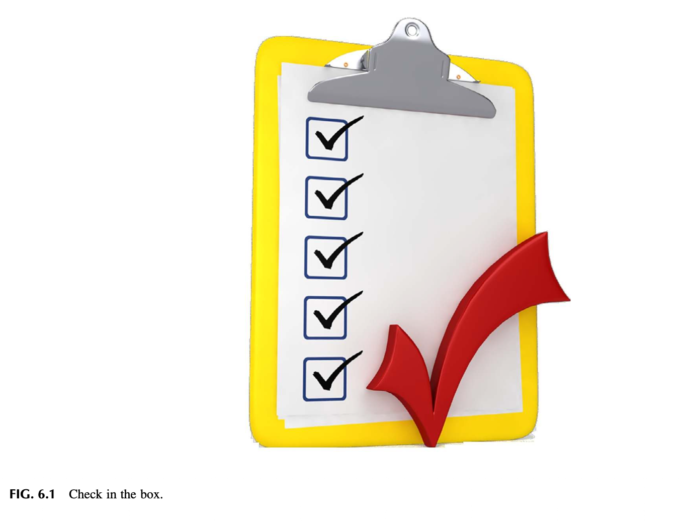

> **[그림 6.1 상세 보충설명: 형식적 안전 점검의 함정]**
> * 단순히 서류상의 네모 칸에 체크(V) 표시를 하는 행위는 안전이 확보되었다는 착각만 줄 뿐, 실제 현장의 잠재 위험을 통제하지 못합니다.

---

### [표 6.1, 6.2, 6.3, 6.4 상세 분석] 글로벌 안전경영 표준 비교

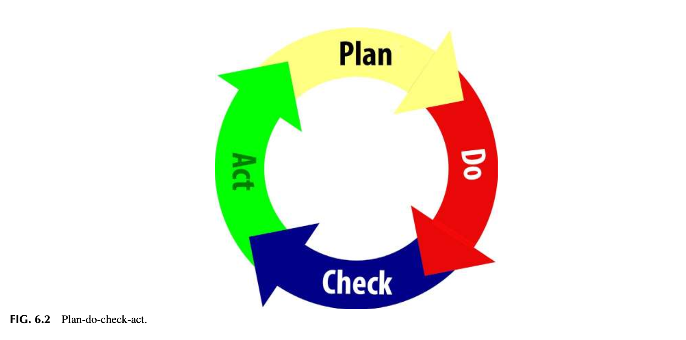
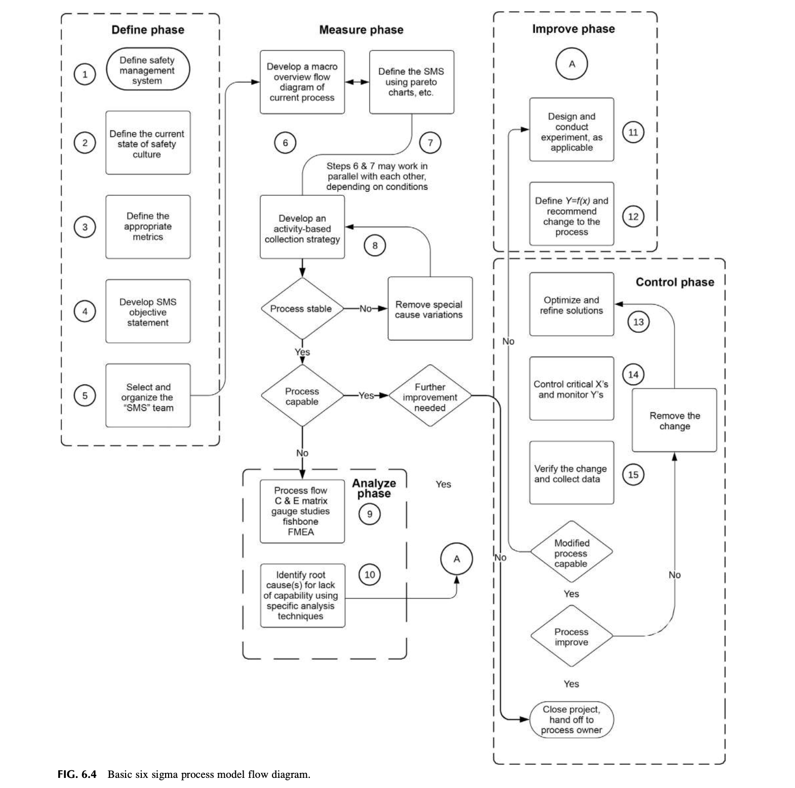
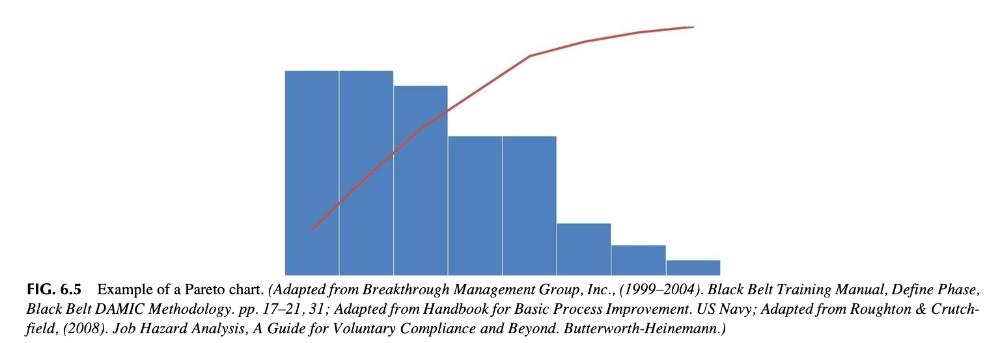

| 글로벌 표준 규격 | 핵심 구성 체계 및 특징 | 실무적 적용 강점 |
| :--- | :--- | :--- |
| **ANSI/AIHA Z10-2012** | 5대 핵심 요소 (경영 리더십, 기획, 실행, 평가, 경영 검토) | 미국 산업계 중심의 강력한 리스크 기반 자율 안전 모델 |
| **CSA Z1000-06** | 캐나다 국가 표준 6대 핵심 요소 | 노사 공동 협력 및 지속적 피드백 시스템 강조 |
| **OHSAS 18001 / ISO 45001** | ISO 9001(품질), ISO 14001(환경)과의 완벽한 통합 호환 | 글로벌 인증 및 전사적 품질-환경-안전 일원화 관리에 최적 |
| **ILO-OSH 2001** | 국제노동기구의 인권 및 근로자 참여 중심 가이드라인 | 글로벌 공급망 및 노동권 보호 관점의 표준 |

---

## 3. THE ANALYTICAL ROOTS OF SAFETY PROGRAMS (안전 프로그램의 분석적 뿌리와 과학적 관리법)

현대 안전 관리의 뿌리는 20세기 초 프레더릭 테일러(Frederick Taylor)의 **'과학적 관리법(Scientific Management)'**에서 출발했습니다.
* **테일러리즘의 명암**:  
  작업 공정을 과학적으로 쪼개어 분석함으로써 생산성과 기계적 안전을 비약적으로 발전시켰으나, 작업자를 시스템의 부속품으로 취급하여 인간적 심리와 자발적 참여를 간과하는 한계를 노출했습니다.

---

### [Observation 1 & 2] 역사적 안전 모델의 진화와 반성
* 작업자의 실수만을 탓하던 과거의 접근법에서 벗어나, 시스템의 결함과 조직적 소통 부재를 통제하는 현대적 시스템 안전으로 패러다임이 전환되었습니다.

---

### [그림 6.2 상세 분석] 데밍의 PDCA 사이클 (Plan-Do-Check-Act)

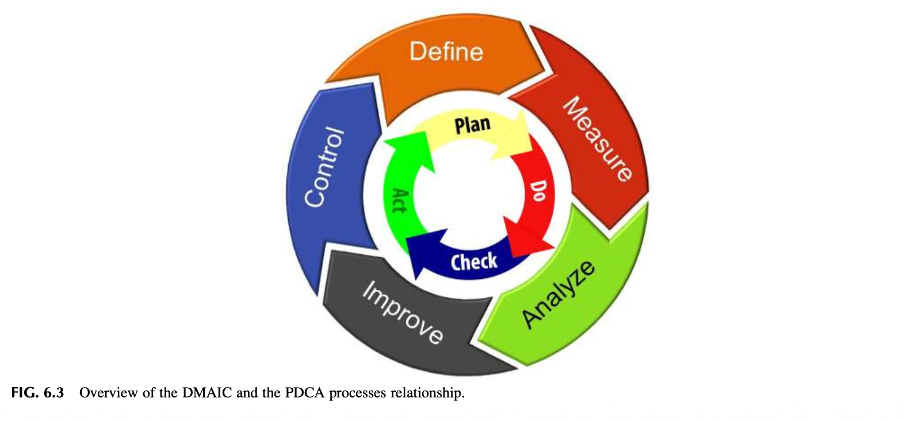

> **[그림 6.2 상세 보충설명: 지속적 나선형 혁신 사이클]**
> * **1. Plan (계획)**: 비전과 위험성평가에 기반한 SMART 목표 및 실행 로드맵 수립.
> * **2. Do (실행)**: 표준 작업 절차 교육, 자원 투입, 현장 안전 프로세스 집행.
> * **3. Check/Study (점검·학습)**: 선행지표 및 감사 결과를 통한 진척도 모니터링 및 갭 식별.
> * **4. Act (개선·환류)**: 미흡한 점을 보완하여 표준을 개정하고 새로운 개선 사이클로 도약.

---

## 4. DEFINE, MEASURE, ANALYZE, IMPROVE, AND CONTROL (DMAIC 모델의 안전 적용)

식스시그마(Six Sigma) 품질 경영의 핵심 방법론인 **DMAIC**를 안전 프로세스에 접목하여 결함(무재해 위협 요인)을 통계적으로 제거합니다.

---

### [그림 6.3 & 6.4 상세 분석] PDCA와 DMAIC의 유기적 매핑 및 프로세스 플로우

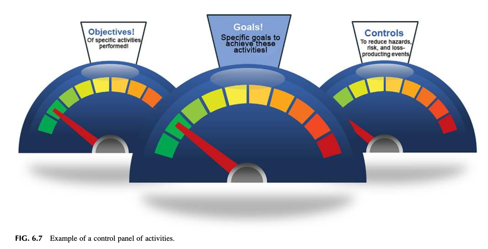
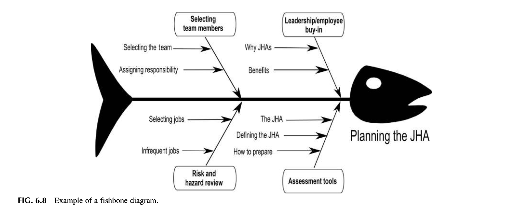

> **[그림 6.3 및 6.4 상세 보충설명: 6시그마 안전 관리 프레임워크]**
> * **Define (정의)**: 안전 문제와 핵심 핵심 위험성평가 대상 정의 (PDCA의 Plan 연계).
> * **Measure (측정)**: 유해위험요인 노출 빈도와 작업 행동 데이터 정량 측정 (Check 연계).
> * **Analyze (분석)**: 근본 원인 분석(RCA) 및 통계적 취약점 규명.
> * **Improve (개선)**: 엔지니어링 방호 대책 및 표준 공정 재설계 (Do 연계).
> * **Control (통제)**: 개선된 안전 상태가 영구히 유지되도록 통제 차트 및 일상 점검 구축 (Act 연계).

---

### [Observation 3 & 4] 품질 도구의 안전 접목 성공 사례
* 전통적인 감(Intuition)에 의존하던 안전 관리를 파레토 차트, 피시본 다이어그램 등 정밀 품질 도구와 결합했을 때 경영진의 전폭적 예산 지원을 이끌어낸 실증 사례.

---

### [그림 6.5, 6.6, 6.7, 6.8 상세 분석] 안전 프로세스 4대 핵심 품질 분석 도구

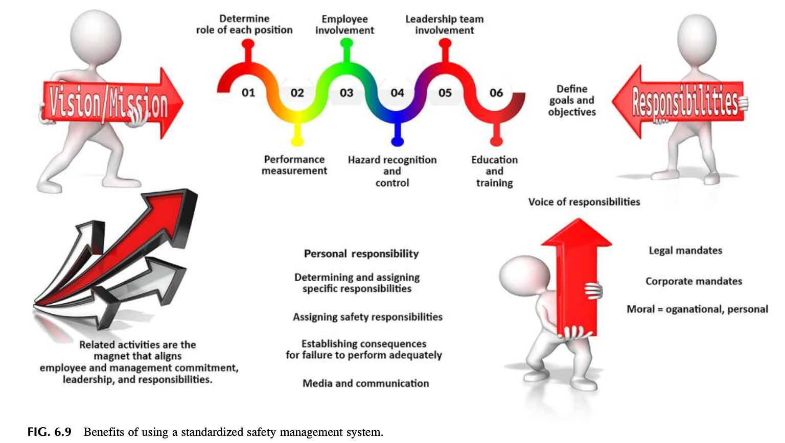
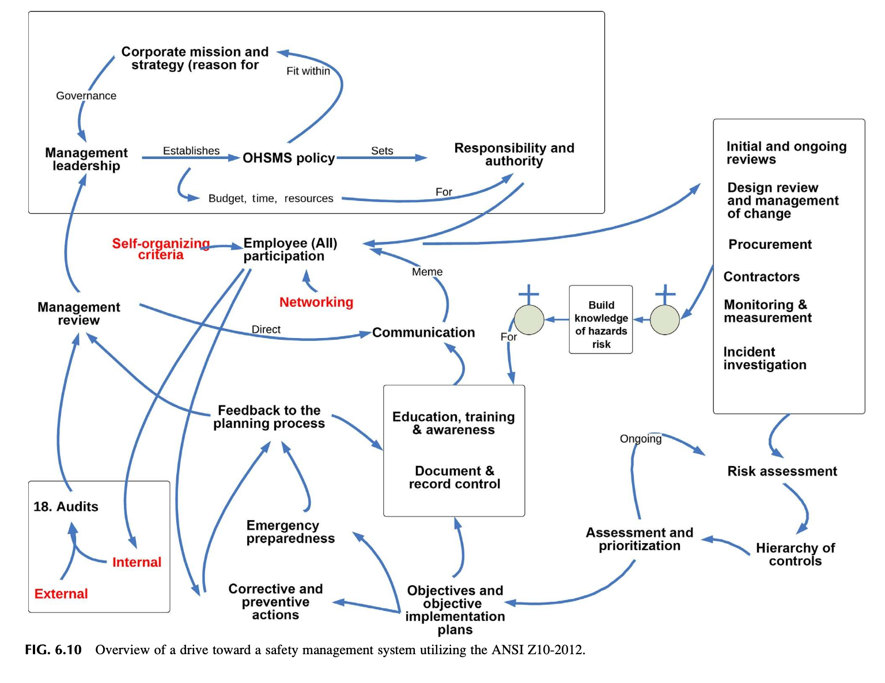
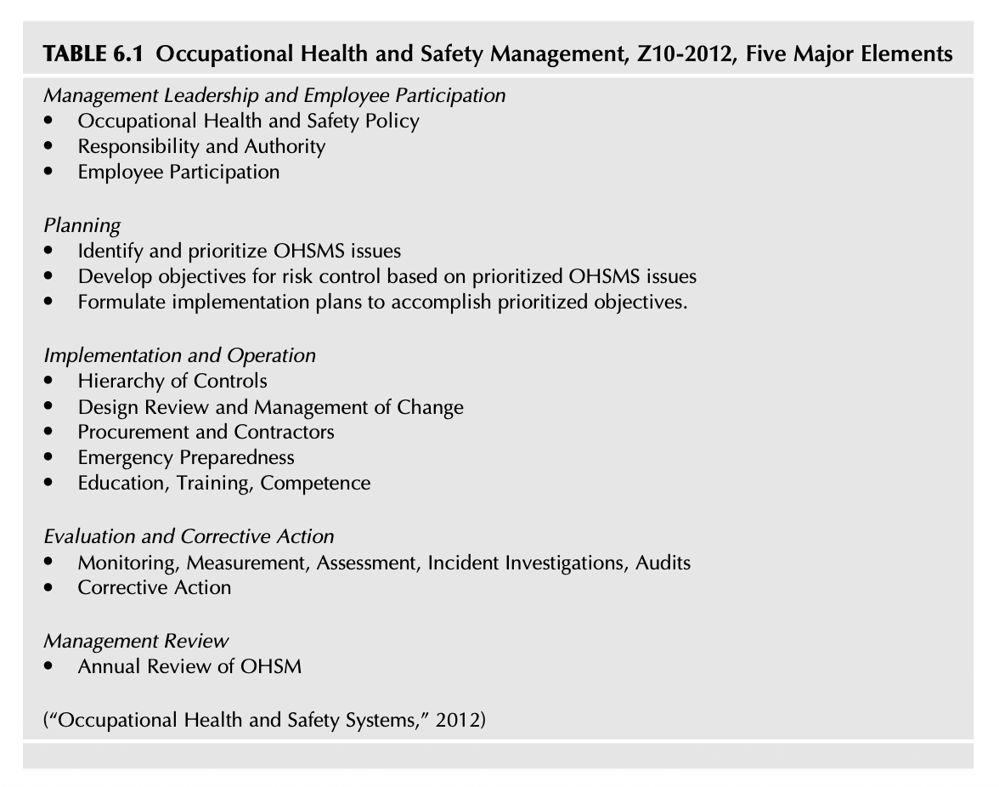
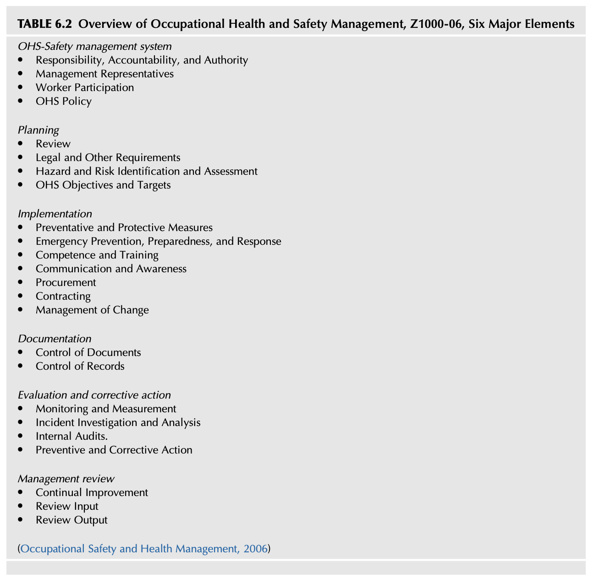

* **Fig 6.5 & 6.6 파레토 차트 (80/20 Rule)**: 전체 사고의 80%를 유발하는 핵심 20%의 치명적 고위험 요인을 선별하여 자원을 집중 투입.
* **Fig 6.7 제어 패널 (Control Panel)**: 실시간 안전 활동 지표를 대시보드 형태로 모니터링.
* **Fig 6.8 특성요인도 (Fishbone Diagram / Ishikawa)**: 사람(Man), 기계(Machine), 재료(Material), 방법(Method)의 4M 관점에서 사고의 근본 원인을 입체 분석.

---

## 5. THE “CONS” OF THE SAFETY MANAGEMENT SYSTEMS (안전경영시스템의 잠재적 위험과 부작용)

시스템 도입이 항상 성공을 보장하는 것은 아닙니다. 다음과 같은 위험을 경계해야 합니다:
1. **통조림식(Canned) 접근법의 함정**: 회사의 고유 문화와 현장 여건을 무시하고 외부 컨설팅 서류를 그대로 복사해 붙여넣는 행태.
2. **관료주의적 서류 폭탄**: 현장 안전 활동보다 감사 대비용 서류 작업에 치여 정작 현장 점검을 소홀히 하는 주객전도 현상.
3. **수동적 안주**: 인증서 취득을 안전문화 완성으로 착각하여 학습을 멈추는 행태.

---

### [그림 6.9 & 6.10 상세 분석] 표준화된 시스템의 이점과 ANSI Z10 추진 로드맵

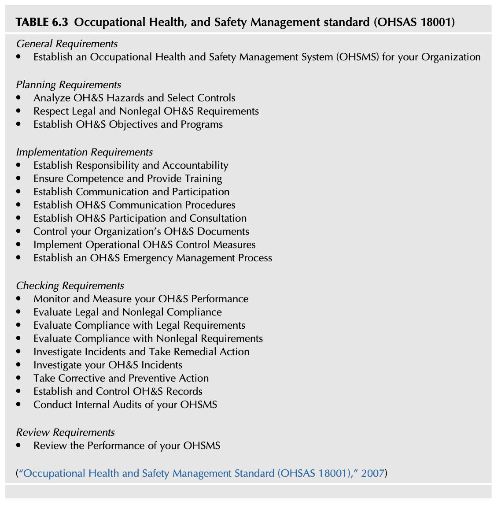
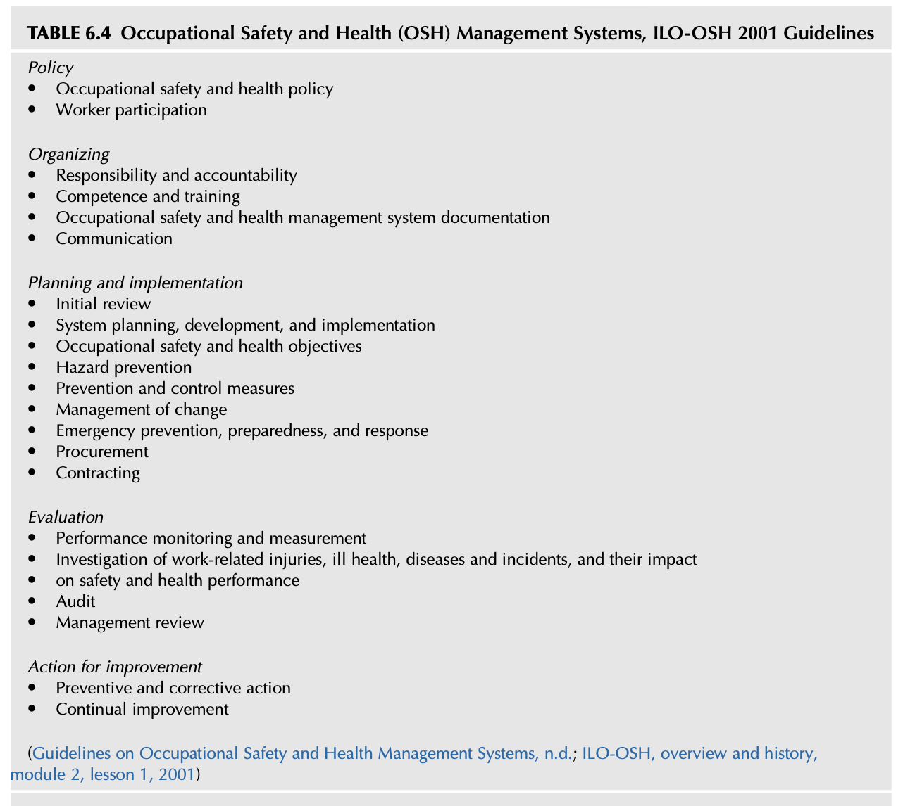

> **[그림 6.9 및 6.10 상세 보충설명: 부작용을 극복하고 시스템의 효용을 극대화하는 추진 전략]**
> * 명문화된 표준이 현장의 일상적 습관으로 정착될 때 비로소 시스템의 진정한 가치가 발현됩니다.

---

## 6. BUILDING AN EFFECTIVE HEALTH AND SAFETY MANAGEMENT SYSTEM (효과적인 안전보건경영시스템 구축 실무)

미국 노동부 OSHA의 **VPP(Voluntary Protection Programs)** 등 자율안전보건 프로그램을 벤치마킹하여 노사 신뢰에 기반한 자생적 시스템을 구축합니다.

---

## 7. SUMMARY (요약 및 핵심 결론)

1. **안전경영시스템은 기계적 체크박스 채우기가 아니라, PDCA와 DMAIC의 지속적 개선 나선형 사이클로 작동해야 합니다.**
2. 파레토 법칙(80/20)과 피시본 다이어그램 등 과학적 품질 도구를 안전 관리에 능동적으로 접목해야 합니다.
3. 획일적인 서류 중심의 통조림식 시스템을 경계하고, 현장의 맥락과 자발적 참여가 결합된 실천형 프로세스를 구축해야 합니다.

---

## 8. CHAPTER REVIEW QUESTIONS (복습 문제 10문항 정밀 분석)

1. **체크박스 채우기(Check in the Box)의 폐해**: 형식적 점검이 안전문화를 어떻게 파괴하는가?
2. **데밍의 PDCA 사이클의 4단계**: 안전 목표 수립부터 사후 환류까지의 유기적 연동 원리는?
3. **식스시그마 DMAIC 모델의 안전 적용**: 결함 제거 기법을 사고 예방에 투영하는 방법은?
4. **파레토 차트(80/20 법칙)의 실무적 효용**: 한정된 안전 예산과 인력을 집중 배분하는 요령은?
5. **특성요인도(Fishbone Diagram)를 활용한 근본 원인 분석**: 4M 관점에서 잠재 요인을 도출하는 절차는?
6. **글로벌 안전 표준(ANSI Z10, ISO 45001, OHSAS 18001)의 공통 분모와 차이점은?**
7. **통조림식(Canned) 시스템 도입의 위험성**: 현장 적합성 없는 외부 패키지 도입이 실패하는 이유는?
8. **OSHA VPP(자율안전프로그램)의 성공 요인**: 노사 파트너십이 안전 성과에 미치는 영향은?
9. **안전 프로세스와 품질 관리 시스템의 통합 방안은?**
10. **지속적 개선(Continuous Improvement)을 유지하기 위한 경영 검토(Management Review)의 핵심 역할은?**

---

## 9. [APPENDIX 6.1] SELECTED PROCESS TOOLS TO HELP ENHANCE THE SAFETY MANAGEMENT SYSTEM (안전 강화를 위한 핵심 실무 분석 도구 총람)

---

### [그림 6.11 ~ 6.19 상세 분석] 9대 첨단 프로세스 도구 매트릭스

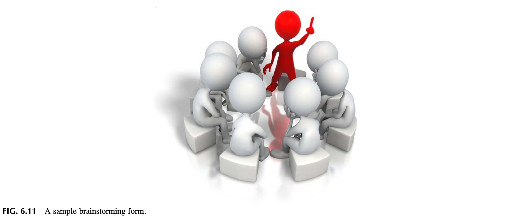
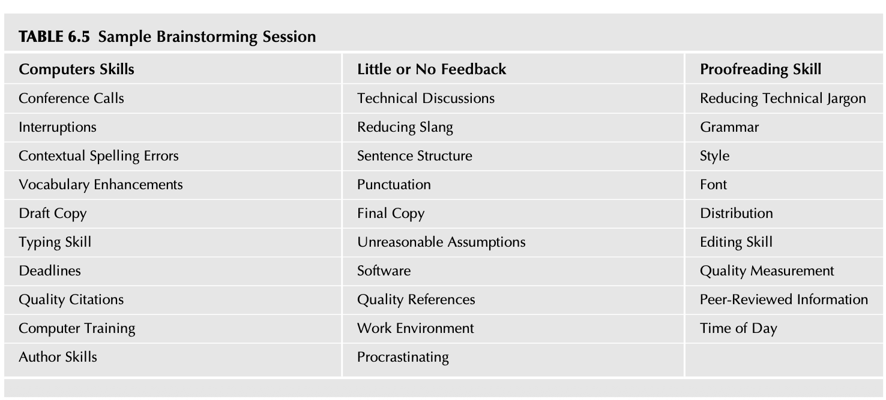
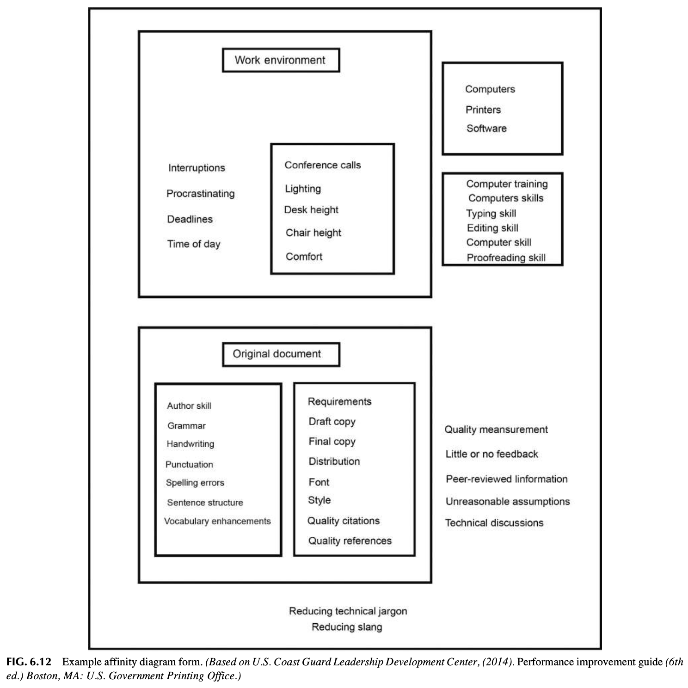
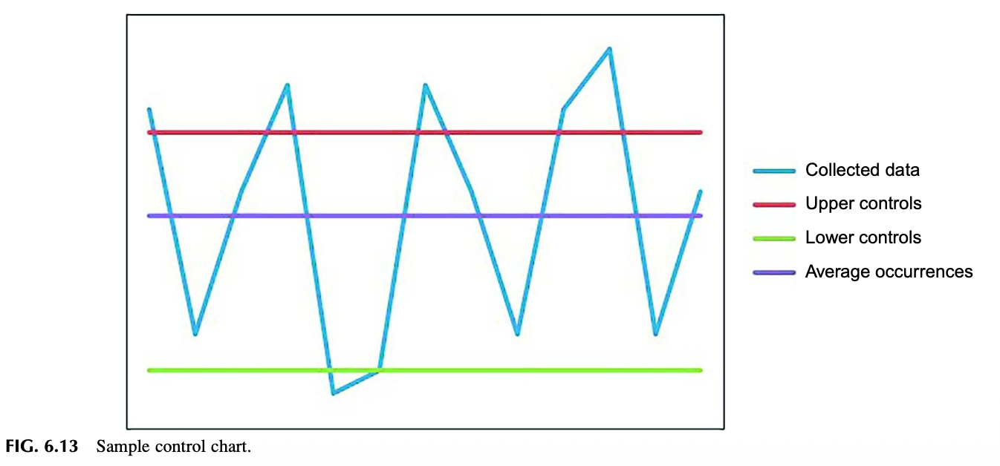
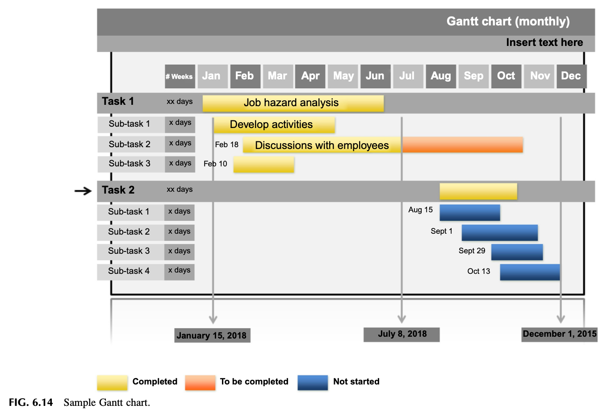
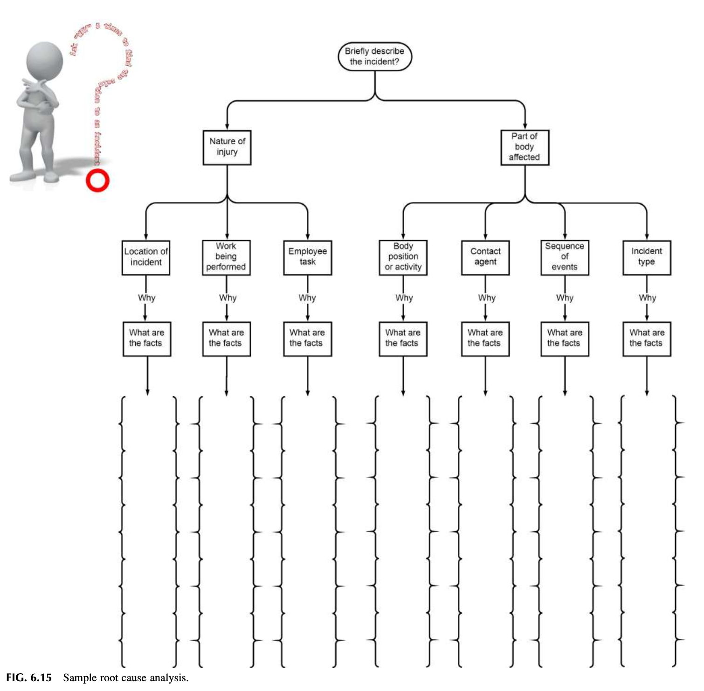
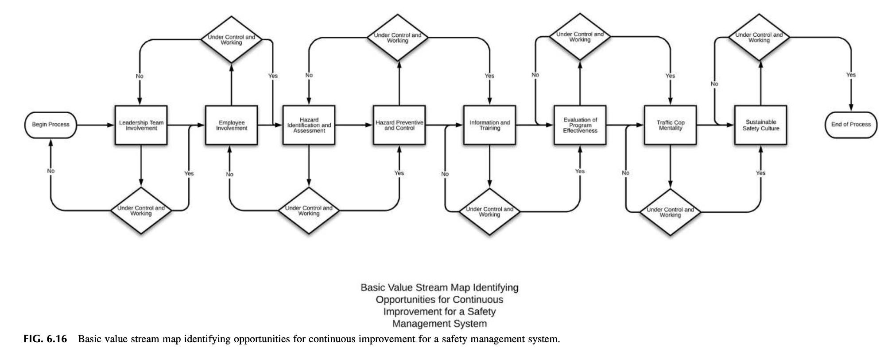
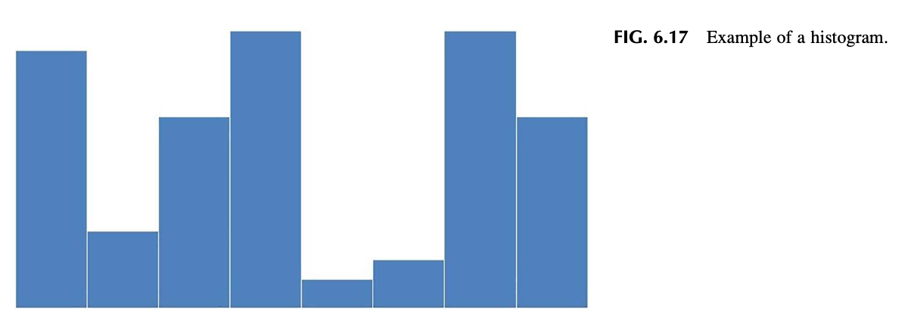
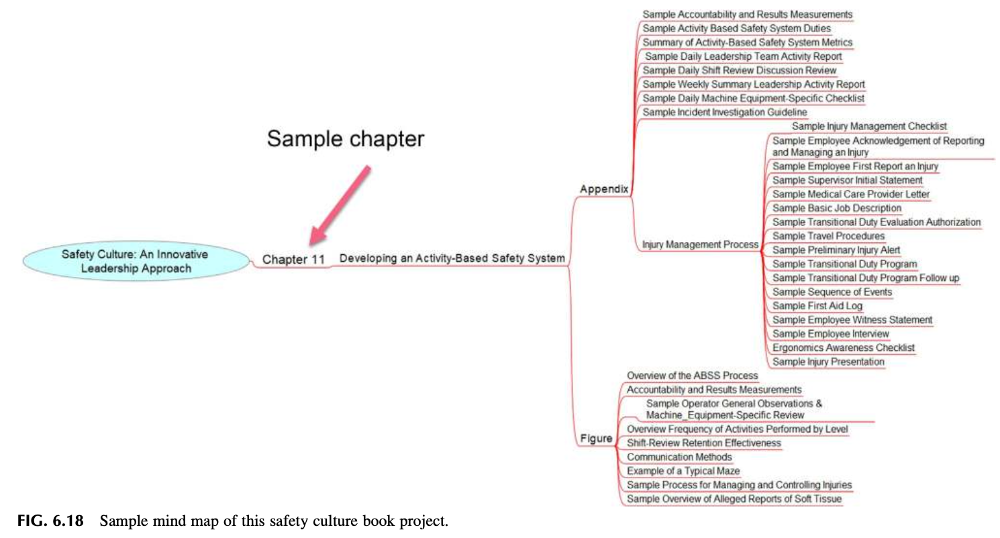

1. **Fig 6.11 브레인스토밍 (Brainstorming)**: 현장 아이디어의 자유로운 발산.
2. **Fig 6.12 친화도 기법 (Affinity Diagram)**: 혼란스러운 위험 요인들의 범주화.
3. **Fig 6.13 관리도 (Control Chart)**: 통계적 이상 징후의 조기 감지.
4. **Fig 6.14 간트 차트 (Gantt Chart)**: 안전 프로젝트 공정 및 일정 관리.
5. **Fig 6.15 근본 원인 분석 (Root Cause Analysis, RCA)**: 표면적 현상 너머의 근원적 결함 추적.
6. **Fig 6.16 가치 흐름 매핑 (Value Stream Mapping, VSM)**: 안전 낭비 요소 제거.
7. **Fig 6.17 히스토그램 (Histogram)**: 위험 노출 빈도의 분포 분석.
8. **Fig 6.18 마인드 맵 (Mind Map)**: 복합 안전 과제의 입체적 구조화.
9. **Fig 6.19 SWOT 분석 매트릭스**: 안전경영 전략 수립의 강점·약점·기회·위협 분석.

---

## 10. [APPENDIX 6.2 ~ 6.6] 법률, 표준 및 실무 양식 분석

* **APPENDIX 6.2**: 몬태나주 안전문화법(Montana Safety Culture Act) 공공 문서 분석.
* **APPENDIX 6.3**: 정부 규제(OSHA, DOE)와 산업 표준(ANSI Z10) 간의 프로세스 요소 상세 대조표 (Table 6.6~6.9).
* **APPENDIX 6.4**: OSHA의 사업장 일반 및 건설업 안전보건 프로그램 권고 지침.
* **APPENDIX 6.5**: 안전 실행 계획 수립을 위한 표준 실무 양식 (Action Planning Form).
* **APPENDIX 6.6**: 일상 작업 분석을 위한 자동차 타이어 교체 표준 체크리스트 실습.

---

## 11. BIBLIOGRAPHY (참고 문헌)

* ANSI/AIHA. (2012). *ANSI/AIHA/ASSE Z10-2012: Occupational Health and Safety Management Systems*.
* Deming, W. E. (1986). *Out of the Crisis*. MIT Center for Advanced Educational Services.
* George, M. L. (2002). *Lean Six Sigma: Combining Six Sigma Quality with Lean Production Speed*. McGraw-Hill.
* Ishikawa, K. (1985). *What Is Total Quality Control? The Japanese Way*. Prentice-Hall.
* OSHA. (2016). *Recommended Practices for Safety and Health Programs*. Occupational Safety and Health Administration.
* Shewhart, W. A. (1980). *Economic Control of Quality of Manufactured Product*. American Society for Quality Control.
