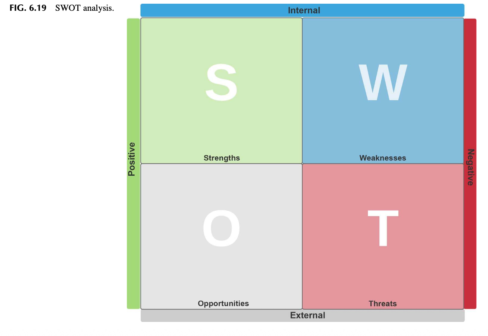
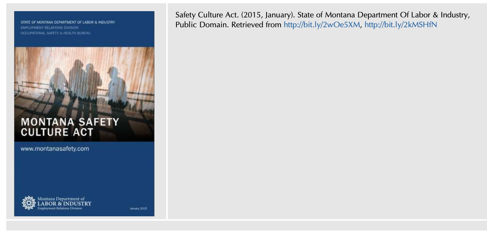
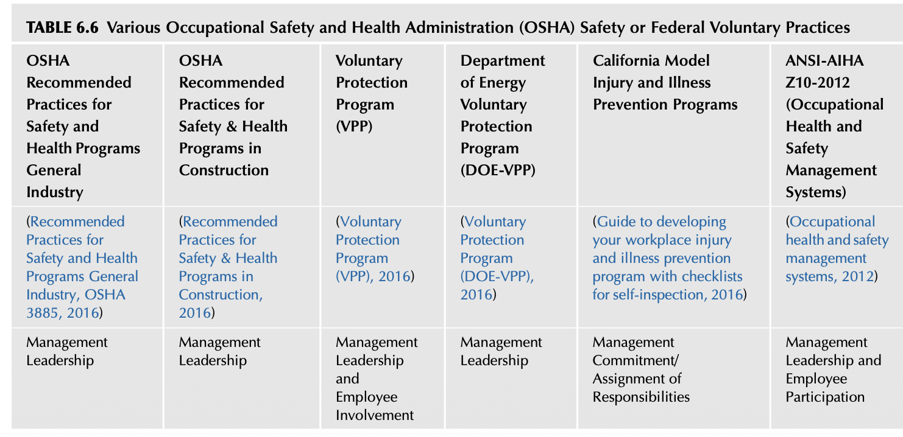
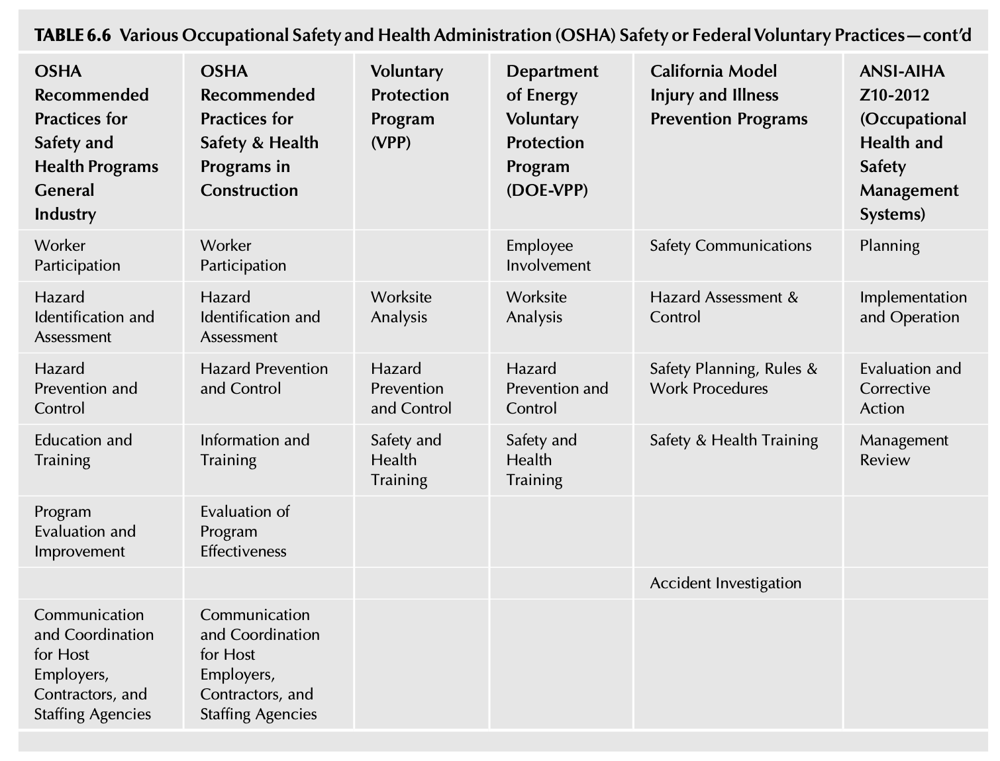
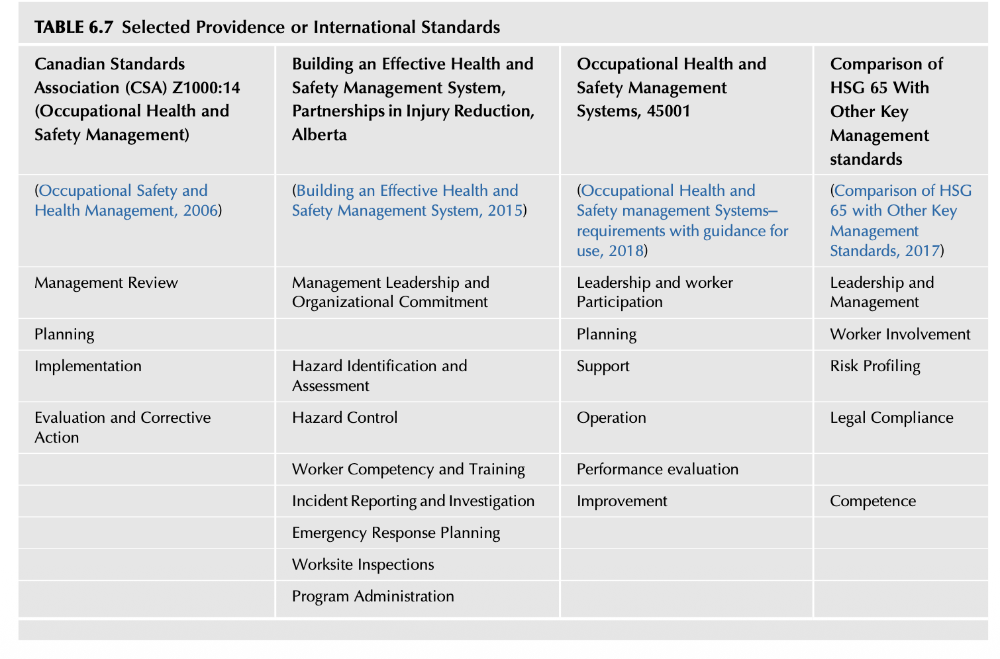
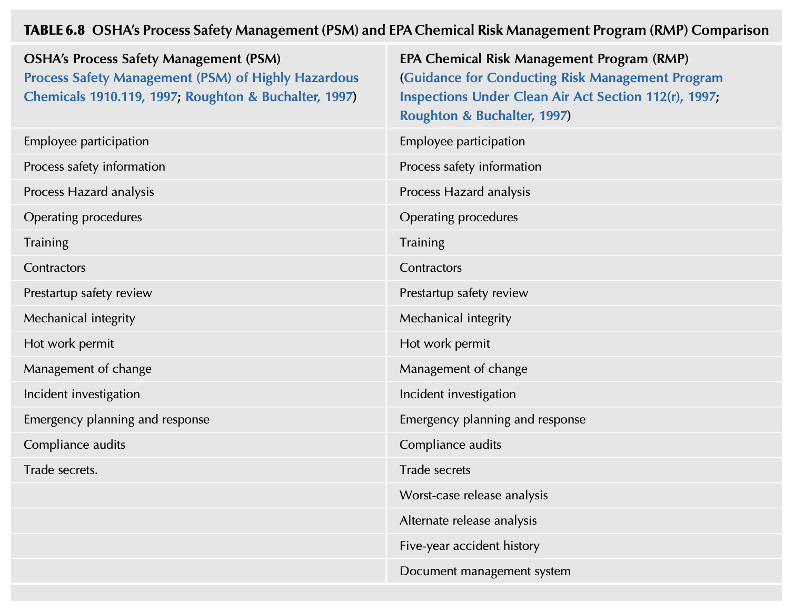
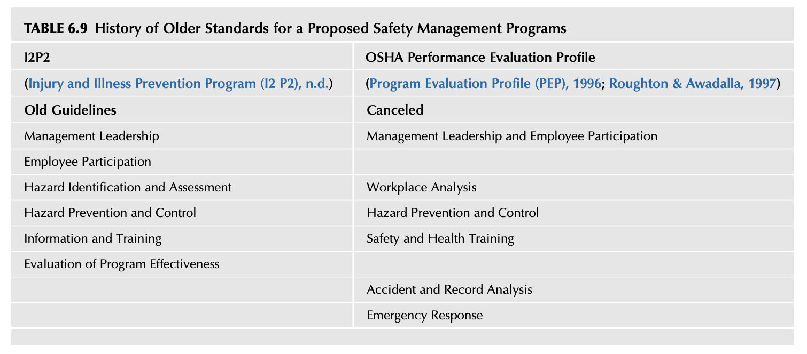
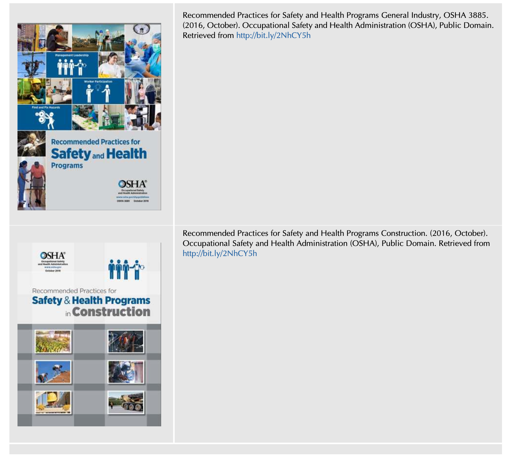

# Chapter 6 Creating the Safety Process
The secret of getting ahead is getting started. The secret of getting started is breaking your complex overwhelming tasks into small manageable tasks, and then starting on the first one. Mark Twain (Mark Twain, 2018) Management of a system requires knowledge of the interrelationships between all of the components within the system and of everybody that works in it. Edward Deming Safety Culture. https://doi.org/10.1016/B978-0-12-814663-7.00006-6
## INTRODUCTION
Most generic safety programs heavily rely on techniques used in the beginning era of modern manufacturing. Fredrick Taylor developed his “Scientific Management” concepts which became the foundation for much of what is still used as problem-solving techniques (Mateski, 2016). Like the human body, an organization cannot be disassembled and then reassembled as if a machine, without a full understanding of how the various components are interrelated. As doctors study anatomy, safety professionals must have a comprehension of all aspects of the organizational “body.” If a system is imposed on an organizational body without knowing how it works, the system will likely fail. A safety management system’s main purpose is to provide a structure for managing and administrating the activities that will control hazards and associated risks. From that structure, the elements can be linked, prioritized, and designed to fit within the overall organizational framework. While many different Safety Management Systems have been developed, a consistent theme is noted that they follow a classic format known as the Deming model of Plan-Do-Check-Act or also known as Deming’s cycle (Deming, 1986). This Chapter compares the differences between several notable safety management systems and their benefits to the safety culture. It will address why selecting and implementing a structured format benefits the organizational safety culture. After reading this Chapter, you should be able to:
* Identify the commonalities of safety management systems.
* Discuss an analytical approach and an integrated approach when implementing a safety management system.
* Discuss and compare “PDCA” and “DMAIC.”
* Identify how the safety management system can enhance and benefit a safety culture.
* Compare the difference between implementing voluntary standards established by industry or international standards
organizations and regulatory governmental-related safety programs.
## A SYSTEMATIC APPROACH TO SAFETY
Many different types of safety management systems are being used by organizations in some form or another. Safety management systems are based on the current trend to use a structured format as provided by International Standards Organizations (ISO), Six-Sigma, or quality control-based concepts in use by many organizations. Safety management systems can range from voluntary standards established by industry or trade groups, consulting organizations, ISO, and regulatory legislation or guidelines. Each of these systems has the same intent, to guide organizations on how to manage and structure a successful safety management system process. Some occupational health and safety management systems (OHSMSs) and guidelines have developed over the last 25 years, some certifiable and some sector specific. Essentially, these require organizations to identify the issues to be addressed; set the direction and standards; plan what needs to be done and organize who will undertake it; equip them to do so; undertake the action; check completion and efficacy, and learn the lessons from this exercise to continually improve. Compliance with certifiable standards is demonstrated through audits by a certifying body, which should be suitably accredited… Lacey & Jones (2017) The authors’ knowledge, experience, and a review of the literature are convinced having a safety management system is essential for success. A safety management system acts as a stabilizing structure, keeping the focus on operational hazards and associated risks as conditions change in an organization. The safety management system provides a formal framework for increased employee involvement leading to an improved work environment. Various methods and tools can be used to aid in shifting from “one-off” programs to processes for installing the desired elements into the organization. Once an element or process has been developed, an administrative structure is needed to ensure performance is as effective as possible. A safety management system aids in providing this structure. Each safety management system element can be viewed as a stand-alone activity to be changed as needed. Each section of an element can be customized to meet the organizational needs. The strength of a safety management system is that it provides an overall structure that has been vetted by professional committees, societies, and regulatory agencies at national and international levels. When viewed from a system or holistic approach, safety management system elements can be regarded as activities built on the interrelationships between the elements and their subsections. The association between the safety management system elements, when verified, may be considered inherently stronger in effecting the safety culture when they are synchronized rather than independently separate.
## THE ANALYTICAL ROOTS OF SAFETY PROGRAMS
Initial safety concepts were developed at the beginning of the 20th century, and its principles were based on new methods for improving productivity in manufacturing. Fredrick Taylor’s Principles of Scientific Management were adapted for use in safety programming (Frederick Winslow Taylor, 1919). At the time of Taylor’s “Scientific Management,” most jobs were primarily manual with limited safety efforts built into the process. For example, Taylor believed that by analyzing a job task by breaking it into its components, its efficiency could be increased. In retrospect, the Job Hazard Analysis (JHA) is based on Taylor’s concepts by going through the same process and identifying the hazards in each task. This traditional JHA approach does not incorporate concepts of risk and does not take into account how the majority of jobs are now designed. The use of Using the Job Hazard Analysis will be discussed in detail in Chapter 12. Taylor’s identities four principles as follows: Replace working by “rule of thumb,” or simple habit and common sense, and instead, use the scientific method to study work and determine the most efficient way to perform specific tasks. Rather than simply assign workers to just any job, match workers to their jobs based on capability and motivation, and train them to work at maximum efficiency. Monitor worker performance, and provide instructions and supervision to ensure that they’re using the most efficient ways of working. Allocate the work between managers and workers so that the managers spend their time planning and training, allowing the workers to perform their tasks efficiently. Frederick Taylor and Scientific Management, Understanding Taylorism and Early Management Theory (2017) When traditional safety programs are reviewed, a vestige of Taylor’s four principles become apparent. General McChrystal notes, that “…most industries have subscribed to management doctrines…similar to Fredrick Taylor’s “Scientific Management,” a system that is excellent for achieving highly efficient execution of known, repeatable processes at scale.” (McChrystal et al., 2015) McChrystal calls this a “structure and culture of disciplined, stratified reductionism.” In reviewing basic job tasks, these methods may remain valid. Technology and changes in the workforce require different concepts of thinking about safety management. Taylor’s Scientific Management Theory promotes the idea that there is “one right way” to do something. As such, it is at odds with current approaches such as Management By Objectives (MBO), Continuous Improvement initiatives, Business Process Reengineering (BPR), and other tools like them. These promote individual responsibility, and seek to push decision making through all levels of the organization. Frederick Taylor and scientific management, understanding taylorism and early management theory (2017) As organizations and operations have become more complex per McChrystal, “Efficiency is no longer enough.” Taylor developed methods to improve job tasks whose outcome was predictable. His methods were not a systems approach designed to consider all the interconnections and dynamics of the organization. A shift has to be made from dealing strictly with “complicated challenges,” programs, guidelines, specific tasks, having predictable outcomes to a different situation of dealing with the complexity of the various system interactions with potential unpredictable outcomes and evolving networks. The design of a safety management system attempts to holistically approach and assess the complexity of an organization to better manage the overall safety process. Unfortunately, the continuing perception of safety as being a simple process still exist, and the methods used not complicated or requiring much planning.
### Observation 1
The authors have encountered situations where clients or risk managers were incredulous as to what was involved in developing a comprehensive plan to improve the workplace. The perception still exists that a safety process involves the use of a pad of paper and a clipboard to walk around taking notes of conditions as we discussed in Chapter 1, Defining the Perception of Safety. In reality, establishing a safety management system requires knowledge of project management and operational processes at a minimum.
### Observation 2
James recalls when he was a safety consultant on a Job Hazard Analysis (JHA) project for a major manufacturer. After successfully earning the contract, a major problem soon became apparent. First, the project manager had no concept of how JHAs were developed and the time or detail required. The project had to be completed in a very short time frame, that is, it was a “rush job.” Second, a “minor” detail had been overlooked, The client expected 3,000 specific jobs to be analyzed. The scope of the project was far more extensive than had been anticipated and it was to be completed in three months. Through extra effort, the team developed most of the JHAs within the period, a significant accomplishment. When the consulting team was ready to implement the completed JHAs, they were told to wait for instructions. The safety professional had left the organization and leadership decided to implement the JHAs without the consultants’ assistance. Months went by, and the JHAs were never implemented (refer Fig. 6.1). The overarching system was not evaluated on how the JHAs (complicated process) fit into the overall organization and what would be required to ensure a successful implementation of a changing work environment (complex situations). On another note, H. W. Heinrich’s “Industrial Accident Prevention,” published in 1931, became the Bible for safety, and, while much of what he wrote is obsolete, remains entrenched in safety literature and other disciplines by international researchers (Heinrich, 1931). According to Manuele, Heinrich’s methods are now considered questionable and by some unethical, but his initial principles which were changed several times during his various publications were not based on empirical studies. Regrettably, the basis of his theoretical writings cannot be verified since there are no historical records of his research (Manuele, 2011). The problem is that H. W. Heinrich’s traditional safety program approach and structure used can be viewed as impediments to implementing a safety management system, as there are many professionals that still believe and use these traditional methods.

FIG. 6.1 Check in the box.

### What Do All Safety Management Systems Have in Common?

As discussed in Chapter 5, after reviewing various safety management systems and comparing their elements side by side, six basic core principles appear to be the vital elements for developing and sustaining a safety culture. These elements are used to design and implement a structure and provide the foundation for sustaining a safety management system. In a note produced by the Royal Society of Chemistry, London (2005), it was concluded that there are no fundamental differences between any of this management system, and there is a large degree of overlap in system elements and most are common requirements (Dababneh, 2007). The differences between BS8800 and ISO 9001 and ISO 14001 relate to the scope and the specific needs of OH&S requirements compared to the quality and environment specifications. The distinction between BS 8800 and OHSAS 18001 and ILO-OSH 2001 is mainly in the order in which the elements are addressed. The intent and basic requirements are common to all three documents. Dababneh (2007) If Dababneh’s study, as discussed above, is correct, it does not matter which safety management system is used since the requirements are all similar. The consistent use of the selected safety management system is the primary concern and issue. The selected safety management system must fit within an organization’s overall operational. If efficiently integrated into the organization, the safety management system has a better chance of becoming a normal and effective part of the overarching primary culture. Safety management systems may be considered parallel to, or a subset of, a quality management process. Understanding the organization’s quality control system benefits the safety management system, as safety programs and processes can be designed to use similar formats. Using similar formats better ensures safety activities are viewed as an integral part of the organization. The networking analysis and organizational charting can aid in identifying leadership and their subordinates roles which have direct responsibility for quality management. The basic quality management tools, such as the cause-and-effect diagram, control charts, flowcharting, histogram, Pareto charts, and so on, can be used for assessing the safety culture and gaps in a safety management system. These tools will be discussed in more detail in Appendix 6.1, Selected Process Tools to help Enhance the Safety System.

### The Plan-Do-Check-Act Cycle

Customers don’t measure you on how hard you tried. They measure you on what you deliver. Steve Jobs When reviewing each safety management system, there is a common theme to help assess each of the foundational safety management systems elements, “Plan-Do-Check-Act (PDCA).” This simple concept of PDCA, also known as the Shewhart cycle, can be applied when designing and implementing safety management system elements (Shewhart, 1980). PDCA has been at the root of quality control methods for decades and is advocated and can be used effectively in each safety process. The Shewhart cycle has been adopted within the framework of many voluntary standards such as ANSI Z10-2012 “Occupational Safety Process.” (Occupational Health & Safety Management Systems, 2012) (refer Fig. 6.2). PDCA (plan do check act or plan do check adjust) is an iterative four-step management method used in business for the control and continuous improvement of processes and products, known as the Deming circle/cycle/wheel, Shewhart cycle, control circle/cycle, or plan do study act (PDSA). Plan-Do-Study-Act (PDSA) Worksheet (n.d.), Definition, PDCA (plan-do-check-act) (2018), Deming (2018) Health and Safety Executive (HSE) has moved away from using the POPMAR (Policy, Organizing, Planning, Measuring performance, Auditing, and Review) model of managing health and safety to a ‘Plan, Do Check, Act’ approach. Managing for health and safety (HSG65) (2013) The move towards Plan, Do Check, Act achieves a balance between the systems and behavioral aspects of management. It also treats health and safety management as an integral part of good management generally, rather than as a stand-alone system. Managing for health and safety (HSG65) (2013) The PDCA process can be used to devise a structure for use in developing and applying a safety management system. By having a specific process, a flow of actions is provided from which a “map” can be developed for the organization to follow.

FIG. 6.2 Plan-do-check-act.
The PDCA provides a dynamic format reflecting how the process is in continual movement and self-renewal. Using PDCA provides another dimension as each element is reviewed using the following four steps:

* **Step 1: Plan,**
 Define the Goals and Objectives of the Safety Management System As discussed in Chapter 4, Setting the Direction for the Safety Culture, the goals and objectives will define specific conditions and behaviors desired by the implementation of the elements of the safety management system. The goals and objectives are defined based on the vision of the organization establishing the values desired within the safety culture. The intended results expected are defined in this phase and discussed with and approved by the leadership team. The input of all levels of the organization is essential in determining organizational espoused values and the current reality in operation.

* **Step 2: Do:**
 Begin the Implementation of the Safety Management System Goals and Objectives Education, training, and communication of the safety management system and its importance to all employees must be developed as to the Who, What, When, Where, and How they are to be accomplished. The “Do” phase signifies that there is a transition that needs to be made from past efforts to a new process and procedures. The implementation must first ensure that all employees understand the “Why” of the new directions and the importance made clear. Using the Activity-Based Safety System (ABSS), Chapter 11, Developing an Activity-Based Safety System is one technique for quickly spreading information about the safety management system, how all employees will be affected, and what involvement is expected.

* **Step 3: Check or**
 Study Goals and Objective State As the safety management system elements are implemented, periodic reviews and surveys are made to ensure efforts are reaching benchmarks set for goals and objectives. Routine checks may reduce resistance to change as concerns or issues are addressed. The study may find where employee buy-in needs to be improved, concerns about time requirements and budgets addressed, communication of safety management system status and corrective actions improved. In this phase, the parallel to quality management is apparent, as the use of statistical process analysis, surveys, questionnaires, and interviews will provide a clearer picture of what the current process is achieving.

* **Step 4: Act on the**
 Findings and Study The findings of the Check/Study phase describe changes and modifications needed, corrections to be made to the safety management system. Actions are further defined for integrating what has been found effective into the safety management system and where areas can be modified to improve the safety culture. Actions and processes determined to be ineffective are abandoned and resources redirected (Shewhart, 1980).
## DEFINE, MEASURE, ANALYZE, IMPROVE, AND CONTROL (DMAIC)
A variation of the PDCA known as “Define, Measure, Analyze, Improve, and Control (DMAIC)” can be used if the organization is following the Six Sigma approach to quality management. DMAIC is a more advanced approach than the traditional PDCA. Both the PDCA/DMAIC concepts provide a framework for plans, objectives, and activities for better management and administration of the safety management system elements. Other methods may be in place, and the intent should be to match the safety management system to the existing techniques in use (refer Fig. 6.3). The following sections will provide a summary of the 15 DMAIC steps in conducting a Six Sigma type of review of the safety management system. Defining the Project Refer Fig. 6.4, Basic Six Sigma Process Model Flow diagram mapped to a successful safety management system.

* **Step 1: Define the scope of the**
 Safety process. What process in what format will best function in the organization?

* **Step 2: Define the current state of the organizational culture:**
 What is to be measured and in what format? What is the current perception of safety?

* **Step 3: Define the appropriate metrics:**
 How will the Safety Culture and safety management system be linked and measured?

* **Step 4: Develop the objective of the safety management systems**
 What type of “evergreen” (Evergreen, Retaining Its Relevance, Popularity, Usefulness, etc.; Enduring, 2018), a living method, the process can be developed that can stand the test of time in an ever-changing organizational environment? Step 5: Select and organize the safety management system team: Working with the Leadership Team, what are the roles, responsibilities, and authorities needed for the safety management system to be successful. How best to increase or establish employee involvement? Measuring the Project Step 6: Develop a macro overview using organizational charts, network maps, and overview flow diagrams of the current safety management system process and the organizational structure. What types of charts and network maps are used by the organization? Can these forms be adapted to use for monitoring and evaluating the safety management systems, or close gaps noted? Step 7: Define the safety project with “Pareto” charts, graphs of risk assessments, loss history, and so on. Use charts and graphs like those already in use by the organization, where the formats and concepts are understood. Pareto charts are bar charts used to separate the vital few from the trivial many. Refer Fig. 6.5 for a example of a Pareto chart.

FIG. 6.3 Overview of the DMAIC and the PDCA processes relationship.

FIG. 6.4 Basic six sigma process model flow diagram.
The Pareto Principle is considered a rule of thumb which states that “20 percent of the problems have 80 percent of the impact.” The 20 percent of the problems are the “vital few,” and the remaining problems are the “trivial many.” The objective is to validate with data the justification for what area(s) need to be improved. (U.S. Coast Guard Leadership Development Center, 2014)

FIG. 6.5 Example of a Pareto chart. (Adapted from Breakthrough Management Group, Inc., (1999 2004). Black Belt Training Manual, Define Phase,
Black Belt DAMIC Methodology. pp. 17 21, 31; Adapted from Handbook for Basic Process Improvement. US Navy; Adapted from Roughton & Crutchfield, (2008). Job Hazard Analysis, A Guide for Voluntary Compliance and Beyond. Butterworth-Heinemann.) Effective Communication is 20 percent what you know and 80 percent how you feel about what you know. Jim Rohn By the numbers, it means that 80 percent of outcomes come from 20 percent of inputs (Baker, 2018). As Pareto demonstrated with his concept, this “rule” holds true, in a very rough sense, to an 80/20 ratio in many cases. Many times, the ratio can be a lot higher—99/1 sometimes closer to reality (Starak, 2018). Refer Fig. 6.6 for an overview of the 80/20 rule. Step 8: Develop a Strategy to collect safety management system Activities. The data collection should be focused on safety management systems activities, objectives, and goals, controls used to reduce hazards, associated risk, and loss-producing events. The use of a well-designed strategy for data collection and presentation can provide a control panel that guides the safety management system. Refer Fig. 6.7 for an example of a control panel of activities. Analyzing the Project Step 9: Refine the process using basic quality tools and methods—process flow, XY matrix, gauge studies, Fishbone (Ishikawa) Diagram, FMEA, and so on. The analysis of the safety management system provides insights on what is

FIG. 6.6 80/20 rule.

FIG. 6.7 Example of a control panel of activities.

FIG. 6.8 Example of a fishbone diagram.
and what is not working, where gaps in communication exist, concerns and issues with the implementation. Refer Fig. 6.8 for an Example of a Fishbone Diagram. Step 10: Identify cause(s) of underlying problems with the implementation of the safety management system or any of its components:
* Any issues with involving the leadership team or employees?
* Need for materials, data gathering, lack of specific data gathering analysis and communication?
* Any issues with established objectives and goals, safety management system activities, authority and responsibilities,
budgets, and so on, to support the safety management systems?
* What obstacles are preventing the full application of any of the elements of the safety management system?
* Have obstacles developed within the organizational structure preventing information flow concerning failures in
implementation? Improving the Project Step 11: Design and conduct an “experiment,” as applicable. The safety management system is analyzed by evaluating the overall system and its element relationships. After the analysis, the first question to ask: Is the selected safety management system model correct for the organization? Begin by examining the measurements used for communication, element activities, preshift review, risk guidance card usage (refer Chapter 9, Defining Risk Perception,) meetings, inspections, and checklist, and so on. Identify what is not working and adjust the process. The evaluation mainly tests the ability of the leadership team and employees’ aptitude to use the safety management system formats and tools chosen routinely. Design of experiments (DOE) is a systematic method to determine the relationship between factors affecting a process and the output of that process. In other words, it is used to find cause-and-effect relationships. This information is needed to manage process inputs to optimize the output. What is design of experiments (DOE)? (2017) Step 12: Define the relationship between elements and activities regarding Y f(x) where Y is a function and outcome of X. This method is a Six Sigma tool for assessing the relationship between elements of the safety management system process. As an example, if a risk guidance card is used, does it have any impact on the avoidance, reduction, and control of hazards? The card is introduced, and its use monitored. If no relationship can be determined, that is, nothing changes with risk or loss-producing incidents, then the further use of the risk card must be reevaluated. Controlling the Project Step 13: Redefine and optimize measures and solutions for closing gaps in the safety management system implementation. A continuous process of audit and review is needed as changes in the organization’s business climate or conditions are constantly evolving. The safety management system offers a structure but can never be considered permanent as with all the existing operating processes. Step 14: Control critical X’s (Inputs) and monitor Y’s, (Outputs) for increasing the effectiveness of resolving issues. By diagramming the safety management process, the organizational relationships can be defined and compartmentalized, thus allowing an examination of the directional flow of communications and safety activities. The implementation of a safety management system is not simple, as it requires an understanding of as many of the interrelationships within an organization as possible. The potential for successful implementation of a safety management system is increased if the sequence and relationship to safety process are defined (refer Fig. 6.9). Step 15: Verify changes identified and continue to collect data about safety management systems effectiveness and implementation issues (The process improvement notebook, 1997). Benefits of Using a Standardized Safety Management System The basic safety management system elements, as discussed in Chapter 5, Overview of Basic Safety Management Systems, when implemented, allows the organization to determine the scope and level of the safety process desired. The fundamental elements and their activities ensure that the organization has the core or fundamentals in place before taking on an advanced safety management system. As the obstacles and gaps in the safety process are identified, the areas needing improvement can be better assessed against proven, accepted guidelines. Safety management systems do more than merely list and string together various safety-related programs. They provide a road map to follow using a set of structured process elements developed from predetermined templates. As part of a defined vision and mission, the safety management system makes the process of describing goals and objectives, responsibility assignment, and required leadership commitment clear and distinct. Pros and Cons of a Standardized Safety Management System Differences in the perception of what the correct safety management system should be and how it is to be developed or implemented can exist. Every organization has different structures, skill sets, mandates, and budgetary needs requiring a variety of approaches. A safety management system gains immediate credibility in the organization by implementing a nationally and internationally recognized format.

FIG. 6.9 Benefits of using a standardized safety management system.
In Six Sigma, the concept of “Voice of the Customer” or as its variation, the “Voice of the Process,” can be used before any safety management system is introduced. Six Sigma DMAIC Process. Define Phase, Capturing Voice of Customer (VOC) Voice of Customer is the customer’s voice, expectations, preferences, comments, of a product or service in the discussion. It is the statement made by the customer on a particular product or service. Six Sigma DMAIC Process – Define Phase – Capturing Voice of Customer (VOC), (2017)
### Observation 3
During the Six Sigma Safety project development that James was involved, the team used the concept of the Voice of the Customer (VOC) and used the term Voice of the Employee (VOE). This helped to define the nature of the safety project, and employee participation was essential to the success of the project. Within the organization, individual departments may have different concerns and requirements that must be understood when implementing the safety management system. While an organization has an overarching culture, departments due to their specialization can have “mini-climates” of the culture. How the safety management system is implemented and managed is not through “one size fits all.” The Why of the safety management system must be made clear in each area (Seidman & Clinton, 2011; Sinek, 2009). For example, various trades within an organization have different requirements and specialty areas. Each discipline views the organization through a different prism. The maintenance department may have a different perspective than production. Marketing needs are different from production. Each area believes its expertise is the most essential as previously discussed. Conflicts can quickly develop.
### Observation 4
As a facility safety and health manager, Mike convinced senior management to shut down a new product and production line due to multiple serious exposures to the operators. Stopping production created a corporate marketing and sales dilemma, as countrywide advertisements had already announced the new product release date and the production stoppage would contradict a costly massive media campaign. A senior marketing director harshly protested the delay and demanded that facility management override the safety process. Mike’s facility management understood the employee risk exposures and supported the stopping of production. This type of push-pull conflict is almost universal to most organizations and how they are handled provides insights into the depth and scope of an organization’s safety culture. The objective of a safety management system implementation is to determine what will work best and what meets the specific needs of the organization. Customizing the safety process and keeping its elements flexible without losing sight of its mission is an ongoing task. The following areas discuss the potential pros and cons to be considered. The “Pros” of the Safety Management Systems The Pros of implementing a specific safety management system can include but are not limited to the following:
* A structured system that can be integrated into all other management processes and not used as a stand-alone program or
process.
* A way to focus the efforts and actions needed from leadership team and employees by acting as a “compass” to guide the
process. The safety management system can improve the potential for everyone in the organization to be on the same page.
* Time-saving considerations are important. This can be accomplished by using a structured map or template to follow.
This process will help to ensure that there is continuous improvement of safety-related activities and a way to gauge the quality of the organization’s safety culture.
* Information from the experiences of other organizations using a similar process to provide benchmarks for achievements and progress.
* A way to communicate to everyone in the organization the status of the safety management system and encourage discussion, corrective action, and problem-solving of hazard and associated risk related issues and concerns.
* Assistance in discussing and ensuring that owners, investors, and insurance underwriters that managing hazards and
associated risk is ongoing, follows a formalized process, and the general risk control status of the organization.
* Internal and external auditors will use the same criteria for reviewing the safety management system.
## THE “CONS” OF THE SAFETY MANAGEMENT SYSTEMS
The Cons of a safety management system requires that an ongoing process is maintained and constantly monitored. The safety management system may have problems if:
* It is not implemented properly and appears to be a “canned” approach not integrated with other management processes,
that is, it provides espoused values but is not guiding the organization.
* Its scope is too narrowly implemented and is viewed as a series of one-off programs and not as an interconnected holistic
process.
* A false sense of safety can develop if the measurement of its activities and process is not conscientiously and consistently followed. An honest, comprehensive, and routine appraisal system must be in place to ensure “pencil whipping,”
false documentation, is not occurring.
* Consequences are not in place for both good and poor implementation. If some form of valued recognition is not present,
employees may see the process as just another administrative task or paperwork to be dispensed with.
* It may be perceived as too time consuming and the why of the safety management system not fully understood. As stated
previously and we want to reenforce the concept, the traditional methods of safety program success are dependent on OSHA recordability and frequency of loss-producing events. If the perception of “no loss no risk” is present then the attitude may be “we don’t need to do this!,” even if associated risks are high.
* It is not customized to the organization and does not consider the organizational structure and existing culture which
may reject, or worse, only espouse, but not internalize the process. Examples of Governmental and Voluntary-Related Safety Management Systems Safety management systems are divided into two types, governmental-regulatory related, either mandated or voluntary systems developed by national and internationally recognized standards agencies and professional societies. Government-related programs emphasize the administration of regulations. This section provides an overview of several safety management systems to demonstrate the various formats and elements. An awareness of the formats can aid in the decision on which safety management system best fits an organization. Safety management systems can be international, national, or state/province/city. Many states and provinces have suggested or mandated safety management systems. Various professional, standards or interdisciplinary groups or societies may offer standards. Finally, an organization may have developed and implemented its process. The following are examples of several standardized governmental-related guidelines safety management systems:
* The Federal Occupational Safety and Health Administration, Recommended Practices for Safety and Health Programs
(Recommended Practices for Safety and Health Programs General Industry and Construction, 2017)
* The Federal Occupational Safety and Health Administration Voluntary Prevention Program (Voluntary Protection
Protection (VPP), 2016)
* The U.S. Department of Energy Voluntary Protection Program (Voluntary Protection Protection (DOE-VPP), 2016)
State or Providence systems include:
* The California OSHA Injury and Illness Prevention Program Title 8-§3203 (Guide to developing your workplace injury
and illness prevention program with checklists for self-inspection, 2016). California OSHA mandates a formal approach to safety program management.
* Building an Effective Health and Safety management system (2015), Partnerships in Injury Reduction, Alberta.
* An interesting approach was taken by the State of Montana with its mandated Montana Safety Culture Act (Job safety
analysis, 2018; Safety Culture Act, 2015). Refer to Appendix 6.2 for the Mandated Safety Culture Act standard, a relevant public domain document that can be downloaded and used for your library. Governmental safety management system models tend to be more regulation based but still use variations of the core elements previously discussed for program administration. Refer to Appendix 6.3 for a Brief Summary Comparison of Governmental-Related Safety Management Systems Process Elements as follows: Table 6.6 Various Occupational Safety and Health Administration (OSHA) Safety or Federal Voluntary Practices, Table 6.7 Selected Providence or International Standards, Table 6.8 OSHA’s Process Safety Management (PSM) and EPA Chemical Risk Management Program (RMP) Comparison Every effort has been made to provide a summary of various regulation, and Table 6.9 History of Older Standards for a Proposed Safety Management Programs. All Regulations are subject to change. The information presented is based on current standard. Recommended Practices for Safety and Health Programs The Occupational Safety and Health Administration (OSHA) updated and published several Guidelines for Safety and Health Programs in 2017 which include the following:
* Recommended Practices for Safety and Health Programs General Industry
* Recommended Practices for Safety and Health Programs in Construction.
These Recommended Practices provide a step-by-step approach to implementing a basic safety management system using seven core elements as discussed in this book. Refer to Appendix 6.4 for these relevant public domain documents that can be downloaded and used for your library Voluntary Protection Program (VPP) VPP has been an effective program based on OSHA studies in establishing in-depth compliance-based programs. As its title implies, the VPP is a voluntary effort, and its general acceptance remains limited to approximately 2200 nationwide participants. The Voluntary Protection Programs (VPP) promote effective worksite-based safety and health. In the VPP, management, labor, and OSHA establish cooperative relationships at workplaces that have implemented a comprehensive safety and health management system. Approval into VPP is OSHA’s official recognition of the outstanding efforts of employers and employees who have achieved exemplary occupational safety and health. The legislative underpinning for VPP is Section (2)(b)(1) of the Occupational Safety and Health Act of 1970, which declares the Congress’s intent "to assure so far as possible every working man and woman in the Nation safe and healthful working conditions and to preserve our human resources - (1) by encouraging employers and employees in their efforts to reduce the number of occupational safety and health hazards at their places of employment, and to stimulate employers and employees to institute new and to perfect existing programs for providing safe and healthful working conditions. Statistical evidence for VPP’s success is impressive. The average VPP worksite has a Days Away Restricted or Transferred (DART) case rate of 52% below the average for its industry. These sites typically do not start out with such low rates. Reductions in injuries and illnesses begin when the site commits to the VPP approach to safety and health management and the challenging VPP application process. All About VPP (n.d.), Voluntary Protection Protection (VPP) (2016) If an organization is small or not ready to implement a robust safety management system, the VPP can be a good starting point and a worthwhile program to follow if its limitations are understood as noted. The VPP program success is based on injury rate reduction and compliance-based efforts. The effort required does not imply a safety culture has been developed within organizations using the program. The measurement of “downstream” may or may not be indicators that risk reduction has been improved. Department of Energy VPP Elements The Department of Energy Voluntary Protection Program (DOE-VPP) promotes safety and health excellence through cooperative efforts among labor, management, and government at the Department of Energy (DOE) contractor sites. DOE has also formed partnerships with other Federal agencies and the private sector for both advancing and sharing its Voluntary Protection Program (VPP) experiences and preparing for program challenges in the next century. The safety and health of contractor and federal employees are a high priority for the Department. General Information of the DOE VPP Program (n.d.), Voluntary protection program (DOE-VPP) (2016), Worker health and safety (n.d.)
### Voluntary Protection Programs Participants’ Association (VPPPA)
The Voluntary Protection Programs Participants’ Association, Inc. (VPPPA) - The Premier Global Safety and Health Organization , is the leading organization dedicated to cooperative occupational safety, health and environmental management systems. VPPPA, a nonprofit 501 (c)(3) charitable organization, is a member-based association, providing a network of more than 2,300 companies and worksites who have achieved or are striving for occupational safety and health excellence, including the Occupational Safety and Health Administration’s (OSHA) or the Department of Energy’s (DOE) Voluntary Protection Programs (VPP). Voluntary protection program (DOE-VPP), (2016) The U.S. Department of Energy developed a comprehensive two-volume manual entitled, “Human Performance Improvement Handbook” (2009) while not a safety management system the manuals offer a wide array of concepts and criteria used in developing safety management systems. These concepts and criteria contained in the manuals provide an understanding of the underlying causes of human error and obstacles to developing a safety management culture. Human performance improvement (HPI) as addressed in this handbook is not a program per se, such as Six Sigma, Total Quality Management, and the like. Rather, it is a set of concepts and principles associated with a performance model that illustrates the organizational context of human performance. The model contends that human performance is a system that comprises a network of elements that work together to produce repeatable outcomes. The system encompasses organizational factors, job-site conditions, individual behavior, and results. The system approach puts a new perspective on human error: it is not a cause of failure, alone, but rather the effect or symptom of deeper trouble in the system. Human error is not random; it is systematically connected to features of people’s tools, the tasks they perform, and the operating environment in which they work. Human performance tools for individuals, work teams, and management, human performance improvement handbook (2009)
## BUILDING AN EFFECTIVE HEALTH AND SAFETY MANAGEMENT SYSTEM
The following are some examples of advanced safety management systems. These systems have similar format and concepts in their structure. By researching and studying the underlined fundamentals of these recognized voluntary standards, a review of an organization’s current system can be made to determine the best approach for a more structured, comprehensive and industry recognized safety management system (Building an Effective Health and Safety Management System, 2015). Refer Chapter 4, Setting the Direction for the Safety Culture.
* Occupational Health and Safety management systems, ANSI/ASSE Z10, 2012 (Occupational Health and Safety
Systems, 2012)
* Occupational Safety and Health ISO 45001 (What is ISO 45001?, 2018)
* Occupational Health and Safety Management standard (OHSAS 18001) (2007)
* Occupational Safety and Health (OSH) Management Systems (Guidelines on Occupational Safety and Health
Management Systems, 2001) Occupational Health and Safety Management, ANSI Z10-2012 The purpose of the standard is to provide organizations with an effective tool for continual improvement of their and safety performance. Although Z10 is a guidance standard, implementation is not required by OSHA, the use of these guidelines is expected to improve occupational health and safety among American organizations. Occupational Health & Safety Management Systems (2012) Refer Fig. 6.10 an Overview of a Drive toward a Safety Management System utilizing the ANSI Z10-2012 and Table 6.1 for an overview of Five Major Elements as outlined in the Occupational Health and Safety Management, system Z10-2012 (Occupational Health & Safety Management Systems, 2012). Fig. 6.10 provides a view of the interrelationships between the various elements of the Z10 and offers insights on its implementation (Occupational Health and Safety Systems, 2012). Guidance Standard - A standard that is advisory and is not a regulatory requirement. (Glossary terms, 2010) Occupational Safety and Health ISO 45001 ISO 45001 has been updated as an international standard for Occupational Safety & Health and released for use in March 2018. ISO 45001 will replace OHSAS 18001 when fully implemented. ISO 45001 remains voluntary standard recommending organizations incorporate health and safety programs into their overall operational management system. As with all safety management systems, senior management’s role is to provide support and administrative support for the standard. ISO 45001 requires organizations to expand OH&S responsibilities, understanding how suppliers and contractors manage their hazards and risks (ISO 45001 as a competitive advantage, 2018). The benefits of ISO 45001 remain unchanged: improved business performance, consistent application of operational best practices, reduced injury incident rates, and increased employee involvement (ISO 45001 as a competitive advantage, 2018). Implementing a recognized, international safety management system standard is like the adoption of any ISO or quality control certification. While organizations espouse safety and health in their literature and material, using a vetted and structured process shows the organization is willing to put in the extra time and effort and budget into its efforts (ISO 45001 as a competitive advantage, 2018).
* Leadership and worker participation
* Planning
* Support
* Operation
* Performance Evaluation
* Improvement
(New International Standard for Occupational Health and Safety Management Systems, 2017; Upgrade your certification to ISO 45001, 2018)

FIG. 6.10 Overview of a drive toward a safety management system utilizing the ANSI Z10-2012.

TABLE 6.1 Occupational Health and Safety Management, Z10-2012, Five Major Elements Management Leadership and Employee Participation Occupational Health and Safety Policy Responsibility and Authority Employee Participation Planning Identify and prioritize OHSMS issues Develop objectives for risk control based on prioritized OHSMS issues Formulate implementation plans to accomplish prioritized objectives. Implementation and Operation Hierarchy of Controls Design Review and Management of Change Procurement and Contractors Emergency Preparedness Education, Training, Competence Evaluation and Corrective Action Monitoring, Measurement, Assessment, Incident Investigations, Audits Corrective Action Management Review Annual Review of OHSM (“Occupational Health and Safety Systems,” 2012) Canadian Centre for Occupational Health and Safety “On September 6, 2006, the Canadian Standards Association (CSA) unveiled Canada’s first consensus-based workplace health and safety management standard. According to CSA, the new standard, titled CSA Z1000-06 Occupational Health and Safety Management, is intended to reduce or prevent injuries, illnesses, and fatalities in the workplace by providing companies with a model for developing and implementing an occupational health and safety management system” (Occupational Safety and Health Management, 2006). “In addition to requirements text, CSA Z1000 also includes extensive guidance material to assist users in implementing the management system. It was designed to be compatible with another management system currently in use by organizations across Canada, such as ISO 14001 (What is ISO 45001?, 2018 and ISO 9001 (quality management)” (Canada’s First Consensus-Based Occupational Health and Safety Management Standard, n.d.). Canada outlines an effective health and safety management system as having eight components:
* “Identification and analysis of health and safety hazards at the work site.
* Control measures to eliminate or reduce the risks to workers from hazards.
* Demonstrated and management commitment, and written company policy.
* Worker competency and training.
* Inspection program.
* Emergency response planning.
* Incident reporting and investigation.
* Management system administration.”
(Building an Effective Health and Safety Management System, 2015) Refer Table 6.2 for an Overview of Occupational Health and Safety Management’s Six Major Elements based on the Z1000-06. Partnerships in Injury Reduction is a voluntary program in which employer and worker representatives work collaboratively with government to build effective health and safety management systems. By improving health and safety, the social and financial costs of workplace injury and illness are reduced. The Alberta Workers’ Compensation Board (WCB) works with the Ministry, Certifying Partners and employers to offer WCB premium incentives through the Partnerships in Injury Reduction program. Employers who reduce their claim costs below predicted targets and achieve a COR can earn up to 20% off their industry rate. Alberta Workers’ Compensation Board (n.d.) Note that the program is also linked to the Workers’ Compensation Board. Occupational Health and Safety Management standard (OHSAS 18001) The British Standard has established formal consensus criteria for occupational health and safety management systems. It is being replaced by ISO 45001 Refer Table 6.3 for an Overview of Occupational Health and Safety Management standard (OHSAS 18001). OHSAS 18001 has been developed to be compatible with the ISO 9001 (Quality) and ISO 14001 (Environmental) management systems standards, to facilitate the integration of quality, environmental and occupational health and safety management systems by organizations, should they wish to do so. The (OHSAS) specification gives requirements for occupational health and safety (OH&S) management system, to enable an organization to control its OH&S risks and improve its performance. It does not state specific OH&S performance criteria, nor does it give detailed specifications for the design of a management system. Occupational Health and Safety Management Standard (OHSAS 18001) (2007) Occupational safety and health (OSH) management systems, ILO-OSH 2001 Guidelines “The International Labor Organization (ILO) is a specialized agency of the United Nations (UN) with a primary goal to promote opportunities for women and men to obtain decent and productive work in conditions of freedom, equity, security, and human dignity.

TABLE 6.2 Overview of Occupational Health and Safety Management, Z1000-06, Six Major Elements OHS-Safety management system Responsibility, Accountability, and Authority Management Representatives Worker Participation OHS Policy Planning Review Legal and Other Requirements Hazard and Risk Identification and Assessment OHS Objectives and Targets Implementation Preventative and Protective Measures Emergency Prevention, Preparedness, and Response Competence and Training Communication and Awareness Procurement Contracting Management of Change Documentation Control of Documents Control of Records Evaluation and corrective action Monitoring and Measurement Incident Investigation and Analysis Internal Audits. Preventive and Corrective Action Management review Continual Improvement Review Input Review Output (Occupational Safety and Health Management, 2006) The ILO developed its voluntary guidelines on occupational safety and health (OSH) management systems in 2001: ILO-OSH 2001 Guidelines.” (“Guidelines on Occupational Safety and Health Management Systems, ILO-OSH 2001, First published 2001, Second Edition 2009,” n.d., “ILO-OSH, overview and history, module 2, lesson 1,” 2001) Refer Table 6.4 for an overview of the Occupational safety and health (OSH) management systems, ILO-OSH 2001 Guidelines. Occupational Safety and Health (OSH) Management Systems, ILO-OSH 2001 Guidelines The International Labor Organization (ILO) is a specialized agency of the United Nations (UN) with a primary goal to promote opportunities for women and men to obtain decent and productive work in conditions of freedom, equity, security, and human dignity. The ILO developed its voluntary guidelines on occupational safety and health (OSH) management systems in 2001: ILO-OSH 2001 Guidelines. Guidelines on Occupational Safety and Health Management Systems (n.d.), ILO-OSH, overview and history, module 2, lesson 1 (2001)

TABLE 6.3 Occupational Health, and Safety Management standard (OHSAS 18001) General Requirements Establish an Occupational Health and Safety Management System (OHSMS) for your Organization Planning Requirements Analyze OH&S Hazards and Select Controls Respect Legal and Nonlegal OH&S Requirements Establish OH&S Objectives and Programs Implementation Requirements Establish Responsibility and Accountability Ensure Competence and Provide Training Establish Communication and Participation Establish OH&S Communication Procedures Establish OH&S Participation and Consultation Control your Organization’s OH&S Documents Implement Operational OH&S Control Measures Establish an OH&S Emergency Management Process Checking Requirements Monitor and Measure your OH&S Performance Evaluate Legal and Nonlegal Compliance Evaluate Compliance with Legal Requirements Evaluate Compliance with Nonlegal Requirements Investigate Incidents and Take Remedial Action Investigate your OH&S Incidents Take Corrective and Preventive Action Establish and Control OH&S Records Conduct Internal Audits of your OHSMS Review Requirements Review the Performance of your OHSMS (“Occupational Health and Safety Management Standard (OHSAS 18001),” 2007) ISO 19443:2018, Quality Management Systems Recently a newly published Standard To Improve Safety In The Nuclear Sector applies the principles of the quality standards, ISO 9001, to the nuclear sector, combining best practice in quality with the specific requirements of the nuclear industry (New Standard to Improve Safety in the Nuclear Sector, 2018). The new standard, ISO 19443, Quality management systems, specifics requirements for the application of the ISO 9001:2015 by organizations in the supply chain of the nuclear energy sector supplying products and services important to nuclear safety. This new standard will help to increase the safety culture in the sector and harmonize supplier assessments such as auditing (New Standard to Improve Safety in the Nuclear Sector, 2018). Consistent with what we have presented, regarding, the PDCA cycle can be applied to all processes and the quality management system as a whole (Deming, 2018). Lean Six Sigma Process Tools Review Six Sigma is a robust business improvement system being used in many organizations and uses statistically based tools that to measure, analyze, and improve performance, practices, and systems in an organization (The environmental professional’s guide to lean & six sigma, 2009). Six Sigma is a quality program that, when all is said and done, improves your customer’s experience, lowers your costs, and builds better leaders. Jack Welch

TABLE 6.4 Occupational Safety and Health (OSH) Management Systems, ILO-OSH 2001 Guidelines Policy Occupational safety and health policy Worker participation Organizing Responsibility and accountability Competence and training Occupational safety and health management system documentation Communication Planning and implementation Initial review System planning, development, and implementation Occupational safety and health objectives Hazard prevention Prevention and control measures Management of change Emergency prevention, preparedness, and response Procurement Contracting Evaluation Performance monitoring and measurement Investigation of work-related injuries, ill health, diseases and incidents, and their impact on safety and health performance Audit Management review Action for improvement Preventive and corrective action Continual improvement (Guidelines on Occupational Safety and Health Management Systems, n.d.; ILO-OSH, overview and history, module 2, lesson 1, 2001) Six Sigma concepts and activities can be used to generate better safety management system results. The problem is that gaining expertise in Six Sigma takes time and effort to educate the designated individuals who will be responsible for achieving the needed improvements. If an organization already follows Six Sigma approach to quality, the safety management systems can benefit from incorporating it into its various elements. Six Sigma tools can be used to achieve process improvements and create value for the organization by eliminating activities found to be ineffective or considered waste. In Chapter 7 we will discuss safety responsibilities that require alternating between being a leader and being a manager. Management skills are necessary when implementing safety management system criteria. Managers use a “reductionist” approach to break problems into basic elements for analysis and the developing of solutions. Leadership communicates the vision and mission of the safety management and inspires employees’ commitment.
## SUMMARY
Safety management systems have been used by organizations for many years. They can range from voluntary standards established by industry or trade groups, consulting organizations, international standards organizations, and mandated regulatory legislation. The various systems have the same general intent, to guide organizations on how to manage and structure a process to manage and control hazards and associated risk. After reviewing safety management systems and comparing their elements side by side, a central theme appears to form the overall core foundation for a safety management system. This core foundation is the simple concept of “Plan-Do-Check-Act” (PDCA) or the Shewhart cycle (Shewhart, 1980). The cycle is found and applied to most if not all safety management systems. PDCA forms the historical “root” of quality control and, by extension, to safety programs. If an organization uses the Six Sigma approach to quality management, the use of a variation of the PDCA known as Define, Measure, Analyze, Improve, and Control (DMAIC) can be used. DMAIC is a more advanced approach than the traditional PDCA. When the basic safety management system elements as discussed in Chapter 5, Overview of Basic Safety Management Systems, are implemented and considered successful, an organization may find it of benefit to continue to expand its safety management systems by adopting a national or international guideline or standard. The organization should ensure it has the initial fundamentals in place before taking on an advanced safety management system. While international consensus has established foundational guidelines and standards, each organization must determine the best approach given its industry, structure, and the potential hazards and risk within in its operations. As advocated by the Six Sigma process, the “Voice of the Customer” is a critical part when implementing a process. Or as a variation, the “Voice of the Employee ,” should be used with any safety management system. The reality of day to day concerns of employees and leadership will always be present and can either assist in improving the safety management systems or become obstacles to improvement. The key is to listen to the questions and concerns of the employees during the planning phase of the safety management system.The vision and specified mission of leadership provide the guidance on how to adapt and manage change in the changing organizational environment.
## CHAPTER REVIEW QUESTIONS
1. What is the purpose of a safety management system?
2. What process elements do all safety management systems have in common? Hint: Refer to Appendix 6.3 for a Comparison of Safety management system Process Elements.
3. Explain the concepts of the Plan-Do-Check-Act Cycle.
4. How does the Plan-Do-Check-Act” (PDCA) apply to safety management? Provide several examples.
5. In what ways is a safety management system like a quality management process?
6. Compare and contrast the Plan-Do-Check-Act” (PDCA) and the Define, Measure, Analyze, Improve, and Control
(DMAIC) system.
7. What are the benefits of using a standardized safety management system?
8. Identify the pros and cons of a standardized safety management system.
9. What is the difference between a governmental and a voluntary safety management system?
10. Identify the difference between OSHA’s proposed Injury and Illness Prevention Plan, (I2P2), Voluntary Protection
Program (VPP), and the Department of Energy Voluntary Protection Program, and the DOE-VPP.
11. Compare the pros and cons of developing and implementing the ANSI/AIHA Z10 safety management system versus
the OSHA VPP program.
## APPENDIX 6.1 SELECTED PROCESS TOOLS TO HELP ENHANCE THE SAFETY MANAGEMENT SYSTEM
The appendix will describe how Lean Six Sigma activities can be used to generate better operational results.
### Observation 5
For example, many safety management systems are using the continuous improvement system such as “Plan, Do, Check, and Act” as a method to achieve success (Deming, 2018; Managing for health and safety (HSG65), 2013). Refer Chapter 6, “Creating the Safety Process,” for a detail discussion, Fig. 6.2 “Plan-Do-Check-Act,” Fig. 6.3 “Overview of the DMAIC and the PDCA Processes relationship,” and Fig. 6.4 “Basic Six Sigma Process Model Flow diagram.”
### Lesson Learned 2
James remembers his journey when working on his Six Sigma Certification. James had the opportunity to learn this process as part of his safety professional role. He admits that it was a struggle to complete all requirements of Six Sigma while trying to perform all work activities. The result after 160 hours of intense classroom training and a 2-year project assignment with a dedicated team was worth the effort. Why Use Lean Six Sigma to Achieve Operational Results Lean Six Sigma is a set of problem-solving tools to reduce or eliminate activities that do not add value to a process (Hurley, 2017; Rastogi, 2018) Lean Six Sigma relies on a continuous improvement culture that is conducive to hazard prevention and sustainability. The most important and the essential element of any process is to ensure that the leadership team and employees buy into the process.
### Observation 6
James learned during this process that all safety professionals would not have an opportunity to achieve this level of education. He also realized that a safety professional does not need to be experienced in Six Sigma to understand continuous improvement techniques. Lean Six Sigma is a subset of Six Sigma and can be used to achieve a level of success by using a various set of tools.
### Lesson Learned 1
James remembers hearing the term “Tribal Knowledge” from individuals in his organization but did not understand the concept. The realization came true when James was involved in the challenge of learning the Six Sigma process. Tribal Knowledge is “A set of unwritten rules or information known by a group of individuals within an organization but not common to others that often contributes significantly to overall quality” (Johnson, 2018; Tribal knowledge, 2018). The question: What is the difference between “tribal knowledge” and a subject matter expert. Refer Chapter 16, “The Safety Professional as Subject Matter Expert,” for a detail discussion regarding on Subject Matter Expert. Selected Process Tools to Help Enhance the Safety System This appendix will provide a summary of selected processes that can help nonexperience safety professional to improve the safety system in any organization. Many other techniques can be used but are beyond the scope of this appendix. Resources will be provided so that the reader can gain more detailed information on what is presented. Kaizen Kaizen means continual improvement which is based on the principles of taking something apart and understanding how it works so that it can be made better (The lean and environment toolkit, 2007; Hafey, 2009). Kaizen is taken from the Japanese words kai, meaning “to take apart” and zen, meaning “to make good.” To achieve success, the intent of a Kaizen Event is to hold small events attended by a member of the Leadership Team and employees to discuss improvements to the process (Kaizen Event, 2018). Kaizen works on the principles that focus on eliminating waste, improving productivity, and achieving sustained continual improvement in targeted activities (Kaizen Event, 2018). Kaizen Events typically require an organization to foster a culture where employees are empowered to identify and solve problems. Most organizations who have implemented kaizen-type improvement processes have established methods and ground rules that are well communicated to the organization and reinforced through training. Kaizen Events have three main phases: Phase 1: Planning and Preparation Phase 2: Implementation—The Event Phase 3: Presentation and Follow-up (Kaizen for the shopfloor, 2002) Overview of Kaizen Events (The lean and environment toolkit, 2007; The environmental professional’s guide to lean and six sigma, 2009) Refer Chapter 8 Getting Employees Involved in the Safety Management System. Kaizen Blitz Event The Kaizen Blitz is a team-based focused continuous improvement activity, short-term project that will help to generate enthusiasm for improving a process. A facilitator guides the team through a process that is a rapid, hands-on event that usually lasts from 3 to 5 days. The team is challenged to reach an improvement objective regarding a process issue. The Kaizen Blitz is a learn by doing an activity that can quickly impact an individual’s understanding and acceptance of lean principles (Hafey, 2009). The Kaizen Blitz event is similar to a “microlearning session which aims to teach one particular lesson, in a brief amount of time” (Microlearning: Training for the millennial generation, 2018). Microlearning is shorter than traditional training, where sessions range from 2 to 5 minutes in length. If a “microlearning training course runs longer than 5 minutes risks, it violates the core concept of focusing on one specific learning objective” (Microlearning: Training for the millennial generation, 2018). Action Planning In industry, many projects are developed after discussions with the leadership team and employees. These meetings are essential in developing an action plan to ensure that what is discussed is acted upon resolved. When using the action planning process approach, a good rule of thumb is to involve the leadership team and employees and other individuals responsible for completion of a given project in deciding the Steps to Achieve the Desired Outcome and when It Gets Done. Formally document the plan and periodically review its status with employees (U.S. Coast Guard Leadership Development Center, 2014). Refer to Appendix This should be Appendix 6.5 for Sample Action Planning Form. Brainstorming Brainstorming provides a free and open conversation that encourages everyone to participate. Quirky ideas are welcomed and built upon. All participants are encouraged to contribute, helping them develop a rich array of creative solutions (George & George, 2003; U.S. Coast Guard Leadership Development Center, 2014). “Brainstorming is a technique,…used in a group setting, to quickly generate many ideas about a specific problem or topic.” It can help encourage creative thinking and generate enthusiasm, as well as avoid the “paralysis of analysis” (U.S. Coast Guard Leadership Development Center, 2014). Analysis Paralysis is the “…inability to reach a decision. The result is no decision is made because the efforts placed to garner information and hold endless meetings and discussions are viewed progress on the subject matter.” (Analysis Paralysis, 2018) Refer Table 6.5 and Fig. 6.11 for a sample brainstorming session.

FIG. 6.11 A sample brainstorming form.
Affinity Diagrams An affinity diagram helps to organize verbal discussions into a visual pattern. The affinity diagram process starts with specific ideas and works toward broad categories. Affinity diagrams can help:
* Organize a list of factors that contribute to a problem.
* Identify areas where improvement is most needed.
(U.S. Coast Guard Leadership Development Center, 2014) Affinity Diagram Example A brainstorming session can be used to reduce the number of errors, grammar, punctuation, sentence structure, and improve vocabulary enhancements in a project. This can be accomplished by developing a list of criteria as provided in Table 6.5, a sample brainstorming session. The idea is to let everyone in the process be creative, by not limiting suggestions or ideas early in a discussion. Encourage people to think creatively. Ask the question, “What if?” and visualize the desired state if you could do anything that you wanted (U.S. Coast Guard Leadership Development Center, 2014).

TABLE 6.5 Sample Brainstorming Session Computers Skills Little or No Feedback Proofreading Skill Conference Calls Technical Discussions Reducing Technical Jargon Interruptions Reducing Slang Grammar Contextual Spelling Errors Sentence Structure Style Vocabulary Enhancements Punctuation Font Draft Copy Final Copy Distribution Typing Skill Unreasonable Assumptions Editing Skill Deadlines Software Quality Measurement Quality Citations Quality References Peer-Reviewed Information Computer Training Work Environment Time of Day Author Skills Procrastinating

FIG. 6.12 Example affinity diagram form. (Based on U.S. Coast Guard Leadership Development Center, (2014). Performance improvement guide (6th
ed.) Boston, MA: U.S. Government Printing Office.) The key is to make it clear that EVERYONE should participate to create an open a climate, work toward to developing a group consensus and concentrate on getting many ideas that can be used to make a quality decision. Refer Fig. 6.12 for an example of an affinity diagrams example to understand how a brainstorming session can be organized. Cause-and-Effect Diagrams—Fishbone Diagram A cause-and-effect diagram graphically illustrates the relationship between a given outcome and all the factors that influence this outcome (U.S. Coast Guard Leadership Development Center, 2014). The cause-and-effect diagram sometimes called an Ishikawa or “Fishbone” Diagram helps to show the relationship of the parts (and subparts) to the whole by:
* Determining the root causes of a problem.
* Focusing on a specific issue without resorting to complaints and irrelevant discussion.
* Identifying areas where there is a lack of data (Fishbone, 2018; U.S. Coast Guard Leadership Development
Center, 2014). The fishbone is “A tool used to solve quality problems by brainstorming causes and logically organizing them by branches” (Fishbone, 2018). Refer Fig. 6.8 for an “Example Fish Bone.” Check Sheet A check sheet is a structured, prepared form to enable systematic recording and compilation of data from historical sources or observations so that patterns and trends can be detected (The process improvement notebook, 1997; What is a process flowchart?, 2018; Check sheets: Five basic types, 2013; U.S. Coast Guard Leadership Development Center, 2014). Refer to Appendix 6.6 for a Sample Checklist on How to Change A Tire On A Car. Control Charts A control chart is a graph which shows how a process can change over time. A control chart has a central line for the average, a line for the upper control limit, and a line for the lower control limit, determined from historical data. By comparing the current data to these lines, one can conclude if the process variation is consistent (in control) or is unpredictable (out of control) (Control Charts, 2018; U.S. Coast Guard Leadership Development Center, 2014). Refer Fig. 6.13 for an example of a control chart. Flow Diagram—Process Flow Chart A flow diagram helps to define how the current process functions and elements in sequence interact (The process improvement notebook, 1997). Flow diagrams or process flowchart have been used throughout this book to illustrate how they can be used to present a process graphically. Refer to Fig. 6.4 for an example Process Flow Chart. Gantt Chart A Gantt chart depicts an overall project timeline, lists tasks required for project completion, and visually illustrates task dependencies. Project managers often include other key information such as task responsibilities (who is responsible for task completion) and resource requirements (Creating a Gantt Chart, 2017). Refer Fig. 6.14 for a sample Gantt chart. Pareto Chart “Pareto chart is a bar graph. The lengths of the bars…are arranged with longest bars on the left and the shortest to the right. The chart visually depicts the more significant situations. You can use a Pareto Chart “when analyzing data about the frequency of problems or causes in a process or when are many problems or causes, and you want to focus on the most significant” (Pareto chart, 2018). Refer Fig. 6.5 for an “Example of a Pareto Chart.” Collected data Upper controls Lower controls Average occurrences

FIG. 6.13 Sample control chart.
Task 1 Sub-task 1 Sub-task 2 Sub-task 3 Task 2 Sub-task 1 Sub-task 2 Sub-task 3 Sub-task 4 Gantt chart (monthly) Insert text here Weeks Jan Feb Mar Apr May Jun Jul Aug Sep Oct Nov Dec xx days Job hazard analysis x days Develop activities x days Feb 18 Discussions with employees x days Feb 10 xx days x days Aug 15 x days Sept 1 x days Sept 29 x days Oct 13 January 15, 2018 July 8, 2018 December 1, 2015 Completed To be completed Not started

FIG. 6.14 Sample Gantt chart.
The Why 5 Technique Asking Five Why’s is a powerful tool that can be used to help identify and understand the root causes of defects in a process and to highlight incorrect assumptions about causes. By asking, “Why?” repeatedly allows one to peel back element to find symptoms of the system that cause specific issues. This technique also helps to identify how different causes of a problem may be related (Hafey, 2009). The following are some key concepts
* Describe the problem in specific terms.
* Ask why it happens.
* If the answer does not identify a root cause, ask why again.
Points to remember:
* Only operate on the fact—no hearsay.
* Focus on the process/aspects of a problem, rather than on the personalities involved. Finding scapegoats does not solve
problems!
* Answers to each successive “why” may require gathering.
(U.S. Coast Guard Leadership Development Center, 2014) Refer Chapter 6 “Creating the Safety Process,” Fig. 6.15 for a sample root cause analysis. Value Stream Map Value stream mapping is a flowchart method to illustrate, analyze, and improve the steps required to deliver a product or service (What is value stream mapping?, 2017). Value stream mapping is a key part of the lean methodology, where it reviews the flow of process steps and information from origin to delivery to the customer (What is value stream mapping?, 2017). The Value Stream Map uses a system of symbols to depict various work activities in the information flows. Specific elements in the process are mapped as adding value or not adding value, with the purpose of identifying and eliminating elements that do not add value (What is value stream mapping?, 2017).

FIG. 6.15 Sample root cause analysis.
Refer Fig. 6.16 for a Value Stream Map Identifying Opportunities for Continuous Improvement for a Safety Management System. 5S Approach 5S is a culture that must be designed and incorporated to help create and maintain a clean, orderly, and safe work environment based the following elements:
* Sort (Seiri)—Separate what is needed from what is not needed.
* Set in order (Seiton)—Organize what remains in the work area.
* Shine (Seiso)—Clean and inspect the work area.
* Standardize (Seiketsu)—Standardize cleaning, inspection, and safety practices.
* Sustain (Shitsuke)—Monitor the process. Perform regular reviews of the process (Grover, 2012; Hart, 2016; 5S
Implementation, 2017).

FIG. 6.16 Basic value stream map identifying opportunities for continuous improvement for a safety management system.
The 5S fosters a culture of continuous improvement and employee engagement that is essential for successful implementation of any process (The lean and environment toolkit, 2007). Some organization has added a 6th component to the 5S concept, “Safety” (The lean and environment toolkit, 2007). Gap Analysis A gap analysis is a technique that enables an organization to identify the gap between the current state and the desired state to be achieved (Gap analysis, reaching your ideal future state, n.d.; Werde, 2015). A gap analysis consists of
* Listing of characteristic factors (such as attributes, competencies, performance levels) of the present situation (“what
is”)
* Listing factors needed to achieve future objectives (“what should be”)
* Highlighting the gaps that exist and need to be corrected (Gap analysis, 2018).
Refer Chapter 6 “Creating the Safety Process,” Fig. 6.12 Sample Process for Managing and Controlling Injuries, and Fig. 6.13 Sample Overview of Alleged Reports of Soft Tissue Injuries. Histogram A Histogram allows one to visualize the distribution of data over a continuous interval or certain period. Histograms help provided an estimate as to where values are concentrated, what the extremes are, and whether there are any gaps (U.S. Coast Guard Leadership Development Center, 2014). Refer Fig. 6.17 for an example of a Histogram.

FIG. 6.17 Example of a histogram.
Mind Map A mind map is a diagram that is used to visualize and outline information and is often created around a single word or text, placed in the center, to which associated ideas, words, and concepts are added (Earl, 2016; Mind map, 2017). Refer Fig. 6.18 for a sample mind map that was used to organize this book. A mind map is also like a Network Map as described in Chapter 3 “Analyzing and Using Your Network.” Kanban Kanban uses a variety of signaling methods as a visual method such as postcards and containers, which trigger work activities and material replacement (Hafey, 2009; What is kanban?, 2018). Trello as discussed in Chapter 15, “Curator for the Safety Management System,” Appendix 15.1, “Software Tools for Curating Information” is a project management system that provides a visual method to help with the collaboration process (Agarwal, 2015). SWOT Analysis A SWOT is a snapshot of your strengths, weaknesses, opportunities, and threats (Evans, 2018).

FIG. 6.18 Sample mind map of this safety culture book project.
“Situation analysis in which internal strengths and weaknesses of an organization and external opportunities and threats faced by it are closely examined to chart a strategy” (SWOT analysis, 2018). A SWOT ensures that strengths are aligned and match with opportunities. The idea is to establish goals that will leverage strengths to exploit opportunities, identify weaknesses that line up with threats, and establish goals that mitigate weaknesses to reduce threats (United States coast guard process improvement guide: Total quality tools for teams and individuals, 1994). Refer Fig. 6.19 for a sample SWOT analysis.

FIG. 6.19 SWOT analysis.
## APPENDIX 6.2 STATE OF MONTANA SAFETY CULTURE ACT
This appendix provides a relevant public domain document that outlines the Montana Safety Culture Act that can be downloaded and used for your library. “The Safety Culture Act enacted by the 1993 Montana State Legislature encourages workers and employers to come together to create and implement a workplace safety philosophy. The act intends to raise workplace safety to a preeminent position in the minds of all Montana’s workers and employers.” Listed in the act “…are the six requirements all employers must meet, and the additional three requirements employers with more than five employees must meet, to comply with the Montana Safety Culture Act (MSCA)…from the Department of Labor and Industry offered guidelines for implementation of the MSCA” (Safety Culture Act, 2015).

Safety Culture Act. (2015, January). State of Montana Department Of Labor & Industry, Public Domain. Retrieved from http://bit.ly/2wOe5XM, http://bit.ly/2kMSHfN
## APPENDIX 6.3 A BRIEF SUMMARY: COMPARISON OF GOVERNMENTAL-RELATED SAFETY MANAGEMENT SYSTEMS PROCESS ELEMENTS
Every effort has been to provide a summary of various regulation. All Regulations are subject to change. The information presented is based on current standard (Tables 6.6 6.9).

TABLE 6.6 Various Occupational Safety and Health Administration (OSHA) Safety or Federal Voluntary Practices OSHA Recommended Practices for Safety and Health Programs General Industry OSHA Recommended Practices for Safety & Health Programs in Construction Voluntary Protection Program (VPP) Department of Energy Voluntary Protection Program (DOE-VPP) California Model Injury and Illness Prevention Programs ANSI-AIHA Z10-2012 (Occupational Health and Safety Management Systems) (Recommended Practices for Safety and Health Programs General Industry, OSHA 3885, 2016) (Recommended Practices for Safety & Health Programs in Construction, 2016) (Voluntary Protection Program (VPP), 2016) (Voluntary Protection Program (DOE-VPP), 2016) (Guide to developing your workplace injury and illness prevention program with checklists for self-inspection, 2016) (Occupational health and safety management systems, 2012) Management Leadership Management Leadership Management Leadership and Employee Involvement Management Leadership Management Commitment/ Assignment of Responsibilities Management Leadership and Employee Participation Continued

TABLE 6.6 Various Occupational Safety and Health Administration (OSHA) Safety or Federal Voluntary Practices—cont’d OSHA Recommended Practices for Safety and Health Programs General Industry OSHA Recommended Practices for Safety & Health Programs in Construction Voluntary Protection Program (VPP) Department of Energy Voluntary Protection Program (DOE-VPP) California Model Injury and Illness Prevention Programs ANSI-AIHA Z10-2012 (Occupational Health and Safety Management Systems) Worker Participation Worker Participation Employee Involvement Safety Communications Planning Hazard Identification and Assessment Hazard Identification and Assessment Worksite Analysis Worksite Analysis Hazard Assessment & Control Implementation and Operation Hazard Prevention and Control Hazard Prevention and Control Hazard Prevention and Control Hazard Prevention and Control Safety Planning, Rules & Work Procedures Evaluation and Corrective Action Education and Training Information and Training Safety and Health Training Safety and Health Training Safety & Health Training Management Review Program Evaluation and Improvement Evaluation of Program Effectiveness Accident Investigation Communication and Coordination for Host Employers, Contractors, and Staffing Agencies Communication and Coordination for Host Employers, Contractors, and Staffing Agencies

TABLE 6.7 Selected Providence or International Standards Canadian Standards Association (CSA) Z1000:14 (Occupational Health and Safety Management) Building an Effective Health and Safety Management System, Partnerships in Injury Reduction, Alberta Occupational Health and Safety Management Systems, 45001 Comparison of HSG 65 With Other Key Management standards (Occupational Safety and Health Management, 2006) (Building an Effective Health and Safety Management System, 2015) (Occupational Health and Safety management Systems requirements with guidance for use, 2018) (Comparison of HSG 65 with Other Key Management Standards, 2017) Management Review Management Leadership and Organizational Commitment Leadership and worker Participation Leadership and Management Planning Planning Worker Involvement Implementation Hazard Identification and Assessment Support Risk Profiling Evaluation and Corrective Action Hazard Control Operation Legal Compliance Worker Competency and Training Performance evaluation Incident Reporting and Investigation Improvement Competence Emergency Response Planning Worksite Inspections Program Administration

TABLE 6.8 OSHA’s Process Safety Management (PSM) and EPA Chemical Risk Management Program (RMP) Comparison OSHA’s Process Safety Management (PSM) Process Safety Management (PSM) of Highly Hazardous Chemicals 1910.119, 1997; Roughton & Buchalter, 1997) EPA Chemical Risk Management Program (RMP) (Guidance for Conducting Risk Management Program Inspections Under Clean Air Act Section 112(r), 1997; Roughton & Buchalter, 1997) Employee participation Employee participation Process safety information Process safety information Process Hazard analysis Process Hazard analysis Operating procedures Operating procedures Training Training Contractors Contractors Prestartup safety review Prestartup safety review Mechanical integrity Mechanical integrity Hot work permit Hot work permit Management of change Management of change Incident investigation Incident investigation Emergency planning and response Emergency planning and response Compliance audits Compliance audits Trade secrets. Trade secrets Worst-case release analysis Alternate release analysis Five-year accident history Document management system

TABLE 6.9 History of Older Standards for a Proposed Safety Management Programs I2P2 OSHA Performance Evaluation Profile (Injury and Illness Prevention Program (I2 P2), n.d.) (Program Evaluation Profile (PEP), 1996; Roughton & Awadalla, 1997) Old Guidelines Canceled Management Leadership Management Leadership and Employee Participation Employee Participation Hazard Identification and Assessment Workplace Analysis Hazard Prevention and Control Hazard Prevention and Control Information and Training Safety and Health Training Evaluation of Program Effectiveness Accident and Record Analysis Emergency Response
## APPENDIX 6.4 RECOMMENDED PRACTICES FOR SAFETY AND HEALTH PROGRAMS GUIDANCE DOCUMENTS
Appendix 6.4 provides two Recommended Practices as provided in OSHA’s Recommended Practices for Safety and Health Programs for the General Industry and Construction. These practices provide a straightforward, step-by-step, approach to setting up a safety and health program. The approach is based around seven core elements, each of which are implemented by completing several action items. These relevant public domain documents can be downloaded and used for your library. Recommended Practices for Safety and Health Programs General Industry, OSHA 3885. (2016, October). Occupational Safety and Health Administration (OSHA), Public Domain. Retrieved from http://bit.ly/2NhCY5h Recommended Practices for Safety and Health Programs Construction. (2016, October). Occupational Safety and Health Administration (OSHA), Public Domain. Retrieved from http://bit.ly/2NhCY5h

## APPENDIX 6.5 SAMPLE ACTION PLANNING FORM
Purpose Write a short definition that you want to achieve regarding for your improvement effort and implementation. Problem Statement Some examples could include: What will be evidence of Success (How will you know that you are making progress? What are your benchmarks?) Evaluation Process (How will you determine that your goal has been reached? What are your measures?) Goal Results/Accomplishments Action Steps What Will Be Done? Responsibilities Who Will Do It? Time line By When? (Day/Month) Potential Barriers Communications Plan Who is involved? What methods? How often?

* **Step 1: Step 2:**
 Step 3: Step 4:
* Develop a work plan for each goal identified through a needs assessment.
* Modify the form as needed to fit unique context.
* Distribute copies of each work plan to the members of the team.
* Bring action plan to meetings to review and update regularly. You may decide to develop new work plans for new
phases of your reform effort.
## APPENDIX 6.6 SAMPLE CHECKLIST ON HOW TO CHANGE A TIRE ON A CAR
Sample Check list on How to Change A Tire On A Car sheets, n.d.; Roughton & Crutchfield, 2016) (Reprinted with Permission Job safety analysis, OSH answers fact Step Task Completed 1 Pull the car off to the side of the road out of traffic. 2 Park on level ground. 3 Set the parking brake. Apply the parking brake, put the car in park. 4 Turn off the ignition, remove the key. 5 Turn on the hazard warning lights. 6 Check for traffic and exit the car. Step Task Completed 7 Block the front wheels if changing a back tire or block the back wheels if changing the front tire, (to keep the car from rolling.) 8 Set safety flares or reflectors five car lengths front and back. 9 Open the truck and remove the tire. 10 Pull out the spare tire. 11 Retrieve other tools out of the trunk, such as jack, lug wrench. 12 Remove wheel covers. 13 Place the jack under the car. Consult your owners’ manual and find where the jack needs to be positioned. 14 Jack the car up part of the way so that tire is still touching the ground. 15 Using the lug wrench, loosen the lug nuts slightly but do not remove. 16 Jack up the car so the tire is off the ground. 17 Remove the lug nuts from the bolts. 18 Remove the flat tire. 20 Replace the flat tire with the spare. 21 Replace the lug nuts on the bolts and tighten. 22 Lower the car until it touches the ground, and then firmly tightens all the lug nuts. 23 Gather everything and put in the trunk. 24 As soon as possible, have the flat tire repaired and reinstalled.
## BIBLIOGRAPHY
5S Implementation. (2017) 5S implementation, 2017, Toyota Production System (TPS). Retrieved from http://bit.ly/2nAs9Ak. Agarwal, A. (2015). How to get things done with trello. Digital Inspiration. Retrieved from http://bit.ly/2Duk6ea. Alberta Workers’ Compensation Board. (n.d.). Government of Alberta. Retrieved from http://bit.ly/2AnDusU. All About VPP. (n.d.). Occupational Safety & Health Administration, (OSHA). Public Domain. Retrieved from http://bit.ly/2CaYGBW. Analysis Paralysis. (2018). Urban Dictionary. Retrieved from http://bit.ly/2BSFjwR. Baker, J. (2018). The 80/20 rule and how it can transform your church. Sacred Structures. Retrieved from http://bit.ly/2DxMax5. Building an Effective Health and Safety Management System. (2015). Partnerships in Health and Safety Program, Partnerships in Injury Reduction (partnerships). Public Domain. Retrieved from http://bit.ly/WsHteC. Canada’s First Consensus-Based Occupational Health and Safety Management Standard. (n.d.). Canadian Centre for Occupational Health & Safety (CCOHS), Based on Information as Presented and Adapted for Use. Check Sheets: Five Basic Types. (2013). Six Sigma Daily. Retrieved from http://bit.ly/2BSyEmf. Comparison of HSG 65 with Other Key Management Standards. (2017). Health and Safety Executive. Retrieved from http://bit.ly/13fgmoX. Control Charts. (2018). Clare-Gladwin RESD, Michigan Algebra II KHauck. Retrieved from http://bit.ly/2FPO5y1. Creating a Gantt Chart. (2017). Microsoft, OfficeToolTips Team. Retrieved from http://bit.ly/2IqtbGA. Dababneh, A. J. (2007). Effective Occupational Safety and Health Management System: Integration of OHSAS 18001, ILO-OSH 2001, and OR-OSHA. Definition, PDCA (Plan-Do-Check-Act). (2018). TechTarget, Whatls.com. Retrieved from http://bit.ly/2DB8uFQ. Deming, W. E. (1986). Out of the crisis (p. 510). Cambridge, MA: Massachusetts Institute of Technology. Center for Advanced Engineering Study. Deming, W. E. (2018). Plan-Do-Check-Act. Wikipedia, the Free Encyclopedia. Retrieved from http://bit.ly/14FZb1H. Earl, P. G. (2016). What is the Difference Between a Mind map and a Flow Chart? Socratic. Retrieved from http://bit.ly/2CF3b9k. Evans, M. (2018). Marketing Strategy in Eight Steps, Creating a Roadmap for Success. Retrieved from http://bit.ly/2GTr5OO. Evergreen, Retaining Its Relevance, Popularity, Usefulness, etc.; Enduring. (2018). Dictionary.com. Retrieved from http://bit.ly/2Mbzlxo. Fishbone. (2018). iSixSigma. Retrieved from http://bit.ly/14v46Gn. Frederick Taylor and Scientific Management, Understanding Taylorism and Early Management Theory. (2017). MindTools. Retrieved from http://bit.ly/ 2igx9r0. Frederick Winslow Taylor, S. D. M. E. (1919). The Principes of scientific management. Haper and Brothers Publishers. Retrieved from http://bit.ly/ 2hsSBIE. Gap analysis. (2018). Business Dictionary. Retrieved from http://bit.ly/2nBdQuJ. Gap analysis, Reaching Your Ideal Future State. (n.d.). MindTools. General Information of the DOE VPP Program. (n.d.). Office of Environment, Health, Safety & Security, U.S. Department of Energy. Retrieved from http://bit.ly/2Co44m0. George, M. L., & George, M. (2003). Lean six sigma for service. New York, NY: McGraw-Hill. Glossary terms. (2010). North Carolina State University. Retrieved from http://bit.ly/XevTjx. Grover, J. (2012). 5S Workplaces: When Safety and Lean Meet. EHS Today. Retrieved from http://bit.ly/2BROT3h. Guidance for Conducting Risk Management Program Inspections Under Clean Air Act Section 112(r). (1997). United States Environmental Protection Agency. Retrieved from http://bit.ly/2GmbHhL. Guide to developing your workplace injury and illness prevention program with checklists for self-inspection. (2016). State of California, Department of and Industrial Relations. Public Domain. Retrieved from http://bit.ly/Xewi5m. Guidelines on Occupational Safety and Health Management Systems. (2001). (2nd ed.). International Labour Organization (ILO). Retrieved from http://bit.ly/2fmSqkU. Guidelines on Occupational Safety and Health Management Systems, ILO-OSH 2001, First published 2001, 2nd ed. 2009. (n.d.). International Labour Organization (ILO). Retrieved from http://bit.ly/2xDm6R8. Hafey, R. (2009). Lean safety: Transforming your safety culture with lean management. CRC Press. Retrieved from https://amzn.to/2KljCL9. Hart, R. (2016). Why 5S is the Key to a Successful CI Initiative. TRACC. Retrieved from http://bit.ly/2FPBgUy. Heinrich, H. (1931). 1959. Industrial accident prevention: A scientific approach. New York: McGraw Hill. Human performance improvement handbook: Vol. 1. 2009, Energy.gov, Office of Environment, Health, Safety, and Security. Retrieved from http://bit.ly/ 2j5OXWm. Human performance tools for individuals, work teams, and management, human performance improvement handbook. (Vol. 2). (2009). U.S. Department of Energy Public Domain. Hurley, B. (2017). Lean six sigma for good. Lean Publishing. Retrieved from http://bit.ly/2FQt1HF. ILO-OSH, overview and history, module 2, lesson 1. (2001). North Carolina Safety University. Retrieved from http://bit.ly/XOTbMM. Injury and Illness Prevention Program (I2 P2). (n.d.). Occupational Safety and Health Administration (OSHA), Public Domain, based on information as presented and adapted for use. Retrieved from http://1.usa.gov/lIszWK. ISO 45001 as a competitive advantage. (2018). Sospes LLC. Retrieved from http://bit.ly/2qEz6SB. Job safety analysis. (2018). Oregon Occupational Safety and Health (Oregon OSHA). is a division of the department of consumer & business services. Retrieved from http://bit.ly/2I3VXN0. Job safety analysis, OSH answers fact sheets, Reprinted with Permission. (n.d.). Canadian Centre for Occupational Health & Safety (CCOHS), based on information as presented and adapted for use. Retrieved from http://bit.ly/2nALGAP. Johnson, J. (2018). What is tribal knowledge and how do you capture it?. Tallyfy. Retrieved from http://bit.ly/2nVkhbY. Kaizen Event. (2018). iSixSigma. Retrieved from http://bit.ly/2BRlZjF. Kaizen for the shopfloor. (2002). Productivity Press. productivity press development team. Retrieved from http://amzn.to/2nomgGt. Lacey, J., & Jones, R. (2017). ISO 45001 and the evolution of occupational health and safety management systems. IOSH. Managing for health and safety (HSG65). (2013). Health and Safety Executive, Crown Publishing. Permission to reprint, based on information as presented and adapted for use. Retrieved from http://bit.ly/YKDzRk. Manuele, F. A. (2011). Heinrich dislodging two myths from the practice of safety. Professional Safety. Mark Twain (2018). Retrieved from http://bit.ly/2DBBoWB. Mateski, M. (2016). A belated review of stanley Mcchrystal’s team of teams. Red Team Journal. Retrieved from http://bit.ly/2hnSEcn. McChrystal, G. S., Fussell, C., Collins, T., & Silverman, D. (2015). Team of teams: New rules of engagement for a complex world. Penguin Publishing Group. Retrieved from http://amzn.to/2huRcRL. Microlearning: Training for the millennial generation. (2018). Industry Safe Safety Software. Retrieved from http://bit.ly/2tx9hHZ. Mind map. (2017). Business Dictionary. Retrieved from http://bit.ly/2IiT5w1. New International Standard for Occupational Health and Safety Management Systems. (2017). The British Standards Institution. Retrieved from http://bit. ly/2BpuPJ5. New Standard to Improve Safety in the Nuclear Sector. (2018). International Organization for Standardization. Retrieved from http://bit.ly/2KjA52m http://bit.ly/2Io27rG. Occupational Health & Safety Management Systems. (2012). The American Society of Safety Engineers. ANSI/AIHA/ASSE Z10. Retrieved from http:// bit.ly/1MsT6MG. Occupational Health and Safety Management Systems Requirements with guidance for use. (2018). International Organization for Standardization. Retrieved from http://bit.ly/2GovPjm. Occupational Health and Safety Management Standard (OHSAS 18001). (2007). Praxiom Research Group Limited. Translated into plain english. Occupational Health and Safety Systems. (2012). The American Industrial Hygiene Association ANSI/AIHA Z10. Occupational Safety and Health Management. (2006). Canadian Standards Association. CSA standard, Z 1000-06, based on information as presented and adapted for use. Pareto chart. (2018). American Society for Quality. Retrieved from http://bit.ly/2nIKLAD. Plan-Do-Study-Act (PDSA) Worksheet. (n.d.). Institute for Healthcare Improvement. Retrieved from http://bit.ly/2Dz5F8m Process Safety Management (PSM) of Highly Hazardous Chemicals 1910.119. (1997). Occupational Safety and Health Administration. Retrieved from http://bit.ly/2GpZRTG. Program Evaluation Profile (PEP). (1996). Occupational Safety and Health Administration (OSHA). public domain, based on information as presented and adapted for use. Retrieved from http://bit.ly/2xzfTpA. Rastogi, A. (2018). A brief introduction to lean, six sigma and lean six sigma. GreyCampus. Retrieved from http://bit.ly/2BQUSoR. Recommended Practices for Safety & Health Programs in Construction. (2016). Occupational Safety and Health Administration (OSHA). Public Domain. Retrieved from http://bit.ly/2ke6ZZM. Recommended Practices for Safety and Health Programs General Industry, OSHA 3885. (2016). Occupational Safety and Health Administration (OSHA). Public Domain. Retrieved from http://bit.ly/2NhCY5h. Recommended Practices for Safety and Health Programs General Industry and Construction. (2017). Occupational Safety and Health Administration (OSHA). Public Domain, based on informaton as presented and adapted for use. Retrieved from http://bit.ly/2y3lm4V. Roughton, J., & Crutchfield, N. (2016). Job hazard analysis: a guide for voluntary compliance and beyond. In Elsevier/Butterworth-Heinemann (Ed.), Chemical, petrochemical & process. (2nd ed.). Massachusetts: Elsevier/Butterworth-Heinemann Retrieved from http://amzn.to/VrSAq5. Roughton, J. E., & Awadalla, C. A. (1997). Program evaluation profile: OSHA’s new inspection strategy. Professional Safety, 42(7), 12. Roughton, J. E., & Buchalter, D. S. (1997). OSHA’s process safety management standard vs. EPA’s risk management plan: a comparison of requirements. Professional Safety, 42(1), 36. Safety Culture Act. (2015). State of Montana Department of Labor & Industry. Public Domain. Retrieved from http://1.usa.gov/ohJMKR. Seidman, D., & Clinton, B. (2011). How: Why how we do anything means everything. Wiley. Shewhart, W. A. (1980). Economic control of quality of manufactured product. Republished by Cleslesa, Michigan: BookCrafters, Inc. Sinek, S. (2009). Start with why: How great leaders inspire everyone to take action. Portfolio. Retrieved from http://bit.ly/2ugVro5. Six Sigma DMAIC Process Define Phase Capturing Voice of Customer (VOC). (2017). International Six Sigma Institutetm. Retrieved from http://bit.ly/ 2B52asA. Starak, Y. (2018). What is the 80/20 rule and why it will change your life?. Entrepreneurs Journey. Retrieved from http://bit.ly/2wmM8oS. SWOT analysis. (2018). BusinessDictionary.com. Retrieved from http://bit.ly/2kvYypQ. The environmental professional’s guide to lean & six sigma. (2009). United States Environmental Protection Agency (EPA). EPA-100-K-09-006. Public Domain. Retrieved from http://bit.ly/2npJ4pn. The lean and environment toolkit. (2007). United States Environmental Protection Agency (EPA). EPA-100-K-06-003. Public Domain. Retrieved from http://bit.ly/2npJ4pn. The process improvement notebook. (1997). Department of the Navy, Total quality leadership office. TQLO publication No. 97-01, Public Domain. Retrieved from http://1.usa.gov/Y7U2ZX. Tribal knowledge. (2018). iSixSigma. Retrieved from http://bit.ly/1JXFKTI. U.S. Coast Guard Leadership Development Center (2014). Performance improvement guide (6th ed.). Boston, MA: U.S. Government Printing Office. United States coast guard process improvement guide: Total quality tools for teams and individuals. (1994). United States. Coast Guard. Quality Center. Public Domain. Retrieved from http://books.google.com/books?id l7dxuAAACAAJ. Upgrade your certification to ISO 45001. (2018). The British Standards Institution. Retrieved from http://bit.ly/2BpuPJ5. Voluntary Protection Protection (DOE-VPP). (2016). Department of Energy (DOE). public domain. Retrieved from http://bit.ly/2x48e3y. Voluntary Protection Protection (VPP). (2016). Occupatonal Safety and Health Administration (OSHA). Public Domain, based on and adapted for use. Retrieved from http://1.usa.gov/T0j6EW. Werde, S. (2015). Early boomers + generation jones: Meet the two boomer subgroups. BridgeWorks. Retrieved from http://bit.ly/2KvldO4. What is a process flowchart?. (2018). American Society for Quality. Retrieved from http://bit.ly/2Iq5lL2. What is design of experiments (DOE)?. (2017). American Society for Quality. Retrieved from http://bit.ly/2jgQ8pv. What is ISO 45001?. (2018). TUV NORD GROUP. Retrieved from http://bit.ly/2nPzH51. What is kanban?. (2018). Leankit, by Planview. Retrieved from http://bit.ly/2CseBw5. What is value stream mapping?. (2017). Lucidchart. Retrieved from http://bit.ly/2ocNNu4. Worker health and safety. (n.d.). US Department of Energy. public domain. Retrieved from http://bit.ly/2DxO1Sz.
