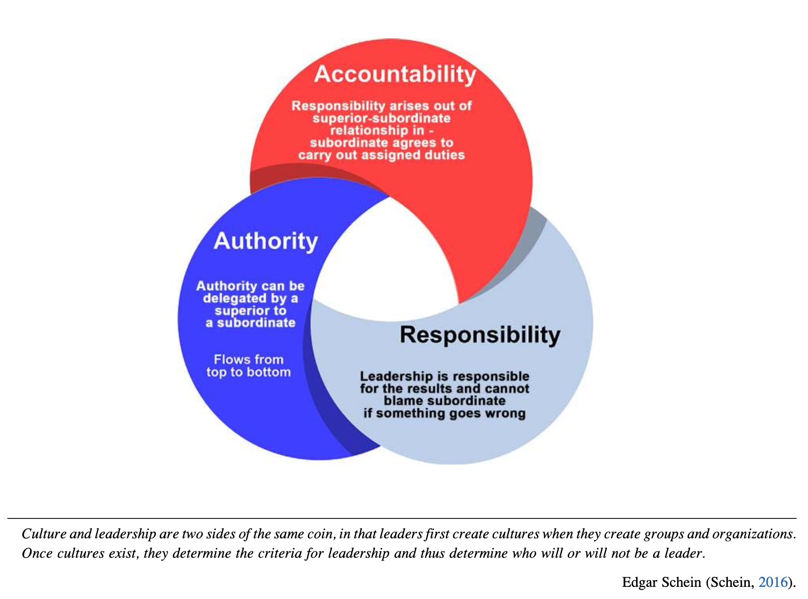
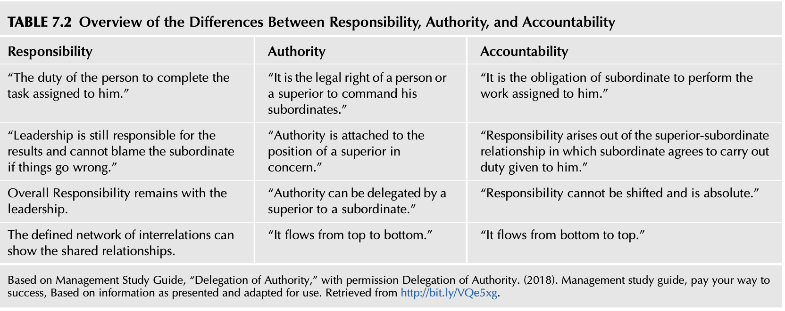
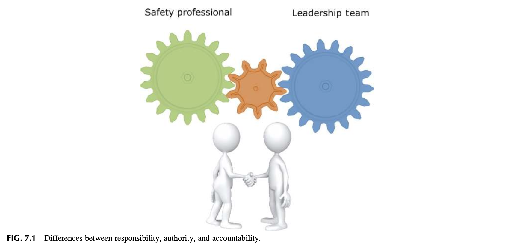
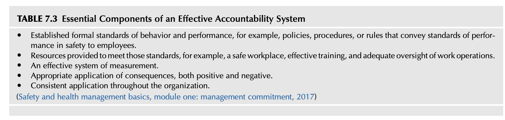

# Chapter 7 Evaluating Leadership and the Safety Culture (리더십과 안전문화 평가) 서브노트



> **[도입부 핵심 명제 및 그림 설명: 리더십-조직문화의 동전 양면성과 삼원조(Triad) 구조]**
> * **에드가 샤인(Edgar Schein, 2016)의 명제**:  
>   *"문화와 리더십은 동전의 양면이다. 리더가 그룹과 조직을 만들 때 먼저 문화를 창조하고, 일단 문화가 존재하게 되면 그 문화가 리더십의 기준을 규정하여 누가 리더가 될 것인지 혹은 되지 못할 것인지를 결정한다."*
> * **핵심 삼원조(Triad)의 상호작용 순환 구조**:
>   * **책무성 (Accountability - 붉은색)**: 상사-부하 관계에서 파생되며, 부하 직원은 자신에게 부여된 직무를 수행하기로 합의하고 결과에 대해 해명할 의무를 가짐 (*Responsibility arises out of superior-subordinate relationship in - subordinate agrees to carry out assigned duties*).
>   * **권한 (Authority - 짙은 파란색)**: 상사가 부하 직원에게 합법적으로 위임할 수 있으며, 최고위층에서 하위 조직으로 하향(Top to bottom) 전달됨 (*Authority can be delegated by a superior to a subordinate / Flows from top to bottom*).
>   * **책임 (Responsibility - 연한 청색)**: 조직의 리더십은 궁극적인 결과에 대해 책임을 지며, 일이 잘못되었을 때 부하 직원에게 책임을 전가할 수 없음 (*Leadership is responsible for the results and cannot blame subordinate if something goes wrong*).

---

## INTRODUCTION (도입)

안전보건 업무를 성공적으로 수행하려면 **관리자(Manager)**의 역할과 **리더(Leader)**의 역할을 유연하게 교대하며 수행해야 합니다.

### 1. 안전 업무에서 관리자와 리더의 상호보완적 역할

안전 프로세스를 실행할 때는 관리 기술(Management skills)이 필수적입니다. 반면, 안전경영시스템의 비전과 미션을 조직 내에 전파하고 구성원을 고무시키는 데는 리더십이 요구됩니다.

| 구분 | 관리자 (Manager) | 리더 (Leader) |
| :--- | :--- | :--- |
| **핵심 접근법** | **환원주의적(Reductionist) 접근**: 복잡한 문제를 가장 기본적인 요소들로 쪼개어 세밀하게 분석하고 해결책을 도출함 | **시스템적/전체론적(Holistic) 접근**: 조직의 모든 부분과 기능이 어떻게 조화롭게 협력해야 하는지 전체 구조를 조망함 |
| **주요 역할** | 안전 프로세스의 구체적인 프로그램 및 정책 실행·운영 | 안전경영시스템의 비전과 미션 제시, 안전문화 달성 및 유지를 위한 직원의 기대역할 제시와 영감(Inspiration) 부여 |
| **조직 지속성** | 관리 역량만으로 단기 생존은 가능하나, 시간이 지나면 관료주의에 빠져 본래의 미션과 비전을 상실하기 쉬움 | 항상 프로세스 전반과 본질적 방향성에 집중하도록 조직을 이끎 |

> **핵심 결론**: 조직은 유능한 관리자와 통찰력 있는 비전을 가진 리더십이 조화를 이룰 때 비로소 탁월함(Excel)을 달성할 수 있습니다. 비전이 결여된 관리는 장기적으로 조직의 안전 유지 역량을 약화시킵니다.

### 2. 안전 전문가에게 요구되는 리더십 역량

* **학습 가능한 역량**: 리더십 기술은 유전되거나 타고나는 것이 아니며, **누구나 훈련과 학습을 통해 습득**할 수 있습니다.
* **소통과 조율**: 안전 전문가는 리더십 원리를 체득하여 경영진(Leadership team) 및 현장 직원들과 안전문화 유지 활동을 조직하고 소통하는 데 적용해야 합니다.
* **조직 개발**: 팀과 안전위원회(Safety Committee)를 구성하고, 다양한 부서 및 개인과의 유대감(Rapport)을 형성하는 데 리더십 자질이 필수적입니다.

### 3. 해당 챕터의 핵심 학습 목표 (8가지)

이 챕터를 학습한 후 안전 전문가는 다음 8가지 핵심 주제에 대해 토론하고 실무에 적용할 수 있어야 합니다:

1. **리더십의 정의에 대한 이해** (Be knowledgeable about the definitions of leadership)
2. **안전 전문가의 리더십 인정 방안** (Discuss how a safety professional can and should become accepted as a leader)
3. **리더십이 안전경영시스템에 미치는 영향** (Discuss the impact of leadership on the safety management system)
4. **책임(Responsibility), 권한(Authority), 책무성(Accountability)의 상호연관성 이해** (Understand how responsibility, authority, and accountability are interrelated)
5. **위임(Delegation)이 안전 프로세스에서 배제되어 온 이유** (Discuss why delegation has not been considered part of a safety process)
6. **책무성과 책임이 안전경영시스템 및 안전문화 유지에 필수적인 이유 규명** (Define how accountability and responsibility are essential for the safety management system and the sustaining of the safety culture)
7. **서면 직무기술서(Written Job Descriptions)의 장단점 및 리더십에서의 중요성** (Discuss the pros and cons of written job descriptions and why they are important for leadership)
8. **성과에 대한 결과/피드백(Consequences for Performance) 설정의 필요성** (Discuss why it is necessary to establish consequences for performance)

---

## LEADERSHIP DEFINED (리더십의 정의)

리더십은 다양한 정의와 인식을 포괄하는 개념이며, 원칙과 이론을 실천함으로써 누구나 더 뛰어난 리더로 성장할 수 있습니다.

### 1. 리더십 정의의 다양성과 직관적 속성

* **정의의 다양성**:
  * 스톡딜(Stogdill, 1974): *"리더십을 정의하려 시도한 사람의 수만큼이나 많은 리더십 정의가 존재한다."*
  * 베니스 & 타운센드(Bennis & Townsend, 1995): 20세기 말 문헌 기준으로 리더십 정의가 **최소 650개 이상**에 달한다고 추산했습니다.
* **직관적 인식과 강력한 추진력**:
  * 오래된 격언에 *"리더십은 보면 안다(Leadership is something you know when you see it)"*라는 말이 있습니다.
  * '리더'라는 단어는 집단의 전면에 나서 무엇을 어떻게 달성할 것인지 명확하고 단호하게 소통하며, 공유된 비전(Shared vision)을 향해 앞장서서 이끄는 강인한 인물의 이미지를 전달합니다.
  * 리더는 남들이 불가능하다고 생각할 때조차 비전을 달성하도록 사람들에게 영감을 불어넣고, 좌절과 장애물 앞에서도 공유된 비전과 나아갈 방향을 잃지 않습니다.
* **비즈니스, 군사, 교육, 종교, 정치 분야 리더에 대한 성찰 질문**:
  * 그들은 어떤 자질(Attributes)을 가졌는가?
  * 왜 리더로 인식되는가?
  * 조직에서 어떻게 리더의 위치에 올랐는가?
  * 인정을 받기 위해 무엇을 행동으로 실천했는가?
  * 그들이 남긴 유산(Legacy)은 무엇이며 지속 가능한가?

### 2. 안전경영시스템과 신뢰(Trust) 구축

* **가시적 존재감과 행동(Visible presence and behavior)**: 리더의 현장 가시성과 솔선수범하는 행동은 안전경영시스템 구축에 필수적인 상호 신뢰(Trust)를 형성합니다.
* **권한과 책임의 지혜로운 활용**: 리더로서의 개인적 학습 목표는 자신에게 부여된 권한과 책임을 가장 효과적으로 사용하는 지식을 확장하는 데 두어야 합니다.
* **조직 문화로의 통합**: 안전 시스템을 별개의 독립된 프로그램으로 두지 않고, 조직 문화(Organizational culture) 전반에 자연스럽게 녹여내는 솔루션을 경영진에게 조언해야 합니다.

### 3. 안전 전문가의 다단계 역할 전환 메커니즘 (JHA 사례)

안전 전문가는 특정 안전 활동의 단계에 따라 **기술자에서 진정한 리더로 정체성을 유연하게 전환**해야 합니다. 본문은 작업위험성평가(JHA, Job Hazard Analysis)를 대표적인 예로 듭니다:

```
[1단계] 위험성평가(JHA)를 직접 작성하고 분석
       ➔ 기술자 (Technician)
         ↓
[2단계] 지정된 현장 직원들에게 JHA 작성 및 분석법을 교육
       ➔ 훈련자/트레이너 (Trainer)
         ↓
[3단계] JHA 프로세스의 품질 관리 및 정확성 검증 보장
       ➔ 품질관리자 (Quality Control)
         ↓
[4단계] JHA의 활용 중요성을 전파하고 조직의 헌신과 지지를 유도
       ➔ 신뢰받는 리더 (Trusted Leader)
```

> **핵심 통찰**: 개별 프로그램 중심 활동(Program-directed activities)과 조직 전반을 아우르는 포괄적 시스템·프로세스적 접근(All-inclusive systems and process approach) 사이에서 시야를 자유롭게 전환하는 능력이 안전 리더십의 핵심입니다.

---

## PRINCIPLES OF LEADERSHIP (리더십 원칙)

안전 프로세스는 인간의 생명과 직결된 중대한 미션을 수행하므로, 단순한 정책과 프로그램 관리를 넘어 목적을 달성하려면 리더십 역량이 필수적입니다. 리더십의 특성은 효과적인 리더들이 위기, 상황, 장애물, 갈등에 직면했을 때 취하는 행동과 태도, 대응에서 명확히 드러납니다.

### 1. 리더십 기대 요소 (Table 7.1)

미 육군 리더십 개발 야전교범(Field Manual 6-22, 2015)에서 제시한 8가지 리더십 기대 사항입니다:

| 번호 | 리더십 기대 요소 (Leadership Expectations) | 실무적 의미 |
| :---: | :--- | :--- |
| **1** | **비전을 수립하고 변화를 주도하라** (*Have a vision and lead change*) | 명확한 미래 지향점을 설정하고 조직 혁신을 견인 |
| **2** | **조직의 도덕적·윤리적 나침반이 되어라** (*Be your organization's moral and ethical compass*) | 타협할 수 없는 윤리적·안전 가치관 견지 |
| **3** | **학습하고, 사고하며, 적응하라** (*Learn, think, and adapt*) | 변화하는 환경과 새로운 위험에 유연하게 대응 |
| **4** | **주도권을 유지하기 위해 위험과 기회의 균형을 맞춰라** (*Balance risk and opportunity to retain the initiative*) | 리스크를 냉철히 평가하되 위축되지 않고 주도권 확보 |
| **5** | **민첩하고 효과적인 고성과 팀을 구축하라** (*Build agile, effective, high-performing teams*) | 부서 간 벽을 허물고 기민하게 협력하는 팀 육성 |
| **6** | **부하 직원에게 권한을 위임하고 리스크를 감수하라** (*Empower subordinates and underwrite the risk*) | 하부 위임과 권한 부여 및 발생 가능한 리스크를 리더가 감당 |
| **7** | **대담하고 적응력 있으며 시야가 넓은 리더를 육성하라** (*Develop bold, adaptive, and broadened leaders*) | 차세대 리더를 발굴하고 역량을 확장 |
| **8** | **상하좌우로 소통하고, 전체적인 맥락을 숨김없이 공유하라** (*Communicate, up, down, and laterally; tell the whole story*) | 전방위적 양방향 소통 및 왜곡 없는 투명한 정보 공유 |

### 2. 리더십의 다면적 속성과 발전 조건 (Mosaic of Leadership)

* **오마 브래들리(Omar Bradley) 장군의 리더십 균형론**:
  * *"리더십은 가혹함이 아닌 확고함(firmness), 나약함이 아닌 이해심(understanding), 이기심이 아닌 관용(generosity), 독선·오만이 아닌 자긍심(pride)을 의미한다."*
  * 리더로 성장하는 과정에서 **정직한 실수(honest mistakes)**를 겪고 어려운 결정과 딜레마를 마주하는 것은 리더십의 기예(art)를 체득하는 필수적 과정입니다.
* **복합적 요구와 영향력 행사**:
  * 리더십은 리더가 개인의 자질, 능력, 경험을 발휘하여 조직, 구성원, 상황, 전개되는 임무에 긍정적인 영향을 미치는 과정입니다.
  * *"리더십은 임무를 완수하고 조직을 개선하기 위해 목적(purpose), 방향(direction), 동기부여(motivation)를 제공하여 사람들에게 영향력을 행사하는 과정이다."*
* **명령이 아닌 존중과 모범**:
  * 리더는 단순히 명령을 내리는 자리가 아니며, **존중을 얻고, 솔선수범하며, 긍정적인 분위기를 조성하고, 자원을 극대화하며, 팀을 구성하여 탁월함을 촉진**하는 사람입니다.
* **권한에 대한 명확한 이해**:
  * 자신이 가진 권한의 종류와 출처를 명확히 알아야 하며, 의문이 있을 때는 확인하고, 권한의 범위를 확신했을 때 건전한 판단력(sound judgment)으로 행사해야 합니다.
* **리더십 개발을 위한 3대 근본 요건**:
  1. 개인의 개선 의지와 노력 투자 (Desire to improve and investment of effort)
  2. 상사의 적극적인 지원 (Superior's support for development)
  3. 학습을 가치 있게 여기는 조직 문화 (Organizational climate valuing learning: 지식 습득 + 실제 경험 + 피드백)

### 3. 경계해야 할 부정적 리더십과 유독성 리더십 (Toxic Leadership)

* **부정적 리더십 (Negative Leadership)**:
  * 리더-추종자 관계가 시작되기 전보다 **조직과 사람을 더 악화된 상태**로 남겨둡니다.
  * 오직 **지위 권력(Positional power)**에만 의존하여 단기 요구사항만 강제로 해결합니다. 이는 단기 실적은 낼지 몰라도 '이끌고 육성하는(leads and develops)' 본질적 리더십 역량을 무시합니다.
  * 장기화될 경우 추종자의 의지, 주도성, 잠재력을 갉아먹고 부대/조직의 사기를 완전히 무너뜨립니다.
* **유독성 리더십 (Toxic Leadership)**:
  * **정의**: 부하 직원, 조직, 임무 완수에 파괴적인 악영향을 미치는 **자기중심적 태도, 동기, 행동의 결합체**입니다.
  * **심리적 기제**: 타인과 조직 분위기에 대한 배려가 전무하며, 비대해진 자아도취(inflated sense of self-worth)와 극단적인 사리사욕(acute self-interest)에 기반합니다.
  * **주요 행동 양식**: 자신의 욕망을 채우기 위해 **기만(deceive), 위협(intimidate), 강압(coerce), 부당한 처벌(unfair punishment)** 같은 역기능적 수단을 지속적으로 사용합니다.

> **안전문화 관점의 핵심 결론**: 안전문화 구축의 핵심은 리더가 조직 내의 **비전(Vision), 소통(Communication), 구성원에 대한 배려(Caring), 그리고 의사결정 고리(Decision-making loop)** 안에서 항상 능동적으로 살아 숨 쉬며 참여하는 것입니다.

---

## THOUGHTS ON LEADERSHIP (리더십에 관한 고찰)

### 1. 에너지 산업에서의 리더십 정의

에너지 산업과 같이 **중대 위험(Severe high hazard)과 치명적 리스크**가 상존하는 환경에서는 리더십을 다음과 같이 규정합니다:

> *"자신의 업무 수행뿐만 아니라 시설(사업장) 전체의 운영 성과에 대해 개인적 책임(Personal responsibility)을 지며, 조직의 프로세스와 가치에 긍정적인 영향을 미치려고 노력하는 모든 개인"*  
> — *Human Performance Improvement Handbook* (U.S. Department of Energy, 2009)

### 2. 비공식 리더(현장 작업자)의 강력한 영향력

* 현장 작업자는 공식적인 관리자 직책(Managerial positions of responsibility)에 있지 않더라도 매우 영향력 있는 리더가 될 수 있으며, 실제로도 그렇습니다.
* **리더라는 호칭/인정의 획득 방식**: 리더라는 타이틀은 일방적으로 부여되는 것이 아니라, **부하 직원, 동료(Peers), 상사(Superiors) 모두로부터 신뢰와 인정을 받아 획득(Earned)**되는 것입니다.

### 3. 공식 부서 관리자(Manager)와 실질적 리더(Actual Leader)의 괴리

부서 관리자는 법적 권한과 책임을 갖고 있을 수 있지만, 실제로 사람들에게 영감을 주고 현장의 행동을 움직이는(Inspiring and driving behavior) '실질적 리더'는 **팀 리더(조장·반장), 노동조합 대의원(Union steward), 숙련 라인 작업자** 등 현장의 숨은 인물일 수 있습니다. 안전 전문가는 이 실질적 리더들을 파악하고 긍정적인 파트너십을 구축해야 합니다.

---

## LEADERSHIP IMPACT ON THE SAFETY MANAGEMENT SYSTEM (리더십이 안전경영시스템에 미치는 영향)

안전경영시스템(SMS)과 안전문화는 조직이 어떻게 관리되는지(Managed)뿐만 아니라 어떻게 이끌어지는지(Lead)에 따라 근본적으로 형성됩니다.

### 1. 관리자 및 감독자의 본원적 리더 책임

관리자와 현장 감독자는 책임이 있는 직위에 있으므로 그 자체로 이미 **조직의 리더(Organizational leaders)**입니다.

### 2. 직원의 자발적 개인 책임을 이끌어내는 심리 기제

직원들은 경영 리더십 팀을 바라보며 자신의 업무에 대한 의미, 목적, 방향, 통찰(Meaning, purpose, direction, insight)을 찾습니다.
* **리더가 모범을 보일 때**: 모든 직무가 중요한 목적을 지니고 있음을 보여주고 조직의 방향성을 공유하면, 직원들은 **더 큰 개인적 책임감(Greater personal responsibility)**을 기꺼이 짊어지며 통상적인 기대를 뛰어넘어 안전 활동에 헌신합니다.
* **리더십 자질이 보이지 않을 때**: 리더에게서 이러한 자질을 발견하지 못하면, 직원들은 안전 개선이나 자발적 참여에 소극적으로 변합니다.

### 3. 현대적 리더십의 재정의: 상호작용적 영향력 (Silva, 2016)

> *"리더십이란 특정 맥락(Context) 속에서, 일부 사람들이 공통의 목표를 달성하기 위해 누군가를 자신들의 리더로 수용할 때 발생하는 '상호작용적 영향력의 과정(Process of interactive influence)'이다."*  
> — Silva (2016)

현대적 안전 리더십은 다음 세 축의 상호작용으로 완성됩니다:
1. **리더 (Leader)**: 비전과 목적을 제시하는 주체
2. **추종자 (Followers / 현장 직원)**: 공통 목표를 위해 리더를 자발적으로 인정하고 따르는 주체
3. **맥락 (Context / 작업 환경 및 위험 여건)**: 상호작용이 발생하는 실제 현장 환경

---

## LEADERSHIP AND ORGANIZATION STRUCTURE (리더십과 조직 구조)

지속 가능한 안전문화를 정착시키려면 조직 구조가 안전경영시스템(SMS)을 뒷받침하는 적절한 수준의 지원 체계를 제공해야 합니다. 조직도(Organizational chart)를 넘어, 조직이 실제로 어떻게 작동하고, 소통하며, 현장 단위의 유연성(Local flexibility)을 허용하는지 진단해야 합니다.

### 1. 현장 관찰 사례: James의 M&A 조직 진단과 전화 회신 테스트 (Observation)

* **배경**: 여러 공장이 합병된 M&A 환경에서 안전 전문가 James는 변화를 성급히 추진하기 전, 각 조직의 고유한 전통, 업계 은어(Industry languages), 관리 방식을 먼저 경청하고 관찰했습니다.
* **전화 회신(Call-back) 테스트**: 인수합병 초기의 혼란 속에서 각 공장 운영 관리자들에게 전화를 건 뒤 "누가, 얼마나 신속하게 전화를 회신하는가"를 관찰했습니다.
* **결론**: 즉각적이거나 합리적인 시간 내에 회신한 리더들은 새로운 조직 구조와 환경을 수용하는 적응력(Adaptable)이 뛰어났고, 새로운 문화 형성의 필요성을 이해하며 변화에 저항하지 않는 협력적인 팀 플레이어였습니다.

### 2. 리더십 스타일이 조직에 전달하는 행동 메시지

경영진의 실질적 행동은 조직 전체에 "무엇이 진짜 중요한가"에 대한 강력한 신호를 보냅니다.

**경영진이 긍정적인 신호를 보내는 7가지 행동:**
1. 작업 전 안전점검(Preshift reviews), 주간/월간 회의, 대면 면담 등 정기적인 안전 회의에 직접 가시적으로 참여함.
2. 전 직원과 열린 양방향 소통을 유지하고, 안전 이슈·유해위험요인·위험 보고의 장벽을 제거함.
3. 손실을 유발하는 불안전한 활동과 상태(Loss-producing activities and conditions)를 신속하게 시정함.
4. 부서 및 경영 회의 안건에 안전경영시스템 관련 정보를 일상적으로 상정함.
5. 신규 입사자 교육(Orientation) 및 모든 관련 직무 교육에 안전 기준을 온전히 통합 반영함.
6. 안전 성과를 손실 전(Pre-loss, 선행)과 손실 후(Post-loss, 후행) 데이터 모두로 추적하되, 선행 예방 데이터에 중점을 둠.
7. 안전 이슈, 위험 요소 및 잠재 위험에 대한 현장의 모든 우려를 진지하게 수용함.

> **주의**: 이 항목들이 현장에서 실행되지 않거나 무시될 경우, 반대로 조직 전체에 **"안전은 중요하지 않다"는 강력한 부정적 메시지**를 주게 됩니다.

### 3. 분권화된 조직 구조와 유독성 리더십

동일한 기업 내 유사 설비를 갖춘 사업장이라도, 분권화된 구조에서는 사업장마다 안전문화 수준이 크게 차이 날 수 있습니다. 안전문화가 뿌리내리지 못하는 주된 원인은 유독성 리더십 스타일 때문일 수 있으며, 그 대표적인 징후는 **단순한 최소 법적 규제 준수(Minimal regulatory compliance)**에만 기본 노력을 집중하는 태도입니다.

### 4. 성과지표: 후행지표와 선행지표의 균형

* **성과지표 (Performance Indicators)**: 조직의 핵심 성공 요인을 반영하여 측정하는 매개변수.
* **후행지표 (Lagging Indicator)**: 이미 일어난 결과나 성과(Results or outcomes)를 측정하는 지표 (예: 재해율, 손실 작업일수 등).
* **선행지표 (Leading Indicator, Metrics)**: 미래 성과를 예측할 수 있게 해주는 시스템 상태나 행동(System conditions or behaviors)을 측정하는 지표 (예: 위험성평가 참여도, 안전 점검 조치율 등).

### 5. 리더십 기대와 자원 배분의 현실 (Leadership Expectations)

경영진의 최우선 관심사는 조직의 수익성 유지와 주주의 목표 달성입니다. 안전 전문가는 조직 내에서 예산과 자원을 요청하는 "수많은 부서 중 하나(One among many)"입니다. 만약 경영진이 안전의 가치를 다른 사업 활동보다 낮게 평가한다면 안전 예산과 자원은 최소한으로 제한될 수 있습니다. 따라서 안전 전문가는 리더십 원리를 내면화하여 개인의 영향력을 지속적으로 확장해야 합니다.

### 6. 현장 교훈: James의 생산 감독자 시절 반성 사례 (Lesson Learned)

* **문제 상황**: 과거 대기업에서 감독자로 승진한 James는 "라인 속도를 못 맞추면 해고하고 새 사람을 뽑아라"라는 회사 방침을 따랐습니다. 그 결과 회사의 '우수 감독자' 기준은 맞췄으나, 직원 이직률이 극심했고 새 라인으로 이동했을 때 직원들이 "우리는 당신 밑에서 일하기 싫다"고 거부하는 사태에 직면했습니다.
* **리더십의 전환**: 그는 자신이 직무 감독(Supervisor)에는 성공했으나 진정한 리더(Leader)는 아니었음을 깨달았습니다. James는 각 직원과 1:1 대면 면담, 소그룹 미팅을 통해 애로사항을 경청하고 새로운 기대치를 전달했습니다. 일방적인 "내 방식대로 안 하면 나가라(My way or the highway!)"는 소통에서, 업무 장애물을 함께 파악하는 긍정적인 양방향 소통으로 전환했습니다.
* **결과**: 직원들은 그가 공정하고 정직하며 의견을 경청한다는 사실을 신뢰하게 되었고, 이직률이 안정화되었으며 기피 대상 감독자에서 '신뢰받는 조언자(Trusted advisor)'로 탈바꿈했습니다.
* **진정성 있는 리더의 정체성 (Identity, FM 6-22, 2015)**:
  * 리더의 정체성은 자아개념(Self-concept)이며, 효과적인 리더는 리더의 역할과 기대에 자신을 일치시키고 그에 걸맞은 책임과 행동을 실천합니다.

---

## ESTABLISHING ORGANIZATIONAL SAFETY PRIORITIES (조직의 안전 우선순위 설정)

경영진과 관리자들은 안전의 가치에 대해 피상적인 이해만 갖고 있을 수 있습니다. 위험(Hazard), 관련 리스크(Associated risk), 통제(Control) 및 안전경영시스템 운영의 중요성을 충분히 인지하지 못할 때, 안전 전문가는 리더십 역량을 발휘하여 이들의 인식을 높여야 합니다.

### 1. 경영진 보행 순회 관리 (Management by Walking Around, MBWA)

* **개념 및 기원**: 피터스 & 워터먼(Peters & Waterman, 2004)의 고전 『초우량 기업의 조건(In Search of Excellence)』에서 소개된 기법으로, 경영진이 일상적으로 사업장을 걸어 다니며 현장 관찰과 직원 1:1 대화를 통해 현장의 분위기와 상태를 파악하는 방식입니다.
* **효과 및 주의사항**:
  * 소통 네트워크를 발전시키고 현장의 일상적 문제와 사각지대를 파악할 수 있습니다 (특히 2·3교대 근무 현장의 리더십 부재 해소).
  * 3단계 영향력 법칙(3 Degrees of Contact, Christakis & Fowler / Ch 3)에 따라 리더의 영향력이 조직 전체로 파급됩니다.
  * **주의**: 리더가 안전 규칙을 무시하거나, 직원을 질책하는 등 미숙하게 행동할 경우 오히려 리더십의 영향력이 심각하게 훼손됩니다.
* **현장 사례 (Nathan의 카펫 제조공장 CEO 일화)**:
  * 안전 컨설턴트 Nathan이 방문한 카펫 제조사의 CEO는 광대한 공장을 정기적으로 순회했습니다. 어느 날 한 직원이 진공청소기 대신 빗자루로 바닥을 쓸고 있는 것을 발견했습니다.
  * 청소기가 고장 났는데 새 제품 주문이 안 되었다는 직원의 말을 듣고, CEO는 즉시 밖으로 나가 직접 새 진공청소기를 구매해 와 직원에게 전달했습니다. 이 일화는 전사에 퍼져나갔고, 모든 관리자들은 현장에 적절한 장비가 지급되도록 신속히 조치하는 계기가 되었습니다.

### 2. 열린 문 정책 (Open Door Policy)

* **기능**: 공식적인 지휘계통(Chain of command)을 우회하거나 침해하기 위한 것이 아니라, 조언과 통찰을 구하는 누구에게나 리더가 다가갈 수 있도록 하는 **안전 완충 밸브(Relief valve)** 역할을 합니다.
* **주의점**: 다른 관리자와의 정상적인 관계를 방해하지 않으면서 소통을 장려하는 미묘한 균형을 유지해야 합니다.
* **운영 형태**: 특정 방문 상담 시간 지정, 온라인 소통 채널 유지 등.
* **아인슈타인(Albert Einstein)의 문제해결 명언**:
  > *"내게 문제를 해결할 1시간이 주어지고 그 해결책에 내 목숨이 달려 있다면, 나는 올바른 질문을 찾는 데 최초 55분을 쓸 것이다. 적절한 질문을 알고 나면 문제는 5분도 안 되어 해결할 수 있기 때문이다."*

---

## DEFINING ROLES, RESPONSIBILITY, DELEGATION, AUTHORITY, AND ACCOUNTABILITY (역할, 책임, 위임, 권한, 책무성의 정의)

사업이 복잡해지고 규모가 커지면 한 사람이 안전경영시스템의 모든 세부 사항을 책임지는 것은 불가능합니다. 시스템이 잠재력을 발휘하려면 역할, 책임, 권한 위임, 권한이 명확히 정의되고 **책무성 구조(Accountability structure)**와 결합되어야 합니다.

* **권한 위임의 정의 (Delegation of Authority, 2018)**:
  * 관리자 혼자 모든 업무를 수행할 수 없으므로, 목표 달성을 위해 하위 구성원에게 권한과 권능을 하향 배분하는 것입니다.
  * 자신의 직무 중 일부를 타인에게 믿고 맡기는 것이며, 효과적인 성과를 도출하기 위한 권한의 세분화 및 재할당입니다.

---

## REVIEW THE ORGANIZATION FOR SAFETY-RELATED RESPONSIBILITIES (안전 관련 책임을 위한 조직 검토)

안전문화 달성을 위한 안전 책임은 단순한 부상 통제나 규정 준수를 넘어 광범위한 영역을 포괄해야 합니다.

### 1. 안전 관련 책임의 6대 핵심 영역
1. **정책 및 매뉴얼 개발, 경영진 보고** (Policy and manual development; status reports)
2. **안전경영시스템 기준 문서화, 감사 및 시정 조치 큐레이션** (Documentation and curation of SMS criteria, audits, corrective actions)
3. **운영 절차 관리** (안전보건환경 EHS, 차량·운행 관리, 도급업체 및 방문객 통제, 보안, 제조물 배상책임, 재해 및 배상 보험 청구 관리)
4. **위험 및 유해위험요인 통제** (장비·공구·자재·화학물질 구매 검토, 인간공학, 설계 검토, 작업위험성평가 JHA)
5. **교육, 훈련, 신규자 오리엔테이션 및 안전 소통**
6. **비상 및 위기 대비, 사고 조사 및 분석**

### 2. 조직 구조 분석과 직무기술서의 연계
* 조직도를 활용하여 각 직무가 안전 시스템을 어떻게 지원할 수 있는지 파악합니다.
* 안전 프로세스에 필수적인 역할을 수행할 수 있는 직위 목록과 직무기술서를 개발하고, 전사 리더와 직원에게 명확한 안전 활동과 책임을 부여합니다.

---

## DEVELOPING AND IMPLEMENTING JOB DESCRIPTIONS (직무기술서 개발 및 실행)

직무기술서는 특정 직위의 자격 요건, 필수 기술, 일반 직무, 활동, 책임 및 권한을 기술합니다. 많은 조직의 약점은 **안전경영시스템 책임이 서면 직무기술서에 직접 반영되지 않고 OSHA 규정 준수 수준으로만 축소되어 있다는 점**입니다.

### 1. 인사(HR) 부서와의 협력
* 직무기술서는 통상 인사 부서에서 관리하므로, 안전 전문가는 인사팀의 기존 프로세스를 이해하고 긴밀한 신뢰 관계를 형성하여 안전 책무가 정식 직무기술서에 반영되도록 설득해야 합니다.

### 2. 잘 작성된 직무기술서가 제공하는 6대 이점
1. 각 직위의 책임과 권한 한계에 대한 의구심을 완전히 해소함.
2. 조직 내 모든 안전 책임이 누락 없이 배분되었는지 확인함.
3. 새로운 작업과 책임이 발생했을 때 배분 경로를 명확히 식별함.
4. 직무 성과 목표를 수립하고 성과 측정 기준을 마련함.
5. 조직 전반의 소통과 조율을 대폭 개선함.
6. 직무 수행의 객관적 평가 기준을 제공함.

### 3. 세부 직무기술서 작성 지침

* **기본 직무기술서 작성 (Writing the Basic Job Description)**:
  * 안전 책임을 규정하는 짧은 '일반 진술문(General Statement)'으로 시작하고, 권한과 필요한 자원을 명시합니다. (Appendix 7.1 워크시트 활용, 정기 검토되는 '살아있는 문서'로 관리).
* **목표 및 목적에 대한 합의 형성 (Gaining Agreement on Goals and Objectives)**:
  * 기획 단계부터 직원과 리더의 참여를 늘려 사전 수용성(Buy-in)을 확보해야 합니다.
  * **주의**: 현장 감독관이 채용, 예산, 장비 유지보수 등 잠재적 관리 결함(Latent conditions)을 통제할 권한이 없음에도 발생한 재해율만으로 책무성을 추궁하는 것은 부당합니다. 감독관과 직원이 **직접 통제할 수 있는 손실 전(Preloss) 예방 활동을 중심으로 책무성을 설정**해야 합니다.
* **명확한 목표 정의와 SMART 원칙**:
  * 모호한 목표는 성과 평가를 불가능하게 합니다. Chapter 4에서 다룬 **SMART 원칙**(Specific, Measurable, Attainable, Realistic, Timely)을 적용하여 현실적이고 측정 가능한 목표를 수립합니다.
* **직무 위치별 목표 문서화 및 실무 예시**:
  1. 지정된 시간에 전 직원과 일일 작업 전 안전점검(Preshift review) 실시
  2. 직원들과 1:1 대면 면담을 통해 안전 애로사항 및 니즈 파악
  3. 주간/월간 안전 회의를 통한 추진 경과 공유
  4. 점검 및 사고 조사를 통해 발굴된 유해위험요인의 제거 실적 추적 및 소통
  5. 기계·설비별 점검 체크리스트 활용도 평가
* **비감독직 직원(Nonsupervisory Employees)의 안전 책임 7가지**:
  1. 지정된 시간의 일일 작업 전 회의 참석
  2. 주간/월간 안전 회의 참여
  3. 발견된 유해위험요인 보고 및 제거 지원
  4. 불안전 상태 및 관련 리스크 즉시 보고
  5. 손실 유발 사건 조사 및 주간 안전 점검 지원
  6. 작업위험성평가(JHA) 참여
  7. 위험 상태 식별 시 '위험안내카드(Risk Guidance Card, Ch 9)' 활용

---

## REVIEW ASSIGNED ACTIVITIES REGULARLY (할당된 활동의 정기적 검토)

관리자가 서면 목표는 모두 달성했음에도 해당 현장에서 아차사고와 유해위험요인이 줄어들지 않는 모순이 발생할 수 있습니다. 이는 근본적인 장애 요인이 파악되지 않았기 때문이며, 실제 운영 환경과 안전 기준이 일치하는지 심층 재평가가 필요합니다.

### 1. 현장 관찰 사례: James의 공장장 성과 목표 조정 (Observation)
* 한 공장장이 5개의 안전 목표 중 4개를 달성하고 1개를 달성하지 못했습니다. 성과 평가 과정에서 해당 목표가 공장장의 통제 범위를 벗어난 업무였음이 확인되었습니다.
* 평가자는 달성 불가능한 목표를 실제로 통제 가능한 새로운 실행 목표로 대체하기로 합의했고, 공장장은 새 목표를 성공적으로 달성하여 현장 안전이 대폭 개선되었습니다.

### 2. 권한과 자원 뒷받침의 필수성
* 책임만 부여하고 권한과 자원을 주지 않으면 직원은 깊은 무력감과 사기 저하를 겪습니다.
* 페트레이어스 & 아모스(Petraeus & Amos, 2006): *"권한 없는 책임, 역량에 맞지 않는 과도하거나 불충분한 업무, 적절한 교육과 피드백 없는 높은 성과 기대는 심각한 부정적 스트레스를 유발한다."*

### 3. 위임의 핵심 요소 (Elements of Delegation)
* 위임은 부하에게 "알아서 해라"라며 책임을 떠넘기는(Passing the buck) 행위가 아닙니다.
* **최종 결과에 대한 책임은 여전히 상위 리더에게 있으며**, 잘못되었을 때 부하 직원을 탓할 수 없습니다. 리더는 정기 보고, 성과 검토, 대면 논의를 통해 지속적으로 참여해야 합니다.
* 랄프 왈도 에머슨(Ralph Waldo Emerson): *"원리를 파악한 자는 자신의 방법을 성공적으로 선택할 수 있지만, 원리를 무시한 채 방법만 시도하는 자는 반드시 곤경에 처한다."*

### 4. 책임, 권한, 책무성의 삼원조 (Triad) 세부 분석

1. **책임 (Responsibility)**:
   * 부여된 과업을 완수해야 하는 의무(Duty)입니다. 적절한 권한 없는 책임은 불만과 좌절을 낳습니다.
   * **하향에서 상향(Bottom to top)으로 흐르며**, 중간 및 하위 관리자가 상위 계층보다 더 많은 구체적 실무 책임을 가집니다.
2. **권한 (Authority)**:
   * 조직 목표 달성을 위해 자원을 효율적으로 배분하고 의사결정을 내리며 명령을 지시할 수 있는 합법적 권리(Power and right)입니다.
   * **상향에서 하향(Top to bottom)으로 흐릅니다**. 권한은 위임될 수 있으나, 권한을 위임했다고 해서 책무성에서 벗어날 수는 없습니다.
3. **책무성 (Accountability)**:
   * 설정된 기대치와 실제 성과 사이의 차이에 대해 설명하고 해명할 의무(Answerable for results)입니다.
   * **책무성은 결코 타인에게 위임할 수 없습니다 (Accountability cannot be delegated).** 상위 경영진이 궁극적으로 가장 큰 책무성을 집니다.

**위임의 3단계 프로세스:**
1. **직무 할당 (Assignment of Duties)**: 기대되는 결과를 명확히 정의하여 전달.
2. **권한 부여 (Granting of Authority)**: 과업 수행에 필요한 충분한 자율성과 권한을 공유.
3. **책임 및 책무성 형성 (Creating Responsibility and Accountability)**: 권한이 위임되면(Delegated) 책임이 형성되고(Created), 책무성이 부과됩니다(Imposed).

---

## THE RELATIONSHIP BETWEEN RESPONSIBILITY, AUTHORITY, AND ACCOUNTABILITY (책임, 권한, 책무성의 상호관계)



### [TABLE 7.2] 책임, 권한, 책무성의 상세 비교 분석 표

| 비교 항목 | 책임 (Responsibility) | 권한 (Authority) | 책무성 (Accountability) |
| :--- | :--- | :--- | :--- |
| **정의** | 부여된 과업을 완수해야 하는 개인의 의무 (*The duty of the person to complete the task assigned to him*) | 부하 직원에게 지시하고 명령할 수 있는 합법적 권리 (*The legal right of a superior to command subordinates*) | 부여된 업무를 완수하기로 동의한 부하 직원의 의무이자 결과 해명 책임 (*Obligation to perform work and explain results*) |
| **주체와 책임성** | 리더십은 결과에 대해 여전히 책임을 지며 문제 발생 시 부하를 탓할 수 없음 | 권한은 해당 직위(Position of a superior)에 결속됨 | 상사-부하 관계에서 발생하며, 직무 수행에 동의함으로써 형성됨 |
| **위임 가능 여부** | **절대 타인에게 전가할 수 없음 (Absolute, cannot be shifted)**. 궁극적 책임은 리더십에 잔류 | **상사가 부하에게 합법적으로 위임 가능 (Can be delegated)** | **결코 위임할 수 없음 (Cannot be delegated)** |
| **흐름의 방향** | **하향에서 상향으로 흐름** (*Flows from bottom to top*) | **상향에서 하향으로 흐름** (*Flows from top to bottom*) | 결과에 대한 답변 책임으로 상향 보고됨 (*Flows from bottom to top*) |

---



> **[그림 7.1 설명: 안전 전문가와 리더십 팀 간의 톱니바퀴 연동 메커니즘]**
> * **안전 전문가(Safety professional - 좌측 초록 기어)**와 **리더십 팀(Leadership team - 우측 파랑 기어)**이 마주 서서 악수를 나누며 파트너십을 형성하고 있습니다.
> * 두 주체 사이에는 **중간 매개 기어(주황색)**가 맞물려 있어, 책임(Responsibility), 권한(Authority), 책무성(Accountability)의 삼원조가 유기적으로 결합되어 회전해야만 전체 안전경영시스템이 원활하게 구동됨을 상징합니다. 어느 한쪽의 기어가 멈추거나 맞물리지 않으면 조직의 안전문화는 작동을 멈추게 됩니다.

### 1. 권한 부여 (Assigning Authority)
* **작업 중지 권한의 제도화**: 위험하거나 고위험 작업을 발견했을 때 즉각 중지시킬 수 있는 공식적 권한(Authority to stop work)이 모든 직무기술서에 명시되어야 합니다. 취약한 안전문화에서는 생산 일정을 맞추기 위해 위험을 무릅쓰고 작업을 강행하는 인식이 팽배합니다.
* 밥 프로스트(Bob Frost, 2017): *"권한이란 상위 경영진의 사전 승인이나 동료의 이의 제기 없이 독자적으로 행동할 수 있는 권리이다. 권한은 할당(Assigned)되는 것이며, 책임은 위임(Delegated)되는 것이다."*
* 미국 에너지부 자율보호프로그램(DOE-VPP, 2016): 안전보건 책임을 진 인력에게는 인력, 공간, 장비, 교육, 자본 예산 등 충분한 자원이 반드시 서면으로 뒷받침되어야 합니다.

### 2. 책무성의 정의와 중요성 (Defining Accountability)
* 책무성은 책임과 권한을 실제로 작동시키는 **활성화 트리거(Activator)**입니다. 책무성이 없으면 권한과 책임을 부여해도 아무도 실행하지 않고 결과에 관심도 두지 않아 안전경영시스템은 붕괴합니다.
* 가이글(Geigle, 2017): 관리자와 직원이 안전 책무를 명확히 질 때, 안전 문제에 장벽을 치기보다 적극적인 해결책을 찾게 됩니다.
* **소급 적용 불가 원칙**: 책무성은 사전에 명확히 인지되고 합의되어야 하며, 일이 터진 후 소급 적용(Retroactive)할 수 없습니다.
* 코너스 & 스미스(Connors & Smith, 2004): 많은 이들이 책무성을 일이 잘못되었을 때 범인을 찾고 손가락질(Finger pointing)하는 것으로 오해하지만, 진정한 책무성은 성과 달성을 이끄는 긍정적 메커니즘입니다.

---



### [TABLE 7.3] 효과적인 책무성 시스템의 5대 필수 구성요소

1. **공식적인 행동 및 성과 기준 수립** (*Established formal standards of behavior and performance*): 직원들에게 안전 기준을 명확히 전달하는 방침, 절차, 규칙 제정.
2. **기준 달성을 위한 충분한 자원 제공** (*Resources provided to meet those standards*): 안전한 작업장, 효과적인 교육 훈련, 적절한 작업 감독 지원.
3. **효과적인 성과 측정 시스템 구축** (*An effective system of measurement*): 선행·후행 지표의 객관적 측정.
4. **결과에 대한 적절한 피드백 적용** (*Appropriate application of consequences, both positive and negative*): 긍정적 보상과 부정적 제재의 합리적 적용.
5. **조직 전반의 일관성 있는 적용** (*Consistent application throughout the organization*): 직급이나 부서에 관계없는 공정한 원칙 집행.

---

## ASSIGNING SPECIFIC RESPONSIBILITIES (직급별 구체적 안전 책임 부여)

안전사고는 직접적인 인적 오류뿐만 아니라 조직에 내재된 **잠재적 오류(Latent errors)**에 의해 유발됩니다. 센더스 & 모레이(Senders & Moray, 1991)는 *"개시 행동(Initiating action)이란 시설 사건(Event)을 유발하는 개인의 행동(올바른 행동, 오류, 또는 위반)"*이라고 정의했습니다. 조직의 계층별 구체적 책임은 다음과 같이 차별화되어 배분되어야 합니다:

### 1. 최고경영진/리더십 팀 (Senior Leadership Team)
* 안전 정책, 목표, 안전경영시스템의 지침, 예산 및 자원을 수립하고 제공함.
* 안전 전문가는 최고경영진에게 시스템 운영 상태와 위험 통제 현황을 보고하고 적절한 자원 배분을 조언함. (상세 항목: Appendix 7.2 참조)

### 2. 사업장 총괄 공장장/관리자 (Managers & Superintendents)
* 최고경영진이 수립한 안전 목표를 실행하고, 관할 사업장의 안전한 작업 조건을 유지함.
* 산하 감독관들을 지휘하고 감독관의 안전 성과를 평가하며 경영진과 감독관 사이의 가교 역할을 수행함. (상세 항목: Appendix 7.3 참조)

### 3. 현장 감독관 (Supervisors)
* 관리자와 현장 라인 직원을 직접 연결하는 핵심 실무자로서, 자신의 담당 구역 내에서 안전 기준과 수칙이 철저히 지켜지도록 모범을 보이고 현장을 점검함. (상세 항목: Appendix 7.4 참조)

### 4. 현장 작업 직원 (Employees)
* 실제 작업 위험에 노출되는 주체로서, 유해위험요인을 발견 즉시 보고하고 시정 제안을 적극적으로 개진하며 안전 수칙을 준수함. (상세 항목: Appendix 7.5 참조)

---

## ESTABLISH CONSEQUENCES FOR PERFORMANCE (성과에 대한 결과/피드백 설정)

성과에 대한 후속 조치(Consequences)는 설계 및 실행 방식에 따라 안전문화를 고양할 수도, 파괴할 수도 있습니다. 구성원들이 이를 징벌로만 인식하면 안전 전반에 방어적이고 부정적인 태도를 갖게 되므로, **긍정적 피드백 중심의 균형 잡힌 접근**이 필수적입니다.

### 1. 신규 업무에 대한 학습 기간(Learning Period) 보장
새로운 책임이나 제도가 도입되면 직원은 학습과 습관 형성 과정을 거쳐야 합니다. 초기에는 무리한 처벌 없이 **개인 코칭, 처벌 없는 즉각적 시정 조치, "왜(WHY)"와 "어떻게(HOW)"를 알려주는 대화**가 선행되어야 합니다.

### 2. 과잉 대응(Overreacting)의 치명적 부작용
* **사례**: 사고 조사를 제대로 수행하지 못했다는 이유로 해당 감독관을 즉각 징계 처벌하는 경우.
* **폐해**: 감독관의 지식이나 조사 기술 부족이 원인일 수 있음에도 징계부터 내리면, 조직 전체에 **"경영진의 문책을 피하려면 사건 발생 사실을 최대한 은폐하라"는 치명적인 메시지**를 주게 됩니다.
* 이는 잠재적 위험에 대한 소통 통로를 차단하여 더 큰 대형 사고를 유발합니다. (메이거 & 파이프, *Mager & Pipe, 1983, Analyzing Performance Problems* 참조).

---

## SUMMARY (요약)

1. **리더의 이미지와 역할**: 리더는 집단 앞에 당당히 서서 목표를 명확히 소통하고 구성원에게 영감을 불어넣어 기대 이상의 성과를 내도록 이끄는 인물입니다.
2. **참여형 안전문화 모델**: 경영진의 가시적 존재감과 행동이 안전문화의 성패를 좌우합니다. 안전 전문가는 리더십 원리를 체득하여 경영진의 전략적 자문 역할을 수행해야 합니다.
3. **삼원조의 유기적 결합**: 책임, 권한, 책무성은 결코 분리될 수 없는 통합체입니다.
4. **진정한 위임의 의미**: 위임은 책임을 전가하는 것이 아니며, 상위 리더는 최종 결과에 대해 끝까지 책무성을 유지합니다.
5. **결과의 균형성**: 성과에 대한 결과는 징벌보다는 긍정적 동기부여와 공정한 피드백 중심으로 설계되어야 보고와 소통이 살아납니다.

---

## CHAPTER REVIEW QUESTIONS (장별 복습 질문 15문항)

1. **'리더'라는 단어는 어떤 이미지를 전달하며, 이 장에서 제시된 리더십 기준과 어떻게 비교되는가?**  
   ➔ 전면에 나서 비전을 소통하고 기대를 뛰어넘도록 영감을 주는 이미지이며, 본 장에서는 여기에 시스템적 시각, 신뢰 구축, 배려, 도덕적 나침반 역할이 결합되어야 함을 강조함.
2. **오마 브래들리 장군의 리더십 명언(확고함, 이해심, 관용, 자긍심)을 안전경영시스템 관리에 어떻게 적용할 수 있는가?**  
   ➔ 규정 집행 시 가혹한 처벌 대신 확고한 기준을 세우고, 현장의 고충을 이해하며, 성과를 구성원에게 돌리는 관용과 정직한 실수를 학습의 기회로 삼는 태도로 적용함.
3. **책무성, 권한, 책임은 어떻게 상호 연관되어 있는가? (Table 7.1/7.2 참조)**  
   ➔ 권한은 하향 위임되고 책임은 상향 수행되며, 책무성은 타인에게 위임할 수 없는 최종 설명 책임으로서 삼자가 맞물릴 때만 작동함.
4. **리더십 개념에 대한 이해가 안전경영시스템에 어떤 유익을 주는가?**  
   ➔ 단순 행정 관리를 넘어 구성원의 자발적 참여와 헌신을 이끌어내고, 안전을 조직의 핵심 가치로 뿌리내리게 함.
5. **'보행 순회 관리(MBWA)'란 무엇이며, 안전 시스템에 어떤 도움을 주는가?**  
   ➔ 경영진이 현장을 순회하며 직접 관찰·소통하는 기법으로, 소통 장벽 해소 및 미처 파악하지 못한 안전 사각지대 발굴에 기여함.
6. **'열린 문 정책(Open Door Policy)'의 의미와 미구현 시 발생하는 문제는?**  
   ➔ 공식 계통을 침해하지 않으면서 누구나 리더에게 다가설 수 있는 완충 밸브이며, 미구현 시 위험 정보의 왜곡과 소통 단절이 발생함.
7. **리더와 직원의 안전 과업을 개발하기 전, 조직의 운영 방식을 먼저 이해해야 하는 이유는?**  
   ➔ 현장의 실제 작업 현실, 의사소통 경로, 자율성 수준과 일치하지 않는 안전 과업은 겉돌거나 거부 반응을 초래하기 때문임.
8. **직무기술서를 개발하는 궁극적인 목적은 무엇인가?**  
   ➔ 역할과 책임, 권한 범위를 명확히 하여 모호성을 없애고 객관적 성과 평가 및 누락 없는 안전 관리를 보장하기 위함임.
9. **기본 직무기술서를 작성할 때 요구되는 핵심 정보는 무엇인가?**  
   ➔ 직위 명칭, 일반 진술문, 권한과 한계, 필요 자원, 구체적 목표 및 책무성 기준.
10. **잘 설계된 목표와 목적이 안전 책임을 부여하는 데 왜 필수적인가?**  
    ➔ 모호성을 제거하여 수행 여부를 객관적으로 측정하고 부족한 부분을 명확히 피드백할 수 있게 함.
11. **목표와 목적에 대한 상호 합의(Agreement)가 왜 필수적인가?**  
    ➔ 구성원의 참여를 통해 사전 수용성(Buy-in)을 확보하고 통제 밖의 요인으로 인한 부당한 책무 추궁을 방지하기 위함임.
12. **직무기술서에 구체적으로 명시할 수 있는 안전경영시스템 활동에는 어떤 것들이 있는가?**  
    ➔ 일일 작업 전 점검, 안전 회의 주재/참석, 위험 보고 및 제거 추적, JHA 작성, 사고 조사 참여 등.
13. **권한 위임(Delegation)의 핵심 구성 요소를 설명하라.**  
    ➔ 직무와 기대 결과의 명확한 정의, 충분한 독립적 권한과 자원 부여, 지속적인 참여와 모니터링, 그리고 리더의 최종 책임 견지.
14. **권한과 책임의 한계선을 명확히 이해하도록 보장하는 것이 왜 중요한가?**  
    ➔ 책임 없는 권한의 남용을 막고, 권한 없는 책임으로 인한 구성원의 심각한 사기 저하와 탈진을 방지하기 위함임.
15. **역할과 책임은 안전경영시스템을 뒷받침하는 데 필요한 리더십 기술의 유형을 어떻게 규정하는가?**  
    ➔ 각 계층이 담당하는 위험 통제 및 관리 과업의 성격에 따라 요구되는 기술(기술적 전문성, 코칭 역량, 비전 제시, 전략적 의사결정 등)이 구체화됨.

---

## APPENDIX 7.1 SAMPLE SAFETY RESPONSIBILITIES WORKSHEET (안전 책임 워크시트 샘플)

모든 조직원은 안전문화와 안전경영시스템을 지원하고 정책과 목표를 준수할 책임이 있습니다. 본 워크시트는 최소한의 기대치를 문서화하는 살아있는 도구입니다.

* **직무 명칭 (Job Title)**: ____________________
* **리더십 기대치에 관한 일반 진술문 (General Statement about Leadership Expectations)**: ____________________
* **역할, 책임, 위임, 권한 및 책무성의 수준과 한계 (Levels/Limits of Roles, Responsibility, Delegation, Authority, and Accountability)**:  
  *(포함 항목: 가용 자원, 지출 승인 한도, 보고된 위험 처리 권한, 장비 및 라인 가동 중지 권한 등)* ____________________
* **주어진 과업에 대해 책임지고 책무성을 평가받을 구체적 목표 및 목적 목록 (List of specific goals and objectives)**: ____________________

---

## APPENDIX 7.2 SAMPLE RESPONSIBILITIES FOR THE LEADERSHIP TEAM (최고경영진/리더십 팀의 안전 책임 샘플)

최고경영진은 조직의 안전 정책, 목표 및 목적을 실행하기 위한 리더십, 예산 및 자원을 다음과 같이 수립하고 제공합니다:

1. 모든 조직 기준, 최우수 관리 관행(BMP), 법적 규제 요구사항을 철저히 준수하도록 정책을 수립함.
2. 모든 직원에게 안전한 작업 환경과 근로 조건을 제공함.
3. 안전 정책과 절차를 완수할 수 있는 리더십과 자원을 지원함.
4. 안전과 생산 우선순위 사이에 갈등이 발생할 경우 이를 안전 우선으로 해결함.
5. 안전 비전/미션, 목표 및 목적을 명확히 정립함.
6. 효과적인 안전 프로세스 구축에 필요한 정보, 교육, 전문 서비스, 시설, 공구, 장비 요청을 전폭 지원함.
7. 안전 프로세스의 각 영역에 명확하고 이해하기 쉬운 책임을 부여하고, 충분한 자원과 권한을 보장함.
8. 관리자, 감독관, 직원이 부여된 책임을 다하고 있는지 확인하고 적절히 인정/보상하여 책무성을 유지함.
9. 안전 프로세스와 관련된 관리자 및 감독관의 효과성을 정기적으로 평가함.
10. 안전 활동을 수행하는 전 직원, 협력업체와 지속적인 현장 소통을 유지함.
11. 특정 안전 활동에 대한 방향성과 권한을 부여하고 가시적인 참여를 모범으로 보임.
12. 안전 규칙과 안전 작업 절차를 솔선수범하여 준수함으로써 헌신의 본보기를 보임.
13. 모든 공급업체, 고객, 협력업체, 방문객이 회사의 안전 정책을 준수하도록 조치함.
14. 직원들이 노출될 수 있는 모든 잠재적 유해위험요인과 리스크를 철저히 이해하고 종합적 예방·통제 시스템을 운영함.
15. 위험 상태를 직원이 신뢰하고 보고할 수 있는 시스템을 제공하고, 신속하고 적절하게 피드백함.
16. 모든 직원이 위험 보고 시스템을 적극적으로 활용하도록 장려함.
17. 자체 점검 시스템을 구축하고 주기적으로 결과를 검토하여 위험이 적시에 개선되도록 함.
18. 설비와 장비의 적절한 유지관리와 정상 가동을 보장하는 예방보전(Preventive maintenance) 프로그램을 개발함.
19. 손실 유발 사건 보고서를 면밀히 검토하여 원인과 추세를 지속적으로 파악함.
20. 사업장 규모와 위험에 부합하는 응급 의료 및 구급 시설 체계를 구비함.
21. 비상사태 발생 시 대처 요령을 숙지할 수 있도록 주기적인 비상 대응 훈련을 실시하고, 체계적인 교육 훈련 프로그램을 제공함.

---

## APPENDIX 7.3 SAMPLE RESPONSIBILITIES PLANT/SITE SUPERINTENDENTS/MANAGERS (공장장/사업장 총괄 관리자의 안전 책임 샘플)

관리자는 담당 구역 내에서 다음과 같은 활동을 통해 안전한 작업 조건을 유지합니다:

1. 안전 정책이 조직의 근본 가치로 유지되도록 솔선수범하는 리더십과 명확한 방향을 제시함.
2. 산하 모든 감독관이 할당된 안전 역할과 직원의 규정 준수를 관리하도록 엄격한 책무성을 부여함.
3. 손실 예방 기여도, 정리정돈, 안전 활동 참여도, 개선 권고 수용성 등을 토대로 감독관의 안전 성과를 공정히 평가함.
4. 높은 수준의 정리정돈(Housekeeping)을 유지하고 안전 작업 절차가 현장에 철저히 정착되도록 관리함.
5. 정기적인 현장 점검에 참여하여 상태를 관찰하고 직원들과 소통하며 긍정적 강화와 시정 조치를 명령함.
6. 직원의 안전 활동 참여를 적극적으로 장려하고 전폭적으로 지원함.
7. 직원이나 안전위원회의 개선 권고사항에 대해 시의적절하고 적절한 후속 조치를 취함.
8. 신규 설비, 장비, 자재, 공정이 도입될 때 잠재적 위험과 리스크를 사전 검토함.
9. 주요 작업에 대한 작업위험성평가(JHA)가 주기적으로 수행되어 위험이 최소화되도록 보장함.
10. 직원이 보복에 대한 두려움 없이 위험을 보고하고 안전 제안을 낼 수 있도록 보장하고 유익한 제안을 적극 채택함.
11. 위험이 확인되거나 불안전 행동이 관찰된 경우 즉각적인 시정 조치 계획을 수립함.
12. 위험 작업에 대해 구체적인 안전 작업 절차나 수칙을 마련하여 부상을 예방함.
13. 적절한 안전 장비와 보호구를 지급하고 올바른 착용법을 숙지시킴.
14. 부상자가 발생했을 때 경미한 상해라도 신속하고 적절한 의료 치료를 받도록 보장함.
15. 모든 사고가 신속히 보고되고 철저히 조사·기록되도록 하며, 포상 제도가 사고 은폐를 조장하지 않도록 관리함.
16. 사고 발생 추세를 면밀히 주시하고 추세를 반전시키기 위한 선제적 조치를 취함.
17. 직원이 배정된 과업을 수행할 수 있는 신체적·기능적 적격성을 갖추었는지 확인함.
18. 직원이 위험을 인지하고 안전 절차를 준수할 수 있도록 정기적·반복적 교육을 보장함.
19. 감독관이 정기 안전 회의를 열어 사고 원인을 분석하고 해결책을 자유롭게 토론하도록 독려함.
20. 안전 관리자(Safety manager)의 전문성을 십분 활용하여 적극적인 안전 프로그램을 추진함.
21. 비상 대응 절차 수립과 실행을 지원하고 프로그램 정기 평가에 주도적으로 참여함.

---

## APPENDIX 7.4 SAMPLE RESPONSIBILITIES FOR SUPERVISION (현장 감독관의 안전 책임 샘플)

현장 감독관은 자신의 관할 구역에서 "언행일치(Practice what you preach)"의 모범을 보이며 다음 책임을 수행합니다:

1. 적용되는 안전 작업 절차와 규칙을 철저하고 성실하게 솔선수범 준수함.
2. 직원의 안전한 행동과 작업 방식을 일상적으로 관찰하고 평가함.
3. 직원의 안전 참여를 적극적으로 격려하고 우수한 성과에 대해 긍정적 보상과 인정을 제공함.
4. 부적절하게 작동하는 공구와 설비 등 특정 위험을 식별할 수 있는 최신 지식과 기술을 유지함.
5. 담당 구역의 우수한 정리정돈 상태를 상시 유지함.
6. 예방보전 프로그램이 철저히 준수되는지 확인하고 결함 발견 시 완료될 때까지 추적 관리함.
7. 체크리스트를 활용하여 빈번한 물리적 현장 안전 점검을 실시함.
8. 손실 유발 사건 발생 시 근본 원인을 철저히 조사하고 위험 통제 방안을 마련함.
9. 직원들에게 안전 책임과 행동에 대한 명확한 책무성을 요구함.
10. 안전 규칙과 절차를 일관되고 공정하게 집행함.
11. 작업 속도를 위한 임의의 지름길(Shortcuts, 편법) 사용을 엄격히 금지함.
12. 안전 작업 절차 및 장비 유지보수에 관한 현장 직무 교육(OJT)을 실시함.
13. 모든 직원이 비상사태 발생 시 대처 요령을 완벽히 숙지하도록 지도함.
14. 현장 차원에서 해결할 수 없는 자원 요구사항은 즉시 상위 리더십 팀에 보고하여 조치를 요청함.

---

## APPENDIX 7.5 SAMPLE LIST OF TASK RESPONSIBILITIES EMPLOYEES (현장 직원의 직무 안전 책임 샘플)

직원은 본인과 동료의 부상을 예방하기 위해 작업 과정에서 마땅한 주의를 기울여야 하며 다음 책임을 수행합니다:

1. 모든 안전 수칙을 철저히 학습하고 임의의 편법이나 지름길(Shortcuts)을 사용하지 않음.
2. 게시되거나 배포된 모든 안전 교육 자료를 꼼꼼히 확인하고, 이해되지 않는 내용은 즉시 질문함.
3. 본인과 동료 및 작업 장비가 위험에 노출되지 않도록 스스로 개인적 책임을 다함.
4. 새로운 작업을 시작하기 전 작업 지시 사항을 완벽히 이해했는지 확인하고 작업에 임함.
5. 취급하는 유해 위험 물질의 유해성과 대처 방법을 능동적으로 찾아 숙지하고 자신을 보호함.
6. 작업 안전성에 조금이라도 의문이 생길 경우 작업을 즉시 멈추고 감독관에게 확인 지침을 받음.
7. 안전 위험을 줄이기 위한 창의적인 개선 아이디어를 제안하고 감독관과 적극 논의함.
8. 비상사태 발생 시 본인이 취해야 할 역할과 대피 경로를 명확히 숙지함.
9. 응급 의료 지원을 어디서 어떻게 받을 수 있는지 비상 연락 체계를 숙지함.
10. 모든 손실 유발 사건, 아차사고, 불안전한 상태를 감독관에게 즉시 보고하거나 안전제안 시스템을 통해 보고함.

---

## BIBLIOGRAPHY (참고문헌)

* A reference for developing a basic occupational safety and health program for small businesses. (2008). State of Alaska Department of Labor and Workforce Development.
* Accountability. (2017). Merriam-Webster.
* Bennis, W., & Townsend, R. (1995). *Reinventing leadership: Strategies to empower the organization*. New York: William Morrow and Company. Inc.
* Concepts and principles, human performance improvement handbook: (Vol. 1). (2009). U.S. Department of Energy.
* Connors, R., & Smith, T. (2004). Create a culture of accountability. *Executive Excellence*, 21(6), 10.
* Delegation of Authority. (2018). Management study guide, pay your way to success.
* Duties, responsibilities, and authority explained. (2017). Army Study Guide.
* Geigle, S. J. (2017). Safety responsibility and accountability: What’s the difference?. *OSHAcademy (TM) Course 703 Study Guide*.
* Human performance tools for individuals, work teams, and management, human performance improvement handbook: Vol. 2 (2009). U.S. Department of Energy.
* Leadership development, field manual, 6-22. (2015). Headquarters, Department of the Army.
* Mager, R. F., & Pipe, P. (1983). *Analyzing performance problems; or you really oughta wanna*.
* Managing worker safety and health Illinois. (2016). OSHA Onsite Safety & Health Consultation Program.
* Managing worker safety and health, sample assignment of safety and health responsibilities. (2018). Missouri Occupational Safety and Health Administration (OSHA), Office of Cooperative Programs.
* Occupational Health & Safety Management Systems. (2012). The American Society of Safety Engineers. ANSI/AIHA/ASSE Z10.
* Peters, T. J., & Waterman, R. H. (2004). *In search of excellence: Lessons from America’s best-run companies*. HarperBusiness.
* Petraeus, D., & Amos, J. F. (2006). *The US army/marine corps counterinsurgency field manual*. FM 3-24, MCWP 3-33.5. Headquarters Department of The Army.
* Roughton, J., & Crutchfield, N. (2013). In B. Heinemann (Ed.), *Safety culture: An innovative leadership approach*. Butterworth-Heinemann.
* Safety and health management basics, module one: management commitment. (2017). OSHA’s voluntary safety and health program management guidelines.
* Schein, E. H. (2016). *Organizational culture and leadership* (5th ed.). John Wiley & Sons, Inc.
* Silva, A. (2016). What is leadership? *Journal of Business Studies Quarterly*, 8(1).
* Stogdill, R. M. (1974). *Handbook of leadership: A survey of theory and research*. New York, NY, US: Free Press.
* The performance-based management handbook, Vol. 3, Establishing Accountability for Performance. (2017). U.S. Department of Energy (DOE), Oak Ridge Institute for Science and Education.
* Voluntary Protection Program (DOE-VPP). (2016). Department of Energy (DOE).