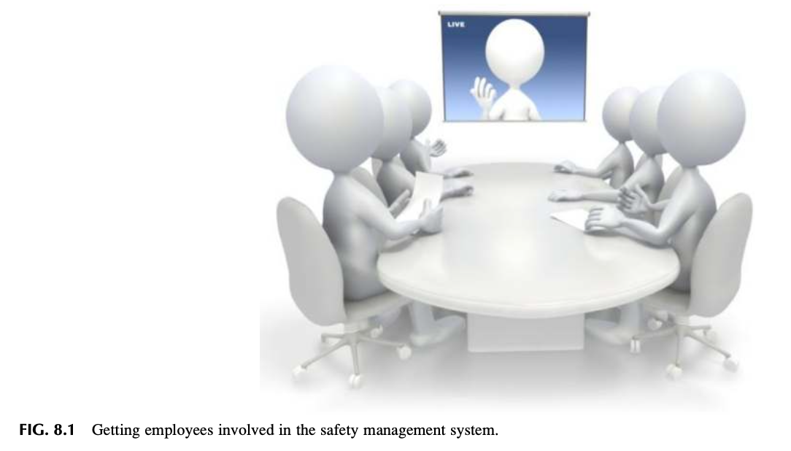
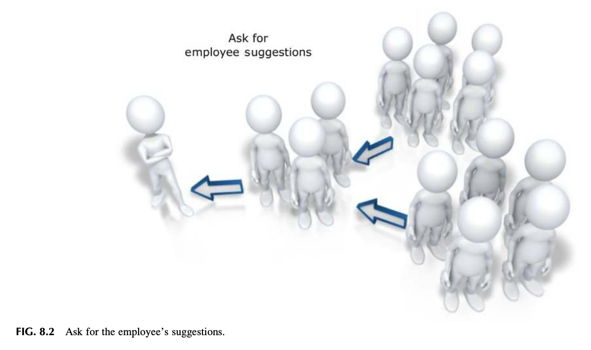
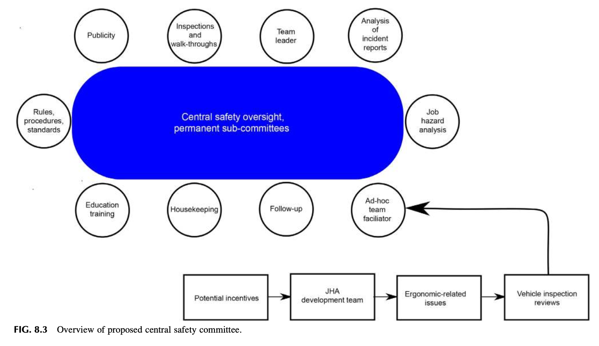
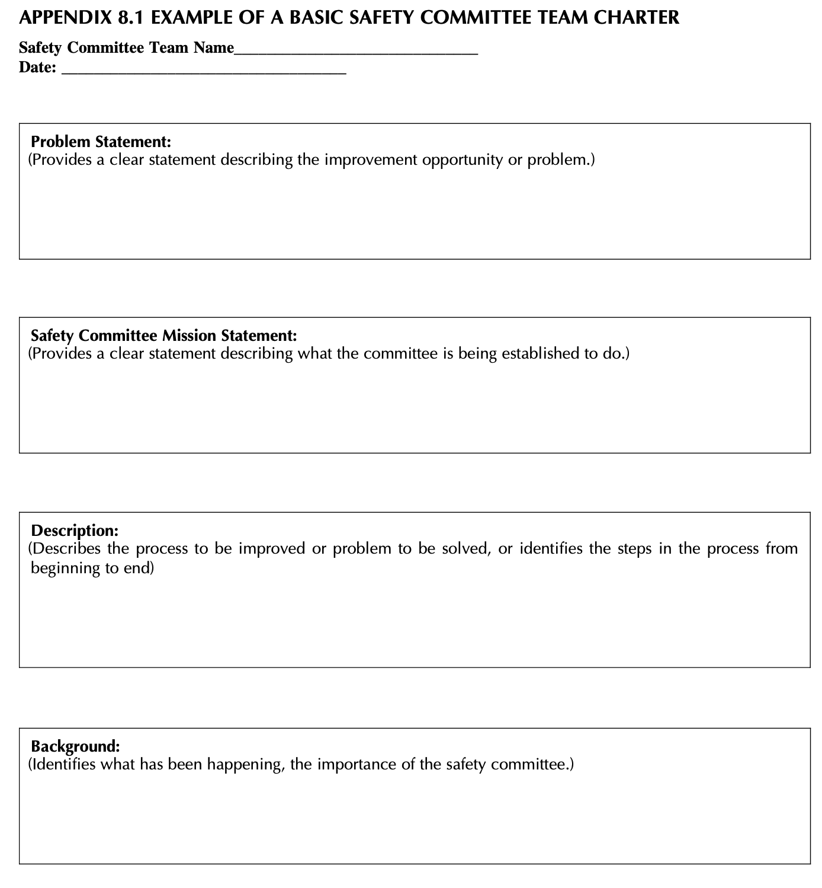
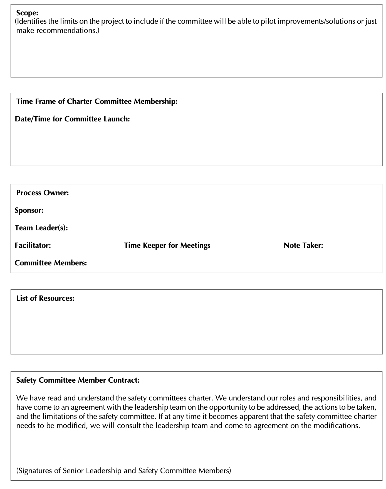
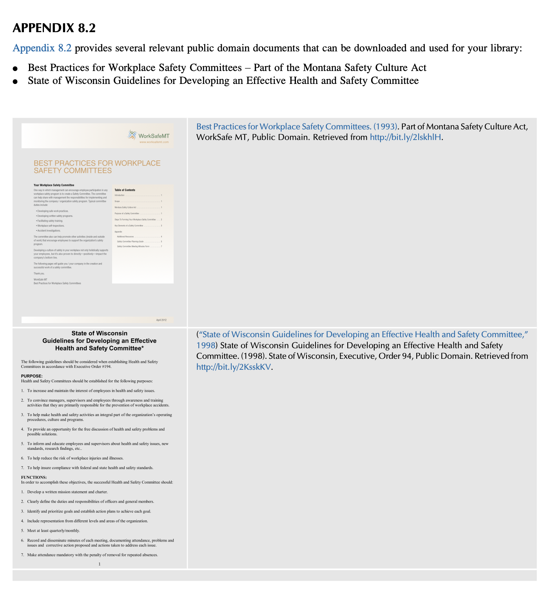

# Chapter 8 Getting Employee Involvement in the Safety Management System (안전경영시스템에서 직원 참여 유도) 서브노트

> *"훌륭한 인재로 시작하라. 규칙을 명확히 제시하라. 직원들과 소통하라. 그들에게 동기를 부여하고 보상하라. 이 모든 것을 효과적으로 수행한다면 결코 실패하지 않을 것이다."*  
> — **리 아이아코카 (Lee Iacocca)**

---

## INTRODUCTION (도입)

안전 전문가는 조직의 나머지 구성원들과 단절된 고립된 상태에서 안전경영시스템(SMS)이나 문화적 문제를 해결할 필요가 없으며, 그렇게 해서도 안 됩니다. 효과적인 안전문화의 핵심 요소는 바로 **안전경영시스템에 대한 직원의 적극적인 참여(Employee Involvement)**입니다.

### 1. 현장 직원의 독보적 가치와 소통의 필요성

* **가장 가까운 문제 해결사**: 현장 경험이 풍부한 직원은 실제적·잠재적 유해위험요인(Hazards)과 관련 리스크(Risk)에 가장 근접해 있으므로, 안전 문제 해결에서 대체 불가능한 핵심 자원입니다.
* **숨은 위험의 발굴**: 현장에 잠재된 미인지 유해위험요인과 통제되지 않은 리스크를 표면화하기 위해서는 직원의 능동적 위험 보고와 소통이 필수적입니다.
* **상호작용 기반 시스템**: 안전경영시스템은 경영진을 포함한 전 직원의 상호작용에 기반합니다. 개방적이고 긍정적인 소통은 확인된 안전 문제에 대해 훨씬 우수한 해결책을 도출할 가능성을 높입니다.
* **해결책의 주체로서의 직원**: 긍정적 관계가 확장될 때 직원은 '무관심하거나 통찰력이 없는 관찰자'가 아니라 **'안전 문제 해결의 핵심 주체'**로 거듭나게 됩니다.

### 2. 제8장 핵심 학습 목표 (6가지)

본 장을 학습한 후 안전 전문가는 다음 6가지 핵심 과제를 논의하고 실행할 수 있어야 합니다:

1. **직원이 안전경영시스템에 참여해야 하는 당위성 설명** (*Discuss why employees should be involved in the safety management system*)
2. **직원 참여를 위한 표준 가이드라인 파악** (*Discuss the guidelines for employee involvement*)
3. **안전 프로세스 효과성에 관한 현장 통찰을 얻는 최선의 방법 식별** (*Identify the best method to get employee insights on the effectiveness of the safety process*)
4. **직원들이 안전 프로세스 참여를 꺼리거나 거부하는 근본 원인 분석** (*Discuss why employees may not want to be involved in the safety process*)
5. **안전위원회(Safety Committee)의 구조와 상설 분과위원회(Permanent Subcommittees) 운영 원리 이해** (*Discuss the structure of a Safety Committee and its permanent subcommittees*)
6. **특별 임무팀(Ad Hoc Subcommittees)의 개념과 효과적 실행 방안 규명** (*What are “Ad Hoc” subcommittees and how are they effectively implemented*)

---

## WHY SHOULD EMPLOYEES BE INVOLVED? (왜 직원이 참여해야 하는가?)

### 1. 경영진의 관점과 현장 실행 간의 간극

경영 리더십 팀은 비전, 미션, 목표를 수립하여 조직을 이끌지만, 수많은 책무 속에서 직원들이 매일 업무를 수행하는 데 필요한 구체적 단계와 세부 과업을 간과하기 쉽습니다.
* **JHA 수립 시 나타나는 현실 괴리**: 저자들이 다양한 기업의 작업위험성평가(JHA)를 지원할 때 공통적으로 발견한 사실은 **"경영진이 현장에서 이루어지고 있다고 믿는 작업 방식과, 실제 현장에서 작업자가 수행하는 작업 방식 간에 현격한 차이가 존재한다"**는 점이었습니다.

### 2. 현장 비공식 노하우와 미통제 위험 수용의 문제

* 직원은 직무 단계와 작업을 직접 수행하므로 작업상 위험에 직접 노출되어 있습니다.
* 직원은 과업 완수 요령은 알지만, 내재된 특정 위험을 학술적·체계적으로 표현하지 못할 수 있습니다.
* 직원은 오랜 경험과 구전(Word of mouth)을 통해 자신들만의 **비공식적인 위험 회피 방법**을 만들어 사용할 수 있으며, 이는 경영진이나 안전 전문가와 공유되지 않습니다.
* 심지어 많은 경우, 통제되지 않은 유해위험요인과 리스크를 **"어쩔 수 없는 내 일의 일부(Part of their job)"**로 체념하고 수용해 버립니다.

### 3. 직원 참여를 유도하는 4대 기본 조치

1. **안전 노력에 직원을 직접 동참시키기** (Involving employees in safety efforts)
2. **경험 많은 직원을 안전 이슈, 위험성평가, 사고 조사의 '문제 해결사'로 정중히 초빙하기** (Inviting experienced employees to become problem-solvers)
3. **작업위험성평가(JHA) 검토 및 완성 과정에 직원을 참여시키기** (Involving employees in reviewing and completing JHA)
4. **직원들이 자신의 아이디어와 개선 제안을 자유롭게 제시하도록 격려하기** (Encouraging employees to offer ideas and suggestions)

---

## REASONS EMPLOYEES ARE NOT INVOLVED IN THE SAFETY PROCESS (직원이 참여하지 않는 이유)

직원 참여를 이끌어내려면, 직원이 **왜 참여할 수 없거나 참여를 꺼리는지** 그 근본 원인부터 되짚어보아야 합니다.

> **[그림 8.1 설명: 안전경영시스템에 직원 참여 유도]**  
> 회의실 원형 테이블에 둘러앉아 화상 화면("LIVE")을 통해 공유되는 리더의 발표와 안건을 함께 경청하고 토론하는 다기능 팀원들의 모습을 보여줍니다. 안전관리는 한 사람의 일방적 지시가 아니라, 다양한 부서의 구성원이 동등한 테이블에 모여 소통하는 참여형 프로세스여야 함을 시각화합니다.

> **[그림 8.2 설명: 직원들의 제안을 직접 요청하기]**  
> 좌측에 서 있는 리더가 직원들에게 제안을 요청하자, 화살표를 따라 개별 직원의 의견이 모이고 소그룹에서 대규모 직원 집단으로 참여 네트워크가 연쇄적으로 확산되는 구조를 보여줍니다. "직원에게 직접 물어보라(Ask for employee suggestions)"는 단순한 출발이 전사적 참여 네트워크를 형성하는 기폭제가 됨을 상징합니다.

### 1. 참여 부재의 주된 원인: 안전에 대한 조직의 편협한 인식

* **공식 프로세스의 부재**: 직원이 공식적으로 의견을 개진하고 참여할 수 있는 제도적 창구가 마련되어 있지 않습니다.
* **생산성 저해 요소로의 오인**: 조직이 안전을 '생산성을 방해하는 걸림돌' 또는 '내 본업과 무관한 부차적 일'로 인식합니다.
* **법적 규제 대응 중심의 한계**: 안전 활동이 법적 의무 사항이나 물리적 규정 준수에만 국한되어 있어, 직원이 주도적으로 참여할 여지가 차단됩니다.

### 2. 개인보호구(PPE) 의존의 맹점과 통제 계층(Hierarchy of Controls)

안전에 대한 부정적 인식이 팽배한 조직에서는 보호구 선정이 구매 예산 부서의 단순 행정 업무로 전락하여, 현장 작업자의 적합성 검토나 올바른 착용 교육 없이 방치됩니다.
* **보호구 착용 거부의 본질**: 직원이 PPE를 제대로 착용하지 않는 현상은 직원의 태만 이전에, **안전 프로세스에 직원이 참여하지 못하고 있다는 명백한 반증**입니다.
* **통제 계층(Hierarchy of Controls) 준수**: 보호구는 제거, 대체, 공학적 통제, 행정적 통제 등 상위 통제 방안을 모두 검토한 후 최후의 수단(Final line of defense)으로 제공되어야 합니다.

> [!CAUTION]
> **보호구(PPE)에 대한 경고**:  
> PPE는 결코 모든 안전 문제의 만병통치약이 아닙니다. 많은 관리자가 손쉬운 해결책이라는 이유로 PPE 지급을 '기본값(Default solution)'으로 삼지만, 이는 근본 위험을 가리는 위험한 접근입니다. 진정한 안전경영시스템은 PPE 너머의 시스템적 통제를 지향해야 합니다.

### 3. 현장 관찰 사례: 권위주의적 처방의 실패 (Observation 1)

* **사례 1: 안구 이물질 사건과 과잉 보호구 교체**  
  공장에 안구 부상 이력이 전무했음에도 한 직원의 눈에 먼지가 들어간 사건이 발생하자, 경영진은 즉시 기존 보안경을 전량 폐기하고 고가의 신형 안경으로 일괄 교체했습니다. 이물질은 작업 위험이 아닌 단순 환경 먼지였으며, 직원의 의견 수렴이나 위험성평가는 전혀 없었습니다. 결과적으로 안전 문제가 아닌 일에 엉뚱한 강제 조치가 내려졌습니다.
* **사례 2: 다목적 칼 부상과 전사 사용 금지 조치**  
  직원이 다목적 작업칼(Utility knife)을 사용하다 다리를 베이자, 근본 원인(Root cause) 조사도 없이 전사에서 모든 작업칼 사용을 전면 금지했습니다. 해당 도구는 특정 생산 공정에 필수적이었으므로 작업 차질과 생산 병목이 발생했고, 안전에 대한 직원들의 인식은 극도로 부정적으로 악화되었습니다.

> **시사점**: 위 두 사례 모두 직원을 평가 과정에 참여시키지 않고 상명하달식 권위주의(Authoritarian) 처방을 강제했습니다. 이러한 환경에서 직원은 안전 문제 해결에 참여할 의지를 완전히 상실하게 됩니다.

### 4. 직원 경청의 힘과 80/20 법칙 (Listen to Employees)

가장 단순하지만 가장 강력한 접근법은 **"직원의 말을 그냥 경청하는 것(Just listen)"**입니다. 이는 현재 안전 프로세스의 실행 가능성을 파악하는 가장 정직한 통로입니다.

* **현장 교훈 (Lesson Learned 1: James의 80/20 법칙)**:  
  사고 조사나 안전 면담 시 **"시간의 80%는 직원의 말을 경청하고, 질문과 발언은 20%만 한다"**는 원칙을 고수했습니다. 직원이 모든 사실관계를 편안히 털어놓을 때 비로소 손실 사건의 잠재적 근본 원인에 도달할 수 있었습니다.
* **경계: 일방적 정보 쏟아붓기 (Information Dump)**:  
  관리자가 자신이 얼마나 많이 알고 있는지를 과시하듯 일방적으로 말을 쏟아내는 행태는 상호 학습을 즉각 차단하고 직원의 참여를 가로막습니다.
* **언어 분석: "우리(We)" vs "그들(They)" (Daniel Pink & Robert Reich)**:  
  직원들이 대화 중 **"우리(We)"**라는 단어를 사용하면 자신이 의미 있는 조직의 일원이라고 느끼고 있음을 뜻하며, **"그들(They)"**이라는 표현을 쓰면 조직과의 괴리(Disengagement) 및 소외(Alienation)가 진행되고 있음을 나타냅니다.

---

## GETTING EMPLOYEES INVOLVED IN THE SAFETY PROCESS (직원 참여 활성화 방안)

"내 방식대로 안 하려면 나가라(My way or the highway)"는 독선적 접근은 현장의 **은밀한 저항(Hidden resistance, 사보타주)**이나 **수동적 순응(Passive acceptance, 틀린 지시라도 맹목 복종)**을 낳아 건설적 대화를 파괴합니다.

### 경영진이 신뢰를 회복하는 6대 가시적 행동
1. 안전한 근무 환경을 유지하겠다는 **서면 정책을 공식 천명**하고, 이를 뒷받침하는 구체적 행동 실천
2. 직원들의 기대사항을 파악하기 위한 **1:1 대면 면담** 실시
3. 직원들에게 **구체적인 안전 책임** 부여
4. 할당된 안전 책임을 완수할 수 있도록 **충분한 시간, 예산, 자원 배분**
5. 직원들의 안전 제안과 위험 보고를 **진지하게 수용**
6. 안전 제안이 신속히 검토·실행되거나, 지연/반려될 경우 **타당한 사유를 반드시 피드백**하는 제안 관리 체계 구축

---

## GUIDELINES FOR EMPLOYEE INVOLVEMENT (직원 참여 표준 가이드라인)

작업 규칙과 절차 개발에 직접 참여한 직원은 자신이 수립에 기여한 아이디어를 지키려는 강한 주인의식(Personal stake)을 갖습니다 (OSHA 건설업 안전보건 권장지침, 2016).

### 전사적 직원 참여 촉진 12대 가이드라인
1. 사업장 안전 이슈의 진행 상황을 직원들에게 **정기적으로 투명하게 소통**함.
2. 직무와 관련된 구체적 안전 프로그램 및 필수 정보에 **완전한 접근 권한**을 부여함.
3. 위험성평가 방법, 우선순위 결정, 교육 기준, 안전경영시스템 평가 기법을 직원들에게 **체계적으로 교육·숙지**시킴.
4. 부상, 응급처치, 아차사고, 신규 유해위험요인을 보고할 수 있는 **신뢰성 있는 보고 프로세스**를 정립함.
5. 직원이 제안한 안전 권고사항에 대해 **신속하고 성실하게 응답**함.
6. 직원이 직접 통제할 수 있는 구체적 위험의 발굴 및 **제거 조치에 직원을 직접 동참**시킴.
7. 작업장 안전 규칙의 제정 및 개정 과정에 **직원을 필수 참여**시킴.
8. 신규자, 전입자, 기존 숙련자 모두에게 **사업장 맞춤형 현장 안전 교육**을 제공함.
9. 안전 회의 자료의 개발 및 **발표 과정에 직원이 주도적으로 참여**하도록 함.
10. 구성원 간 상호작용을 통해 서로를 돌보는 **팀 접근법(Team approach)**을 정착시킴.
11. 사업장 순회 점검 및 안전 진단에 **관리자-직원 합동 점검팀**을 구성함.
12. 안전위원회 및 특별 위원회 활동에 참여할 수 있도록 **공식적인 근무 시간과 자원을 보장**함.

---

## “JUST ASK” EMPLOYEES TO GET INVOLVED (직원에게 "그냥 물어보라")

가장 단순하지만 가장 자주 간과되는 최선의 방법은 바로 **"직원들에게 안전 프로세스에 참여하고 싶은지 직접 물어보는 것(Just ask)"**입니다. 강제 동원이 아닌 자발적 지원자(Volunteers)로 참여할 때 진정한 몰입이 생깁니다.

> **[현장 교훈: James의 다문화 사업장 참여 유도 (Lesson Learned 2)]**  
> 한 공장장이 "직원들의 참여를 위해 온갖 노력을 다했지만 아무도 나서지 않는다"고 토로했습니다. James가 "직원들에게 직접 물어본 적이 있는가?"라고 묻자 공장장은 "없다"고 답했습니다. 해당 공장은 영어가 서툰 다문화 근로자가 많아 언어 장벽을 우려해 직접 묻지 못했던 것입니다. James와 공장장이 현장으로 나가 서툰 영어로 "안전 문제 해결에 함께 참여하겠는가?"라고 직접 묻자, 직원들은 압도적으로 **"예(YES)!"**라고 화답하며 적극 참여하기 시작했습니다.

---

## SIMPLE BEGINNINGS CAN GENERATE AN IMPACT (단순한 출발이 만드는 거대한 파급력)

참여를 네트워크(Network) 관점에서 바라보면, 소수의 열성적인 직원으로부터 시작된 긍정적 평판과 신뢰의 '밈(Meme)'이 조직 전체로 급격히 전파될 수 있습니다.

### 1. 안전위원회(Safety Committee)의 본질과 실패 원인

안전위원회는 직원 참여의 핵심 구심점입니다. 그러나 신중한 기획 없이 구성될 경우, 안전문화 개선은커녕 불평불만만 늘어놓는 **'푸념의 장(Gripe session)'**으로 전락할 위험이 큽니다.

**안전위원회가 흔히 겪는 9대 문제점:**
1. 명확한 방향성과 존재 이유 부재 (헌장, 구조, 일정 결여)
2. 경영진의 정기적 참석 및 관심 부재
3. 회의 시간을 통제할 체계적 안건(Agenda) 미사용
4. 회의가 정체되어 새로운 학습 기회를 제공하지 못함
5. 논의가 구체적 의사결정이나 실행 계획(Action plan)으로 이어지지 않음
6. 팀 경험이나 관심이 전혀 없는 인원을 자의적으로 선발
7. 위원들의 잦은 불참과 무성의한 태도
8. 위원장의 리더십 및 회의 진행 역량 부족
9. 회의 안건과 결과 회의록이 전사에 신속히 공유되지 않음

### 2. 안전위원회의 효과적 운영 원칙
* **타 부서 성공 위원회 벤치마킹**: 품질위원회(Quality Committee) 등 기존에 잘 작동하는 위원회의 서식, 헌장, 운영 방식을 차용하여 시행착오를 줄입니다.
* **다양성 확보를 통한 집단 의사결정**: 전사 각 부서의 다양한 직군이 참여할 때 광범위한 공감대(Buy-in)와 창의적 문제 해결이 가능해집니다.
* **한계와 예외 (IDLH 상황)**: 생명과 건강에 즉각적 위험(IDLH)이 발생하는 긴급 사태는 위원회의 토론 대상이 아니며, 즉각적인 현장 작업 중지와 시정 조치가 우선되어야 합니다. 위원회는 사후 재발 방지 분석을 담당합니다.
* **책임 대체 불가 원칙**: 안전위원회는 자문 기구(Advisory team)이며, **안전한 작업 환경을 유지해야 하는 최고경영진의 법적 책임과 책무성을 절대 대신할 수 없습니다.**

---

## ESTABLISHING THE TEAM CHARTER (팀 헌장의 수립)

안전위원회가 표류하지 않고 지속성을 가지려면 위원회의 목적, 권한, 범위를 규정하는 **팀 헌장(Team Charter)**이 반드시 수립되어야 합니다.

> **프로젝트 헌장의 정의 (Charter, 2018)**:  
> 프로젝트의 범위, 목표, 참가자를 공식 규정하는 문서로서, 역할과 책임을 명시하고 핵심 이해관계자를 식별하며 관리자의 권한을 정의하여 프로젝트의 향후 권한 기준이 되는 문서입니다.

* **살아있는 문서(Living Document)**: 헌장은 경영진과 위원회 초기 멤버가 공동으로 작성하며, 환경 변화에 따라 주기적으로 검토·수정됩니다.
* **헌장 수립을 위한 13대 핵심 질문 (Turner & Turner, 1998)**:
  1. 위원회의 본질적 목적은 무엇인가?
  2. 위원회의 권한, 책무성, 책임 범위는 어디까지인가?
  3. 성공 여부를 어떤 지표로 측정할 것인가?
  4. 위원회의 최고 후원자(Sponsor/Champion)는 누구인가?
  5. 구성원은 누구이며, 임기는 얼마인가?
  6. 위원회 리더십은 어떻게 선출하고 순환할 것인가?
  7. 반드시 준수해야 할 구체적 마감 기한은 무엇인가?
  8. 회의 주기와 위원들의 참여 허용 시간은 얼마인가?
  9. 회의를 개최하기 가장 적합한 시간대는 언제인가?
  10. 회의 장소는 어디인가?
  11. 위원회에 배정된 예산은 얼마인가?
  12. 어떤 자원과 외부 자문 전문성이 필요한가?
  13. 위원회의 보고서와 결정사항을 전사에 어떻게 소통할 것인가?

> [!WARNING]
> **목적 전치(Mission Creep) 경고 (Roughton & Crutchfield, 2016)**:  
> 팀이 실패하는 가장 큰 원인은 초기 헌장이 지나치게 모호하기 때문입니다. 헌장이 모호하면 위원회가 의도치 않은 영역으로 침범하거나, 자신들의 권한 범위를 오인하여 현장 관리자 및 타 부서와 심각한 마찰을 빚게 됩니다.

---

## CHOOSING SAFETY COMMITTEE MEMBERS & SUB-COMMITTEES (위원 선발 및 분과위원회 구성)

### 1. 스노우볼 추천 방식 (Observation 2)
James는 위원을 선발할 때 직원들에게 훌륭한 위원이 될 동료를 추천하게 하고, 추천받은 직원이 또 다른 직원을 추천하도록 하는 **연쇄 추천(Snowball endorsement)** 방식을 사용했습니다. 이는 현장 비공식 소셜 네트워크를 활용하여 위원회의 신뢰와 영향력을 자연스럽게 전파하는 탁월한 방법입니다.

### 2. 위원회 3대 핵심 진행 역할
회의가 효율적이고 시간 내에 완결되도록 모든 회의마다 다음 3가지 역할을 명확히 지정합니다:
1. **위원장 (Chair)**: 회의를 주재하고 안건 진행을 조율하며 과업을 위임함 (위원 간 순환 보직 권장).
2. **서기 / 기록원 (Secretary / Notes Keeper)**: 모든 논의 사항과 결정된 실행 계획, 마감 시한을 회의록으로 기록 관리함.
3. **시간 관리자 (Time Keeper)**: 회의가 정해진 시작 및 종료 시간을 엄격히 준수하도록 관리함.

---

> **[그림 8.3 상세 설명: 제안된 중앙 안전위원회 및 분과·특별위원회 아키텍처]**  
> * **중앙 푸른색 영역 (Central safety oversight, permanent sub-committees)**: 안전위원회의 컨트롤 타워로서 전체 안전 활동을 총괄하고 상설 분과위원회의 조율을 담당합니다.
> * **원형 노드 (8대 상설 분과위원회 및 역할)**: 중앙 테이블 주변으로 홍보(Publicity), 현장점검(Inspections and walk-throughs), 팀 리더(Team leader), 사고보고 분석(Analysis of incident reports), JHA(Job hazard analysis), 규정·절차·기준(Rules, procedures, standards), 교육훈련(Education training), 정리정돈(Housekeeping), 후속조치(Follow-up), 특별팀 촉진자(Ad-hoc team facilitator)가 유기적으로 둘러싸고 있습니다.
> * **하단 사각 노드 (Ad-hoc 특별 임무팀 연계)**: 특별팀 촉진자의 지원을 받아 안전 인센티브(Potential incentives), JHA 개발팀(JHA development team), 인간공학 과제(Ergonomic-related issues), 차량점검 검토(Vehicle inspection reviews) 등 특정 단기 프로젝트가 유연하게 구성되어 운영됩니다.

---

### 3. 8대 상설 분과위원회 (Permanent Sub-Committees)

중앙 위원회의 업무 과중을 방지하고 전문성을 살리기 위해 구체적 과업을 상설 분과위원회로 분산 위임합니다.

1. **홍보 분과 (Publicity)**: 안전 메시지와 서브노트의 핵심 가치를 전사에 홍보하고, 다양한 매체를 통해 위원회의 활동과 성과를 긍정적으로 전파함.
2. **점검 및 현장 순회 분과 (Inspections and Walk-Throughs)**: 시설과 현장 순회 점검을 조율하고, 체크리스트를 표준화하며, 미흡 사항이 개선될 때까지 후속조치 분과와 협력함.
3. **사고 보고서 분석 분과 (Analysis of Incident Reports)**: 손실 사건 보고서의 정확성을 검토하고, 근본 원인이 제대로 규명되었는지 평가하며, 리스크 관리·법무·보험 부서와 긴밀히 공조함.
4. **작업위험성평가 분과 (Job Hazard Analysis, JHA)**: 각 직무의 JHA가 최신 상태로 유지되도록 갱신을 주도하고 잔여 위험이 통제되고 있는지 지속 감시함.
5. **규정, 절차 및 기준 분과 (Rules, Procedures, and Standards)**: 안전 수칙을 명확하고 일관성 있게 제·개정함.
   * **[경계 사례: 35페이지 규칙 책의 함정 (Observation 3)]**: 한 회사는 부상이 발생할 때마다 원인을 수칙으로 추가하여 35페이지에 달하는 거대한 '안전 규칙 책'을 만들었습니다. 사고가 나면 과거 규칙 위반 여부만 찾아 직원을 처벌하는 **'징벌용 성경(Disciplinary Bible)'**으로 악용되었고, 안전문화는 파탄에 이르렀습니다. 규칙은 처벌 도구가 되어서는 안 됩니다.
6. **교육 및 훈련 분과 (Education and Training)**: 신규 입사자 오리엔테이션 및 정기 안전 교육의 품질을 감독하고 최신 교육 기법을 제공함.
7. **정리정돈 분과 (Housekeeping)**: 쾌적하고 질서 있는 작업 환경을 유지하기 위해 자재 적치, 통로 확보, 폐기물 관리를 점검하고 올바른 현장 습관을 유도함.
8. **후속 조치 분과 (Follow-Up)**: 안전 관련 유지보수 작업의뢰서(Work Order)의 이행을 감독함. 정비 기술자와 관리자가 참여하여 의뢰인과 함께 현장을 실사하고 개선 완료 시 **의뢰인과 위원이 상호 서명(Sign-off)**하여 종결함.

### 4. 특별 임무팀 (Ad Hoc Committees)

장기 위원회 활동에 부담을 느끼는 직원들을 위해, **단기적이고 특정한 프로젝트**를 전담하는 한시적 특별팀을 구성합니다.
* **주요 운영 분야**: 인간공학적 개선, 안전 인센티브 제도 설계, 업무용 차량 안전 점검, 특정 공정 JHA 집중 개발, 소방 방호 진단, SMS 특정 지침 개정 등.

---

## BEST PRACTICES & SUMMARY (우수 사례 및 요약)

* 안전위원회와 분과위원회는 경영진과 현장 직원 사이의 정보가 막힘없이 흐르도록 하는 **핵심 소통 파이프라인(Conduit for communication)**입니다.
* 전사 각 부서에서 선발된 직원들의 풍부한 현장 지식은 안전경영시스템의 행정적 품질을 비약적으로 끌어올립니다.

---

## CHAPTER REVIEW QUESTIONS (장별 복습 질문 8문항)

1. **직원이 안전경영시스템에 참여해야 하는 근본적인 이유는 무엇인가?**  
   ➔ 현장 작업자가 실제 위험에 가장 가까이 노출되어 있고 구체적인 업무 절차를 가장 잘 알고 있어, 경영진이 알지 못하는 숨겨진 위험과 비공식적 위험 회피 관행을 양성화할 수 있는 대체 불가능한 문제 해결사이기 때문입니다.
2. **직원들이 안전 프로세스 참여를 꺼리거나 거부하는 이유는 무엇인가?**  
   ➔ 공식적 참여 창구 부재, 안전을 생산성 저해 요소로 보는 조직 문화, 과거 제안 시 부정적 피드백을 받은 경험, 그리고 권위주의적인 일방적 처벌 위주의 대응 때문입니다.
3. **직원 참여를 개선하기 위해 경영진이 취해야 할 구체적 조치는 무엇인가?**  
   ➔ 서면 안전 정책의 모범적 실천, 1:1 경청 대화, 구체적 안전 책임 부여, 충분한 시간과 예산 지원, 제안에 대한 성실하고 신속한 피드백 제공입니다.
4. **안전위원회 회의를 효율적으로 관리하기 위한 3대 핵심 리더십 역할은?**  
   ➔ 회의를 주재하고 안건을 이끄는 위원장(Chair), 논의와 실행 계획을 기록하는 서기(Notes Keeper), 회의 시간을 통제하는 시간 관리자(Time Keeper)입니다.
5. **안전경영시스템을 지원하기 위해 운영할 수 있는 상설 분과위원회의 종류는?**  
   ➔ 홍보, 점검/현장순회, 사고보고 분석, JHA, 규정/절차/기준, 교육훈련, 정리정돈, 후속조치(유지보수 완료 서명) 등 8대 분과입니다.
6. **특별 임무팀(Ad Hoc Subcommittees)이란 무엇이며 그 목적은?**  
   ➔ 장기 위원회 참여 부담을 덜고 직원의 특정 전문성을 활용하기 위해, 특정 프로젝트(인간공학, 인센티브, 차량 점검 등)를 한시적으로 수행하도록 구성된 팀입니다.
7. **안전 우려사항에 대한 직원의 의견을 경청하는 것이 왜 중요한가?**  
   ➔ 현장 프로세스의 실현 가능성을 파악하는 가장 정직한 방법이며, 직원이 조직의 중요한 주체("We")로서 신뢰감을 형성하게 만들기 때문입니다 (80/20 법칙).
8. **직원 참여 가이드라인에 명시된 핵심 요소들을 나열하라.**  
   ➔ 정기적 상태 공유, 안전 정보 완전 접근권, 위험평가 기법 교육, 신뢰할 수 있는 보고 체계, 신속한 제안 응답, 작업수칙 제정 동참, 현장 합동 점검, 공식 참여 시간 보장 등입니다.

---

## APPENDIX 8.1 BASIC SAFETY COMMITTEE TEAM CHARTER (기본 안전위원회 팀 헌장 서식)

### [부록 8.1 서식 표준 템플릿]

* **안전위원회 팀 명칭 (Safety Committee Team Name)**: __________________________________
* **작성 일자 (Date)**: ____________________
* **문제 진술문 (Problem Statement)**:  
  *(개선 기회 또는 해결하고자 하는 현장 안전 문제를 명확히 기술)* __________________________________
* **안전위원회 미션 선언문 (Safety Committee Mission Statement)**:  
  *(위원회가 달성하고자 설립된 근본 목적을 구체적으로 기술)* __________________________________
* **프로세스 설명 (Description)**:  
  *(개선할 프로세스나 해결할 문제의 처음부터 끝까지의 단계 기술)* __________________________________
* **추진 배경 (Background)**:  
  *(그동안 발생한 상황 및 안전위원회의 필요성과 중요성 기술)* __________________________________
* **활동 범위 (Scope)**:  
  *(위원회의 한계 명시: 독자적으로 개선책을 시범 적용할 권한이 있는지, 아니면 권고안만 제출하는지 명시)* __________________________________
* **위원 임기 (Time Frame of Charter Committee Membership)**: ____________________
* **위원회 출범 일시 (Date/Time for Committee Launch)**: ____________________
* **프로세스 소유자 (Process Owner)**: ____________________
* **후원자/챔피언 (Sponsor)**: ____________________
* **팀 리더/위원장 (Team Leader)**: ____________________
* **촉진자 (Facilitator)**: ____________________
* **시간 관리자 (Time Keeper)**: ____________________
* **기록원/서기 (Note Taker)**: ____________________
* **위원회 위원 명단 (Committee Members)**: __________________________________
* **가용 자원 목록 (List of Resources)**: __________________________________
* **안전위원회 위원 서약서 (Safety Committee Member Contract)**:  
  > *"우리는 안전위원회 헌장을 충분히 읽고 이해했습니다. 우리는 우리의 역할과 책임을 인지하고 있으며, 다루어야 할 개선 기회, 실행 조치, 위원회의 한계에 대해 경영 리더십 팀과 완전히 합의했습니다. 활동 중 헌장의 수정이 필요하다고 판단될 경우, 언제든지 경영진과 협의하여 수정에 합의할 것을 서약합니다."*  
  *(최고경영진 및 안전위원회 위원 서명 날인란)*

---

## APPENDIX 8.2 PUBLIC DOMAIN RESOURCES (공공 자료 참고문헌)

부록 8.2에서는 안전위원회 구축 시 실무적으로 즉시 활용할 수 있는 미국 주정부의 공공 도메인 지침 자료 2건을 제공합니다:

1. **몬태나주 직장 안전위원회 우수사례 지침 (Best Practices for Workplace Safety Committees)**  
   * 몬태나주 안전문화법(Montana Safety Culture Act, 1993/2018)의 일환으로 WorkSafe MT에서 발간한 실무 가이드라인. 위원회 구성 절차, 회의 운영 양식 수록.
2. **위스콘신주 효과적 보건안전위원회 개발 가이드라인 (State of Wisconsin Guidelines for Developing an Effective Health and Safety Committee, 1998)**  
   * 위스콘신주 행정명령 94호에 따른 주정부 공식 지침. 위원회의 7대 목적, 7대 기능(헌장 수립, 분기별 회의, 회의록 전파, 출석 의무화 등) 규정.

---

## BIBLIOGRAPHY (참고문헌)

* Best Practices for Workplace Safety Committees. (1993). Part of Montana Safety Culture Act. WorkSafe MT.
* Best Practices for Workplace Safety Committees (2018). State of Montana.
* Charter. (2018). Dictionary.com.
* Managing Worker Safety and Health. (2016). Illinois OSHA Onsite Safety & Health Consultation Program.
* Pink, D. H. (2011). *Drive: the surprising truth about what motivates us*. Penguin Group US.
* Recommended Practices for Safety & Health Programs in Construction. (2016). Occupational Safety and Health Administration (OSHA).
* Roughton, J., & Crutchfield, N. (2013). In B. Heinemann (Ed.), *Safety culture: an innovative leadership approach*. Butterworth-Heinemann.
* Roughton, J., & Crutchfield, N. (2016). *Job hazard analysis: a guide for voluntary compliance and beyond* (2nd ed.). Elsevier/Butterworth-Heinemann.
* State of Wisconsin Guidelines for Developing an Effective Health and Safety Committee. (1998). State of Wisconsin, Executive Order 94.
* Turner, L., & Turner, R. (1998). *How to grow effective teams and run meetings that aren’t a waste of time*. Ends of the Earth Learning Group.
