# Chapter 9 Defining Risk Perception (위험 지각의 정의) 서브노트

> *"당신은 아는 것만을 본다." (You only see what you know.)*  
> — **알베르트 아인슈타인 (Albert Einstein)**  
> 
> *"주사위에는 기억력이 없다. 그것들은 언제나 매 순간 변화한다." (Dice have no memory; they change all of the time.)*  
> — **CSI TV 시리즈**  
> 
> *"판단 또한 시간에 따라 변화한다. 어제 용인되었던 것이 오늘과 내일에는 용인되지 않을 수 있다."*  
> — **물라이 (Mullai, 2006)**  
> 
> *출처: Safety Culture (Elsevier, 2019, pp. 187-204), PART III How to Handle the Perception of Risk, Chapter 9*  
> *DOI: https://doi.org/10.1016/B978-0-12-814663-7.00009-1*

---

## 1. INTRODUCTION (도입)

심층적이고 지속 가능한 안전문화(In-depth Safety Culture)를 구축·유지하기 위해서는 **위험(Risk)과 그 통제(Control)에 대한 올바른 이해가 조직 전체에 깊이 스며들어야(Permeate)** 합니다. 안전 전문가는 경영 리더십 팀에게 조직적 리스크(Organizational Risk)에 대한 완전한 평가와 깊이 있는 이해를 제공해야 할 책무가 있습니다.

### 1.1 전통적 점검·관찰 중심 SMS의 한계
* **잠재 리스크 연계 결여의 맹점**: 안전경영시스템(SMS)이 단순한 현장 점검(Inspections)과 행동 관찰(Observations)에만 의존하여 유해위험요인(Hazards)을 식별하는 데 그친다면, 그 결과를 잠재적인 운영 리스크(Operational Risk) 및 위험 리스크(Hazard Risk)와 직접 연계하지 못해 부상과 물적 피해의 잠재력을 온전히 파악할 수 없습니다.
* **창발적 속성(Emergent Property)으로서의 안전**: 안전은 조직의 모든 측면과 상호작용에서 비롯되는 '창발적 속성'입니다. 작업 환경의 미세한 변화에 대한 끊임없는 관심과 모니터링이 없다면, 손실 유발 사건(Loss-producing events)의 발생 확률은 점진적으로 증가하여 결국 통제 불능 상태로 치닫게 됩니다.
* **사후 약방문식 인식의 탈피**: 유해위험요인과 관련 리스크의 진정한 규모와 심각성은 실제로 손실 사건이나 중대 사고가 터진 후에야 비로소 밝혀지는 경우가 너무나 흔합니다.

```mermaid
flowchart TD
    subgraph Traditional["전통적 사후 대응 패러다임"]
        T1["손실 미발생<br/>(No Loss)"] --> T2["위험 부재로 착각<br/>(No Risk Perception)"]
        T2 --> T3["잠재 위험의 만성화/누적"]
        T3 --> T4["💥 대형 손실 사건 발생<br/>(Loss-Producing Event)"]
        T4 --> T5["사후적 위험 규모 인지<br/>(뒤늦은 수습)"]
    end
    subgraph Modern["선제적 리스크 기반 패러다임 (제9장 제안)"]
        M1["전 직원 리스크 개념 교육<br/>(Risk Education)"] --> M2["위험성평가 + 위험 식별 결합<br/>(Assessment + Identification)"]
        M2 --> M3["노출 시점의 즉각적 위험 소통<br/>(Communication at Exposure)"]
        M3 --> M4["상호 합의된 통제책 실행<br/>(Agreed Risk Control)"]
        M4 --> M5["🛡️ 안전문화의 질적 도약<br/>(Emergent Safety Culture)"]
    end
```

### 1.2 전 직원 리스크 교육을 통해 해결되는 2대 핵심 과제
모든 구성원에게 위험(Risk)의 학술적·실무적 개념을 교육하면 위험성평가(Risk Assessment)를 유해위험요인 발굴과 결합하여 운용할 수 있는 튼튼한 토대가 마련되며, 다음 두 가지 중대한 문제를 선제적으로 해결할 수 있습니다:
1. **위험 지각의 근본적 전환**: *"손실을 유발한 사건이 발생하지 않았다면 위험도 존재하지 않는다"*는 그릇된 맹신을 타파하고, 잠재적 위험의 실재성을 직시하도록 지각을 바꿉니다.
2. **노출 시점의 위험 소통 획기적 개선**: 현장 통제 장치가 비효과적이거나 기능이 저하·열화(Degraded)되었을 때, 위험에 노출되는 바로 그 접점(Point of exposure)에서 상호 소통과 보고가 즉각적으로 이루어지도록 만듭니다.

### 1.3 리스크 기반 접근법(Risk-based Approach)의 본질적 가치
* **소통과 합의의 장(Format) 제공**: 위험성평가 프로세스는 유해위험요인 관련 우려와 잠재 위험에 대해 노사가 동등한 테이블에서 논의하고 상호 합의(Agreement)에 도달하도록 돕는 공식적 틀을 제공합니다.
* **직원의 선제적 경고 권한 부여**: 직원이 자신의 일상 업무 중 특정 측면에서 위험에 처해 있다고 판단될 때, 경영진에게 주저 없이 경고할 수 있는 공식 통로를 열어줍니다.
* **근로자의 자발적 위해 노출 차단**: 높은 부상 잠재력이 엄연히 도사리고 있음에도 "나는 안전하다"고 맹신한 채 위험천만한 작업을 묵묵히 강행하다가 스스로를 위험에 빠뜨리는 파국을 방지합니다.

### 1.4 제9장 8대 핵심 학습 목표
본 장을 학습한 후 안전 전문가는 다음 8가지 핵심 과제를 설명하고 실행할 수 있어야 합니다:
1. 직원들이 불필요한 위험(Unnecessary risk)을 감수하는 근본 원인 설명.
2. 사후 손실(Loss) 중심에서 선제적 위험(Risk) 중심으로 초점이 전환되어야 하는 당위성 설명.
3. 부상률(Injury rates, TCIR)이 위험의 정확한 척도가 될 수 없는 이유 설명.
4. 위험 안내 도구(Risk Guidance Tool)의 활용 원리 및 사용 개념 설명.
5. '유해위험요인(Hazard)'과 '리스크(Risk)' 용어의 엄밀한 정의.
6. 위험 안내 도구가 위험의 범위(Scope)와 심각도(Severity)를 소통하는 데 기여하는 방식 설명.
7. 위험 수용도/내성(Risk Tolerance)의 개념과 그로 인한 잠재적 문제점 설명.
8. 체계적인 위험성평가가 안전문화를 실질적으로 개선하는 메커니즘 이해.

---

## 2. RISK MANAGEMENT CONCEPTS (위험관리 개념)

위험관리(Risk Management) 개념은 고위험 산업(항공, 화학, 원자력, 해양 등)에서 수년 동안 옹호되고 활용되어 왔습니다.

### 2.1 전통적 규제 준수 프로그램의 한계와 위험관리의 정의
* **기존 프로그램의 후진성**: 대다수 일반 기업의 안전 프로그램은 여전히 법적 규제 준수(Regulatory compliance)를 중심으로 설계되어 있으며, 초보적인 위험 원칙만을 제한적으로 적용한 채 철저히 '손실 발생 후 데이터(Post-loss data)'에 의존하고 있습니다.
* **위험관리의 정의**: 조직 내에 잠재된 유해위험요인을 식별하기 위한 다양한 기법들의 체계적인 적용(Systematic application of an array of techniques)과, 그에 내재된 고유 위험(Inherent risk)에 대한 정밀 평가를 결합한 종합적 관리 체계입니다.

### 2.2 조직 내 위험 소통과 통합
* **양방향 소통 채널(Open Line of Two-way Communication)의 필수성**: 조직의 전반적인 위험 범위(Scope of risk)에 관한 정보를 효과적으로 공유하기 위해서는 상하좌우를 관통하는 열린 소통망이 필수적입니다.
* **명확성과 객관성**: 위험관리 프로세스의 본래 취지는 경영 리더십 팀과 현장 직원 모두에게 명확히 정의되고, 객관적이며 정확하게 전달되어야 합니다.
* **전사적 통합**: 안전시스템이 제 기능을 발휘하고 조직의 잠재적 위험 수준을 전사적으로 파악하기 위해서는 위험관리 요소가 조직의 모든 하위 구성 요소(Component)에 유기적으로 스며들어야 합니다.

---

## 3. RISK (리스크의 정의와 패러다임 전환)

### 3.1 ANSI/AIHA/ASSE Z10 표준에 따른 리스크 정의
미국 국가표준인 ANSI/AIHA/ASSE Z10(Occupational Health & Safety Management Systems, 2012)에서 규정한 리스크의 학술적·실무적 정의는 다음과 같습니다:

> **리스크(Risk)의 정의**:  
> *"유해위험 사건 또는 노출(들)이 발생할 **발생가능성(Likelihood)**과, 그 사건 또는 노출에 의해 야기될 수 있는 부상이나 질병의 **심각도(Severity)**의 조합에 대한 추정치."*  
> *(“An estimate of the combination of the likelihood of an occurrence of a hazardous event or exposure(s), and the severity of injury or illness that may be caused by the event or exposures.”)*

* **우선순위 수립(Prioritizing)**: 리스크 분석 개념은 수많은 작업장 위험 요소들 중에서 어떤 사건을 먼저 통제해야 하는지 객관적인 우선순위를 확립하는 표준화된 방법론을 제공합니다.

### 3.2 안전 지각의 패러다임 전환 (Shift in Perception)
* **손실 정보에서 리스크 데이터로**: 단순히 과거에 몇 명이 다쳤는지를 집계하는 사후 손실 정보(Loss information)에만 매달리는 좁은 시야에서 벗어나, 작업장에 상존하는 리스크 데이터(Risk data)를 적극적으로 포함하도록 안전에 대한 지각을 재지향(Redirect)해야 합니다.
* **예방 잠재력의 극대화**: 위험 지각이 근본적으로 전환될 때, 위험관리는 안전시스템의 가장 견고한 초석이 되며 손실 유발 사건을 최소화할 수 있는 강력한 실행 잠재력을 갖추게 됩니다 (Mishap Prevention Program, 2011).

---

## 4. WHY ARE UNNECESSARY RISK TAKEN? (왜 불필요한 위험을 감수하는가?)

### 4.1 위험의 무형성과 인간의 과거 경험 의존성
* **무형적이고 은폐된 위험**: 위험은 무형적(Intangible)이며 작업 환경의 복잡한 구조와 일상적 맥락 속에 교묘하게 숨겨져(Hidden in the fabric of the work environment) 있습니다.
* **과거 편향(Built-in Affinity to Past Experiences)**: 인간은 유해위험요인과 마주했을 때, 현재 눈앞의 물리적 잠재 위험을 객관적으로 분석하기보다는 **"자신의 과거 경험이나 역사에 기반하여 현재 환경을 바라보는 타고난 성향"**을 보입니다.
* **결과 중심적 착각**: 과거에 유사한 위험 상황에서 작업을 강행했음에도 아무런 사고나 문제가 발생하지 않았다면, 작업자는 '미래의 손실 발생 잠재력(Existing potential)'이 아니라 **'과거에 얻었던 긍정적 결과(Previous consequences)'**에 근거하여 위험한 행동을 반복하게 됩니다.

### 4.2 선제적 위험 식별 프로세스의 필요성
안전경영시스템(SMS)은 유해위험요인과 관련 리스크를 식별하는 프로세스를 반드시 포함해야 합니다. 이러한 프로세스의 구조는 기존의 잠재적 위험뿐만 아니라 새롭게 발생하는 잠재 위험을 지속적이고 선제적으로 식별(Continuous proactive identification)하고, 손실 유발 사건의 잠재적 심각도를 평가하는 구체적 기법들을 갖추어야 합니다.

### 4.3 위험의 일상화(Normalization of Risk)와 집단 동조
* **위험의 영구적 수용**: 많은 유해위험요인이 시간이 흐름에 따라 일상화(Routine)되고, 조직의 영구적인 일부로 자연스럽게 수용되며 통제됩니다.
* **위험 감수를 찬양하는 문화**: 어떤 조직 문화에서는 위험을 무릅쓰는 행위를 '비즈니스를 수행하는 당연한 방식(Part of doing business)', '전통적 삶의 방식', 혹은 '자신의 능력과 용기를 증명하는 수단'으로 칭송하고 찬양(Celebrate or embrace)하기도 합니다.
* **동조 압력과 소속감 유지**: 작업자 개인은 잠재적 위험을 감지하더라도, 동료 집단의 일원으로 남기 위해(To remain considered part of the group) 부상 위험이 엄연히 존재함을 알면서도 타인의 위험한 행동 방식을 그대로 모방하고 추종하게 됩니다.

### 4.4 '일 끝내기 밈(Meme)'의 활성화와 전파
* **밈(Meme)의 개념**: 제3장(Analyzing and Using Your Network)에서 정의된 바와 같이, 문화적 정보 단위이자 모방을 통해 뇌에서 뇌로 전파되는 행동 양식입니다.
* **기계 끼임 사례를 통한 밈의 작동**:
  * 한 작업자가 가동 중인 기계에 걸린 이물질을 제거하기 위해 작동을 멈추지 않고 손을 집어넣었는데 운 좋게 다치지 않았다고 가정해 봅시다.
  * 이때 해당 작업자의 뇌에서는 **"공정을 멈추지 않고 일을 빨리 끝내는 것(Getting the job done)"**이라는 밈이 강력하게 활성화됩니다.
  * 이 밈은 공정을 일시 중단시키는 '안전한 행동 절차'를 완전히 압도해 버립니다.
  * 이후 이 위험 감수 밈은 즉각적인 작업 환경 네트워크를 타고 주변 동료들에게 급속도로 복제·확산(Spread and influence)됩니다.

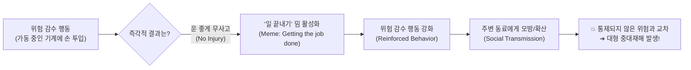

> *"사람들의 위험에 대한 관점과 가치 판단은 고정된 것이 아니라, 처한 상황과 맥락에 따라 끊임없이 변화한다."*  
> — **물라이 (Mullai, 2006)**

### 4.5 무사고로 인한 위험의 은폐(Masking)와 임계점
위험을 감수했는데도 나쁜 결과가 발생하지 않으면, 인간은 결과를 전혀 고려하지 않고 그 행동을 반복하는 경향이 있습니다. **즉각적인 사고가 없었다는 우연한 사실이 잠재적 위험을 은폐(Masked)하고 행동을 강화**하는 것입니다. 그러나 이러한 위험 행동들이 계속 누적되다 보면, 결국 어느 시점에서 통제되지 않은 유해위험요인과 교차(Cross with uncontrolled hazards)하게 되며, 돌이킬 수 없는 부상, 파괴, 손실 사건으로 폭발하게 됩니다.

---

## 5. LESSON LEARNED 1 (교훈 1: 인쇄기 롤러 청소와 위험 수용의 함정)

### 5.1 신문 윤전기 인쇄기 청소 중상 사고
한 동료 안전 전문가가 들려준 실화입니다. 신문 인쇄 공장에서 한 작업자가 빠르게 회전하는 롤러에 걸레를 손에 감아 쥔 채 기계를 닦고 있었습니다. 관리자가 위험성을 지적하자 작업자는 이렇게 대답했습니다:  
> **"내가 이 일을 수십 년 동안 해왔지만, 한 번도 걸린 적이 없어요!!" (I’ve done this for many years and never been caught!!)**

그러나 그 말을 뱉은 지 얼마 지나지 않아, 작업자의 손은 회전하는 롤러 사이로 순식간에 말려 들어갔고 심각한 영구적 손 압착 손상을 입었습니다.

### 5.2 인쇄업계의 왜곡된 마인드셋: "손가락 없는 인쇄공"
저자 제임스(James)가 인쇄 산업에 처음 발을 들였을 때, 노련한 인쇄기 오퍼레이터들은 입을 모아 다음과 같이 코멘트하곤 했습니다:  
> **"진짜 훌륭한 인쇄공은 손가락 하나쯤은 없는 법이지." (A good printer always has a missing finger.)**

수많은 조직이 과업을 완수할 때 위험을 감수하고 부상을 입을 수 있는 잠재력을 '당연한 것'으로 수용하고 있었습니다. 제임스가 그 업계에 몸담았던 수년 동안, 조직 내부에서 위험을 수용하는 이 왜곡된 마인드셋은 결코 변하지 않았습니다.

### 5.3 부정적 결과의 부재로 강화되는 위험 행동
위험 감수 행동이 부정적인 결과 없이 반복될 때, 그 행동은 지속적으로 강화(Reinforced)됩니다:
* **운전 중 산만 행동**: 운전하면서 음식을 먹고, 휴대폰을 들여다보고, 라디오 주파수를 바꾸고, 뒷좌석으로 손을 뻗는 행위는 십중팔구 아무 일도 일어나지 않기 때문에 계속 반복됩니다.
* **운전 중 문자메시지 전송**: 수많은 자동차 사고를 유발함에도 대다수 운전자는 여전히 "운전 중 문자 전송이 위험하다는 건 운전이 미숙한 다른 사람들에게나 해당되는 이야기"라고 착각합니다.

### 5.4 과업 요구조건에 대한 무비판적 순응
과업의 근본 요구조건을 제대로 이해하지 못하면 "아무 문제 없이 굴러가고 있으니 더 이상 질문하거나 조사할 필요가 없다"고 지각하게 됩니다. 눈에 보이는 문제가 없다고 해서 그것이 가장 안전하고 최선의 작업 방식인 것은 아닙니다. 특정한 작업 단계나 동작의 위험성을 온전히 이해하지 못하더라도, 현장의 방식은 아무런 의심이나 질문 없이 끊임없이 반복 수행됩니다.

---

## 6. QUESTIONING ATTITUDE (질문하는 태도)

> *"가장 중요한 것은 질문을 멈추지 않는 것이다. 호기심은 그 자체만으로도 존재할 이유를 지닌다."*  
> — **알베르트 아인슈타인 (Albert Einstein)**

### 6.1 "Stop when Unsure" (확신이 없으면 멈춰라) 밈의 제도화
어떤 작업이나 활동이 진정 안전한지 의심이 들거나, 유해위험요인이 완전한 통제 하에 있지 않다고 느낄 때, 위험을 감지한 작업자가 작업을 즉시 멈추고 도움을 요청할 수 있도록 허용하는 조직적 밈, 즉 **"확신이 없을 때는 멈춰라(Stop when Unsure)"**라는 행동 양식을 제도화해야 합니다 (Concepts and principles, 2009).
* **관행의 악순환 단절**: 특정 상태에 대해 확신이 서지 않을 때 스스로 멈출 수 있는 공식 절차를 마련하면, *"원래 우리 현장은 다 이렇게 해왔어(The way things are done around here)"*라는 안일한 수용의 악순환 고리를 끊어낼 수 있습니다.
* **상황 인식의 유지**: 이를 위해 작업의 매 순간 조건과 환경에 대한 경각심을 유지하며 던지는 **"질문하는 태도(Questioning Attitude)"**가 절실히 요구됩니다.

---

### [그림 9.1 & 표 9.1 분석] 질문하는 태도 개발 및 위험 점수화 절차

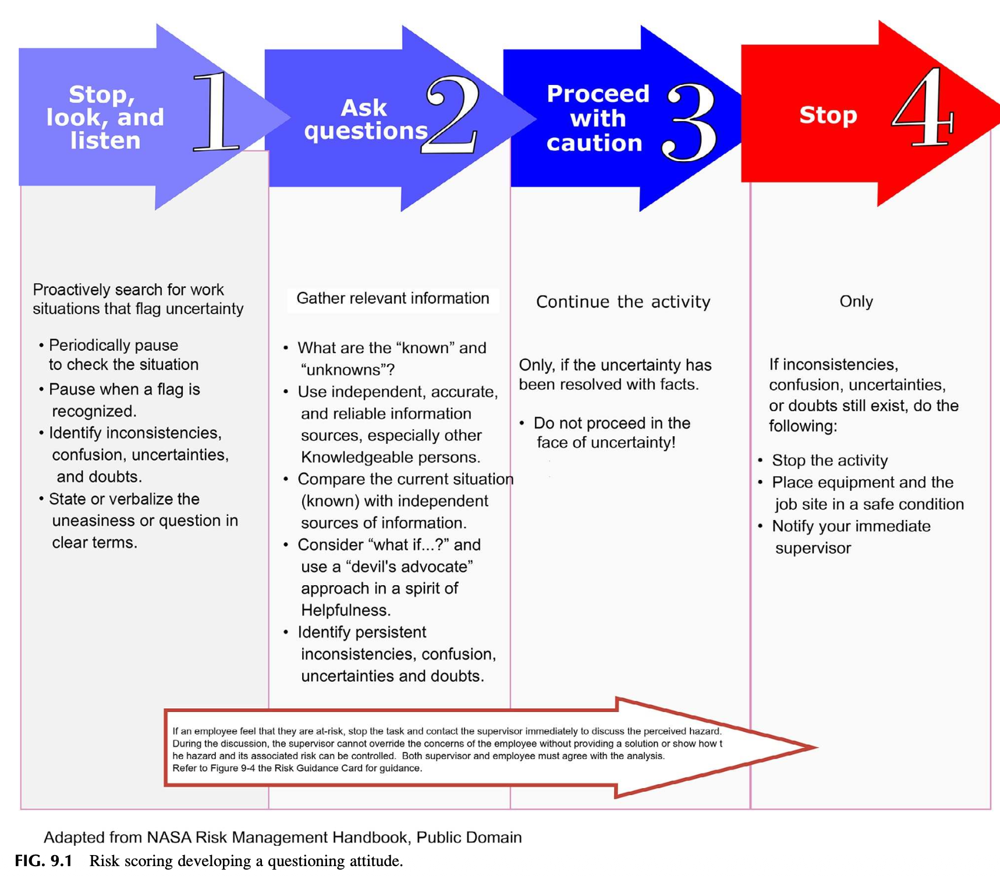

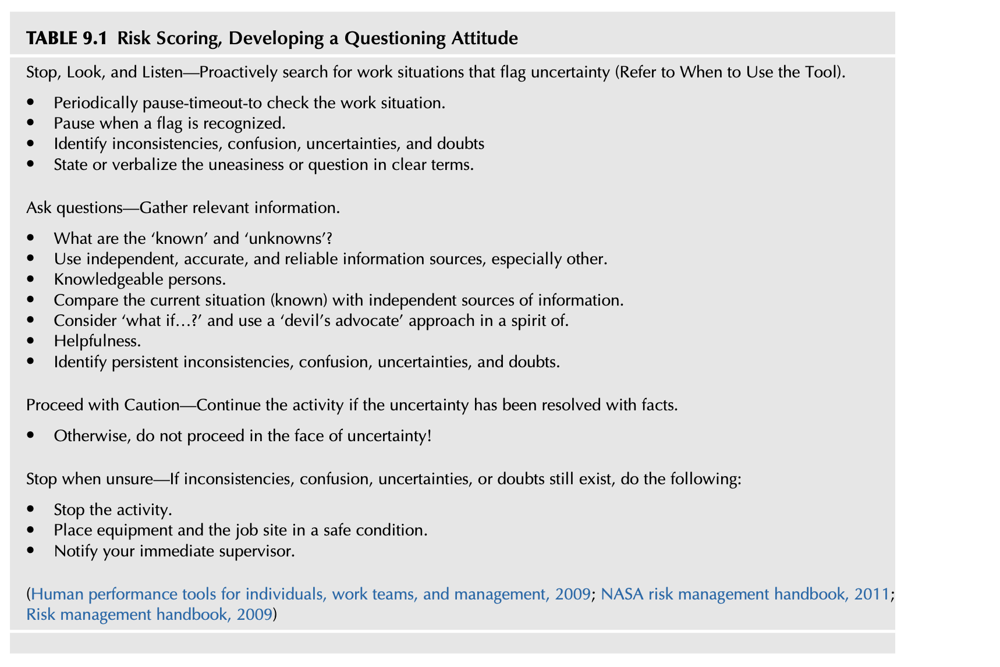

> ### 🔍 [그림 9.1 및 표 9.1 정밀 상세 분석]
> 
> * **출처 및 배경**: 미국 항공우주국(NASA Risk Management Handbook, 2011), 미 에너지부(Human Performance Tools for Individuals, Work Teams, and Management, 2009), 미 연방항공청(FAA Risk Management Handbook, 2009)의 인간 수행도 향상(HPI) 도구를 바탕으로 개발되었습니다.
> * **구조적 메커니즘**: 현장 작업자가 작업 도중 불확실성이나 위험을 감지했을 때 밟아야 하는 **4단계 순차적 행동 프로세스**를 시각화하고 있습니다.
> 
> | 단계 번호 | 단계 명칭 | 핵심 행동 요령 및 점검 체크리스트 | 행동 분기 기준 |
> | :---: | :--- | :--- | :--- |
> | **Step 1** | **Stop, Look, and Listen** (멈추고, 보고, 경청하라) | • 불확실성을 알리는 위험 징후(Flag)가 있는 작업 상황을 능동적으로 탐색함. • 작업 상황을 점검하기 위해 주기적으로 잠시 멈춤(Pause / Time-out)을 가짐. • 위험 플래그가 인식되면 즉시 행동을 멈춤. • 불일치(Inconsistencies), 혼란(Confusion), 불확실성(Uncertainties), 의구심(Doubts)을 구체적으로 식별함. • 마음속의 불안감이나 의문점을 명확한 언어로 소리 내어 표현(State or verbalize)함. | 징후 포착 시 Step 2로 진행 |
> | **Step 2** | **Ask Questions** (질문하라) | • 관련 정보를 체계적으로 수집함. • **'이미 알고 있는 것(Known)'**과 **'알지 못하는 것(Unknowns)'**이 무엇인지 명확히 분류함. • 독립적이고 정확하며 신뢰할 수 있는 정보 출처, 특히 현장의 전문 지식을 갖춘 타 구성원들의 지혜를 활용함. • 현재 상황(Known)을 객관적 정보 출처와 꼼꼼히 비교 대조함. • 동료를 돕겠다는 건설적 지원의 정신(Spirit of helpfulness)으로 **"만약 ~라면 어떨까?(What if...?)"**라는 악마의 변호인(Devil's advocate) 접근법을 구사함. • 지속되는 불일치, 혼란, 불확실성, 의구심을 명확히 식별함. | 사실 규명 여부에 따라 분기 |
> | **Step 3** | **Proceed with Caution** (주의를 기울이며 진행하라) | • **오직 불확실성이 객관적 사실(Facts)에 근거하여 명백하게 해소되었을 때에만 작업을 계속 진행함.** • ⚠️ **불확실성이 상존하는 상태에서는 절대로 작업을 진행하지 말 것!** | 불확실성 해소 시에만 제한적 허용 |
> | **Step 4** | **Stop** (즉시 전면 중단하라) | • 질문과 조사 후에도 불일치, 혼란, 불확실성, 의문이 조금이라도 남아있다면 다음 조치를 즉각 실행함: 1. **작업 활동을 즉각 중단(Stop the activity)할 것.** 2. **장비와 작업 현장을 안전한 상태(Safe condition)로 조치해 둘 것.** 3. **직속 관리감독자(Immediate supervisor)에게 즉시 보고할 것.** | 잔여 의문 시 강제 중단 |
> 
> * **🚨 하단 절대 원칙 (골든 룰 - Non-Override Rule)**:  
>   그림 하단의 붉은 화살표 박스는 관리자와 작업자 간의 소통 원칙을 강력하게 규정합니다:  
>   *"직원이 자신이 위험에 처해 있다고 느낀다면 작업을 중단하고 즉시 감독자에게 연락하여 위험을 논의해야 한다. 논의 과정에서 **감독자는 명확한 해결책을 제시하거나 유해위험요인과 관련 리스크가 확실히 통제될 수 있음을 객관적으로 입증하여 보여주지 않고서는 직원의 우려를 일방적으로 묵살하거나 무효화(Override)할 수 없다.** 작업이 재개되기 위해서는 감독자와 직원 양측 모두가 분석 결과에 상호 합의해야만 한다."*

### 6.2 안전문화의 자가 진단 질문
안전문화의 강도를 측정하는 핵심 척도 중 하나는 조직이 자신의 실제 운영 상태를 얼마나 자각하고 있는가입니다.  
> **근본적 반성 질문**:  
> *"어째서 현장 직원들 대다수가 이미 뻔히 알고 있으면서도 전혀 고쳐지지 않던 위험천만한 환경을, 외부에서 방문한 제3자가 들어와서 지적해야만 비로소 개선되는 것인가?"*

---

## 7. BUILDING THE FOUNDATION FOR RISK PERCEPTION (위험 지각의 기초 구축)

### 7.1 풀뿌리 수준(Grassroots Level) 개인 도구의 필요성
* **기존 위험평가 도구의 관리자 중심 한계**: 일반 산업계에서 사용하는 대부분의 위험성평가 도구는 고위 경영진의 관리 도구로만 취급되어 현장 직원을 직접적·즉각적으로 동참시키지 못했습니다.
* **풀뿌리 개인 위험성평가 도구(Personal Risk Assessment Tool)**: 잠재적 위험에 기반하여 현장 작업자가 즉각적인 조치를 결정할 수 있도록 최일선 현장(Grassroots level)에 직접 배치되는 실천적 프로세스여야 합니다.
* **결과(Consequence)의 측정**: 위험성평가를 수행할 때는 위험이 발생했을 때의 결과, 즉 "얼마나 나쁜가(How bad)"를 반드시 측정해야 합니다. 결과는 사건의 발생 결과 또는 잠재적 결과로 정의되며, 단 하나의 사건에도 복수의 연쇄적 결과가 따를 수 있습니다 (A risk matrix for risk managers, 2008).

### 7.2 오리건 OSHA의 인체공학 작업 리스크 점수화 모델
오리건주 산업안전보건청(Oregon OSHA)은 직장 내 인체공학적 위험을 현장 직원이 직접 평가할 수 있는 실용적 기법을 제시했습니다 (Easy ergonomics: A practical approach for improving the workplace, 2017).

---

### [표 9.2 & 표 9.3 분석] 작업 난이도 및 빈도 기반 위험 점수 산출

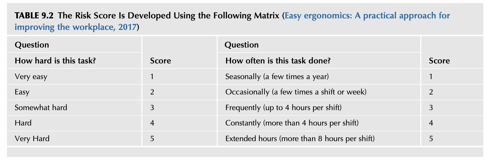

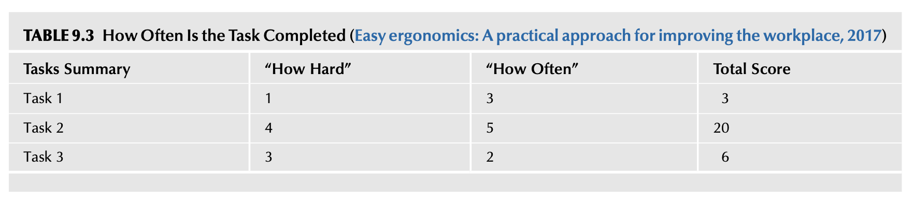

> ### 🔍 [표 9.2 및 표 9.3 정밀 상세 분석]
> 
> * **2차원 평가 체계**:  
>   1. **"이 작업이 얼마나 힘든가 / 신체적 부담이 큰가?" (How hard is this task?)** ➔ 1점~5점  
>   2. **"이 작업을 얼마나 자주 수행하는가?" (How often is this task done?)** ➔ 1점~5점
> 
> #### [표 9.2 매트릭스 채점 기준]
> | 점수 (Score) | 질문 1: 작업 난이도/강도 (How hard?) | 질문 2: 작업 빈도 (How often?) |
> | :---: | :--- | :--- |
> | **1점** | **매우 쉬움 (Very easy)** | 계절적 수행 (Seasonally, 1년에 몇 번) |
> | **2점** | **쉬움 (Easy)** | 가끔 수행 (Occasionally, 근무조당 혹은 주당 몇 번) |
> | **3점** | **다소 힘듦 (Somewhat hard)** | 빈번한 수행 (Frequently, 근무조당 최대 4시간) |
> | **4점** | **힘듦 (Hard)** | 지속적 수행 (Constantly, 근무조당 4시간 초과) |
> | **5점** | **매우 힘듦 (Very hard)** | 연장 시간 수행 (Extended hours, 근무조당 8시간 초과) |
> 
> #### [표 9.3 총점 산출 및 우선순위 적용 예시]
> * **총점 산출 공식**: $\text{Total Score} = \text{How Hard (난이도 점수)} \times \text{How Often (빈도 점수)}$
> 
> | 작업명 (Tasks Summary) | 난이도 점수 ("How Hard") | 빈도 점수 ("How Often") | 총점 (Total Score) | 우선순위 판정 |
> | :--- | :---: | :---: | :---: | :--- |
> | **Task 1** | 1 (Very easy) | 3 (Frequently) | **3점** ($1 \times 3$) | 저위험 유지 |
> | **Task 2** | **4 (Hard)** | **5 (Extended hours)** | **20점** ($4 \times 5$) | 🚨 **최우선 정밀 개선 검토 대상** |
> | **Task 3** | 3 (Somewhat hard) | 2 (Occasionally) | **6점** ($3 \times 2$) | 중위험 관리 |
> 
> * **도구의 장점과 원문의 비판적 고찰**:
>   * **장점**: 관찰과 직원의 주관적 응답을 결합하여 복잡한 계산 없이 직관적으로 우선순위를 즉각 도출할 수 있습니다.
>   * **한계**: 이 방식은 난이도와 빈도만을 곱하므로, **"해당 작업에 내재된 잠재적 부상 심각도(Potential injury severity)"를 전혀 고려하지 못한다는 치명적 결함**이 있습니다. 따라서 전반적인 안전 위험성평가로 확장하기 위해서는 심각도 축이 결합된 매트릭스로 발전해야 합니다.

### 7.3 노사 합동 접근법의 우수성
현장 직원과 리더십 팀이 합동으로 위험성평가를 수행하는 것이 가장 효과적인 접근법입니다:
* 유해위험요인 및 관련 리스크의 식별, 인지, 평가, 통제 전 과정에 걸쳐 직원의 지식과 전문성을 획기적으로 향상시킵니다.
* 표준화된 위험성평가 도구는 개인마다 제각각인 **주관적 위험 지각의 간극(Gap between individual risk perceptions)**을 좁히고 조직적 합의를 형성하는 결정적 가교 역할을 합니다.

---

## 8. HAZARD RECOGNITION TOOLS (유해위험요인 식별 도구)

### 8.1 기존 위험 식별 도구의 종류와 위상
산업 현장에서는 유해위험요인을 파악하기 위해 다양한 기법들이 활용되어 왔습니다:
* **작업위험성평가 (JHA, Job Hazard Analysis)**
* **표준작업절차서 (SOP, Standard Operating Procedures)**
* **위험 사냥 (Hazard Hunting)**
* **직무/과업 분석 (Task Analyses)** 등

### 8.2 기존 도구의 근본적 한계와 극복 과제
* 노출 빈도와 잠재 손실 심각도에 따라 모든 유해위험요인은 저마다 잠재적 리스크 범위를 지닙니다.
* 그러나 기존의 위험 발굴 프로그램들은 운영상의 유해위험요인은 찾아낼지언정, **그것이 내포한 '리스크(Risk)의 정밀 평가'에는 직접적으로 접근하지 못했습니다.**
* 대다수 조직은 여전히 총기록재해율(TCIR), 산재보상 청구 건수 등 사후 손실 통계(Loss assessments)에 기반하여 이들 도구를 형식적으로 운용해 왔습니다. 따라서 실제 현장 상황을 온전히 반영하고 개인 위험성평가 도구를 현장에 안착시키기 위한 근본적 재검토가 필요합니다.

> *"관련 쟁점을 전담하는 전문 안전인력이라 할지라도, 수많은 '수용 가능한 위험(Acceptable risk)'에 대한 의사결정은 언제나 불완전한 정보(Incomplete information) 속에서 내려질 수밖에 없다."*  
> — **클랩 (Klapp, 1992)**

---

## 9. RISK ASSESSMENT TOOL DEFINED (위험성평가 도구의 정의와 특징)

### 9.1 개인 휴대용 위험 안내 카드(Risk Guidance Card)의 개념
본 장에서 제시하는 핵심 위험성평가 도구는 **모든 직원이 주머니에 휴대할 수 있는 소형 카드 형태(Small card carried by all employees)**로 설계된 현장 자가 평가(Self-assessment) 도구입니다.

### 9.2 도구의 3대 핵심 목적
1. 작업 환경에 특화된 고유한 유해위험요인을 현장에서 즉각 **식별(Recognize)**한다.
2. 유해위험요인에 대한 노출 정도와 잠재적 심각성, 그리고 관련된 잠재 리스크를 객관적으로 **분석(Analyze)**한다.
3. 관리 리더십과 함께 해당 위험에 대해 상호 합의된 통제 방안(Mutually agreed-upon risk control)을 **도출(Develop)**한다.

### 9.3 관리자의 인식 전환과 이견(Disagreement)의 수용
* **두려움 없는 위험 보고**: 직원이 불이익에 대한 두려움 없이 자유롭게 위험 문제를 제기할 수 있는 심리적 안전감이 전제되어야 합니다.
* **이견의 가치 인정**: 관리자와 직원 간에 위험 수준에 대한 시각 차이(이견)가 발생하는 것은 지극히 정상적이며 건강한 프로세스의 일부로 수용되어야 합니다.

> *"구성원들이 오직 좋은 소식만을 보고하거나 모두가 동의하는 척 침묵한다면, 조직 내에서 새로운 지식은 훨씬 덜 창출되고 혁신적 발견은 줄어들 수밖에 없다. 가장 효과적인 시스템이 되기 위해서는 **서로 다른 관점, 지식, 전문성을 지닌 다양한 인재들이 참여하는 '도전 프로세스(Challenge process)'**가 반드시 포함되어야 한다."*  
> — **찰스 코크 (Charles G. Koch, 2007)**

### 9.4 상위 에스컬레이션(Escalation) 메커니즘
현장 직원과 직속 관리감독자 간에 위험 등급이나 통제 대책에 대해 합의에 도달하지 못할 경우, **해당 논의는 어떠한 지연이나 방해 없이 차상위 또는 최고 경영 리더십 단계로 즉각 격상(Elevated to a higher level)**되어야 합니다. 위험에 관한 우려가 조직의 계층 구조를 막힘없이 통과하도록 보장하는 것이 시스템의 핵심입니다.

### 9.5 위험 안내 도구의 4대 기본 설계 형식
* **단순 명료한 매트릭스**: 모든 직원이 별도의 복잡한 계산 없이 직관적으로 이해할 수 있는 단순한 위험 매트릭스를 채택함.
* **상시 즉시성**: 작업 전 일상적 점검뿐만 아니라, 이상 징후 발생 시 찰나의 순간에도 즉시 꺼내어 사용할 수 있어야 함.
* **전사적 일관성**: 일선 작업자부터 최고경영자까지 전 조직 계층이 동일한 기준과 척도로 사용함.
* **광범위한 적용성**: 단순 물리적 위험부터 복합 공정 위험까지 광범위한 위험 범주를 포괄적으로 평가할 수 있어야 함.

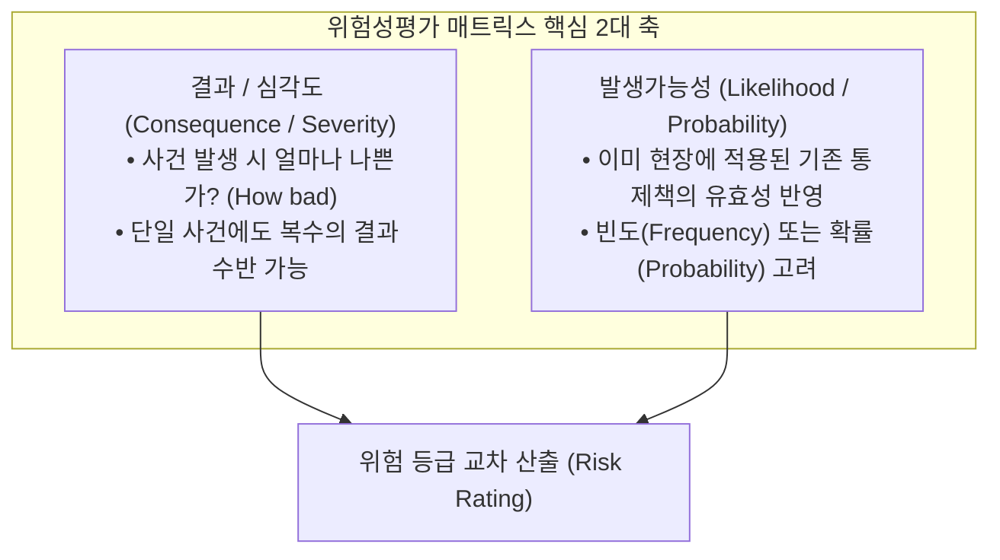

---

## 10. CHANGING PERCEPTIONS (인식의 전환: 손실에서 위험으로)

### 10.1 TCIR 사후 지표의 맹점 탈피
* **총기록재해율(TCIR)의 한계**: 재해율이나 사후 손실 비율은 과거의 이력을 보여주는 지표일 뿐, 조직의 진정한 안전 수준을 측정하는 유일한 잣대가 될 수 없습니다.
* **활동 기반 안전시스템과의 결합**: 선제적 안전 측정을 위해 제11장에서 다루어질 활동 기반 안전시스템(Activity-Based Safety System)의 선행 지표 요소들과 유기적으로 결합되어야 합니다.

### 10.2 일반 대중의 위험 수용성 vs. 작업장 안전의 괴리
* **대중적 위험 수용의 정의**: 피트렐과 바트람(Fewtrell & Bartram, 2001)은 *"위험은 일반 대중에게 수용 가능할 때 비로소 수용 가능하다"*고 언급했습니다.
* **작업장 위험과의 차이점**: 그러나 일반 사회 대중이 일상적으로 감수하는 위험 기준을 기업 조직 내부에 그대로 대입할 수는 없습니다. 대중에게 용인되는 위험이라 할지라도 조직 환경에서는 안전문화를 심각하게 파괴할 수 있으며, 법률 체계와 판례는 통제되지 않은 위험에 대해 기업에 엄중한 법적 책임과 손해배상 의무를 부과하고 있습니다.
* **개인적 위험 수용 성향의 작업장 유입 차단**:
  * 어떤 직원은 퇴근 후 개인 시간에 스카이다이빙, 암벽등반 등 극한의 익스트림 스포츠를 즐기거나, 주말에 안전벨트를 매지 않고 과속 운전을 즐길 수 있습니다.
  * 문제는 이러한 개인적인 고위험 감수 마인드셋(Mind-set of risk acceptance)이 사업장 내부로 여과 없이 유입되는 것입니다.
  * 수용 불가능한 위험을 사전에 원천 차단하는 객관적 제도와 표준 도구가 없다면, 개인의 위험 불감증이 전사적 재앙으로 번질 수 있습니다.

---

## 11. MEETING AND GETTING TO SUSTAINABILITY (지속가능성 확보를 위한 실행 전략)

### 11.1 개인별 주관적 편차를 줄이는 객관적 도구
개인은 저마다 살아온 배경과 과거 경험이 다르기 때문에 동일한 상황 앞에서도 위험을 지각하는 수준이 천차만별입니다. 주관적이고 개인적인 '의견'에만 의존해서는 위험의 진정한 심각성을 평가할 수 없습니다. **표준화된 개인 위험성평가 도구는 개인 간의 위험 지각 격차를 좁혀주는 객관적 기준선(Baseline)**이 됩니다.

### 11.2 리더십의 솔선수범과 네트워크 확산 모델
1. **리더십의 직접 시연**: 중간관리자와 감독자가 현장의 실제 위험을 도구로 직접 평가하고 체험함으로써 도구의 효용성을 스스로 확신하게 만듭니다.
2. **다방향 네트워크 확산**: 리더십 팀이 도구의 가치를 인식하고 적극적으로 강조할 때, 그 가치는 조직 네트워크를 타고 상하좌우 모든 방향으로 급속히 전파됩니다.
3. **소그룹 단위 도입**: 소규모 그룹 단위의 워크숍을 통해 사용법과 실용성을 직접 시연하고, 초기 핵심 그룹의 자발적 공감대(Buy-in)를 확보하여 전사적으로 확산시킵니다.

---

## 12. IDENTIFYING RISK PERCEPTION (조직의 위험 지각 진단 16대 체크리스트)

위험성평가 도구를 현장에 성공적으로 도입하기 위해서는, 조직의 현재 기저 문화와 환경을 진단할 수 있는 다음 16가지 전략적 질문을 면밀히 검토해야 합니다:

| 번호 | 진단 영역 | 핵심 질문 내용 |
| :---: | :--- | :--- |
| **1** | **조직 가치** | 현재 사용 중인 안전 서식과 지침들을 이끄는 조직의 표방 가치(Espoused organizational values)는 무엇인가? |
| **2** | **위험 허용도** | 우리 조직의 전반적인 위험 허용 수준(Risk tolerance)은 어느 정도인가? |
| **3** | **위험 인식** | 조직 내부 구성원들이 위험에 대해 현재 공유하고 있는 이해와 지각 수준은 어떠한가? |
| **4** | **외생 변수** | 일상적인 위험 감수 의사결정에 영향을 미치는 잠재적 조직 요인은 무엇인가? |
| **5** | **변화 피로도** | 지난 24개월 동안 조직에 도입·추진된 프로젝트는 몇 개이며, 직원들은 이를 진정한 개선으로 보는가, 아니면 단명할 **'이달의 유행(Flavors of the month)'**으로 치부하는가? |
| **6** | **저항 극복** | 만약 단명 프로그램으로 인식된다면, 이번 위험 도구가 '이달의 유행'으로 전락하는 것을 막고 저항을 극복할 구체적 전략은 무엇인가? |
| **7** | **도구 충돌** | 최근 타 부서에서 발표된 다른 위험 관련 제도나 서식과 본 도구가 상충되거나 중복되지 않는가? |
| **8** | **수용 태도** | 과거에 도입되었던 유사한 제도들은 현장에서 어떻게 수용되었는가? (열광, 체념적 인내, 소극적 무시, 노골적 적대감 등) |
| **9** | **도입 절차** | 신규 프로젝트는 전사 확대 전에 통상적으로 파일럿 테스트(소규모 사전 검증)를 거치는가? |
| **10** | **과거의 오점** | 과거의 실패했던 기획이나 프로그램이 이번 위험성평가 도구 도입에 부정적 편견(Taint)을 남기지 않았는가? |
| **11** | **네트워크 조력자** | 당신의 사내 네트워크 중 위험성평가 도구의 도입을 가장 강력하게 도와줄 핵심 조력자는 누구인가? |
| **12** | **교육 장애물** | 전 계층 대상 교육을 실행하는 데 있어 가장 큰 현실적 장애물은 무엇인가? |
| **13** | **소통 스타일** | 구성원들의 자발적 수용을 이끌어내기 위해 어떤 형태의 도입 자료와 소통 스타일이 요구되는가? |
| **14** | **가치 전달** | 이 도구가 지닌 실질적 가치를 리더십과 현장 직원들에게 어떻게 가장 설득력 있게 전달할 것인가? |
| **15** | **강제성 여부** | 공식 정책을 통해 본 도구의 사용을 전사적으로 의무화(Mandate)해야 하는가? 의무화가 제도 안착에 득이 되는가, 독이 되는가? |
| **16** | **SMS 호환성** | 본 도구의 사용이 현행 안전경영시스템의 핵심 요소들과 완벽히 조화되고 양립 가능한가? |

---

## 13. OBSERVATION—CAUTIONARY NOTES (관찰—주의사항: 단어 프레이밍의 나비효과)

### 13.1 현장 관찰 사례: 'Rollout' 단어의 부정적 낙인 효과
제임스가 컨설팅을 수행했던 한 조직에서는 신규 안전 프로젝트를 발표할 때 관행적으로 **"롤아웃(Rollout, 전사 배포)"**이라는 단어를 사용했습니다. 그런데 현장 조사 결과, 직원들에게 '롤아웃'이라는 단어는 극도로 부정적인 낙인 효과를 지니고 있었습니다.  
직원의 무의식 속에서 '롤아웃'은 *"또 위에서 반짝하고 사라질 골치 아픈 프로그램(Flavor of the month)이 시작되었구나. 온갖 요란한 활동만 강요하다가 얼마 못 가 흐지부지 사라지겠지"*라는 냉소적 불신을 의미했습니다.

### 13.2 프레이밍(Framing)의 전환과 소통 창구 확보
새로운 프로세스를 지지하고 정착시키기 위해 토론이나 행동을 어떻게 **프레이밍(Framing)**하는가는 현장의 수용성을 결정짓는 절대적 요소입니다. 해당 기업에서는 부정적 어감을 가진 '롤아웃'이라는 단어를 완전히 폐기하고, **'도입/소개(Introduce)'**라는 친숙하고 부드러운 단어로 대체했습니다. 이러한 작은 단어의 변화만으로도 직원들의 적대적 편견을 걷어내고 새로운 시도에 대한 건설적인 대화의 창구를 열 수 있었습니다.

---

## 14. IMPLEMENTING THE RISK ASSESSMENT TOOL (도구의 현장 실행 지침)

> *"아무리 일상적이고 반복적인 작업이라 할지라도, 모든 과업, 훈련, 미션, 운영, 그리고 개인 활동에는 언제나 위험(Risk)이 본질적으로 내재되어 있다."*

### 14.1 업무 부담 가중 금지와 구식 서식의 통폐합
* **단순성의 원칙**: 위험 안내 도구의 도입이 관리자와 직원의 행정적 업무 부담(Burden)을 결코 가중시켜서는 안 됩니다. 형식은 최대한 단순해야 합니다.
* **비효율적 기존 서식 폐지**: 새로운 도구를 도입하기에 앞서, 현재 현장에서 사용 중인 안전 서식과 지침들을 전수 조사하여 **실효성이 없거나 유명무실해진 낡은 서식들을 과감히 폐지하고 본 위험성평가 도구로 통합·대체**해야 합니다. 껍데기뿐인 서식을 없애주는 조치는 현장 직원과 관리자 모두에게 전폭적인 환영을 받으며 신규 제도에 대한 수용성을 비약적으로 높여줍니다.

### 14.2 도구 도입 시 필수 포함 4대 요소
1. 위험 안내 도구의 근본 취지와 지향점에 대한 총괄 개요.
2. '유해위험요인(Hazard)'과 '관련 리스크(Associated Risk)'의 명확한 정의 및 3x3 위험 매트릭스 소개.
3. 작업 현장에서 도구를 언제, 어떻게 사용하는지에 대한 구체적 설명.
4. 개인의 위험 지각 수준을 정립하기 위한 기본 규칙(Ground rules)과, 리더십 및 안전 전문가의 공식 개입이 요구되는 명확한 기준 설정.

### 14.3 지속 가능한 정착을 위한 6대 실행 조치
1. **입사 및 전입 오리엔테이션 반영**: 신규 채용자 및 타 부서 전입자의 온보딩 과정에 도구 사용법 교육을 포함함.
2. **리더십-안전 전문가 합동 발표**: 도입 교육 시 안전 부서 단독이 아니라, 반드시 현장 경영 리더십 구성원이 안전 전문가와 나란히 서서 공동으로 발표함.
3. **최고경영진의 공식 지지 천명**: 도입 세션은 전사 최고경영자(Senior leadership)의 강력한 지지 선언(Endorsement)으로 시작되어야 함.
4. **부서 사일로(Silo) 파괴를 위한 전사 합동 참여**: 경영, 행정, 생산 운영, 정비 보전 등 전 부서가 한자리에 모여 교육을 받음으로써 부서 간 단절(Silo effect)을 허물고 횡적 소통을 활성화함.
5. **동일 정보 공유를 통한 사전 예방 전환**: 경영진과 현장 직원이 완벽히 동일한 정보를 교육받아, 사후 손실 추적에서 사전 예방(Pre-loss effort)으로 조직 역량을 집중함.
6. **현장 순회 시 리더십의 지속적 관심 표명**: 리더십 팀은 일상 회의뿐만 아니라 현장 방문 및 순회 점검 시 작업자들에게 도구의 사용 현황과 개선 사항을 지속적으로 질문함으로써 강력한 지지 의지를 행동으로 각인시킴.

### 14.4 모든 구성원이 매 순간 품어야 할 2대 핵심 화두
* *"과거에는 우리가 늘 일상적으로 해왔던 관행이지만, 오늘날의 기준에서는 더 이상 수용될 수 없는 위험(No longer an acceptable risk)은 무엇인가?"*
* *"정밀한 위험 검토가 시급히 요구되는 우리의 일상적·비일상적 핵심 작업은 무엇인가?"*

> *"판단 또한 시간에 따라 변화한다 — 어제 용인되었던 것이 오늘과 내일에는 용인되지 않을 수 있다."*  
> — **물라이 (Mullai, 2006)**

---

## 15. HAZARD AND RISK DEFINED (유해위험요인과 리스크의 학술적 정의)

현장의 모호한 용어 혼용을 종식시키기 위해 ANSI/AIHA/ASSE Z10 (2012) 표준에 근거한 세 가지 핵심 용어를 엄밀히 정의합니다:

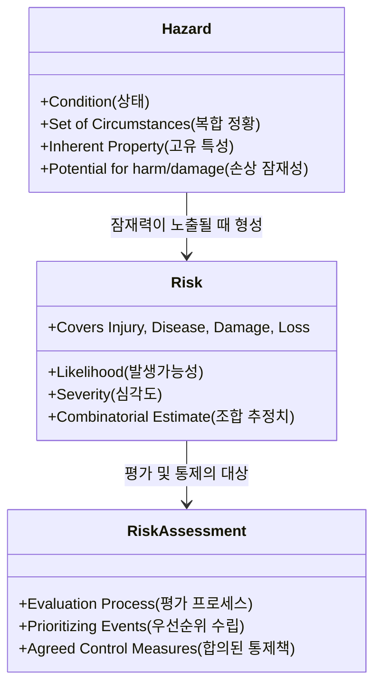

1. **유해위험요인 (Hazard)**:  
   *"부상, 질병 또는 사망을 유발할 수 있는 조건, 정황의 집합, 또는 고유한 물리적 특성."*  
   *(본 장에서는 여기에 물적 피해나 모든 유형의 손실 유발 잠재성을 포함하여 확장함)*
2. **리스크 (Risk)**:  
   *"유해위험 사건이나 노출(들)이 발생할 **발생가능성(Likelihood)**과, 그 사건이나 노출에 의해 야기될 수 있는 부상 또는 질병의 **심각도(Severity)**의 조합에 대한 추정치."*  
   *(본 장에서는 여기에 재산 피해 및 기타 유무형의 모든 손실을 포괄함)*
3. **위험성평가 (Risk Assessment)**:  
   *"유해위험요인 및 시스템적 문제와 연계된 위험의 수준을 체계적으로 평가하는 전반적인 프로세스."*

---

## 16. RISK ACCEPTANCE (위험의 수용 기준과 포괄적 비용)

### 16.1 포괄적 비용 고려와 균형
위험관리는 통제를 아예 적용하지 않는 것부터 제도화하는 것까지 다양한 수준의 통제가 가져올 잠재적 이익과 잠재적 손실 비용을 비교 형량하는 논리적 프로세스입니다 (Mishap Prevention Program, 2011). 그러나 위험의 부정적 결과와 잠재적 이익 사이에서 균형을 맞추는 법을 배워야 합니다.

### 16.2 단순 투자수익률(ROI) 중심 위험 수용의 위험성
* **비용-편익 분석의 오용 경계**: 위험을 수용할 것인가에 대한 의사결정은 **단순한 '투자수익률(ROI)' 기준에만 의존하여 내려져서는 안 됩니다.**
* **포괄적 가치 고려**: 지역사회에 미치는 영향, 소비자, 환경, 법적 책무, 그리고 수많은 무형의 '비용' 요소를 총체적으로 고려해야 합니다.
* **무해성의 논리적 입증**: 식별된 위험에 대해서는 왜 그 위험이 수용 가능한 것으로 간주되는지, 그리고 그 위험 수준이 누구에게도 피해를 주지 않는다는 논리와 평가 근거를 명확히 제시해야 합니다.

---

## 17. LESSON LEARNED 2 (교훈 2: 포드 핀토 연료탱크 폭발 사건)

### 17.1 비용-편익 분석에 의한 위험 수용 결정
포드 자동차 회사(Ford Motor Company)는 소형차 '핀토(Pinto)'의 설계 결함과 관련하여, **설계를 개선하는 비용보다 잠재적인 법적 소송 배상금을 물어주는 것이 회사에 더 큰 이익(비용 절감)을 가져다준다는 비용-편익 분석(Cost-benefit analysis)**에 기반하여 위험을 그대로 감수하기로 결정했습니다.

### 17.2 참혹한 대가와 시사점
포드는 이 냉혹한 결정으로 인해 감당할 수 없을 만큼 값비싼 대가를 치러야 했습니다. 포드 경영진은 인간의 생명을 위협하는 치명적 설계 결함에 대해 내린 냉담한 결정이 자사의 브랜드 가치에 미칠 잠재적 타격과, 일반 대중이 쏟아낼 분노의 규모를 전혀 이해하지 못했습니다 (The top automotive engineering failures: the ford pinto fuel tanks, 2011).

---

## 18. LESSON LEARNED 3 (교훈 3: 다카타 에어백 리콜 지연 사건)

### 18.1 법적 핑계와 리콜 지연
다카타(Takata) 사는 충돌 시 폭발하여 탑승자에게 치명적 금속 파편을 발사하는 결함 에어백에 대해 위험 의사결정을 내렸습니다. 특정 차량 모델이 초기 공식 리콜 목록에 포함되지 않았다는 이유를 대며, 위험성을 알면서도 오랜 기간 동안 에어백 리콜 조치를 고의로 지연시켰습니다 (Clifford Atiyeh, 2015). 결국 다카타 사는 사상 최대 규모의 강제 리콜과 파산, 경영진 형사 처벌이라는 파국을 맞이했습니다.

### 18.2 "손실이 없으면 위험도 없다"는 착각을 깨기 위한 리더십의 6대 핵심 질문
경영진이 과거 사고가 없었다고 해서 위험도 없다고 착각하는 오류를 방지하기 위해, 각 직무 기능마다 다음 6가지 질문을 상시 던져야 합니다:
1. 특정 유해위험요인에 대한 근로자의 노출(Exposure)이 얼마나 자주 일어나는가?
2. 해당 작업이나 직무가 완료되어야 하는 표준 주기와 빈도는 어떠한가?
3. 직무의 개별 세부 단계나 과업을 수행하는 동안 손실 유발 사건이 발생할 확률은 얼마나 되는가?
4. 인간, 작업 활동, 공구, 장비, 자재, 그리고 주변 환경이 복합적으로 결합될 때 발생 가능한 최악의 노출 결과는 무엇인가?
5. 과업을 완수함으로써 얻는 편익과 비교할 때, 모든 잠재적 부정적 결과를 고려한 손실 사건의 총 잠재 비용은 얼마인가?
6. 과업 완료를 통해 얻는 총 편익이 이 모든 잠재적 위험 비용을 진정으로 능가하는가? (Mishap Prevention Program, 2011)

---

## 19. WHY ARE RISK ANALYSIS AND RISK REDUCTION IMPORTANT? (위험 분석 및 위험 저감이 왜 중요한가?)

### 19.1 단순 부상을 넘어선 조직 브랜드와 지속가능성 보호
위험에 대한 평가는 단순히 일선 작업자의 신체적 부상을 막는 차원을 넘어섭니다:
* 설비와 운영에 가해지는 물적 손실
* 제3자(Third parties)에게 미치는 피해
* **기업 조직의 '브랜드(Brand)'와 평판(Reputation)의 파괴**
* 고객 신뢰 상실, 시장 점유율 폭락, 천문학적인 규제 과징금 및 손해배상 소송

### 19.2 위험에 대한 조직의 숨은 왜곡 신념 타파
조직 문화의 무의식 속에는 이러한 파급 효과에 대한 왜곡된 문화적 신념이 자리 잡고 있을 수 있습니다:
* *"이 정도 사고나 손실은 비즈니스를 하기 위해 치러야 할 당연한 사업 비용(Cost of doing business)이다."*
* *"목표 일정을 맞추려면 어쩔 수 없이 지불해야 하는 대가다."*
* *"손실은 피할 수 없는 불운한 운명(Fate)이다."*

이러한 신념은 사규나 공식 문서에는 결코 적혀 있지 않지만, 사고 발생 후 관리자들의 비공식적 대화 속에서 노골적으로 분출됩니다. 위험에 대한 과학적 이해로의 전환만이 조직 안전문화의 폭과 깊이를 질적으로 확장할 수 있습니다.

---

## 20. HAZARD RECOGNITION TOOLS, BUILDING THE FOUNDATION FOR RISK PERCEPTION (위험 식별 도구와 미군 운용위험관리 모델)

### 20.1 미군 운용위험관리(ORM)의 도입과 체계화
위험 평가 도구인 위험 매트릭스는 수년 동안 운영 리스크를 이해하기 위해 활용되어 왔습니다. 미군은 일상 활동에서 운영 리스크를 직관적으로 이해하고 통제하기 위해 **운용위험관리(ORM, Operational Risk Management)**를 채택했습니다:
* "ORM은 군사 작전과 관련된 위험을 다루는 전반적인 프로세스로, 위험성평가, 위험 의사결정, 그리고 통제책의 실행을 포함합니다. 이 모델은 리더십이 개인적 위험뿐만 아니라 운영상 위험을 모두 식별하고 효과적인 위험 통제책을 수립할 것을 권장합니다" (OPNAVINST ORM Fundamentals, 2010; Marine Corps ORM 1-0, 2002).
* 본 장의 매트릭스는 미 국방부(DOD) 표준 실무 지침(Air Force System Safety Handbook, 2000; System Safety Handbook, Chapter 15, 2008)을 바탕으로 교육 및 시연 목적으로 구성되었습니다.

---

### [그림 9.2 분석] 3x3 위험평가 매트릭스와 조직 승인 권한 계층

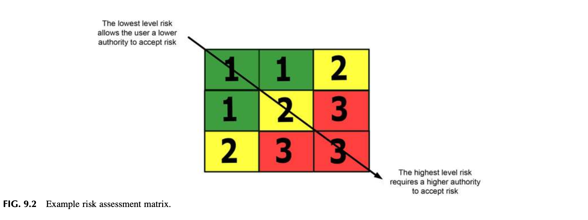

> ### 🔍 [그림 9.2 정밀 상세 분석]
> 
> * **출처**: 미 국방부(DOD) 시스템 안전 표준 및 미 공군 시스템 안전 핸드북.
> * **매트릭스 구조 (3단계 등급 체계)**:
>   * 3단계 심각도와 3단계 발생가능성이 교차하여 총 9개의 셀을 형성합니다.
>   * **1등급 (Green, 녹색 - 총 3개 셀)**: 최저 수준 위험.
>   * **2등급 (Yellow, 황색 - 총 3개 셀)**: 중간 수준 위험.
>   * **3등급 (Red, 적색 - 총 3개 셀)**: 최고 수준 고위험.
> 
> | 심각도 \ 발생가능성 | 1 (낮음) | 2 (중간) | 3 (높음) |
> | :---: | :---: | :---: | :---: |
> | **1 (경미)** | **1 (Green)** | **1 (Green)** | **2 (Yellow)** |
> | **2 (중대)** | **1 (Green)** | **2 (Yellow)** | **3 (Red)** |
> | **3 (심각)** | **2 (Yellow)** | **3 (Red)** | **3 (Red)** |
> 
> * **대각선 관통 화살표의 조직적 의미 (Key Authority Rule)**:
>   * **좌상단 화살표 시작점**: *"The lowest level risk allows the user a lower authority to accept risk"*  
>     ➔ **최저 수준 위험(1등급, Green)**은 작업을 직접 수행하는 **현장 실무자 수준(Lower authority)의 권한으로도 적절한 표준 통제책을 확인한 후 위험을 수용**하고 작업을 진행할 수 있습니다.
>   * **우하단 화살표 종착점**: *"The highest level risk requires a higher authority to accept risk"*  
>     ➔ **최고 수준 위험(3등급, Red)**은 절대로 일선 실무자나 하위 관리자가 독단적으로 수용할 수 없으며, **반드시 조직의 고위 승인권자(Higher authority)에게 공식적으로 보고되어 승인 및 통제 대책이 마련되어야만 수용 여부를 결정**할 수 있습니다.
>   * **핵심 가치**: 낮은 직급의 관리자가 조직 전체를 파멸로 몰고 갈 수 있는 고위험을 독단적으로 감수하지 못하도록 승인 권한의 경계를 제도화한 것입니다.

### 20.2 풀뿌리 수준의 적용과 노사 협력의 시너지
* 산업계의 기존 위험 매트릭스는 경영진의 관리 도구로만 취급되어 현장 직원을 직접 참여시키지 못했습니다.
* 개인 위험성평가 도구의 활용은 최일선 현장(Grassroots level)에서 위험을 다루고 즉각적인 조치를 결정하는 가장 효과적인 방법입니다.
* 표준화된 개인 위험성평가 도구는 개인 간의 위험 지각 차이와 변동성을 잇는 가교 역할을 하며, 직원과 리더십 팀이 잠재 위험을 함께 논의하는 것이 최선의 접근법입니다.

---

## 21. PERSONAL RISK TOLERANCE—HOW DO WE DECIDE WHAT IS A RISK? (개인별 위험 내성: 우리는 무엇이 위험인지 어떻게 결정하는가?)

### 21.1 개인차와 객관적 기준선의 필요성
위험에 대한 지각은 사람마다 다릅니다. 위험을 평가하는 객관적인 기준선(Baseline) 방법이 없다면, 위험 수용이나 내성(Tolerance)은 당신의 평가와 전반적인 우려를 위협하게 됩니다. 위험성평가 도구를 사용하면 "무엇이 위험인가"에 대해 특정 한 사람의 주관적 평가나 개인적 의견에만 의존하는 위험을 방지할 수 있습니다.

### 21.2 미디어와 대중문화가 초래한 위험 불감증과 왜곡된 인식
* **컴퓨터 게임, 액션 영화, 리얼리티 쇼의 악영향**: 대중문화는 무의식중에 사람들에게 무모한 위험을 감수하고 결과를 무시하도록 훈련해 왔습니다.
* **상식을 파괴하는 연출**: 영화 속 주인공들은 물리 법칙과 인체 한계를 가볍게 비웃으며 초고층 빌딩에서 뛰어내려 아스팔트 바닥에 구르고도 약간 멍해질 뿐 즉시 일어나 다시 추격을 이어갑니다.
* **안전 담당자에 대한 희화화**: 영화 속에서 안전을 강조하는 인물은 언제나 상황 파악을 못 하는 '답답한 괴짜(Geeky safety guy)'로 조롱받고, 모든 폭발이 일어난 후 위험을 무릅쓴 것이 필수적이었다고 미화됩니다.
* 이러한 미디어 환경은 경영진부터 현장 근로자에 이르기까지 전 구성원에게 "위험을 무릅쓰는 것이 필수적이며 결과는 언제나 긍정적"이라는 치명적인 마인드셋을 주입합니다.

### 21.3 물리적 실체: 추락 충격에 대한 과학적 실증 데이터
미디어의 환상과 달리, 인체의 물리적 한계는 냉혹합니다:

> **해머와 프라이스(Hammer & Price, 2001) 및 화이트와 보웬(White & Bowen)의 실증 연구**:  
> *"단단한 지면에 **시속 18마일(초당 27피트, 약 29km/h)**의 속도로 충돌하는 사람 중 **50%는 그 자리에서 사망**한다. 그리고 이 속도는 고작 **11피트(약 3.35미터, 아파트 1층 남짓한 높이)에서의 자유 낙하**만으로도 도달하는 속도이다."*

엔터테인먼트 산업은 스턴트 액션 뒤에 숨겨진 정교한 안전 장치를 보여주지 않기 때문에, 근로자들에게 "높은 곳에서 떨어져도 상처 하나 없이 회복할 수 있다"는 비현실적 위험 지각을 남겨놓는 것입니다.

---

## 22. THE RISK GUIDANCE CARD, A POTENTIAL SOLUTION (위험 안내 카드: 잠재적 해결책)

### 22.1 카드의 실무적 운용 개념
* **상시 휴대와 즉각적 소통**: 전 직원에게 배포되는 작은 카드 형태의 '위험 안내 카드(Risk Guidance Card)'는 직원들이 일상 과업을 수행할 때 직접적으로 영향을 미치는 주관적 위험 지각을 다루도록 돕습니다.
* **Go/No-Go 의사결정**: 작업 착수 전 팀원들과 함께 카드를 펼쳐놓고 "작업을 진행할 것인가, 멈출 것인가(Go/No Go)"를 즉석에서 판정합니다 (Roughton & Crutchfield, 2013).
* **지각의 상호 일치 도달**: 직원과 리더십 팀이 잠재 위험의 크기에 대해 완벽히 일치된 지각(Mutually consistent perception)에 도달할 때까지 카드를 매개로 소통을 지속합니다.
* **위험 매트릭스 탑재**: 카드의 핵심 요소로서 잠재 위험, 심각도, 노출 빈도에 대한 지각을 평가하는 매트릭스와 가이드 질문들이 수록되어 있습니다 (Safety management system toolkit, 2007).

---

### [표 9.4 & 그림 9.3 분석] 발생가능성 및 심각도 판정 기준과 평가 모델

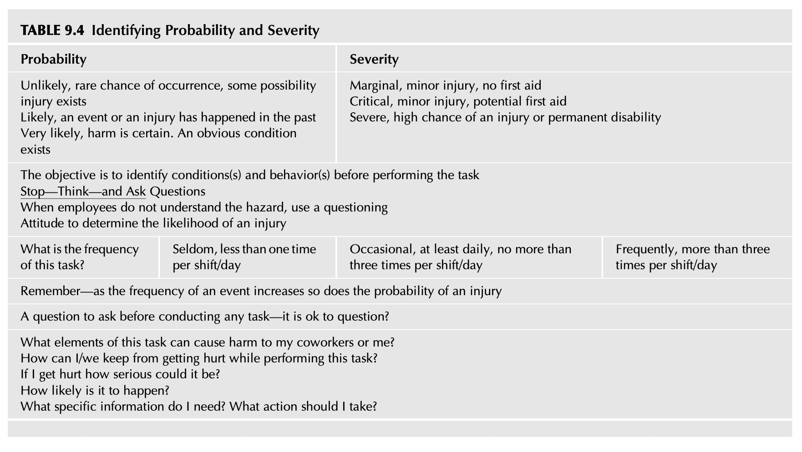

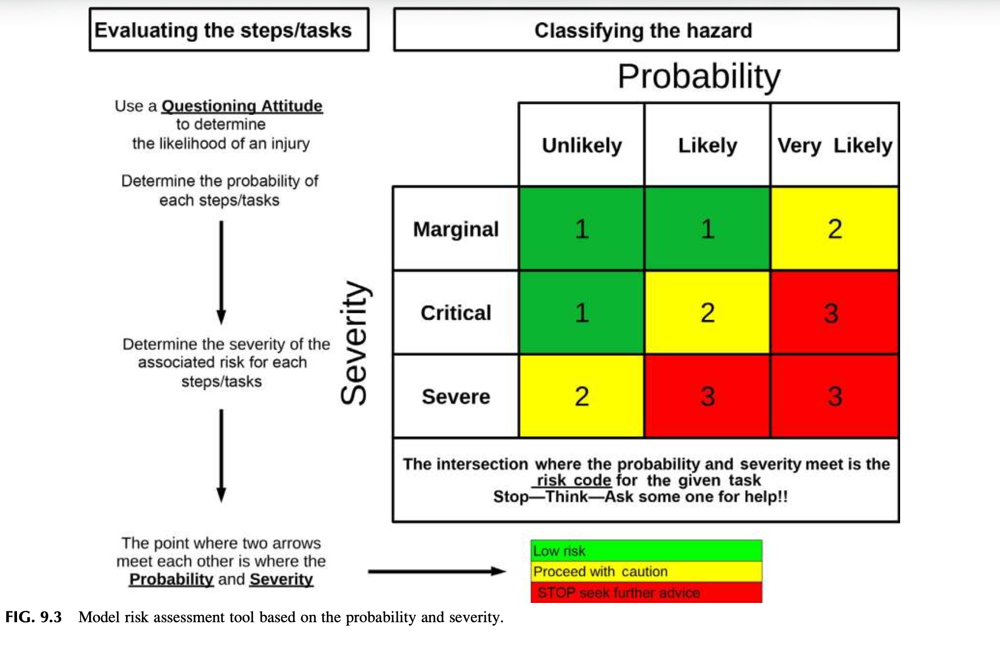

> ### 🔍 [표 9.4 및 그림 9.3 정밀 상세 분석]
> 
> * **평가 목적**: 과업을 수행하기 전(Before performing the task)에 잠재된 불완전한 상태(Conditions)와 위험 행동(Behaviors)을 선제적으로 찾아내는 것입니다.
> * **행동 모토**: **Stop — Think — and Ask Questions (멈추고 — 생각하고 — 질문하라)**
> 
> #### [표 9.4 세부 판정 기준 체계]
> 
> 1. **발생가능성 (Probability) 판정 3단계**:
>    * **희박함 (Unlikely)**: 발생 가능성이 극히 드물지만, 부상 가능성이 존재하는 상태.
>    * **가능성 있음 (Likely)**: 사건이나 부상이 과거에 실제로 발생한 적이 있는 상태.
>    * **매우 높음 (Very likely)**: 피해 발생이 확실함. 명백한 위험 조건이 상존하는 상태.
> 
> 2. **심각도 (Severity) 판정 3단계**:
>    * **경미 (Marginal)**: 경미한 부상, 단순 응급처치(First aid) 불필요 수준.
>    * **중대 (Critical)**: 경미한 부상, 잠재적 응급처치 또는 의학적 처치 필요 수준.
>    * **심각 (Severe)**: 부상 또는 영구적 장애(Permanent disability)의 높은 가능성.
> 
> 3. **작업 빈도 (Frequency) 고려**:
>    * **드묾 (Seldom)**: 근무조/일당 1회 미만 수행.
>    * **가끔 (Occasional)**: 최소 매일 수행하되, 근무조/일당 3회 이하 수행.
>    * **빈번함 (Frequently)**: 근무조/일당 3회 초과 수행.
>    * 💡 **핵심 원칙**: *"사건의 빈도가 증가함에 따라 부상의 발생 확률도 비례하여 증가한다!"*
> 
> 4. **작업 착수 전 작업자가 스스로에게 던져야 할 6대 질문**:
>    * 질문을 제기해도 괜찮은 분위기인가? (Is it ok to question?)
>    * 이 작업의 어떤 요소가 나와 내 동료에게 위해를 가할 수 있는가?
>    * 이 작업을 하는 동안 어떻게 해야 우리 모두 다치지 않고 안전할 수 있는가?
>    * 만약 내가 다친다면 그 부상은 얼마나 심각할 것인가?
>    * 실제로 사고가 발생할 가능성은 얼마나 높은가?
>    * 안전을 위해 지금 내게 필요한 구체적 정보는 무엇이며, 나는 어떤 조치를 취해야 하는가?
> 
> #### [그림 9.3 모델 위험성평가 도구 매트릭스 메커니즘]
> * **평가 프로세스 흐름**:
>   1. 좌측 축: 과업 단계별 유해위험요인의 **심각도(Severity)** 결정 (Marginal, Critical, Severe).
>   2. 상단 축: 질문하는 태도를 구사하여 부상의 **발생가능성(Probability)** 결정 (Unlikely, Likely, Very likely).
>   3. 두 화살표가 만나는 교차점(Intersection)의 숫자가 바로 해당 과업의 **리스크 코드(Risk Code: 1, 2, 3)**가 됨.
> * **범례 및 행동 수칙**:
>   * 🟩 **1 (Green - Low risk)**: 저위험. 표준 절차 준수 하에 작업 진행.
>   * 🟨 **2 (Yellow - Proceed with caution)**: 주의 요망. 직속 관리감독자와 위험을 논의하고 대책을 확인한 후 신중히 진행.
>   * 🟥 **3 (Red - STOP seek further advice)**: **즉각 작업 중지!** 즉시 상위 리더십에 보고하고 해결책이 확정될 때까지 작업 전면 중단.

---

## 23. USING THE RISK GUIDANCE CARD (위험 안내 카드의 구체적 사용법)

작업자가 위험 안내 카드를 들고 현장에서 던지는 4가지 핵심 질문은 다음과 같습니다:
1. 내가 보고 믿고 있는 이 현장 상황과 조건에서, 노출로 인해 발생할 수 있는 잠재적 결과는 무엇인가?
2. 유해하거나 파괴적인 사건이 터질 확률(승산)은 얼마나 되는가? 그 사건은 경미(Marginal), 중대(Critical), 아니면 심각(Severe)한 수준인가?
3. 이 과업 중에서 구체적으로 무엇이 부상이나 파괴를 야기할 수 있는가?
4. 이 상황이나 조건을 해결하기 위해 지금 즉시 무엇을 실행해야 하는가?

> [!NOTE]
> **발생가능성(Likelihood) 평가 시 주의사항**:  
> 발생가능성을 채점할 때는 반드시 **"현재 현장에 설치되어 작동 중인 유해위험요인 통제 장치의 실제 효과성"**을 냉정하게 반영해야 합니다. 발생가능성은 미래에 손실 유발 사건이 발생할 잠재성과 가능성을 반영합니다 (A risk matrix for risk managers, 2008).

---

## 24. RISK SCORING (위험 채점 및 관리자 기각 금지 황금률)

발생가능성과 심각도는 각각 1점에서 3점 척도로 채점됩니다. 매트릭스에서 두 점수가 교차하는 지점이 바로 해당 과업의 **'리스크 등급(Risk Rating)'**이 됩니다.

---

### [표 9.5, 표 9.6, 표 9.7 분석] 위험 등급 채점 및 색상별 조치 행동

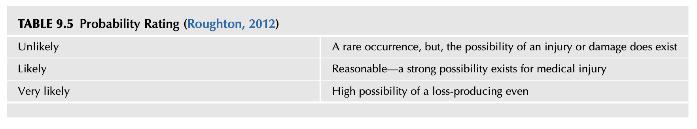

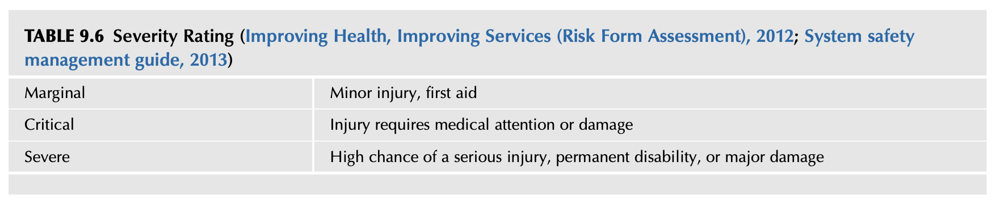

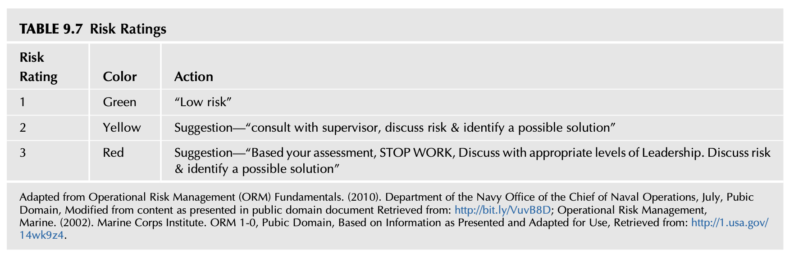

> ### 🔍 [표 9.5, 표 9.6, 표 9.7 정밀 상세 분석]
> 
> * **출처**: 미 해군 참모총장실 운용위험관리 원칙(OPNAVINST ORM Fundamentals, 2010), 미 해병대 연구소(Marine Corps ORM 1-0, 2002), 영국 NHS Lincolnshire 위험평가 지침(2012), 시스템 안전 관리 지침(2013).
> 
> #### [표 9.5 발생가능성 등급 (Probability Rating)]
> | 등급 명칭 | 세부 정의 및 판단 기준 |
> | :--- | :--- |
> | **희박함 (Unlikely)** | 드물게 발생하지만, 부상이나 손상의 가능성이 엄연히 존재함. |
> | **가능성 있음 (Likely)** | 합리적 개연성. 의학적 치료가 필요한 부상이 발생할 강력한 가능성이 존재함. |
> | **매우 높음 (Very likely)** | 손실 유발 사건이 발생할 가능성이 대단히 높음. |
> 
> #### [표 9.6 심각도 등급 (Severity Rating)]
> | 등급 명칭 | 세부 정의 및 판단 기준 |
> | :--- | :--- |
> | **경미 (Marginal)** | 경미한 부상, 단순 응급처치 수준. |
> | **중대 (Critical)** | 의학적 전문 치료(Medical attention)가 요구되는 부상 또는 손상. |
> | **심각 (Severe)** | 중상, 영구적 장애(Permanent disability), 또는 치명적 대형 손상 발생 가능성이 매우 높음. |
> 
> #### [표 9.7 최종 위험 등급 및 행동 조치 기준 (Risk Ratings)]
> | 리스크 등급 | 식별 색상 | 현장 조치 및 승인 행동 요령 (Action) |
> | :---: | :---: | :--- |
> | **등급 1** | **Green (녹색)** | **"Low risk" (저위험)**: 일상적 안전 수칙 준수 하에 현장 작업자 재량으로 작업 수행 가능. |
> | **등급 2** | **Yellow (황색)** | **"주의 요망"**: 관리감독자와 즉시 상담하고 위험을 논의하여 실행 가능한 안전 대책을 확인 및 식별할 것. |
> | **등급 3** | **Red (적색)** | 🚨 **"STOP WORK" (작업 즉각 전면 중지)**: 자신의 평가 결과 위험 등급 3이 도출되면 작업을 즉시 중단하고 해당 권한을 가진 적정 직급의 경영 리더십과 논의할 것. 위험을 분석하고 상호 합의된 해결책이 마련될 때까지 작업 재개 불가. |

---

### [그림 9.4 분석] 위험성평가 분석 실사례: 작업 중지(Stop Work)의 구체적 경로

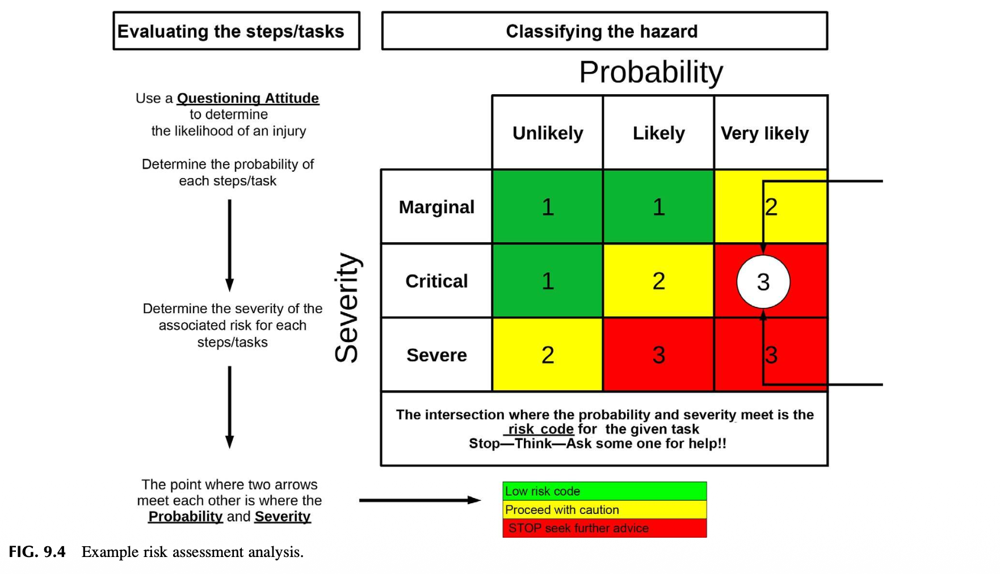

> ### 🔍 [그림 9.4 정밀 상세 분석: 위험 평가의 현장 적용]
> 
> * **상황 시나리오**:  
>   한 현장 작업자가 배정된 과업을 수행하기 전 위험 안내 카드를 꺼내어 자가 평가를 실시했습니다.
>   * 작업자가 분석한 심각도: **중대 (Critical)** ➔ 의학적 치료가 요구될 수 있는 부상 위험.
>   * 작업자가 분석한 발생가능성: **매우 높음 (Very likely)** ➔ 사고 가능성이 대단히 높음.
> * **매트릭스 교차점**: Critical 행과 Very likely 열이 만나는 지점 ➔ **리스크 코드 '3 (RED)'** 도출 (그림 상 흰색 원과 우측 브래킷으로 강조됨).
> 
> #### 🚨 [작업 중지와 관리자 권한 제한의 절대적 3대 원칙]
> 
> 1. **즉각적 작업 중단 및 보고**:  
>    위험 등급 3(RED)이 나오면 작업자는 그 즉시 작업을 올스톱(STOP WORK)하고 직속 관리감독자에게 연락하여 평가 근거를 공유합니다.
> 2. **관리자의 독단적 기각 절대 금지 (The Non-Override Rule)**:  
>    > [!CAUTION]
>    > **관리자 독단 배제 원칙**:  
>    > 직속 관리감독자는 **확실한 안전 해결책을 현장에 제공하거나 위험이 완전히 통제될 수 있음을 객관적으로 입증하여 보여주지 않는 한, 직원이 제기한 우려를 결코 묵살하거나 일방적으로 무시(Override)하여 작업을 강행시킬 수 없습니다.**
> 3. **상호 합의 원칙과 상위 계층 에스컬레이션**:  
>    * 작업이 재개되려면 **관리자와 현장 직원 양측 모두가 분석 내용과 통제책에 상호 합의(Mutually agree)**해야만 합니다.
>    * 만약 관리자와 직원 간에 위험 등급이나 해결책에 대해 끝내 이견이 좁혀지지 않거나, 해당 부서 수준에서 해결할 수 없는 위험인 경우, **작업을 절대로 강행하지 말고 즉시 차상위 경영 리더십(Next level of leadership)으로 에스컬레이션**하여 조직 전체가 위험을 공동 해결해야 합니다.

### 24.1 미 해군 ORM 색상 코드와 상황인식(Situational Awareness)
미 해군(OPNAVINST, 2010)의 색상 코드는 단순한 위험 크기를 넘어 팀원 간의 '상황인식(SA)'을 일치시키는 핵심 언어로 작동합니다:
* **Green (녹색)**: 오류나 실수가 발생할 수 있으나, 작업자 개인에 의해 자체적으로 즉각 포착·수정될 수 있는 안전 상태.
* **Yellow (황색)**: 오류가 발생할 잠재적 가능성이 크게 증가한 경계 상태.
* **Red (적색)**: 오류가 발생했을 때 개인이 통제할 수 없으며, 과업이나 미션 전체에 치명적 결과를 초래할 수 있는 위험 상태.

> *"수많은 조직 활동에는 언제나 오류와 뜻밖의 돌발 사태가 일어날 잠재성이 도사리고 있다. 따라서 오류 징후(Error signals)를 구성하는 미세한 정보들은 부서의 장벽과 계층적 서열을 뛰어넘어 소통망을 통해 조직 전체에 광범위하게 공유되어야 한다. **소통의 장벽이나 단절은 피드백, 증거의 축적, 그리고 경고와 우려의 공유를 파괴하는 가장 치명적인 위협이다.**"*  
> — **보인과 슐만 (Boin & Schulman, 2008)**

---

## 25. OVERALL RISK MANAGEMENT RESPONSIBILITIES (전사적 위험관리 책임과 권한)

효과적인 위험관리는 경영 리더십 팀의 책임과 권한(Responsibility and Authority)의 범위를 명확히 규정해야 하며, 다음 8가지 핵심 사항을 포함합니다:

1. **수용 불가능한 위험의 공식 정의**: 조직 차원에서 결코 용납될 수 없는 위험(Unacceptable risk)의 기준을 명문화하고, 위험이 초래할 잠재적 부정적 파급 효과를 전사적으로 완벽히 이해시킴.
2. **잔여 위험(Residual Risk) 평가 체계화**: 위험을 평가하고 위험 저감 대안을 수립하며, 대책 실행 후에도 남게 되는 잔여 위험 문제를 지속적으로 추적 관리함.
3. **무효한 통제 장치의 과감한 퇴출**: 현장에서 불필요하거나 효과를 상실한 낡은 안전 통제책을 선별하여 개선하거나 교체함.
4. **합리적 위험 저감 옵션 선택**: 위험성평가 권고사항에 기반하여 최적의 위험 감소 대안을 결정함.
5. **사전 설정된 기준에 따른 위험 수용/거부**: 잠재적 심각도와 사전 정의된 위험 허용 기준(Predetermined risk tolerance)에 근거하여 위험의 수용 또는 거부를 공식 결정함.
6. **전 직원 위험관리 교육 훈련**: 선정된 위험관리 도구와 기법에 대해 전 직원을 체계적으로 교육함 (제11장 연계).
7. **적정 조직 레벨에서의 위험 감수와 상위 에스컬레이션**:  
   > [!IMPORTANT]
   > 위험은 오직 그 위험을 책임질 수 있는 **'적절한 조직 직급(Appropriate organizational level)'에서만 감수**되어야 합니다. 낮은 직급의 현장 관리자가 내린 안일한 판단으로 인해 조직 전체가 치명적 대형 위험에 노출되는 참사를 원천 차단해야 합니다. 하위 레벨에서 통제할 수 없는 위험은 상위 리더십으로 즉각 이관되어야 하며, 이는 상위 리더십이 현장의 잠재 위험과 통제 현황을 완벽히 꿰뚫고 있어야 함을 전제합니다.
8. **경영 비즈니스 계획 및 예산과의 통합**: 위험 통제 대책의 실질적 실행에 필요한 시간과 예산이 확보될 수 있도록 위험성평가 방법론을 기업의 공식 사업 계획 수립(Business planning process)에 통합함 (Carter & Smith, 2001; ANSI Z10, 2012; Risk management toolkit, 2018).

---

## 26. LEADERSHIP’S RISK RESPONSIBILITIES (리더십의 위험관리 책무)

경영 리더십 팀이 짊어져야 할 구체적 책무 3가지는 다음과 같습니다:
1. 손실 유발 사건의 잠재력을 식별하기 위해 **위험성평가 및 위험관리 개념을 일관되게 사용할 것**.
2. 위험성평가, 작업위험성평가(JHA), 그리고 안전경영시스템(SMS)이 규정한 **적절한 위험 통제 절차와 프로토콜을 직원들이 철저히 준수하도록 보장할 것**.
3. 자신의 권한이나 통제 범위를 벗어나는 위험 우려 및 쟁점이 발생했을 때, 이를 **신속하게 상위 최고 경영진에게 보고(Elevating)하여 해결책을 도출할 것** (Risk management toolkit, 2018).

---

## 27. LESSON LEARNED 4 (교훈 4: 허구의 유령 SOP 징계 미수 사건)

### 27.1 존재하지 않는 SOP에 대한 재교육 권고의 모순
관리감독자들과 함께 부상 사고 조사를 진행하던 세션에서 일어난 실화입니다.  
초기 사고 조사 보고서에는 **"부상당한 작업자에게 관련 표준작업절차(SOP)에 대한 재교육을 실시하라"**는 시정 권고사항이 적혀 있었습니다.  
이에 안전 전문가가 정밀 작업위험성평가(JHA)를 진행하기 위해 논의 대상이 된 해당 서면 절차서 사본을 제출해 달라고 요청했습니다.

놀랍게도, **해당 작업에 대한 SOP는 애초에 존재하지도 않았습니다 (The procedure did not exist)!**

### 27.2 교훈 및 시사점
현장의 경영진과 관리감독자 모두는 당연히 누군가 SOP를 작성해 두었을 것이라고 막연히 지레짐작(Assumed)하고 있었지만, 실제로 문서를 작성한 사람은 아무도 없었습니다.  
이 사건은 인용되는 표준 문서에 대해 철저한 사전 조사와 사실 검증이 얼마나 중요한지를 일깨워주었습니다. 만약 꼼꼼한 JHA 검토와 확인 작업이 없었다면, **회사는 있지도 않은 '허구의 SOP(Fictional SOP)'를 위반했다는 황당한 이유로 무고한 부상 근로자를 징계하고 처벌하는 중대한 시스템적 오류**를 범할 뻔했습니다.

---

## 28. EMPLOYEE’S RISK RESPONSIBILITIES (현장 직원의 위험관리 책무)

현장 일선 작업자들의 구체적인 역할과 책임 5가지는 다음과 같습니다:
1. 유해위험요인 및 리스크 통제 조치가 왜 필요한지 그 **근본 이유를 명확히 이해하고, 현장 통제 장치를 능동적으로 사용, 준수, 유지·관리할 것**.
2. 자신이 수행하는 특정 절차, 과업, 운영에 내재된 **잠재적 위험의 심각성에 대해 상시적인 경각심(Constant awareness)을 유지할 것**.
3. 위험 저감 대책이 현장에서 작동하지 않거나, 비현실적이거나, 비효과적인 고위험 절차가 강요될 경우 **직속 관리 리더십 팀과 즉각적으로 소통할 것** (Risk management toolkit, 2018).
4. 모든 안전 규정과 통제 프로토콜이 철저히 지켜지도록 동료들과 하나의 팀(Team)으로 협력하고, **효과적인 위험 통제를 유지하기 위해 동료를 서로 도울 것**.
5. **불필요한 위험(Unnecessary risks)을 회피할 것.**

### 생산 일정 압박과 타협하지 않는 위험성평가의 힘
위험성평가의 활용은 권고사항이 제시되는 방식을 명확하고 강력하게 만들어 안전문화를 개선할 수 있습니다. 초점은 단순한 사후 손실 정보나 규제 준수에만 머무르지 않고 활동 자체에 내재된 위험에 맞춰집니다. 조직이 생존하기 위해서는 특정한 생산량이나 서비스 목표를 완수해야 하므로, 권고사항이 손실 잠재력을 명확하게 밝혀내지 못하면 일정을 준수하려는 생산 압박(Pressure to maintain schedule)이 안전을 압도하게 됩니다. 근로자들은 상황과 조건이 명백히 위험을 가리키고 있음에도 "이 정도 위험은 괜찮다"고 스스로를 합리화하게 됩니다. 위험성평가는 권고사항의 객관적 근거를 명확히 세워 이러한 일정 압박 속에서 위험과 타협하는 비극을 차단합니다.

---

## 29. SUMMARY (제9장 총괄 요약)

1. **위험 이해의 조직적 침투**: 심층적 안전문화가 지속되려면 위험과 그 통제에 대한 올바른 이해가 조직 전체에 스며들어야 합니다. 단순 점검과 관찰에만 의존하는 SMS는 잠재 위험과 연계되지 못해 실패합니다.
2. **과거 편향과 위험의 은폐**: 인간은 과거 무사고 경험에 의존하여 현재의 위험을 과소평가합니다. 위험을 감수하고도 다치지 않으면 위험 행동이 강화되지만, 결국 통제되지 않은 위험과 교차하는 순간 대형 참사로 이어집니다.
3. **풀뿌리 수준의 실천 도구**: 기존의 상향식 관리자 도구를 탈피하여, 일선 작업자가 작업 착수 전 주머니에서 꺼내어 스스로 위험을 평가할 수 있는 풀뿌리 '위험 안내 카드(Risk Guidance Card)'가 정착되어야 합니다.
4. **리더십의 역할 변화와 심리적 안전감**: 직원이 불이익에 대한 두려움 없이 위험 우려를 제기하고 작업 중지(Stop Work)를 선언할 수 있어야 하며, 관리자는 대안 제시 없이 직원의 우려를 기각(Override)할 수 없습니다. 합의 불가 시 상위 리더십으로 즉각 에스컬레이션됩니다.
5. **다차원적 손실 방어**: 위험 관리는 단순한 근로자 부상 예방을 넘어, 물적 피해, 제3자 보호, 그리고 조직의 '브랜드 평판'과 존립을 지키는 전사적 방어벽입니다.
6. **사후 지표에서 사전 위험으로의 전환**: 과거 재해율(TCIR) 중심의 사후 관리에서 벗어나, 선제적 위험 평가와 통제에 조직의 모든 자원과 소통 역량을 집중해야 합니다.
7. **차기 장과의 연계**: 제10장(Understanding Basic Risk Management Principles)에서는 강력한 안전문화의 필수 구성요소인 위험관리 원칙을 다루며, 제11장(Developing Safety Training Needs)에서는 위험관리 역량을 내재화하기 위한 안전 교육 훈련 체계를 다룹니다.

---

## 30. CHAPTER REVIEW QUESTIONS (복습 질문 및 심화 해설)

본 장에서 제시된 9가지 핵심 질문과 그에 대한 이론적·실무적 답변 요약입니다:

1. **안전이 왜 조직의 '창발적 속성(Emergent Property)'으로 간주되는가?**  
   * ➔ 안전은 어느 한 부서나 독립된 규칙에서 나오는 것이 아니라, 조직의 구조, 기술, 리더십, 소통, 작업 환경 등 모든 구성 요소들이 상호작용하는 복합계 속에서 자연스럽게 발현되는 전체론적 결과물이기 때문입니다.
2. **직원들은 왜 불필요한 위험(Unnecessary Risk)을 감수하는가?**  
   * ➔ 위험의 무형성, 과거 무사고 경험에 기인한 인지적 편향, "빨리 일을 끝내라"는 밈(Meme)의 지배, 위험을 감수하는 것을 칭송하는 그릇된 조직 문화, 그리고 집단에 소속되기 위한 동조 압력 때문입니다.
3. **부상률(TCIR)이 왜 위험의 진정한 척도가 될 수 없는가?**  
   * ➔ TCIR은 이미 벌어진 과거의 손실 결과(Post-loss data)만을 사후 집계할 뿐이며, 현장에 잠재된 미래의 위험 노출이나 시스템의 열화 상태(Pre-loss potential)를 전혀 보여주지 못하기 때문입니다.
4. **'유해위험요인(Hazard)'과 '리스크(Risk)'를 정의하고, 위험성평가에 어떻게 활용되는지 설명하라.**  
   * ➔ 유해위험요인은 부상·질병·피해를 일으킬 수 있는 본질적 잠재 조건이며, 리스크는 그 위험 사건이 일어날 발생가능성과 결과의 심각성을 결합한 추정치입니다. 위험성평가는 이를 바탕으로 사건의 우선순위를 정하고 상호 합의된 통제책을 도출합니다.
5. **위험 안내 도구(Risk Guidance Tool)의 개념과 현장 활용 방식을 설명하라.**  
   * ➔ 전 직원이 휴대하는 명함 크기의 카드로, 작업 전 심각도와 발생가능성을 평가하여 1(Green), 2(Yellow), 3(Red)의 코드를 도출하고 작업 진행 여부(Go/No-Go)를 결정하는 실천적 자가 평가 도구입니다.
6. **위험 안내 도구가 위험의 범위와 심각성을 소통하는 데 어떻게 기여하는가?**  
   * ➔ 주관적인 개인 의견 대신 객관적인 색상 코드와 공통의 언어를 제공함으로써, 현장 작업자와 관리 리더십이 동일한 기준선 위에서 위험의 크기를 정확히 공유하고 합의할 수 있게 만듭니다.
7. **개인적 위험 내성(Personal Risk Tolerance)이란 무엇이며 왜 중요한가?**  
   * ➔ 개인이 위험을 감수하고 견뎌내는 주관적 성향으로, 미디어와 과거 경험에 의해 심각하게 왜곡될 수 있습니다. 이를 방치하면 작업장에 무모한 위험 수용이 만연해지므로 표준화된 기준선 도구로 통제해야 합니다.
8. **위험성평가가 왜 중요하며 이것이 어떻게 안전문화를 개선하는가?**  
   * ➔ 위험에 대한 객관적 근거를 제공하여 생산 압박 속에서도 안전의 우선순위를 지켜내며, 질문하는 태도(Questioning attitude)와 열린 소통망을 활성화하여 조직 전체의 상황인식과 신뢰를 극대화하기 때문입니다.
9. **위험 지각 진단(표 9.3 / 16대 질문)에서 조직의 현재 분위기를 파악하는 것이 도구 도입에 왜 결정적인가?**  
   * ➔ 조직 내에 팽배한 변화 피로도, 과거 단명 프로그램('이달의 유행')에 대한 냉소주의, 기존 제도와의 충돌 등을 사전에 진단하지 않고 밀어붙이면 현장의 은밀한 저항과 형식주의에 부딪혀 실패하기 때문입니다.

---

## 31. BIBLIOGRAPHY (참고문헌)

* A risk matrix for risk managers. (2008). London: The National Patient Safety Agency. January, Retrieved from: http://bit.ly/12hoCH4.
* Air force system safety handbook. (2000). Kirtland: Air Force Safety Agency July, Public Domain, Adapted for Use.
* Boin, A., & Schulman, P. (2008). Assessing NASA’s safety culture: the limits and possibilities of high-reliability theory. *Public Administration Review*, 68(6), 1050-1062.
* Carter, G. R., & Smith, S. (2001). Construction safety risk—improving the level of hazard identification. In: *ESREL, European Safety Reliability International Conference*, Torino, Italy.
* Clifford Atiyeh, R. B. (2015). Massive takata airbag recall: everything you need to know, including full list of affected vehicles. *Car and Driver*, July, Retrieved from: http://bit.ly/1D8eFdR.
* Concepts and principles, Human performance improvement handbook. (2009). Vol. 1, US Department of Energy.
* Easy ergonomics: A practical approach for improving the workplace. (2017). Oregon Occupational Safety and Health Division (Oregon OSHA) Public Domain, Retrieved from: http://osha.oregon.gov/OSHAPubs/3347.pdf.
* Fewtrell, L., & Bartram, J. (2001). *Water quality: Guidelines, standards, and health: Assessment of risk and risk management for water-related infectious disease*. Geneva: IWA Publishing.
* Hammer, W., & Price, D. (2001). *Occupational safety management and engineering*. Vol. 240, Upper Saddle River, NJ: Prentice-Hall.
* Human performance tools for individuals, work teams, and management. (2009). Human performance improvement handbook. Vol. 2. US Department of Energy Public Domain.
* Improving Health, Improving Services (Risk Form Assessment). (2012). NHS Lincolnshire, Cross O’Cliff, Bracebridge Heath, Public Domain, Lincoln, Retrieved from: http://bit.ly/XOLXZo.
* Klapp, M. G. (1992). *Bargaining with uncertainty: decision-making in public health, technological safety, and environmental quality*. Washington, DC: Auburn House Publishing Company.
* Koch, C. G. (2007). *The science of success: how market-based management built the world’s largest private company*. Kansas: John Wiley & Sons.
* Mishap Prevention Program. (2011). United States Air Force, Instruction 91-202, August, Retrieved from: http://1.usa.gov/XMhhrU.
* Mullai, A. (2006). *Risk management system: risk assessment frameworks and techniques*. Turku: DaGoB Project Office, Turku School of Economics. Retrieved from: http://bit.ly/1GHack4.
* NASA risk management handbook. (2011). Washington, DC: NASA Headquarters. November, Adapted from National Aeronautics and Space Administration, Public Domain.
* Occupational Health & Safety Management Systems. (2012). The American Society of Safety Engineers, ANSI/AIHA/ASSE Z10, Retrieved from: http://bit.ly/1MsT6MG.
* Operational Risk Management (ORM) Fundamentals. (2010). Department of the Navy Office of the Chief of Naval Operations, July, Public Domain, Retrieved from: http://bit.ly/VuvB8D.
* Operational Risk Management, Marine. (2002). Marine Corps Institute, ORM 1-0, Public Domain, Retrieved from: http://1.usa.gov/14wk9z4.
* Risk management handbook. (2009). US Department of Transportation, Federal Aviation Administration, Flight Standards Service, Public Domain.
* Risk management toolkit. (2018). MITRE’s Systems Engineering Process Office, Public Domain. Retrieved from: http://bit.ly/2HkFcNn.
* Roughton, J. (2012). Safety culture—six basic safety program elements. *SafetyRisk*, November, Retrieved from: http://bit.ly/2CBZ3qF.
* Roughton, J., & Crutchfield, N. (2013). In B. Heinemann (Ed.), *Safety culture: An innovative leadership approach*. Burlington, MA: Butterworth Heinemann Retrieved from: http://amzn.to/1qoD4oN.
* Safety management system toolkit. Developed by the Joint Helicopter Safety Implementation Team of the International Helicopter Safety Team, The International Helicopter Safety Symposium, Montreal, Canada, Retrieved from: http://bit.ly/YaSCOg.
* System safety handbook. (2008). Federal Aviation Administration (FAA). Public Domain, (chapter 15). Retrieved from: http://1.usa.gov/1FDhENy.
* System safety management guide. (2013). Department of the Army. Pamphlet 385-16, Public Domain, August, Retrieved from: http://bit.ly/2xerr1F.
* The top automotive engineering failures: the ford pinto fuel tanks. (2011). *Popular Mechanics*, May, Retrieved from: http://bit.ly/1C2zEDh.
