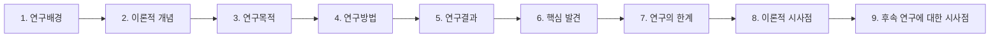
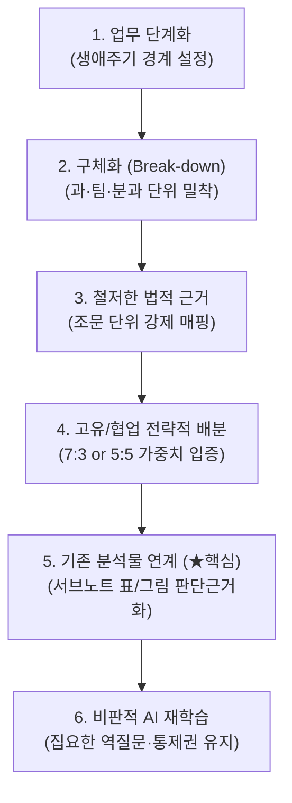
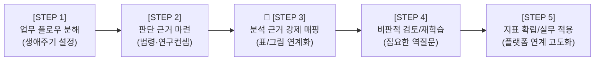

# [부록] AI 활용 시 연구자료 사용 원칙, 선행연구 작성 지침 및 KPI 도출 방법론

> [!IMPORTANT]
> **대원칙**: 제공되는 연구용 **SUB-NOTE**는 학술연구의 기초자료이며, 원문에 존재하지 않는 내용을 사실처럼 추가하거나 왜곡하지 않는다. 또한 AI 활용 성과지표(KPI) 도출 및 연구방법론 수립 시 교수님의 심화 지도 지침을 철저히 준수하여 연구자의 엄밀한 통제권을 유지한다.

---

## 1. 연구자료(SUB-NOTE) 사용 11대 기본 원칙

AI(Claude, Gemini 등)를 활용하여 학술연구를 진행할 때 아래의 원칙을 엄격히 준수한다. 

1. **연구내용 임의 수정 금지**  
   - 원문에 명시된 연구내용을 임의로 수정하거나 왜곡하고, 원문의 목차 순서 그대로 SUB-NOTE를 작성한다. 
2. **환각(Hallucination) 방지 및 무단 생성 금지**  
   - 원문에 없는 연구결과나 통계치를 만들어내지 않는다.
3. **원 연구 결과와 연구자 해석의 엄격한 분리**  
   - 원 연구의 직접적인 결과와 연구자(또는 AI)의 해석을 명확히 구분한다.
   - 새로운 연구문헌을 작성할 경우에도 원 연구가 실제로 수행한 연구와 후속 연구자의 해석을 분리한다.
4. **미확인 내용의 명시적 표기**  
   - 원문에서 직접 확인할 수 없는 내용은 반드시 `"원문에서 확인되지 않음"`이라고 명시한다.
5. **연구 데이터의 정확성 유지**  
   - 연구방법, 표본(Sample), 척도(Scale), 신뢰도(Reliability), 통계분석 결과는 가능한 한 정확하게 유지한다.
6. **핵심 학술 개념 불변의 원칙**  
   - 연구의 핵심 학술 개념을 임의로 다른 개념으로 대체하지 않는다.  
   - **유지 대상 주요 핵심 개념**:
     - 네트워크 성과
     - 다차원적 성과
     - 다원주의
     - 다중 관점
     - 지각 (Perception)
     - 의미구성 (Sensemaking)
     - 평가 (Evaluation)
7. **이론적 시사점의 명확한 구분**  
   - 학위논문에 활용할 경우에는 원 연구의 직접적인 결과와 후속 연구에 적용할 수 있는 이론적 시사점을 명확히 구분한다.
8. **출처 및 인용 정보 우선 표기**  
   - 인용이 필요한 경우 저자, 연도 및 원문 페이지를 우선적으로 표시한다.
9. **과도한 일반화 및 확대해석 금지**  
   - 과도한 일반화나 인과관계의 확대해석을 하지 않는다.
10. **문헌 재작성 시 엄밀성 유지**  
    - 제공된 자료를 기반으로 새로운 연구문헌을 작성할 경우에도 원 연구가 실제로 수행한 연구와 후속 연구자의 해석을 분리한다.
11. 표나 그림에 대한 상세 보충설명

---

## 2. 박사학위 논문 선행연구 작성 순서

선행연구 분석 및 학위논문 본문 작성 시 아래의 단계별 순서를 표준 템플릿으로 준수한다.

### 단계별 세부 항목

| 순서 | 단계 | 주요 내용 |
| :---: | :--- | :--- |
| **1** | **연구배경** | 연구 주제의 필요성, 시대적·사회적 문제의식 및 선행 배경 |
| **2** | **이론적 개념** | 주요 이론적 배경, 핵심 개념 정의 및 분석 틀(틀거리) |
| **3** | **연구목적** | 연구가 규명하고자 하는 핵심 질문(Research Question) 및 구체적 목적 |
| **4** | **연구방법** | 연구 설계, 표본 및 자료수집, 측정 척도, 신뢰도/타당도, 분석 방법 |
| **5** | **연구결과** | 통계 분석 결과, 가설 검정 결과 등 실증적 분석 데이터 |
| **6** | **핵심 발견** | 실증 분석을 통해 도출된 핵심적 사실 및 발견점 |
| **7** | **연구의 한계** | 표본의 대표성, 방법론적 한계, 미통제 외생변수 등 한계점 명시 |
| **8** | **이론적 시사점** | 원 연구 결과가 학문적·이론적 체계에 기여하는 학술적 의의 |
| **9** | **후속 연구에 대한 시사점** | 본 연구의 한계를 보완하고 확장하기 위해 필요한 향후 연구 방향 제언 |

---

## 3. 학습 지도노트: AI 활용 성과지표(KPI) 도출 6대 핵심 원칙 (교수님 심화 지도)

교재의 내용에 충실하면서도 현장 맞춤형 성과지표(KPI)를 도출하고, 이를 안전문화 진단 및 실무 개선 플랫폼으로 구현하기 위해 아래 6대 핵심 원칙을 상시 견지한다.

### 1) 업무 단계화 (스텝/생애주기 설정)
- '재난 관리', '안전 점검'과 같은 포괄적 명칭을 피한다.
- **예방 - 대비 - 대응 - 복구** 또는 **기획 - 실행 - 모니터링 - 개선**과 같이 **표준화된 절차와 명확한 경계**를 설정한다.
- AI는 명확한 경계를 인식할 때 각 생애주기 단계별로 측정 가능한 정교한 지표를 생성할 수 있다.

### 2) 구체화 (Break-down) 및 표본(조직) 특성 반영
- 거시적 기관 단위 지표(중범위 이상)는 현장 실무와 괴리된다.
- 연구자가 실제 속한 **과 단위, 팀 단위, 혹은 특정 분과(예: 의령소방서 119구조대, 에어사이드 운영부, 대테러계 등)**의 인원수, 교대근무 형태, 작업 환경 등 구체적 조직 특성을 반영하여 현장 즉시 적용 가능한 밀착형 지표를 설계한다.

### 3) 철저한 법적 근거 기반 (환각 방지)
- 성과지표의 당위성을 확보하기 위해 임의의 데이터나 일반론에 의존해서는 안 된다.
- 해당 업무를 규정하는 **본법, 시행령, 시행규칙, 훈령의 조문(Article) 단위**까지 구체적으로 발췌하여 AI에게 학습시키고 근거로 제시한다.
- 법적 근거는 지표 도출의 가장 강력하고 절대적인 판단 기준이다.

### 4) 고유/협업 지표의 전략적 가중치 분배
- 모든 업무를 단독으로 수행할 수는 없다.
- 부서 내에서 독자적으로 통제 가능한 **'고유 지표'**와 타 기관(경찰, 소방, 군, 지자체 등)과의 연계가 필수적인 **'협업 지표'**를 엄격히 분류한다.
- 실무 현실을 반영하여 **7:3 또는 5:5 등 최적의 가중치 비율을 설정**하고, 이 비율의 타당성을 법령과 이론에 근거하여 논리적으로 입증한다.

### 5) 기존 분석물(표/그림/절별 분석)의 KPI 연계 (★핵심)
- AI에게 단순히 원문을 요약하라고 지시하는 것에 그치면 안 된다.
- 연구자가 사전에 학습하고 정리해 둔 **서브노트의 정밀 분석 내용, 표(Table), 그림(Figure) 등을 KPI 도출의 '판단 근거'로 강제 매핑**한다. 이는 AI가 표류하지 않고 연구자의 의도대로 작동하게 만드는 가장 중요한 장치이다.

### 6) 비판적 AI 재학습 (강화 학습 및 역질문)
- AI가 1차적으로 제시한 번듯한 표나 요약본에 속아 넘어가서는 안 된다.
- *"이 지표의 출처는 무엇인가?"*, *"어느 문헌, 어떤 법률 조항으로부터 추론한 것인가?"*를 끊임없이 역질문하여 AI를 검증한다.
- 연구자가 질문하지 않으면 AI는 경로를 이탈하고 임의로 넘어간다.

---

## 4. 단계별 성과지표(KPI) 도출 및 플랫폼 적용 5단계 프로세스

### [STEP 1] 업무 플로우 분해 및 단계(스텝) 설정
- **행동 지침**: 본인 혹은 소속 부서의 일하는 방식을 단순히 나열하지 않고, 업무의 착수부터 종료까지 생애주기처럼 쪼개어 명확한 경계를 설정한다.
- 각 단계마다 성과를 평가하고 측정할 수 있는 지표가 도출될 수 있는지 논리적 완결성을 확인한다.

### [STEP 2] 적용 가능한 판단 근거 및 기준 마련 (법률 및 문헌)
- **법적 근거 수집**: 업무에 직접 적용되는 법률, 시행령, 시행규칙, 훈령 조문을 샅샅이 발췌하여 텍스트를 AI에 직접 입력/사전 학습시킨다.
- **연구 0점(컨셉) 설정**: *"나는 향후 [특정 플랫폼/분야] 관점에서 성과지표 연구를 할 것이다"*라는 컨셉을 초기에 명확히 선언하고 불필요한 노이즈를 제거한다.

### 🚨 [STEP 3] 기존 정밀 분석물(표/그림)의 KPI 판단 근거화 (교수님 특별 지적 사항)
- **문제점 인식**: AI에게 단순히 "7장에 근거해서 성과지표를 만들어줘"라고 포괄적으로 지시하면, 연구자가 기존에 힘들게 분석해 둔 '절별 정밀 분석'이나 '표/그림 분석 데이터'가 KPI 도출 과정에 반영되지 않고 겉돌게 된다.
- **해결 및 프롬프트 적용 방법**:
  1. **기준 명시화 지시**: 기존에 정리한 서브노트의 특정 파트를 명확히 지목한다. (예: "4.3 리더십 원칙", "표 7.1 리더십 기대치", "표 7.2 RAA(책임과 권한)" 파트를 콕 집어서 대표성 있는 판단 근거로 삼도록 명시).
  2. **출력 포맷(표) 내 근거 강제 매핑**: AI가 KPI 표를 생성할 때, 근거 란에 단순히 '7장 참조'라고 적지 못하도록 규제한다. *"4절의 절별 정밀 분석 내용과 6절의 테이블 분석 내용을 모두 고려하여 해당 KPI가 도출된 구체적인 '판단 근거'와 '이론적 배경'을 표의 별도 컬럼에 직접 명시하고 서술하라"*고 강력하게 요구한다.

### [STEP 4] 비판적 검토 및 AI 강화 학습 (통제권 유지)
- **집요한 역질문 실시**: *"이 지표는 어느 문헌, 어떤 법률 조항으로부터 도출된 것인가?"*, *"다른 성과관리 이론(예: 레질리언스 이론)을 적용하면 우선순위는 어떻게 달라지는가?"*를 집요하게 묻고 검증한다.
- **경로 이탈 방지**: 연구자가 주도권을 쥐고 3단계에서 확립한 '절대 기준'대로 지표가 세팅될 때까지 지속적으로 프롬프트를 수정하고 재학습시킨다.

### [STEP 5] 지표 확립 및 실무 적용 (플랫폼/조직진단 고도화)
- **핵심 지표 추출 (수렴)**: 방대하게 도출된 KPI 리스트 중에서 교재 이론과 법적 근거를 바탕으로 가장 대표성을 띠는 핵심 지표 체계로 압축한다.
- **진단 및 컨설팅 플랫폼 연계**: 도출된 핵심 지표를 조직 안전문화 진단 평가 척도 및 모니터링 시스템에 직접 연동하여 실무에서 즉시 활용할 수 있도록 구현한다.
- **예비 지표의 선제적 관리**: 공공기관 기재부 경영평가 등 기존 하향식(Top-down) 평가 지표에만 얽매이지 않고, 교재 기반의 현장 맞춤형 예비 지표(대체 지표)를 선도적으로 발굴·관리하여 향후 전사적 안전문화 개선 시 강력한 논리적 근거로 활용한다.

---

## 5. 기본 원칙 및 연구자 주도권 재확인

> **"이 SUB-NOTE는 연구자료이며, 원문에 존재하지 않는 내용을 사실처럼 추가하지 않는다."**  
> **"AI는 질문하지 않은 영역에 대해 스스로 사유하지 않는다. 연구자가 명확한 법령 조문과 서브노트 분석 표/그림을 강제 매핑할 때에만 진정한 학술적·실무적 연구 결과가 완성된다."**