# 제1장 안전에 대한 지각의 정의 (Defining the Perception of Safety)

조직문화는 대단히 중요하다. 경영진이 구성원을 대우하기로 선택하는 방식은—좋든 나쁘든—모든 것에 영향을 미친다. — 사이먼 시넥 (Simon Sinek)

당신이 사물을 바라보는 방식을 바꾸면, 당신이 바라보는 사물이 바뀐다. — 웨인 W. 다이어 (Wayne W. Dyer)

Safety Culture (안전문화). https://doi.org/10.1016/B978-0-12-814663-7.00001-7

## 도입 (INTRODUCTION)

조직의 안전문화(Safety Culture)는 안전한 작업 환경을 보장하기 위한 잠재력을 향상시키기 위해 다학제적 접근(Multidiscipline Approach)을 필요로 한다. 리더십은 수행해야 할 과업에 대한 명확한 비전을 제시하고, 안전을 위한 바람직한 조직 분위기(Organizational Climate)를 달성하기 위해 공통의 목표에 초점을 맞춤으로써 안전에 대한 지각(Perception of Safety)을 견인할 수 있다. 

이 방법은 예를 들어 안전경영시스템(SMS)의 선정, 인적 오류 성과(Human Error Performance)의 측정, 다계층 커뮤니케이션 개선, 재해(Hazard) 및 손실(Loss) 분석, 법적 규제 준수 모니터링에 이르는 일련의 다양한 활동들을 실행하는 것을 수반한다. 

가장 중요한 것은, 안전문화가 발전하고 지속되기 위해서는 리더십 팀과 근로자 모두가 안전이 무엇을 수반하는지에 대해 긍정적인 지각과 깊이 있는 이해를 지녀야 한다는 점이다. 안전은 조직 내에서 자신만의 고유한 '브랜드(Brand)'를 갖는다. 경영 리더십 팀과 근로자들에 의해 그 브랜드가 어떻게 지각되고 있는지를 반드시 규명해야 한다. 그리고 이 안전 브랜드에 어떻게 도전하고 혁신할 것인가가 안전문화를 개선하는 데 있어 중대한 핵심 요소가 된다.

### 관찰 1 (Observation 1)

조직은 결코 정적(Static)이지 않다! 조직에는 언제나 어느 정도의 끊임없는 유동과 변화(Flux and change)가 존재한다. 이와 반대로, 전통적인 안전 프로세스는 안정성을 원하며 영구적이고 변하지 않는 프로세스를 구축하고자 한다. 

안전에 대한 지각은 개선과 성공을 위한 옹호자(Advocate)가 아니라 변화를 가로막는 반대자(Opponent)로 인식되기 쉽다. 이러한 반대적 대립 구도는 안전 전문가와 리더십 팀 사이에 적대적 관계(Adversarial relationship)를 형성하는 경우가 많다. 

심층적인 '안전의 문화(Culture of Safety)'를 실행하는 것은 대단히 복잡하며 명확히 정의되어 있지 않다. '안전'에 대한 일반적인 대중적 지각은 단순히 규칙만 잘 지키면 달성될 수 있다는 수준에 머물러 있다! 안전한 작업 환경을 위해 요구되는 수많은 측면들을 고려할 때, 안전이 무엇을 의미하는지에 대해 상호 합의된 정의를 내리는 것조차 여전히 난제로 남아 있다. 

"안전 규칙이 사람을 안전하게 만들어준다는 막연한 느낌이 존재하지만, 사고 위험을 줄여주는 실체는 규칙 자체가 아니라 규칙을 준수하고 따르는 행동 그 자체이다..." (Potter, 2018). 

향상되고 강화된 안전문화가 번영하기 위해서는, 조직의 리더십 팀을 설득하고 당위성을 입증할 수 있도록 현재의 전반적인 안전 지각이 더욱 정교하게 정의되어야 한다. 다양한 비즈니스 기술, 심리학적, 과학적, 공학적 상호작용으로 이루어진 복잡한 네트워크는 조직의 내·외부 학제 및 자원과 일치되어야 한다. 안전문화를 향상시키는 것은 조직 내에서 안전 전문가가 갖는 영향력의 범위(Sphere of Influence), 그리고 안전 전문가가 리더십 팀과 얼마나 원활하게 소통하고 동료들과 어떻게 네트워크를 형성하느냐에 더욱 깊이 의존한다. 

저자들은 안전 전문가의 직무 기능이 주로 안전 정보 자원(Information Resource)의 위치에서 안전경영시스템을 능동적으로 전개하는 전략적 플레이어(Strategic Player)의 위치로 이동하는 패러다임 전환이 일어나고 있다고 확신한다. 

"한 사람에게 물고기를 주면 하루를 먹여 살릴 수 있지만, 물고기 잡는 법을 가르쳐주면 평생을 먹여 살릴 수 있다." — 고대 중국 속담 (Maimonides, 2018). 

오늘날 안전 정보는 조직 구성원 누구라도 인터넷 검색 엔진을 사용하여 손쉽게 찾을 수 있다. 다양한 미디어에 게시되는 직원이나 고객들의 게시물에서 볼 수 있듯이, 이슈와 문제점들은 소셜 미디어 사이트에 순식간에 공개될 수 있다. 이는 제기된 불만이나 지각된 우려 사항에 대해 신속하고 유효하며 효율적인 대응을 해야 할 필요성을 낳았다. 치명적인 재해(Hazard) 및 리스크 관련 이슈들을 의사결정권자에게 신속하게 평가하고 전달하도록 설계된 커뮤니케이션 네트워크는 이제 안전 프로세스의 절대적으로 중대한 핵심 구성요소이다. 

수많은 조직들이 리더십에 의해 낮은 부상/질병 발생률이 기대되고 인정받는다는 이유만으로, 잠재적 리스크가 일정하게 상존하고 있음에도 불구하고 여전히 '무손실 = 무위험(No Loss No Risk)' 멘탈 모델(Mental model, 2018)을 사용하고 있다. 이러한 개념을 사용하는 대신, 과거의 부상 통계나 역사적 손실 데이터만을 사용하는 안전 프로세스는 안전경영시스템 표준인 ANSI Z10-2012(직업건강안전경영시스템, 2012)에서 권고하는 리스크 기반 접근법(Risk-based approach)의 도입을 반드시 고려해야 한다. 

멘탈 모델(Mental Models)은 우리가 주변 세계로부터 받아들이는 반영된 입력 정보들을 단순화하고 체계화할 수 있게 해주는 지적 구조(Intellectual structures)이다. 이는 우리의 사고, 의사결정, 견해, 가치관, 신념을 형성하고 지지한다. (Koch, 2007) 

이 장을 완료하면 독자는 다음을 수행할 수 있어야 한다:
* '안전'에 대한 개인적 실무 작업 정의를 개발한다.
* 안전문화에서 지각(Perception)이 왜 중요한지 토론한다.
* 조직 내에서 안전이 어떻게 지각되고 있는지, 그리고 그것이 조직에 미치는 긍정적 또는 부정적 영향을 식별한다.
* 안전에 대한 공통적인 지각들과 그러한 지각을 형성하는 원인들을 식별한다.

## 안전의 정의 (DEFINING SAFETY)

안전의 정의는 안전문화 발전에 지대한 영향을 미치는 핵심 쟁점이다. 일반적인 가정은 조직 내의 모든 사람이 '안전'이라는 용어를 이해하고 있으며 조직 내에서 그 용어가 어떻게 사용되는지 알고 있다는 것이다. 그러나 이러한 가정이 반드시 정확한 것은 아니다. 안전에 대한 다중적인 정의나 모호한 개념은 안전문화를 향상시킬 잠재력을 저해한다. 

수많은 안전에 대한 정의들이 모호하고 불확실하며, 엄밀하게 분석될 수 있는 대상이라기보다는 정확히 정의하기 어려운 일종의 '본질(Essence)'에 가깝게 기술되고 있다. 안전이라는 단어를 정의할 때 모호한 메시지를 전달해서는 안 된다. 안전은 모든 사람이 그 개념을 명확히 이해할 수 있도록 운영적 용어(Operational terms)로 정의되어야 한다. 안전문화가 발전하거나 지속되기 위해서는 '안전'이라는 용어에 대한 명확한 정의가 반드시 필요하다. 

문헌을 빠르게 검토해 보아도 수십 년이 지난 지금까지도 문헌 상에서 안전에 대한 명확하고 간결한 단일 정의는 여전히 확정되지 않은 상태임을 알 수 있다. 사전에 수록된 몇 가지 안전의 정의는 다음과 같다:
* "안전(Safety)—(1) 안전한 상태의 특성; (2) 위험이나 부상의 리스크로부터의 자유."
* "안전(Safety): 상해, 부상 또는 손실을 겪거나 초래하는 것으로부터 안전한 상태" (Safety, 2018).

이러한 사전적 정의들은 안전을 그 자체로 순환 정의하고 있으며, 안전이란 눈으로 보았을 때 그것이 안전인지 알 수 있는 직관적인 무언가임을 암시할 뿐이다. 이는 안전이 무엇을 수반하는지 이해하거나 규명하는 데 거의 혹은 전혀 통찰을 제공하지 못한다. 

이에 따라 고려해 볼 만한 보다 우수한 정의는 다음과 같다: 
"고의로 발생했든 사고로 발생했든 관계없이, 위험(Danger), 리스크(Risk), 또는 인명과 재산에 대한 위해·부상·손실의 위협으로부터의 상대적인 자유(Relative freedom)." (Safety, 2018)

설계에 의한 예방 표준인 ANSI/ASSE Z590.3, 2011(Prevention through Design)에서는 안전(Safety)이라는 단어를 "수용 불가능한 위험으로부터의 자유(Freedom from unacceptable risk)"로 정의하며, 리스크(Risk)는 "재해(Hazard)와 관련된 사건이나 노출이 발생할 확률에 대한 추정치"로 정의한다. 또한 재해(Hazard)는 "위해를 초래할 수 있는 잠재력(The potential for harm)"으로 정의된다 (Fledscher, 2014; Prevention through Design Guidelines for Addressing Occupational Hazards and Risks in Design and Redesign Processes, 2011; Prevention through Design, Plan For the National Initiative, 2017).

재해(Hazard)와 위험(Risk)에 대한 ANSI Z590의 이러한 정의들은 실무적 관점에서 상대적인 수준의 '위험 수용(Risk acceptance)'을 허용한다. 어떤 직무나 과업은 그 리스크를 완화하고 통제하기 위해 극도의 노력을 기울인 후에도 여전히 위험 요소를 내재하고 있으므로, 일정한 수준의 리스크는 수용 가능할 수 있다. 

예를 들어 소방관, 경찰관, 우주비행사, 군인, 석유/가스/광업 종사자, 카레이서 등에서는 필수적이거나 바라는 활동을 통해 목표를 달성하기 위해 사회적으로 그 리스크가 수용 가능한 것으로 간주된다. 비록 수용 가능한 것으로 간주된다 하더라도, 가능한 모든 보호 장치, 방침, 절차가 완비되어 효과적으로 작동하고 있음을 보장하기 위해 리스크는 가능한 최대한도로 평가되고 통제되어야 한다. 리스크 지각 개념에 대한 상세한 논의는 제9장과 제10장을 참조하라.

### 관찰 2 (Observation 2)

리스크 관리 동료이자 컨설턴트인 윌리엄 몬탄테(William Montante)는 교육 과정과 발표를 시작할 때마다 관리감독자와 관리자들에게 안전을 정의해 보라고 질문을 던졌다. 그가 이러한 질문을 하는 이유는 윌리엄 W. 로런스(William W. Lowrance)의 고전적 저서 『수용 가능한 위험에 관하여(Of Acceptable Risk)』(Lowrance, 1976)에 나오는 언급에 기반을 두고 있다. 로런스는 "안전의 본질에 대한 광범위한 혼란의 상당 부분은... 안전이라는 용어의 의미가 명확해진다면 해소될 것이다"라고 기술했다. 로런스가 내린 안전의 정의는 "어떤 대상의 리스크가 수용 가능한 것으로 판단될 때 그 대상은 안전하다"는 것이다 (Lowrance, 1976). 

몬탄테는 안전을 다음과 같이 정의한다: "안전이란 리스크와 그로부터 파생된 재해(Hazard)들이 수용 가능하거나 통제 하에 있다고 판단되는 존재의 상태(State of being)이다" (Montante, 2006). 몬탄테는 안전에 대한 수십 가지 정의를 수집해 왔다. 예를 들어 그는 단 하나의 조직 내에서 130명의 안전 리더들이 내놓은 응답들을 다음과 같이 나열했다:
* 사고 또는 부상 예방하기.
* 위해 또는 부상으로부터의 자유.
* 안전한 상태로 있는 것.
* 주변 환경을 주의 깊게 인식하는 것.
* 다치지 않는 것.
* 안전은 최우선 순위이다.
* 절차와 규칙을 준수하는 것.
* 존재의 한 상태이다.
* 서로를 보살펴 주는 것.
* OSHA(미국 직업안전보건청) 규정을 준수하는 것.
* 출근했을 때의 온전한 모습 그대로 퇴근하는 것.

몬탄테는 다음과 같이 천명한다: "간단히 말해서, 안전은 어떤 시점에서 수행하고 있는 일, 또는 미래의 특정 시점에 수행하기로 선택한 일에 내재된 재해(Hazard)와 위험(Risk)에 대한 '수용 가능한 통제(Acceptable control)'의 조건 또는 판단에 다름 아니다. 그 존재의 상태는 개인적인 것일 수도 있고 비즈니스 문화의 반영일 수도 있다" (Montante, 2006). 

몬탄테는 나아가 안전이 재해(Hazard)와 연계된 위험(Risk)를 강조하는 정의와 보다 일치되도록 정의되어야 한다고 제안한다: "'안전 제일', '안전을 생각하자', '안전은 당신의 책임이다'라는 전통적인 상투어를 대체하라. 각 '재해 통제 관리자(Hazard control manager)'가 안전이 무엇인지, 그리고 자신과 회사가 어떻게 통제를 관리해 나가고 있는지를 속속들이 명확하게 알고 있다고 확신과 확실성을 가지고 말할 수 있는 개인적·조직적 숙달(Mastery)을 위해 분투하라" (Montante, 2006). 

안전이 적절하게 정의될 때, 조직 내에 숨겨진 문제로부터 기인하는 제반 문제들에 대한 깊은 통찰을 제공할 수 있다. 안전 문제는 다음과 같은 사항들을 허용하는 조직문화 내에서 배태된다:
* 계획의 결여 또는 부실한 계획 수립.
* 직원의 고충과 우려에 대한 이해 부족.
* 부실하고 단절된 커뮤니케이션.
* 비효율적인 교육 훈련 체계 또는 교육 방식.
* 열악하고 미흡한 운영 유지보수.
* 불량한 품질, 기술적 문제 등.

안전문화를 지속적으로 유지하기 위해서는 조직의 커뮤니케이션에 어떠한 '공백(Gap)'도 존재해서는 안 된다. 커뮤니케이션의 공백이 존재하는 불완전한 퍼즐의 예는 그림 1.1을 참조하라. 안전 전문직은 안전한 작업 환경을 촉진하고 안전경영시스템을 발전시키기 위해 이러한 수많은 요소들 간의 상호 연계성을 오래전부터 인식해 왔다. 퍼즐의 모든 조각들은 어떠한 '공백'도 존재하지 않도록 하나로 맞물려 연결되어야 한다. '일반적인 조직 퍼즐의 개요'는 그림 1.2를 참조하라. 이 퍼즐은 고품질의 서비스와 제품을 생산하기 위해 반드시 함께 맞물려야 하는 조직 구성 요소들의 기본 개요를 나타낸다.

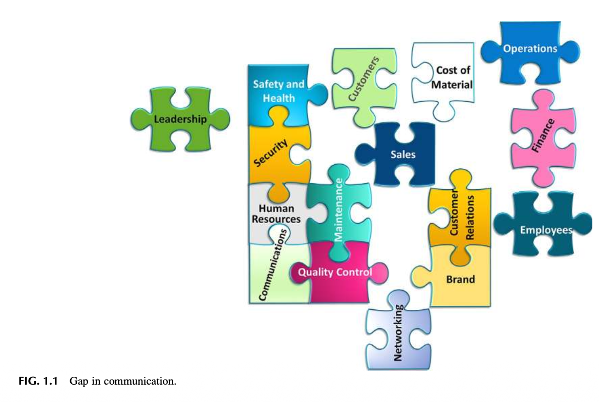

그림 1.1 커뮤니케이션의 공백 (Gap in communication).

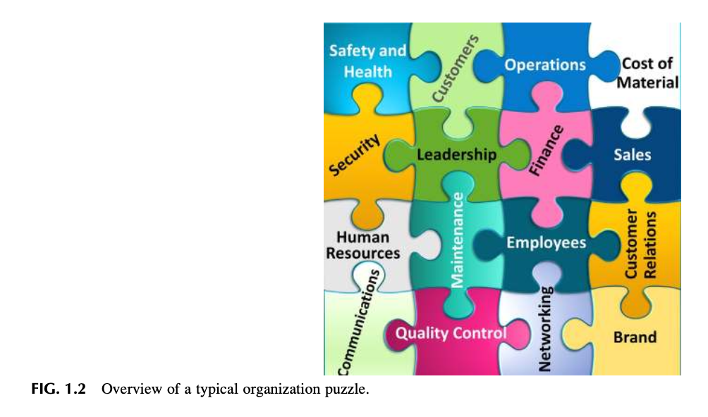

그림 1.2 전형적인 조직 퍼즐의 전반적 개요 (Overview of a typical organization puzzle).

## 창발적 특성으로서의 안전 (SAFETY AS AN EMERGENT PROPERTY)

저자들은 안전이 조직의 전반적인 문화 내부에서 하나의 **'창발적 특성(Emergent Property)'**으로 간주되어야 한다는 논거를 제시해 왔다. 안전은 조직의 수많은 상호 관련된 프로세스들과 구성 요소들의 능동적인 관여와 긴밀한 얽힘으로부터 비롯되는 결과물이다. 

**창발적 특성(Emergent property)**이란, 구성 객체들이 상위 수준의 종합적 집합체를 '구축'하기 위해 제약적 관계 속에서 결합될 때 비로소 '창발(출현)'하는 고유한 특성이며, 두 개 이상의 단순한 구성 요소들의 결합으로부터 예측 불가능하게 나타나는 새로운 특성을 의미한다 (Emergent Property, 2018). 

안전 전문가의 핵심 역할 중 하나는 조직의 지배적인 상위 문화를 심층적으로 이해함으로써 조직의 모든 측면들 간의 개인적·전문적 관계를 향상시키는 것이다. 문화를 이해한다는 것은 사람들이 어떻게 반응하고, 어떻게 협력하며, 무엇을 믿고, 어떻게 소통하는지를 이해하는 것을 요구한다. 조직이 어떻게 결합되고 맞물리는가에 따라 안전한 환경이 창발할 수도 있고, 불안전한 환경이 창발할 수도 있다. 

웬델 프렌치(Wendell French)와 세실 벨(Cecil Bell)이 그들의 고전적 저서 『조직 개발: 조직 개선을 위한 행동과학적 개입(Organizational Development, Behavioral Science Interventions for Organizational Improvement)』(French & Bell, 1984)에서 제시한 조직 모델은 **"환경(Environment), 기술(Technology), 과업(Task), 인간-사회적 요소(Human-social), 구조(Structure), 목표(Goals)"**라는 상호 연동되는 6대 핵심 영역으로 구성된 모델을 제공한다. '조직 개선의 6대 연동 영역'에 대한 개요는 그림 1.3을 참조하라. 

만약 어떠한 정렬 불일치(Misalignment)나 누락된 관계가 존재하고 거기에 고유한 재해(Hazard)까지 가세한다면, 손실을 초래하는 사고(Loss-producing event)가 발생할 확률을 증가시키는 '공백(Gap)'이 형성될 수 있다.

그림 1.3 조직 개발의 6대 연동 영역 (Six interlocking areas of organizational development).

이러한 '창발적(Emergent)' 특성 모델은 안전 전문가의 본원적 역할을 근본적으로 변화시킨다. 이는 단순히 다양한 전통적 안전 프로그램을 개발하는 협소한 강조점에서 벗어나 거시적인 조직적 접근법(Organizational approach)으로의 전환을 제공한다. 

이러한 접근법은 조직 내의 제반 요소들이 지닌 고유한 재해(Hazard)와 관련된 위험(Risk)를 '수용 가능한 통제 상태' 내로 유지하도록 보장한다. 즉, 노력의 초점이 단순히 규제 법령 프로그램을 관리하는 수준에서 벗어나, 조직의 강점과 약점을 정확히 이해한 바탕 위에서 프로세스가 설계되도록 보장하는 것으로 이동한다. 

그렇다면 수용 가능한 통제(Acceptable Control)란 무엇인가? 무엇이 수용 가능하며, 누구의 관점에서 수용 가능한 것인가? 내부적 관점인가? 외부적 관점인가? 조직의 각 직급 계층의 관점인가? 지역사회의 관점인가? 정치적 관점인가? 엔지니어링의 관점인가? 영업 부서의 관점인가?

## 안전에 대한 지각 (THE PERCEPTION OF SAFETY)

조직의 리더십 팀, 경영진, 그리고 모든 직급의 관리감독자들은 언제나 조직의 성공을 달성하는 데 가장 최선이라고 믿는 의사결정을 내린다. 그렇지 않다면 그 조직은 결국 실패에 직면할 것이기 때문이다. 리더십의 의사결정은 조직 내부와 외부로부터 유입되는 연속적인 정보의 흐름(Continuous flow of information)으로 간주될 수 있다. 

의사결정은 이러한 정보에 기반하여 내려지며, 비즈니스의 현재 상태와 안전 노력에 대한 지각(Perceptions)을 양분 삼아 이루어진다. 조직이 재해(Hazard)와 위험(Risk)를 수용 가능한 한계 내로 유지하고자 한다면, 안전경영시스템으로부터 도출되는 정보가 이 데이터 스트림에 반드시 통합되어야만 한다. 

만약 초점이 지속적인 리스크 평가가 아니라 과거의 손실 이력에만 맞춰져 있다면, 리더십의 의사결정은 심각한 치명적 손실의 잠재력을 과소평가하게 될 수 있다. 시간과 예산은 유한하기 때문에, 리더십의 관심은 오직 현재의 비즈니스 목표와 목적을 달성하는 데 가장 적합해 보이는 조치들에만 집중될 수밖에 없다. 조치와 의사결정은 리더십의 경험과 전문성, 선입견, 그리고 핵심 기능 부서들로부터 흘러나오는 데이터 스트림을 통해 형성된 개인적 의견에 기초한다. 

안전의 정의에 대한 리더십의 선입견이 갖는 중요성은 아무리 강조해도 지나치지 않다. 리더십의 관심을 누가 차지하고 있는지에 대한 전반적 개요는 그림 1.4를 참조하라. 안전 전문가의 과업은 리더십 팀으로 하여금 운영상에 내재된 재해(Hazard)와 관련 위험(Risk)의 전체 범위를 지속적으로 명확히 인식하도록 유지하는 것이다. 

방대한 데이터와 결정들이 소용돌이치는 환경 속에서, 다른 많은 분야들이 자신들의 요구사항이 최우선 순위라고 믿고 있는 치열한 경쟁의 장에서 리더십의 의사결정에 긍정적인 영향을 미치기 위해 부단한 노력을 기울여야 한다. 조직 내에서 커뮤니케이션이 어떻게 구조화되고 흘러가는지를 깊이 이해해야만, 재해(Hazard)와 위험(Risk)에 관한 중대하고 결정적인 정보들이 왜곡 없이 네트워크를 통해 신속하게 전달되도록 보장할 수 있다. 

**지각(Perception)**: 사람들이 주변 세계로부터 정보를 선택, 조직, 해석, 검색, 그리고 이에 반응하는 일련의 인지적 과정 (Schermerhorn, Hunt, Osborn, & Osborn, 2004). 

조직 내에서는 여전히 안전 전문가가 조직의 모든 '안전' 활동에 대해 전적인 책임을 져야 한다는 지각이 팽배해 있다. 통상적으로 직무기술서(Job description)는 안전 관리자를 '안전'과 관련된 모든 활동을 전담하여 수행하는 주된 개인으로 규정하면서,

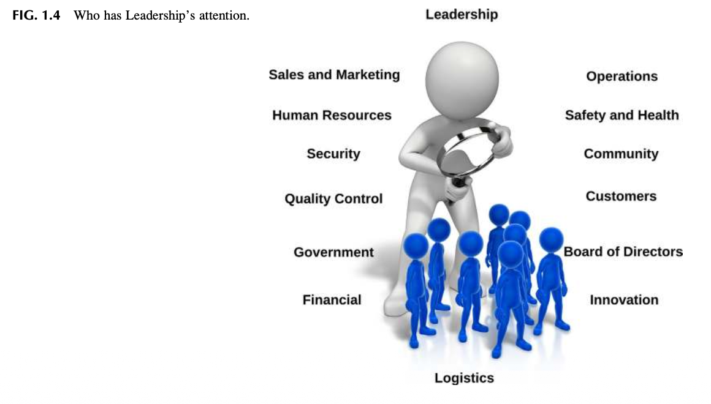

그림 1.4 리더십의 관심을 차지하고 있는 주체들 (Who has Leadership’s attention).

요구되는 수많은 기술 목록들을 길게 나열하고 있다. 그러나 이러한 직무기술서에는 일반적으로 명확히 규정된 권한(Authority)과 리더십 역할이 결여되어 있는 경우가 대부분이다. 만약 안전이 앞서 정의된 바와 같이 조직의 창발적 특성(Emergent property)이라면, 그 어느 단 한 사람의 개인에게도 조직 내에 존재하는 전반적인 안전문화에 대한 모든 책임을 전가할 수는 없다. 서면화된 직무기술서를 개발하고 실행하는 가치에 대한 상세한 논의는 제7장을 참조하라.

### 관찰 3 (Observation 3)

최근 제임스(James)는 다른 안전 전문가와 안전 추진 노력에 관해 이야기를 나누었다. 이 대화에서 그 전문가는 아무런 안내나 지침도 받지 못한 채 신임 안전 관리자로 갓 승진했을 때의 경험을 털어놓았다. 그 사람은 '스스로 알아서 해결하라'는 말만 들었다고 했다. 

그는 자신이 마치 8번 공 뒤에 갇힌 것처럼—"매우 불리하고 곤란한 처지, 패배할 수밖에 없는 열세의 위치"(Behind the Eight Ball, 2018; 그림 1.5 참조)—느껴졌다고 진술했다. 수많은 실무자들과 나눈 대화에 비추어 볼 때, 이러한 현상은 직장에서 대단히 흔하게 발생하는 것으로 보인다. 제임스 역시 자신의 조직에서 처음 안전 업무를 이끌도록 요청받았을 때 바로 이러한 상황에 처했던 기억을 생생하게 떠올렸다.

그림 1.5 에이트 볼 뒤에 갇힌 처지 (Behind the Eight Ball).

## 조직 내에서 안전 전문가는 어떻게 지각되는가? (HOW IS THE SAFETY PROFESSIONAL PERCEIVED IN AN ORGANIZATION?)

**지각(The Perception)**: 대부분의 전문 직업군에는—좋든 나쁘든—그 직업과 연관된 고정관념(Stereotype)이 존재한다. '은행원', '엔지니어', '교사', '경찰관', '코치', '정치인' 등의 직함을 들었을 때 머릿속에 무엇이 떠오르는지 생각해 보라. 그러한 시각적 이미지는 해당 역할을 맡은 사람의 기대 행동이 어떠해야 하는지를 암시하며, 특정 역할에 대한 규범, 습관, 행동 양식을 강화한다.

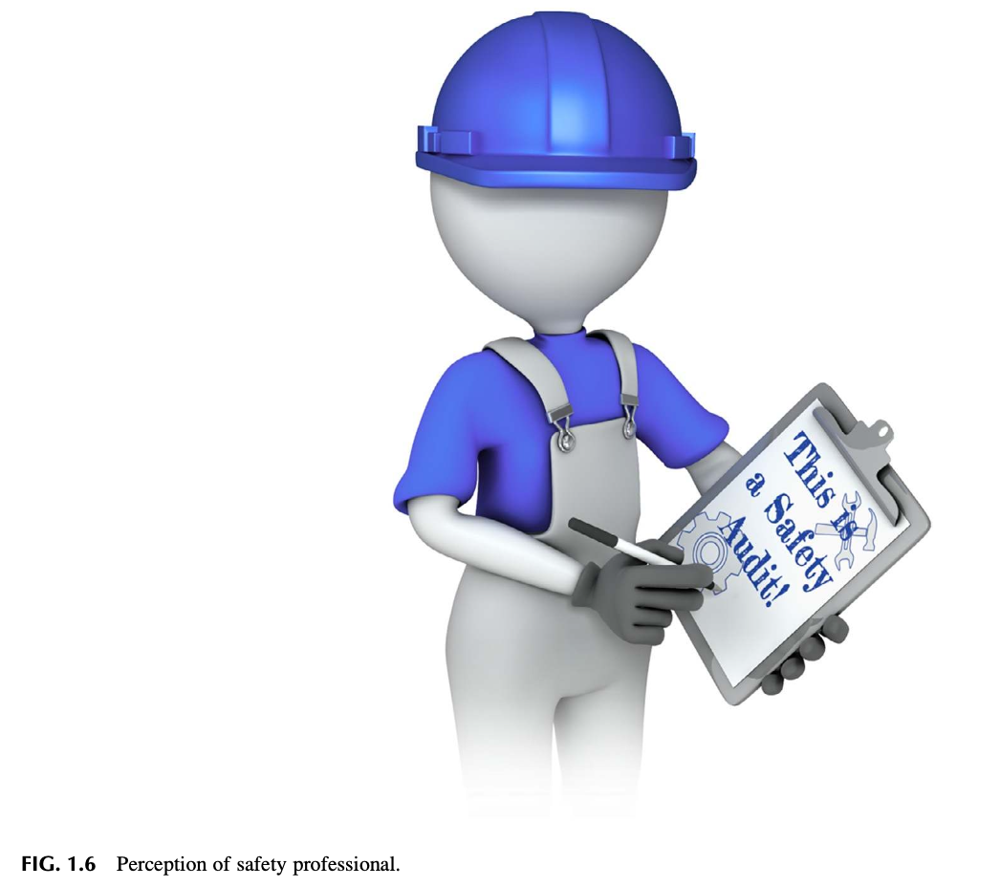

그림 1.6 안전 전문가에 대한 지각 (Perception of safety professional).

문제는 '안전 관리자(Safety Manager)', '안전 리더(Safety Leader)', 또는 '안전 코디네이터(Safety Coordinator)'라는 직함이 안전 전문가의 역할에 대해 오랜 세월 동안 형성되어 온 부정적인 이미지의 역사를 즉각적으로 연상시킨다는 점이다. 

대부분의 사람들은 안전 전문가를 안전모를 쓰고 클립보드를 손에 든 인물로 머릿속에 시각화한다 (그림 1.6 참조). 안전 전문가의 이미지는 작업 현장을 돌아다니며 불안전한 요소들을 찾아내고, 법규 조항을 읊조리거나, 오직 개인보호구(PPE) 착용만을 강요하는 사람으로 각인되어 있다. 

이러한 이미지가 안전 전문가의 역할 중 한 단면을 묘사하고 있기는 하지만, 그것이 여전히 지배적인 이미지로 군림하고 있다는 것이 문제이다. 이 이미지는 안전 전문직의 공인된 상징으로 굳어져 왔다. 이는 오랜 시간에 걸쳐 다양한 출판물과 관행적 전통에 의해 조장된 이미지이다. 

이러한 지각 자체가 본질적으로 무조건 잘못되었다는 것은 아니다. 적절한 상황에서 개인보호구 착용을 주창하고 작업 조건에 대해 메모를 작성하는 것은 분명 필요한 일이다. 그러나 만약 지각이 오직 거기에만 머물러 멈춰 선다면, 리더십은 조직 내에서 안전 전문가의 역할이 지니는 장기적인 전략적 가치를 온전히 이해하지 못할 것이다. 

이러한 이미지가 바뀌지 않는 한, 안전 전문가는 조직 내에서 끊임없이 '적대적 역할(Adversarial role)'에 놓이게 된다. 이러한 편협한 지각을 전환하기 위해서는, 안전 전문가의 이미지를 안전문화를 형성하고 조직에 진정한 가치를 제공하는 데 필요한 리더십 역량을 갖춘 전문직(Professional)으로서 완전히 새롭게 바라보아야 한다.

### 관찰 4 (Observation 4)

네이선(Nathan)에게 다음과 같은 질문이 던져졌다. "기업에서 손쉽게 따르고 실행할 수 있는 안전 알고리즘을 가지고 계십니까?" 이 질문을 던진 경영 컨설턴트들은 자신들이 왜 이러한 질문을 하는지 그 배경을 이어서 설명했다. 

"저희는 고객사 안전 관리자들과 관련하여 큰 문제를 겪고 있습니다. 저희 고객사 안전 관리자 중 몇 분이 고위 경영진 직급으로 승진했습니다. 그런데 그분들은 다른 경영진들과 전혀 '같은 언어'로 대화하지 못합니다. 고객사 최고 리더십으로부터 이런 질문을 받습니다: '도대체 저 사람들이 무슨 말을 하고 있는 겁니까? 우리는 그들이 무슨 말을 하는지 도무지 이해할 수가 없습니다!'" 

이 관찰은 안전 전문가가 조직의 언어와 커뮤니케이션 스타일을 깊이 이해해야 할 필요성에 대해 무엇을 시사하고 있는가?

## 지각이 가장 먼저다 (PERCEPTION COMES FIRST)

누군가가 방에 들어서거나, 회의를 주재하거나, 구두 보고를 하거나 서면 발표를 진행할 때 형성되는 '지각'을 떠올려 보라. 한 개인이 보여주는 전문적 이미지는 그의 아이디어와 개념이 상대방에게 어떻게 수용되는지에 직접적인 영향을 미친다. 

그 사람은 조직 리더십의 품격과 스타일을 반영하는 전문적 이미지를 갖추고 있는가? 그 이미지는 동료, 근로자, 그리고 리더십 팀에게 거만하거나 불쾌감을 주지 않으면서도 자신이 말하고 있는 바를 명확하고 간결하며 자신감 있게 꿰뚫고 있는 신뢰할 수 있는 인물이라는 확신을 전달하고 있는가? 그 이미지는 진정으로 신뢰할 수 있는 사람의 모습을 그려내고 있는가? 

"경영진으로서의 존재감(Executive presence)은 대단히 직관적이며 명확히 규정하기 어렵지만, 궁극적으로는 성숙한 자신감을 보여줄 수 있는 능력으로 귀결된다. 즉 어렵고 예측 불가능한 상황을 장악하여 통제하고, 시의적절하게 결단을 내리며, 경영진의 다른 유능하고 기가 센 구성원들 사이에서도 당당히 자신의 입지를 지켜낼 수 있다는 신뢰감이다." — 비슨 (Beeson, 2012). 

이전의 안전 담당자가 남긴 잔존 이미지는 전임 안전 담당자의 외모나 존재감의 강도에 따라 극복해야 할 오랜 잔재를 남겼을 수 있다 (표 1.1 참조). 

안전 전문가의 역할에 대해 왜 다음과 같은 질문들이 끊임없이 제기되는 것일까: 
"왜 리더십은 내 말을 경청하지 않는가?" 또는 "왜 리더십은 내가 하는 일의 중요성을 알아주지 않는가?" 
"왜 리더십은 안전의 역할을 조직의 나머지 부분과 분리된 별개의 것으로 지각하는 것일까?" 

안전한 작업 환경을 대놓고 반대하는 조직은 거의 없다. 그러나 균형을 맞추어야 할 수많은 경영 조치들이 경합하는 현실 속에서, 특정 안전 이슈가 지니는 가치나 중요성에 대한 강력하고 설득력 있는 논거(Case)를 제시하는 것은 언제나 절대적으로 필요하다.

## 퍼스널 브랜딩 (PERSONAL BRANDING)

조직의 브랜드는 그들이 고객에게 어떻게 지각되는지, 그리고 고객에게 어떠한 가치를 제공하는지를 정의한다. 이 개념은 조직 내의 직급이나 위치와 무관하게 개인에게도 정확히 똑같이 적용된다. 

안전문화를 개발하거나 개선하는 프로세스를 시작할 때, 가장 먼저 안전이 어떻게 지각되고 있는지, 즉 안전의 '브랜드(Brand)'가 무엇인지에 대한 초기 진단 평가가 선행되어야 한다. 

조직의 전반적인 문화 속에서 개인의 '브랜드'를 비판적으로 되돌아보는 것은 개인적 차원과 전문적 차원 모두에서 변화의 여정을 시작하는 출발점이 된다. 만약 그 브랜드가 아무런 가치도 제공하지 못한다면, 리더십과 직원들은 안전 기능을 결코 진지하게 받아들이지 않을 것이다 (그림 1.7 및 표 1.2 참조).

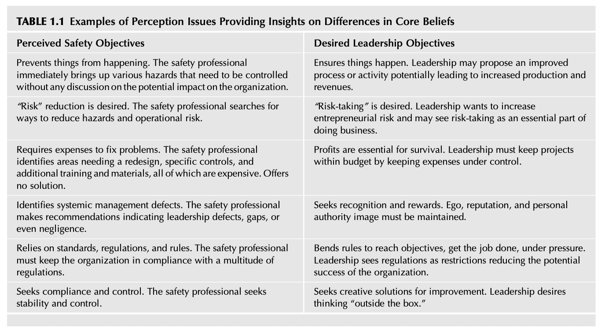

표 1.1 핵심 신념의 차이에 대한 통찰을 제공하는 지각 이슈의 사례 (TABLE 1.1 Examples of Perception Issues Providing Insights on Differences in Core Beliefs)

| 지각된 안전 목표 (Perceived Safety Objectives) | 추구하는 리더십 목표 (Desired Leadership Objectives) |
| :--- | :--- |
| **일이 발생하는 것을 방지한다 (Prevents things from happening).** 안전 전문가는 조직에 미칠 잠재적 영향에 대한 논의 없이 즉각 통제되어야 할 다양한 재해(Hazard)만을 앞세워 제기한다. | **일이 일어나도록 보장한다 (Ensures things happen).** 리더십은 생산과 수익 증대로 이어질 수 있는 개선된 프로세스나 활동을 제안하고자 한다. |
| **"리스크" 감소를 추구한다 ("Risk" reduction is desired).** 안전 전문가는 위험과 운영 리스크를 줄이기 위한 방안만을 모색한다. | **"리스크 감수"를 추구한다 ("Risk-taking" is desired).** 리더십은 기업가적 위험 감수를 확대하기를 원하며, 리스크를 감수하는 것을 비즈니스를 수행하는 필수적 일부로 여긴다. |
| **문제 해결을 위해 비용 지출을 요구한다 (Requires expenses to fix problems).** 안전 전문가는 재설계, 특정 통제 장치, 추가 교육 및 자재가 필요한 영역을 식별하는데, 이 모든 것은 비용이 많이 든다. 해결책은 제시하지 않는다. | **생존을 위해 이익 창출은 필수적이다.** 리더십은 경비를 엄격히 통제함으로써 프로젝트가 정해진 예산 범위 내에서 유지되도록 통제해야 한다. |
| **시스템적 관리 결함을 지적한다 (Identifies systemic management defects).** 안전 전문가는 리더십의 결함, 공백, 심지어 과실을 지적하는 개선 권고사항을 제시한다. | **인정과 보상을 추구한다 (Seeks recognition and rewards).** 자존심(Ego), 평판, 그리고 개인의 권위 이미지는 반드시 보호되고 유지되어야 한다. |
| **표준, 법규, 규칙에만 의존한다 (Relies on standards, regulations, and rules).** 안전 전문가는 조직이 수많은 법적 규제를 준수하도록 강제해야 한다. | **목표를 달성하고 압박 속에서 일을 완수하기 위해 규칙을 유연하게 적용한다 (Bends rules to reach objectives, get the job done, under pressure).** 리더십은 규제가 조직의 성공 잠재력을 저해하는 제약 요인이라고 바라본다. |
| **규정 준수와 통제를 추구한다 (Seeks compliance and control).** 안전 전문가는 불변의 안정성과 엄격한 통제를 추구한다. | **개선을 위한 창의적 솔루션을 모색한다 (Seeks creative solutions for improvement).** 리더십은 "틀에서 벗어난 사고(Thinking outside the box)"를 갈망한다. |

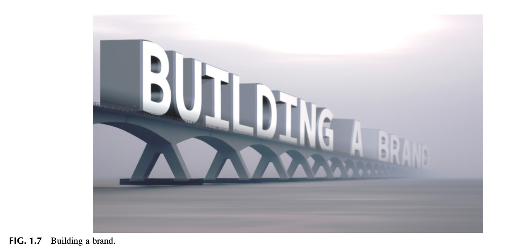

그림 1.7 브랜드 구축 (Building a brand).

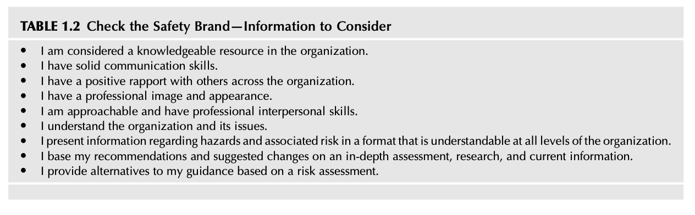

표 1.2 안전 브랜드 점검 — 고려해야 할 질문 사항 (TABLE 1.2 Check the Safety Brand—Information to Consider)

* 나는 조직 내에서 지식과 식견을 갖춘 전문가 자원으로 인정받고 있는가?
* 나는 탄탄하고 명확한 커뮤니케이션 기술을 갖추고 있는가?
* 나는 조직 전반의 다양한 사람들과 긍정적인 라포(Rapport, 신뢰 관계)를 형성하고 있는가?
* 나는 전문직다운 전문적인 이미지와 용모를 갖추고 있는가?
* 나는 다가가기 쉬운 사람이며 전문적인 대인관계 능력을 발휘하고 있는가?
* 나는 조직의 생리와 그 당면 현안 이슈들을 깊이 이해하고 있는가?
* 나는 재해(Hazard)와 관련 위험(Risk)에 관한 정보를 조직의 모든 계층이 쉽게 이해할 수 있는 형식으로 제시하고 있는가?
* 나는 심층적인 평가, 엄밀한 연구, 그리고 최신 정보에 근거하여 개선 권고사항과 제안을 내놓고 있는가?
* 나는 정밀한 리스크 평가에 근거하여 나의 지침에 대한 실행 가능한 대안들을 함께 제공하고 있는가?

"브랜드란 소비자가 하나의 제품이나 서비스를 다른 것 대신 선택하도록 이끄는 기대감, 기억, 이야기, 그리고 관계들의 총체적인 집합이다. 소비자(그것이 기업이든, 개별 구매자든, 유권자든, 기부자든)가 프리미엄 가격을 지불하지 않거나, 그것을 선택하지 않거나, 입소문을 퍼뜨리지 않는다면, 그 소비자에게 브랜드 가치는 전혀 존재하지 않는 것이다." — 고딘 (Godin, 2009).

핵심 질문: 나의 개인적·전문적 브랜드는 균형 잡힌 전문적인 이미지를 보여주고 있으며, 리더십과 직원들, 그리고 안전 부서와 협력하는 모든 구성원들의 기대에 부응하고 있는가?

### 관찰 5 (Observation 5)

안전 관리직을 수락한 직후, 저자 중 한 명은 "어떤 슈트를 입으실 건가요?"라는 질문을 받았다. 
"슈트라니요?" 그가 되물었다. 
"네, 이전 안전 관리자는 슈퍼맨 슈트를 입었거든요. 특별 안전 회의나 축하 행사 때 어떤 슈트를 입으실 건가요?" 
"아무것도 안 입습니다(입지 않겠습니다)!"가 그의 대답이었다. 

이 사업장에서 안전 관리자의 기존 브랜드는 무엇이었는가? 그 브랜드는 과연 안전관리에 대한 전문적인 접근을 고취하고 있었는가?

## 조직적 마찰? (ORGANIZATIONAL FRICTION?)

조직 내의 마찰(Friction)은 "서로 다른 생각, 희망 사항 등으로 인해... 사람들 사이에 불화나 갈등"을 야기할 수 있다 (Friction, 2018). '마찰'은 리더십과 구성원이 어떻게 조직되어 있든 간에 모든 조직에서 지극히 전형적으로 발생한다. 

안전 프로세스에 대해 리더십과 직원이 서로 다른 지각을 갖게 되면, 이는 조직의 수많은 계층 전반으로 확산되는 '조직적 마찰'을 유발할 수 있다. 

"마찰이란 사람들이 삶에서 성취하고자 하는 바를 가로막는 모든 방해물이다." — 로젠블럼과 버그 (Rosenblum and Berg, 2017). 

조직적 마찰이란 무엇인가? 비즈니스 팀들은 상충되는 철학, 전문 분야, 전문 지식으로 인해 때때로 서로 다른 우선순위를 갖는다. 이러한 자연스러운 현상의 결과로 실체 전체를 가로지르는 조직적 마찰이 발생한다. 그룹들이 서로 정렬되지 않은 상충된 목표를 향해 일할 때 팀 갈등이 고조되고 목표 달성률은 떨어지며, 따라서 조직적 마찰은 증폭된다 (Is Organizational Friction Killing Your Firm’s Productivity?, 2014). 

조직 계층 간 안전 지각의 차이는 특정한 안전 행동과 조치에 대한 거부와 저항을 초래할 수 있다. 안전 리더십은 자연스럽게 발생하는 마찰이 안전 부서의 목표와 비즈니스 팀의 목표 간 충돌의 결과일 수 있음을 반드시 이해해야 한다. 

안전한 환경을 달성하기 위해, 안전 리더십은 조직의 각 계층과 함께 목표의 우선순위를 정하고 이를 지속적으로 유지할 수 있도록 지원해야 한다. 안전 부서, 리더십, 현장 직원의 세 가지 기능으로 구성된 안전 시스템을 생각해 보라. 만약 이 시스템 기능들이 안전에 대해 서로 다른 지각을 품고 있다면, 이러한 불일치는 조직 내에 격심한 마찰을 야기한다. 

이러한 조직 기능들은 안전 구성 요소에 대해 아무런 공감도 갖지 못할 수 있다. "그들은 오직 높아진 기대치만을 갖고 있을 뿐이다" (Rosenblum & Berg, 2017). 

리더십의 전폭적인 지원 속에서 커뮤니케이션과 상호 기대치가 완벽히 일치할 때, 조직의 안전 목표와 지각은 내부 마찰을 우회하고 안전한 환경을 구현할 잠재력을 극대화할 수 있다 (그림 1.8 참조).

## 안전에 대한 조직의 멘탈 모델은 무엇인가? (WHAT IS THE ORGANIZATION’S MENTAL MODEL FOR SAFETY?)

멘탈 모델(Mental Models, 심성 모형)은 우리가 주변 세계로부터 받아들이는 무수한 입력 정보들을 단순화하고 체계화할 수 있게 해주는 지적 구조이다. 멘탈 모델은 우리의 사고, 의사결정, 견해, 가치관, 신념을 형성하고 지지한다 (Koch, 2007). 지각(Perceptions)과 멘탈 모델은 매우 유사하다. 

피터 센게(Peter Senge)는 『제5경영 핸드북(Fifth Discipline Handbook)』에서 멘탈 모델을 "우리 자신, 다른 사람들, 제도, 그리고 우리 세계의 모든 측면에 대해 우리 마음속에 품고 있는 이미지, 가정, 이야기"라고 정의했다 (Senge, 2006). 

이러한 이해를 발전시키기 위해서는 리더십의 모든 계층 및 직원들과 신중하고 깊이 있는 논의가 요구된다. 

"세계는 각자의 사익을 추구함으로써 서로에게 기여하는 수십억 명의 자기 이익적 개인들로 구성되어 있다. 만약 개인이나 기업이 타인에게 기여하지 못한다면, 그 자신에게 기여하는 데에도 실패할 것이다." — 월링 (Walling, 2008).

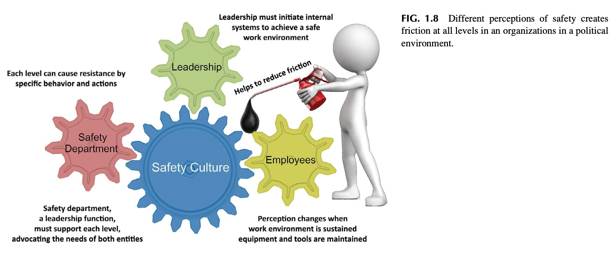

그림 1.8 안전에 대한 서로 다른 지각이 초래하는 영향 (Different perceptions of safety creates friction).

정치적 환경 속에서 조직의 모든 계층에 걸쳐 발생하는 마찰. 안전 관리가 품고 있는 멘탈 모델과 과거에 그 프로세스가 어떻게 관리되었는지에 기반하여 특정한 지각이 형성되어 있을 수 있다. 과거 안전 관련 이슈에 적용되었던 관리 스타일은 어떠했으며, 현재는 어떤 방식이 사용되고 있는가?
* 주된 관심사가 오직 법적 규제 준수, 규칙, 규정에만 머물러 있는가?
* 안전 접근법이 단지 최소한의 노력에 불과하여, 오직 불가피하게 필요할 때에만 변화를 시도하려는 의도로 일이 발생하도록 방치하고 있는가?
* 확립된 안전 프로세스가 리더십에 의해 제도적으로 의무화되어 있는가? 추진 노력들이 조율되고 있으며 통일된 접근법을 따르고 있는가?
* 논의와 관찰을 통해 볼 때, 현재의 안전 프로세스가 조직의 비전이나 사명과 상충되는 것으로 인식되고 있는가?

사용 중인 안전관리의 스타일과 관련된 구성원들의 성격 특성은 안전 관련 기준에 대한 지각을 왜곡시켰을 수 있다. 안전문화에 미치는 영향을 파악하고 그러한 지각을 전환하기 위해 어떤 조치가 필요한지 결정하려면 이 점을 반드시 명확히 이해해야 한다. 

제이 라이트 포레스터(Jay Wright Forrester)는 일반적인 멘탈 모델을 다음과 같이 정의했다: "우리가 머릿속에 품고 있는 우리 주변 세계의 이미지는 하나의 모델에 불과하다. 그 누구도 머릿속에 전 세계나 정부, 국가의 모든 실체를 온전히 그릴 수는 없다. 인간은 단지 선택된 개념들과 그들 간의 관계만을 취하여 실제 시스템을 표현하는 데 사용할 뿐이다" (Mental model, 2018).

### 관찰 6 (Observation 6)

저자 중 한 명은 보안(Security) 책임까지 함께 맡고 있던 한 기업의 안전 부서와 협력하여 일한 적이 있다. 많은 조직들이 이러한 기능들을 중첩하거나 통합하여 운영하며, 대개의 경우 원활히 조율될 수 있다. 

그러나 이 특정 사업장 상황에서는, 안전 담당 직원이 보안 점검 일정을 잡은 뒤 제품 도난 사건에 대해 거짓말 탐지기를 동원하여 심문을 진행하곤 했다. 만약 거짓말을 한 것으로 드러나면 유죄로 판명된 직원은 즉시 해고될 수도 있었다. 반면 다른 방문 때에는 그 동일한 직원이 안전 평가를 수행하면서, 어떠한 개선 조치가 필요한지에 대해 솔직하고 기탄없는 의견을 직원들에게 요청하곤 했다. 

이러한 모순된 조치의 결과는 뻔했다. 그 어떤 직원도 안전 부서 직원과 말을 섞으려 하지 않았고, 그 어떤 자발적인 협조도 제공하지 않으려 했다.

## 다학제적 전문직업으로서의 안전 (SAFETY, A MULTIDISCIPLINARY PROFESSION)

안전 전문가는 조직의 규모와 운영 범위에 따라 수많은 모자를 번갈아 쓰며(다양한 역할을 수행하며) 일련의 광범위한 책무를 부여받을 수 있다. 안전 전문가에 대한 지각에 관한 우리의 논의를 명확히 예시하기 위해, 직무와 책임의 실제 사례를 다룬 부록 1.1을 참조하라. 

이 직무기술서는 일부 조직들이 안전 전문가가 도대체 무엇을 수행해야 한다고 믿고 있는지에 대한 생생한 통찰을 제공한다. 이는 인터넷 구인 사이트에 실제로 게시되었던 전형적인 '안전 관리자 직무기술서'이다. 게시된 이 직무기술서는 수많은 조직들이 안전 관리자를 바라보는 시각을 여실히 보여준다. 

이 직무기술서, 책임, 직무 및 자격요건을 읽어보면서 독자 여러분께서 다음의 몇 가지 사항을 깊이 생각해 보기를 바란다:
* 이 직위에 있는 안전 전문가가 과연 나열된 모든 요구조건들을 완수하고 성공할 수 있다고 생각하는가?
* 리더십 팀은 나열된 방대한 정보를 갖춘 잠재적 직원을 도대체 어떻게 선발하고 매칭할 수 있을 것인가?
* 만약 여러분이 이 직위에 지원하기로 결정했다면, 여러분의 전문성이 명시된 요구조건과 완벽히 부합한다는 점을 면접관에게 어떻게 설득할 것인가?

이러한 직무기술서들이 보여주듯이, 안전 전문가는 조직 내의 모든 경계를 넘나들며 협력하고 일하는 데 필수적인 수많은 학문 분야의 전문 지식을 반드시 갖추어야 한다 (그림 1.9 참조; General Staff Function, 2017; Incident Command Model—Position Titles, 2008).

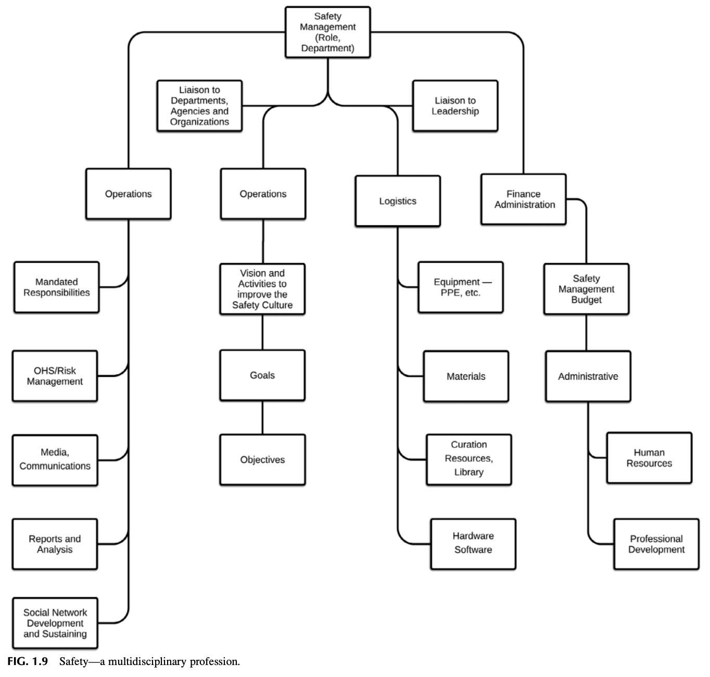

그림 1.9 다학제적 전문직업으로서의 안전 (Safety—a multidisciplinary profession).

## 교훈 1 (LESSON LEARNED 1)

저자들은 새로운 안전 직무를 탐색할 수 있는 여러 차례의 기회를 가졌던 기억이 있다. 이 구직 과정에서 가장 좌절스러웠던 부분은 구인 공고에 자신의 이력서를 완벽히 일치시키려고 애쓰는 일이었다. 

오늘날 인터넷과 소셜 미디어에 대한 접근성은 이러한 과정을 크게 간소화했다. 구직 활동은 과거에도 어려웠고, 오늘날에도 이력서 정보가 분류되고 처리되는 방식 때문에 여전히 도전적인 과제로 남아 있다. 

이력서를 작성하고 구축하는 과정은 인터넷에서 특정 웹사이트나 제품을 검색할 때 핵심 키워드(Keyword) 검색을 수행하는 것과 대단히 유사하다. 전문가를 위한 소셜 미디어 도구를 다룬 제16장 부록 16.2의 키워드 활용 논의를 참조하라. 자신의 이력서에 들어가는 키워드의 수를 전략적으로 늘리는 방법을 활용하면, 이력서의 노출도를 높이고 채용 공고와 이력서가 매칭될 확률을 극대화할 수 있다.

## 교훈 2 (LESSON LEARNED 2)

모든 직무기술서에서 검토되는 내용을 바탕으로 볼 때, 구직 직위에 지원서를 제출할 때 **'직무 격차 분석 및 상호작용 양식(Job Gap Analysis and Interaction Form)'**의 작성을 진지하게 고려할 것을 권장한다. 이 양식에는 채용 후보자를 검색하고 매칭하는 데 사용될 구체적인 핵심 키워드들이 포함되기 때문이다. 

이력서 제출을 통해 긍정적인 서류 합격 반응을 이끌어내는 데 도움을 줄 수 있는 '제안된 직무 격차 분석 및 상호작용 양식'과 '강점, 약점, 기회, 위협(SWOT) 매트릭스'에 대한 논의는 부록 1.2를 참조하라. 

강점, 약점, 기회, 위협(SWOT) 매트릭스에 관한 추가적인 정보는 안전 시스템 개선을 돕기 위해 엄선된 프로세스 도구들을 다룬 제6장 부록 6.5의 매트릭스 활용에 관한 간략한 논의를 참조하라.

## 시간관리 매트릭스의 활용 (USING A TIME MANAGEMENT MATRIX)

코비(Covey)는 그의 고전적 명저 『성공하는 사람들의 7가지 습관(Seven Habits of Highly Successful People)』(Covey, 1990)에서 주의력의 분산과 '중요하지만 긴급하지 않은 활동'에 집중해야 할 필요성에 대해 논의했다. 

자신에게 할당된 일상적 역할과 책임은 안전경영시스템의 본원적인 목표와 목적들로부터 점진적으로 멀어지는 표류(Drift)를 유발할 수 있다. 

"중요한 것은 거의 긴급하지 않으며, 긴급한 것은 거의 중요하지 않다." — 드와이트 D. 아이젠하워 (Dwight D. Eisenhower).

### 관찰 7 (Observation 7)

제임스는 한 생산 현장의 문제에 대해 다양한 분야의 전문가들이 한 팀으로 긴밀히 협력하여 안전 문제를 멋지게 해결했던 경험을 기억하고 있다. 

작업자들이 오버헤드 컨베이어에서 부품을 내리려고 애쓰다가 어깨 부상을 당하는 일이 빈번히 발생하고 있었다. 그 컨베이어는 제품을 조립하기 위해 5개의 서로 다른 생산 라인에 여러 부품들을 연속적으로 공급하는 데 사용되고 있었다. 이 다발성 부상 문제에 대한 정밀 조사를 진행한 결과, 산업공학 기술자(IE)들이 생산 라인에 부품을 공급하기 위해 이 컨베이어를 수동으로 동기화하고 있었다는 사실이 밝혀졌다. 

라인 전환 시점이 되면, 산업공학 엔지니어와 유지보수 담당자가 지정된 후크에 색상 태그를 수작업으로 부착하여 각 제품이 정확한 시간에 특정 위치에 도달할 수 있도록 동기화했다. 그런 다음 산업공학 엔지니어는 다음 교대근무 동안 라인 변경의 성공 여부를 평가하고 누락된 공백을 기록하곤 했다. 이러한 생산 엔지니어링 수정 작업은 컨베이어를 완벽히 동기화하는 데만 약 1주일의 시간이 소요되었다. 앞서 기술했듯이, 무거운 생산 부품을 손으로 걸고 내리는 반복 작업이 지속적인 부상 잠재력을 유발했던 것이다. 

컴퓨터 프로그래머와의 협업을 통해, 컨베이어 라인 변경의 동기화를 획기적으로 개선하고 작업자의 부상 잠재력을 근본적으로 줄여주는 자동화 프로그램이 개발되었다. 이 사건은 다른 전문 분야들과 안전 전문가가 생산성을 증대시키고 작업자 부상을 줄이기 위한 컴퓨터 기반 솔루션에 어떻게 상호 합의에 도달할 수 있는지를 생생하게 보여준다. 

문제 해결을 위한 이러한 다학제적 협력 접근법의 성공적인 결과는 이 생산 공장에서 안전에 대한 기존의 편협한 지각을 완전히 바꾸어 놓았다. 

드와이트 D. 아이젠하워는 우리가 제15장에서 논의하게 될 정보 큐레이션 프로세스에도 유용하게 적용될 수 있는 단순한 '시간관리 매트릭스'를 활용하여 업무를 조직화하고 실행하는 탁월한 의사결정 전략으로 잘 알려져 있다. 이 격언은 구체적인 우선순위를 체계화하는 매우 유효한 방법인 코비의 시간관리 격자(Covey, 1990)와 궤를 같이한다. 

**활동의 덫(Activity Traps)을 경계하라!** 
"본질적으로, 숙달(Mastery)이란 부단한 실천이다. 숙달이란 올바른 길 위에 끊임없이 머무르는 것이다." — 조지 레너드 (George Leonard). 

핵심은 여러분이 리더십 팀에게 깊고 확고한 첫인상을 심어주어, 여러분이 과업을 완수하는 데 필요한 역량을 갖추고 있음을 명확히 입증하고 싶어 한다는 점이다. 여기에는 아무런 문제가 없다. 단 하나의 예외만 제외한다면 말이다. 즉 여러분이 추진하는 프로세스에 확고히 정립된 궁극적 목적이 결여되어 있다면, 수많은 일들을 정신없이 처리하면서도 정작 자신의 목표를 향해서는 거의 아무것도 성취하지 못하는 치명적인 **'활동의 덫(Activity trap)'**에 빠질 수 있다는 점이다 (표 1.3 참조). 

시작 단계에서 여러분은 언제나 '프로세스'에 대해 끊임없이 고뇌해야 한다: "단순히 개별적인 특정 과업에만 얽매이지 않고, 안전문화를 조직의 핵심 사명과 유기적으로 연결하는 진정한 안전경영시스템을 구축하기 위해 내가 과연 무엇을 할 수 있을 것인가?" 

아래에 기술되는 4사분면 매트릭스의 활용은 아이젠하워 또는 코비 매트릭스에 기초하고 있으며, 업무 과업의 진정한 우선순위를 결정하는 데 결정적인 도움을 줄 수 있다:
* 제1사분면(Quadrant I) — 긴급하고 중요한(Urgent & Important) 활동 및 정보. 여기에는 매우 중요하거나 끊임없이 즉각 요구되는 활동이나 데이터가 포함된다. 이는 당면 과업에 직접적으로 관련되며 조직에 명백한 가치를 더한다.

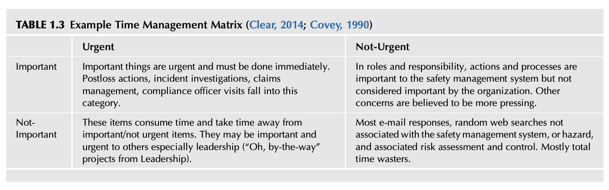

표 1.3 시간관리 매트릭스의 예시 (TABLE 1.3 Example Time Management Matrix; Clear, 2014; Covey, 1990)

| 구분 | 긴급함 (Urgent) | 긴급하지 않음 (Not-Urgent) |
| :--- | :--- | :--- |
| **중요함 (Important)** | **중요한 일들은 긴급하며 반드시 즉각 처리되어야 한다.** 사고 발생 후 사후 조치, 사고 조사, 산재 보상 청구 관리, 노동청 감독관의 불시 점검 방문 등이 이 범주에 속한다. | **역할과 책임의 관점에서, 이러한 조치와 프로세스들은 안전경영시스템에는 대단히 중요하지만 조직 전체에 의해서는 중요하게 여겨지지 않을 수 있다.** 다른 경영 현안들이 훨씬 더 시급하다고 믿어지기 때문이다. |
| **중요하지 않음 (Not-Important)** | **이러한 항목들은 귀중한 시간을 소모하며, '중요하지만 긴급하지 않은' 핵심 항목들로부터 시간을 빼앗아 간다.** 타인들, 특히 경영진에게는 긴급하고 중요하게 느껴질 수 있다(경영진의 "아 참, 그나저나 이것 좀..." 식의 돌발 프로젝트). | **대부분의 이메일 응답, 안전경영시스템이나 재해(Hazard) 및 리스크 평가·통제와 무관한 무작위 웹서핑 등.** 거의 전적으로 완벽한 시간 낭비 요소들이다. |

* 제2사분면(Quadrant II) — 긴급하지 않지만 중요한(Not Urgent & Important) 활동. 장기적인 전략 수립 및 시스템 개발, 또는 향후 중요해질 데이터 등이 여기에 해당한다. 이러한 활동들은 완료해야 할 기한이 명확히 정해져 있거나, 당면 과업과 깊이 관련되어 조직에 중대한 가치를 지속적으로 창출한다.
* 제3사분면(Quadrant III) — 긴급하지만 중요하지 않은(Urgent & Not Important) 활동. 시간에 쫓기는 분주한 주의 분산 요소들이다. 이러한 정보나 활동은 본질적으로 중요하지 않다. 정보나 활동에 대한 지원 요청이 쇄도할 수 있지만, 그러한 정보나 활동은 조직에 거의 무관하며 실질적인 가치를 더하지 못한다. 이러한 유형의 정보나 활동은 다른 사람들에게 위임하여 완수하도록 조치할 수 있다.
* 제4사분면(Quadrant IV) — 긴급하지도 않고 중요하지도 않은(Not Urgent & Not Important) 활동이나 정보. 조직에 거의 혹은 전혀 가치를 창출하지 못한다 (Clear, 2014; Covey, 1990; Eisenhower’s Urgent/Important Principle, 2018; Koort, 2014; Moon, 2017; Roughton & Crutchfield, 2016; Savara, 2018; The Time Management Grid, 2014; Thomas, 2012; Time Management for a Small Business, 2018; 그림 1.10 참조). 

한 예로, 위험성평가(Risk assessment), 직무재해분석(Job Hazard Analysis, JHA), 비상대응계획(Emergency planning)은 안전경영시스템의 핵심적이고 근본적인 필수 요소이다. 이것들은 대단히 중요하지만, 당장 눈앞에 닥친 위기 상황이 아니라는 이유로 그 자체로 긴급한 것으로 여겨지지 않는다. 

"다른 급박한 위기, 목전의 긴급한 문제, 마감 시한에 쫓기는 프로젝트들"이 언제나 우선권을 가로채 간다 (Covey, 1990). 그 결과, 그것들의 절대적인 중요성이 수많은 문헌으로 입증되어 있음에도 불구하고 늘 차순위의 우선순위로 밀려나고 만다.

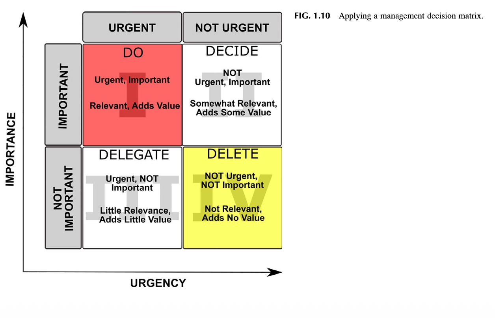

그림 1.10 관리 의사결정 매트릭스의 적용 (Applying a management decision matrix).

코비는 장기적인 탁월한 성취는 오직 **'중요하지만 긴급하지 않은(Important/Not Urgent)'** 제2사분면 영역에서 달성된다고 굳게 믿었다. 반면 '중요하고 긴급한' 사분면은 당장의 시간을 급격히 소모시키며 통상적으로 어떠한 체계적인 계획 프로세스에도 속하지 못한다 (Covey, 1990). 

중요하지 않은 영역에 속한 사분면들은 안전문화 발전에 투입되어야 할 소중한 시간을 갉아먹으며, 안전문화 발전의 실체는 오직 '중요하지만 긴급하지 않은' 사분면에 온전히 자리잡고 있다. 

이 매트릭스를 실질적으로 활용하기 위해서는, 수집된 모든 정보가 유관해 보이든 무관해 보이든 가리지 않고 우선 철저한 전수 인벤토리를 작성하는 것부터 시작하라. 일단 정보가 수집되면, 각 정보 조각을 면밀히 검토하여 우선순위에 따라 4개 사분면 중 하나에 적절히 배치하라. 

카테고리가 명확히 정의되면, 항목 리스트는 어떤 정보가 가장 높은 우선순위를 지니고 있는지에 대한 선명한 전체 그림을 제시해 줄 것이다. 지속적인 검토와 결합된 이러한 '선제적(Up-front)' 의사결정 프로세스는 큐레이션이 필요한 핵심 정보들을 지속적으로 정제해 줄 것이다. 

"무엇이 정말 중요하며 어떤 현안 이슈들을 해결해야 하는지 명확히 파악한 후에는, 바로 그 핵심 과업들을 다룰 수 있는 절대적 시간을 반드시 확보해야 한다." — 코어트 (Koort, 2014).

## 갈림길에 선 안전 (SAFETY AT A CROSSROAD)

안전관리는 조직 내부의 모든 활동들이 교차하는 바로 그 '갈림길(Crossroad)'에 위치한다. 안전 전문가의 영향력은 자신의 노력이 조직의 전반적인 조직문화와 완벽히 정렬될 때 잠재적으로 극대화된다. 모든 안전 전문가의 궁극적 목표는 다음과 같은 역할을 능숙히 수행하는 신뢰받고 식견 있는 '핵심 적임자(Go-to person)'로 인정받는 것이다:
* 리더십 및 조직의 모든 직급이나 부서로부터 제기되는 보고된 안전 우려 사항들을 능동적으로 해결한다.
* 안전 관련 이슈에 대한 자신의 입장과 결론을 강력히 뒷받침하는 핵심 정보들을 정밀하게 큐레이션하고 검색하여 활용한다 (이 개념은 제15장에서 더욱 자세히 다룬다).
* 조직의 모든 계층과 원활하고 긍정적인 커뮤니케이션 채널을 상시 개방한다. 치명적인 재해(Hazard) 및 리스크 이슈를 신속히 전파하기 위해 필요한 경우 공식적인 커뮤니케이션 경로를 '단축(Short circuit)'하는 소셜 네트워크를 전략적으로 활용한다 (제4장에서 커뮤니케이션 흐름의 중요성을 논의한다).
* 실제적 또는 지각된 위험 및 연계 리스크에 대한 우려 사항들을 과학적으로 분석한다.
* 안전경영시스템의 핵심 현안과 권고사항에 대한 가시적 조치가 신속히 취해지도록 전문적인 영향력을 강력하게 발휘한다.

조직 내부의 '사내 정치(Internal politics)'와 역동적인 대인관계를 깊이 이해하지 않고서는 안전문화를 결코 바꿀 수 없다. 이러한 이해는 안전을 조직의 핵심 구성 요소로 보다 확고히 자리매김하고 리더십의 의사결정에 실질적인 영향을 미치기 위해 절대적으로 필수적이다. 

모든 인간의 집단적 과업에 내재된 대인관계적 '정치'에 대한 예민한 인식이 결여된다면, 오직 안전경영시스템의 요구만을 편협하게 고집하는 근시안적인 시각에 갇히게 된다. 

**정치(Politics)**: 정치적 업무 또는 비즈니스; 특히 권력과 리더십을 쟁취하기 위해 경합하는 이익 집단이나 개인들 간의 치열한 경쟁(정부에서와 같은) (Politics, 2014). 

안전 전문가의 역할은 안전 메시지가 조직에 실질적인 이익을 가져다주고 진정한 가치를 더해준다는 점을 리더십 팀에 명확히 입증할 수 있도록 메시지를 가다듬고 영향력을 발휘하는 것이다. 

이러한 영향력의 강도는 조직의 개편, 운영의 변화, 리더십의 교체 등의 격변기 속에서도 핵심적인 안전 관련 기준들이 흔들림 없이 유지될 수 있는 잠재력을 높여준다. 안전문화는 상이한 비즈니스 환경 속에서 조직이 진화하고 변화함에 따라 지속적으로 가해지는 압박과 스트레스를 견뎌낼 수 있을 만큼 충분히 견고하고 회복 탄력적이어야 한다 (Yario, 2017). 

그림 1.4에 제시된 바와 같이, 조직 내의 모든 전문 분야들은 희소한 자원을 배분하는 최종 의사결정권자의 관심을 사로잡기 위해 치열하게 경쟁하고 있다. 각 부서, 사업장, 전문 분야, 지원 부서들은 자신들의 제도적으로 의무화되었거나 바라는 프로그램을 유지하기 위해 한정된 자원을 배정해 줄 것을 한목소리로 요청한다. 그들은 각자 자신들이 리더십이 책정한 시간과 예산에서 최우선 순위를 차지해야 한다고 굳게 믿는다. 

이러한 다른 부서와 그룹들은 안전관리와 자원을 놓고 경쟁하며 잠재적 갈등 관계에 놓여 있다. 그들 각자는 자원 배분에 대해 막대한 이해관계를 가지고 있다. 

매번 리더십의 의사결정은 제한된 정보와 높은 불확실성 속에서, 자신들의 조치가 당면한 문제에 가장 올바른 해법이라고 믿는 바탕 위에서 내려진다. 리더들은 자신들의 조치가 가져올 수 있는 의도치 않은 결과들로 인해 원하는 결과가 달성될 수도 있고 그렇지 못할 수도 있는 상황 속에서 불확실성을 숙명처럼 다루어야만 한다. 

이러한 경영 리더십의 접근법과 정반대로, 안전 전문가들은 전통적으로 정성적인 편익에 근거하여 결론을 도출하는 방식을 사용해 왔다. 즉, "우리가 정책 X를 시행한다면, 사고 Y는 결코 발생하지 않을 것입니다"라는 식이다. 

상황을 해석하고 의사결정을 내리는 방식에서의 이러한 근본적인 차이는 리더십 팀과 안전 전문가 사이에 첨예한 갈등이 발생하는 가장 결정적인 이유 중 하나이다 (그림 1.11 참조; Radford, 1988, 1991).

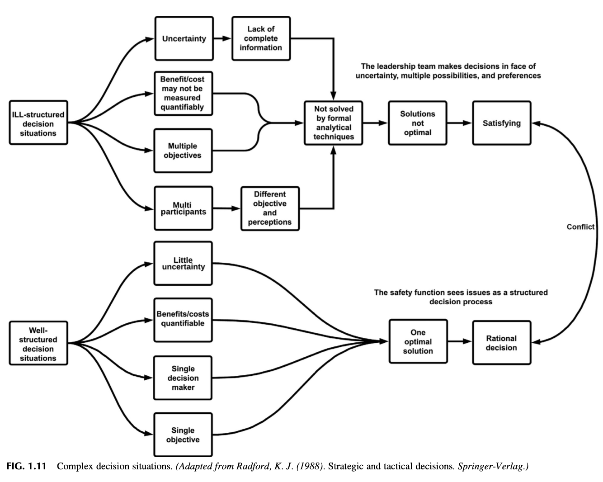

그림 1.11 복합 의사결정 상황 (Complex decision situations. Adapted from Radford, K. J. (1988). Strategic and tactical decisions. Springer-Verlag).

대부분의 경우, 리더십은 조직의 모든 구성 요소들이 제각기 중요하다는 점을 잘 이해하고 있다. 문제는 리더십이 유한한 희소 자원을 어떻게 가장 최적으로 배분할 것인가를 결정해야 한다는 냉혹한 현실이다. 

안전 전문가들이 전통적으로 사용해 온 구태의연한 논리는 "내게 예산을 주지 않으면 정부 규제 당국이 우리를 적발하고 무거운 과태료를 부과할 것입니다"라며 위기를 조장하는 것이었다. 어느 정도 사실이기는 하지만, 오직 이러한 처벌 위협 방식만을 사용하는 것은 리더십과 극심한 적대적 관계를 고착화시킬 뿐이다. 

이는 안전 직무의 전문적 가치를 더해주기는커녕 안전문화에 대한 전반적인 인식을 심각하게 격하시킨다. 규제 처벌의 회피가 안전경영시스템을 보유해야 하는 유일한 이유가 되어서는 결코 안 된다. 

이러한 방식은 리더십이 위험 정보를 자신의 전반적인 경영 의사결정 프로세스에 능동적으로 통합할 수 있는 가시적인 개선 경로를 전혀 제시하지 못한다. 진정한 안전문화는 자신의 목표와 목적을 달성하기 위해 처벌이나 규제의 위협에 의존할 필요가 없어야 한다.

## 안전과 리더십은 같은 언어로 대화하고 있는가? (DO SAFETY AND LEADERSHIP SPEAK THE SAME LANGUAGE?)

공통의 통일된 언어는 동료, 리더십, 그리고 근로자들이 커뮤니케이션을 어떻게 수용하는지를 결정짓는다. 가장 본질적인 단계는 안전 프로세스가 조직에서 통용되는 '동일한 비즈니스 언어'를 사용하고 있는지를 확인하는 것이다. 

커뮤니케이션은 일상적인 행동, 빈틈없는 프레젠테이션, 긍정적인 태도, 세련된 스타일, 그리고 끊임없이 보여지는 전문적인 존재감을 통해 이루어진다. 새로운 아이디어는 반드시 설득력 있게 판매(세일즈)되어야 하며, 안전의 당위성은 언제나 흔들림 없이 일관되게 입증되어야 한다. 

안전 노력이 조직의 표방된 가치(Espoused value; Espoused Values, 2018)로 간주된다고 해서, 당연히 원하는 모든 자원을 전폭적으로 얻게 될 것이라고 순진하게 가정해서는 안 된다. 

이 '게임'의 본질은 안전 프로세스와 그 프로그램들이 대단히 효과적이고 효율적이라는 점을 지속적으로 입증할 수 있는 탁월한 전략을 수립하는 데 있다. 반드시 수행해야 할 과업은 조직이 일상적으로 사용하는 동일한 비즈니스 언어와 용어로 위험과 연계 리스크를 가시적이고 실체적으로 변환하여, 리더십을 설득할 수 있는 최상의 논거(Case)를 제시하는 방법을 터득하는 것이다.

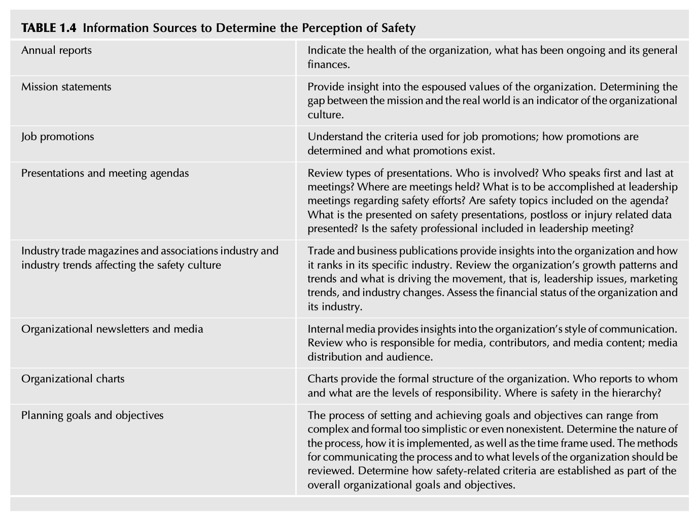

표 1.4 안전에 대한 지각을 파악하기 위한 정보 출처 (TABLE 1.4 Information Sources to Determine the Perception of Safety)

| 정보 출처 (Information Source) | 세부 검토 내용 및 통찰 (Insights and Details) |
| :--- | :--- |
| **연례 보고서 (Annual reports)** | 조직의 건강 상태, 진행되어 온 사업 현황, 전반적인 재무 건전성을 명확히 보여준다. |
| **사명 선언문 (Mission statements)** | 조직의 표방된 가치(Espoused values)에 대한 깊은 통찰을 제공한다. 공식 사명과 실제 현실 세계 사이의 간극(Gap)을 규명하는 것은 조직문화를 가늠하는 핵심 지표이다. |
| **직무 승진 (Job promotions)** | 승진에 사용되는 실제 평가 기준을 파악하라. 승진이 어떻게 결정되고 조직 내에 어떠한 승진 경로가 존재하는지 분석하라. |
| **발표 및 회의 안건 (Presentations and meeting agendas)** | 발표의 유형을 면밀히 검토하라. 회의에 누가 참석하는가? 회의에서 누가 가장 먼저 발언하고 누가 마지막에 발언하는가? 회의는 어디에서 열리는가? 안전 추진 노력과 관련하여 경영 리더십 회의에서 달성하고자 하는 것은 무엇인가? 안전 주제가 정식 의제에 포함되어 있는가? 안전 관련 발표에서 과거 손실이나 부상 통계 데이터만이 보고되는가? 안전 전문가가 리더십 회의에 핵심 일원으로 정기적으로 포함되어 있는가? |
| **업계 전문지 및 협회 동향 (Industry trade magazines and trends)** | 안전문화에 영향을 미치는 업계 및 산업 트렌드를 검토하라. 비즈니스 및 전문 출판물은 조직과 해당 조직이 특정 산업군에서 차지하는 위상에 대한 객관적 통찰을 제공한다. 조직의 성장 패턴과 트렌드를 분석하고, 그 움직임을 견인하는 요인(리더십 이슈, 마케팅 동향, 산업 환경 변화 등)이 무엇인지 규명하라. 조직과 해당 산업의 재무 상태를 냉정하게 평가하라. |
| **조직 사보 및 사내 미디어 (Organizational newsletters and media)** | 사내 미디어는 조직의 커뮤니케이션 스타일을 파악하는 창이다. 미디어 발행 책임자가 누구인지, 기고자는 누구이며, 콘텐츠의 주된 내용은 무엇인지, 미디어의 배포 범위와 독자층은 누구인지 검토하라. |
| **조직도 (Organizational charts)** | 조직도는 조직의 공식적인 위계 구조를 나타낸다. 누가 누구에게 보고하며, 각자의 책임 수준은 어떠한가? 전체 위계 구조 속에서 안전의 위치는 어디인가? |
| **기획 목표 및 목적 (Planning goals and objectives)** | 목표와 목적을 설정하고 달성하는 프로세스는 고도로 복잡하고 공식적인 것에서부터 지나치게 단순하거나 심지어 아예 존재하지 않는 수준까지 다양하다. 프로세스의 본질, 실행 방식, 적용되는 시간 프레임을 파악하라. 프로세스를 조직의 어느 직급 계층까지 어떻게 전파하고 소통하는지 검토하라. 안전 관련 기준이 전반적인 조직 목표 및 목적의 필수적 일부로 어떻게 수립되어 있는지 명확히 규명하라. |

조직 내부에서 안전에 대한 현재의 지각이 어떠한지 정확히 파악하기 위해서는 세심한 관찰, 타 부서와의 깊이 있는 대화, 그리고 전반적인 비즈니스 환경에 대한 다각적인 조사가 필수적으로 요구된다. 안전에 대한 지각을 파악하는 데 귀중한 통찰을 제공하는 정보 출처들에 대한 간략한 개요는 표 1.4를 참조하라.

## 시작부터 현상 유지까지 (FROM STARTUP TO STATUS QUO)

긍정적인 지각에 기반하여 안전문화가 조직의 본질적 결(Fabric) 속으로 깊숙이 짜여 들어갈 때, 안전문화를 지속적으로 유지할 수 있는 잠재력은 극대화될 수 있다. 

잘 설계되고 유연성을 갖춘 안전경영시스템은 안전문화를 고도화하며, 다음과 같은 급격한 환경 변화 사건들에 의해 산산이 부서지지 않고 버텨낼 수 있는 훨씬 우수한 회복탄력성(Resilience)을 확보하게 된다:
* 리더십의 개성, 철학, 태도의 변화.
* 노사 관계 및 직원 커뮤니케이션의 변화.
* 운영상의 변화를 통한 조직 내 위험 및 재해(Hazard)의 변화.
* 일상적인 루틴을 뒤흔드는 위기 상황 (예: 직장 내 괴롭힘/폭력, 화재, 중대재해, 자연재해 등).
* 교육 훈련 요구의 급증.
* 기업 인수 및 합병(M&A).
* 부실한 계획 수립 및 잘못된 경영 의사결정.
* 신기술의 도입 및 기술적 변화.
* 조직에 충격을 주는 기타 잠재적인 복합 합병증들.

상세한 논의는 제5장을 참조하라. 안전경영시스템은 조직 및 비즈니스 환경이 진화함에 따라 발생하는 급격한 변화에 유연하고 적응력 있게 대처할 수 있어야 한다. 전반적인 조직문화의 가혹한 요구 속에서도 살아남을 수 있는 생존 잠재력을 향상시키기 위해, 안전경영시스템은 반드시 유연성을 지니고 조직의 실질적 요구 내부에서 능동적으로 작동할 수 있도록 정밀하게 설계되어야 한다.

## 전환의 원을 이해하고 관리하기 (UNDERSTANDING AND MANAGING THE CIRCLE OF DIVERSION)

현실에서 안전 전문가는 매일매일 발생하는 수많은 주의 전환과 분산(Diversions)에 직면하며, 마치 여러 개의 공을 공중에 띄우는 저글러처럼 한 번에 수많은 일들을 동시에 능숙히 처리해야 한다 (그림 1.12 참조). 

어떠한 안전 프로세스를 구축하든 반드시 이해해야 하는 무수한 전환 요소들이 존재한다. 전환(Diversion)이란 무엇인가? 전환은 "진로, 활동 또는 정해진 용도로부터 벗어나거나 빗나가는 행위 또는 사례..."로 설명되어 왔다 (Diversion, 2018). 

매티스(Mathis)는 다음과 같이 기술한다: "...전환이란 관리자들이 다른 우선순위 업무들로 인해 단순히 지나치게 바빠지거나 압도당하여, 안전이 성공을 거두는 데 필요한 충분한 주의와 관심을 기울이지 못하는 현상을 의미한다" (Mathis, 2014). 

주의 전환은 조직 환경에서 지극히 당연한 일상의 일부이다. 주의 전환 요소를 다루는 것은 안전의 본원적 책임의 일부이며, 이를 주도적으로 이끄는 리더십은 안전경영시스템의 핵심 구성 요소로 간주된다. 

'전환의 수레바퀴 스코어카드(Wheel of Diversion Score Card)'는 시간이 어떻게 소비될 수 있으며 소비되어야 하는지를 시각화하는 탁월한 방법 중 하나이다. '안전 전문가의 전환의 수레바퀴'의 실제 사례는 그림 1.13을 참조하라. 

이 수레바퀴는 두 가지 유형의 활동을 선명히 보여준다: 계획, 목표, 목적의 일부로 사전에 정해진 **'예상된 활동(Expected Activities)'**과, 리더십의 돌발적인 지시나 즉각적인 조치가 요구되는 예기치 못한 이슈나 우려로 인해 촉발되는 **'예상치 못한 활동(Unexpected Activities)'**이다. 

이 수레바퀴는 안전 전문가가 마주칠 수 있는 예상된 활동과 예상치 못한 활동들의 핵심 목록을 나타낸다. 이 활동들 중 과연 어떤 활동에 시간과 주의를 집중해야 하는가는 때때로 어지럽게 회전하는 룰렛 바퀴처럼 느껴질 수 있다. 

'전환의 수레바퀴 스코어카드'는 가장 노련한 기획자조차도 순식간에 압도해 버릴 수 있는 끊임없이 변화하는 요청과 의무의 소용돌이 환경에 뿌리를 두고 있다. 

시간 관리, 명확한 우선순위 설정, 앞서 논의한 4사분면 시간 매트릭스의 활용, 전략적 기획 등은 광범위한 도구와 방법을 제공하며 가용한 시간을 극대화하는 데 훌륭하게 활용될 수 있다. 시간 및 기획 기법들은 대단히 유익하며 가능한 최대한도로 적극 활용되어야 한다. 

수레바퀴에 적힌 항목들을 주목하라. 직무재해분석(JHA), 위험성 식별, 정기 회의, 안전 교육 등 일부 활동들은 사전에 계획되고 예상된 활동들이다. 반면 설비 고장, 사고 조사, 규제 기관 이슈, 불시 소집 회의 등은 돌발적으로 발생하는 예상치 못한 문제에 의해 규정되는 활동들이다. 

예상된 상황과 예상치 못한 돌발 상황 모두를 유연하게 다루는 확고한 마인드셋을 유지하는 것은 절대적으로 필수적이다.

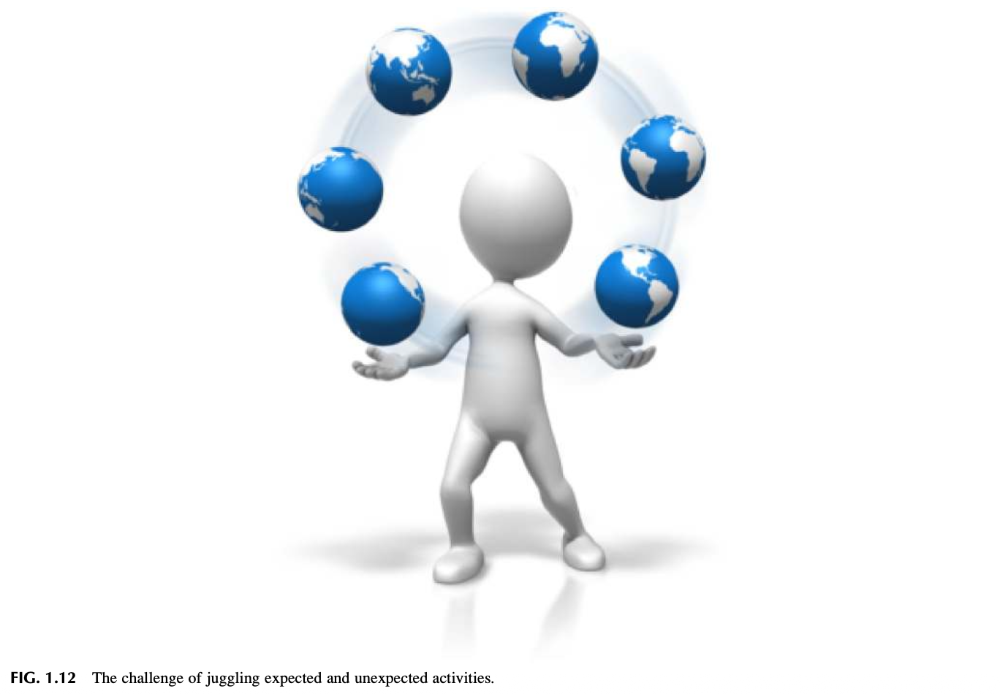

그림 1.12 예상된 활동과 예상치 못한 활동을 동시에 곡예하듯 다루는 도전 과제 (The challenge of juggling expected and unexpected activities).

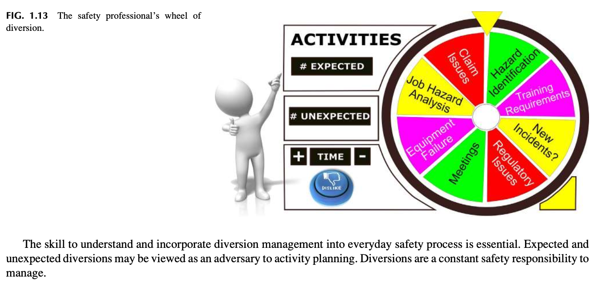

그림 1.13 안전 전문가의 전환의 수레바퀴 (The safety professional’s wheel of diversion).

전환의 수레바퀴. 이러한 전환 관리를 일상적인 안전 프로세스에 깊이 이해하고 체계적으로 통합하는 역량은 필수불가결하다. 예상된 전환과 예상치 못한 전환은 계획된 활동의 적으로 비쳐질 수 있다. 그러나 전환을 효과적으로 통제하는 것은 안전 부서가 상시적으로 감당해야 할 본원적 책임이다.

### 관찰 8 (Observation 8)

예를 들어 한 직원이 안전 관련 우려 사항을 가지고 와서 해당 의문에 대해 조사해 줄 것을 요청할 수 있다. 그 직원에게 그것은 즉각적인 주의가 요구되는 대단히 중대한 문제이다. 

만약 명확한 지연 사유에 대한 상세한 설명도 없이 부주의하게 그 요청이 낮은 우선순위로 취급되고 있다는 인상("나중에 시간 나면 처리해 줄게요")을 풍긴다면, 이는 매우 부정적인 신호를 전달하게 된다. 우리는 제3장에서 이러한 태도가 어떻게 지각되는지에 대해 상세한 논의를 제공할 것이다. 

주의 전환 문제에 어떻게 접근하느냐는 다음과 같은 추가적인 본질적 질문들로 이어진다:
* 하루의 목표와 계획이 예기치 못한 돌발 상황에 의해 얼마나 자주 중단되거나 변경되는가?
* 안전 전문가의 역할이 지나치게 여러 갈래로 분산되어 상시적인 소방수식 문제 해결에만 매달리고 있지는 않은가? 즉 다른 사람들은 문제를 해결할 능력이 없거나 이슈 자체를 전혀 이해하지 못하고 있는 것인가?
* 리더십이 안전 전문가를 안전경영시스템을 운영하고 유지관리하는 본연의 목표와 무관한 엉뚱한 잡무에 동원하고 있지는 않은가?
* 너무나 많은 '돌발 위기'가 끊임없이 터져 나오고 있지는 않은가? 이것이 변화에 대한 조직 내부의 일종의 저항에서 비롯된 것은 아닌가? 그 근본적인 근인(Root cause)은 무엇인가?
* 이러한 전환 현상들은 조직의 안전문화에 대해 무엇을 말해주고 있는가?
* 이러한 전환 현상들은 조직 내에서 안전에 대한 지각이 어떠한 수준인지를 어떻게 암시하고 있는가?

주의 전환 요소들과 이를 어떻게 관리하고 있는가는 안전문화를 진단하고 평가하는 필수적인 일부가 되어야 한다.

## 안전 전문가에 대한 지각 바꾸기 (CHANGING THE PERCEPTION OF THE SAFETY PROFESSIONAL)

만약 여러분이 현재 조직 내에서 본 장에서 논의한 바와 같은 전형적인 '안전 담당 직원(Safety Guy)'으로만 취급되고 있고 이러한 왜곡된 지각을 근본적으로 바꾸고 싶다면, 철저한 자기 평가를 수행하고 스스로 인식을 변화시킬 수 있는 영역들에 대한 '개인적 자기 점검 인벤토리(Personal self-inventory)'를 체계적으로 작성해야 한다. 

저자들의 풍부한 현장 경험에 비추어 볼 때, 안전 전문가를 객관적으로 평가하기 위한 체계적인 평가 체크리스트가 유용하게 활용될 수 있다. 이러한 개인적 인벤토리는 안전 전문가의 역할에 대해 사람들이 품고 있는 지각에 대한 깊은 통찰을 제공하며, 조직의 전반적인 안전문화 수준에 대한 중요한 징후들을 보여준다. 

이 인벤토리는 조직 내에서 자신의 독보적인 전문적 브랜드(Professional brand)를 정립할 수 있도록 돕기 위해 특별히 고안되었다. 이 인벤토리의 목적은 눈앞의 특정한 장애물들을 극복하고, 안전 전문가 스스로가 자신의 조직으로부터 현재 어떻게 지각되고 있다고 믿는지를 냉정하게 성찰할 수 있도록 돕는 데 있다. 자기 평가를 위한 '안전 전문가 지각 인벤토리'의 구체적 사례는 부록 1.3을 참조하라.

## 오리엔테이션 대 온보딩 (ORIENTATION VS. ONBOARDING)

여러분이 노련한 베테랑 전문가이든 조직에 새로 합류한 신규 담당자이든 관계없이 안전 지각을 혁신하는 도전 과제를 성공적으로 달성하기 위해서는, 모든 직업군의 전반적인 역할 인식을 전환하는 데 절대적으로 중대한 몇 가지 필수 프로세스가 존재한다는 사실을 깊이 이해해야 한다. 

우리는 여러분의 조직에 새로운 직원, 전환 배치된 직원, 타 사업장에서 전보된 직원들이 지속적으로 채용될 것이며 그들에게 안전 프로세스와 새로운 기회들에 대한 친절한 안내가 필요하다는 사실을 종종 망각하곤 한다. 

오리엔테이션에는 사업장 시설 전반에 대한 개요, 담당 직무와 연계된 역할, 그리고 여러분의 조직이 정의하는 전반적인 안전문화에 대한 포괄적인 소개가 반드시 포함되어야 한다 (How to Onboard and Train Employees into a Safety Culture, 2018). 

이것이 바로 경험이 풍부한 베테랑 안전 전문가가 이 지속적인 프로세스에 반드시 직접 참여해야 하는 결정적인 이유이다. 안전 전문가는 모든 구성원이 안전 프로세스에 따라 적용되는 규칙과 원칙을 명확히 이해하도록 보장하는 이 핵심 메시지를 전달할 수 있는 가장 최적의 적임자이다. 

첫인상은 그 뒤에 이어지는 모든 것들의 기본 토대를 형성하기 때문에 대단히 중요하다. 오리엔테이션은 직원에게 최초의 기초 토대를 놓아주기 때문에 대단히 중요하다. 체계적인 오리엔테이션이 결여된다면 직원은 새로운 직무 환경에서 극심한 불안감과 불편함을 느끼게 되며, 자신의 온전한 잠재력에 도달하는 데 훨씬 더 오랜 시간이 걸리게 된다 (Why is Orientation Important?, 2018). 

안전 온보딩 프로그램의 완성도는 여러분의 조직이 어떤 조직인지, 그리고 안전에 얼마나 막대한 중요성을 부여하고 있는지를 대외적으로 웅변해 준다 (Lawton, 2014). 

입사 후 최초 며칠간은 필수적인 안전 정보를 전달하고 안전 노력에 대한 올바른 오리엔테이션을 확립함으로써 직원들에게 올바른 메시지를 확실히 각인시켜야 하는 결정적인 골든타임이다 (Lawton, 2014). 

일부 조직들은 온보딩을 오직 신규 입사자만을 위한 프로그램으로 협소하게 생각한다. 그러나 온보딩은 기존의 숙련된 직원들을 유지(Retention)하고 능동적으로 몰입(Engagement)시키는 데에도 똑같이 중요하다는 점을 반드시 명심해야 한다 (How to Onboard and Train Employees into a Safety Culture, 2018). 

이 프로세스를 돕기 위해 부록 1.4에서는 오리엔테이션과 온보딩 프로세스 간의 명확한 차이점에 대한 간략한 개요를 제공한다. 또한 부록 1.3에 제시된 안전 전문가 지각 인벤토리에 수록된 몇 가지 중요한 영역들이 기대치에 관한 보다 구체적인 세부사항을 제공하기 위해 확장되어 다루어질 것이다.

## 요약 (SUMMARY)

안전문화의 지속과 부단한 개선에 영향을 미치는 다양한 지각(Perceptions)들이 폭넓게 논의되었다. 

지각은 안전 프로세스의 리더십에 대한 현재의 평가, 이전의 리더십 스타일과 관련하여 과거에 발생했던 일들, 그리고 안전 관련 기준들이 어떻게 소통되었는가에 대한 현재의 견해에 뿌리를 두고 있다. 

앞서 논의한 바와 같이, 안전은 끊임없이 변화하는 역동적인 환경 속에서 지속적으로 진화하는 하나의 **'창발적 특성(Emerging property)'**이다. 모든 조직의 타고난 기본 속성으로서의 '변화'를 겸허히 수용할 때 비로소 안전한 문화를 유지할 수 있는 잠재력이 극대화된다. 

안전문화를 향상시키는 것은 단순히 안전경영시스템을 새로운 것으로 갈아치운다고 해서 달성되는 것이 아니라, 안전에 대한 '지각의 프레임'을 전환함으로써 달성된다. 

안전 책임은 조직의 전 영역을 가로지르며, 그렇게 하는 과정에서 수많은 이슈, 고충, 그리고 갈등이 불가피하게 발생하고 이에 대한 적극적인 해결이 요구된다. 경영 리더십의 엄격한 지시명령에서부터 현장 직원들의 절실한 요청에 이르기까지 시간적 요구는 사방에서 쏟아져 들어오며, 그 하나하나를 모두 소홀함 없이 다루어야만 한다. 

하루의 일과가 진행됨에 따라 수많은 주의 전환 요소들이 끊임없이 튀어나오며, 당초 수립했던 계획을 수정하는 것은 피할 수 없는 일상이 된다. 조직의 역동성은 영원히 변화무쌍하다. 소유권의 변화, 리더십의 교체, 직원의 입·퇴사, 기술 혁신, 신규 프로젝트, 우선순위의 변경 등은 끊임없이 운영 방식을 수정한다. 

이러한 개연성 높은 시나리오들을 고려할 때, 안전경영시스템은 조직의 변화에 발맞추기 위해 수시로 '영구적인 시동 모드(Perpetual start-up mode)'에 머물러 있게 되는 경우가 다반사이다. 사실상 안전경영시스템은 변화된 조건들이 요구할 때마다 스스로를 끊임없이 재창조하고 혁신해야만 한다. 

회복탄력적인 안전경영시스템의 막대한 중요성을 깊이 이해하고 안전의 본질적 가치를 반복적으로 소통하는 것만이 이러한 급변하는 환경을 상쇄할 수 있다. 정적인 접근법보다는 안전경영시스템에 대한 동적이고 역동적인 접근법을 수용하는 것이 안전 프로세스의 지속적인 발전을 견인한다. 

조직은 결코 정적이지 않으며 언제나 변화의 상태에 놓여 있다. 이러한 냉엄한 현실을 직시할 때 안전관리 역시 결코 정체되어 머물러서는 안 된다. 

안전경영시스템은 조직에 흔들리지 않는 안정성을 제공하는 동시에, 비즈니스 환경의 새로운 요구에 유연하게 부응할 수 있는 유연한 프로세스를 반드시 갖추어야 한다. 상황은 조건이 변하고 흔들림에 따라 너무나 자연스러운 일상의 과정으로 발생한다. 제임스는 조직에 최선으로 보이지 않았던 수많은 조직 개편과 변화를 겪어 왔다. 

변화는 인생의 숙명이다. 대부분 사실로 판명되는 유명한 격언이 하나 있다: "만약 지금의 변화가 마음에 들지 않는다면 딱 6개월만 기다려 보라, 모든 것은 다시 바뀔 것이다." 

예를 들어:
* 직원의 이직은 작업 현장에 미숙련을 유발하고 안전에 대한 다양한 잠재적 시각을 유입시킨다.
* 구성원들의 상이한 기술 및 교육 수준은 완전히 새로운 교육 방식을 요구할 수 있다.
* 새로운 설비나 공정이 가동됨에 따라 재해(Hazard)와 연계 위험(Risk)가 새롭게 진화할 수 있다.
* 운영상의 변화는 손실을 유발하는 사고 상황이 발생할 확률을 증가시킬 수 있다.
* 최고 리더십이 교체되면 조직의 전반적인 커뮤니케이션 스타일 자체가 바뀔 수 있다.

안전관리의 최우선 목적은 안전문화를 지속시키기 위해 고안된 효과적인 방법과 개념에 대해 조직을 충실히 조력하고 자문하는 데 있다. 작업 환경에 대한 정확한 이해는 필수적이며, 리더십 및 근로자들과 어떻게 접근하고 소통할 것인가를 결정짓는다. 

안전의 역할에 대해 조직이 품고 있는 현재의 지각을 정확히 이해하는 것이야말로 안전문화를 획기적으로 개선하기 위한 귀중한 기회의 창을 열어준다. 

안전 전문가는 매일매일 광범위한 현안들을 능동적으로 해결해야 하므로, 예상된 전환과 예상치 못한 돌발 전환을 관리하는 것은 중단 없는 일상적 프로세스이다. 안전 커뮤니케이션의 본질과 스타일은 안전에 대한 지각을 드높일 수도 있고 처참하게 격하시킬 수도 있다. 

안전관리의 최우선 목적은 안전문화를 지속시키기 위해 고안된 효과적인 방법과 개념에 대해 조직을 충실히 조력하고 자문하는 데 있다. 작업 환경에 대한 정확한 이해는 필수적이며, 리더십 및 근로자들과 어떻게 접근하고 소통할 것인가를 결정짓는다. 안전의 역할에 대해 조직이 품고 있는 현재의 지각을 정확히 이해하는 것이야말로 안전문화를 획기적으로 개선하기 위한 귀중한 기회의 창을 열어준다. 

제2장에서 우리는 조직문화를 정밀하게 분석하는 방법과 안전경영시스템의 효과적인 개발 및 구현 잠재력을 높이기 위해 조직문화를 깊이 이해하는 것이 왜 절대적으로 필요한지를 심층적으로 논의할 것이다. 우리는 대부분의 조직에서 안전이 어떻게 **'표방된 가치(Espoused value)'**로 간주될 수 있는지를 명확히 증명해 보일 것이다. 

**표방된(Espoused)**이란 안전에 관한 공식적이고 공개적이며 눈에 보이는 커뮤니케이션과 언명들을 의미한다. 조직의 표방된 가치는 조직을 실제로 움직이는 실제적 가치(Actual values)와 가능한 한 가장 긴밀하게 정렬되어야 한다. 

표방된 가치란 개인이나 조직에 의해 공식적으로 채택되고 지지되는 가치들이다. 표방된 가치에 관한 정보는 여러분이 관찰하거나 느끼는 제반 현상들에 대해 질문을 던짐으로써 얻을 수 있다. 표방된 가치는 사람들이 자신들이 지지한다고 입으로 말하는 가치들이다. 

가치(Values)란 사물이 마땅히 어떠해야 하는가에 대해 사람들이 선호하는 바람직한 상태이다 (원자력 시설의 안전문화, 2002; 원자력 산업의 안전문화: 규제 평가를 위한 속성, 2004). 

안전 지각을 혁신하는 도전 과제를 완수하는 길은 모든 전문직의 전반적인 역할 인식을 바꾸는 데 결정적인 몇 가지 핵심 프로세스가 존재한다는 사실을 깊이 이해하는 데 있다. 이는 체계적인 안전 오리엔테이션과 온보딩을 통해 훌륭하게 달성될 수 있다.

## 복습 질문 (CHAPTER REVIEW QUESTIONS)

1. 조직의 안전문화를 발전시키고 지속하기 위해 다학제적 접근(Multidisciplinary approach)이 반드시 필요한 이유를 설명하라.
2. '안전문화(Safety Culture)'라는 용어를 정의하라.
3. '창발적 특성(Emergent Property)'이라는 용어를 정의하고, 그것이 안전문화에서 어떻게 적용되는지 설명하라.
4. 안전에 대한 긍정적 지각(Positive perception)이 갖는 중요성을 논하라.
5. 서면화된 직무기술서를 개발하고 실행하는 가치를 설명하라. 잘 작성된 직무기술서가 제공하는 7가지 이점을 나열하라.
6. 지각(Perceptions)이 왜 조직 안전문화의 중요한 지표가 되는지 논하라.
7. 표 1.1의 '지각 이슈의 사례'에 대해 토론하라.
8. 멘탈 모델(Mental Models)을 설명하고 구체적인 사례를 제시하라.
9. 시간관리 매트릭스(Time Management Matrix)의 4개 구성 요소를 식별하라.
10. 리더십과 '동일한 언어'로 대화하지 못할 때 발생하는 문제점들을 논하라.
11. 안전 브랜드를 확립하는 것이 왜 중요한지 이해의 중요성을 논하라.
12. 전환의 수레바퀴(Wheel of Diversion)를 깊이 이해하는 것이 왜 중요한지 논하라.

## 부록 1.1 전형적인 안전 관리자 직무기술서, 직무 및 책임의 실제 예시 (APPENDIX 1.1 EXAMPLE OF A TYPICAL SAFETY MANAGER JOB DESCRIPTION, DUTIES, AND RESPONSIBILITIES)

"전술 없는 전략은 승리에 이르는 가장 느린 길이다. 전략 없는 전술은 패배 직전의 요란한 소음에 불과하다." — 손자 (Sun Tzu). 

여러분은 왜 이러한 정보가 이 책에 수록되었는지 의아해할 수도 있다. 본 장에서 논의했듯이, 오랜 전통과 관행에 의해 안전 전문가의 역할에 대해 고착화되어 온 일련의 부정적인 이미지의 역사가 존재하기 때문이다. 

대표적인 사례로, 여러분이 누군가에게 자신이 '안전 전문가(Safety Professional)'라고 말했을 때 돌아오는 첫 번째 반응은 "그게 무슨 일을 하는 건데요?"이다. 그러고 나면 그 뒤를 잇는 반응은 "아, 당신이 그 'OSHA(노동부 직업안전보건청) 직원'이군요!"라는 말이다. 

본 장에서 언급했듯이, 이는 대부분의 사람들이 안전 전문가를 안전모를 쓰고 클립보드를 든 사람으로 상상하는 바로 그 지점이다. 

문제는 이러한 이미지가 현장 감사를 실시하고, 개인보호구(PPE) 착용을 강요하며, 작업 조건에 대해 지적 메모나 적는 사람이라는 안전 전문직의 공인된 상징으로 굳어졌다는 사실이다. 만약 지각이 여기에만 머물러 멈춰 선다면, 리더십은 안전 전문가가 지니는 장기적인 전략적 가치를 결코 온전히 이해하지 못할 것이다. 

우리의 목표는 안전 전문가에 대한 왜곡된 지각을 전환하는 데 실질적인 도움을 줄 수 있는 강력한 도구들을 제공하는 데 있다.

### 전형적인 구인 공고 (Typical Job Posting)

**직무 개요 (Job Description):**
* 회사의 안전을 유지하는 데 수반되는 모든 활동들을 총괄 조정하고 관리함.
* 다음을 포함하는 환경, 보건 및 안전(EHS) 방침과 프로그램의 개발, 유지관리 및 실행: 질병 및 부상 예방 프로그램(IIPP), 사고 보고 및 조사, 산재보상보험 청구 관리, 비상조치/대응 계획, 화재 예방, 지게차 운전 안전, 유해화학물질 경고표지 및 물질안전보건자료(GHS/MSDS 소통), 청력 보존, 잠금장치/표지판(LOTO), 기계 안전 및 장비 사용 수칙, 개인보호구(PPE), 산업안전보건위원회 회의 운영, 안전 교육 훈련, 법정 기록 보존 및 게시 의무.

**책임 및 직무 (Responsibilities and Duties):**
* **질병 및 부상 예방 프로그램 (IIPP)**: 회사의 IIPP를 구성하는 다양한 필수 요소들을 유지관리하고 현장에 철저히 실행함.
* **사고/유해물질 노출 보고 및 조사**: 사고/노출 보고 및 조사 프로그램을 총괄 관리하고 실행함. 해당 프로그램이 사고/노출 보고 및 정밀 조사를 위한 표준화된 방법과 실무 절차를 명확히 규정하도록 보장함.
* **산재보상보험 청구 관리**: 산재 청구 프로세스를 면밀히 검토, 모니터링 및 관리함. 조기 직장 복귀 및 수정 직무 프로그램을 총괄하고, 사고 및 부상 추세를 모니터링·분석하며, 재해 예방을 위한 중점 교육 및 개선 영역을 식별함.
* **비상대응계획**: 시설 관리 부서와 협력하여 회사의 비상대응계획이 항상 최신 상태로 유지되고 실행될 수 있도록 보장함. 비상계획이 발동될 경우를 대비하여 적절한 담당자들이 관련 절차와 프로세스를 완벽히 숙지하도록 교육을 보장함.
* **화재 예방**: 시설 관리 및 엔지니어링 부서와 협력하여 건물 대피 절차 및 소방 훈련을 포함한 화재 예방 프로그램을 지속적으로 검토, 수정 및 실행함.
* **지게차 운전 안전**: 회사의 지게차 운전 안전 프로그램이 법적 기준을 완벽히 준수하도록 보장함. 지게차 운전자 교육 훈련을 총괄 감독하고, 자격 인증 교육 기록 및 면허를 추적·관리하며, 일일 지게차 점검이 누락 없이 수행되고 문서화되는지 확인하고, 운전자가 적절한 개인보호구를 착용하도록 보장함.
* **유해화학물질 소통 (HazCom)**: 시설 및 엔지니어링 부서와 협력하여 물질안전보건 소통 프로그램을 검토, 개정 및 실행함. 해당 프로그램과 회사의 현장 실무가 캘리포니아주 OSHA(CalOSHA) 표준을 완벽히 준수하도록 보장함.
* **청력 보존**: 청력 보존 프로그램(Hearing Conservation Program)을 체계적으로 개발, 실행 및 지속 유지관리함.
* **잠금장치/표지판 (LOTO)**: 시설 관리 및 엔지니어링 부서와 협력하여 에너지고립(LOTO) 프로그램을 검토, 개정 및 유지관리함.
* **기계 안전 및 장비 사용**: 회사에 최신의 정상 작동하는 기계 안전 및 설비 사용 프로그램이 완비되어 있는지 확인함. 해당 프로그램이 전 직원에게 명확히 전달되도록 보장하고 요구되는 안전 교육을 적시에 제공함.
* **개인보호구 (PPE)**: 직무별 개인보호구 필요성을 과학적으로 평가하고, 관련 규정에 부합하는 적합한 보호구를 식별하며, 직원이 보호구의 올바른 사용법과 착용 목적에 대해 교육받도록 보장하고, 수행하는 직무에 적합한 보호구를 항상 올바르게 착용하도록 철저히 지도함.
* **툴박스 미팅 (TBM/Tailgate Meetings)**: 회의 내용에 대한 기록이 철저히 유지되도록 보장하고, 회의 일지를 보존하며, 안전 리더의 목적과 역할에 대해 적격 담당자들을 교육함.
* **안전 교육 훈련**: 집체 교육, TBM, 서면 교재를 망라하는 연간 안전 교육 훈련 프로그램을 수립하고 실행함. 안전 교육은 전사적 안전 프로그램과 IIPP를 유기적으로 뒷받침해야 함.
* **기록 보존 및 법정 게시 요건**: 안전 기능과 관련된 제반 문서들이 법정 기록 보존 규정에 따라 최신 상태로 유지되도록 보장함. OSHA 300 및 300A 재해 기록부를 정확히 작성하고 OSHA 규정에 따라 매년 사업장에 의무 게시함.
* **사업장 시설 및 현장 작업장 안전 점검**: 주기적인 현장 안전 순회 점검을 실시함.
* **기타 필요에 따른 제반 안전 관련 현안 업무를 처리함.**

**지원 자격 요건: 학력, 경력 및 자격증 (Qualifications: Education, Experience, and Certifications):**
* 안전관리, 산업안전보건환경(EHS) 또는 관련 분야의 학사 학위 소지자 및 건설 현장 총괄 책임 안전 전문가로서의 5년 이상 실무 경력자.
* 2년제 대학 교육 이수자로서 건설 현장 총괄 책임 안전 전문가로서의 8년 이상 직접 연관 실무 경력을 보유한 경우 학사 학위에 상응하는 것으로 인정함.
* 건설보건안전기사(CHST) 또는 미국 공인안전전문가(CSP) 자격 보유자 우대.
* OSHA 500 공인 강사 자격.
* 고소작업대 운전자 교육관 / ASME 리깅(줄걸이) 교육관 자격.
* 심폐소생술(CPR) / 응급처치 강사 자격.
* 지역 법령 및 캘리포니아 OSHA(CalOSHA) 규정에 대한 심도 있는 전문 지식.
* 탁월한 구두 및 서면 커뮤니케이션 능력.
* 뛰어난 대인관계 및 인간관계 조율 기술.
* 탁월한 조직화 및 기획 역량.
* 안전 프로그램을 주도적으로 설계, 실행 및 통제할 수 있는 검증된 실무 능력.
* 건설 현장 필드 및 제작 시설 전반에서 안전 점검을 능숙히 수행할 수 있는 역량.
* 안전한 작업 환경의 문화를 확립하도록 경영진을 효과적으로 관리하고 설득력 있게 영향력을 발휘할 수 있는 검증된 리더십 역량.

이 구인 공고의 말미에는 전형적인 채용 마감 문구가 붙어 있다. 예: "지원에 관심이 있으신 분은 이메일 제목에 '안전 관리자'를 기재하여 이력서 및/또는 자기소개서를 이메일로 보내주시기 바랍니다. 이력서에 희망 연봉을 반드시 기재해 주십시오." 

독자 여러분의 세밀한 검토와 향후 지침을 위해, 우리는 잠재적 고용주들이 구인 공고용 직무기술서를 발췌해 오는 몇 가지 신뢰할 수 있는 출처들을 제공했다. 

수많은 조직들은 안전 전문가의 진정한 역할을 깊이 이해하지 못하고 있기 때문에, 편의상 이러한 인터넷상의 직무기술서들을 그대로 모방하여 공고를 내곤 한다. 우리는 모든 독자들이 다양한 웹사이트에 등재된 다른 안전 채용 공고들을 폭넓게 검토하여, 조직들이 안전 전문가를 지각하는 현실적인 방식을 직시해 볼 것을 강력히 권장한다. 

이러한 현실적 간극(Gaps)을 정확히 이해하고 적응해 나가는 역량이야말로 본 도서 전반에 걸쳐 다루어지는 안전 전문가의 리더십 기술을 고도화하는 데 결정적인 도움이 될 것이다.

### 직업명 사전 (Dictionary of Occupational Titles)

다양한 직무와 책임 (직업정보 네트워크 O*NET, 안전 관리자, 직종 코드: 012.167-058, 2015). 

안전 관리자 직무기술서 템플릿: 이 웹사이트는 다음과 같이 명시하고 있다: "이 안전 관리자 직무기술서 템플릿은 온라인 구인 게시판이나 채용 페이지에 게시하기에 최적화되어 있으며 귀사의 실정에 맞게 손쉽게 맞춤화할 수 있습니다" (Safety Manager Job Description Template, 2017). 

직업 명칭 목록 — 데이터베이스 분석가 및 데이터 관리자 (NOC 2172-A). 해당 웹사이트는 다음과 같이 진술한다: "...사람들이 일상에서 사용하는 실제 직업 명칭 각각은 서로 다른 직함들의 그룹화에 속해 있다. 본 웹사이트는 이러한 그룹화를 기반으로 다양한 협력 파트너들로부터 서로 다른 정보들을 연결하는 기초로 활용한다" (Government of Canada Job Bank, 2018).

## 부록 1.2 제안된 직무 격차 분석 및 상호작용 양식 (APPENDIX 1.2 SUGGESTED JOB GAP ANALYSIS AND INTERACTION FORM)

"새로운 발견의 과정은, 현재 존재하는 모습(What is)과 미래에 존재할 수 있는 모습(What could be) 사이의 간극을 우리가 비록 모호하게나마 관찰하기 시작할 때 비로소 싹튼다." — 코크 (Koch, 2007). 

최근 일자리에 지원해 본 사람이라면 누구나 잘 알고 있듯이, 인재를 채용하는 방식은 최근 몇 년 사이에 극적으로 바뀌었다. 오늘날 수많은 경우에 입사 지원서는 온라인으로만 제출되며, 지원자들은 채용 선발 과정 내내 인사 담당자와 단 한마디 대화도 나누지 못하는 경우가 허다하다 (Cappelli, 2012). 

소셜 미디어와 구직 웹사이트가 지배하는 현재의 채용 환경을 고려할 때, 구직 엔진에 구체적인 '핵심 키워드(Keywords)'를 포함하지 않은 채 일반적인 표준 이력서만을 그대로 제출한다면 여러분은 공고된 직위에 입찰(지원)할 수 있는 소중한 기회를 아예 날려버릴 수 있다. 

왜 그럴까? 수많은 경우에 지원자를 특정 직무 요구조건과 매칭하기 위해 컴퓨터 알고리즘(ATS 자동 채용 시스템)이 특정 키워드를 검색하는 데 사용되기 때문이다. 키워드가 정확히 일치할 때에만 비로소 면접 기회를 얻을 확률이 극적으로 높아진다. 물론 이것이 최종 취업을 100% 보장하는 것은 아니다. 

핵심 질문은 "...채용과 선발이 완전히 자동화된다면 과연 인간은 어디에 설 자리가 있는가? 데이터는 채용 담당자가 사용하는 수많은 도구 중 단 하나에 불과하다..." (Miller, 2015). 예를 들어 "...채용 담당자들은 지원자 프로필에서 특정 자격요건 세트와 핵심 키워드를 보유한 후보자를 찾기 위해 링크드인(LinkedIn) 회원 데이터베이스를 정밀 검색한다" (Joyce, 2018).

### 직무 격차 분석 및 상호작용 양식 (Job Gap Analysis and Interaction Form)

본 부록에서 제안하는 방법을 사용하고, 실제 구인 공고에 제시된 직무기술서와 여러분의 일치하는 자격요건을 보충 자료로 추가하면 채용 합격에 지대한 도움이 될 것이다. 

부록 1.1의 '전형적인 안전 관리자 직무기술서, 직무 및 책임의 실제 예시'에 제시된 정보를 바탕으로, 요구되는 정보의 취지를 명확히 보여주기 위해 '직무 격차 분석 양식'을 구성했다. 단순성을 위해 구인 공고의 몇 가지 대표적 요소를 양식에 입력하여 이 양식이 실제로 어떻게 작동하는지를 시연했다. 

핵심 아이디어는 '직무기술서 및 요구조건' 섹션의 각 행에 개별 직무 요구조건을 기재한 후, '나의 전문성 및 주요 성과'라는 표제 아래에서 1:1로 비교 대조를 수행하는 것이다. 이는 구직자로서 여러분이 가진 구체적인 강점과 자격을 회사가 제시한 직무 요구조건과 정밀하게 일치시킬 수 있는 절호의 기회를 제공한다. 

참고: 만약 직무기술서나 요구조건의 특정 부분에 동의하지 않는다면, 이 격차 분석 양식에 해당 사항을 강조 표시해 둔 후 추후 면접관과의 인터뷰에서 적절히 논의하라. 

본 부록에서 제안하는 2열 양식은 지원자의 전문적 실무 경험과 고용주가 요구하는 직무 요건 사이의 간극(Gap)을 좁히도록 돕기 위해 고안되었다. 이 양식을 활용하면 잠재적 고용주는 지원자의 개인적 전문 지식과 성과를 한눈에 신속하게 비교 검토할 수 있다. 

이 양식은 서류 검토자가 특정 자격요건을 파악하기 위해 긴 직무 프로필을 일일이 읽고 이를 다시 이력서와 대조해야 하는 번거로운 작업을 극적으로 단순화해 준다. 핵심 키워드에 대한 보다 상세한 논의는 제16장 부록 16.2 '전문가를 위한 소셜 미디어 도구'를 참조하라.

| 공고된 직무기술서 및 요구조건 (Job Description and Requirements) | 나의 전문성 및 주요 성과 (My Expertise and Accomplishments) |
| :--- | :--- |
| **회사의 안전을 유지하는 데 수반되는 모든 활동을 총괄 조정하고 관리함.** 다음을 포함하는 환경, 보건 및 안전(EHS) 방침과 프로그램의 개발, 유지관리 및 실행: IIPP, 사고 보고 및 조사, 산재보상 청구 관리, 비상대응계획, 화재 예방, 지게차 운전, 유해화학물질 소통, 청력 보존, LOTO, 기계 안전 및 장비 사용, 개인보호구(PPE), 안전위원회 회의, 안전 교육 훈련, 기록 보존 및 법정 게시. | *(지원자가 해당 항목과 1:1로 일치하는 자신의 구체적 실무 경력, 취득 자격증, 프로젝트 성공 사례 및 정량적 성과 데이터를 기술하는 컬럼)* |

### 교훈 3 (Lesson Learned 3)

제임스는 자신의 전문 경력 전반에 걸쳐 수많은 구직 활동을 수행해 본 풍부한 경험을 가지고 있다. 그는 구직 탐색에서 성공할 확률을 높일 수 있는 탁월한 방법을 언제나 찾아 헤맸다. 그러나 과거에는 구직 과정을 실질적으로 도와줄 수 있는 체계적인 도구를 전혀 찾을 수 없었다. 당시에는 소셜 미디어나 전문 구직 사이트 자체가 아예 존재하지 않았기 때문이다. 

이것이 바로 인터넷 채용 공고 사이트에 제시된 요구조건을 완벽히 충족시키기 위해 '직무 격차 분석 및 상호작용 양식'을 직접 개발하게 된 배경이다. 

또한 SWOT 분석의 활용은 강점, 약점, 그리고 개선을 위한 기회를 식별하는 데 결정적인 도움을 준다. 제임스는 채용 총괄 관리자와의 대면 면접을 성공적으로 성사시킨 수많은 사람들과 이 혁신적인 방법론을 공유해 왔다.

### SWOT 분석 (SWOT Analysis)

실제 입사 면접에 임하기 전에 자신의 **강점(Strengths), 약점(Weaknesses), 기회(Opportunities), 위협(Threats)**을 체계적으로 정의하도록 돕는 다음 단계는 바로 'SWOT 분석 매트릭스'를 활용하는 것이다. 

SWOT 분석은 입사 면접 전에 자신의 강점, 약점, 기회, 위협을 다각도로 평가할 수 있는 대단히 탁월한 전략 도구이다. SWOT 분석은 과거를 객관적으로 통찰하고 자신의 교육적 배경과 실무 경험에 기반하여 기존 문제나 잠재적 문제에 대한 실행 가능한 해결책을 창의적으로 고안하는 데 큰 도움을 준다 (SWOT Analysis, A Tool for Making Better Business Decisions, 2008). 

SWOT 분석 매트릭스를 작성함으로써 지원자는 약점을 강점으로 전환하기 위한 전략적 시정 조치를 취할 수 있다 (Fehr, 2018). 자신의 강점, 약점, 기회, 위협을 심도 있게 분석하고 나면, 이제 그 정보를 한 단계 더 발전시켜 앞서 살펴본 '직무 격차 분석'에 능동적으로 적용할 수 있다. 

이 프로세스를 시작할 때 여러분은 다음과 같은 몇 가지 핵심 질문을 스스로에게 던져야 한다:
* 우리는 어떻게 강점을 극대화할 수 있는가?
* 우리는 식별된 위협 요인을 어떻게 극복할 수 있는가?
* 우리는 식별된 약점을 어떻게 극복할 수 있는가?
* 우리는 주어진 기회를 어떻게 적극적으로 포착하고 활용할 수 있는가? (Conducting an Environmental Scan and SWOT Analysis, 2008)

만약 입사 면접을 한 번이라도 경험해 보았다면, 여러분은 반드시 훌륭하고 설득력 있는 답변을 준비해야 하는 대표적인 단골 면접 질문들을 익히 기억하고 있을 것이다:
* 당신의 가장 큰 강점과 치명적인 약점은 무엇입니까?
* 당신이 뼈아픈 실패를 맛보았던 구체적인 경험에 대해 말씀해 주십시오.
* 당신의 향후 5개년 커리어 계획은 무엇입니까?
* 왜 당신이 이 직무에 가장 적합한 적임자라고 생각하십니까?
* 당신이 이룬 가장 위대한 업적은 무엇입니까?
* 매우 복잡한 전문 정보를 타인에게 성공적으로 전달하고 설득해야 했던 구체적인 사례를 설명해 주십시오.
* 당신이 직면했던 가장 거대한 도전 과제는 무엇이었으며, 그것을 어떻게 슬기롭게 극복하셨습니까? (Mason, 2017)

SWOT은 면접관이 던질 수 있는 이러한 까다로운 질문들에 가장 완벽하게 답변할 수 있는 최고의 전략 도구이다. 이 매트릭스를 충실히 완성함으로써 여러분은 이러한 유형의 압박 질문들에 훨씬 더 빈틈없이 철저히 대비할 수 있을 것이다. 

**주의 사항**: SWOT을 작성할 때 반드시 피해야 할 몇 가지 유의점이 있다. 개별 강점이나 약점 등이 조직이나 직무에 미치는 영향의 심각도(Degree of impact) 측면에서 제대로 평가되지 않을 수 있다는 점이다. 즉 어떤 치명적인 약점 하나가 몇 가지 사소한 강점들보다 훨씬 더 결정적일 수 있다. 전형적인 SWOT에서 단순히 약점의 개수가 강점의 개수보다 적다는 사실 자체는 아무런 학술적·실무적 의미를 갖지 못한다 (SWOT Analysis, 2009).

| 구분 | 내부 요인 (Internal factors) | 외부 요인 (External factors) |
| :--- | :--- | :--- |
| **긍정적 요인 (Helpful)** | **강점 (Strengths)** 목표 달성에 도움이 되는 조직 및 개인의 긍정적 속성. 원하는 최종 성과 및 핵심 성공 요인(CSF)을 달성하는 데 직접적으로 기여하는 내부적 역량 측면들. | **기회 (Opportunities)** 목표 달성에 도움이 되는 긍정적인 외부 환경 조건. 원하는 최종 성과 및 핵심 성공 요인(CSF)을 달성하는 데 유리하게 작용할 수 있는 외부 사건과 추세들. |
| **부정적 요인 (Harmful)** | **약점 (Weaknesses)** 목표 달성을 저해하거나 해를 끼치는 조직 및 개인의 부정적 속성. 원하는 최종 성과 및 핵심 성공 요인(CSF)을 성취할 수 있는 능력을 가로막고 지연시키는 내부적 결함 측면들. | **위협 (Threats)** 조직의 지속적 개선과 발전에 심각한 피해를 입힐 수 있는 불리한 외부 환경 조건. 원하는 성과 및 핵심 성공 요인의 달성을 방해하고 좌절시킬 수 있는 잠재적 위험 사건들. |

## 부록 1.3 안전 전문가 지각 인벤토리: 자신의 지각을 평가해 볼 수 있는 소중한 기회 (APPENDIX 1.3 SAFETY PROFESSIONAL PERCEPTION INVENTORY, AN OPPORTUNITY TO CONSIDER EVALUATING YOUR PERCEPTION)

**자기 평가를 위한 점검 항목 및 성찰 (Assessing Yourself & Comments)**

**조직 내 위상 (Organization):**
* 당신은 조직의 위계 구조에서 어디에 위치해 있는가? 즉 공식 조직도 상에서 당신의 위치는 어디인가?
* 당신은 조직 내에서 누구에게 직접 보고하는가?
* 당신은 어떤 부서에 소속되어 있는가?

**사무실의 위치 (Where is your office?):**
* 사무실이 최고 경영진 및 리더십이 상주하는 구역 내부 또는 그 근처에 위치해 있는가?
* 리더십과 완전히 격리된 별도의 건물에 동떨어져 있는가?
* 당신의 사무실은 다른 주요 직무 부서 사무실과 동일한 품질의 집기, 비품, 가구를 갖추고 있는가?
* 안전 문제를 상의하고 논의하려는 현장 구성원들이 손쉽게 접근할 수 있는 동선에 위치해 있는가?
* 사무실 위치가 일반 직원이나 외부 방문객의 출입을 과도하게 제한하거나 통제하는 곳은 아닌가?
* 사무실 공간은 안전 부서의 다양한 전문 활동을 수행하기에 충분히 적절하고 쾌적한가?
* 문서 파일링 및 자재 보관 공간이 충분하며 체계적으로 잘 정리되어 있는가?

**자기 조직화 역량 (How well organized are you?):**
* 사무실이 전문직다운 품격 있고 전문적인 외관을 보여주고 있는가?
* 파일 정리 절차, 참고 자료, 지침서, 매뉴얼 등이 깔끔하고 질서정연하게 체계화되어 있는가?
* 당신의 사무실 상태와 당신의 정리정돈 방식은 당신이라는 전문가에 대해 타인에게 무엇을 웅변하고 있는가?

**기술 활용 능력 (Technology):**
* 당신은 최신 기술과 디지털 툴에 대한 전문적 식견과 지식을 갖추고 있는가?
* 최신 기술 장비에 접근할 수 있으며, 그것들이 항상 최신 상태로 유지·업데이트되고 있는가?
* 인터넷에 자유롭게 접속할 수 있는가? 관련 보안 및 사용 규정은 어떠한가?

**기획 및 예산 (Planning and Budget):**
* 배정된 예산이 안전경영시스템의 법적 책무와 실무적 요구를 충족하기에 충분한가?
* 당신은 전사적 비즈니스 경영 기획 회의에 동등한 자격으로 직접 참여하고 있는가?

**서면 작성 및 스피치 역량 (Writing and speaking skills):**
* 리더십 팀이 명확히 이해할 수 있는 형식과 스타일로 시의적절한 정보를 적시에 제공하고 있는가?
* 경영 리더십과 현장 직원들 앞에서 프레젠테이션을 진행할 때 자신감 있고 편안하게 임하는가?
* 탄탄하고 설득력 있는 비즈니스 문서 작성 능력을 보유하고 있는가?
* 안전과 리더십은 과연 동일한 언어로 소통하고 있는가?

**전문적 이미지 (What is your image?):**
* 평소 복장 규정은 비즈니스 정장인가, 아니면 캐주얼인가?
* 당신은 전문가다운 품격 있는 복장과 단정한 용모를 갖추고 있는가?
* 다른 구성원들이 당신을 바라볼 때 동등한 동료(Peer), 존경받는 전문가(Professional), 그리고 영향력 있는 리더(Leader)로 인식하는가?

**사내 평판 (What is your reputation in the company?):**
* 당신은 문제를 실제로 해결해 주는 사람(Problem solver)으로 평가받고 있는가?
* 구성원들의 질문과 요청에 신속하고 성실하게 응답하는 사람으로 인정받는가?
* 누구에게나 편안하게 다가갈 수 있는 친근하고 개방적인 사람으로 여겨지는가?
* 깊이 있는 전문 지식과 식견을 갖춘 전문가로 신뢰받고 있는가?

**커뮤니케이션 (Communications):**
* 당신은 조직 전반에 걸쳐 얼마나 촘촘하고 폭넓은 네트워크를 구축하고 있는가?
* 당신의 주된 커뮤니케이션 스타일은 어떠한가?
* 당신의 소통 방식은 조직과 경영 리더십 팀의 공식 커뮤니케이션 스타일과 궤를 같이하고 있는가?
* 전사적 비즈니스 커뮤니케이션 채널과 최고 리더십 정례 회의에 공식 구성원으로 포함되어 있는가?
* 본사 및 현장의 행정 지원 스태프들과 친밀하고 긍정적인 라포를 맺고 있는가?

## 부록 1.4 오리엔테이션 대 온보딩 (APPENDIX 1.4 ORIENTATION VS. ONBOARDING)

### 오리엔테이션과 온보딩의 차이점은 무엇인가? (What is the Difference Between Orientation and Onboarding?)

'오리엔테이션(Orientation)'과 '온보딩(Onboarding)'이라는 용어는 때때로 혼용되기도 하지만, 사실 이 둘은 뚜렷하게 구별되는 개념이다. 그럼에도 불구하고 두 과정 모두 신규 입사자의 성공적인 조직 적응과 동화에 있어 절대적으로 중대한 핵심 프로세스이다 (Training and Development Policy Wiki, 2018). 

시간을 내어 오리엔테이션과 온보딩의 본질적인 차이를 면밀히 검토해 본다면, 이 두 프로세스가 새로 채용된 직원뿐만 아니라 회사 전체에 얼마나 상이하며 얼마나 막대한 중요성을 갖는지를 선명히 깨달을 수 있을 것이다 (Lewkovich, 2017).

### 오리엔테이션 (Orientation)

새로운 조직에 입사하면 모든 직원은 대개 하루, 길어야 며칠 동안 진행되는 오리엔테이션 과정을 거치게 된다. 

오리엔테이션은 일회성 이벤트(One-time event)이며, 인사 부서(HR)가 신규 직원이 알아야 할 방대한 양의 기본 정보들을 공유하는 자리이다. 너무나 방대한 양의 정보가 일방적으로 쏟아져 들어오기 때문에 모든 내용을 머릿속에 기억하는 것은 대단히 어렵다. 

오리엔테이션은 거대한 온보딩 프로세스를 구성하는 단 하나의 조각에 불과하다. 직원 오리엔테이션은 회사 규정, 복리후생 선택지, 주차 장소, 점심 식사 시간 등 모든 신규 입사자가 알아야 할 공통 정보를 전달한다. 이는 신규 직원을 환영하는 몇 시간에서 하루 정도 진행되는 단발성 행사인 경향이 강하다. 안타깝게도 많은 경우에 이러한 기본 오리엔테이션에서 안전은 아예 누락되곤 한다.

### 직원 오리엔테이션이란 무엇인가? (What is Employee Orientation?)

오리엔테이션은 신규 입사자가 조직의 고유한 문화, 비전, 사명, 그리고 핵심 가치관을 처음으로 접하고 소개받는 소중한 시간이다. 

이 오리엔테이션은 신규 직원의 첫 출근일 이전이나, 늦어도 입사 후 최초 며칠 이내에 반드시 실시되어야 한다 (Lewkovich, 2017). 구체적인 교육 내용은 조직마다 차이가 있을 수 있다. 

통상적으로 신규 직원 오리엔테이션에서 다루어지는 표준적인 기본 개요는 다음과 같다:
* 환영사 및 회사 문화, 비전, 사명, 핵심 가치에 대한 소개.
* 입사 관련 필수 행정 서류 작성.
* 복리후생 제도 및 플랜에 대한 전반적 안내.
* 행정 규정 절차 검토 (휴가, 병가, 근무 시간, 근태/결근 관리, 주차, 사내 전산망 시스템 로그인 등).
* 안전, 보건 및 기타 중대 경영 방침에 대한 검토 (Lewkovich, 2017).

단순한 기본 오리엔테이션이 갖는 치명적인 한계는 상호작용성(Interactive)이 결여되어 있으며, 교육이 끝나고 난 뒤 현업에 배치된 신규 직원에게 실질적인 도움을 주지 못한다는 점이다 (Baker, 2013). 모든 직원이 조직의 문화, 비전, 사명, 가치에 대한 소개를 받기는 하지만, 실제로 자신의 직무를 수행하기 전까지는 이것들이 조직의 실질적 기대와 어떻게 맞물려 돌아가는지 온전히 체감할 수 없기 때문이다.

### 온보딩이란 무엇인가? (What is Onboarding?)

온보딩은 단순한 오리엔테이션보다 훨씬 더 장기적인 심층 프로세스이다. 성공적인 온보딩 프로세스는 공식 채용 제안(오퍼)이 수락되는 바로 그 순간부터 시작되어 신규 채용자가 조직 내에서 온전한 제 몫을 다하는 완전한 기능적 직원(Fully functioning employee)으로 확립될 때 비로소 완성된다. 

온보딩 프로세스는 신규 직원이 새로운 직무에서 성공을 거두기 위해 매일매일 무엇을 해야 하는지를 명확히 이해하도록 이끌어 준다. 이 프로세스는 일상적인 업무 기대치를 구체적으로 분해하고, 그들의 개별 작업이 조직 전체의 거대한 목표에 어떻게 기여하는지를 명쾌하게 설명해 주어야 한다 (Deutsch, 2016). 

수많은 선진 조직에서 온보딩은 입사 전부터 입사 후까지 장기간에 걸쳐 진행되며, 수 주에서 수개월 동안 지속된다. 온보딩은 모든 신규 채용자에게 회사의 고유한 문화와 일하는 방식을 체화하고 깊이 각인시키려는 부단한 시도이다. 

온보딩은 채용 면접 과정에서 신규 입사자가 들었던 모든 약속들을 재확인하고 강화해야 하며, 신규 입사자가 더 큰 성장을 이룰 때까지 최선의 역량을 발휘할 수 있도록 지속적인 동기를 부여해야 한다 (Baker, 2013). 

많은 조직들이 온보딩에 대해 고도의 전략적 접근을 취하고 있다. 신규 직원이 자신의 직속 관리자, 팀 동료, 행정 지원 스태프들을 정식으로 소개받고 유대감을 형성하는 것은 바로 이 온보딩 기간 동안이다. 그들은 동료들과 함께 정례 회의에 참석하고 프로젝트를 직접 수행하면서 회사의 궁극적 목표와 문화를 온몸으로 체득해 나가기 시작한다. 

신규 직원이 업무 속도를 빠르게 끌어올리고 팀의 생산적인 일원으로 자리잡을 수 있도록, 관리자가 온보딩 기간 내내 신규 직원과 정기적으로 체크인 미팅을 갖고 새로운 신뢰 관계를 긴밀히 배양할 것을 강력히 권장한다 (Lewkovich, 2017). 

두 프로세스 간의 차이점을 보다 명확히 이해하기 위해 표 1.5를 참조하라. 이 표는 두 프로세스 간의 중요한 핵심적 차이점들을 1:1 대조 방식으로 명쾌하게 제시한다.

### 새로운 직무 발령 후의 첫 며칠간 (The First Days in a New Job Assignment)

신규 채용자이든, 부서 이동자이든, 타 사업장에서 전보된 자이든 관계없이 새로운 직무에서 최초의 며칠을 살아남는 것은 거대한 도전 과제인 동시에 대단히 보람찬 경험이다. 

새롭게 마주치는 수많은 정보와 환경을 머릿속에 기억하려 애쓰는 과정에서 어느 정도의 스트레스, 두통, 고충은 불가피하게 수반된다 (Sewell, 2007). 

다음은 반드시 고려해야 할 핵심 지침들이다. 가장 먼저 해야 할 일은 조직과 회사, 그리고 자신에게 요구되는 직무 기대치에 신속히 익숙해지는 것이다. 자신이 조직에 어떻게 가치를 더할 수 있는지를 명확히 파악하는 것이 무엇보다 중요하다 (Sewell, 2007). 

이는 직속 상사와 1:1 면담을 갖고 자신의 핵심 사명과 리더십 팀이 중요하게 여기는 현재의 당면 목표들을 재확인하고 명확히 규정함으로써 달성될 수 있다.

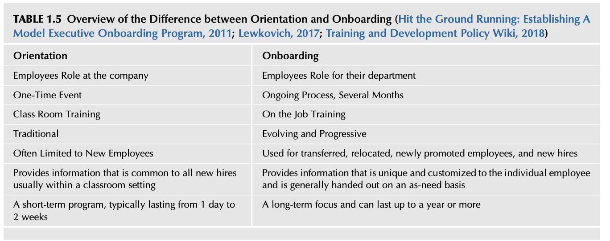

표 1.5 오리엔테이션과 온보딩의 차이점 개요 (TABLE 1.5 Overview of the Difference between Orientation and Onboarding; Hit the Ground Running, 2011; Lewkovich, 2017; Training and Development Policy Wiki, 2018)

| 비교 항목 (Criteria) | 오리엔테이션 (Orientation) | 온보딩 (Onboarding) |
| :--- | :--- | :--- |
| **초점 (Focus)** | 회사 전체에서 직원의 일반적 역할 | 소속 부서 내에서 직원의 구체적 역할 |
| **진행 형태 (Format)** | 1회성 단발 이벤트 (One-Time Event) | 수개월간 지속되는 진행형 프로세스 (Ongoing Process) |
| **교육 방식 (Method)** | 강의실 집체 교육 (Classroom Training) | 현장 실무 중심 OJT 교육 (On the Job Training) |
| **접근법 (Approach)** | 전통적이고 정형화된 방식 (Traditional) | 진화하고 발전하는 진보적 방식 (Evolving & Progressive) |
| **적용 대상 (Target)** | 흔히 신규 입사자에게만 국한됨 | 전보자, 재배치자, 신임 승진자 및 신규 입사자 전원 |
| **정보 성격 (Content)** | 대개 강의실에서 모든 신입사원에게 공통된 기본 정보 제공 | 개별 직원의 특성에 맞춘 독창적 맞춤형 정보 제공 (필요시 수시 제공) |
| **소요 기간 (Duration)** | 통상 1일에서 2주 정도 지속되는 단기 프로그램 | 최장 1년 이상 지속될 수 있는 장기적 집중 관리 프로그램 |

직속 상사와의 초기 면담에서 자신의 직무, 책임, 권한을 꼼꼼히 확인하고 그것이 당초 자신이 예상했던 바와 일치하는지 점검해야 한다. 이 시점에서 여러분은 자신의 사명에 대해 티끌만 한 오해도 없이 완벽히 명확한 이해를 갖추어야 한다. 직속 상사와 나누는 이야기의 대부분은 언뜻 너무나 당연하고 뻔한 말처럼 들릴 수 있지만, 입사 초기 며칠간은 조직에서 여러분의 궁극적인 성공을 결정짓는 결정적인 골든타임이다. 

여러분이 이 직위로 내부 승진했든, 회사에 완전히 새로 합류했든, 새로운 부서로 이동했든, 아니면 단순히 복도 건너편 사무실로 자리를 옮겼을 뿐이든 간에, 여전히 배우고 실천해야 할 것들은 무궁무진하다. 

여러분은 이 직무에 지원하기 전에 회사를 철저하게 사전 조사했을 수도 있다. 그러나 이제는 조직의 실제 규모, 역학, 본질적 속성에 대해 완전히 새로운 현장 중심의 시각을 수집해야 할 때이다. 여러분의 사전 조사가 모든 세부사항을 알려주었을 것이라고 결코 자만하지 마라. 

가용한 공식 조직도가 있다면 반드시 면밀히 검토하라. 만약 공식 조직도를 찾을 수 없다면, 여러분이 조직의 어디에 위치해 있으며 누가 어떤 업무에 책임을 지고 있는지를 매핑하는 단순한 도표를 스스로 직접 작성해 보라. 오늘날 수많은 기업에서 이러한 조직도 관리가 소홀해진 경향이 있다. 핵심은 여러분 자신의 업무 목적을 위해 최신의 조직 지도를 항상 업데이트해 두는 것이다. 이에 대한 상세한 논의는 제3장에서 다룰 것이다. 

여러분이 조직의 다양한 구역을 이동하며 사람들을 만날 때, 여러분이 원하든 원하지 않든 간에 여러분의 옷차림, 행동, 말투, 대응 방식에 의해 여러분에 대한 엄격한 평가와 지각이 형성된다. 이것이 바로 여러분의 첫인상이다. 새로운 지인들에게 자신을 정중하게 소개하고 그들의 이름을 반드시 기억하도록 노력하라 (Sewell, 2007). 

바로 이 지점에서 사람들이 여러분을 어떻게 지각하고 상호작용하는지에 대한 최초의 이미지가 각인된다. 이러한 초기 대화들은 이 조직에서 보낼 여러분의 향후 전체 시간의 기조를 확정 짓게 된다. 이를 일컬어 **'지휘 존재감(Command presence)'**, 즉 "권위와 신뢰를 풍기는 전문적 이미지"를 갖추는 것이라고 부른다 (Leadership Development, Field Manual 6-22, 2015; Medal of Honor, 2008). 

안전 부서와 리더십이 동일한 비즈니스 언어로 대화하고 있는지를 예민하게 탐색하라! 

현장을 직접 걷고, 귀 기울여 경청하며, 눈으로 관찰하라! 톰 피터스(Tom Peters)는 그의 첫 번째 저서에서 **MBWA(Management By Wandering Around, 현장 순회 경영)** 기법을 제안했다 (Peters & Austin, 1999). 

모든 교대근무 조를 순회하며 관리감독자와 현장 근로자들을 직접 대면하라. 야간 교대근무 조가 있다면 야간 조를 절대 빼먹지 마라. 온전히 경청하는 데 충분한 시간을 투자하라. 메모장을 준비하되, 상대방의 말을 경청하고 있는 동안에는 절대 메모장을 끄적이지 마라! 대화가 끝난 직후 기억을 되살리는 트리거로서 핵심 사항들을 신속히 메모하라. 

만약 현장의 애로사항이나 문제가 논의되었다면, 즉시 개선 조치에 착수하고 그 이슈를 제기했던 당사자에게 조치 진행 상황을 신속히 피드백하라. 이 단계에서 여러분이 팀의 진정한 일원이자 언제든 의지할 수 있는 '핵심 적임자(Go-to person)'로 인정받기를 원한다면, 이러한 피드백 조치는 절대적으로 결정적이다. 

그동안 무슨 일이 일어났는지, 그 역사적 배경과 직원들의 진솔한 우려 사항들에 대한 전체적인 그림을 구축해 나감에 따라, 과거의 안전 추진 노력이 어디에서 좌절되었고 실패했으며 발전을 멈추었는지에 대한 깊은 통찰을 얻게 된다. 또한 무엇이 현장에서 실제로 통했고 무엇이 통하지 않았는지를 가장 잘 알고 있는 현장 작업자들과 끈끈한 라포(신뢰 관계)와 공감대를 형성하게 된다. 

여러분의 직속 상사가 여러분이 현재 무엇을 하고 있는지 항상 명확히 알 수 있도록 소통을 지속하라. 행정적인 보고와 관리 업무를 결코 대수롭지 않게 여기고 무시하지 마라. 안전 전문가를 비롯한 다른 서비스 직종 종사자들은 자신이 수행하고 있는 일 자체가 그 자체로 고결한 가치를 지니고 있으며(실제로 가치가 있다!), 모든 사람이 자신들이 하는 일의 중요성을 당연히 알고 있을 것이라고 순진하게 믿는 경향이 있다. 그러나 이는 현실에서 결코 사실이 아니다. 여러분은 안전의 메시지를 끊임없이 능동적으로 소통해야 한다. 

본 부록은 오리엔테이션과 온보딩 프로세스 간의 핵심적 차이에 대한 간략한 개요를 제공했다. 또한 새로운 직무 발령 후 초기 며칠 동안 취해야 할 조치와 관련하여 부록 1.3의 '안전 전문가 지각 인벤토리'에 제시된 몇 가지 중요한 영역들이 함께 논의되었다. 여러분이 조직을 깊이 이해하는 여정에 커다란 행운이 함께하기를 바란다.

## 참고문헌 (BIBLIOGRAPHY)

Baker, S. (2013). The difference between orientation and on-boarding. Acacia HR Solutions.
Beeson, J. (2012). Deconstructing executive presence. Harvard Business Review.
Behind the Eight Ball. (2018). Urban Dictionary.
Cappelli, P. (2012). How to get a job? Beat the machines.
Clear, J. (2014). Use the ‘Eisenhower Box’ to stop wasting time and be more productive. Entrepreneur.
Conducting an Environmental Scan and SWOT Analysis. (2008). State of Alaska, Department of Administration, Division of Personnel & Labor Relations. Public Domain.
Covey, S. R. (1990). The 7 habits of highly effective people: powerful lessons in personal change. Simon and Schuster, Inc.
Deutsch, L. (2016). Onboarding best practices, part 3: How orientation differs from onboarding and why it matters. EKsystems Inc.
Diversion. (2018). Merriam-Webster, Incorporated.
Eisenhower’s Urgent/Important Principle, Using Time Effectively, Not Just Efficiently. (2018). MindTools.
Emergent Property. (2018). Dictionary.com.
Espoused Values. (2018). Businessdictionary.com.
Fehr, J. (2018). The SWOT analysis: Putting it all together. The Hartford, Business Owner’s Playbook.
Fledscher, N. A. (2014). Prevention through design, ANSI Z590.3. In American Society of Safety Engineers, safety 2014 conference.
French, W., & Bell, C. (1984). Organizational development: Behavioral science interventions for organizational movement. Englewood Cliffs, NJ: Prentice-Hall.
Friction. (2018). Dictionary.com.
General Staff Function. (2017). FEMA, Emergency Management Institute. Unit 5.
Godin, S. (2009). Define brand.
Government of Canada Job Bank. (2018). Government of Canada.
Hit the Ground Running: Establishing A Model Executive Onboarding Program. (2011). United State Office of Personnel Management Employee Services, Public Domain.
How to Onboard and Train Employees into a Safety Culture. (2018). Travelers.
Incident Command Model—Position Titles. (2008). Incident Command System.
Is Organizational Friction Killing Your Firm’s Productivity?. (2014). The Manager’s Resource Handbook.
Joyce, S. P. (2018). Guide to being found by recruiters: Improve your LinkedIn profile ranking (personal LinkedIn SEO). Job Hunt.
Koch, C. G. (2007). The science of success: How market-based management built the world’s largest private company. John Wiley & Sons.
Koort, K. (2014). A simple handbook for achieving maximum at work. weekdone.com.
Lawton, P. (2014). Safety onboarding: a crucial part of an employee’s first few days. EHS Daily Advisor.
Leadership Development, Field Manual, 6-22. (2015). Headquarters, Department of the Army. Public Domain.
Lewkovich, A. (2017). Employee onboarding vs. employee orientation: What’s the difference?. Training and eTracking Solutions.
Lowrance, W. (1976). Of acceptable risk: Science and the determination of safety. Los Altos, Calif: W. Kaufmann.
Maimonides. (2018). Give a man a fish and you feed him for a day; teach a man to fish and you feed him for a lifetime. Brainy Quotes.
Mason, D. (2017). Example questions and answers. Prospects.
Mathis, T. L. (2014). When site managers undo corporate safety. ProAct Safety.
Medal of Honor. (2008). Major Bruce P. Crandall.
Mental model. (2018). Oxford Reference.
Miller, C. C. (2015). Can an algorithm hire better than a human? The New York Times.
Montante, W. M. (2006). The essence of safety—what’s in your mental model? Professional Safety, November, 36–39.
Moon, L. (2017). The Eisenhower matrix productivity method. In Using Trello at work.
Occupational Health & Safety Management Systems. (2012). The American Society of Safety Engineers. ANSI/AIHA/ASSE Z10.
Occupational Information Network, Safety Manager, Code: 012.167-058. (2015). Photius Coutsoukis and Information Technology Associates.
Peters, T., & Austin, N. (1999). Doing MBWA. In J. A. Shtogren (Ed.), Skyhooks for leadership. Amacom.
Politics. (2014). Merriam-Webster.com.
Potter, C. (2018). Do we need better safety rules?. Potter and Associates International, Inc.
Prevention through Design Guidelines for Addressing Occupational Hazards and Risks in Design and Redesign Processes. (2011). American Society of Safety Engineers. ANSI/ASSE Z590.3.
Prevention through Design, Plan For the National Initiative. (2017). CDC NIOSH. Public Domain.
Radford, K. J. (1988). Strategic and tactical decisions. Springer-Verlag.
Radford, K. J. (1991). Tactic selection in a complex decision situation.
Rosenblum, J., & Berg, J. (2017). Friction, passion brands in the age of disruption. powerHouse Books.
Roughton, J., & Crutchfield, N. (2016). Job hazard analysis: A guide for voluntary compliance and beyond (2nd ed.). Elsevier/Butterworth-Heinemann.
Safety. (2018). The Free Dictionary by Farlex.
Safety Culture in Nuclear Installations. (2002). International Atomic Energy Agency (IAEA), IAEA-TECDOC-1329.
Safety Culture in the Nuclear Power Industry: Attributes for Regulatory Assessment. (2004). U.S. Nuclear Regulatory Commission.
Safety Manager Job Description Template. (2017). Workable.
Savara, S. (2018). Time management matrix by Stephen Covey—Urgent vs important.
Schermerhorn, J. R., Hunt, J. G., Osborn, R., & Osborn, R. (2004). Core concepts of organizational behavior. Wiley.
Senge, P. M. (2006). The fifth discipline: the art & practice of the learning organization. Crown Publishing Group.
Sewell, G. F. (2007). Effective points to surviving your first 30 days on the job. WC Career Journal, 4(4).
SWOT Analysis. (2009). Scottish energy study volume 4: Issues SWOT analysis.
SWOT Analysis, A Tool for Making Better Business Decisions. (2008). USDA Risk Management Agency. Public Domain.
The Time Management Grid, Covey’s Time Management Grid. (2014). U.S. Geological Survey.
Thomas, M. N. (2012). Personal productivity secrets. John Wiley & Sons, Inc.
Time Management for a Small Business. (2018). U.S. Small Business Administration (SBA). Public Domain.
Training and Development Policy Wiki. (2018). U.S. Office of Personnel Management. Public Domain.
Walling, A. (2008). Spontaneous order revealed. Marketing-based management institute.
Why is Orientation Important?. (2018). Oregon State University.
Yario, J. (2017). 2017 training survey, safety + health asks: How much do you spend on safety training? National Safety Council.

**추천 추가 도서 (FURTHER READING):**
* Ferrazzi, K., & Raz, T. (2014). Never eat alone: And other secrets to success, one relationship at a time. Doubleday.
* Heath, C., & Heath, D. (2008). Made to stick: Why some ideas survive and others die. Random House.
* Recommended Practices for Safety and Health Programs General Industry. OSHA 3885. (2016). OSHA, Public Domain.
