# Chapter 10 Understanding Basic Risk Management Principles (기본 위험관리 원칙의 이해) 서브노트

> *"위험관리의 본질은 우리가 결과에 대해 어느 정도 통제력을 가진 영역을 극대화하는 동시에, 결과에 대해 통제력이 없고 원인과 결과의 연계가 은폐되어 있는 영역을 최소화하는 데 있다."*  
> — **피터 번스타인 (Peter L. Bernstein, 1996, *Against the Gods: The Remarkable Story of Risk*)**  
> 
> *"비즈니스 세계에서 백미러는 언제나 앞유리보다 훨씬 더 선명하다." (In the business world, the rearview mirror is always clearer than the windshield.)*  
> — **워런 버핏 (Warren Buffett, 2018)**  
> 
> *출처: Safety Culture (Elsevier, 2019, pp. 205-215), PART III How to Handle the Perception of Risk, Chapter 10*  
> *DOI: https://doi.org/10.1016/B978-0-12-814663-7.00010-8*

---

## 1. INTRODUCTION (도입: 사후 손실 지표에서 예측적 위험관리로)

위험관리(Risk Management)는 고도화되고 지속 가능한 안전문화(Strong Safety Culture)를 구축하는 데 있어 결코 생략할 수 없는 핵심 초석입니다. 미국 산업위생협회 및 안전공학회의 표준인 **ANSI Z10-2012 (안전보건경영시스템 표준)** 등 유수의 안전 프레임워크는 조직 전반을 분석할 때 반드시 체계적인 위험성평가(Risk Assessment)를 선행하도록 규정하고 있습니다.

위험관리 개념은 최고경영진과 현장 관리자로 구성된 **'리더십 팀의 일상적 운영 의사결정 프로세스'의 핵심 축**으로 다루어져야 합니다. 또한 조직의 안전문화를 장기적으로 유지하고 발전시키기 위해서는 경영진뿐만 아니라 현장의 **모든 임직원이 '위험(Risk)', '위험 통제(Risk Control)', '위험관리(Risk Management)'라는 핵심 개념을 일관되고 정확하게 이해**해야 합니다.

### 1.1 백미러의 함정: 사후 손실 데이터(Post-loss Data)의 맹점
* **사후적 통제 착각**: 오늘날 대다수 기업은 조직이 얼마나 안전하게 통제되고 있는지를 가늠하는 일차적 척도로 과거의 사고 및 손실 데이터(Post-loss data)를 여전히 사용하고 있습니다.
* **워런 버핏의 비유**: 워런 버핏의 명언처럼, 비즈니스 세계에서는 '백미러(후방 거울)'로 지난 과거를 돌아보는 것이 '앞유리(윈드실드)'를 통해 앞으로 닥칠 미래를 내다보는 것보다 훨씬 선명하고 명확해 보입니다. 현재 다수 기업이 고수하는 안전관리 방식은 **앞을 보지 않고 백미러만 보며 운전하는 위험천만한 후방 지향적 방식**과 같습니다.

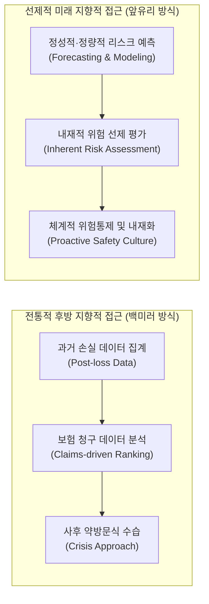

### 1.2 안전 전문가가 처한 모순과 정량적·정성적 예측(Forecasting)의 부재
* **규제 대응 위기관리의 역설**: 안전 전문가들은 위험관리 시스템 방법론을 통해 잠재 위험을 사전 차단하기보다는, 정부의 법적 규제 단속과 위기 상황에 즉흥적으로 대응하느라 전통적인 사후 손실 접근법을 답습하도록 강요받아 왔습니다.
* **예측 분석의 실종**: 위험관리의 가장 중요한 도구는 **리스크의 불확실성과 발생 확률을 사전에 최소화하는 정성적·정량적 예측 기법(Qualitative and Quantitative Forecasting)**입니다. 그러나 안타깝게도 현실의 안전 전문가들은 이 엄밀한 분석 기법을 거의 활용하지 못하고 있으며, 모호하고 오해를 불러일으키는 단순 '안전 메트릭(Safety metrics)'이라는 용어 뒤에 숨어 있습니다.
* **보험 청구 순위 매기기의 고착화**: 보험금 청구 데이터에만 매달려 사고 발생 빈도(Frequency), 심각도(Severity), 백분율을 집계하고 이를 내림차순으로 정렬하여 단순 순위를 매기는 구태의연한 방식이 여전히 안전 성과 측정의 주류로 고착되어 있습니다.

### 1.3 제10장 7대 핵심 학습 목표
본 장을 통하여 안전 전문가는 다음 7가지 핵심 사항을 체계적으로 설명하고 실무에 적용할 수 있어야 합니다:
1. 위험(Risk)의 학술적·실무적 개념 정의.
2. 조직 내 각 부서별로 위험의 정의가 상이하게 사용되는 원인과 맥락 설명.
3. 조직 내 위험관리를 가로막는 주요 장애물(Obstacles) 분석.
4. 위험성평가의 8단계 프로세스 설명.
5. 수용 가능한 위험(Acceptable Risk, ALARP)의 개념과 그 파급 효과 규명.
6. 위험 측정 및 진단의 다양한 방법론 설명.
7. 위험 스펙트럼(Risk Spectrum)의 5단계 계층 구조 및 전사적 영향 설명.

---

## 2. WHAT IS RISK? (위험이란 무엇인가?)

안전경영시스템(SMS)을 성공적으로 구축하고 안전문화를 질적으로 개선하는 근본 목적은 **조직이 자신도 모르는 사이에 치명적인 고심각도 위험(Unwise high severity risk)을 감수하는 파국적 상황을 원천적으로 방지**하는 데 있습니다.

위험에 대한 학술적 논의는 오랜 역사를 가지고 있으며, 수많은 연구자들은 위험성평가의 공식 실행을 지속적으로 촉구해 왔습니다. 일찍이 윌리엄 로런스(William Lowrence, 1976)는 위해(Harm)의 발생 확률과 심각도를 결합하여 **'수용 가능한 위험(Acceptable Risk)'의 객관적 판정 기준**을 정립한 바 있습니다.

### 2.1 글로벌 표준 및 학술 문헌상의 리스크 정의 비교

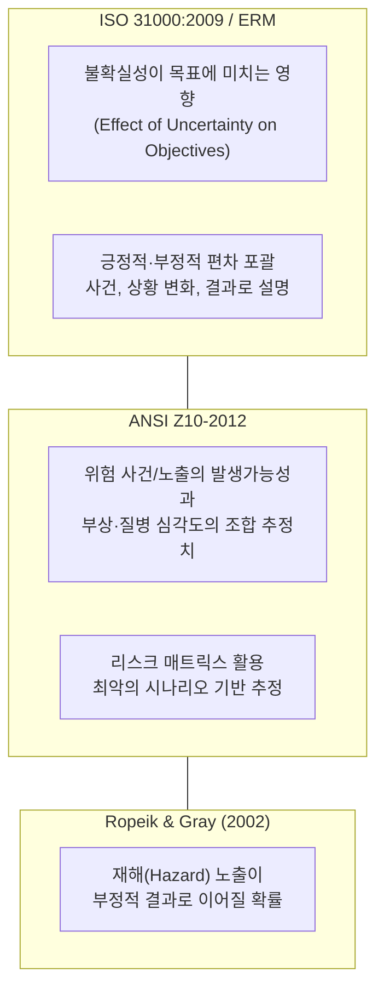

1. **ISO 31000 (국제표준화기구 위험관리 가이드라인)**:
   * 리스크를 **"불확실성이 목표에 미치는 영향(Effect of uncertainty on objectives)"**으로 정의합니다.
   * 영향(Effect)이란 기대했던 것과의 긍정적·부정적 편차(Deviation)를 의미하며, 리스크는 특정한 사건, 상황의 변화 또는 결과의 조합으로 설명됩니다.
2. **ANSI Z10-2012 (미국 산업위생 및 안전보건경영시스템 표준)**:
   * 리스크를 **"재해(Hazard) 사건 또는 노출(들)의 발생가능성(Likelihood)과, 그 사건 또는 노출에 의해 야기될 수 있는 부상이나 질병의 심각도(Severity)의 조합에 대한 추정치"**로 정의합니다.
   * 과거 산업계 데이터, 과학적 근거, 위해 메커니즘에 기반한 **'리스크 매트릭스(Risk Matrix)'**를 사용하여 노출의 성격과 형태에 따른 최악의 시나리오(Worst-case scenario)를 상정하고 위험의 크기를 추정합니다.
3. **로픽과 그레이 (Ropeik & Gray, 2002)**:
   * *"리스크(위험)란 재해(Hazard)에 대한 노출이 부정적인 결과(Negative consequence)로 이어질 확률이다."*

### 2.2 재해(Hazard)와 위험(Risk)의 연계 및 4대 처리 전략
* **모든 재해에는 고유 위험(리스크)이 내재**: 현장의 모든 재해(사망·부상·파괴를 야기하는 근원 그 자체)는 그에 상응하는 고유한 위험(발생 가능성과 심각도의 조합 추정치)을 품고 있습니다.
* **리스크의 4대 대응 대안 (4T 전략)**:
  1. **회피 (Avoidance / Terminate)**: 고위험 공정이나 물질의 사용을 완전히 중단하거나 배제함.
  2. **통제 (Control / Treat)**: 공학적·관리적 방벽을 설치하여 발생 확률과 심각도를 낮춤.
  3. **전가 (Transfer / Tolerate through third-party)**: 보험 가입이나 계약 조항을 통해 재정적 손실을 제3자에게 이전함.
  4. **수용 (Acceptance / Tolerate)**: 잠재적 손실의 크기를 완벽하게 평가한 후, 통제 가능한 잔여 위험을 감수함.
* **위험 수용의 대전제**: 위험을 수용(Acceptance of risk)하는 것은 결코 방치가 아니며, **잠재 손실의 전반적인 규모와 파급력을 면밀히 평가한 후에만 취할 수 있는 정당한 경영 행위**입니다.

---

## 3. THE MYTH OF “NO LOSS NO RISK” (“손실이 없으면 위험도 없다”는 신화)

### 3.1 위험 이론의 발전과 운명론(Fate)의 잔재
* **16세기 확률론의 태동**: 위험 개념은 16세기 통계학과 확률(Probability) 이론의 진보와 발을 맞추어 체계화되었으며, 점차 모든 현대 조직의 운영 핵심으로 자리 잡았습니다.
* **전통적 운명론과 미신의 지속**: 근대적 위험 개념이 정립되기 이전 인류는 사고나 부상을 인간이 통제할 수 없는 '정해진 운명(Preordained fate)'의 결과로 여겼습니다. 이러한 운명론적 사고와 행운(Luck)에 대한 믿음은 오늘날에도 여전히 남아 있습니다. (예: 운동선수들이 경기 당일 특정 유니폼을 고집하거나 의식적 징크스, 행운의 부적을 착용하여 운명을 바꾸려는 행위).

### 3.2 LESSON LEARNED 1 (교훈 1: 주관적 의견을 넘어 객관적 증거와 표준으로 말하라)
* **안전 전문가의 언어**: 안전 전문가는 객관적 증거(Supporting evidence)가 뒷받침되지 않는 사견이나 주관적 의견을 제시해서는 안 됩니다.
* **설득력의 원천**: 상대방을 설득력 있게 변화시키려면 개인의 신념, 과거 경험, 주관적 느낌, 단순한 제안의 차원을 넘어서야 합니다.
* **학술적 출처와 표준 인용**: 사실에 기반한 진술(Fact-based statements)은 반드시 학술적 출처(Scholarly sources)에 의해 입증되어야 합니다. 경영 리더십 팀과 규제 준수나 안전 현안을 논의할 때 **구체적인 공인 표준(Specific standard) 조항을 직접 인용**하는 것이 가장 강력한 무기입니다. (소셜 미디어 및 문헌 도구의 정밀 활용은 제16장에서 심화).

### 3.3 잠재적 오류(Latent Errors)와 지연된 피드백의 함정
* **설계 단계의 잠재 오류**: 손실 유발 사건의 근본 원인은 일상적 작업 속에 교묘히 숨겨져 있습니다. 시스템의 초기 설계, 원자재 선정, 장비 스펙, 작업자 선발, 교육 훈련 프로세스 등에서 **'잠재적 오류(Latent errors)'가 미처 인지되지 못한 채 구조적으로 내장**될 수 있습니다.
* **시간적 지연(Time Line Stretch)**: 통제되지 않은 재해(Hazard)에 노출되는 빈도와 실제 대형 사고가 폭발하는 사이에는 상당한 시간적 지연이 발생합니다. 인간의 실수, 부적절한 기계 설계, 내장된 잠재적 재해가 한 줄로 정렬되는 '스위스 치즈 모델의 궤적'이 완성되기까지는 오랜 시간이 걸리기 때문입니다.

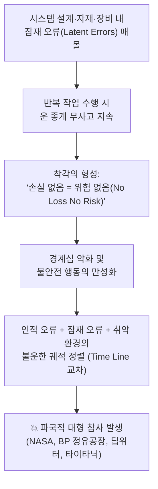

### 3.4 “No Loss No Risk” 착각과 대형 참사의 교훈
* **무사고 착각**: 위험천만한 작업일지라도 아무런 사고 없이 여러 번 완료되면 작업자와 관리자는 "사고가 안 났으니 이 일은 안전하다"는 치명적인 착각, 즉 **'No loss, no risk'의 맹신**에 빠져듭니다.
* **역사적 대형 참사들의 공통 분모**:
  1. **NASA 우주왕복선 폭발 참사** (챌린저호/컬럼비아호)
  2. **BP 멕시코만 딥워터 호라이즌 시추선 폭발 및 원유 유출 참사** (2011)
  3. **BP 텍사스 정유공장 폭발 참사** (2005)
  4. **RMS 타이타닉호 침몰 참사** (1912)
* **참사의 공통 원인 분석**:
  * 겉으로 드러난 손실 빈도가 낮다고 해서 현장의 위험이 통제되고 있는 것은 결코 아닙니다.
  * 이러한 초대형 참사들의 공통점은 **현장의 위험 경고를 진지하게 다루지 않았고, 잠재적 위험에 대한 완전한 평가를 게을리했으며, 초기 손실 징후를 묵살했고, 안전 표준을 준수하지 않았거나, 작업 환경이 급변했음에도 낡고 부적절한 법적 규제만을 맹목적으로 따랐다**는 사실입니다.

---

## 4. DEFINITIONS OF RISK—THE POTENTIAL FOR CONFLICT (위험 정의의 다원성과 부서 간 충돌)

위험성평가를 수행할 때 리스크의 심각성과 수용 수준은 첨예한 논쟁거리가 됩니다. 특정 프로젝트의 이해관계자(Stakeholder)는 사업이 가져다줄 잠재적 이익이 손실 가능성보다 훨씬 크다는 점을 강변하며 자신의 프로젝트를 결사적으로 방어하려 듭니다.

### 4.1 LESSON LEARNED 2 (교훈 2: 손실 통제에서 잠재 심각도 중심으로의 코페르니쿠스적 전환)
* **네이선(Nathan)의 경험**: 고객사를 위한 정밀 위험성평가 프로세스 개발 팀에 참여했던 네이선은 평생 동안 사후 '손실 통제(Loss control)'에만 매몰되어 일해 왔습니다. 그러나 리스크의 진정한 본질을 깊이 공부하면서 전문적 인생의 전환점을 맞이했습니다.
* **인식의 일대 전환**: 리스크 기반 관점을 온전히 받아들이자, 과거 자신이 **"발생 빈도는 높으나 피해는 미미한 경미한 사건(High frequency with low risk)"을 줄이는 데만 지나치게 많은 시간과 자원을 낭비**하고 있었으며, 정작 작업장 배후에 숨겨져 있던 **"발생 빈도는 극히 낮지만 발생 시 조직을 파멸시키는 잠재적 고심각도 조건(High severity potential conditions)"을 완전히 놓치고 있었다**는 충격적인 진실을 깨달았습니다.

### 4.2 조직 내 부서별 위험 정의의 파편화와 갈등 메커니즘
경영 리더십 팀에게 '위험'이라는 개념을 제시할 때 가장 먼저 맞닥뜨리는 장벽은 **각 부서가 사용하는 '위험(Risk)'이라는 단어의 정의가 근본적으로 다르다**는 점입니다.

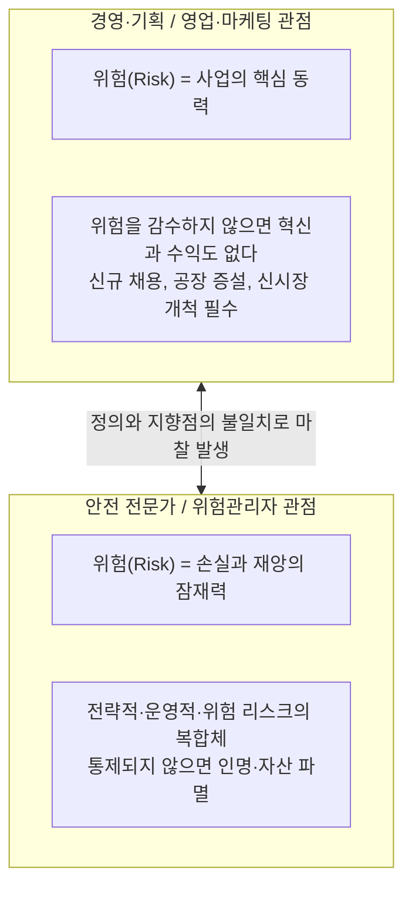

* **비즈니스 리더십의 시각**: 일반 비즈니스 환경에서 '위험'은 기업을 성장시키는 필수적인 전략적 결단입니다. 신제품 개발, 공장 신축, 신규 인력 채용, 미개척 시장 진출은 모두 리스크를 무릅쓰는 행위이며, 경영 관점에서는 위험을 감수(Risk-taking)하지 않고는 어떤 성과도 달성할 수 없습니다.
* **안전 전문가의 시각**: 안전 및 리스크 관리자가 사용하는 위험은 **전략적 리스크, 운영 리스크, 재해(Hazard) 리스크가 상호 중첩되어 다양한 손실 유발 상황을 창출하는 잠재적 파괴력**을 의미합니다.
* **충돌과 마찰의 발발**: 경영진은 위험 감수를 위대한 비즈니스적 미덕으로 바라보는 반면, 안전 부서의 위험 저감 제안은 기업의 성공과 확장을 가로막는 번거로운 걸림돌이나 방해물로 인식하여 심각한 갈등이 야기됩니다 (Quadrant of Risk, 2017).

---

## 5. OBSTACLES TO RISK MANAGEMENT (위험관리 실행의 5대 장애물)

위험을 효과적으로 관리하기 위해서는 조직의 의사결정 방식과 문제 해결 메커니즘을 정확히 간파하고, 적재적소에 꺼내 쓸 수 있는 **'위험 평가 방법론 툴박스(Toolbox of methods and techniques)'**를 완벽히 구축해야 합니다.

### 5.1 문화적 장애물: 사고(Accident)라는 단어의 독성과 운명론
* **불가항력이라는 착각**: 관리자나 감독자들과 대화를 나누다 보면 사고는 불가피하게 일어나는 것이며 일을 완수하기 위해 치러야 할 대가라는 인식을 종종 보입니다.
* **사전적 정의의 한계**: 사전에서 사고(Accident)는 *"피해자의 과실이나 잘못 없이 발생하는, 부상이나 손실을 야기하는 예기치 못한 우발적 사건"*으로 정의됩니다 (Merriam-Webster, 2018). 이 용어는 현장의 위험 노출에 대해 아무것도 설명하지 못하며, 사고는 막을 수 없다는 운명론적 체념을 강화합니다.
* **ANSI Z10의 용어 혁신**: **ANSI Z10 표준은 '사고(Accident)'라는 단어를 완전히 폐기하고 '인시던트(Incident, 사건/이상상황)'라는 용어를 채택**했습니다. 인시던트는 업무 관련 부상, 질병, 사망이 발생했거나 발생할 뻔했던 모든 사건(아차사고/Near-miss, Close call 포함)을 총칭하여, 사전에 통제 가능한 시스템적 결함임을 분명히 합니다.

### 5.2 LESSON LEARNED 3 (교훈 3: 고위 임원의 결함 설계를 방치한 오프알 삽질과 사내 정치)
* **기괴한 현장 관찰**: 한 식품 가공공장에 안전 진단을 나간 네이선은 직원이 악취 나는 폐기물(Offal, 찌꺼기/부산물) 배수관 앞에 쪼그려 앉아 삽으로 오물을 끝없이 퍼내고 있는 광경을 목격했습니다.
* **숨겨진 내막**: 원래 그 시스템은 고가의 '자동 세척 시스템'이어야 했습니다. 왜 이런 고된 육체노동을 반복하느냐고 묻자 작업자는 어처구니없는 대답을 내놓았습니다.  
  *"이 배수관 이송 시스템은 본사 최고위 임원 중 한 분이 직접 특별 설계(Special design)한 것입니다. 하지만 전혀 작동하지 않습니다. 매일 밤 유지보수 및 청소 인력이 달라붙어 막힌 배관을 뚫어야만 다음 날 공장을 돌릴 수 있습니다. **하지만 그 누구도 고위 경영진에게 당신이 거액을 들여 만든 자동화 시스템이 완전히 실패작이며 매일 막힌다는 진실을 감히 말하지 못합니다.**"*
* **인간적 에고와 사내 정치의 벽**: 단순한 인간공학적 부담(허리 굽힘, 무거운 부품 인양, 삽질)을 조사하러 갔다가 사내 권력 구조와 임원의 에고(Ego), 침묵의 카르텔이 얽힌 복합적 시스템 결함을 발견한 사례입니다.
* **시사점**: 위험관리 개선안을 제안할 때는 조직의 인간적 역학 관계와 사내 정치(Organizational politics), 개인의 자존심을 정밀하게 고려해야 합니다. 논리적이고 빈틈없이 제안하더라도, 조직이 건설적인 비판을 수용할 준비가 되어 있지 않다면 심각한 저항에 직면하게 됩니다.

### 5.3 재해(Hazard)와 위험(Risk) 용어의 엄밀한 구분 (혼용 방지)
이단과 리틀(Ethan & Little, 2011)이 지적했듯, 가장 흔하면서도 치명적인 장애물은 두 개념을 구별하지 못하고 둘 다 '위험'으로 뒤섞어 쓰는 것입니다:
* **재해 (Hazard)**: *"사망, 부상, 질병, 또는 물리적 손상을 야기하는 본질적 사건이나 물리적 근원 그 자체(Potential source of harm / damage)."* (예: 고전압 전류, 화학물질 폭발, 독성가스 누출, 암벽 낙하 등 인간에게 직접적 위해를 가하는 실체).
* **위험 / 리스크 (Risk)**: *"식별된 재해(Hazard)에 노출되었을 때 그 악영향이 실제로 발생할 가능성(Probability/Likelihood)과 초래될 결과 심각도(Severity)의 통계적·논리적 조합."* (즉, 재해의 발생 가능성과 파급력의 크기 추정치).

---

## 6. RISK ASSESSMENT (위험성평가: 3단계 기반 프레임워크와 8단계 프로세스)

### 6.1 위험관리의 3단계 기반 프레임워크 (Managing for Health and Safety, HSG65)
영국 보건안전청(HSE)의 HSG65 지침 및 국제 표준에 따른 위험관리의 3단계 기본 구조는 다음과 같습니다:

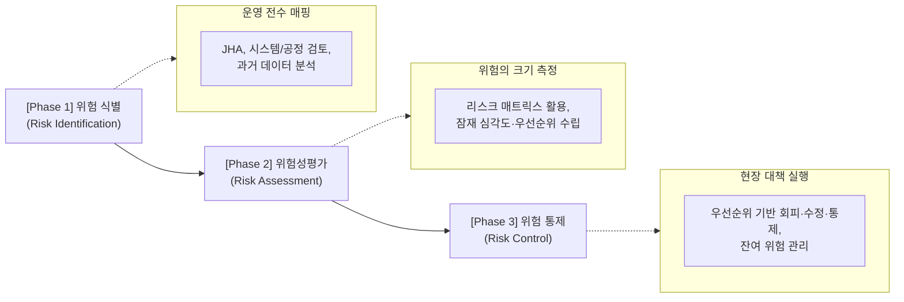

1. **Phase 1: 재해 식별 (Hazard / Risk Identification)**
   * 조직 내의 모든 활동과 물리적 조건을 체계적으로 전수 조사하여 공정 운영을 정밀 매핑(Map the operations)합니다.
   * 작업위험성평가(JHA), 시스템 및 프로세스 분석, 과거 데이터 분석 등 가용한 모든 도구를 동원하여 어떤 재해 요인이 어디에 도사리고 있는지 완벽히 파악합니다.
2. **Phase 2: 위험성평가 (Risk Assessment)**
   * 재해(Hazard)로부터 발생할 수 있는 위험(Risk)의 크기와 영향을 정밀 추정합니다.
   * 표준화된 **'리스크 매트릭스(Risk Matrix)'**를 적용하여 잠재적 심각도 등급을 매기고, 위험 통제 조치를 즉각 실행해야 할 객관적 우선순위(Priorities)를 확립합니다.
3. **Phase 3: 위험 통제 (Risk Control)**
   * 수립된 우선순위에 입각하여 식별된 위험을 회피(Avoid), 수정(Modify), 통제(Control)하기 위한 현장 조치를 강력하게 단행합니다.

---

### 6.2 Table 10.1 Eight Steps to Risk Assessment (위험성평가 8단계 상세 분석)

본문의 핵심 프로세스인 위험성평가 8단계의 구조와 세부 내용은 다음과 같습니다:

**TABLE 10.1 Eight Steps to Risk Assessment**

| 단계 (Step) | 핵심 실행 과업 (Action) | 세부 설명 및 적용 기준 (Description) |
| :---: | :--- | :--- |
| **Step 1** | **위험성평가의 목표 정의** *(Define the objective)* | 위험성평가의 궁극적 목표는 **조직에 미치는 잠재적 영향을 기준으로 위험의 객관적 우선순위를 수립(Prioritizing of risk)**하는 데 있다. |
| **Step 2** | **평가 대상 조직/시스템의 정의 및 기술** *(Define and describe the organization/system)* | 조직/시스템의 구성 요소들이 어떻게 상호작용하여 재해(Hazards)와 위험(Risks)을 빚어내는지 심층 분석한다: **4대 핵심 축인 인적 요소(People), 도구/장비/자재(Tools/Equipment/Materials), 작업 환경(Environment), 정책/절차/관리 체계(Policies/Procedures/Administrative)**를 포괄적으로 규명한다. |
| **Step 3** | **조직/시스템 내 재해 식별** *(Identify hazards)* | 조직과 시스템에 대한 전면적 검토를 통해 **"우리가 무엇을 하며, 그것을 어떤 방식으로 수행하는가(What do we do and how do we do it?)"**를 집요하게 질문하고 잠재적 재해(Hazards)를 식별·분석한다. |
| **Step 4** | **재해 연계 위험의 평가 및 분석** *(Assess and analyze the risk)* | 특정 재해와 연계된 위험의 범위를 기술하기 위해 **정량적·정성적 메트릭(Quantitative and Qualitative metrics)을 모두 동원**한다. 재해로 인한 손실 유발 사건이 발생할 확률과 잠재적 피해 심각도에 대한 정밀 추정치를 도출한다. |
| **Step 5** | **잠재 영향에 따른 재해 및 위험의 우선순위화** *(Prioritize hazards and associated risks)* | 모든 재해와 위험의 복합적 파급 영향을 결합하고, 사전에 수립된 **'수용 가능한 위험 기준(Criteria as to what is acceptable)'과 대조하여 통제의 시급성을 서열화**한다. |
| **Step 6** | **위험관리를 위한 실행 계획 수립** *(Develop action plans)* | 우선순위가 확정되면, 가장 치명적이고 순위가 높은 최상위 핵심 위험(Highest priority or most severe risk)부터 착수하여 구체적 관리 실행 계획을 수립한다. |
| **Step 7** | **관리 방법 실행 평가 및 잔여 위험 추적** *(Evaluate implementation and residual risk)* | 현장에 적용된 위험관리 대책들의 실질적 유효성을 정밀 평가한다. 대책 적용 후에도 불가피하게 남게 되는 **잔여 위험(Residual risk)의 크기를 추적·통제**한다 (Fig. 10.1 연계). |
| **Step 8** | **조직/시스템 프로세스의 지속적 수정 및 피드백** *(Modify organization/system processes)* | 위험관리 프로세스는 일회성 행사가 아니며, **조직, 시스템, 미션 또는 개별 활동의 전체 생애주기(Life cycle) 전반에 걸쳐 영구히 지속되고 갱신**되어야 한다 (Acquisition Risk Management, 2017). |

---

### 6.3 Fig 10.1 총 위험 vs 잔여 위험 (Types of Risk: Total Risk vs. Residual Risk) 상세 해설

**FIG. 10.1 Types of risk—total risk vs residual risk.**

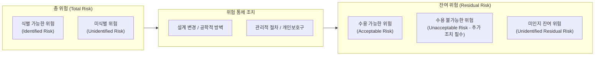

* **총 위험 (Total Risk)**: 시스템 내에 존재하는 모든 잠재적 위험의 총체이며, 인간이 찾아낸 '식별된 위험(Identified Risk)'과 아직 시스템 배후에 숨어 있는 '미식별 위험(Unidentified Risk)'의 합으로 구성됩니다.
* **통제 조치 적용 후의 분화**: 아무리 완벽한 안전 대책을 수립하더라도 총 위험을 0(Zero)으로 만드는 것은 불가능합니다. 위험 감소 대책을 실행하고 난 후 필연적으로 남게 되는 위험을 **'잔여 위험(Residual Risk)'**이라 합니다.
* **잔여 위험의 3대 구성 요소**:
  1. **수용 가능한 위험 (Acceptable Risk)**: 정밀 평가를 거쳐 조직의 기준선(ALARP) 이하로 통제되어 경영진이 공식 수용할 수 있는 안전한 잔여 위험.
  2. **수용 불가능한 위험 (Unacceptable Residual Risk)**: 대책을 적용했음에도 여전히 조직의 허용 기준을 초과하는 위험으로, 추가적인 공학적 방벽이나 공정 수정이 강제되는 위험.
  3. **미식별 잔여 위험 (Unidentified Residual Risk)**: 평가 과정에서 미처 발견하지 못해 방어벽 없이 시스템에 잠복해 있는 가장 치명적인 시한폭탄 같은 위험.

---

### 6.4 Fig 10.2 위험성평가 8단계 순환 다이어그램 상세 해설

**FIG. 10.2 Eight steps to accomplish a successful risk assessment.**

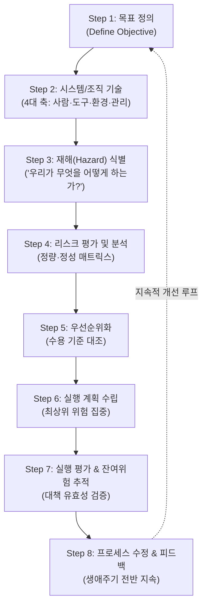

* 본 다이어그램은 위험성평가가 일회성 서류 작업(One-time paper drill)으로 끝나는 것이 아니라, **1단계부터 8단계까지 끊임없이 피드백되며 순환하는 생애주기 관리 폐루프(Closed-loop Lifecycle Management)**임을 명확히 보여줍니다.
* 특히 8단계(Modify processes)에서 도출된 교훈과 시스템 개선점은 다시 1단계와 2단계로 즉각 피드백되어 조직의 변화된 환경을 최신 상태로 반영하게 됩니다.

---

## 7. ACCEPTABLE RISK (수용 가능한 위험과 ALARP 원칙)

### 7.1 위험의 편재성과 일상적 위험 감수 성향의 위험성
* **모든 행동에 편재된 위험**: 위험은 눈에 보이지 않더라도 조직의 모든 기능, 과업, 행동 속에 상존합니다. 계단을 내려가거나, 물건을 들어 올리거나, 자동차에 주유를 하는 지극히 일상적인 동작에도 위험은 언제나 도사리고 있습니다.
* **일상적 위험 수용의 작업장 전이**: 암벽 등반, 스노보드, 포뮬러 1 레이싱과 같은 익스트림 스포츠는 종종 비극적 사고가 일어남을 알면서도 사람들이 자발적으로 위험을 감수(Voluntary risk-taking)합니다. 심각한 문제는 **작업자들이 자신의 사생활에서 즐기던 무모한 위험 수용 성향을 작업장 안으로 고스란히 끌고 들어온다**는 점입니다.

### 7.2 ALARP 원칙과 수용 가능한 위험의 학술적 정의
국제적으로 통용되는 위험관리 의사결정의 대원칙은 **ALARP (As Low As Reasonably Practicable, 합리적으로 실행 가능한 한 낮게)**입니다.

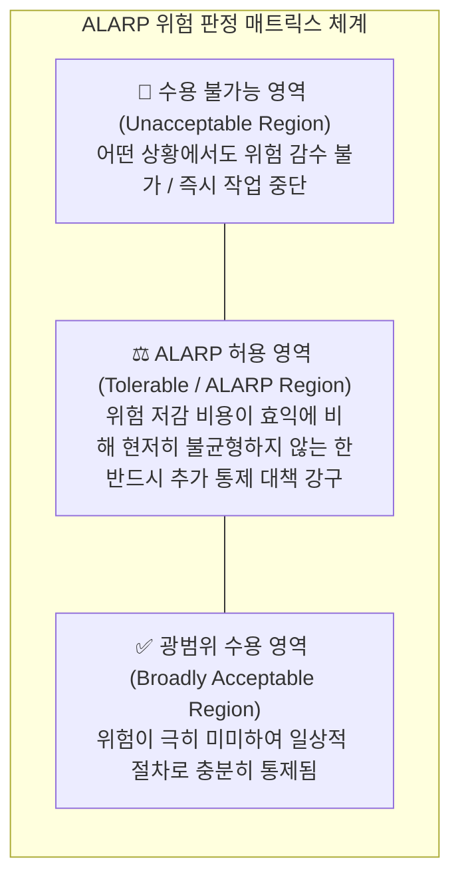

> **수용 가능한 위험 (Acceptable Risk)의 정의**:  
> *"재해(Hazard) 관련 인시던트나 노출이 발생할 확률과, 그로 인해 발생할 수 있는 피해 또는 손실의 심각도가 **합리적으로 실행 가능한 한 낮으며(As low as reasonably practicable)**, 검토 대상 상황에서 **충분히 감내할 수 있는(Tolerable)** 수준의 위험."*  
> *(On Acceptable Risk, 2002)*

### 7.3 미숙련 근로자의 자의적 위험 수용 엄금
* 위험을 수용할 것인가에 대한 중대한 의사결정을 **전문적 훈련을 받지 못했거나 지식이 부족한 현장 개인에게 맡겨서는 절대로 안 됩니다.**
* 무엇을 수용해야 할지, 언제 상급자에게 도움을 청해야 할지 모르는 미숙련 작업자가 자의적으로 위험을 수용하게 내버려두면, 조직 전체에 돌이킬 수 없는 치명적 재앙(Irreparable harm)을 초래하게 됩니다.

---

## 8. MANAGEMENT OF RISK (위험관리 체계: 부서 간 장벽 극복과 8대 진단 질문)

### 8.1 고위험 전문 직업군의 위험 통제 메커니즘
경찰, 소방, 군사 작전, 광업, 심해 잠수, 항공기 조종 등은 본질적으로 극도의 고위험 환경(High-risk environment)에서 작동합니다. 그럼에도 불구하고 이들이 일상적으로 임무를 완수할 수 있는 이유는, **주어진 임무를 완수하는 데 필요한 수준까지 위험을 철저히 낮추도록 특별히 고안된 엄격한 절차, 다중 방호 프로토콜, 고도화된 통제 장치**를 체계적으로 보유하고 있기 때문입니다.

### 8.2 재무 중심 위험관리 부서와 안전 부서의 갈등과 단절
* **위험관리 부서(Risk Management Dept.)의 한계**: 많은 기업이 위험관리 전담 부서를 두고 있지만, 이들의 주된 업무는 대개 보험 증권 발행(Placing insurance), 위험 재무화(Risk financing), 사후 손실 보상 및 클레임 관리(Claims management)에 국한되어 있습니다. 현장의 광범위한 위험 노출과 손실 잠재력을 선제적으로 발굴하는 심층적 절차는 결여된 경우가 많습니다.
* **소속 본부의 분리로 인한 적대적 관계**:
  * 안전 부서는 대개 **'생산운영(Operations)'** 또는 **'인사(HR)'** 본부 산하에 배치됩니다.
  * 위험관리 부서는 막대한 보험료 지출과 배상금 지급 때문에 주로 **'재무/기획(Finance)'** 본부 산하에 속합니다.
  * 그 결과 두 부서는 서로 협력하기는커녕, 위험을 정의하는 방식과 통제에 접근하는 철학의 차이로 인해 사내에서 서로 반목하고 대립하는 적대적 관계(Adversaries)로 전락하기 일쑤입니다.

### 8.3 조직 내 위험관리 현황 진단을 위한 8대 핵심 질문
안전 전문가가 사내 위험관리 체계를 전면 재진단하고 안전경영시스템과 융합하기 위해 던져야 할 8가지 전략 질문은 다음과 같습니다:
1. 우리 조직이 ISO 31000 등 공인 표준에 기반한 **전사적 위험관리(Enterprise Risk Management, ERM)** 체계를 공식적으로 따르고 있는가?
2. 현재 사내 위험관리 부서가 추진 중인 업무의 본질적 성격과 범위는 무엇이며, 어떤 과업을 수행하도록 최고 리더십으로부터 위임받았는가?
3. 위험관리 실무 담당자들과 가능한 모든 채널을 통해 긴밀한 신뢰 및 협력 관계(Rapport)를 구축하고 있는가?
4. 현행 위험관리 프로세스 안에 **실질적인 현장 '안전(Safety) 기준'이 공식 지표로 포함**되어 있는가?
5. 위험관리 부서가 조직의 전사적 리스크를 평가할 때 **구체적으로 어떤 평가 메트릭과 기법을 사용**하고 있는지 완벽히 파악하고 있는가?
6. 위험관리 부서가 보유한 전문 자원(리스크 분석 툴, 재무 데이터 등) 중 안전경영시스템을 보완하고 강화하는 데 끌어다 쓸 수 있는 자원은 무엇인가?
7. 위험관리 기준이 사내에 전파되는 소통 경로를 이해하고 있으며, 안전경영시스템도 동일한 전사 소통망을 공유하여 활용할 수 있는가?
8. 위험(Risk), 재해(Hazard), 손실 유발 사건, 그리고 안전 현안에 대해 부서의 벽을 넘어 **상호 간에 데이터를 실시간 공유할 수 있는 통합 프레임워크**를 구축했는가?

---

## 9. THE “RISK SPECTRUM” (위험 스펙트럼의 5단계 계층과 복합 연쇄 폭발)

위험이 조직에 미치는 파급 영향에는 칼로 자르듯 명확한 경계선이 존재하지 않습니다. 고차원적 위험관리 접근법을 구현하기 위해 위험의 전사적 파급 범위를 조망하는 **'위험 스펙트럼(Spectrum of Risk)' 5단계 계층 모델**을 적용합니다.

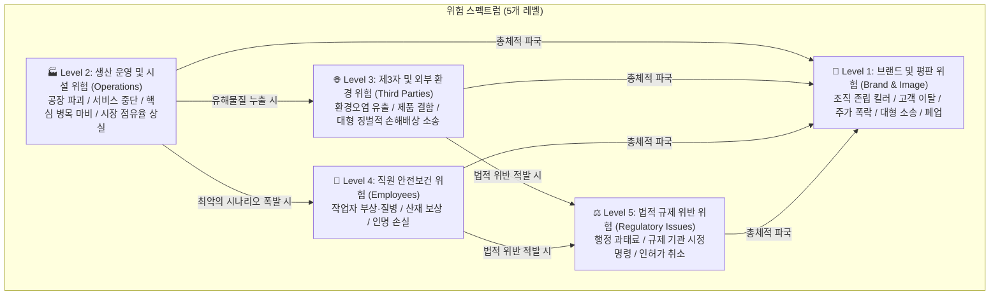

### 9.1 위험 스펙트럼 5단계 상세 분석

1. **Level 1: 조직의 브랜드 및 대외 평판 위험 (Risk impacting the organization’s brand)**
   * **파급력**: 조직에 닥칠 수 있는 최상위의 파멸적 위험입니다. 기업의 브랜드, 명성, 신뢰도를 단숨에 추락시키거나 완전히 파괴합니다.
   * **결과**: 이 위험은 진정한 **'조직의 킬러(Organizational killers)'**로 작동합니다. 고객들이 등을 돌리고, 기업 가치와 주가가 폭락하며, 정부 규제 기관의 가혹한 개입과 대규모 민형사상 소송, 언론의 집중 포화를 불러옵니다. 조직의 회복탄력성(Resilience)이 극도로 높지 않다면, 브랜드 신뢰를 상실한 기업은 시장에서 영구히 퇴출당합니다.
2. **Level 2: 생산 운영 및 시설 위험 (Risk impacting the operations)**
   * **파급력**: 제품을 생산하거나 서비스를 제공하는 개별 공장, 사업장, 핵심 시설을 직접적으로 타격하는 위험입니다.
   * **결과**: 공장이 완전히 전파되지 않더라도 특정 사업장이 납기를 맞추거나 생산 목표를 달성하는 능력을 심각하게 저하시킵니다. 대체 생산 라인이 신속히 가동되고 시장 점유율을 방어할 수 있다면 살아남겠지만, 그렇지 못하거나 자금 지원이 지체되면 기업은 파산에 직면합니다.
   * **리스크 맵(Risk Map)의 활용**: 자재와 제품의 유입(Inflows)과 유출(Outflows) 간의 상호 연결성을 시각화한 리스크 맵을 구축해야 합니다. 이를 통해 전체 조직을 멈춰 세울 수 있는 **치명적인 '물류·생산 병목(Bottlenecks)'을 사전에 식별하고 업무연속성계획(BCP)의 기초를 수립**합니다 (Fig. 10.3 연계).
3. **Level 3: 제3자 및 외부 환경 위험 (Risk impacting on third parties / non-organization entities)**
   * **파급력**: 공장 설비 자체는 멀쩡하여 생산이 계속되더라도, 조직의 외부 경계를 넘어 지역사회와 일반 대중에게 피해를 입히는 위험입니다.
   * **결과**: 제품 설계 결함, 운송 차량 대형 교통사고, 유독물질의 환경 누출 및 대기 오염 등으로 인해 막대한 징벌적 손해배상 집단 소송이 제기됩니다. 그로 인한 천문학적 재정적 손실은 기업의 정상적 운영 역량을 바닥까지 갉아먹습니다. 위험관리는 공장 울타리를 넘어 기업이 속한 거시적 비즈니스 생태계 전반을 조망해야 합니다.
4. **Level 4: 직원 안전보건 위험 (Risk impacting employees)**
   * **파급력**: 작업 현장 근로자의 부상 및 직업성 질병 예방을 다루며, 대다수 전통적 안전 프로그램이 집중하는 영역입니다.
   * **결과**: 안전한 일터는 안전문화의 절대적 기본이지만, 냉혹하게도 중대 재해를 제외한 통상적인 작업자 부상은 공장 가동을 전면 중단시키지 않으며 산재보상보험 처리로 수습되곤 합니다. 그러나 만약 부상 빈도가 지속적으로 높거나 비극적인 사망 사고가 발생하면, "위험천만한 죽음의 일터"라는 악명이 퍼져 기업 브랜드(Level 1)를 직격하고 지역사회와 노동계, 언론의 강력한 규탄을 받게 됩니다.
5. **Level 5: 규제 위반 및 행정 처분 위험 (Risk from regulatory issues)**
   * **파급력**: 노동부나 환경청 등 규제 기관의 감독과 법적 기준 위반에 따른 위험입니다.
   * **결과**: 통상적인 과태료나 시정 조치는 공장을 멈추지 않으며 재무적 벌금 납부로 종결됩니다. 그러나 규제 준수를 지속적으로 위반하고 개선 의지 없이 태만(Negligent)한 모습을 보일 경우, 전면 조업 정지 및 사법 처리로 이어져 최악의 파국을 맞게 됩니다.

---

### 9.2 Fig 10.3 간이 리스크 맵 (Simplified Risk Map) 상세 해설

**FIG. 10.3 Simplified risk map. Risk maps identify “bottlenecks” or where a loss-producing event can stop flow of service or product to customer.**

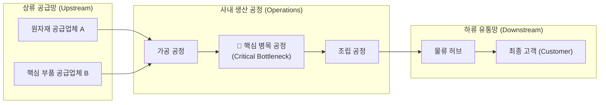

* **병목 구간(Bottleneck)의 시각화**: 리스크 맵은 원자재 유입부터 고객에게 완제품이 전달되기까지의 밸류체인 전 과정을 정밀 추적합니다.
* **단절점의 조기 포착**: 어느 한 공정이나 공급망에서 단 한 번의 손실 유발 사건이 터졌을 때, 전체 서비스나 제품 흐름을 올스톱시킬 수 있는 **가장 취약한 '단일 실패점(Single Point of Failure)'을 찾아내어 선제적 이중화 및 BCP 대책을 세우는 전략적 지도**입니다.

---

### 9.3 최악의 시나리오 (Worst-case Scenario)를 통한 복합 연쇄 폭발의 예시
위험 스펙트럼의 5개 레벨은 고정불변의 서열이 아니며, 사고의 규모에 따라 상호 연쇄적으로 폭발합니다:
* **발단**: 화학 공장에서 대형 배관 폭발 및 화재 참사가 발생함 (**Level 2 생산 시설 파괴**).
* **연쇄 1**: 현장 운전원들이 사망하거나 중화상을 입음 (**Level 4 직원 인명 피해**).
* **연쇄 2**: 유독가스가 공장 담장을 넘어 인근 아파트 단지를 덮치고 인근 하천을 오염시켜 주민들이 병원에 실려 감 (**Level 3 제3자 배상 및 환경 재앙**).
* **연쇄 3**: 고용노동부와 환경청이 압수수색을 단행하고 천문학적 과징금을 부과하며 공장 전면 가동 중지 명령을 내림 (**Level 5 규제 사법 처분**).
* **파국**: 방송 메인 뉴스를 도배하며 불매 운동이 번지고 모기업 주가가 폭락하여 창사 이래 최대의 파산 위기에 직면함 (**Level 1 브랜드와 기업 존립의 파멸**).

---

### 9.4 Fig 10.4 위험관리 전략 및 평가 총괄 프레임워크 상세 해설

본 장의 백미인 Fig 10.4는 조직의 전사적 리스크 관리(ERM)와 안전문화를 하나로 묶어내는 마스터플랜 다이어그램입니다:

**FIG. 10.4 Example overview of a risk management strategy and assessment.**

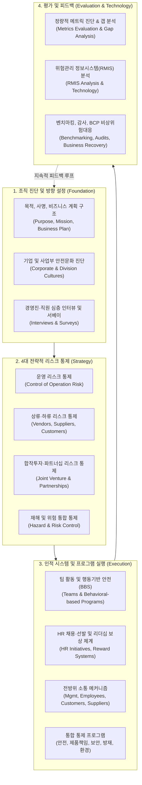

* **전사적 통합 구조**: Fig 10.4는 안전이 결코 독립된 섬이 아니며, **조직의 거시적 경영 비즈니스 계획, 인사 보상 정책(HR), 협력업체 공급망(Supply Chain), IT 정보시스템(RMIS), 그리고 비상 재난 복구(Business Recovery)와 완벽히 맞물려 돌아가는 종합 시스템**임을 증명합니다.

### 9.5 제11장 ABSS(활동 기반 안전시스템)와의 가교
* **양방향 소통의 절실함**: 위험관리를 성공시키기 위해 최고 리더십은 자신의 안전 비전과 위험 저감 목표를 현장에 끊임없이 전파해야 합니다. 그러나 이는 자칫 일방적인 하향식(Top-down) 지시로 변질되기 쉽습니다.
* **ABSS의 역할**: 차기 장인 제11장에서 다룰 **'활동 기반 안전시스템(Activity-Based Safety System, ABSS)'**은 리더십과 현장 직원이 실재하는 위험과 지각된 위험에 대해 격의 없이 토론할 수 있는 공식적인 **'양방향 소통 플랫폼(Two-way communication framework)'**을 제공하여 위험 중심의 안전 활동을 현장에 완벽히 착근시킵니다.

---

## 10. SUMMARY (제10장 총괄 요약)

1. **패러다임의 대전환**: 심층적 안전문화 구축의 핵심은 과거의 사후 손실 지표(Loss-based) 중심에서 벗어나, 미래 지향적인 위험관리(Risk-based) 중심으로 지각을 근본적으로 바꾸는 것입니다.
2. **위험관리의 3단계 기본 사이클**: 재해 식별(Identification) ➔ 위험성평가(Assessment) ➔ 위험 통제(Control)의 3단계를 축으로 재해에 내재된 위험을 회피, 통제, 전가, 수용합니다.
3. **부서 간 위험 정의의 격차 해소**: 비즈니스 부서(위험 감수=미덕)와 안전 부서(위험=손실 방지) 간의 위험 정의 차이를 명확히 이해하고, 공통의 전략적 언어로 소통해야 합니다.
4. **'No Loss No Risk' 신화의 타파**: 손실이 발생하지 않았다고 해서 위험이 없는 것이 아닙니다. 잠재적 오류가 은폐되어 있다가 시간 축이 교차하는 순간 대형 참사가 폭발합니다.
5. **체계적인 8단계 위험성평가와 잔여 위험 통제**: 목표 정의부터 시스템 분석(4대 축), 우선순위화, 잔여 위험 추적, 프로세스 수정에 이르는 8단계 생애주기 평가 모델을 실행해야 합니다.
6. **위험 스펙트럼과 다차원적 방어**: 근로자 부상(Level 4)뿐만 아니라 설비 마비(Level 2), 제3자 피해(Level 3), 규제 제재(Level 5)를 방어하여 조직의 궁극적 존립 기반인 브랜드 가치(Level 1)를 사수해야 합니다.
7. **차기 장과의 연계**: 제11장에서는 본 장의 위험관리 원칙을 양방향 소통 구조로 구현하는 활동 기반 안전시스템(ABSS)을 본격적으로 다룹니다.

---

## 11. CHAPTER REVIEW QUESTIONS (복습 질문 및 심화 학술 해설)

### Q1. 위험(Risk)을 정의하라.
* **해설**: 리스크(위험)란 단순히 다칠 수 있는 가능성이 아니라, **"특정한 재해(Hazard) 사건 또는 노출이 실제로 발생할 확률(Likelihood/Probability)과, 그로 인해 발생할 수 있는 부상, 질병, 재산 피해, 환경 파괴 등 부정적 결과의 심각도(Severity)를 통계적·논리적으로 결합한 추정치"**입니다 (ANSI Z10, 2012; ISO 31000).

### Q2. 조직 내에서 위험의 정의가 부서마다 서로 다르게 사용되는 양상과 그로 인한 갈등을 설명하라.
* **해설**: 
  * **경영/마케팅 부서**: 신제품 출시, 공장 증설, 시장 개척을 위한 위험 감수(Risk-taking)를 기업 성장의 필수적 미덕이자 가치 창출 동력으로 정의합니다.
  * **안전/위험관리 부서**: 사고, 부상, 배상 책임, 브랜드 실추를 유발하는 회피 및 통제의 대상(Hazardous potential)으로 정의합니다.
  * **갈등 메커니즘**: 경영진은 안전 부서의 규제 및 통제 제안을 사업을 가로막는 걸림돌로 오인하고, 안전 부서는 경영진의 과감한 추진을 무모한 안전 불감증으로 비판하며 소통의 벽이 형성됩니다.

### Q3. 위험관리를 가로막는 주요 장애물(Obstacles)을 설명하라.
* **해설**:
  1. 사고를 불가항력적 운명이나 불운으로 치부하는 '사고(Accident)'라는 단어의 독성과 운명론적 문화.
  2. 최근 무사고였으니 앞으로도 안전할 것이라 착각하는 'No loss no risk'의 집단적 편향.
  3. 재해(Hazard, 손상 그 자체)와 위험(Risk, 발생 가능성과 심각도의 결합) 용어의 무분별한 혼용.
  4. 고위 임원의 잘못된 결함 설계를 알리지 못하는 사내 정치와 침묵 카르텔 (Lesson Learned 3의 오프알 삽질 사례).
  5. 재무 중심의 위험관리 부서와 생산 중심 안전 부서 간의 조직적 사일로와 적대감.

### Q4. 위험성평가의 8단계 프로세스를 순서대로 설명하라.
* **해설**:
  * **Step 1 (목표 정의)**: 우선순위 수립 목적 선언.
  * **Step 2 (시스템 기술)**: 인적, 도구/장비, 환경, 관리적 4대 축의 상호작용 분석.
  * **Step 3 (위험 식별)**: "우리가 무엇을 어떻게 하는가?" 전수 추적.
  * **Step 4 (리스크 분석)**: 정량적·정성적 메트릭을 결합한 확률 및 심각도 도출.
  * **Step 5 (우선순위화)**: 수용 가능성 기준과 대조하여 통제 서열화.
  * **Step 6 (실행계획 수립)**: 최상위 심각도 위험부터 즉각적인 조치 계획 확립.
  * **Step 7 (평가 및 잔여 위험 추적)**: 대책 실행 유효성 검증 및 남은 잔여 위험 통제.
  * **Step 8 (프로세스 수정)**: 전 생애주기 동안 시스템을 지속적으로 수정하고 피드백 루프 가동.

### Q5. 수용 가능한 위험(Acceptable Risk)과 ALARP의 개념 및 그 잠재적 영향을 설명하라.
* **해설**:
  * **개념**: 위험을 0으로 만드는 것은 불가능하므로, 통제 대책을 통해 위험 사건의 발생 확률과 피해 심각도를 **"합리적으로 실행 가능한 한 낮추고(ALARP)", 사회적·법적·조직적 관점에서 감내할 수 있는 수준(Tolerable)으로 낮춘 상태**를 의미합니다.
  * **잠재적 영향**: 명확한 수용 기준이 확립되지 않으면, 미숙련 작업자가 자신의 위험 감수 성향에 따라 무모하게 작업을 강행하다가 조직 전체를 파멸로 몰고 가는 참사가 발생하므로, 반드시 권한 있는 조직 직급에서만 위험 수용 여부를 공식 결정해야 합니다.

### Q6. 위험 스펙트럼(Risk Spectrum)의 5단계 계층 구조를 설명하라.
* **해설**:
  * **Level 1 (브랜드 위험)**: 고객 이탈, 기업 가치 폭락, 조직의 생존을 결정짓는 최상위 킬러 리스크.
  * **Level 2 (운영/시설 위험)**: 공장 가동 중단, 핵심 병목 마비, 서비스 불능.
  * **Level 3 (제3자/환경 위험)**: 환경 누출, 대형 교통사고, 대규모 제조물 책임 및 징벌적 손해배상.
  * **Level 4 (직원 안전보건 위험)**: 작업자 부상, 직업병, 산업재해 및 인명 손실.
  * **Level 5 (규제 위반 위험)**: 행정 처분, 벌금 과태료, 인허가 취소.

---

## 12. BIBLIOGRAPHY (참고문헌)

* A structured approach to Enterprise Risk Management (ERM) & the requirements of ISO 31000. (2010). AIRMIC. Retrieved from: http://bit.ly/2Hju03v.
* Accident. (2018). *Merriam-Webster, Incorporated*. Retrieved from: http://bit.ly/XTAklU.
* Acquisition Risk Management Probability Definitions. (2017). *Risk Management Toolkit*. Retrieved from: http://bit.ly/VAZN7L.
* Bernstein, P. L. (1996). *Against the gods: The remarkable story of risk*. New York: Wiley.
* Blast at BP Texas Refinery. (2005). *ProPublica, Journalism in the Public Interest in ‘05 Foreshadowed Gulf Disaster*, March. Retrieved from: http://1.usa.gov/13tv7Y8.
* Buffett, W. (2018). In the business world, the rearview mirror is always clearer than the windshield. In *Brainy quote*. Retrieved from: http://bit.ly/2kDzgpE.
* Concepts and Principles. Human Performance Improvement Handbook. (2009). Vol. 1, US Department of Energy.
* Deep Water, The Gulf Oil Disaster and the Future of Offshore Drilling. (2011). *National Commission on the BP Deepwater Horizon Oil Spill and Offshore Drilling*, January. Retrieved from: http://1.usa.gov/XeVOw8.
* Ethan, G., & Little, D. (2011). Risk—assessing and mitigating to deliver sustainable safety performance. *Professional Safety*, (July).
* Guidelines for Hazard Identification, Risk Assessment and Risk Control (HIRARC). (2008). Department of Occupational Safety and Health Ministry of Human Resources Malaysia, Based on Information as Presented on and Adapted for Use. Retrieved from: http://bit.ly/bBXZYW.
* Havern, C. B. (2012). The short life and tragic end of RMS Titanic. *Coast Guard Journal of Safety & Security at Sea: Proceedings of the Marine Safety & Security Council*, 69(2). Retrieved from: http://bit.ly/2J56rhe.
* ISO 31000, Risk Management—Principles and Guidelines. (2009). International Organization for Standardization. Retrieved from: http://bit.ly/Uobg8J.
* Lowrance, W. W. (1976). *Of acceptable risk: Science and the determination of safety*. Los Altos, CA: William Kaufmann, Inc.
* Managing for Health and Safety (HSG65). (2013). Health and Safety Executive, Crown Publishing. Permission to Reprint, Based on Information as Presented and Adapted for Use. Retrieved from: http://bit.ly/YKDzRk.
* Occupational Health and Safety Systems. (2012). The American Industrial Hygiene Association, ANSI/AIHA Z10.
* Offal, the waste or by-product of a process. (2018). *Merriam-Webster*. Retrieved from: http://bit.ly/2MuhK4c.
* On Acceptable Risk. (2002). In *EHS Today*. January, Retrieved from: http://bit.ly/Z36Yma.
* Principles of System Safety. (2000). The Federal Aviation Administration (FAA), Office of System Safety, FAA System, Adapted for use (chapter 3) December. Retrieved from: http://bit.ly/2kfwY2Z.
* Quadrant of Risk: Hazard, Operational, Financial, and Strategic. (2017). ERM Strategies, LLC. Retrieved from: http://bit.ly/YE0Spv.
* Ropeik, D., & Gray, G. M. (2002). *Risk: A practical guide for deciding what’s really safe and what’s really dangerous in the world around you*. Boston, MA: Houghton Mifflin Company.
