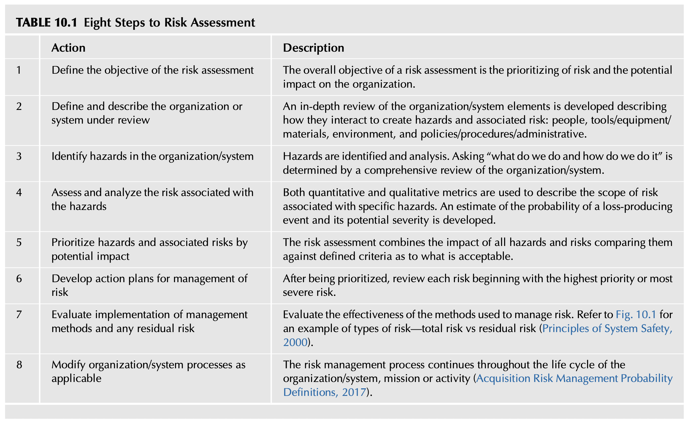
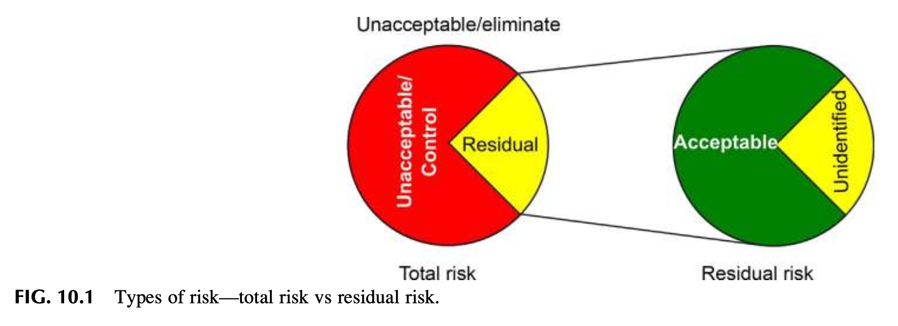
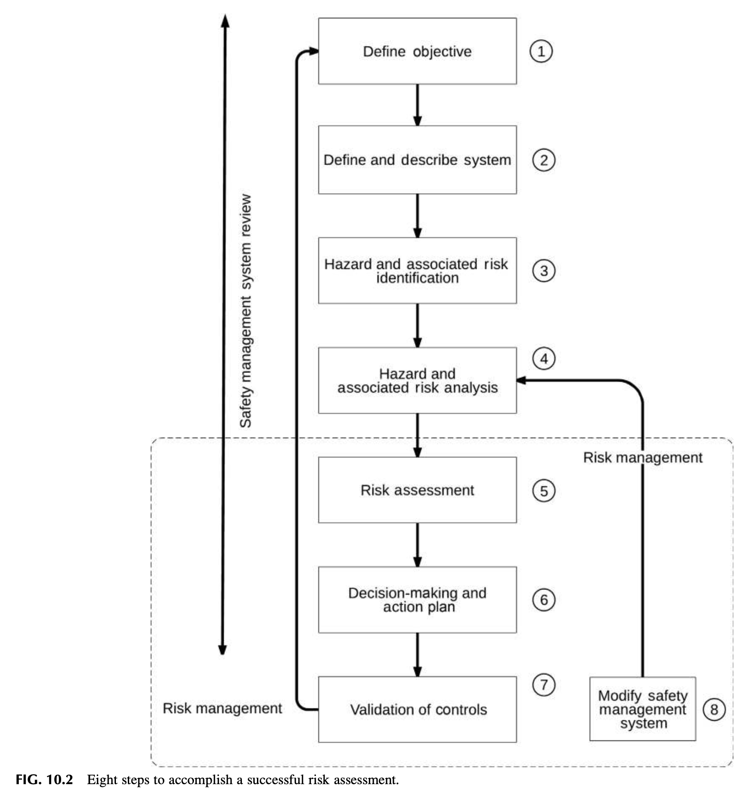
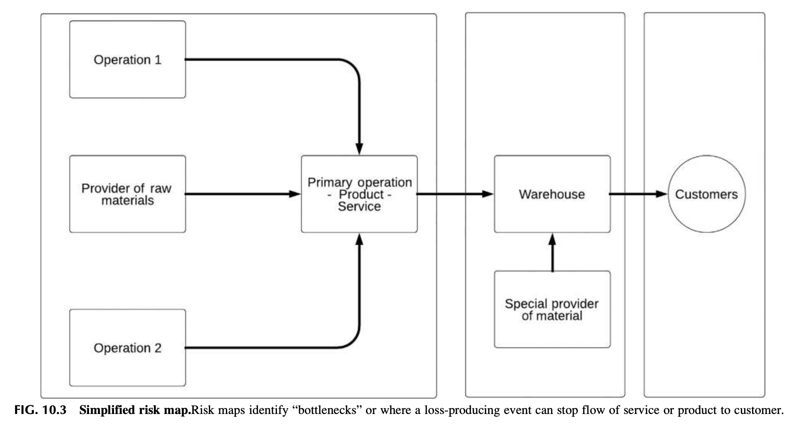
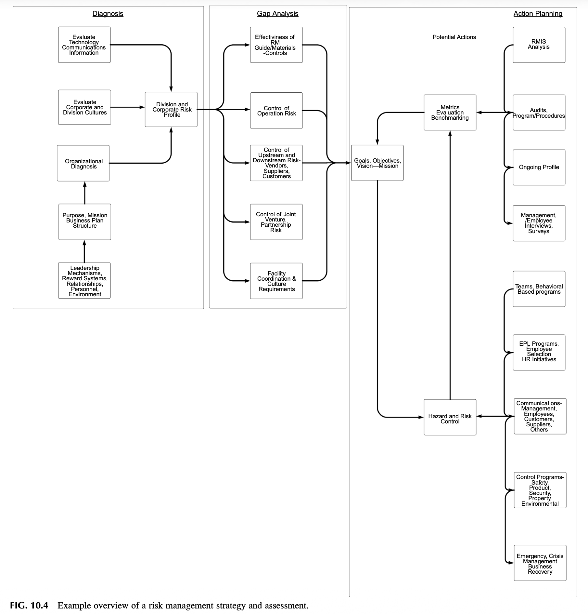

<!-- Block B01 -->
# 제10장 기본 위험관리 원칙의 이해 (Chapter 10 Understanding Basic Risk Management Principles)
Safety Culture. https://doi.org/10.1016/B978-0-12-814663-7.00010-8

> "위험관리의 본질은 우리가 결과에 대해 어느 정도 통제력을 가진 영역을 극대화하는 동시에, 결과에 대해 전혀 통제력을 갖지 못한 영역을 최소화하는 데 있다." – 피터 L. 번스타인 (Peter L. Bernstein, 1996)

<!-- Block B02 -->
## 서론 (INTRODUCTION)

위험관리(Risk Management)는 강력한 안전문화의 필수불가결한 핵심 요소이다. ANSI/AIHA/ASSE Z10-2012와 같은 안전보건경영시스템 표준은 조직에 대한 총체적 분석의 일환으로 위험성평가를 완료하도록 권고하는 명확한 기준을 제시하고 있다. 위험관리의 개념은 최고경영진의 일상적 운영 의사결정 프로세스의 핵심 요소로 간주되어야 한다. 또한 조직의 안전문화를 지속 가능하게 유지하려면 모든 임직원이 위험(Risk), 위험 통제(Risk Control), 위험관리(Risk Management)와 같은 핵심 용어를 명확히 이해하고 있어야 한다.

그러나 수많은 조직들은 여전히 조직이 얼마나 통제된 상태에 있는지를 판단하는 주요 지침으로 **사후 손실 데이터(postloss lag data)**에만 매달리고 있다. 워런 버핏(Warren Buffett)의 유명한 격언은 이를 날카롭게 꼬집는다: "비즈니스 세계에서는 항상 앞유리(전방 윈드실드)보다 백미러(후방 거울)가 훨씬 더 선명하다"(Buffett, 2018). 이 명언은 오늘날 수많은 기업들이 관행적으로 답습하고 있는 사후 손실 기반 경영 접근법을 가장 완벽하게 묘사하는 비유이다.

아이러니하게도 안전 전문가들은 위험관리 시스템 방법론 대신 법적 규제에 의해 강제된 사후 위기 대응 방식을 따르도록 오랫동안 훈련받아 왔다. 예를 들어, 정성적 및 정량적 예측(Forecasting)은 위험의 확률과 불확실성을 최소화하기 위해 사용되는 위험관리의 필수 요소이지만, 단순한 사후 산재 통계에 매몰된 안전 실무에서는 거의 활용되지 못했다. 빈도, 강도, 백분율로 손실 데이터를 나열하고 순위를 매기는 보험 청구 주도형 접근법은 여전히 안전 측정의 주류로 고착화되어 있다.

본 장에서는 위험관리의 정의, 그리고 조직의 위험 관련 이슈를 소통하고 해결하기 위한 기초 개념들을 심도 있게 탐구한다.

본 장을 마친 후 당신은 다음을 수행할 수 있어야 한다:
* 위험(Risk)을 명확히 정의할 수 있다.
* 조직 내 부서마다 위험에 대한 정의가 어떻게 다를 수 있는지 설명할 수 있다.
* 위험관리를 가로막는 다양한 조직적 장애물을 분석할 수 있다.
* 위험성평가의 8단계 프로세스를 설명할 수 있다.
* 허용 가능한 위험(Acceptable Risk)의 개념과 그 파급효과를 설명할 수 있다.
* 위험 측정의 다양한 프로세스를 비교할 수 있다.
* 위험 스펙트럼(Risk Spectrum)과 4대 사분면 위험 모델을 설명할 수 있다.

<!-- Block B03 -->
## 위험이란 무엇인가? (WHAT IS RISK?)

안전보건경영시스템을 구축하고 안전문화를 개선하는 것은 조직이 자신도 모르는 사이에 무모한 고위험·고강도 위험을 감수할 확률을 줄이는 데 결정적으로 기여한다. 위험은 오랫동안 광범위하게 논의되어 왔으며, 학자들은 위험성평가의 수행을 지속적으로 주창해 왔다. 윌리엄 로런스(William Lowrence)는 유해·위험의 발생 확률과 결과의 심각성에 연계된 "허용 가능한 위험(Acceptable Risk)"의 결정 개념을 정립했다(Lowrance, 1976).

다양한 국내외 표준들은 위험을 다음과 같이 정의하고 평가 지침을 구축해 두었다:
* **ISO 31000 (국제표준 위험관리):** 위험을 **"목표에 대한 불확실성의 영향(effect of uncertainty on objectives)"**으로 정의한다. 이 관점에서 영향은 긍정적, 부정적, 또는 기대치로부터의 이탈일 수 있으며, 위험은 종종 특정 사건, 상황의 변화, 또는 결과로 설명된다(ISO 31000:2009 / 2018).
* **ANSI Z10-2012 (미국 산업안전보건경영시스템):** 위험을 **"유해·위험 사건 또는 위험 노출의 발생 가능성(likelihood/probability)과, 그 사건 또는 노출로 인해 초래될 수 있는 부상이나 질병의 중대성(severity)의 결합에 대한 추정치"**로 정의한다. ANSI Z10에서는 현장 경험, 산업 통계 이력, 과학적 원리, 그리고 상해를 유발하는 기전에 근거하여 특정 위험을 추정하기 위해 위험 매트릭스(Risk Matrix)를 활용한다. 위험 매트릭스는 위험 노출의 성격과 유형에 따라 최악의 시나리오에서 잠재적 심각성이 어느 정도일지에 대한 포괄적인 통찰을 제공한다.

> "위험(Risk)이란 유해·위험요인(Hazard)에 대한 노출이 부정적인 결과(Negative Consequence)로 이어질 확률이다."  
> – 로페익 & 그레이 (Ropeik & Gray, 2002)

위험관리는 유해·위험요인을 식별하고 특정 유해·위험요인과 결합된 위험을 파악하기 위한 과학적 방법과 개념의 활용을 요구한다. 모든 유해·위험요인은 그에 상응하는 관련 위험을 반드시 수반한다. 이러한 유해·위험요인에 내재된 위험의 범위가 추정되면, 정의된 위험을 **회피(Avoidance), 통제/경감(Control/Mitigation), 전가(Transfer), 또는 수용(Acceptance)**하기 위한 구체적인 위험 처리 조치들이 선택된다. 위험의 수용은 잠재적 손실의 전체 규모와 파급효과가 면밀히 평가된 후에만 정당화될 수 있는 최후의 조치이다.

<!-- Block B04 -->
## "손실이 없으면 위험도 없다"는 치명적 신화 (THE MYTH OF “NO LOSS NO RISK”)

위험의 개념은 과학과 통계학, 특히 확률론의 발전과 궤를 같이하며 진화해 왔다. 위험 이론은 16세기 무렵부터 싹트기 시작하여 점차 조직 경영의 모든 영역으로 스며들었다.
위험이 공식적으로 정의되기 전, 과거 인간 사회는 불행과 재난을 운명(fate), 신의 섭리, 혹은 단순한 불운으로 돌리곤 했다. 그러나 현대 통계학과 위험 이론은 사고가 맹목적인 운명이 아니라, 관리 가능한 확률적 프로세스임을 입증했다.
산업 현장에 팽배한 가장 치명적인 미신은 바로 **"지난 수년간 무사고였으니 우리 작업장에는 아무런 위험도 없다"**는 착각이다. 사고가 발생하지 않았다는 외형적 결과가 위험이 부재하다는 증거가 결코 될 수 없다.

<!-- Block B05 -->
### 교훈 1: 학술적 엄밀성과 근거 기반 접근 (LESSON LEARNED 1)

안전 전문직(Safety Profession)에서 우리는 뒷받침하는 객관적 증거(supporting evidence) 없이 주관적인 사견을 늘어놓아서는 안 된다. 독자나 경영진을 설득하려면 당신의 글과 보고서는 단순한 개인적 믿음, 주관적 경험, 사견 및 모호한 제안의 수준을 넘어서야 한다.

**사실에 기반한 진술(Fact-based statements)은 자신의 주장과 결론을 입증하기 위해 신뢰성 있는 학술 문헌(Scholarly Sources)과 공인된 표준을 요구한다.**

리더십 팀과 규제 준수 관련 주제를 논의할 때 구체적인 산업안전보건 표준이나 법률 조문을 직접 인용할 수 있는 역량은 대단히 유용하다. (문헌 인용과 참고문헌 표기에 대해서는 제16장에서 보다 자세히 다룬다.)

경영진이 과거의 무사고 기록에 안주하려는 태도는 인간의 인지 구조상 이해할 수 있는 일이지만, 안전 전문가는 객관적 통계 데이터와 위험성평가 결과를 들이밀며 침묵하는 잠재 위험을 가시화해야 한다. 현장 조건이 바뀌었음에도 과거의 성공에 도취되어 구태의연한 방식을 고수할 때 참사가 잉태된다.

<!-- Block B06 -->
## 위험 정의의 차이—갈등의 잠재적 불씨 (DEFINITIONS OF RISK—THE POTENTIAL FOR CONFLICT)

위험성평가의 일환으로 위험의 다차원적 수준이 신중히 고려되어야 한다.
어떤 프로젝트의 이해관계자는 해당 사업이 창출할 의도된 이익(효익)이 잠재적 손실 가능성을 훨씬 능가한다는 점을 내세워 자신의 프로젝트를 방어해야 한다는 강한 의무감을 느낄 수 있다.
안전 부서가 지적하는 위험과 사업 부서가 추구하는 기회 사이에서 발생하는 이러한 인식 차이는 조직 내 갈등의 주요 원인이 된다.

<!-- Block B07 -->
### 교훈 2: 손실 통제에서 위험 지각으로의 패러다임 전환 (LESSON LEARNED 2)

네이선(Nathan)은 고객 조직들을 위해 위험성평가 프로세스를 개발하는 전담 팀의 일원이었다. 과거에 주로 사후 "손실 통제(loss control)" 프로그램만을 중심으로 일해왔던 그에게, 위험(Risk) 그 자체에 대한 학술적 연구는 직업 인생을 송두리째 바꾸어 놓은 경이로운 경험이었다.
그가 단순한 사후 손실이 아닌 사전 위험 기반의 관점을 온전히 받아들이자, 조직의 너무나 많은 노력이 '발생 빈도는 높지만 위험성은 낮은 사소한 사건(High Frequency, Low Severity)'에만 낭비되고 있었으며, 정작 현장 운영 속에 깊숙이 숨겨진 '치명적인 대형 재해 잠재 조건(Low Frequency, High Severity / Fatalities)'은 완전히 놓치고 있었다는 충격적인 사실을 깨닫게 되었다.

경영진에게 "위험"의 개념을 제시할 때 반드시 고려해야 할 중대한 문제는 조직 내 위험 정의의 다원성이다. 기업 경영진은 '위험을 감수하는 행위(Risk-taking)'를 비즈니스를 영위하기 위한 필수불가결한 미덕으로 정의한다. 신규 인력 채용, 공장 증설, 신제품 개발 투자는 일반 경영 환경에서 대단히 가치 있는 도전으로 간주된다. 경영학적 관점에서 볼 때 위험을 감수하지 않고는 아무것도 성취할 수 없다.

조직의 각 부서는 '위험'이라는 용어를 완전히 다른 의미로 사용하고 있다. 리더십과 위험을 논의할 때 영업/마케팅, 생산운영, 재무, 안전, 품질관리 등 다양한 전문 분야가 이 용어를 어떻게 사용하며, 특정 위험 정의가 구성원의 행동을 어떻게 유도하는지 명확히 이해해야 한다.
영업 및 마케팅 부서는 신제품 개발 시 위험을 감수하는 것을 당연하게 여긴다. 반면 안전 전문가와 리스크 관리자가 사용하는 위험의 정의는 순수 손실을 초래하는 위험에 집중된다. 이러한 위험 정의의 충돌은 경영진이 안전 부서의 위험 저감 요구를 비즈니스 성공을 가로막는 장애물로 오해하게 만드는 마찰을 초래한다(Quadrant of Risk, 2017).

<!-- Block B08 -->
## 위험관리의 조직적 장애물 (OBSTACLES TO RISK MANAGEMENT)

위험관리를 가로막는 장애물을 극복하기 위해서는 위험을 평가할 때 적재적소에 활용할 수 있는 다양한 방법과 기법들로 구성된 '도구함(Toolbox)'을 체계적으로 구축해야 한다. 나아가 이는 조직에서 현재 사용 중인 의사결정 및 문제 해결 방식을 깊이 이해하고, 안전 위험 평가를 전사적 비즈니스 프로세스에 조화롭게 융합하는 것을 요구한다.

<!-- Block B09 -->
### 교훈 3: 숨겨진 위험과 조직 정치학 (LESSON LEARNED 3)

어느 가공 공장의 안전 프로그램을 평가하기 위해 현장을 방문했을 때, 네이선은 한 작업자가 폐기물 이송 배수로에서 동물 내장 부산물(Offal)을 삽으로 연신 퍼내고 있는 모습을 관찰했다.
원래 그 배수로 시스템은 자동으로 찌꺼기를 세척·배출하는 자동화 설비였기에, 네이선은 작업자에게 왜 이 힘든 일을 수작업으로 하고 있는지 물었다. 작업자의 대답은 놀라웠다: 이 이송 시스템의 엔지니어링 설계는 **고위 임원 중 한 명이 야심 차게 추진한 "특수 설계"**였는데, 실제로는 전혀 작동하지 않았던 것이다! 매일 밤 정비 및 청소 인력 팀이 달라붙어 막힌 배수로를 뚫어야 다음 날 공장이 돌아갈 수 있었다. 그러나 그 누구도 고위 임원에게 그의 값비싼 자동화 시스템이 완전히 실패작이며 매일 배관이 막힌다는 진실을 감히 보고하지 못했다. 단순한 근골격계 부담 작업(부품 들기, 허리 굽히기, 삽질하기)에 대한 질문에서 시작된 현장 조사가, 결국 고위층의 개인적 자존심과 조직 정치학이 얽힌 복합적인 공정 위험과 거대한 시스템 결함을 밝혀내는 결과로 이어졌다.

앞선 사례에서 보듯, 개인의 자존심(ego)과 조직 내 정치적 역학 관계에서 비롯되는 장애물을 반드시 고려해야 한다. 변화를 위한 권고사항을 제시할 때 이러한 '인간적 요소(human element)'는 대단히 신중하게 다루어져야 한다. 조직이 논리적이고 잘 정돈된 방식으로 비판을 제기했을 때 이를 열린 마음으로 수용하는 문화를 가지고 있는가?

에단과 리틀(Ethan & Little, 2011)에 따르면 위험관리를 가로막는 또 다른 중대한 장애물은 **유해·위험요인(Hazard)과 위험(Risk)의 개념을 혼동하여 둘을 마구 혼용하는 경향**이다:
* **"유해·위험요인(Hazard)은 잠재적인 피해의 원천(potential source of harm)이다."**
* **"위험(Risk)은 식별되지 않거나 통제되지 않은 유해·위험요인의 부정적 영향이 실제로 일어날 확률(chance)이다."**
화학물질, 전기, 방사선 등 유해·위험요인의 원천은 부상이나 파손을 유발할 수 있는 물리적 조건을 형성한다. 반면 위험은 발생할 수 있는 사건의 잠재적 심각성과 유해·위험요인에 대한 노출 빈도를 동반한 발생 확률의 결합이다.

위험을 조직에 실질적인 개념으로 각인시키는 데 있어, **"사고(Accident)"라는 전통적 용어 자체가 장애물**이 될 수 있다. 왜냐하면 '사고'라는 단어는 여전히 인간이 예방할 수 없는 불가항력적 사건, 즉 운명이나 불운이라는 미신적 이미지를 품고 있기 때문이다. 사전적 정의에서도 사고는 "피해자의 과실이나 잘못에 기인하지 않은 예상치 못한 손실이나 부상..."으로 묘사된다(Accident, 2018). 이러한 낡은 정의는 위험에 대해 아무것도 알려주지 못하며, 그 손실 사건을 예방하기 위해 할 수 있는 일이 별로 없었다는 무기력한 변명을 암시한다.
따라서 ANSI Z10 표준은 '사고'라는 모호한 단어를 쓰지 않고, 부상이나 질병이 실제로 발생했거나 발생할 뻔했던 모든 사건을 포괄하는 **"사건(Incident)"**이라는 과학적 용어를 사용한다(ANSI Z10, 2012).

<!-- Block B10 -->
## 위험성평가의 3단계 기초 틀거리 (RISK ASSESSMENT)

위험관리를 위한 확고한 기반을 확립하기 위해 3단계 접근법(Three-part Approach)이 활용된다. 프로세스 자체는 단순하게 서술될 수 있지만, 숨겨진 운영상의 유해·위험요인과 그 위험 수준을 온전히 밝혀내기 위해서는 대단히 심층적이고 방법론적인 접근이 요구된다.

**위험성평가의 3대 핵심 단계:**
1. **위험 식별 (Risk Identification):** 무엇이, 언제, 어디서, 왜, 어떻게 발생할 수 있는가? 시스템 내의 모든 유해·위험요인을 누락 없이 찾아내는 단계.
2. **위험 분석 (Risk Analysis):** 식별된 위험의 발생 가능성(빈도)과 잠재적 결과의 중대성(심각성)을 체계적으로 추정하고 평가하는 단계.
3. **위험 평가 (Risk Evaluation):** 분석된 위험 수준을 조직의 허용 기준과 비교하여, 위험 저감 조치의 우선순위를 결정하고 의사결정을 내리는 단계.
이 세 단계가 유기적으로 결합될 때 비로소 진정한 사전 예방적 위험관리가 완성된다.

<!-- Block B11 -->

**표 10.1 위험성평가의 8단계 프로세스 (TABLE 10.1 Eight Steps to Risk Assessment)**

| 단계 (Step) | 실행 조치 (Action) | 상세 설명 (Description) |
| :---: | :--- | :--- |
| **1단계** | **위험성평가의 목표 정의 (Define the objective)** | 위험성평가의 총체적 목표는 위험의 우선순위를 정하고 그것이 조직에 미치는 잠재적 영향을 규명하는 것이다. |
| **2단계** | **검토 대상 조직 또는 시스템 정의 및 기술 (Define and describe the system)** | 유해·위험요인과 관련 위험을 창출하는 상호작용 방식(인간, 공구/장비/자재, 작업 환경, 방침/절차/관리적 요소)을 면밀히 설명하는 심층 검토를 수행한다. |
| **3단계** | **조직/시스템 내 유해·위험요인 식별 (Identify hazards)** | 모든 유해·위험요인을 찾아내고 분석한다. 포괄적인 시스템 검토를 통해 "우리가 무엇을 하며 어떻게 일하는가"를 낱낱이 파악한다. |
| **4단계** | **유해·위험요인과 결합된 위험의 측정 및 분석 (Assess and analyze the risk)** | 정량적 및 정성적 지표를 모두 활용하여 특정 위험의 범위를 기술한다. 손실 유발 사건의 발생 확률과 잠재적 결과 심각성에 대한 추정치를 도출한다. |
| **5단계** | **잠재적 영향도에 따른 위험의 우선순위 결정 (Prioritize hazards and risks)** | 모든 위험의 영향을 종합하고 무엇이 허용 가능한 기준인지 정의된 척도와 비교하여 우선순위를 확립한다. |
| **6단계** | **위험관리를 위한 실행 계획 수립 (Develop action plans)** | 우선순위가 결정된 후, 최우선 순위 또는 가장 심각한 위험부터 시작하여 각 위험별 저감 실행 계획을 수립한다. |
| **7단계** | **관리 방법의 실행 및 잔여 위험 평가 (Evaluate implementation and residual risk)** | 위험을 관리하기 위해 적용된 통제 방법의 효과성을 평가하고, 남아 있는 **잔여 위험(Residual Risk)**을 측정한다. (그림 10.1 참조). |
| **8단계** | **필요에 따라 조직/시스템 프로세스 수정 및 지속적 갱신 (Modify processes as applicable)** | 위험관리 프로세스는 조직, 시스템, 임무 또는 활동의 전체 생애주기(Life Cycle)에 걸쳐 영구히 지속되고 갱신된다. |

(출처: Principles of System Safety, 2000; Acquisition Risk Management, 2017)

<!-- Block B12 -->

**그림 10.1 위험의 유형—총 위험 vs 잔여 위험 (Total Risk vs. Residual Risk).**
초기 상태의 '총 위험(Total Risk)'에 공학적·관리적 통제 조치를 적용한 후에도 여전히 남아 있는 위험을 '잔여 위험(Residual Risk)'이라 부른다. 안전관리의 목표는 이 잔여 위험을 합리적으로 실행 가능한 최저 수준(ALARP)까지 낮추는 것이다.

<!-- Block B13 -->

**그림 10.2 성공적인 위험성평가를 완수하기 위한 8단계 순환 흐름도 (Eight Steps Flowchart).**
목표 정의에서 출발하여 시스템 분석, 위험 식별 및 분석, 우선순위화, 실행 계획 수립, 잔여 위험 평가, 그리고 시스템 갱신으로 이어지는 닫힌 루프(Closed-loop) 개선 사이클을 보여준다.

<!-- Block B14 -->
## 허용 가능한 위험과 ALARP 원칙 (ACCEPTABLE RISK)

위험은 눈에 보이게 만져지는 물리적 형태는 아닐지라도, 조직이 수행하는 모든 활동, 과업 및 기능 속에 언제나 엄연히 존재한다. 단순히 계단을 내려가는 것부터, 무거운 물건을 들어 올리는 것, 차량에 휘발유를 주유하는 것에 이르기까지 모든 곳에 위험이 도사리고 있다.
또한 암벽 등반이나 스노보드처럼 인간이 자발적으로 위험을 감수하는 스포츠 활동도 존재한다.

그러나 직업적 작업 환경에서 위험의 감수는 결코 개인의 자발적 취향에 맡겨질 수 없다.
이때 적용되는 핵심 기준이 바로 **"합리적으로 실행 가능한 한 낮게(ALARP, As Low As Reasonably Practicable)"** 원칙이다.
* **허용 불가능 영역 (Unacceptable Region):** 위험이 너무 높아 어떠한 비즈니스 이익이 있더라도 절대 용납될 수 없는 영역 (즉시 작업 중지 및 근본적 통제 필수).
* **ALARP / 토러러블 영역 (Tolerable Region):** 위험 저감에 소요되는 비용과 노력 대비 안전상의 이익을 비교 형량하여, 위험을 더 낮추는 데 드는 비용이 지나치게 불균형적으로 크지 않는 한 위험을 가능한 한 최저로 낮추어야 하는 영역.
* **광범위한 수용 가능 영역 (Broadly Acceptable Region):** 위험 수준이 매우 미미하여 추가적인 통제 없이도 일상적으로 수용 가능한 영역.

<!-- Block B15 -->
## 위험의 관리 (MANAGEMENT OF RISK)

안전 프로세스는 위험관리의 다양한 측면에 체계적인 조직적 접근법을 제공하며, 조직의 위험 특성과 유형에 대한 지식을 획기적으로 증진시킬 수 있다.
안전 프로세스는 또한 무엇이 '허용 가능한 위험'인지 조직이 결정하는 기준을 발전시킬 수 있는 훌륭한 기회를 제공한다.
예를 들어 경찰, 소방, 군사, 광산, 심해 잠수, 항공기 조종 등 특수 직업군은 본질적으로 극도의 고위험 환경에서 작동하지만, 위험을 철저히 통제된 수준으로 낮추기 위해 고도로 훈련된 세부 절차와 프로토콜 및 다중 방어 시스템을 구축하고 있다.
이처럼 위험관리의 목적은 모든 위험을 0으로 만드는 이상주의가 아니라, 위험을 체계적으로 통제하여 비즈니스의 사명과 인간의 안전을 동시에 달성하는 데 있다.

<!-- Block B16 -->
## "위험 스펙트럼" (THE “RISK SPECTRUM”)

거시적 관점의 위험 접근법은 위험의 본질과 유형에 대해 훨씬 더 깊은 통찰을 제공한다. 위험이 조직에 미치는 영향을 무 자르듯 가르는 단 하나의 경계선은 존재하지 않는다.
조직에 미치는 파급효과에 따라 위험은 연속적인 **"위험 스펙트럼(Risk Spectrum)"**으로 평가될 수 있다:

* **1수준: 조직 내부 운영 및 직원에게만 국한되는 위험 (Level 1, Risk impacting internal operations):** 공장 내부의 작업자 부상이나 특정 라인의 일시적 설비 고장 등.
* **2수준: 생산 및 서비스의 심각한 중단을 초래하는 위험 (Level 2, Bottlenecks stopping flow to customers):** 공급망 마비, 대형 화재로 인한 공장 전면 가동 중단 등.
* **3수준: 외부 제3자, 지역사회 및 환경에 파멸적 피해를 미치는 위험 (Level 3, Risk impacting third parties or environment):** 유해 화학물질 누출, 대형 환경 재난, 대규모 소비자 피해 등.
* **4수준: 기업의 생존 자체를 위협하는 전략적·법적 위험 (Level 4, Catastrophic strategic & survival risk):** 중대재해처벌법 형사 처벌, 영업정지, 브랜드 파멸 등.

<!-- Block B17 -->

**그림 10.3 간이 위험 맵 (Simplified Risk Map) 및 위험의 4대 사분면 (Four Quadrants of Risk).**
위험 맵은 고객에게 제품이나 서비스가 전달되는 흐름을 가로막는 '병목 지점(Bottlenecks)'이나 치명적 손실 사건이 발생하는 취약 지점을 명확히 식별한다.

전사적 리스크 관리(ERM)에서 위험은 다음 4대 사분면으로 분류된다:
1. **유해·위험요인 리스크 (Hazard Risk):** 화재, 폭발, 화학물질 누출, 직업병, 산업재해 등 순수 손실만을 초래하는 전통적 안전보건 위험.
2. **운영 리스크 (Operational Risk):** 생산 공정 결함, 공급망 마비, IT 시스템 장애, 인적 오류 등 일상 운영의 실패에서 기인하는 위험.
3. **재무 리스크 (Financial Risk):** 금리 변동, 환율 급변, 유동성 위기, 신용 위험 등 재무적 손실 위험.
4. **전략 리스크 (Strategic Risk):** 시장 경쟁 환경 변화, 신제품 실패, 규제 입법 변화, 기업 브랜드 및 평판 훼손 등 기업의 장기 생존과 관련된 거시적 위험.

안전 전문가와 리스크 관리자는 안전보건의 '유해·위험요인 리스크'가 어떻게 운영 리스크 및 전략 리스크로 전이되는지 그 상호 연결성을 입체적으로 통찰해야 한다.

<!-- Block B18 -->

**그림 10.4 위험관리 전략 및 평가 개요 예시 (Risk Management Strategy and Assessment).**

안전보건경영시스템은 반드시 조직의 전사적 리스크 관리(ERM) 프로그램에 긴밀히 통합되어야 한다. 포괄적인 안전경영시스템의 구축은 조직을 위험으로부터 더욱 강력하게 보호하기 위한 체계적인 위험 평가 및 분석 프로세스의 핵심 도관(Conduit) 역할을 수행한다.

제11장 "활동 기반 안전 시스템 개발"에서는 리스크 통제를 실무 활동 지표로 구체화하는 방안을 다룰 것이다.

<!-- Block B19 -->
## 요약 (SUMMARY)

위험관리와 위험성평가의 원칙은 안전보건경영시스템의 핵심 중추이다.
사후 손실 기반의 안전 프로세스에서 사전 위험 기반의 안전보건경영시스템으로 전환하려면 조직 내 위험에 대한 지각과 인식의 근본적인 전환이 요구된다.
1. 과거의 무사고가 미래의 안전을 보장하지 않는다. "손실이 없으면 위험도 없다"는 치명적 신화를 깨뜨려야 한다.
2. 유해·위험요인(Hazard)은 잠재적 피해의 원천이며, 위험(Risk)은 그 유해·위험요인이 실제 부정적 결과로 이어질 확률과 심각성의 결합이다.
3. 위험성평가의 8단계 프로세스를 통해 조직의 총 위험을 체계적으로 식별하고, 통제 조치를 적용한 후 남는 잔여 위험을 합리적으로 실행 가능한 최저 수준(ALARP)으로 관리해야 한다.
4. 안전보건 위험을 단순한 기술적 영역에 가두지 않고, 전사적 리스크 관리(ERM)의 4대 사분면(유해·위험, 운영, 재무, 전략)과 통합하여 경영진의 전략적 의사결정에 직결시켜야 한다.

<!-- Block B20 -->
## 장 복습 문제 (CHAPTER REVIEW QUESTIONS)

1. 위험(Risk)을 학술적으로 정의하고 ISO 31000과 ANSI Z10의 정의 차이를 설명하라.
2. 조직 내 다양한 부서(마케팅, 재무, 안전 등) 간에 '위험'에 대한 정의가 어떻게 다르며 왜 마찰이 발생하는지 설명하라.
3. 위험관리를 가로막는 주요 조직적 장애물(조직 정치, 자존심, 용어 혼용 등)을 열거하고 극복 방안을 논하라.
4. 위험성평가의 8단계 프로세스를 순서대로 설명하라.
5. '허용 가능한 위험(Acceptable Risk)'과 ALARP(합리적으로 실행 가능한 최저 수준) 원칙의 개념을 설명하라.
6. 총 위험(Total Risk)과 잔여 위험(Residual Risk)의 차이점을 설명하라.
7. 위험의 4대 사분면(Hazard, Operational, Financial, Strategic Risk)을 설명하고 안전 위험이 전략 리스크로 전이되는 사례를 제시하라.

<!-- Block B21 -->
## 참고문헌 (BIBLIOGRAPHY)

* A structured approach to Enterprise Risk Management (ERM) & the requirements of ISO 31000. (2010). AIRMIC.
* Accident. (2018). Merriam-Webster Dictionary.
* Acquisition Risk Management Probability Definitions. (2017). Department of Defense.
* ANSI/AIHA/ASSE Z10-2012. Occupational Health and Safety Management Systems.
* Bernstein, P. L. (1996). Against the Gods: The Remarkable Story of Risk. John Wiley & Sons.
* Buffett, W. (2018). Berkshire Hathaway Annual Report & Shareholder Letters.
* Ethan, D., & Little, R. (2011). Hazard Identification and Risk Assessment in the Workplace. Industrial Safety Journal.
* ISO 31000:2009 / 2018. Risk Management — Principles and Guidelines. International Organization for Standardization.
* Lowrance, W. W. (1976). Of Acceptable Risk: Science and the Determination of Safety. William Kaufmann, Inc.
* Principles of System Safety. (2000). System Safety Society.
* Quadrant of Risk: Hazard, Operational, Financial, and Strategic. (2017). Risk and Insurance Management Society (RIMS).
* Ropeik, D., & Gray, G. (2002). RISK: A Practical Guide for Deciding What's Really Safe and What's Really Dangerous in the World Around You. Houghton Mifflin.

