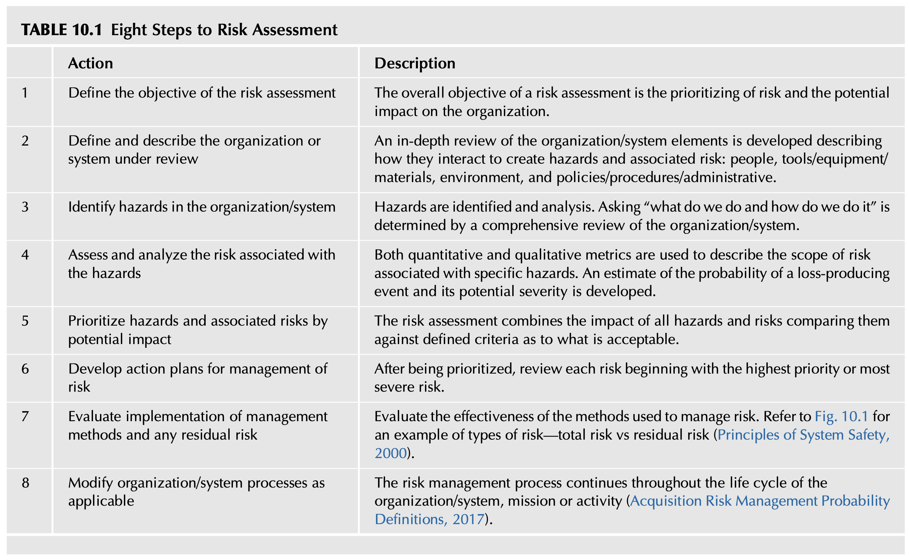
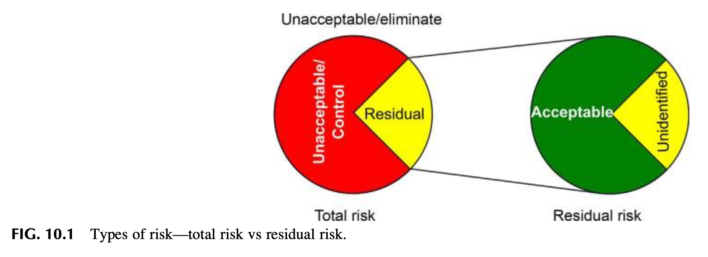
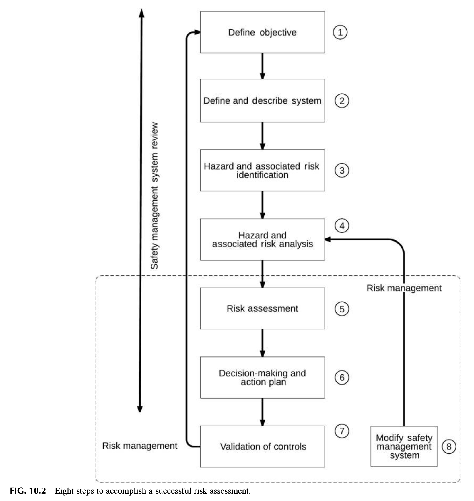
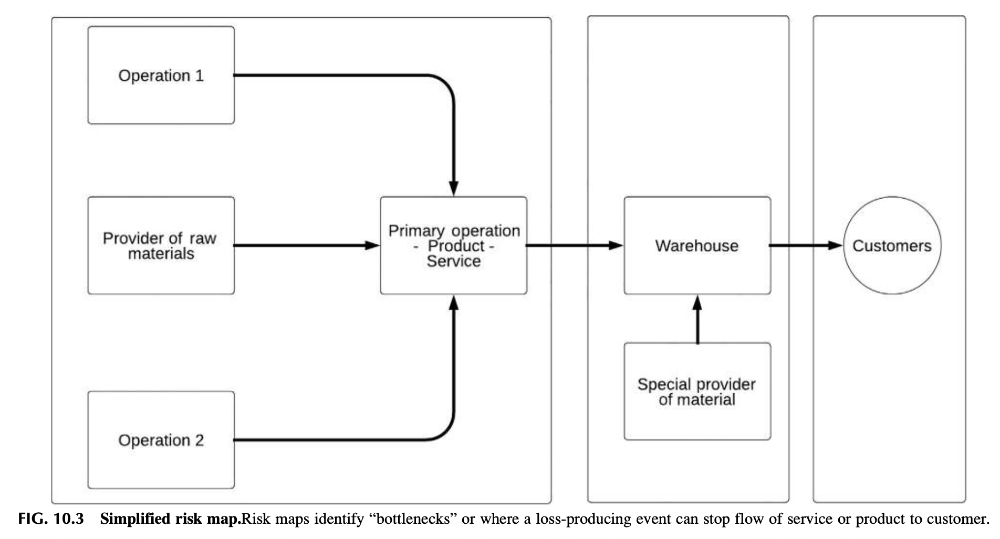
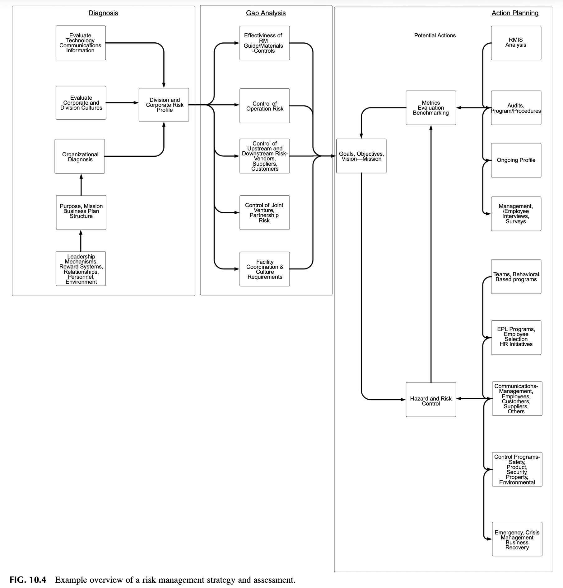

# Chapter 10 Understanding Basic Risk Management Principles
Safety Culture. https://doi.org/10.1016/B978-0-12-814663-7.00010-8

> The essence of risk management lies in maximizing the areas where we have some control over the outcome while minimizing the areas where we have no control over the outcome, and the linkage between effect and cause is hidden from us.  
> (Bernstein, 1996)

## INTRODUCTION
Risk management is an essential element of a strong safety culture. Safety management systems such as ANSI Z10-2012 (Occupational Health and Safety Systems, 2012) have criteria recommending a risk assessment to be completed as part of the overall analysis of an organization. The concepts of risk management should be considered an essential element of the leadership team’s operational decision-making process. Also, all employees need a basic understanding of the terms such as risk, risk control, and risk management if the organization’s safety culture is to be sustained.

Organizations continue to use postloss data as the primary guide to how well the organization is in control. A well-known quote by Warren Buffett states, “In the business world, the rearview mirror is always clearer than the windshield” (Buffett, 2018). This quote is a good analogy to describe the current loss-based management approach used by many organizations.

The irony is safety professionals traditionally must support this process due to the mandated regulatory crisis approach versus risk management systems methodology. For example, qualitative and quantitative forecasting is a critical element of risk management used to minimize the probability and uncertainty of risk. This analytical process is rarely used by safety professionals, instead of the misleading term of safety metrics. The insurance claims driven approach of analyzing loss data by frequency, severity, percentages, and sorting or ranking in descending order remains entrenched in safety measurements.

This chapter continues the discussion of risk management, its definition, and concepts for the communication of organizational risk-related issues.

After completing this chapter, you should be able to:
* Define risk.
* Explain how definitions of risk may be different in the organization.
* Explain the obstacles to risk management.
* Explain the eight steps of a risk assessment.
* Explain acceptable risk and its potential impact.
* Explain the various processes of risk measurement.
* Explain the risk spectrum.

## WHAT IS RISK?
Implementing a safety management system and improving the safety culture is essential in reducing the probability an organization will unknowingly take unwise high severity risk. Risk has been widely discussed, and researchers have long advocated that risk assessments be completed. William Lowrence defined the concept of determining, “of acceptable risk” related to probability and severity of harm (Lowrance, 1976).

Various standards have defined risk and built assessments into their guidelines such as:
* **ISO 31000** defines risk as the “effect of uncertainty on objectives.” From this point of view “the effect may be positive, negative or a deviation from the expected, and that risk is often described by an event, a change in circumstances or consequence” (A structured approach to Enterprise Risk Management (ERM) & the requirements of ISO 31000, 2010; ISO 31000, Risk Management—Principles and Guidelines, 2009).
* **ANSI Z 10-2012** defines risk as “an estimate of the combination the likelihood of occurrence of a hazardous event or exposure(s), and the severity of injury or illness that may be caused by the event or exposures” (Occupational Health and Safety Systems, 2012). In ANSI Z10, a risk matrix is used to gain an estimate of the specific risk and is based on experience, industry history, science, and understanding of what causes harm. The risk matrix provides a general idea of what the potential severity may be in a worst-case scenario based on the nature and type of exposure.

> Risk is the probability that exposure to a hazard will lead to a negative consequence.  
> (Ropeik & Gray, 2002)

The management of risk calls for the use of methods and concepts for identifying hazards and the risk associated with specific hazards. Every hazard has an associated risk. The scope of the risk inherent in those hazards is estimated and control treatments or actions selected for either avoidance, control, transfer, or acceptance of the defined risk. Acceptance of risk is a valid action but only after the full scope of its loss potential is assessed.

## THE MYTH OF “NO LOSS NO RISK”
The concept of risk was developed in parallel with the advance of science and statistics, primarily probability. A theory of risk began to evolve around the 16th century and has gradually found its way into all aspects of organizations. Before risk was formally defined, the popular consensus was nothing could be done to prevent injuries or loss-producing events, as these events were caused by one’s preordained fate. The belief that fate or luck plays a role in loss-producing events is still accepted by many people. For example, athletes may wear a certain shirt on game day, go through a set ritual when preparing for a game, or wear some magic charm to change their fate by improving their luck.

### LESSON LEARNED 1
In the safety profession, we do not offer opinions without supporting evidence. To be persuasive to the reader, your writing should extend beyond beliefs, experiences, opinions, and suggestion.

Fact-based statements require scholarly sources to support claims and conclusions.

Being able to cite a specific standard is helpful when discussing any compliance-related subject with your leadership team. Citing and referencing resources will be discussed in more detail in Chapter 16, Social Media Tools for the Professional.

This belief is understandable as the underlying cause of loss-producing events may be well hidden for various reasons. “Latent” errors may have been inadvertently built into or incorporated in the original design of the work environment, selected materials, equipment and employee selection, training and skills (Concepts and principles, 2009). The frequency of exposure to an uncontrolled hazard may stretch the time line between activity and a loss-producing event, as the alignment of human error, improper design, and built-in hazards may take time to occur.

When a loss-producing event is viewed from a risk-based standpoint, an activity may appear to be safe, having been completed numerous times without a loss-producing event occurring. When an activity is done without immediate harm or damage, the mind-set is that an activity must be safe as no loss occurs, that is, “No loss no risk.”

As we discussed in a previous chapter, infrequent losses do not necessarily mean low or controlled risk as evidenced by catastrophic events such as the NASA space shuttle loss, the BP Gulf Deep Water Horizon oil spill (Deep Water, The Gulf Oil Disaster and the Future of Offshore Drilling, 2011), refinery explosions (Blast at BP Texas Refinery, 2005), even disasters such as the sinking of the Titanic (Havern, 2012).

The commonalities in these high severity events appear to be related as risk concerns were not treated seriously, not fully assessed, potential loss indicators ignored, standards not followed, or inadequate regulations were blindly followed even though conditions had changed.

## DEFINITIONS OF RISK—THE POTENTIAL FOR CONFLICT
As part of the risk assessment, the level of risk should be considered. A project’s stakeholder may feel obligated to defend their project based on its intended benefits outweighing the potential for loss.

### LESSON LEARNED 2
Nathan was part of a team charged with the development of a risk assessment process to be used with client organizations. Having worked primarily with programs focused on “loss control,” he found the study of risk a professionally life-changing experience. Once he accepted a risk-based perspective and not strictly loss, he found too much effort had been going into reducing events of high frequency with low risk and missing the high severity potential conditions that can remain hidden in operations.

A major issue of the definition of risk must be considered when presenting the concept of “risk” to organizational leadership. Organizations define “risk” as an activity essential to managing a business. Hiring new employees, building a new plant, investing in a new product line is considered a valuable trait in the general business environment. From an organizational point of view, nothing is accomplished without taking the risk.

Each department of an organization may be using different definitions for the term risk. When discussing risk with leadership, it is important to ensure the various groups, sales/marketing, operations, finance, safety, quality control, and so on, understand how each professional discipline uses the term risk and understands how a specific risk definition drives behavior.

Organizations take on a strategic risk when developing new products, services, or move into new markets. Sales and marketing departments consider taking risk essential when developing new products and services. The definition of risk used by risk managers and safety professionals involves a combination of strategic, operational, and hazard risks which overlap and can create a variety of loss-producing situations.

This difference in risk definitions can create friction with leadership seeing risk-taking as a valuable trait and suggestions to reduce risk as an obstacle to success (Quadrant of Risk: Hazard, Operational, Financial, and Strategic, 2017).

## OBSTACLES TO RISK MANAGEMENT
To overcome the obstacle to managing risk requires assembling a toolbox of methods and techniques to be used at the appropriate time when assessing risk. This further involves understanding the decision and problem-solving methods in use by an organization and incorporating these into the safety management system.

One of the overall cultural obstacles is still viewed as having an element of fate or bad luck to risk management and loss-producing events. The authors have experienced conversations with managers and supervisors who implied nothing could be done to have prevented an “accident” (Accident, 2018), as accidents must be considered as part of getting the job done.

A major obstacle to risk management is the mind-set that if no loss or major issue has recently occurred, the risk is low or may be nonexistent. The need for building risk assessment into an overall decision-making process at the highest organizational levels must be considered as a major operational goal. An understanding of the importance of how the overall culture operates has been stressed throughout this book.

### LESSON LEARNED 3
While visiting a processing plant to complete a safety program assessment, Nathan observed an employee shoveling offal out of a drain conveying waste materials (Offal, the waste or by-product of a process, 2018). The employee was asked why he had to do this task as the system was supposed to be self-cleaning. The employee responded that the engineering of the conveying system was a “special design” by a member of senior management. It did not work. Every night a team of maintenance and cleaning personnel worked to get the system cleared for the next day. No one would tell the senior leadership their expensive automated system was not functional and clogged up every day. A series of questions about a task creating an ergonomic concern (lifting equipment parts, bending/lifting/shoveling) ended up finding multiple risk and hazard issues with more complex process concerns.

As the previous example found, obstacles must be considered stemming from organizational politics, as there may be some personal egos present. This human element must be considered when presenting recommendations for change. There must be an understanding of what organizational values are essential. Does the organization readily accept criticism if presented in a logical, well thought out manner?

A further obstacle according to Ethan and Little is the confusion between the concepts of hazard and risk is the tendency to use the terms interchangeably. They state the following, “a hazard is a potential source of harm.” “Risk is the chance that the adverse effects of unidentified hazards will occur” (Ethan & Little, 2011). The source of the hazard, chemical, electrical, radiation, and so on, establishes the physical conditions that create the potential for injury or damage. The risk is a combination of the potential severity of the incident that might occur and its probability of occurrence with the frequency of exposure to the hazard.

The issue of making risk a tangible concept to the organization, the term “accident” can be an obstacle as it still carries the image of an unpreventable event maintaining the belief in an element of fate or luck. A dictionary definition of accident is an “unexpected happening causing loss or injury which is not due to any fault or misconduct on the part of the person injured…” (Accident, 2018). This definition does not tell anything about the risk encountered and implies not much could be done to have prevented the particular loss-producing event. The ANSI Z10 does not use the term accident but defines “Incident” as an "event" in which a work-related injury or illness (regardless of severity) or fatal or could have occurred, commonly referred to as a “close call” or “near miss” (Occupational Health and Safety Systems, 2012).

## RISK ASSESSMENT
A three-part approach is used to establish the foundation for the management of risk. While the process can be stated simply, it does require an in-depth and methodical approach in its attempt to uncover hidden operational hazards and their associated level of risk. The three parts consist of risk identification, risk assessment, and risk control (Managing for Health and Safety (HSG65), 2013). Another definition is “the process of evaluating the risk to safety and health arising from hazards at work” (Guidelines for Hazard Identification, Risk Assessment and Risk Control (HIRARC), 2008).

* **Phase 1, Risk Identification** is a methodical review of all activities and conditions that exist in an organization. A risk identification process can be used to map the operations to determine the types of hazards exist and where they are located. Job hazard analysis, systems and process reviews, data analysis, and any other available tools to describe the organization are used. Once the hazards are located and described, the second phase of risk assessment begins.
* **Phase 2, Risk Assessment** is defined as “Assessing the risk that may arise from hazards” (Managing for Health and Safety (HSG65), 2013). Risk assessment uses a risk matrix to determine the potential severity of a risk and establish priorities for the necessary control actions.
* **Phase 3, Risk Control** involves the implementation of actions to avoid, modify, and control identified risk based on their priority.

Also, there are eight steps to risk assessment. Refer Table 10.1 for a summary of the eight steps to risk assessment. Refer Fig. 10.2, eight steps to accomplish a successful risk assessment.

**TABLE 10.1 Eight Steps to Risk Assessment**

| Step | Action | Description |
| :---: | :--- | :--- |
| **1** | **Define the objective of the risk assessment** | The overall objective of a risk assessment is the prioritizing of risk and the potential impact on the organization. |
| **2** | **Define and describe the organization or system under review** | An in-depth review of the organization/system elements is developed describing how they interact to create hazards and associated risk: people, tools/equipment/materials, environment, and policies/procedures/administrative. |
| **3** | **Identify hazards in the organization/system** | Hazards are identified and analysis. Asking “what do we do and how do we do it” is determined by a comprehensive review of the organization/system. |
| **4** | **Assess and analyze the risk associated with the hazards** | Both quantitative and qualitative metrics are used to describe the scope of risk associated with specific hazards. An estimate of the probability of a loss-producing event and its potential severity is developed. |
| **5** | **Prioritize hazards and associated risks by potential impact** | The risk assessment combines the impact of all hazards and risks comparing them against defined criteria as to what is acceptable. |
| **6** | **Develop action plans for management of risk** | After being prioritized, review each risk beginning with the highest priority or most severe risk. |
| **7** | **Evaluate implementation of management methods and any residual risk** | Evaluate the effectiveness of the methods used to manage risk. Refer to Fig. 10.1 for an example of types of risk—total risk vs residual risk (Principles of System Safety, 2000). |
| **8** | **Modify organization/system processes as applicable** | The risk management process continues throughout the life cycle of the organization/system, mission or activity (Acquisition Risk Management Probability Definitions, 2017). |

**FIG. 10.1 Types of risk—total risk vs residual risk.**

**FIG. 10.2 Eight steps to accomplish a successful risk assessment.**

## ACCEPTABLE RISK
The risk may not be visibly tangible, but it is always present in every action, endeavor, and any function that an organization may undertake. From simply walking down a flight of stairs, picking up an object, putting gasoline in a car, the risk is present. Also, various sports are designed to allow the voluntary taking of risk, for example, rock climbing, snowboarding down a treacherous mountain, Formula 1 racing, are pursued even though it is well known an occasional tragedy can occur. This creates an issue for the design of safe operations as employees may bring aspects of risk acceptance into the workplace.

A concept used internationally for risk management decision making is defined as “As Low As Reasonably Practicable (ALARP).” Once the risk of the operation or item in question has been assessed, a determination must be made of how effective any controls are effective that are put in place. Acceptable Risk is defined as “risk for which the probability of a hazard related incident or exposure occurring and severity of harm or damage that may result are as low as reasonably practicable and tolerable in the situation being considered” (On Acceptable Risk, 2002).

The acceptance of risk should not be left to individuals who may not have the skills or training to know what to accept, or when and how to ask for assistance. They may inadvertently accept risk which can cause irreparable harm to the organization.

## MANAGEMENT OF RISK
The safety process can provide a structured organizational approach to aspects of risk management and can provide increased knowledge of the nature and types of organizational risk. The safety process can also provide opportunities to improve the organization’s understanding of how it determines what risk is considered acceptable. For example, police, fire, military, mining, deep diving, flying an aircraft, and other occupations operate in a very high-risk environment but have various procedures and protocols as well as controls specifically designed to reduce the risk to a level considered acceptable for the task that must be completed.

Many organizations use a risk management department with a level of understanding about risk and may already have risk assessment procedures. The risk management department’s primary mandate may be limited to the placing insurance, risk financing, and claims management. A formal procedure should be used for in-depth identification of the range of organizational risk exposures and loss potential.

In the authors’ experience, many safety professionals do not have contact with their organization’s risk management department. Safety programs are found in the operations or human resources department. The risk management department may be found under the financial department due to the financing necessary for insurance, claims, and self-insurance requirements. As a result, the safety department and risk management department may be adversaries caused conflict with different approaches to the control of risk and differences in the definition of risk.

The following is a list of questions that can be useful in determining where and how risk is currently managed in the organization:
* Determine if the organization follows or uses an enterprise risk management approach (A structured approach to Enterprise Risk Management (ERM) & the requirements of ISO 31000, 2010; ISO 31000, Risk Management—Principles and Guidelines, 2009) or other concepts.
* Locate the nature and scope of the current risk management process to understand what has been mandated to accomplish.
* Establish a rapport, to the degree possible, with the function involved in the risk management process.
* Determine if safety criteria are included in the current risk management process.
* Develop an understanding of how the risk management department assesses the organization’s risk and what metrics are used.
* Determine what resources may be available from the risk management department and can complement the safety management system.
* Develop an understanding of how risk management criteria are communicated and if the safety management system can use similar lines of communication.
* Develop a framework for the mutual sharing of information about risk, hazards, loss-producing events, and other safety-related issues and concerns.

## THE “RISK SPECTRUM”
A high-level risk approach provides a better idea of the nature and types of risk. No hard line divides the impact of a risk on the organization. A “spectrum” of risk can be used to evaluate the impact a specific risk has on an organization. The following spectrum of risk can be used to aid in the assessment and management process:

* **Level 1, Risk impacting the organization’s brand.** The highest level risk can degrade or destroy the “brand” and image of the organization. These risks are organizational “killers,” driving customers away, causes a loss in the organization’s value, increases negative involvement with regulatory agencies, legal liabilities, lawsuits, and negative media commentaries brought against the organization. Depending on how resilient the organization is, the potential for not surviving a loss of trust in the brand is a possibility.
* **Level 2, Risk impacting the operations.** This type of risk impacts individual operations or facilities providing a service or product(s). An operational loss does not have to be total but may degrade the ability for a specific location to meet its services or production goals. The brand may not be harmed to any high degree, and the organization may survive if insurance and alternative production and service methods are available to meet customer demand. The organization will probably survive if it can shift operations to other facilities and recover its market share. If not, insurance or other funds can sustain the organization by buying or quickly rebuilding an operation. Otherwise, the organization will not survive.  
  A risk map can be developed to show the interrelationships between inflows and outflows of products and services and would aid in reviewing whether product or material “bottlenecks” exist that could harm the entire organization. The risk map provides an upstream look at where resources come from and the basis for a business recovery plan (refer Fig. 10.3).

**FIG. 10.3 Simplified risk map. Risk maps identify “bottlenecks” or where a loss-producing event can stop flow of service or product to customer.**

* **Level 3, Risk impacting on nonorganization entities or third parties.** Risk of this nature may not cause damage to facilities or operations, and production continues. Substantial liability lawsuits can occur if the organization has caused harm through negligence, poor product design, vehicle accidents, environmental spills or releases, and so on. The financial impact can be extreme and result in major degrading of the ability of the organization to continue operations. Risk management must look beyond the boundaries of its operation and assess the overall business environment it operates within.
* **Level 4, Risk impacting employees.** Employee injury and illness prevention is the primary focus of most safety processes. While a safe work environment is crucial to maintaining a safety culture, except in extreme cases, employee injuries do not shut down operations for any length of time and are handled as medical cases subject to state Workers’ Compensation regulations. Operations can normally continue to function with the limited loss of productivity. The exception being serious injuries or fatalities. If employee injury frequency remains high or tragic, severe incidents occur, the brand of the organization can be impacted by a reputation of a dangerous work environment, drawing negative media coverage as well as regulatory, community, and labor concerns.
* **Level 5, Risk from regulatory issues.** In most cases, regulatory citations and impact do not shut down operations and do not result in any form of loss except for financial regulatory fines. Production continues even as regulatory visits are made. In extreme cases, the impact may be made if the organization fails to meet and maintain compliance requirements and appears negligent in its responsibilities to employees, its customers, and community.

These levels of risk are not a rigid hierarchy as the scope and severity of a specific loss-producing event may shift their ranking. The objective is to provide a better understanding of the extent of risk in the attempt to make risk assessment more tangible to leadership. As an example of a worst-case scenario, a high-risk potential for a plant explosion and fire (Level 2) may cause employee injuries (Level 4), harm nearby communities involving third-party liability (Level 3), cause environmental damage (Level 3), and regulatory claims or citations (Level 5). The combination of these levels of risk results in the severe brand, operational and legal negative impact (Level 1) (refer Fig. 10.4).

**FIG. 10.4 Example overview of a risk management strategy and assessment.**

The safety management system must be incorporated into the organization’s risk management program. Use of a comprehensive safety management system provides the conduit for a risk assessment and analysis process to better safeguard the organization.

In Chapter 11, Developing an Activity-Based Safety System (ABSS), we will discuss in detail, building on the insights of risk perception and risk management to help influence the safety management system at multiple levels of an organization that will enhance and strengthen the safety culture.

ABSS stresses the need for a leadership team to regularly communicate and emphasize its safety vision, goals, and objectives required to reduce operational risk and improve the work environment. Many times, this is a top-down, one-way direction of communication. ABSS also provides a structure and framework useful in implementing and increasing the potential for two-way communication across an organization.

We will discuss how when ABSS is implemented, both leadership and employees have a way to communicate and discuss real or perceived risks or safety related issues. The increased potential for such a structured dialog provides a way to prioritize and better implement safety activities based on risk.

## SUMMARY
The principles of risk management and risk assessment are a crucial part of a safety management system. The shift from a loss-based safety process to a risk-based safety management system requires a fundamental change in perceptions held about safety.

Risk management establishes the criteria necessary for identifying of hazards; assessing the risk inherent within those hazards; and selecting the treatments or methods for the avoidance, control, transfer, or acceptance of risk. A major issue develops when discussing “risk” within an organization, as each department of an organization views risks differently.

A distorted perception of risk can exist if no loss or issue has recently occurred. A belief may form that the work environment is safe even when risks are high and ever-present.

A three-part approach was introduced in the chapter that can be used to establish the foundation for the management of risk. While the process can be stated simply, it does require an in-depth and methodical approach in the attempt to identify and bring out hidden hazards and associated risk. The three parts consist of risk identification, risk assessment, and risk control.

Many organizations use a risk management department with a level of understanding about risk and may already have risk assessment procedures. Usually, its primary mandate may be limited to the placing insurance and risk financing, and may not have a process identifying risk exposures and loss potential.

The management of risk must be based on a robust safety management system that has been incorporated into the organization as a part of its value system.

## CHAPTER REVIEW QUESTIONS
1. Define risk.
2. Explain how definitions of risk may be different in the organization.
3. Explain the obstacles to risk management.
4. Explain the eight steps of a risk assessment.
5. Explain acceptable risk and its potential impact.
6. Explain the risk spectrum.

## BIBLIOGRAPHY
* A structured approach to Enterprise Risk Management (ERM) & the requirements of ISO 31000. (2010). AIRMIC. Retrieved from http://bit.ly/2Hju03v.
* Accident. (2018). Merriam-Webster, Incorporated. Retrieved from http://bit.ly/XTAklU.
* Acquisition Risk Management Probability Definitions. (2017). Risk Management Toolkit. Retrieved from http://bit.ly/VAZN7L.
* Bernstein, P. L. (1996). Against the gods: The remarkable story of risk. New York: Wiley.
* Blast at BP Texas Refinery. (2005). ProPublica, Journalism in the Public Interest in ‘05 Foreshadowed Gulf Disaster, March. Retrieved from http://1.usa.gov/13tv7Y8.
* Buffett, W. (2018). In the business world, the rearview mirror is always clearer than the windshield. In Brainy quote. Retrieved from http://bit.ly/2kDzgpE.
* Concepts and Principles. Human Performance Improvement Handbook. (2009). Vol. 1 US Department of Energy.
* Deep Water, The Gulf Oil Disaster and the Future of Offshore Drilling. (2011). National Commission on the BP Deepwater Horizon Oil Spill and Offshore Drilling January. Retrieved from http://1.usa.gov/XeVOw8.
* Ethan, G., & Little, D. (2011). Risk—assessing and mitigating to deliver sustainable safety performance. Professional Safety, (July).
* Guidelines for Hazard Identification, Risk Assessment and Risk Control (HIRARC). (2008). Department of Occupational Safety and Health Ministry of Human Resources Malaysia, Based on Information as Presented on and Adapted for Use. Retrieved from http://bit.ly/bBXZYW.
* Havern, C. B. (2012). The short life and tragic end of RMS Titanic. Coast Guard Journal of Safety & Security at Sea: Proceedings of the Marine Safety & Security Council, 69(2). Retrieved from http://bit.ly/2J56rhe.
* ISO 31000, Risk Management—Principles and Guidelines. (2009). International Organization or Standardization. Retrieved from http://bit.ly/Uobg8J.
* Lowrance, W. W. (1976). Of acceptable risk: Science and the determination of safety.
* Managing for Health and Safety (HSG65). (2013). Health and Safety Executive, Crown Publishing. Permission to Reprint, Based on Information as Presented and Adapted for Use. Retrieved from http://bit.ly/YKDzRk.
* Occupational Health and Safety Systems. (2012). The American Industrial Hygiene Association, ANSI/AIHA Z10.
* Offal, the waste or by-product of a process. (2018). Merriam-Webster. Retrieved from http://bit.ly/2MuhK4c.
* On Acceptable Risk. (2002). In EHS Today. January, Retrieved from http://bit.ly/Z36Yma.
* Principles of System Safety. (2000). The Federal Aviation Administration (FAA), Office of System Safety, FAA System, Adapted for use (chapter 3) December. Retrieved from http://bit.ly/2kfwY2Z.
* Quadrant of Risk: Hazard, Operational, Financial, and Strategic. (2017). ERM Strategies, LLC. Retrieved from http://bit.ly/YE0Spv.
* Ropeik, D., & Gray, G. M. (2002). Risk: A practical guide for deciding what’s really safe and what’s really dangerous in the world around you. Boston, MA: Houghton Mifflin Company.
