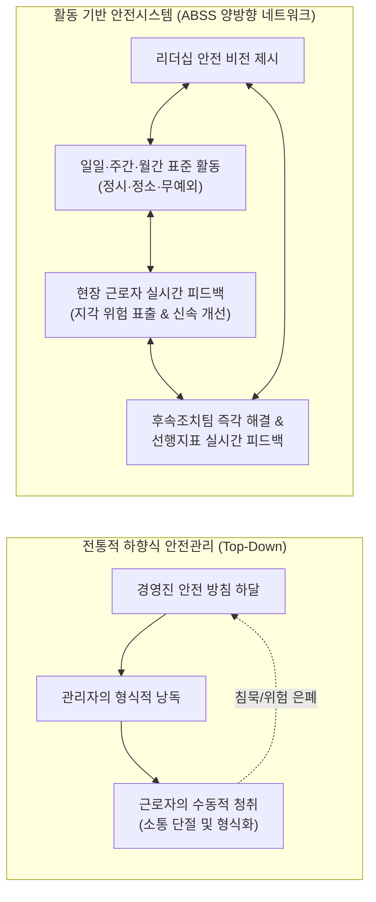
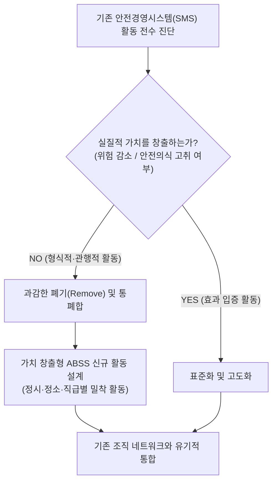
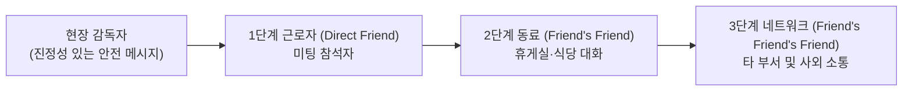
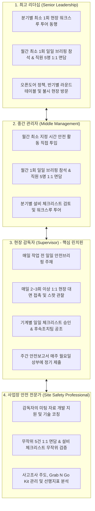
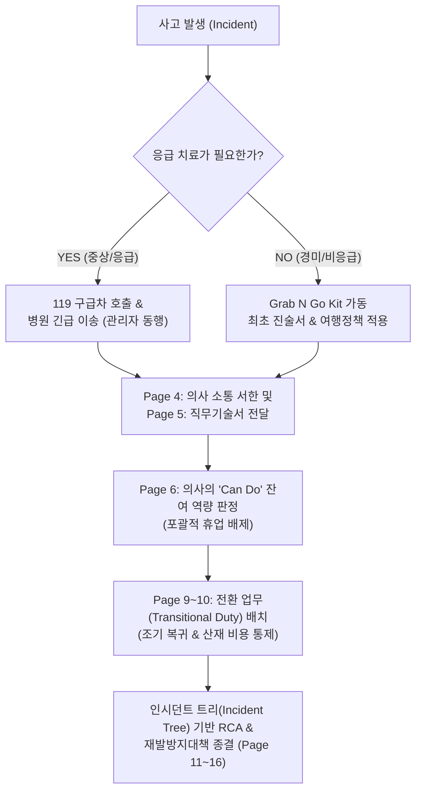
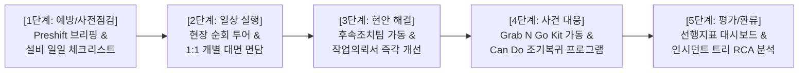

# Chapter 11 Developing an Activity-Based Safety System (활동 기반 안전시스템의 구축) 서브노트

> *"변화 없이는 진보가 불가능하며, 자신의 생각을 바꾸지 못하는 사람은 그 어떤 것도 바꿀 수 없다." (Progress is impossible without change, and those who cannot change their minds cannot change anything.)*  
> — **조지 버나드 쇼 (George Bernard Shaw)**  
> 
> *"아이들의 프로그램 '블루스 클루스(Blue's Clues)'의 핵심은 반복(Repetition)과 상호작용이다. 만약 기업이 구성원 내면에 잠자고 있는 상상력과 창의성을 이끌어낼 수만 있다면, 그 기업에는 경쟁자가 없을 것이다."*  
> — **다이앤 트레이시 (Diane Tracy, 2002)**  
> 
> *출처: Safety Culture (Elsevier, 2019, pp. 219-288), PART IV Tools to Enhance Your Safety Management System, Chapter 11*  
> *DOI: https://doi.org/10.1016/B978-0-12-814663-7.00011-X*

---

## 1. INTRODUCTION (도입: 하향식 일방 소통에서 전사적 양방향 소통으로)

성공적인 안전경영시스템(Safety Management System, SMS)을 구축하고 지속 가능한 안전문화를 창달하기 위해서는 최고경영진과 현장 리더십 팀이 조직의 안전 비전, 목표, 세부 과제를 주기적으로 소통하고 강조해야 합니다. 그러나 대다수 전통적 조직에서 이루어지는 안전 커뮤니케이션은 **경영진에서 현장으로 일방적으로 전달되는 '하향식 일방통행(Top-down, one-way)'**에 머물러 있습니다.

본 장에서 제시하는 **활동 기반 안전시스템(Activity-Based Safety System, ABSS)**은 이러한 일방향 소통의 구조적 한계를 타파하고, 조직 전반에 걸쳐 **'양방향 소통(Two-way communication)'의 잠재력을 극대화할 수 있는 강력한 프레임워크와 운영 구조**를 제공합니다.

### 1.1 ABSS의 핵심 목적과 작동 메커니즘
* **실재적·지각적 리스크의 공식 토론 채널 확립**: ABSS가 올바르게 작동하면 경영진과 현장 근로자 모두가 현장에 실재하는 객관적 위험(Real risk)뿐만 아니라 근로자가 주관적으로 느끼는 지각된 위험(Perceived risk) 및 안전 관련 현안을 공식적이고 격의 없이 소통할 수 있게 됩니다.
* **시간·장소·주기의 표준화 (No Exceptions)**: ABSS는 특정한 핵심 활동을 **정해진 시간(Specific time), 정해진 날짜(Specific date), 정해진 장소(Specific place)**에서 예외 없이(No exceptions) 일일(Daily), 주간(Weekly), 월간(Monthly) 단위로 루틴하게 수행하도록 강제합니다.
* **영향력의 신속한 전사 확산**: 일상적이고 반복적인 활동을 통해 조직 내 숨겨진 위험을 즉각 드러내고, 전사적 안전의식(Safety awareness)을 고취하여 안전문화를 획기적으로 강화합니다.
* **실시간 성과 측정 연동**: 활동이 정기적으로 실행되고 추적되며, 실시간 선행 성과지표(Continuous real-time performance measurements)를 통해 피드백될 때 비로소 진정한 안전문화가 형성됩니다.

### 1.2 제11장 7대 핵심 학습 목표
1. 조직 내 특정 계층별 소통을 위한 ABSS 활용 방안 설명.
2. 일일 작업 전 안전브리핑(Preshift review), 주간 안전회의, 월간 안전회의의 정의 및 운영 체계 설명.
3. 근로자와의 1:1 대면 면담(One-on-one meetings)의 본질적 중요성 이해.
4. 현장 순회 안전관찰 투어(Safety walk-through tours)의 실무적 효과 이해.
5. 기계·설비별 맞춤형 안전 체크리스트(Machine/Equipment-specific checklist)의 구축 및 실행 방안 설명.
6. 안전 현안의 즉각적 해결을 위한 후속조치팀(Follow-up team)의 운영 방법 정의.
7. 리더십 팀의 각 직급·계층별 안전 역할 및 책임(Roles & Responsibilities) 정의.

---

## 2. ACTIVITY-BASED SAFETY SYSTEM & GETTING STARTED (ABSS의 개념과 착수 단계)

안전 프로세스를 가장 성공적으로 현장에 안착시키는 비결은 안전 개선을 실질적으로 견인하는 **'핵심 필수 활동(Main essential activities)'에 역량을 집중하는 체계적 접근법**을 사용하는 것입니다.

ABSS는 현장에서 식별된 문제와 우려 사항이 조직 내 **적절한 의사결정 권한을 가진 계층으로 지체 없이 직송되는 커뮤니케이션 연결망(Communication links)**을 구축합니다. 활성화된 소통 네트워크는 유해위험요인과 리스크 이슈가 지연 없이 즉각 통제되도록 만듭니다 (제3장 '네트워크 분석 및 활용' 이론 기반).

### 2.1 착수 1단계: 기존 SMS 활동 전수 진단 및 가치 분석
ABSS 프로세스 도입의 첫걸음은 현재 조직에서 수행 중인 안전 활동들을 전수 조사하여, **어떤 활동이 실제로 안전 프로세스에 '실질적 가치(Value)'를 더하고 있는지**를 엄밀히 판별하는 것입니다.

* **무가치한 구태 활동의 과감한 폐기**: 유해위험요인을 통제하지 못하거나, 위험도를 낮추지 못하며, 근로자의 안전의식도 고취하지 못하는 형식적이고 관행적인 구태 활동(Ineffective activities)을 과감히 제거(Remove), 수정(Modify), 대체(Replace)합니다.
* **가치 창출형 활동의 신규 통합**: 안전경영시스템의 실질적 위험 통제력을 높이는 새로운 표준 활동을 체계적으로 도입합니다.

### 2.2 James의 M&A 인수 기업 적용 사례와 저항 극복
* **초기 현장의 강력한 반발**: 저자 James가 M&A를 통해 새롭게 인수한 기업에 ABSS를 처음 도입했을 때, 경영진과 직원들로부터 *"이 복잡한 시스템은 우리 공장 환경에는 절대 맞지 않는다"*는 극심한 부정적 저항에 직면했습니다.
* **가치 진단을 통한 인식 대전환**: 기존 안전 규정 및 활동을 정밀 실사한 결과, 위험 제어나 리스크 통제에 전혀 기여하지 못하면서 서류 작업만 유발하던 무의미한 활동들이 대거 적발되었습니다.
* **업무 가중이 아닌 일하는 방식의 혁신**: ABSS의 본질은 관리자나 근로자에게 새로운 잡무를 얹어주는 것이 아닙니다. 조직 내 기존 소통망을 활용하여 가치 없는 낭비 요소를 걷어내고, 고유의 일상 업무 속에 안전 대화를 자연스럽게 녹여내는 혁신입니다.

### 2.3 ABSS의 차별적 우위성: 규제 준수를 넘어선 현장 맞춤형 리더십
전통적인 규제 준수(Compliance) 중심의 안전관리는 눈에 보이는 피상적 지적에 머무릅니다. 반면 ABSS는 **리더십 팀 각자의 풍부한 실무 경험과 관할 업무 영역의 전문성을 결합**하여, 담당 직원들이 피부로 깊이 공감할 수 있는 맞춤형 안전 대화를 주도하도록 지원합니다.

---

## 3. HOW ABSS WORKS & BASIC ELEMENTS (ABSS 작동 메커니즘과 핵심 요소)

### 3.1 규격화된 주입식 대본(Canned Scripts)의 치명적 한계
많은 기업들이 안전 미팅을 운영할 때 본사에서 일괄 배포한 **"미리 작성된 정형화된 대본(Canned scripted topics)"을 낭독하는 방식**에 의존합니다.

> **[IAEA 국제원자력기구 안전지침 (2002)]**  
> *"교육훈련은 실제 현장 적용점과 반드시 일치해야 한다(Training Must Match the Application). 작성된 원고나 비디오를 그대로 틀어주는 프로그램은 넘쳐난다. 그러나 강사가 현장 작업 조건과 전혀 맞지 않는 대본을 영혼 없이 읽기만 할 때, 교육생들은 그 정보가 자신과 무관함을 직감하며 안전 정보의 수용은 극도로 어려워진다."*

* **리더십의 창의성 말살**: 획일화된 대본은 현장 관리자가 자신의 풍부한 전문 지식과 창의성을 발휘하지 못하도록 가로막으며, '모든 상황에 맞추려는 일률적 접근법(One size fits all)'의 오류에 빠뜨립니다.
* **실무와의 극심한 괴리 (Lesson Learned 1)**:
  - 지게차 운전 경험이 전무한 순수 기계 조작원들에게 지게차 안전 수칙 대본을 낭독함.
  - 눈이 거의 내리지 않는 미국 남부의 따뜻한 공장에서 스노우 체인 장착법 대본을 읽어줌.
  - 근로자들은 안전 미팅을 '시간 낭비'이자 '지루한 말장난'으로 인식하게 됨.

### 3.2 아인슈타인의 명언과 ABSS 7대 핵심 구성 요소

> *"측정 가능한 모든 것이 중요한 것은 아니며, 중요한 모든 것을 측정할 수 있는 것도 아니다."*  
> — **알베르트 아인슈타인 (Albert Einstein)**

ABSS는 주입식 대본을 걷어내고 현장 감독자가 자신의 개성과 창의적 통찰력을 발휘할 수 있도록 다음 **7대 핵심 축**을 제공합니다:

1. **3계층 근로자 미팅**: 일일 작업 전 브리핑, 주간 회의, 월간 회의.
2. **1:1 개별 대면 면담 (One-on-One Discussions)**: 현장 밀착형 소통.
3. **현장 순회 관찰 투어 (Safety Walk-Through Tours)**: 정리정돈 및 유해위험요인 발굴.
4. **기계·설비별 맞춤형 체크리스트 (Machine/Equipment-Specific Checklists)**: 15개 핵심 위험 중심.
5. **다기능 후속조치팀 (Follow-Up Teams)**: 작업의뢰서 즉각 해결.
6. **실시간 선행 성과지표 (Performance Metrics)**: 행동 및 프로세스 중심 측정.
7. **계층별 책임 보고 체계 (Leadership Specific Activities)**: 일일·주간 활동 보고서.

---

## 4. SAFETY MEETINGS & COMMUNICATION NETWORK (계층별 안전 미팅과 소통망)

조직은 조직도상의 단순한 상자가 아니라, 사람과 사람이 얼굴을 맞대고 상호작용하는 **살아있는 유기적 네트워크(Network of individuals)**입니다.

### 4.1 소셜 네트워크와 '영향력의 3단계 법칙' (Christakis & Fowler, 2009)
* **네트워크 파급 효과**: 하버드대 니콜라스 크리스타키스와 제임스 파울러 교수는 명저 《행복은 전염된다(Connected)》에서 **'영향력의 3단계 법칙(Three Degrees of Influence Rule)'**을 입증했습니다.
* **3단계 파급 메커니즘**: 우리가 행하거나 말하는 모든 것은 네트워크를 통해 파문을 일으키며, **친구(1단계) ➔ 친구의 친구(2단계) ➔ 친구의 친구의 친구(3단계)**까지 전파되어 인간의 광범위한 태도와 감정, 행동을 변화시킵니다.
* **안전 소통의 승수 효과**: 관리자가 안전 미팅에서 전달한 진정성 있는 메시지는 미팅 참석자에게서 멈추지 않고, 휴게실, 점심 식사, 사외 모임 등을 통해 동료와 가족에게로 급속히 확산(Magnifying effect)됩니다.

### 4.2 일일 작업 전 안전브리핑 (Daily Preshift Review / Toolbox Talk)
* **운영 원칙**: 매일 작업 착수 직전, 현장 직속 감독자(Supervisor)가 자신의 팀원들과 함께 실시하는 짧고 집중적인 미팅 (2분 훈련, 툴박스 톡, 스탠드다운 등).
* **골든 타임의 활용**: 하루를 시작하는 시점은 근로자의 집중력이 가장 높고 피로도가 낮은 최적의 타이밍입니다. 퇴근 무렵이나 오후 미팅은 피로와 업무 잡념으로 인해 기억 잔존율이 급격히 떨어집니다.
* **위험 지각의 전환 (Observation 1)**:
  - 과거에는 안전부서 직원이 지적 사항을 적어 감독자에게 넘겨주어 낭독하게 했으나, 감독자는 자기 구역의 위험을 전혀 알지 못했습니다.
  - ABSS 도입 후 감독자가 매일 직접 현장 위험을 찾아 브리핑을 주도하면서, 감독관 스스로 현장 최고의 위험 전문가로 거듭났습니다.
* **짐 콜린스의 '20마일 행진(20 Mile March)'**: 짐 콜린스와 모튼 한센이 《위대한 기업의 선택(Great by Choice)》에서 강조했듯, 일관되고 구체적이며 엄격하게 추구되는 일일 실행 메커니즘이 조직을 최고로 만듭니다.
* **미팅 종료 시 절대 빠뜨려선 안 될 1가지 핵심 질문**:
  > [!IMPORTANT]
  > *"오늘 이 자리에서, 여러분 중 누구라도 안전하게 일하는 것을 방해하는 장애 요인이 있습니까?" (Is there anything preventing anyone here from working safely today?)*
  - 이 단순한 질문 하나가 숨겨진 방호장치 파손, 환기 불량, 유독물질 취급 불안감 등을 수면 위로 즉각 끌어올립니다.

### 4.3 교대근무(Multishift) 인수인계와 주간·월간 안전 회의
* **교대 인수인계 (Shift Handoff)**: 교대 전 감독자는 이전 근무조의 이상 징후, 적색 태그(Red-tagged) 설비 내역, 작업자 건의 사항 등을 차기 근무조에 문서 또는 구두로 명확히 인계합니다.
* **주간 안전 회의 (Weekly Meetings)**: 15~30분간 진행. 지난 한 주의 이슈를 결산하고, 일일 브리핑 피드백을 종합하여 우선순위에 따른 **안전 행동 계획(Action Plan: 조치 내용, 담당자, 완료 목표일)**을 수립합니다. (월 3회 주간 회의 실시 후 4주 차에 월간 회의 전환).
* **월간 정기 안전 회의 (Monthly Meetings)**: 보다 공식적인 전사 안전 공유의 장. 규제 컴플라이언스 심층 교육, 외부 전문가 초빙, 최고경영진의 회사 안전 성과 브리핑 등이 진행됩니다.

---

## 5. DIRECT ENGAGEMENT & HAZARD HUNTING (직접 소통과 현장 위험 발굴 기법)

### 5.1 1:1 개별 대면 면담 (One-on-One Discussions)
* **목적**: 군중 심리, 수줍음, 불신감 등으로 인해 다수 미팅에서 발언하지 못하는 근로자의 진솔한 목소리를 경청하는 장치.
* **실시 장소의 철칙**: 절대로 관리자의 사무실로 직원을 불러서는 안 됩니다. 이는 직원에게 징계나 질책이라는 위압감(Intimidating)을 줍니다. **반드시 직원이 일하는 친숙한 작업 현장 바닥(Work environment)으로 찾아가 대화**해야 합니다.
* **T.J. Larkin 교수의 하버드대 연구 (Robotham, 2014)**:
  > *"조직의 변화를 근로자에게 전달할 때는 최고경영진이 아닌 **'직속 감독자(Supervisor)'**를 통하고, 문서가 아닌 **'얼굴을 맞대는 대면 소통(Face-to-face)'**을 사용하며, 거대 담론이 아닌 **'당장 일하는 작업 구역과 밀접한 내용'**으로 프레임해야 성공한다."*
* **주의점**: 결코 부정적인 지적이나 질책의 자리가 되어서는 안 되며, 휴대폰 확인 등 방해 요소를 완벽히 차단하고 온전히 경청해야 합니다.

### 5.2 현장 순회 관찰 투어 (Safety Walk-Through Tour)
* **MBWA의 현대적 진화**: 톰 피터스(Tom Peters)의 '현장 배회 관리(Management by Wandering Around)' 개념을 안전에 접목하여 책상에서 벗어나 현장과 다시 연결되는 활동입니다.
* **다양한 관점의 합동팀 구성**: 감독자, 현장 근로자, 그리고 최고 리더십 멤버가 함께 팀을 이루어 월 1회, 1시간 이내로 진행합니다. 경영진의 직접 동행은 전사 직원들에게 안전의 중요성을 가장 강력하게 웅변하는 상징적 조치입니다.

### 5.3 기계·설비별 맞춤형 체크리스트 (Machine/Equipment-Specific Checklist)
* **15개 핵심 위험 압축 원칙**: 수백 개 항목의 두꺼운 점검표는 형식주의로 전락합니다. 설비별로 인명 피해를 유발할 수 있는 **가장 치명적인 15개 내외의 고유 위험에 집중**합니다.
* **살아있는 문서 (Living Document)**: 유지보수용 정밀 점검표가 아니라, 매일 가동 전 작업자가 5분 내로 핵심 방호장치와 잠재 위험을 확인하는 신속 참조용 체크리스트입니다.
* **제지공장 로드 터너(Load Turner) 참사 교훈 (Observation 2)**:
  - 6피트 높이의 종이 뭉치를 회전시키는 로드 터너 기계의 300파운드(약 136kg) 상판 볼트가 파손되면서 상판이 추락하는 중대 사고 발생.
  - 조사 결과 볼트 결함 점검 기준이 부재했음이 밝혀져, 즉시 설비별 체크리스트를 제정하고 전 공장에 확대 적용함.

### 5.4 다기능 후속조치팀 (Follow-Up Team)
* **구성 및 역할**: 유지보수 기사, 감독자, 현장 근로자로 구성된 다기능 연합팀(Cross-functional team)으로, 안전 작업의뢰서(Safety Work Order)를 공정하고 신속하게 해결합니다.
* **안전의 정치화 차단 (Observation 3)**: 과거에는 정당한 위험 근거 없이 사적 편의를 위해 안전을 핑계로 설비 개조를 요구하는 일이 잦았으나, 후속조치팀이 제9장의 '위험 지각 카드'를 기준으로 실제 위험 여부를 객관적으로 검증함으로써 편법을 근절했습니다.
* **피해 당사자 최종 서명 종결제**: 개선 작업이 완료되면, 위험을 최초로 제기했던 근로자가 직접 현장을 확인하고 동의(Sign-off)해야만 작업의뢰서가 최종 종결됩니다.

---

## 6. ABSS ROLES AND RESPONSIBILITIES (계층별 역할과 책임)

ABSS의 성공은 조직의 모든 계층이 자신에게 부여된 구체적인 안전 행동을 정해진 주기에 맞추어 성실히 수행할 때 완성됩니다.

---

## 7. TRAINING INNOVATION, DOE & SCIENTIFIC LEARNING (식스시그마 DOE 기반 교육 혁신)

### 7.1 손 부상(Hand Safety) 방지 식스시그마 프로젝트의 충격적 발견
James는 날카로운 칼과 기계 조작으로 인한 손 베임(Hand lacerations) 사고를 줄이기 위해 식스시그마 기법을 안전 교육에 도입했습니다.
* **게이지 R&R (Gage Repeatability & Reproducibility) 평가**: 감독자가 안전 교육을 실시한 직후, 1주일 후, 1개월 후 근로자가 위험 정보를 얼마나 기억하고 있는지를 인터뷰하여 측정 시스템의 변동성과 기억 잔존율을 분석했습니다.
* **결과**: 감독자가 *"분명히 다 가르쳤다"*고 믿고 있던 내용과 근로자의 실제 기억 잔존율 사이에 **'치명적인 정보 단절 갭(Huge gap)'**이 존재함이 밝혀졌습니다.

### 7.2 어린이 만화 '블루스 클루스(Blue's Clues)'에서 얻은 통찰
* 브레인스토밍 도중 한 팀원이 유아용 만화 《블루스 클루스》를 언급했습니다. 만 3~5세 유아들은 만화 캐릭터와의 적극적 상호작용과 **'치밀하게 계산된 반복 학습(Repetition)'**을 통해 올바른 행동을 완벽하게 체화합니다.
* 성인의 뇌 구조도 학습의 원리는 동일합니다. 단 한 번의 오리엔테이션으로 안전 행동이 정착될 것이라 기대하는 것은 망상이며, **일상적인 반복 소통만이 망각 곡선을 극복**할 수 있습니다.

### 7.3 실험계획법(Design of Experiments, DOE) 연구 결과
연구팀은 교육 전달 방식에 따른 기억 잔존율을 과학적으로 규명하기 위해 4가지 시나리오를 설계하여 DOE를 수행했습니다:

#### TABLE 11.1 소통 방식에 따른 시각 자료 활용 시나리오 (Roughton, 2005)
| 방식 (Method) | 커뮤니케이션 형태 | 시각 자료(Visual Aids) 유형 |
| :---: | :--- | :--- |
| **Method 1** | 대면 토의 (Face-to-face discussion) | 시각 자료 없음 (그림 및 위험 설명문 부재) |
| **Method 2** | 토의 없음 (No discussion) | 위험에 대한 텍스트 설명문만 제공 |
| **Method 3** | 토의 없음 (No discussion) | 사진 이미지만 제공 (텍스트 설명 부재) |
| **Method 4** | **대면 토의 (Face-to-face discussion)** | **사진 이미지와 텍스트 설명문 동시 제공 및 상호 토의** |

#### 과학적 실험 및 인지과학 연구 데이터 (Observation 4)
* **텍스트 vs 텍스트+시각자료**: 순수 텍스트만 읽었을 때의 이해·잔존율은 **70%**에 불과하나, 텍스트에 그림과 삽화를 결합하면 이해도와 잔존율이 **95%**로 수직 상승합니다 (Bladon, 2017).
* **지시문 이행률의 차이**: 그림과 텍스트가 함께 제공된 지침을 따를 때, 글자만 있는 지침보다 실행력이 무려 **323% 우수**합니다 (Dowse & Ehlers, 2005; Levie & Lentz, 1982).
* **뇌의 시각 처리 속도**: 인간의 뇌는 시각 데이터를 텍스트보다 **60,000배 빠르게 처리**하며, 뇌에 전달되는 정보의 90%는 시각 정보입니다.
* **3일 후 기억 보존 법칙 (Medina, 2017)**: 귀로만 들은 정보는 3일 후 **10%만 기억**되지만, 시각 이미지를 결합하면 3일 후에도 **65%를 선명하게 기억**합니다.
* **2차 게이지 R&R 검증**: 사진과 대면 토의를 결합한 Method 4 방식을 도입한 후, 근로자의 불안전 행동 식별 능력이 1차 대비 **35% 향상되어 71%에 도달**했습니다.

---

## 8. TIPS FOR ABSS IMPLEMENTATION & PERFORMANCE METRICS (성공 팁과 성과지표)

### 8.1 ABSS 성공을 위한 5대 핵심 실무 팁
1. **경청과 집중 (Listen and Pay Attention)**: 현장 근로자의 말을 방어적 태도나 에고(Ego)로 묵살하지 말 것. 작업을 매일 수행하는 근로자가 최고의 문제 해결사입니다.
2. **피드백 시간의 공식 배정**: 1:1 대화 시간을 인사고과용 면담과 분리하여 공식 일정으로 확보할 것.
3. **잡음과 방해 요인의 원천 차단**: 1:1 대화 중에는 스마트폰, 문자, 이메일 확인을 전면 중단하고 온전히 상대에게 집중할 것.
4. **일관된 안전 메시지 유지**: 경영진의 생산 압박과 안전 원칙 사이에서 이중 메시지가 전달되지 않도록 가치관을 일치시킬 것.
5. **긍정적 피드백과 코칭의 균형**: 사고나 설비 고장이 났을 때만 다가가는 '부정적 감시자'가 되지 말고, 안전 수칙을 준수하는 모범 행동을 적극 칭찬하고 포상할 것.

### 8.2 선행 지표(Leading)와 후행 지표(Lagging)의 엄격한 비교

> *"성과지표의 대다수는 모든 근로자가 사고를 예방하기 위해 매일 수행하는 능동적 활동을 추적하는 **선행 지표(Leading indicators)**여야 한다."*  
> — **주디 애그뉴 & 오브리 대니얼스 (Judy Agnew & Aubrey Daniels, 2011)**

| 구분 | 후행 지표 (Lagging Indicators) | 선행 지표 (Leading Indicators) |
| :---: | :--- | :--- |
| **개념** | 사건이 발생한 후 사후 손실 결과를 측정 | 사고 발생을 방지하기 위한 예방 활동 과정을 측정 |
| **측정 대상** | 재해율, 사망만인율, 요양일수, 산재 보상금 | 일일 브리핑 실시율, 1:1 면담 횟수, 위험성평가 건수 |
| **한계 및 장점** | 이미 발생한 손실이므로 미래 사고를 예측할 수 없음 | 조직의 실시간 '안전 건강성(Safety Health)'을 진단 가능 |
| **ABSS 적용** | 개선 방향의 거시적 참고자료로만 활용 | **ABSS의 핵심 평가 척도로 전사 대시보드에 실시간 반영** |

---

## 9. INCIDENT INVESTIGATION & INJURY MANAGEMENT FRAMEWORK (사고 조사 및 부상 관리)

### 9.1 사고 조사의 미로(Maze) 메타포와 사후 확증 편향 (FIG. 11.7)
* **미로 풀이의 역설 (US DOE, 2012)**: 사람들에게 복잡한 미로를 가장 빨리 푸는 법을 물으면 모두 **'도착점(Finish)에서 출발점(Start)으로 거꾸로 추적하는 것'**이라고 답합니다.
* **사후 조사의 맹점**: 사고 조사관은 이미 결과를 알고 뒤를 돌아보기 때문에 모든 인과관계가 명백해 보입니다(Hindsight bias). 그러나 사고 당시 현장 작업자에게 앞길은 불확실성으로 가득 찬 미로와 같았습니다. 따라서 조사관은 사후 편향을 배제하고 **'당시 작업자의 관점에서 사실(Facts)만을 추적'**해야 합니다.

### 9.2 부상 관리 프로세스 북클릿: "Grab N Go Kit" 운용 (FIG. 11.8)
사고가 발생하면 현장은 공황(Panic) 상태에 빠집니다. 이를 방지하기 위해 모든 필수 서식을 가방 하나에 패키징한 **'Grab N Go Kit'**를 현장에 비치합니다.

### 9.3 연부조직 부상(Soft Tissue Injury)과 인체공학적 통제 (FIG. 11.9)
근골격계 질환(MSD)과 같은 연부조직 부상은 원인 규명이 모호하여 관리가 극히 어렵습니다.
* **인체공학적 위험도 평가 공식**:
  $$\text{총 위험 점수(Total Risk Score)} = \text{작업 난이도(How Hard, 1~5점)} \times \text{작업 빈도(How Often, 1~5점)}$$
* 점수가 높은 고위험 공정부터 인체공학적 개선 장비(리프트, 치공구 등)를 집중 투입합니다.

### 9.4 인시던트 트리(Incident Tree) 분석 기법 (Table 11.2 ~ 11.5)
* **재해 형태(Incident Type) 13대 표준 분류**: 물체에 맞음(Struck by), 물체에 부딪힘(Struck against), 유해물질 접촉(Contact by), 위험물 접촉(Contact with), 끼임/말림(Caught in/between), 걸림(Caught on), 동일 평면 넘어짐(Fall-same level), 높은 곳 추락(Fall-different level), 무리한 동작/과도한 힘(Strain/sprain), 갇힘(Trapped in), 화재/폭발(Fire/explosion), 교통사고(Motor vehicle), 유해환경 노출(Exposure).
* **5-Why 다이어그램 결합**: 불안전한 행동과 상태 이면에 도사린 관리적·시스템적 근본 원인(Systemic Root Causes)을 규명할 때까지 질문을 반복합니다.

---

## 10. SUMMARY (제11장 총괄 요약)

1. **소통의 패러다임 전환**: 전통적 안전의 맹점인 '하향식 일방 소통'을 깨뜨리고, '활동 기반 안전시스템(ABSS)'을 통해 전사적 '양방향 소통 네트워크'를 확립해야 합니다.
2. **시간·장소·주기의 표준화**: 일일 작업 전 미팅, 주간 회의, 월간 회의를 '정시·정소·무예외' 원칙으로 정례화하여 안전을 일상적 업무 습관(20마일 행진)으로 체질화합니다.
3. **현장 밀착형 1:1 대면 소통**: 관리실이 아닌 작업 현장 바닥에서 진행되는 비징계적 1:1 경청 대화가 근로자의 닫힌 입을 열고 잠재 위험을 발굴합니다.
4. **과학적 교육과 시각적 반복 학습**: 식스시그마 DOE 및 인지과학 연구에 근거하여, 텍스트 일방 낭독을 폐기하고 사진+텍스트+대면 토의가 결합된 시각적 반복 학습(블루스 클루스 원리)을 적용합니다.
5. **선행 지표 중심의 관리**: 사고 후의 손실 지표(Lagging)에 의존하던 백미러식 관리에서 탈피하여, 일일 예방 활동을 실시간 측정하는 선행 지표(Leading) 체계로 전환합니다.
6. **표준화된 위기 대응 패키지(Grab N Go Kit)**: 사고 발생 시 혼란을 방지하는 16개 표준 서식 북클릿을 통해 조기 응급처치, 의사의 'Can Do' 잔여 역량 평가, 조기 업무 복귀(Transitional Duty), 인시던트 트리 근본원인 분석을 원스톱으로 달성합니다.

---

## 11. CHAPTER REVIEW QUESTIONS (복습 질문 및 심화 해설)

### Q1. 활동 기반 안전시스템(ABSS)의 핵심 용도와 개념을 정의하라.
* **해설**: ABSS는 일일·주간·월간 단위로 명확히 구조화된 핵심 안전 활동을 정해진 시간과 장소에서 지속 수행함으로써, 조직 내 실재하는 위험과 지각된 위험을 경영진과 현장 근로자가 격의 없이 양방향으로 소통하고 해결하도록 돕는 선제적 안전경영 프레임워크입니다.

### Q2. 조직 내 특정 계층별 소통을 전개하는 구체적 방안을 설명하라.
* **해설**: 최고경영진은 분기별 워크스루 투어와 라운드테이블을 통해 안전 의지를 표명하고, 중간관리자는 부서 점검과 1:1 면담을 통해 감독자를 코칭하며, 현장 감독자는 일일 툴박스 미팅과 현장 스팟 관찰을 통해 근로자와 밀착 소통하는 계층별 맞춤형 소통망을 가동합니다.

### Q3. 일일 작업 전 미팅, 주간 미팅, 월간 미팅의 차이점과 기능을 정의하라.
* **해설**:
  * **일일 작업 전 미팅(Daily Preshift Review)**: 작업 착수 직전 2~5분간 당일 특정 위험과 작업자 이상 유무를 점검하고 안전 방해 요인을 색출하는 신속 브리핑.
  * **주간 미팅(Weekly Meeting)**: 15~30분간 주간 이슈를 결산하고, 일일 미팅 피드백을 수렴하여 구체적 안전 개선 계획(Action Plan)을 수립하는 실무 회의.
  * **월간 미팅(Monthly Meeting)**: 전사적 차원의 심층 법정 교육, 규제 준수 검토, 외부 전문가 특강 및 회사 전반의 안전 성과를 공유하는 대규모 정기 회의.

### Q4. 근로자와의 1:1 대면 면담(One-on-One Discussions)이 중요한 이유를 설명하라.
* **해설**: 다수 미팅에서는 동료들의 시선이나 처벌에 대한 두려움으로 인해 말하지 못하는 은폐된 위험 우려를, 관리자가 현장 작업 공간으로 직접 찾아가 편안하고 신뢰감 있는 환경에서 청취함으로써 진솔한 현장 피드백을 확보할 수 있기 때문입니다.

### Q5. 현장 순회 안전관찰 투어(Safety Walk-Through Tours)의 이점을 설명하라.
* **해설**: 최고 리더십, 관리자, 근로자가 합동으로 참여함으로써 경영진의 안전 솔선수범 의지를 현장에 각인시키고, 서로 다른 시각과 전문성을 가진 다학제 팀이 현장의 정리정돈 상태와 잠재 위험을 다각도에서 입체적으로 발굴할 수 있습니다.

### Q6. 기계·설비별 맞춤형 안전 체크리스트의 구축 배경과 운영 원리를 설명하라.
* **해설**: 제지공장 볼트 추락 사고와 같이 보이지 않는 부품 결함이 대형 참사로 이어지는 것을 막기 위해, 장비별로 가장 치명적인 15개 이내의 핵심 위험을 작업자가 가동 전 5분 내로 점검하도록 설계된 살아있는(Living) 현장 검증 도구입니다.

### Q7. 후속조치팀(Follow-Up Team)의 활용법과 운영 효과를 정의하라.
* **해설**: 유지보수 담당자, 현장 근로자, 감독자가 원팀이 되어 안전 작업의뢰서의 타당성을 위험 지각 카드(Risk Guidance Card)로 신속히 판정하고 즉각 보수하며, 위험을 제기한 근로자가 직접 확인 서명할 때까지 추적 종결하는 피어 투 피어(Peer-to-peer) 실행 기구입니다.

### Q8. 리더십 팀 각 계층별 안전 역할을 구분하여 정의하라.
* **해설**: 최고경영진은 정책적 지원과 분기별 현장 투어, 중간관리자는 예산 배정 및 부서 안전 감사, 현장 감독자는 일일 브리핑과 스팟 관찰 주재, 안전 전문가는 기술적 코칭과 서식 분석 및 위험도 평가 지원을 담당합니다.

### Q9. 일일 작업 전 리뷰와 정기 주간 안전 미팅의 본질적 차이를 설명하라.
* **해설**: 일일 리뷰는 당일 현장 작업의 즉각적 위험을 회피하기 위한 단기 전술적 조치이며, 주간 미팅은 축적된 일일 피드백을 분석하여 시스템적 개선 대책을 수립하고 전사 안전 방향을 조율하는 중기 전략적 조치입니다.

### Q10. 교대근무(Multishift Operation)에서 안전 관리 및 정보 인계가 중요한 이유를 설명하라.
* **해설**: 교대 시점에 설비 결함, 비정상 징후, 정비 중인 기계(Red-tagged) 정보가 누락되면 교대조 작업자가 위험에 무방비로 노출되므로, 서면 및 구두를 통한 정밀한 인수인계 프로토콜이 필수적입니다.

### Q11. ABSS 시스템에서 각 직급별로 상이한 안전 책무성이 부여되는 이유를 논하라.
* **해설**: 조직 내 직급마다 통제할 수 있는 자원(Budget), 의사결정 권한(Authority), 현장 접근성(Proximity)이 다르므로, 현장 감독자에게는 즉각적 행동 통제를, 중간관리자에게는 프로세스 지원을, 최고경영진에게는 제도적 환경 조성을 강제함으로써 전사적 안전 거버넌스를 완결 짓기 위함입니다.

---

## 12. SPECIAL STUDY: 교수님 심화 지도 지침에 따른 KPI 도출 및 안전문화 진단 플랫폼 연계 방법론

> [!IMPORTANT]
> **지도 교수님 심화 지도 6대 핵심 원칙의 완벽한 투영**:
> 1. 업무 단계화 (ABSS 5단계 생애주기 경계 설정)
> 2. 구체화 (과·팀·작업조 단위의 밀착 브레이크다운)
> 3. 철저한 법적 근거 (산업안전보건법 조문 강제 매핑)
> 4. 고유/협업 전략적 가중치 배분 (7:3 / 5:5 논리 입증)
> 5. 기존 분석물(부록 11.1~11.9 서식)의 KPI 판단근거화 (★핵심)
> 6. 비판적 검토 및 AI 재학습 역질문 프로토콜

### 12.1 ABSS 5단계 생애주기 프로세스와 직급별 KPI 도출 체계

### 12.2 부서·직급별 현장 밀착형 KPI 세부 매핑 및 법적 근거 테이블

| 생애주기 단계 | 대상 계층 (Break-down) | 핵심 성과지표 (KPI) 명칭 | 지표 성격 & 가중치 | 산출 공식 및 목표치 | 관련 법적 근거 (산안법 조문 강제 매핑) | 서브노트 판단 근거 (원문 표/서식 연계) |
| :---: | :---: | :--- | :---: | :--- | :--- | :--- |
| **1단계 (예방/사전)** | **현장 감독자 (Supervisor)** | 일일 작업 전 안전브리핑(TBM) 정시 실행률 | **고유 (70%)** | $\frac{\text{실제 실시 일수}}{\text{월간 총 작업 일수}} \times 100 \ge 98\%$ | 산안법 제16조 (관리감독자 유해위험 점검 의무) | 본문 4.2절 & Appendix 11.5 (Preshift Report) |
| **1단계 (예방/사전)** | **현장 작업자 (Operator)** | 기계·설비별 가동 전 맞춤 체크리스트 이행률 | **고유 (70%)** | $\frac{\text{15개 핵심항목 점검 완료수}}{\text{가동 설비 총수}} \times 100 = 100\%$ | 산안법 제38조 (안전조치 의무 - 기계·기구 방호조치) | 본문 5.3절 & Appendix 11.7 (Checklist 서식) |
| **2단계 (일상/실행)** | **현장 감독자 (Supervisor)** | 일일 1:1 대면 안전 면담 및 스팟 관찰 건수 | **고유 (70%)** | 교대근무 1인당 일일 2~3회 이상 면담 실시율 $\ge 95\%$ | 산안법 제16조 및 제32조 (산업안전보건 점검 지도) | 본문 5.1절 & Appendix 11.2 (Section 4) |
| **2단계 (일상/실행)** | **최고경영진 (Senior Mgmt)** | 경영진 현장 순회 투어(MBWA) 참여율 | **협업 (30%)** | 분기당 1회 이상 현장 순회 투어 및 피드백율 $100\%$ | 산안법 제14조 (이사회 보고 및 안전보건계획 승인) | 본문 5.2절 & 본문 6.3절 (Senior Leadership) |
| **3단계 (현안/개선)** | **후속조치팀 (Follow-Up Team)** | 안전 작업의뢰서 적기 조치율 및 당사자 서명율 | **협업 (50%)** | $\frac{\text{기한 내 개선 완료 및 서명건}}{\text{접수된 총 안전의뢰서}} \times 100 \ge 95\%$ | 산안법 제36조 (위험성평가 실시에 따른 시정조치) | 본문 5.4절 & Observation 3 (다기능 협업) |
| **4단계 (사건/대응)** | **안전관리자 & 부서장 (Cross-team)** | 부상 관리 "Grab N Go Kit" 24시간 내 초동조치율 | **협업 (50%)** | $\frac{\text{24시간 내 1~3페이지 작성 완료}}{\text{총 보고된 부상 건수}} \times 100 = 100\%$ | 산안법 제57조 (산업재해 발생 은폐 금지 및 보고) | 본문 9.2절 & Appendix 11.9 (1~3페이지) |
| **4단계 (사건/대응)** | **의료기관 협력팀 (HR/Safety/Clinic)** | 의사 "Can Do" 잔여역량 평가 기반 전환배치율 | **협업 (50%)** | $\frac{\text{조기 복귀 전환배치 근로자수}}{\text{경업무 가능 판정 부상자수}} \times 100 \ge 90\%$ | 근로기준법 제78조 및 산안법 제140조 (자격·취업제한) | Appendix 11.9 (Page 4~6 의사소통 및 Can Do 서식) |
| **5단계 (평가/환류)** | **안전위원회 (Joint Committee)** | 인시던트 트리(Incident Tree) 근본원인 규명률 | **협업 (50%)** | $\frac{\text{5-Why 연동 시스템 원인 도출건}}{\text{총 조사 완료 재해 건수}} \times 100 \ge 95\%$ | 산안법 제24조 (산업안전보건위원회 심의·의결 사항) | 본문 9.4절 & Table 11.2~11.5 (Appendix 11.8) |
| **5단계 (평가/환류)** | **전사 부서장 (Dept Managers)** | 선행지표(Leading Metrics) 주간 종합보고 달성도 | **고유 (70%)** | 주간 리더십 보고서 매주 월요일 적기 제출율 $\ge 98\%$ | 산안법 제15조 (안전보건관리책임자의 총괄관리 의무) | 본문 8.2절 & Appendix 11.6 (Weekly Report) |

### 12.3 고유 지표 vs 협업 지표의 7:3 / 5:5 전략적 가중치 배분 논리
1. **현장 일상 통제 업무 (7:3 가중치 적용 - 고유 지표 70%, 협업 지표 30%)**:
   - 일일 TBM 브리핑, 설비 체크리스트 점검, 1:1 현장 대면 접촉 등은 **해당 부서 감독관과 작업자가 독자적으로 100% 통제 가능한 영역**입니다.
   - 따라서 외부 핑계를 대지 못하도록 고유 지표 가중치를 70%로 높게 부여하여 현장 자기 완결형 안전 실행력을 강제합니다.
2. **사고 대응 및 근본 원인 개선 업무 (5:5 가중치 적용 - 고유 지표 50%, 협업 지표 50%)**:
   - 후속조치팀의 설비 개조(생산+정비 협업), 부상자의 조기 직무 복귀(안전+인사+의료기관 협업), 인시던트 트리 근본원인 규명(노사 합동위원회 협업)은 **어느 한 부서의 힘만으로는 절대 완수할 수 없습니다.**
   - 따라서 유관 부서 간 '사일로(Silo) 현상'을 타파하고 강력한 상호 연대 책임을 지우기 위해 고유와 협업의 가중치를 5:5 균등 배분하여 공동 평가를 유도합니다.

### 12.4 안전문화 진단 및 컨설팅 플랫폼 구축 시 시사점
* **디지털 Grab N Go Kit 모바일화**: 부록 11.9의 16개 서식을 모바일 태블릿 앱으로 구현하여, 사고 발생 즉시 현장에서 사진 촬영, 음성 진술 녹음, 의사용 "Can Do" 체크리스트가 클라우드로 즉시 공유되도록 플랫폼을 고도화합니다.
* **선행지표 실시간 대시보드 연동**: 부록 11.1 및 11.3의 측정 지표를 ERP 및 인사평가 시스템과 실시간 연계하여, 일일 TBM 실시율, 1:1 면담 달성률, 안전의뢰서 해결률을 실시간 시각화하고 경영평가 예비 지표로 상시 관리합니다.

---

## 13. BIBLIOGRAPHY (참고문헌)

* A step-by-step guide: Incident investigations. (n.d.). *Occupational Safety and Health Administration (OSHA)*, Public Domain. Retrieved from: http://bit.ly/2DvE4oN.
* Accident analysis report. (n.d.). *Ohio Bureau of Workers’ Compensation Division of Safety & Hygiene*, Public Domain, Modified and Adapted for Use. Retrieved from: http://bit.ly/2Chsb9Q.
* Accident and operational safety analysis, volume I: Accident analysis techniques. (2012). *US Department of Energy (DOE)*, Public Domain.
* Accident investigation, instructor guide. (2018). *Oregon OSHA*, Public Domain. Retrieved from: http://bit.ly/2DunbKY.
* Accident investigation online course. (n.d.). *Oregon OSHA*, Public Domain. Retrieved from: http://bit.ly/2CtVcf1.
* Accident investigator—slideshare. (2016). Retrieved from: http://bit.ly/2DyB9LS.
* Best practices for the development, delivery, and evaluation of susan harwood training grants. (2010). *Occupational Safety and Health Administration (OSHA)*, OSHA 3686-09. Retrieved from: http://1.usa.gov/Z5nKoy.
* Bladon, B. (2017). *Crash course infographics*. Retrieved from: http://bit.ly/2GVmqAO.
* Christakis, N. A., & Fowler, J. H. (2009). *Connected: The surprising power of our social networks and how they shape our lives*. New York: Little, Brown and Company.
* Claim? take pictures!. (2018). *Thompsoninsagency.com*. Retrieved from: http://bit.ly/2j7yXCW.
* Collins, J., & Hansen, M. T. (2011). *Great by choice: Uncertainty, chaos, and luck—Why some thrive despite them all*. New York: HarperCollins.
* Connors, R., & Smith, T. (2004). Create a culture of accountability. *Dietary Manager*, June. Retrieved from: http://bit.ly/2xP1ymZ.
* Course 702, effective accident investigation, the basics. (2017). *OSHAcademy Occupational Safety and Health Training*. Retrieved from: http://bit.ly/2Dw95ZC.
* Create a Grab n Go-Kit & Effectively Manage Incidents. (2018). *Montana State Fund*. Retrieved from: http://bit.ly/2kspGWs.
* Dowse, R., & Ehlers, M. (2005). Medicine labels incorporating pictograms: do they influence understanding and adherence? *Patient Education and Counseling*, 58(1), 63–70.
* Easy ergonomics: A practical approach for improving the workplace. (2017). *Oregon Occupational Safety and Health Division (Oregon OSHA)*. Retrieved from: http://osha.oregon.gov/OSHAPubs/3347.pdf.
* Effective accident investigation. (2018). *OSHAcademy Course 702 Study, Geigle Safety Group*. Retrieved from: http://bit.ly/2j3NqQ7.
* Ergonomics. (n.d.). *Occupational Safety and Health Administration (OSHA)*, Public Domain. Retrieved from: http://bit.ly/2CFP9mB.
* FactSheet, the importance of root cause analysis during incident investigation. (2017). *Occupational Safety and Health Administration (OSHA)*. Retrieved from: http://bit.ly/2Cgpu3W.
* Gage R&R. (2017). *iSixSigma*. Retrieved from: http://bit.ly/1fwxBxG.
* Georgia State Board of workers’ compensation employee handbook. (2007). *The State Board of Workers’ Compensation*, July. Retrieved from: http://bit.ly/2qwf8dv.
* Hazard recognition. (2018). *Bureau of Workers’ Compensation PA Training for Health & Safety*, PPT-147-01. Retrieved from: http://bit.ly/2CdvudO.
* Human performance tools for individuals, work teams, and management. Human Performance Improvement Handbook. Vol. 2. (2009). *US Department of Energy*, Public Domain.
* Improving health, improving services (risk form assessment). (2012). Lincoln: *NHS Lincolnshire*, Cross O’Cliff, Bracebridge Heath. Retrieved from: http://bit.ly/XOLXZo.
* Incident [accident] investigations: A guide for employers. (2015). *Occupational Safety and Health Administration (OSHA)*. Retrieved from: http://bit.ly/2CviHnX.
* Incident investigation. (n.d.). *Occupational Safety and Health Administration (OSHA)*, Public Domain. Retrieved from: http://bit.ly/2DwzQ07.
* Incident investigation form. (2018). *Infrastructure Health & Safety Association*. Retrieved from: http://bit.ly/2Cssw69.
* Incident investigation report form. (2013). *Builders Insurance Group*. Retrieved from: http://bit.ly/2CvTtpP.
* Investigating accidents and incidents, HSG245. (2004). *Health and Safety Executive (HSE)*. Retrieved from: http://bit.ly/2Cskb2l.
* Investigation and root cause analysis guidelines. (2007). *Air Force Research Laboratory, Wright-Patterson Air Force Base*. Retrieved from: http://bit.ly/2Cz3SRk.
* Judy Agnew, P. D., & Aubrey Daniels, P. D. (2011). Developing high-impact leading indicators for safety. *Performance Management Magazine*, November. Retrieved from: http://bit.ly/WTK66g.
* Just the facts, Ma’am. (2017). *The Free Dictionary by Farlex*. Retrieved from: http://bit.ly/2BNHMZW.
* Leadership development, field manual, 6-22. (2015). *Headquarters, Department of the Army*, Public Domain. Retrieved from: http://bit.ly/2iX1V8n.
* Levie, W. H., & Lentz, R. (1982). Effects of text illustrations: a review of research. *Educational Communication and Technology Journal (ECTJ)*, 30(4), 195–232.
* Martin Luther King, Jr. (2018). *Goodreads—quotes*. Retrieved from: http://bit.ly/2DyL4SM.
* Medina, J. (2017). *Brain rule rundown, rule 10: Vision trumps all other senses*. Pear Press. Retrieved from: http://bit.ly/2zOfVel.
* Mishap prevention program. (2011). *United States Air Force, Instruction 91-202*, August. Retrieved from: http://1.usa.gov/XMhhrU.
* Near miss reporting systems—Our mission is safety. (n.d.). *National Safety Council (NSC)*. Retrieved from: http://bit.ly/2lwOKMi.
* Peters, T. J., & Waterman, R. H. (2004). *In search of excellence: Lessons from America’s best-run companies*. New York: HarperBusiness.
* Repetition. (2018). *Dictionary.com*. Retrieved from: http://bit.ly/2AassK1.
* Robotham, G. (2014). More on 10 sure fire ways to stuff up a safety management system. In *Health and safety risk management*, October. Retrieved from: http://bit.ly/2yjnU31.
* Roege, W. H. (n.d.). The human performance improvement formula and mathematics. *Highly Reliable Performance*. Retrieved from: http://bit.ly/2CvVW3z.
* Root cause analysis. (2018). *U.S. Department of Energy Office of Nuclear Energy*. Retrieved from: http://bit.ly/2CcSXMg.
* Roughton, J. (2005). *Safety black belt projects, certified by BMG*. Breakthrough Management Group, August (unpublished document).
* Roughton, J., & Crutchfield, N. (2013). *Safety culture: An innovative leadership approach*. Massachusetts: Butterworth-Heinemann. Retrieved from: http://amzn.to/1qoD4oN.
* Safety Culture in Nuclear Installations. (2002). *International Atomic Energy Agency (IAEA)*, IAEA-TECDOC-1329. Retrieved from: http://bit.ly/V1KsKt.
* State of Wisconsin guidelines for developing an Effective Health and Safety Committee. (1998). *State of Wisconsin*, Public Domain. Retrieved from: http://bit.ly/2lyUoRm.
* Sundararajan, K. (2017). Design of experiments—A primer. *iSixSigma*. Retrieved from: http://bit.ly/2Dz8Uwy.
* The big challenge. (2018). *VideoScribe*. Retrieved from: http://bit.ly/2DPoSEg.
* Tracy, D. (2002). *Blue’s clues for success: The 8 secrets behind a phenomenal business*. Chicago, IL: Dearborn Trade Publishing.
* US Coast Guard Leadership Development Center. (2014). *Performance improvement guide* (6th ed.). Boston, MA: US Government Printing Office.
* Vanichkachorn, G., Roy, B., & Lopez, R. (2014). Evaluation and treatment of the acutely injured worker. *American Family Physician*, January. Retrieved from: http://bit.ly/2DB2xJ0.
* What is first aid?. (2017). *Occupational Safety and Health Administration (OSHA)*, Public Domain. Retrieved from: http://bit.ly/2rokFDz.
* What is root cause analysis (RCA)?. (2018). *American Society for Quality (ASQ)*. Retrieved from: http://bit.ly/2Cvt1fL.
* White, C. (2015). Proactive ergonomics: stopping injuries before they occur. *Professional Safety*, 60(6), 69.
* Your accident prevention program (APP). (2017). *Department of Labor and Industries, Washington State*, Public Domain. Retrieved from: http://bit.ly/2pOuXNn.
