<!-- Block B01 -->
# 제11장 활동 기반 안전 시스템(ABSS) 구축 (Chapter 11 Developing an Activity-Based Safety System)

*Safety Culture.* https://doi.org/10.1016/B978-0-12-814663-7.00011-X  
"목표를 측정할 수 없다면, 그것을 관리할 수 없다." – 피터 드러커 (Peter Drucker)

<!-- Block B02 -->
## 서론 (INTRODUCTION)

안전 프로세스는 운영 위험을 줄이고 작업 환경을 개선하기 위해 리더십 팀이 안전 비전, 목표 및 세부목표를 정기적으로 소통하고 강조해야 할 필요성을 역설한다. 그러나 많은 경우 이는 상명하달식의 일방적인(top-down, one-way) 의사소통에 그치곤 한다.

**활동 기반 안전 시스템(ABSS, Activity-Based Safety System)**은 리더십 팀과 현장 직원들이 조직의 안전 프로세스를 직접 지원하기 위해 실천하는 일상적 안전 활동에 적극 참여할 수 있도록 구조화된 프레임워크를 제공한다.
ABSS는 일련의 사전 예방적 선행 활동(활동 지표, leading activities)을 공식적으로 규정하고, 이를 정량적으로 측정하고 추적 관리함으로써 안전 활동이 일상 업무의 자연스러운 일부로 정착되도록 만든다.

본 장을 마친 후 당신은 다음을 수행할 수 있어야 한다:
* 활동 기반 안전 시스템(ABSS)이 무엇인지 정의할 수 있다.
* ABSS를 도입할 때 얻을 수 있는 장점을 설명할 수 있다.
* 교대 전 일일 안전 점검(Daily Preshift Review)의 구성 요소와 운영 방법을 논의할 수 있다.
* 일대일 안전 대화(One-on-One Safety Discussions)와 현장 순회 투어(Safety Walk-Through)의 실행 방안을 설명할 수 있다.
* 기계·설비별 맞춤 체크리스트와 후속 조치 팀(Follow-Up Team)의 역할을 규명할 수 있다.
* 감독자, 관리자, 근로자의 ABSS 상의 구체적 책임과 역할을 설명할 수 있다.

<!-- Block B03 -->
## 활동 기반 안전 시스템이란 무엇인가? (ACTIVITY-BASED SAFETY SYSTEM)

안전 프로세스는 안전보건경영시스템의 전사적 실행과 지속 가능성을 확보할 수 있도록 현장에서 구체적으로 측정 가능한 **'선행 안전 활동(Leading Safety Activities)'**을 체계화할 때 가장 성공적으로 정착된다.
ABSS는 단순히 사고가 났는가 안 났는가를 따지는 후행 지표(lagging indicators)에서 벗어나, 매일매일 현장에서 어떤 안전 예방 행동과 활동이 실제로 수행되었는가를 추적하고 평가하는 혁신적인 안전관리 방법론이다.

<!-- Block B04 -->
## 도입의 출발점 (GETTING STARTED)

ABSS 프로세스를 구축하기 위한 첫 번째 단계는 현재 진행 중인 안전보건경영시스템 활동들을 면밀히 검토하고, 그중 어떤 활동이 안전 프로세스에 실질적인 가치를 더하고 있는지를 판별하는 것이다.
기존 안전 활동들이 식별되면, 가치가 없거나 비효과적인 형식적 서류 활동은 과감히 폐기하거나 수정하고, 현장의 위험을 실질적으로 줄여주는 정예화된 활동으로 대체하는 의사결정을 내릴 수 있다.
불필요한 서류 부담을 덜어내고 핵심 예방 활동에 집중할 때 비로소 관리자와 직원들의 자발적 참여가 일어난다.

<!-- Block B05 -->
## ABSS 활용의 장점 (THE ADVANTAGE OF USING ABSS)

구조화된 ABSS를 활용함으로써 얻을 수 있는 장점은 다음과 같다:
* 사후 결과(재해율) 중심에서 사전 활동(선행 지표) 중심으로 안전 패러다임을 전환한다.
* 관리감독자와 근로자가 매일 무엇을 해야 하는지 구체적인 행동 지침을 명확히 제공한다.
* 정량화된 활동 점수화를 통해 개인 및 부서의 안전 기여도를 객관적이고 공정하게 평가할 수 있다.
* 위험요인의 발굴부터 시정 조치 완료까지의 전 과정을 투명하게 추적 관리할 수 있다.
* 경영진에게 현장의 실질적인 안전 실행 현황에 대한 실시간 가시성을 제공한다.

<!-- Block B06 -->
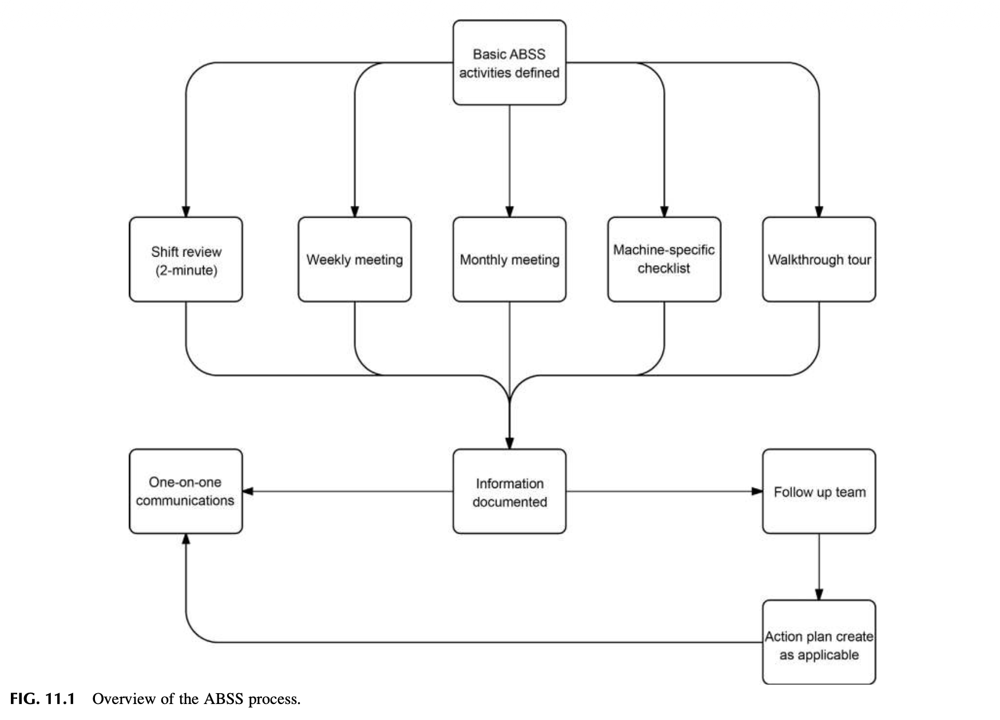
그림 11.1 ABSS 프로세스 개요.

<!-- Block B07 -->
### 그림 11.1 활동 기반 안전 시스템(ABSS) 프로세스 흐름도
ABSS의 기획, 일일 활동 수행, 데이터 집계 및 분석, 성과 피드백, 지속적 개선으로 이어지는 선순환 구조를 보여준다.

<!-- Block B08 -->
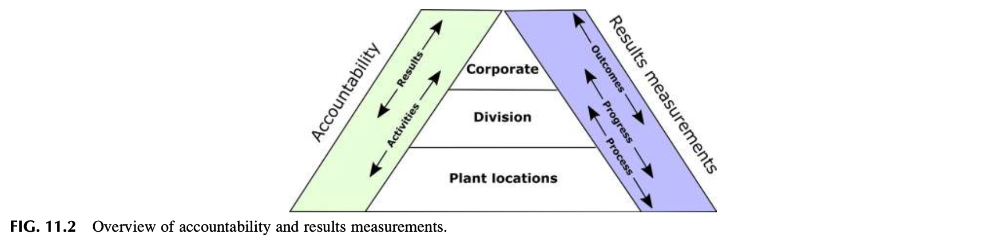
그림 11.2 책무성 및 결과 측정 체계 개요.

<!-- Block B09 -->
### 그림 11.2 책무성과 결과 측정의 연계 모델
수행된 안전 활동(투입/과정)이 위험성 감소(중간 결과)를 거쳐 궁극적인 무재해 및 안전문화 정착(최종 성과)으로 이어지는 논리적 인과 모델을 나타낸다.

<!-- Block B10 -->
## ABSS의 작동 메커니즘 (HOW ABSS WORKS)

수많은 조직들이 이미 회의, 점검, 교육 등 다양한 형태의 안전 활동을 수행하고 있다. 그러나 이러한 활동들은 대개 파편화되어 있고 체계적으로 기록되거나 성과와 연계되지 못한 채 허공으로 사라지기 일쑤이다.
ABSS는 이러한 개별 활동들을 하나의 표준화된 시스템 안으로 통합하여, 각 활동마다 명확한 점수(가중치)를 부여하고 일별·주별·월별로 이행 실적을 체계적으로 모니터링한다.

<!-- Block B11 -->
## ABSS 시스템과 기본 구성 요소 (ABSS SYSTEM AND THE BASIC ELEMENTS)

안전에서 셀 수 있는 모든 것이 가치 있는 것은 아니며, 가치 있는 모든 것을 쉽게 셀 수 있는 것도 아니다.
ABSS는 현장의 실질적인 위험 통제에 결정적으로 기여하는 핵심 활동들을 엄선하여 기본 요소로 구축한다. 이 기본 요소들은 모든 관리감독자와 작업자가 일상 업무 흐름 속에서 자연스럽게 실천할 수 있도록 설계된다.

<!-- Block B12 -->
## 리더십을 위한 구체적 안전 활동 (SPECIFIC ACTIVITIES FOR LEADERSHIP)

ABSS는 리더십 팀이 현장에서 솔선수범하여 수행해야 하는 구체적인 활동 목록을 정의하는 것부터 출발한다:
* 정기 현장 순회 투어 및 작업자와의 일대일 면담
* 안전보건위원회 주재 및 자원 지원 의사결정
* 교대 전 안전 점검(Preshift Review) 참관 및 격려
* 우수 안전 행동에 대한 즉각적인 현장 칭찬과 포상

<!-- Block B13 -->
## 안전 회의 및 미팅 (SAFETY MEETINGS)

안전문화를 성공적으로 유지하려면 조직의 모든 부서와 영역에서 특화된 안전 교육 및 코칭 미팅을 정기적으로 개최해야 한다.
안전 교육과 정보가 "내가 아닌 다른 사람에게나 적용되는 것"이라는 냉소적인 편견은 철저히 타파되어야 한다.
안전 회의는 단순한 일방적 지시 하달의 자리가 아니라, 현장의 잠재적 위험에 대해 자유롭게 의견을 나누고 집단적 해결책을 모색하는 상호 학습과 소통의 장이어야 한다.

<!-- Block B14 -->
### 교대 전 일일 안전 점검 (DAILY PRESHIFT REVIEW)

명칭이 의미하듯 교대 전 일일 안전 점검(일일 안전 브리핑 / TBM, Tool Box Meeting)은 매 교대 작업이 시작되기 직전 현장 관리감독자와 작업자 팀이 모여 5분 내외로 진행하는 짧고 강력한 안전 점검 미팅이다.
오늘 수행할 작업의 핵심 유해·위험요인은 무엇인지, 어떤 특별 보호구와 안전 절차가 필요한지, 작업자들의 건강 상태는 이상이 없는지 확인하는 필수적인 사전 예방 의식이다.

<!-- Block B15 -->
### 관찰 1 (OBSERVATION 1)

제임스는 교대 안전 점검이 진행되는 방식을 바꾼 후 관리감독자들의 역량이 어떻게 눈부시게 향상되기 시작했는지 주목했다.
전통적으로는 공장의 안전 전담 관리자나 환경안전 부서가 교대 안전 점검 자료를 일괄 작성하여 감독자에게 전달하면, 감독자는 그것을 교대 전 미팅에서 영혼 없이 읽어 내려가는 방식으로 진행되었다.
이러한 방식은 현장 교대 리더들이 안전을 '남의 일'로 치부하고 자신들은 회의 자료를 읽어주는 확성기에 불과하다고 느끼게 만들었다.
그러나 감독자가 직접 자신의 공정 위험을 분석하여 오늘의 안전 주제를 선정하고 주도적으로 회의를 이끌도록 권한과 책임을 부여하자, 감독자들의 안전 전문성과 주인의식이 극적으로 향상되었다.

<!-- Block B16 -->
### 교훈 1 (LESSON LEARNED 1)

제임스는 안전 회의를 진행할 때 관리감독자가 일방적으로 훈계만 늘어놓는 회의는 최악의 결과를 낳는다는 점을 경험했다.
성공적인 안전 미팅의 비결은 관리감독자가 20%만 말하고 나머지 80%는 현장 작업자들이 자유롭게 발언하고 토론하도록 유도하는 것이다.
작업자가 직접 위험을 말하게 할 때 비로소 그 위험에 대한 책임감이 형성된다.

<!-- Block B17 -->
### 교대근무 사업장에서의 인수인계 (MULTISHIFT OPERATION)

2교대 또는 3교대로 돌아가는 연속 조업 공장에서는 교대 조가 교대하기 직전 전임 조와 후임 조 사이의 안전 인수인계가 치명적인 위험 관리 포인트가 된다.
앞선 조에서 발생했던 설비 이상, 임시 정비 상태, 아차사고 정보가 교대 시 누락 없이 후임 조 감독자와 작업자에게 완벽하게 인계되어야 한다.

<!-- Block B18 -->
### 주간 안전 회의 (WEEKLY MEETINGS)

주간 단위로 개최되는 안전 회의는 지난 한 주 동안 발생했던 유해·위험요인 발굴 실적, 시정 조치 진행 현황, 그리고 한 주간의 아차사고 사례를 보다 심도 있게 분석하고 다음 주의 안전 중점 과제를 공유하는 심화 미팅이다.

<!-- Block B19 -->
### 월간 안전 회의 (MONTHLY MEETINGS)

수많은 조직들이 이미 월간 단위로 안전보건위원회나 전사 안전 진척 회의를 운영하고 있다.
월간 회의는 부서별 ABSS 안전 활동 점수와 성과 지표를 총괄 검토하고, 반복적으로 지연되는 설비 개선 과제를 해결하기 위해 필요한 예산과 자원을 최고경영진 차원에서 승인하고 지원하는 자리이다.

<!-- Block B20 -->
### 직원과의 일대일 안전 대화 (ONE-ON-ONE DISCUSSIONS WITH EMPLOYEES)

일대일 안전 대화는 현장 관리감독자가 매일 혹은 매주 특정 작업자와 5~10분간 단둘이 마주 앉아 편안하고 개방적인 분위기에서 안전에 대해 대화를 나누는 코칭 프로세스이다.
다수가 모인 회의에서는 입을 열기 꺼려지는 개인적 고충, 작업의 불편함, 사소해 보이지만 위험한 관행들을 솔직하게 털어놓을 수 있는 최고의 심리적 안전 통로가 된다.

<!-- Block B21 -->
### 대면 소통의 결정적 기회 (OPPORTUNITIES FOR FACE-TO-FACE DISCUSSION)

이메일이나 메신저, 공지사항 게시판과 같은 비인격적 소통 수단은 결코 인간적인 대면 소통(Face-to-Face)의 힘을 대체할 수 없다.
직접 눈을 맞추고 나누는 대화는 리더가 직원의 안전을 진심으로 염려하고 있다는 온도를 전달하는 가장 확실한 방법이다.

<!-- Block B22 -->
### 현장 안전 순회 투어 (SAFETY WALK-THROUGH TOUR)

안전 점검, 관찰 및 현장 순회 투어는 ABSS의 핵심 실천 활동이다.
관리감독자와 공장장은 정해진 체크리스트에 얽매이지 않고 열린 시각으로 현장을 걸으며, 불안전한 상태(설비 결함, 정리정돈 불량, 방호 장치 해제 등)와 작업자의 불안전한 행동을 직접 관찰하고 즉각적인 피드백을 제공한다.

<!-- Block B23 -->
### 기계·설비별 맞춤 체크리스트 (MACHINE/EQUIPMENT-SPECIFIC CHECKLIST)

포괄적이고 일반적인 점검표는 현장에서 형식적인 '체크 표시(Check-the-box)'만을 유발할 뿐 실질적인 위험을 걸러내지 못한다.
ABSS에서는 특정 기계나 설비(예: 5호 프레스기, 혼합 탱크, 지게차 등)의 고유한 위험 포인트를 콕 집어 명시한 **기계·설비별 맞춤 체크리스트**를 현장 작업자 및 오퍼레이터에게 제공하여 작업 전 점검에 활용하도록 한다.

<!-- Block B24 -->
### 관찰 2 (OBSERVATION 2)

기계별 맞춤 체크리스트는 장비 오퍼레이터들의 적극적인 참여 속에 개발되었을 때 가장 놀라운 효과를 발휘했다.
현장 오퍼레이터들은 매뉴얼에는 나오지 않는 기계의 미세한 이상 소음, 진동, 누유 위치를 누구보다 정확히 꿰뚫고 있었으며, 이들의 경험을 체크리스트 항목으로 명문화하자 설비 고장과 안전사고가 동시에 급감했다.

<!-- Block B25 -->
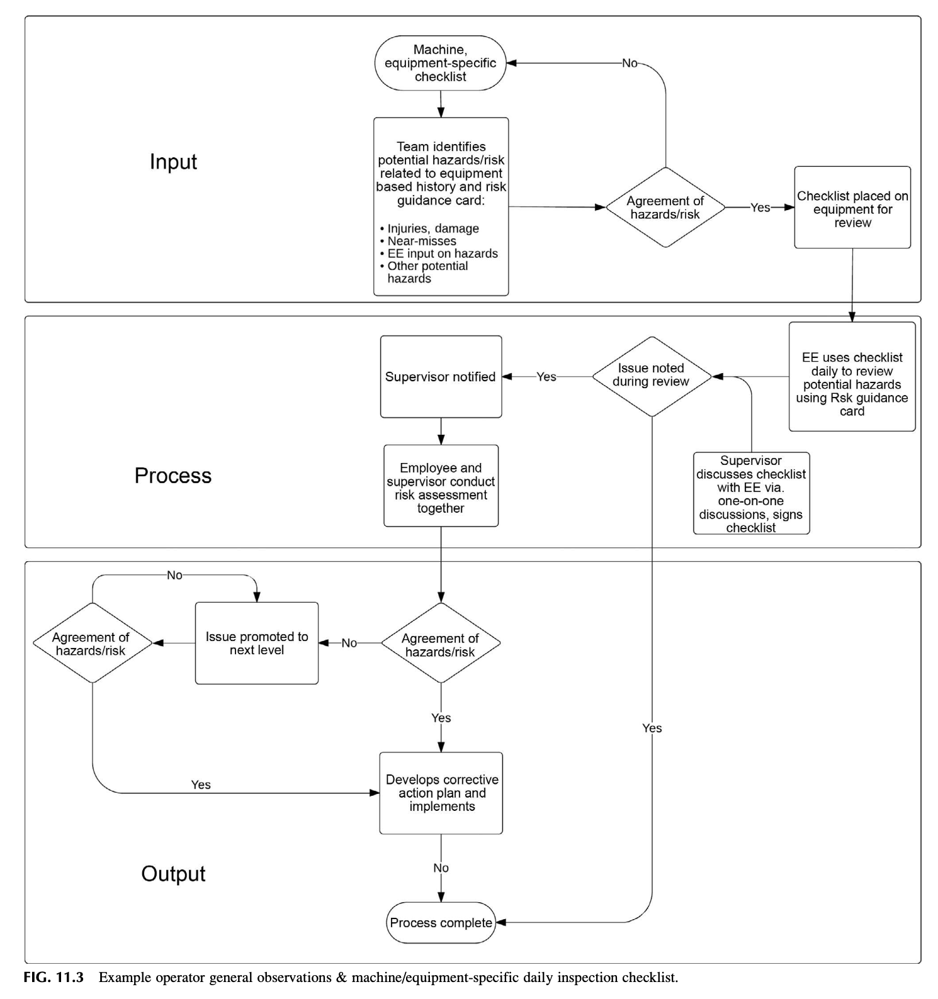
그림 11.3 오퍼레이터 일반 관찰 및 기계별 점검 양식 예시.

<!-- Block B26 -->
### 그림 11.3 오퍼레이터 일반 관찰 및 설비 점검 양식 해설
오퍼레이터가 작업 개시 전 주요 안전 방호장치, 비상정지 버튼, 유압 라인, 보호구 상태 등을 일상적으로 점검하고 기록할 수 있는 직관적인 현장 점검 서식을 보여준다.

<!-- Block B27 -->
### 후속 조치 팀 (FOLLOW-UP TEAM)

현장에서 위험요인을 아무리 많이 발굴하더라도 후속 시정 조치가 지연되면 근로자들은 극심한 냉소주의에 빠지게 된다.
후속 조치 팀(Follow-up Team)은 발굴된 모든 안전 정비 요청과 작업 의뢰서가 실제로 완료될 때까지 끝까지 추적·독려하고 지원하는 전담 조직이다.

<!-- Block B28 -->
### 관찰 3 (OBSERVATION 3)

제임스는 현장의 유해·위험요인을 평가하고 신속히 해결하기 위해 관리자, 현장 감독자, 보전 정비 기술자, 그리고 현장 생산 근로자로 구성된 다기능 후속 조치 팀(Cross-Functional Team)을 조직했다.
이 팀은 현장 근로자들과 직접 만나 잠재적 위험에 대해 논의하고, 시정 조치의 우선순위를 정한 후, 자체 권한과 예산 범위 내에서 즉시 해결할 수 있는 사안들을 현장에서 즉각 조치했다.
자신들이 제기한 위험 문제가 며칠 만에 눈앞에서 해결되는 모습을 본 근로자들의 사기와 참여도는 폭발적으로 상승했다.

<!-- Block B29 -->
## ABSS 상의 역할과 책임 정의 (ABSS ROLES AND RESPONSIBILITIES DEFINED)

ABSS의 성공적인 정착을 위해서는 각 계층별로 요구되는 구체적인 활동과 RAA(책임, 권한, 책무성)가 명문화되어야 한다.

<!-- Block B30 -->
### 현장 감독자의 역할 (SUPERVISOR)

현장 감독자의 역할은 매일 현장에서 ABSS 활동을 직접 실행하고 팀원들을 이끄는 최전선 야전사령관으로서 대단히 결정적이다.
감독자는 일일 TBM 주관, 일대일 안전 코칭, 기계 점검 확인, 발견된 위험의 즉각적 보고 및 1차 조치를 완수할 책임을 진다.

<!-- Block B31 -->
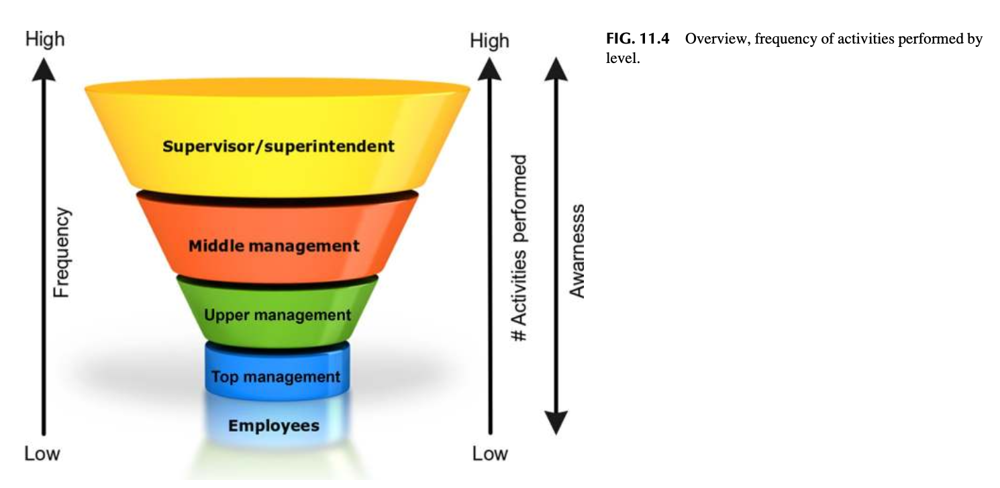
그림 11.4 직급별 안전 활동의 빈도 및 개요.

<!-- Block B32 -->
### 그림 11.4 직급별(감독자, 중간관리자, 최고경영진, 안전전문가) 안전 활동 주기 및 빈도 요약
각 계층이 매일, 매주, 매월 수행해야 하는 안전 점검, 코칭, 위원회 참여 빈도를 한눈에 보여주는 로드맵 다이어그램.

<!-- Block B33 -->
### 중간 관리자의 역할 (MIDDLE MANAGEMENT)

중간 관리자(부장, 팀장)는 산하 감독자들이 ABSS 활동을 충실히 수행할 수 있도록 지속적인 자원과 지원을 제공해야 한다.
정기적인 현장 순회 투어에 참여하고, 감독자들의 일일 점검 보고서를 검토하며, 부서 간 협업이 필요한 안전 과제를 조율하고 해결할 책임을 진다.

<!-- Block B34 -->
### 최고경영진의 역할 (SENIOR LEADERSHIP)

최고경영진(공장장, 임원)은 전사적 ABSS 활동의 강력한 후원자이자 촉진자 역할을 수행해야 한다.
월간 안전 회의를 직접 주재하고, 설비 개선에 필요한 자본 지출을 과감히 승인하며, 현장을 직접 방문하여 솔선수범하는 안전 리더십을 가시적으로 입증해야 한다.

<!-- Block B35 -->
### 사업장 안전 전문가의 역할 (SITE SAFETY PROFESSIONAL)

안전 전문가는 현장 관리감독자를 대신하여 안전 활동을 떠맡는 사람이 아니라, 관리감독자들이 ABSS 도구를 능숙하게 활용할 수 있도록 지도하고 지원하는 내부 컨설턴트이자 코치 역할을 수행한다.
ABSS 데이터 집계, 통계 분석, 법적 기준 해석, 그리고 새로운 안전 교육 자료의 개발을 전담한다.

<!-- Block B36 -->
## 창의적 교육 접근법과 기억 유지율 연구 (TRAINING IDEAS AND CREATIVE APPROACHES)

6시그마 프로젝트의 일환으로 제임스는 작업 환경 개선에 관한 정밀 연구를 수행했다. 이 연구는 6시그마 통계 기법을 활용하여 현장 작업자들의 안전 지식 기억 유지율(Retention Rate)을 어떻게 획기적으로 향상시킬 수 있는지 평가하기 위해 기획되었다.
전통적인 연 1회 몰아치기식 주입식 강의는 교육 후 불과 며칠 만에 기억의 80% 이상이 휘발된다는 사실이 통계적으로 입증되었다.
반면 교대 전 일일 5분 안전 점검과 같은 마이크로러닝(Microlearning) 방식과 시각적 자료를 결합했을 때, 지식의 기억 유지율과 현장 실천율이 극적으로 높아진다는 결과를 도출했다.

<!-- Block B37 -->
### 교훈 2 (LESSON LEARNED 2)

어린이 교육 프로그램 '블루스 클루스(Blue's Clues)'의 반복 학습 이론에 기반하여, 복잡하고 방대한 내용을 한 번에 가르치기보다 가장 핵심적인 안전 메시지 1~2가지를 다양한 방식으로 매일 반복해서 노출시킬 때 성인 작업자의 행동 변화가 가장 확실하게 유도된다는 점을 확인했다.

<!-- Block B38 -->
### 표 11.1 안전 프로젝트를 위한 의사소통 방식 비교 (TABLE 11.1 Communication Methods)
텍스트 위주 공지, 구두 브리핑, 시각적 카드, 현장 실습 등 다양한 의사소통 방식별 작업자 기억 유지율 및 효과성 비교 분석표.

<!-- Block B39 -->
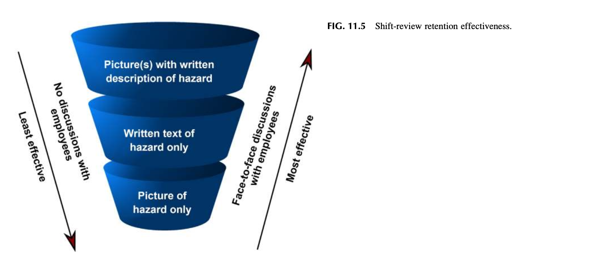
그림 11.5 교대 안전 점검의 기억 유지 효과성 그래프.

<!-- Block B40 -->
### 그림 11.5 교대 안전 점검의 반복 주기에 따른 정보 보유율(Retention) 곡선 해설
주기적인 짧은 안전 대화가 망각 곡선을 극복하고 작업자의 안전 의식을 높은 수준으로 지속시키는 원리를 입증한다.

<!-- Block B41 -->
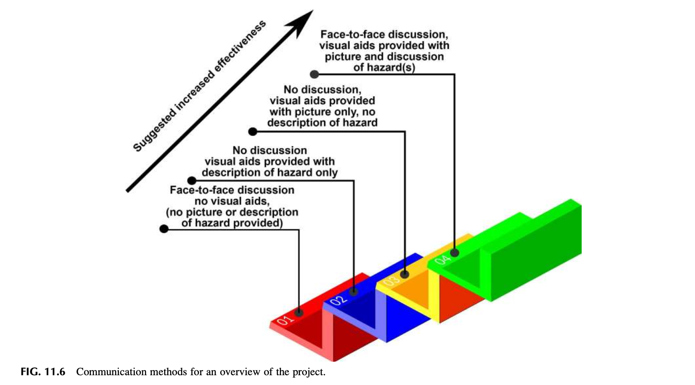
그림 11.6 프로젝트 의사소통 방식 체계.

<!-- Block B42 -->
### 그림 11.6 다양한 채널을 결합한 다층적 안전 의사소통 프레임워크 해설

<!-- Block B43 -->
## 근로자와 함께하는 위험 감소로의 사고 전환 (SHIFTING THE THOUGHT PROCESS TO RISK REDUCTION WITH EMPLOYEES)

안전의 패러다임은 관리자가 일방적으로 통제하는 방식에서, 근로자 스스로 위험을 발견하고 줄여나가는 자율적 위험 감소 체계로 근본적으로 전환되어야 한다.

<!-- Block B44 -->
### 실험계획법(DOE)의 적용 (DESIGN OF EXPERIMENT)

안전 교육 및 의사소통 방식의 효과성을 과학적으로 검증하기 위해 6시그마의 **실험계획법(DOE, Design of Experiments)**이 적용되었다.
서로 다른 4가지 교육 시나리오(일방적 텍스트, 강의식 구두 전달, 시각적 그래픽 카드, 참여형 실습)를 독립 변수로 설정하고, 현장 작업자의 위험 지각 정확도와 안전 수칙 준수율을 종속 변수로 측정하여 어떤 방식이 가장 우수한 인과관계를 나타내는지 통계적으로 규명했다.

<!-- Block B45 -->
### 관찰 4 (OBSERVATION 4)

연구 결과, 텍스트와 단순 구두 지시만을 받은 작업자들은 복잡한 작업 지침의 절반 이상을 잘못 이해하거나 생략한 반면, **시각적 그래픽 일러스트와 핵심 체크리스트가 결합된 지침**을 받은 작업자들은 오류 발생률이 80% 이상 감소했다.

<!-- Block B46 -->
### 교훈 3 (LESSON LEARNED 3)

조직의 안전 규칙이 지나치게 복잡하고 두꺼운 책자로 존재할 때 아무도 그것을 읽지 않는다는 점이 재확인되었다.
핵심 안전 수칙은 현장에서 10초 이내에 직관적으로 이해할 수 있는 시각적 표준으로 요약·게시되어야 한다.

<!-- Block B47 -->
## ABSS 활용을 위한 필수 실천 팁 (ESSENTIAL TIPS FOR USING ABSS)

ABSS를 성공적으로 정착시키기 위한 핵심 팁은 다음과 같다:
* 현장의 안전 활동을 지나치게 복잡한 지표로 계량화하여 관리 부담을 가중시키지 마라.
* 점수화 시스템은 처벌의 도구가 아니라, 우수 활동을 칭찬하고 인정하는 긍정적 강화 도구로 활용되어야 한다.
* 시스템 도입 초기에는 2~3개의 핵심 활동(일일 TBM, 설비 체크리스트)부터 시작하여 점진적으로 확장하라.
* 활동의 양적 달성률뿐만 아니라 현장 점검의 질적 깊이를 함께 모니터링하라.

<!-- Block B48 -->
## ABSS 성과의 정밀 측정 (MEASURING THE ABSS PERFORMANCE)

안전 성과와 안전경영시스템 요소는 조직 전체에 명확하고 일상적으로 소통되지 않는다면 아무런 가치를 발휘하지 못한다.

> *"지표의 대다수는 경영진, 관리감독자 및 근로자의 능동적이고 선제적인 안전 활동에 초점을 맞추는 **선행 지표(Leading Indicators)**여야 한다."*

ABSS는 매월 각 부서의 일일 TBM 이행률, 설비 체크리스트 완료율, 일대일 안전 코칭 건수, 발굴된 위험의 시정 완료율을 종합하여 'ABSS 활동 지수'를 산출하고 이를 부서 평가에 공정하게 반영한다.

<!-- Block B49 -->
## 안전 프로세스를 지원하고 가치를 더하는 도구들 (TOOLS THAT SUPPORT AND ADD VALUE)

ABSS를 강력히 뒷받침하기 위해 사고 조사 지침, 사건 정보 관리 시스템, 그리고 부상 관리 프로세스 북클릿과 같은 표준화된 도구들이 유기적으로 결합되어야 한다.

<!-- Block B50 -->
### 사건·사고 조사 지침 (INCIDENT INVESTIGATION GUIDELINES)

운영상의 위험 유형과 범위가 변화함에 따라 모든 유형의 사고 잠재력이 증가할 수 있다. 안전보건경영시스템의 필수 요소는 사고 조사의 효과적인 수행과 체계적인 사고 관리 프로세스의 개발이다.
사고 조사는 누구의 잘못인가를 따지는 마녀사냥(blame game)이 아니라, 시스템 내부의 어떤 결함과 취약점이 그 사건을 유발했는가를 파악하는 '근본 원인 분석(Root Cause Analysis)'이어야 한다.

<!-- Block B51 -->
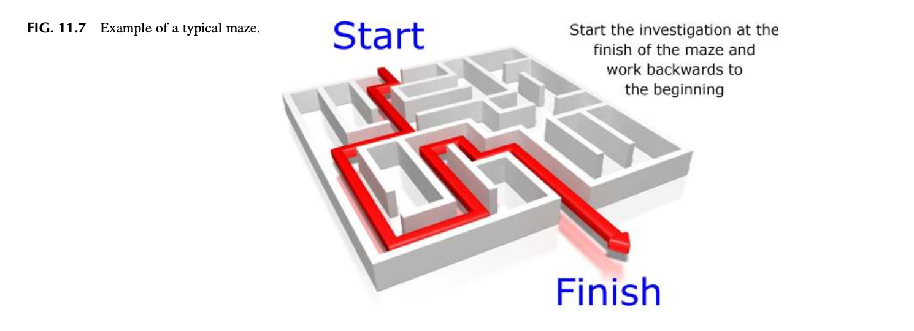
그림 11.7 전형적인 미로의 예시.

<!-- Block B52 -->
### 그림 11.7 사고 원인의 복잡한 미로 다이어그램
단일 원인이 아닌 복합적인 시스템적 요인들이 얽혀 있는 사고의 다중 경로를 미로에 비유하여 설명한다.

<!-- Block B53 -->
### 사건 정보 관리 체계 (INCIDENT INFORMATION MANAGEMENT)

사건 정보 관리 시스템은 모든 부상, 질병, 재산 손실, 그리고 특히 아차사고(Near Miss) 데이터를 신속하게 기록하고 분석하여 잠재적 재해 추세를 사전에 감지하는 조기 경보 시스템 역할을 수행한다.

<!-- Block B54 -->
### 부상 관리 프로세스 북클릿 (INJURY MANAGEMENT PROCESS BOOKLET)

부상 관리 프로세스 북클릿의 목적은 부상이 발생했을 때 필요한 모든 서식과 절차를 하나로 묶은 **"원스톱 응급 키트(Grab N Go Kit)"**를 제공하는 것이다.
사고 발생 직후 경황이 없는 현장 관리감독자가 당황하지 않고, 부상자의 즉각적인 응급 처치와 병원 이송, 초기 현장 보존, 사진 촬영, 목격자 진술 확보, 초기 경보 보고서 작성을 누락 없이 일사불란하게 처리할 수 있도록 돕는다.

<!-- Block B55 -->
### 관찰 5 (OBSERVATION 5)

사고 관리 프로세스를 도입하기 전에 관리감독자들에게 실습 모의 훈련을 실시하지 않으면, 실제 사고 발생 시 극심한 패닉에 빠져 부상자 이송이나 초기 현장 조치가 지연된다는 점이 발견되었다. 정기적인 워크숍 훈련이 필수적이다.

<!-- Block B56 -->
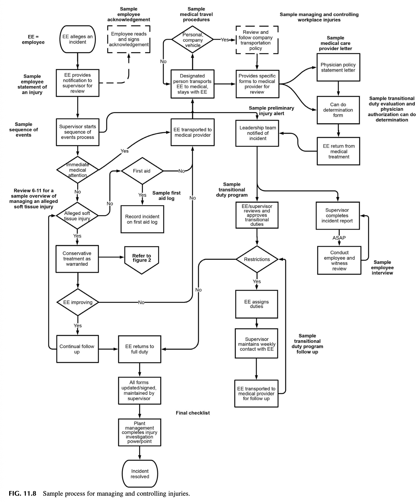
그림 11.8 부상 관리 및 통제 프로세스 샘플 흐름도.

<!-- Block B57 -->
### 그림 11.8 부상 발생 시 즉각 대응 및 후속 관리 흐름도 해설
부상 발생부터 응급 의료 제공, 초기 보고, 정밀 원인 조사, 시정 조치, 업무 복귀(RTW, Return to Work) 프로그램에 이르는 일련의 표준 절차를 명시한다.

<!-- Block B58 -->
### 근골격계 연부조직 부상 개요 (OVERVIEW OF ALLEGED SOFT TISSUE INJURY)

산업 현장에서 가장 빈번하게 발생하면서도 진위 논란과 보상 갈등을 초래하기 쉬운 대표적인 재해가 바로 염좌, 긴장 등 연부조직(Soft Tissue) 부상 및 근골격계 질환이다.

<!-- Block B59 -->
### 관찰 6 (OBSERVATION 6)

이러한 유형의 부상을 효과적으로 해결하기 위해, 리더십 팀은 인체공학적 작업 환경 평가를 정례화하고, 올바른 인양 요령 교육 및 초기 증상 조기 보고 체계를 갖추어야 한다.
초기 통증을 조기에 보고하여 가벼운 스트레칭과 물리치료로 회복할 수 있는 기회를 놓치면 만성적인 중대 질환으로 악화된다.

<!-- Block B60 -->
## 제11장 본문 요약 (SUMMARY)

이상적인 안전문화 시스템에서 리더십 팀은 조직이 성공하는 데 필요한 비전과 목표 및 세부목표를 일상적으로 소통하고 강조한다.
ABSS 형식의 결정적 장점은 각 관리감독자의 현장 경험과 구역 전문성을 안전 프로세스를 개선하는 핵심 자산으로 활용한다는 점이다.
ABSS는 일일 TBM, 기계별 맞춤 점검, 일대일 안전 코칭, 현장 순회 투어 등 측정 가능한 선행 안전 활동을 통해 안전을 구체적인 일상 업무로 내재화한다.

<!-- Block B61 -->
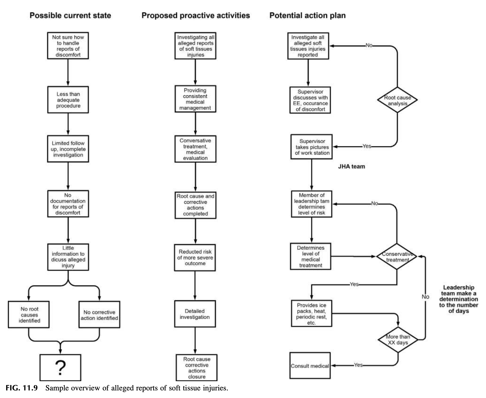
그림 11.9 연부조직 부상 보고 및 관리 프로세스 개요.

<!-- Block B62 -->
### 그림 11.9 근골격계 연부조직 통증 조기 보고 및 체계적 관리 절차 해설
작업 중 불편감 감지 시 초기 보고, 전문의 진단, 작업 환경 인체공학적 개선, 재활 및 점진적 복귀에 이르는 체계적 프로세스를 도식화한 다이어그램.

<!-- Block B63 -->
## 장 복습 문제 (CHAPTER REVIEW QUESTIONS)

1. 활동 기반 안전 시스템(ABSS)의 개념과 도입 목적을 정의하라.
2. ABSS가 전통적인 사후 손실 기반 지표(TCIR 등)와 비교하여 가지는 핵심적인 장점 3가지를 설명하라.
3. 교대 전 일일 안전 점검(Daily Preshift Review / TBM)이 안전문화 향상에 기여하는 방식을 논의하라.
4. 관리감독자가 안전 회의에서 취해야 할 80/20 경청의 원칙을 설명하라.
5. 기계·설비별 맞춤 체크리스트의 필요성과 오퍼레이터 참여의 중요성을 설명하라.
6. 후속 조치 팀(Follow-up Team)이 현장 안전 제안의 실행력 확보에 결정적인 이유를 논하라.
7. 부상 관리 프로세스 북클릿("Grab N Go Kit")의 필요성과 구성 요소를 설명하라.

<!-- Block B64 -->
## 부록 11.1 샘플 책무성 및 결과 측정 시스템 (APPENDIX 11.1 SAMPLE ACCOUNTABILITY AND RESULTS MEASUREMENT SYSTEM)

본 부록은 조직의 안전 활동을 정량적으로 추적하고 관리하기 위한 4대 핵심 영역별 선행 지표 측정 모델을 제시한다.

<!-- Block B65 -->
### 1. 리더십 팀의 측정 지표 (The Leadership Team)

리더십 팀은 안전에 대한 헌신을 눈에 보이게 가시적으로 입증해야 한다:
* **현장 안전 순회 투어 건수:** 주간/월간 목표 대비 실제 이행 횟수.
* **직원과의 일대일 안전 대화 건수:** 월간 계획 대비 완료 실적.
* **안전보건위원회 회의 참석률:** 경영진의 정기 회의 참석 빈도.
* **안전 예산 집행률:** 승인된 안전 설비 개선 자본의 신속한 집행 실적.

<!-- Block B66 -->
### 2. 직원 참여 측정 지표 (Employee Involvement)

모든 직원의 적극적인 안전 참여를 추적하고 격려한다:
* **안전 개선 제안 제출 건수:** 작업자 1인당 연간 제안 건수.
* **위험 보고 및 아차사고 신고 건수:** 처벌 없는 자발적 신고 활성화 수준.
* **안전 분과위원회 및 애드혹 프로젝트 참여 직원 수.**
* **기계별 일일 자가 점검표 성실 작성률.**

<!-- Block B67 -->
### 3. 유해·위험요인 파악 및 통제 지표 (Hazard Recognition & Control)

* **발굴된 유해·위험요인 총 건수 및 위험 등급별 분류.**
* **시정 조치 계획(CAP)의 기한 내 완료율:** 30일 이내 개선 조치 완료 비율.
* **미해결 위험 과제의 잔여 기간 추적 관리.**
* **작업중지권(Stop-Work Authority) 발동 및 위험 해결 건수.**

<!-- Block B68 -->
### 4. 교육 및 훈련 지표 (Education & Training)

* **필수 안전보건 법정 교육 및 직무 교육 이수율 (100% 목표).**
* **신규 입사자 및 부서 이동자 안전 온보딩 완료율.**
* **관리감독자 안전 코칭 및 JHA 실습 훈련 이수 실적.**
* **비상사태 대피 훈련 참가 인원 및 소요 시간 단축 실적.**

<!-- Block B69 -->
## 부록 11.2 직급별 ABSS 직무 및 책임 예시 목록 (APPENDIX 11.2 EXAMPLE LIST OF ABSS DUTIES AND RESPONSIBILITIES)

<!-- Block B70 -->
### 1. 최고경영진 핵심 성과 활동 (Leadership Members Core Performance Activities)

1. **전사 안전 방침 천명 및 정기적인 안전 메시지 전파.**
2. **월간 전사 안전 진척 회의 주재 및 안전 성과 평가.**
3. **격주 또는 월간 정기 현장 안전 순회 투어 실시.**
4. **고위험 작업장 방문 시 직원들과의 즉석 안전 대화 및 노고 치하.**
5. **안전 투자 예산의 우선적 승인 및 적시 배분.**

<!-- Block B71 -->
### 2. 안전위원회 권장 활동 (Safety Committee Suggested Activities)

1. **월간 정기 안전위원회 회의 진행 및 회의록 전사 공지.**
2. **영구 분과위원회(홍보, 점검, JHA, 교육)의 분기별 성과 검토.**
3. **전사 아차사고 및 사고 조사 보고서의 근본 원인 정밀 검토.**
4. **현장 안전 수칙 및 표준 작업 절차의 현실성 검토 및 개정 지원.**

<!-- Block B72 -->
### 3. 부서장(부장/팀장) 권장 활동 (Department Managers Suggested Activities)

1. **주간 부서 안전 회의 주관 및 주간 안전 이슈 점검.**
2. **산하 현장 감독자들의 일일 TBM 진행 상태 모니터링.**
3. **부서 내 발굴된 유해·위험요인에 대한 정비 의뢰서 승인 및 예산 지원.**
4. **월 2회 이상 관할 구역 심층 안전 순회 점검 실시.**

<!-- Block B73 -->
### 4. 현장 교대 감독자 / 라인 리더 권장 활동 (Shift Supervisors / Shift Leader Suggested Activities)

1. **매 교대 작업 시작 전 5분 일일 TBM(Preshift Review) 필수 주관.**
2. **매일 1명 이상의 작업자와 5분간 개별 일대일 안전 코칭 대화 실시.**
3. **담당 구역 내 주요 기계·설비의 일일 점검표 작성 상태 확인.**
4. **작업 중 불안전한 상태 및 행동 발견 시 즉시 지도 및 작업중지권 행사.**
5. **교대 시 후임 조 감독자에게 안전 관련 특이사항 완벽 인수인계.**

<!-- Block B74 -->
## 부록 11.3 권장 ABSS 측정 양식 예시 (APPENDIX 11.3 EXAMPLE OF SUGGESTED ABSS METRICS)

<!-- Block B75 -->
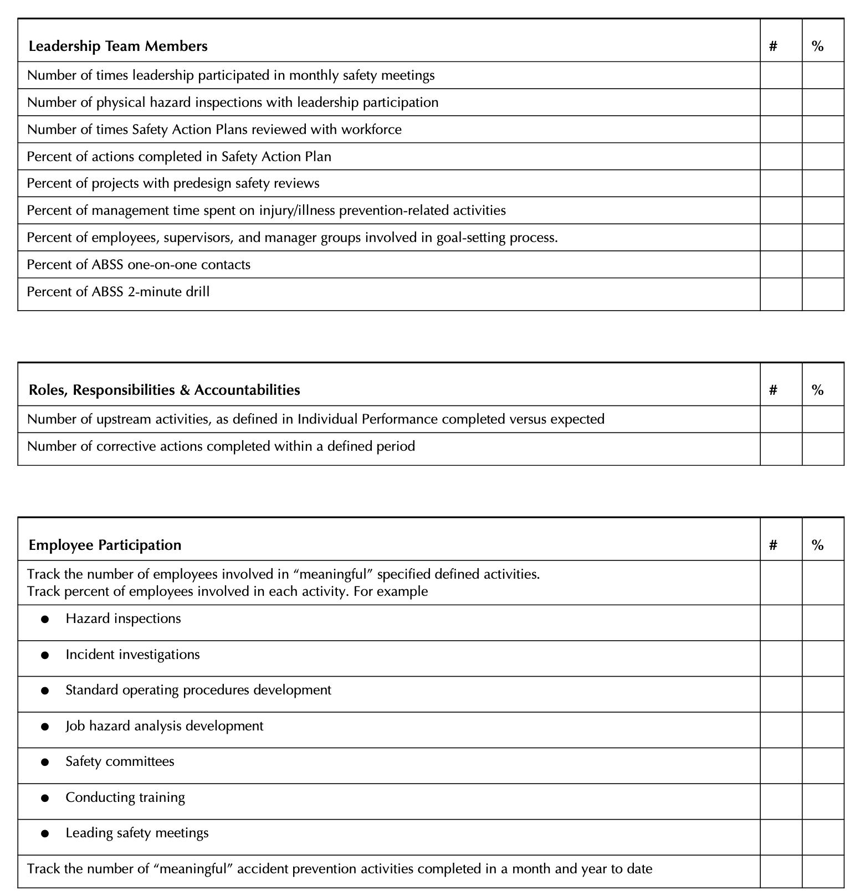
ABSS 일일 활동 기록 및 점수 환산 양식 (1페이지).

<!-- Block B76 -->
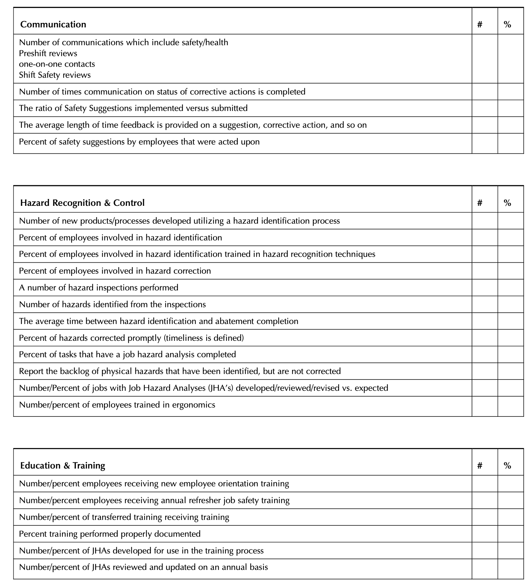
부서별 주간 안전 활동 집계 및 모니터링 시트 (2페이지).

<!-- Block B77 -->
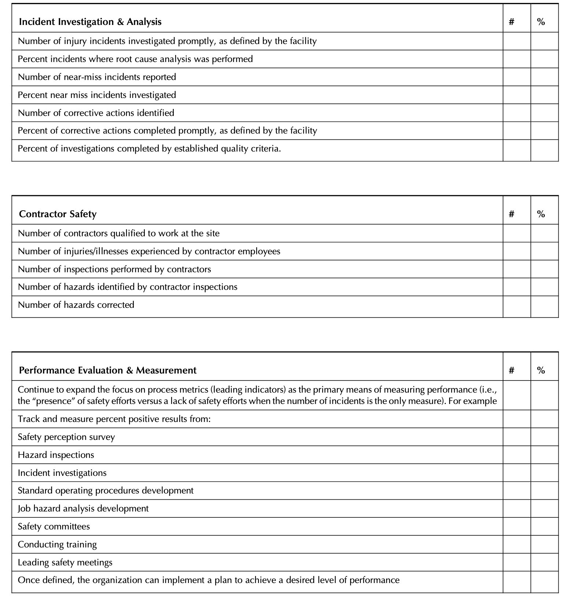
월간 전사 안전 활동 종합 평가 및 대시보드 서식 (3페이지).

<!-- Block B78 -->
## 부록 11.4 일일 리더십 팀 안전 활동 보고서 샘플 (APPENDIX 11.4 SAMPLE DAILY LEADERSHIP TEAM ACTIVITY REPORT)

<!-- Block B79 -->
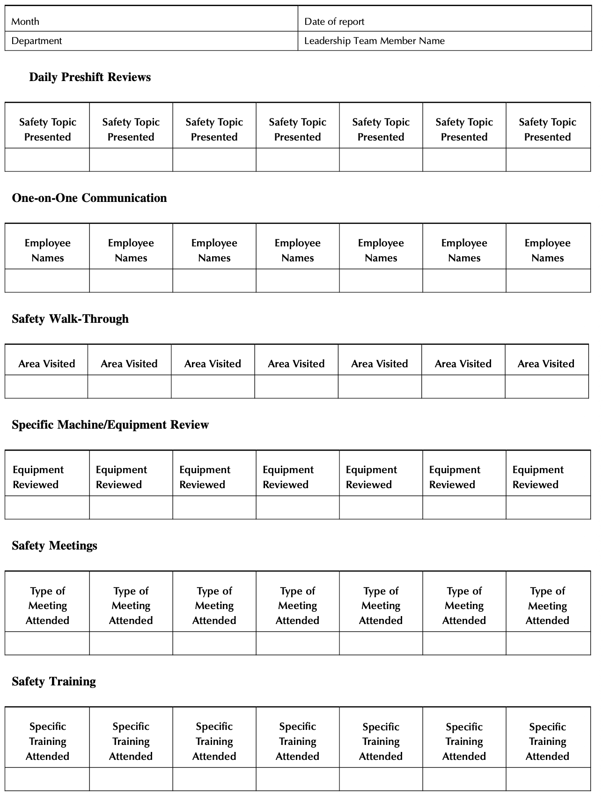
경영진의 일일 현장 방문, 작업자 면담, 안전 관찰 결과를 즉시 기록하고 전산 입력하는 일일 리더십 활동 보고서 양식.

<!-- Block B80 -->
## 부록 11.5 일일 교대 전 안전 점검 보고서 샘플 (APPENDIX 11.5 SAMPLE DAILY PRESHIFT REVIEWS REPORT)

<!-- Block B81 -->
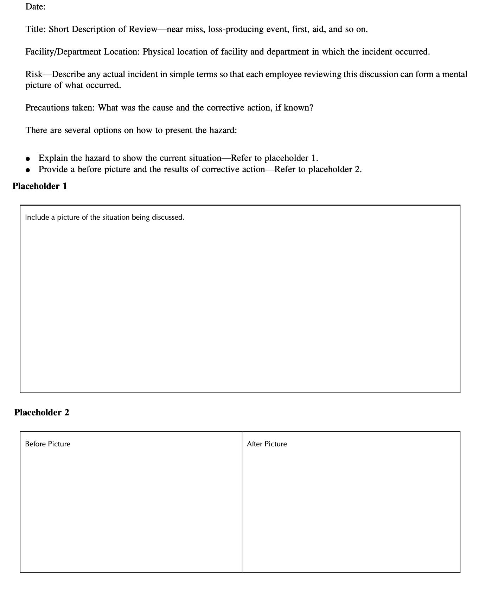
감독자가 매일 아침 교대 전 TBM에서 논의한 안전 주제, 참석자 명단, 작업자 피드백을 기록하는 표준 일일 브리핑 서식.

<!-- Block B82 -->
## 부록 11.6 주간 리더십 안전 활동 요약 보고서 샘플 (APPENDIX 11.6 SAMPLE WEEKLY SUMMARY, LEADERSHIP ACTIVITY REPORT)

<!-- Block B83 -->
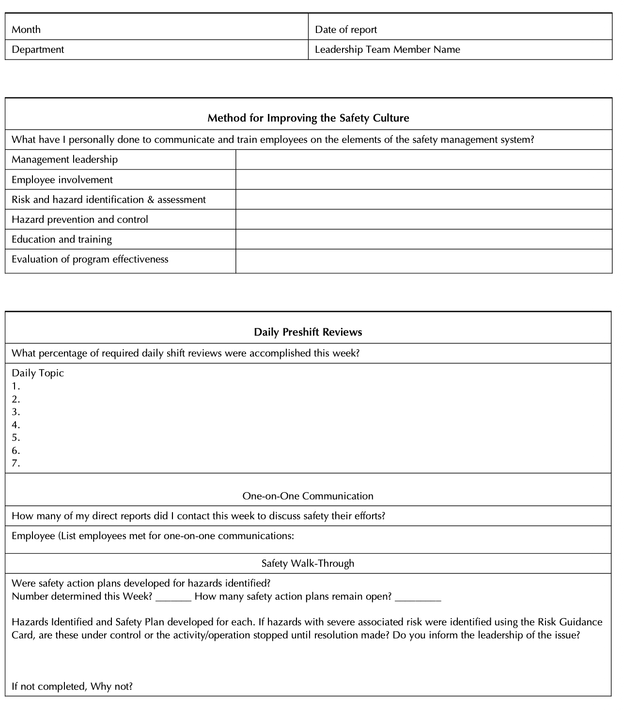
주간 단위로 부서별 안전 순회 횟수, TBM 실시율, 위험 제안 건수를 요약 집계하는 총괄 보고서 (1페이지).

<!-- Block B84 -->
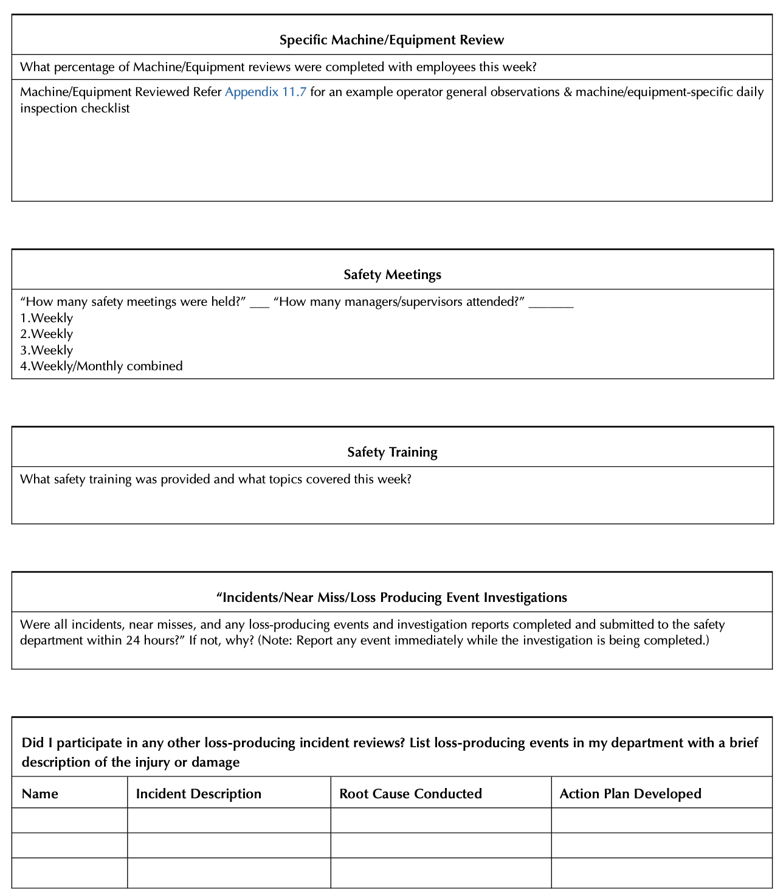
발견된 위험 항목별 조치 진행 상태(완료, 진행 중, 지연)를 색상으로 구분하여 표시하는 주간 추적 시트 (2페이지).

<!-- Block B85 -->
## 부록 11.7 오퍼레이터 일반 관찰 및 기계·설비 점검표 샘플 (APPENDIX 11.7 SAMPLE OPERATOR GENERAL OBSERVATIONS & MACHINE/EQUIPMENT CHECKLIST)

<!-- Block B86 -->
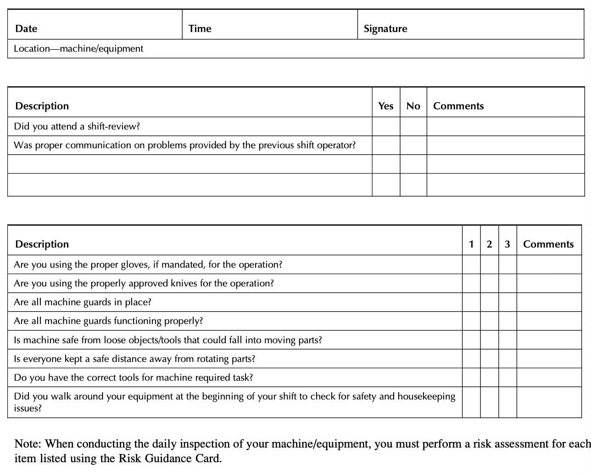
오퍼레이터가 설비 가동 전 5분 동안 안전 인터록, 누유, 이상 발열, 비상 정지 장치를 점검하는 일일 설비 점검 체크리스트.

<!-- Block B87 -->
## 부록 11.8 기본 사건·사고 조사 지침 예시 (APPENDIX 11.8 EXAMPLE BASIC INCIDENT INVESTIGATION GUIDELINES)

<!-- Block B88 -->
### 1. 도입 및 핵심 목적 (Introduction and Core Purpose)

신속하고 효과적인 사고 조사의 궁극적인 목적은 재발 방지(prevention of recurrence)에 있다.
누군가를 처벌하거나 비난하기 위함이 아니라, 시스템과 프로세스의 결함을 찾아내어 개선함으로써 향후 유사한 사고로부터 다른 동료들을 보호하는 데 목적이 있다.

<!-- Block B89 -->
### 2. 조사의 책임 및 적시성 (Responsibilities and Timing of Investigation)

* **즉각적인 조사 착수:** 모든 사건·사고 및 중대 아차사고는 발생 후 24시간 이내에 조사가 개시되어야 한다. 시간이 지체될수록 현장 증거가 훼손되고 기억이 왜곡된다.
* **현장 보존:** 부상자 응급 구조 직후 사고 현장은 조사팀이 도착할 때까지 원형 그대로 보존되어야 한다.

<!-- Block B90 -->
### 3. 부상 근로자 및 목격자 면담 기법 (Interviewing Injured Employees and Witnesses)

* 면담은 조용하고 편안한 장소에서 개별적으로 진행되어야 한다.
* 부상자와 목격자에게 조사의 목적이 처벌이 아닌 안전 개선임을 명확히 안심시켜야 한다.
* 유도신문을 지양하고 개방형 질문(Open-ended questions: "무슨 일이 있었는지 말씀해 주시겠습니까?")을 사용하라.

<!-- Block B91 -->
### 4. 사건 트리 근본 원인 분석 및 기여 요인 (Incident Tree Root Cause Analysis & Contributing Factors)

사고의 표면적 원인에 머물지 않고 근본 원인에 도달하기 위해 논리적 인과관계를 구조화하는 **사건 트리(Incident Tree)** 분석 기법을 적용한다.

<!-- Block B92 -->
### 표 11.2 사건 트리 분석 절차 (TABLE 11.2 Procedure for Completing Incident Tree Method)
손실 사건을 최상단에 배치하고 직접 원인, 간접 원인, 시스템적 근본 원인으로 가지를 뻗어 나가며 원인을 규명하는 5단계 표준 절차서.

<!-- Block B93 -->
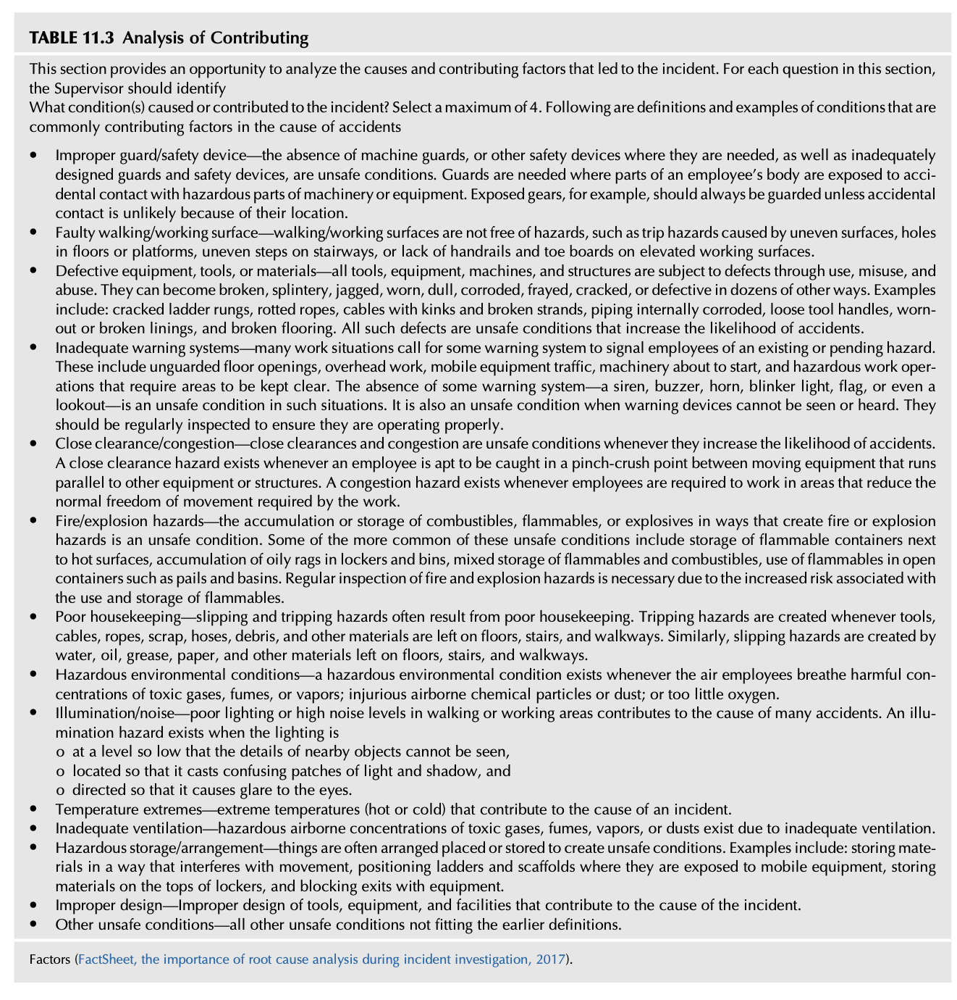
사건 트리 작성 절차 가이드라인 시트.

<!-- Block B94 -->
### 표 11.3 사고 기여 요인 분석 분류표 (TABLE 11.3 Analysis of Contributing Factors)
인적 요인, 설비적 요인, 환경적 요인, 관리적 시스템 요인 등 사고 발생에 기여한 다차원적 변수들의 표준 분류 매트릭스.

<!-- Block B95 -->

사고 기여 요인 점검표.

<!-- Block B96 -->
### 표 11.4 사고를 유발하거나 기여한 행동 목록 (TABLE 11.4 What Action(S) Caused or Contributed to the Incident)
위험한 편법 사용, 방호장치 임의 해제, 개인보호구 미착용, 부적절한 도구 사용 등 불안전한 행동에 대한 세부 체크리스트.

<!-- Block B97 -->
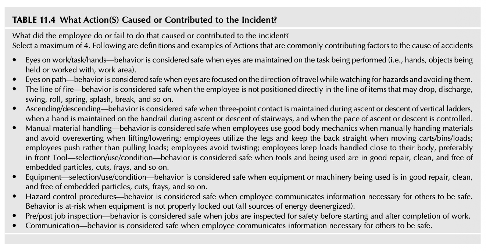
불안전한 행동 식별 양식.

<!-- Block B98 -->
### 표 11.5 부상 정보—재해 발생 형태 표준 분류 (TABLE 11.5 Injury Information—Incident Type)
유해·위험요인 인식 및 위험 지침 카드와 직접 연계된 재해 발생 형태(기인물 및 접촉 방식)의 표준 분류 기준표.

<!-- Block B99 -->
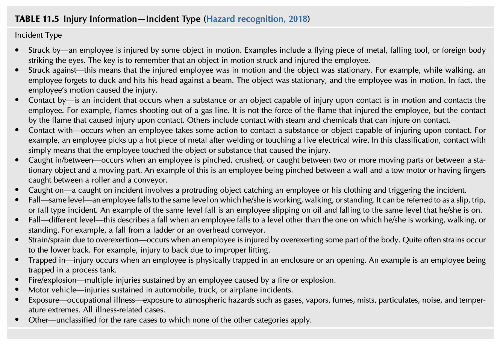

**주요 재해 발생 형태 분류 기준 (Key Incident Type Classifications):**
* **낙하·비래 (Struck by):** 날아오거나 떨어지는 물체에 맞음 (예: 비산하는 금속 파편, 낙하하는 공구).
* **충돌·격돌 (Struck against):** 작업자가 움직이다가 고정된 물체에 부딪힘 (예: 돌출된 H빔에 머리를 부딪힘).
* **접촉 (Contact by):** 움직이는 위험 물질에 접촉함 (예: 비산된 화학물질이나 증기 접촉).
* **유해물 접촉 (Contact with):** 고정된 날카롭거나 뜨거운 물체에 접촉함 (예: 뜨거운 배관 화상, 배전반 감전).
* **협착·끼임 (Caught on):** 움직이는 기계 돌출부에 옷이나 장갑이 걸림.
* **협착·말림 (Caught in):** 회전 롤러, 컨베이어 기어 사이에 신체가 말려 들어감.
* **끼임·압착 (Caught between):** 닫히는 문이나 두 개의 고정/이동 물체 사이에 신체가 압착됨.
* **추락 (Fall to lower level):** 비계, 사다리, 개구부 등 높은 곳에서 아래로 떨어짐.
* **넘어짐 (Fall on same level):** 바닥의 물기, 기름, 장애물로 인해 미끄러지거나 걸려 넘어짐.
* **과도한 신체 부담 (Overexertion):** 무거운 물건을 무리하게 들거나 비틀어 발생한 근골격계 부상.

<!-- Block B100 -->
### 5. 시정 조치 및 품질 검토 (Corrective Actions and Quality Review)

* **조치 수립 기준:** 시정 조치는 '작업자 주의 환기'와 같은 모호한 문구가 아니라, **통제의 위계(Hierarchy of Controls)**에 따라 제거, 대체, 공학적 개선을 최우선으로 수립되어야 한다.
* **기한과 책임자 명시:** 모든 조치에는 완결 기한(Target Date)과 실행 책임자(PIC)가 명확히 지정되어야 한다.
* **유효성 사후 평가:** 조치 실행 30일 후 실제로 위험이 제거되었는지 현장 품질 검토를 필수적으로 수행한다.

<!-- Block B101 -->
## 부록 11.9 부상 관리 프로세스 북클릿 ("Grab N Go Kit" 종합 서식) (APPENDIX 11.9 INJURY MANAGEMENT PROCESS BOOKLET)

본 부록은 작업장 내 부상 사고 발생 시 관리감독자가 즉시 들고 출동하여 원스톱으로 대응할 수 있는 'Grab N Go Kit'의 표준 서식 17종(0페이지~16페이지)을 제공한다.

<!-- Block B102 -->
### 부상 대응 키트 서식 및 직급별 검토 책임 매트릭스 (Overview of Grab N Go Kit Forms)

| 페이지 번호 | 서식 및 절차서 명칭 | 부상 직원 | 감독자 | 리더십 팀 | 안전 전문가 | 의료진 |
| :---: | :--- | :---: | :---: | :---: | :---: | :---: |
| **0** | 초기 부상 예방 및 대응 체크리스트 (표지) | - | **X** | **X** | **X** | - |
| **1** | 근로자 부상 보고 확인서 | **X** | **X** | - | - | - |
| **2** | 근로자 초기 진술서 (최초 보고서) | **X** | **X** | - | - | - |
| **3** | 관리감독자 초기 사건 진술서 | - | **X** | **X** | **X** | - |
| **4** | 주치의 및 병원 의료진 협조 서한 | - | **X** | - | - | **X** |
| **5** | 기본 직무 기술서 (신체 요구도 포함) | - | **X** | - | - | **X** |
| **6** | 전환 업무(경업무) 평가서 및 의사 소견서 | - | **X** | - | - | **X** |
| **7** | 병원 이송 및 교통편 절차 안내서 | - | **X** | - | - | - |
| **8** | 초기 부상 경보 보고서 (Incident Alert) | - | **X** | **X** | **X** | - |
| **9** | 전환 업무(임시 복귀) 프로그램 통지서 | **X** | **X** | - | - | - |
| **10** | 전환 업무 프로그램 후속 추적 양식 | **X** | **X** | - | **X** | - |
| **11** | 사건 타임라인 (사건 발생 순서) 기록지 | - | **X** | - | **X** | - |
| **12** | 사업장 구급처치 일지 (First Aid Log) | - | **X** | - | **X** | - |
| **13** | 목격자 진술서 | - | **X** | - | **X** | - |
| **14** | 직원 면담 기록 양식 | - | **X** | - | **X** | - |
| **15** | 인체공학적 위험 인식 체크리스트 | **X** | **X** | - | **X** | - |
| **16** | 사고 보고 브리핑 프레젠테이션 양식 | - | **X** | **X** | **X** | - |

<!-- Block B103 -->
### [서식 0페이지] 초기 부상 대응 체크리스트 (Initial Injury Management Checklist)
부상 발생 즉시 취해야 할 10단계 응급 조치 순서도 (응급처치, 119 후송, 현장 보존, 사진 촬영, 최초 경보 발령 등).

<!-- Block B104 -->
### [서식 1페이지] 근로자 부상 보고 확인서 (Sample Employee Acknowledgment)
부상 근로자가 회사에 부상 사실을 지체 없이 정직하게 보고했음을 상호 확인하고 서명하는 공식 서약 양식.

<!-- Block B105 -->
### [서식 2페이지] 근로자 초기 진술서 (Sample Employee Statement of First Report)
부상 근로자 본인이 육하원칙에 따라 사고 당시의 상황, 통증 부위, 사용 중이던 공구와 보호구를 직접 기술하는 서식.

<!-- Block B106 -->
### [서식 3페이지] 관리감독자 초기 진술서 (Sample Supervisor Initial Statement)
현장 감독자가 부상 통보를 받은 즉시 현장 상태를 조사하여 기재하는 1차 감독자 보고서.

<!-- Block B107 -->
### [서식 4페이지] 의료진 협조 서한 (Sample Medical Care Provider Letter)
치료 의사에게 회사의 경업무(Transitional Duty) 프로그램을 소개하고, 불필요한 휴업 대신 가능한 신체 활동 범위를 지정해 줄 것을 요청하는 공식 공문.

<!-- Block B108 -->
### [서식 5페이지] 직무 신체 요구도 기술서 (Sample Basic Job Description)
해당 직무가 요구하는 들어 올리기 무게, 서 있는 시간, 무릎 꿇기 빈도 등을 의료진이 판단할 수 있도록 정리한 직무 명세표.

<!-- Block B109 -->
### [서식 6페이지] 전환 업무 평가서 (Sample Transitional Duty Evaluation)
주치의가 부상 근로자의 신체적 제한 사항(예: 5kg 이상 인양 금지, 앉아서만 작업 등)을 구체적으로 체크하는 의료 소견서 양식.

<!-- Block B110 -->
### [서식 7페이지] 병원 이송 및 교통편 규정 (Sample Travel Policy & Transportation Procedure)
부상자 발생 시 지정 병원 이송 절차 및 회사 차량 지원 수칙 안내문.

<!-- Block B111 -->
### [서식 8페이지] 초기 부상 경보 보고서 (Sample Preliminary Injury Alert)
사고 발생 2시간 이내에 전사 경영진과 관련 부서에 긴급 배포되는 1페이지짜리 핵심 사고 속보 양식.

<!-- Block B112 -->
### [서식 9페이지] 전환 업무 배치 통지서 (Sample Transitional Duty Program Notification)
부상 근로자에게 주치의 소견에 맞추어 임시로 배정된 안전한 전환 업무의 내용과 근무 조건을 공식 통지하는 서식.

<!-- Block B113 -->
### [서식 10페이지] 전환 업무 후속 추적 양식 (Sample Transitional Duty Program Follow Up)
전환 업무 수행 중 통증 변화와 회복 상태를 주간 단위로 추적 기록하는 관리 시트.

<!-- Block B114 -->
### [서식 11페이지] 사건 타임라인 기록지 (Sample Sequence of Events Timeline)
사고 당일 시간대별 작업 상황과 인과관계를 분 단위로 정리하는 정밀 타임라인 서식.

<!-- Block B115 -->
### [서식 12페이지] 구급처치 일지 (Sample First Aid Log)
경미한 찰과상 등 사내에서 처치된 모든 구급 처치 이력을 누락 없이 기록하는 표준 대장.

<!-- Block B116 -->
### [서식 13페이지] 목격자 진술서 (Sample Witness Statement of Facts)
사고 현장을 직접 목격한 동료 작업자가 자신이 보고 들은 사실만을 객관적으로 기술하는 법적 진술 서식.

<!-- Block B117 -->
### [서식 14페이지] 직원 면담 기록지 (Sample Employee Interview Form)
조사관이 부상자 및 관련자와 심층 면담을 진행하며 질문과 답변을 체계적으로 기록하는 인터뷰 양식.

<!-- Block B118 -->
### [서식 15페이지] 인체공학적 위험 인식 체크리스트 (Sample Ergonomics Awareness Checklist)
부적절한 자세, 반복 작업, 과도한 힘, 접촉 스트레스 등 근골격계 유해요인을 자가 진단하는 인체공학 점검표.

<!-- Block B119 -->
### [서식 16페이지] 사고 보고 브리핑 프레젠테이션 양식 (Sample Injury Reporting Presentation)
경영진과 안전보건위원회에 사고 조사 결과와 재발 방지 대책을 3분 이내에 보고할 수 있도록 정리된 표준 슬라이드 양식.

<!-- Block B120 -->
## 참고문헌 (BIBLIOGRAPHY)

* A step-by-step guide: Incident investigations. (n.d.). Occupational Safety and Health Administration (OSHA).
* Accident analysis report. (n.d.). Ohio Bureau of Workers’ Compensation Division of Safety & Hygiene.
* Activity-based costing for safety management. (2012). Journal of Safety Research.
* ANSI/AIHA/ASSE Z10-2012. Occupational Health and Safety Management Systems.
* Blue's Clues Educational Repetition Theory. (1996). Nickelodeon Research & Development.
* Deming, W. E. (2000). Out of the Crisis. MIT Press.
* Drucker, P. F. (1954). The Practice of Management. Harper & Brothers.
* Ergonomics: How to design for workplace comfort and safety. (2015). NIOSH.
* High Reliability Organizing in Practice. (2014). U.S. Department of Veterans Affairs.
* Incident investigation guidelines for process safety. (2003). Center for Chemical Process Safety (CCPS/AIChE).
* Job Safety Analysis: A Guide for Voluntary Compliance and Beyond. (2016). Elsevier / Butterworth-Heinemann.
* Lean Six Sigma for Safety: Eliminating Waste and Reducing Variation. (2011). Quality Progress.
* Managing Soft Tissue Injuries in the Workplace. (2017). American College of Occupational and Environmental Medicine (ACOEM).
* Montgomery, D. C. (2017). Design and Analysis of Experiments (9th ed.). John Wiley & Sons.
* Preshift Briefings and TBM Implementation Manual. (2015). Associated General Contractors of America (AGC).
* Root Cause Analysis: Improving Performance for Patient Safety. (2015). Joint Commission Resources.
* Roughton, J. E., & Crutchfield, N. (2013). Safety Culture: An Innovative Leadership Approach. Butterworth-Heinemann.
* Return to Work Strategies for Musculoskeletal Disorders. (2016). International Labour Organization (ILO).
* Tool Box Topics and Safety Coaching. (2014). National Safety Council (NSC).

