# Chapter 11 Developing an Activity-Based Safety System

*Safety Culture. https://doi.org/10.1016/B978-0-12-814663-7.00011-X* *©2019 Elsevier Inc. All rights reserved.*

> "Progress is impossible without change, and those who cannot change their minds cannot change anything."
> — George Bernard Shaw

---

## INTRODUCTION

The safety process stresses the need for a leadership team to regularly communicate and emphasize its safety vision, goals, and objectives required to reduce operational risk and improve the work environment. Many times, this is a top-down, oneway direction of communication.

The activity-based safety system (ABSS) provides a structure and framework useful in implementing and increasing the potential for two-way communication across an organization.

When ABSS is appropriately implemented, both leadership and employees have a way to communicate and discuss real or perceived risks or safety-related issues. The increased potential for such a structured dialog provides a way to prioritize and better implement safety activities based on risk.

The objective of ABSS is to extend the influence of the safety process quickly throughout the entire organization to enhance any real or perceived risk, and create safety awareness at all levels of the organization, awareness and strengthen the safety culture. The ABSS approach leverages direct communication by establishing core activities that must be performed at a specific time, date, and place. This is accomplished using particular activities that are conducted routinely on a daily, weekly, and monthly basis with no exceptions.

Safety awareness is created when specific activities are routinely performed, tracked, and reviewed using continuous real-time performance measurements. ABSS provides a framework for involving all levels of an organization by using the strengths of the organization’s existing structure and communication network.
On completing this chapter, you will be able to
* Explain the use of the ABSS for communicating with specific levels of the organization.
* Define daily shift reviews, as well as weekly, and monthly meetings.
* Understand the importance of one-on-one meetings with employees.
* Understand the benefits of safety walk-through tours.
* Explain the implementation of a machine/equipment-specific safety checklist.
* Define how to use a follow-up team to correct safety-related issues.
* Define the safety-related roles of the various levels of the leadership team.

---

## ACTIVITY-BASED SAFETY SYSTEM

A safety process is best implemented by using a systematic approach to focus efforts on the main essential activities driving improvement. The activity-based safety system (ABSS) is intended to establish communication links that are consistently applied so concerns and issues can be rapidly taken to the appropriate decision-making levels of an organization. An active communication network increases the probability of hazards and risk-related issues being addressed without delay. The ABSS builds on the concepts discussed in Chapter 3, Analyzing and Using Your Network (refer Fig. 11.1).

---

## GETTING STARTED

The first step for implementing an ABSS Process is to review ongoing safety management system activities and determine those activities effectively adding value to the safety process. Once existing safety activities are identified, the decision can be made to remove, modify, and replace the ineffective activities with modified or new activities designed to add value to the safety management system (refer Appendix 11.1 Sample Accountability and Results Measurements and Fig. 11.2 Overview of accountability and results measurements).

When James first introduced the ABSS to a new organization that was acquired through acquisition, he received an initial negative reaction from leadership and employees stating that this would not work in their environment. Once the organization began reviewing the current state of safety requirements, activities were identified which did not make any impact or add value to the process, such as not reducing or controlling hazards or associated risks or improving safety awareness. Leadership began to realize that the ABSS process could potentially add value to the organization’s safety process and could be used to replace traditional safety program activities that had lost significance.

The intent of implementing ABSS is not to create additional work for leaders or employees. New safety activities are systematically introduced and integrated with existing safety management system elements by using a structured communication process throughout the organization. Activities are used to complement specific safety-related efforts already in place.

---

## THE ADVANTAGE OF USING ABSS

The advantage of the structure of ABSS is that it uses the Leadership team’s experience and areas of responsibilities to build safety-related information for discussion with employees. ABSS provides a method allowing members of the Leadership team to go beyond the visible issues usually found in a regulatory compliance-driven effort. Each member of the Leadership team should be able to develop area-specific safety topics that their assigned employees can relate to when ABSS is fully implemented.

---

<!-- [그림 11.1 스크린샷 삽입 위치] -->
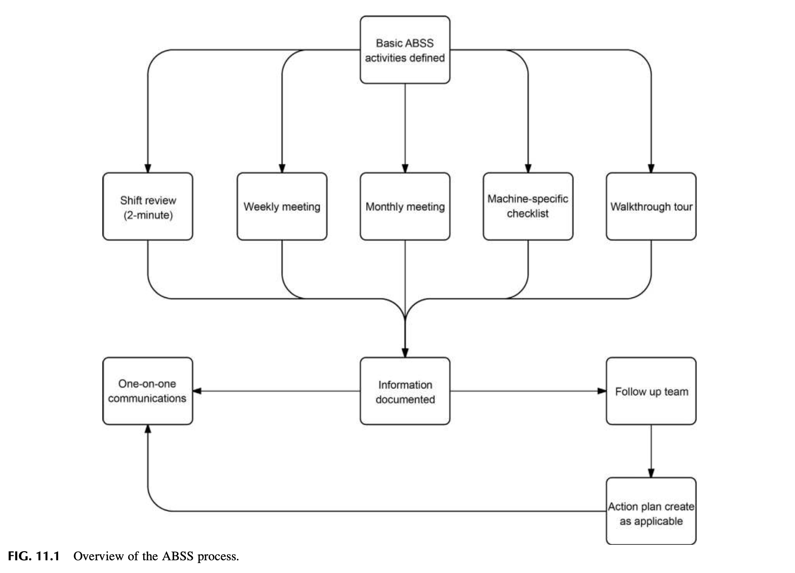
<!--  -->

### FIG. 11.1 Overview of the ABSS process.

---

<!-- [그림 11.2 스크린샷 삽입 위치] -->
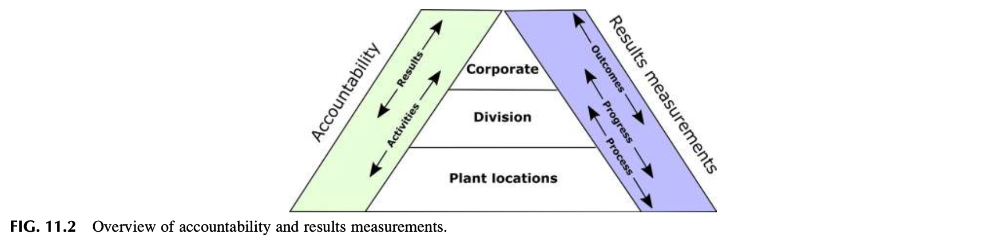
<!--  -->

### FIG. 11.2 Overview of accountability and results measurements.

---

## HOW ABSS WORKS

Many organizations already use various methods for meetings to convey a safety message. Unfortunately, leaders are not always knowledgeable on how to develop and present specific safety-related topics. The problem is that many organizations still use a “canned” scripted approach provided by predetermined topics for safety meetings. While these types of programs can be beneficial, this approach restricts members of the leadership team from using their creativity and personal expertise. A standardized script does not always consider the actual needs of the work activity and becomes a “one size fits all approach.”

 

> **Training Must Match the Application**—Training packages that include a written script, and sometimes a video, and are designed to solve safety problems are plentiful. In many cases, the trainer only conveys what is provided, reading a prepared script that may or may not apply to the specific working conditions. As a result, trainees recognize the information is not relevant and imparting the information becomes more difficult than it needs to be.  
> — *(Safety Culture in Nuclear Installations, 2002)*

---

## ABSS SYSTEM AND THE BASIC ELEMENTS

Not everything that counts can be counted, and not everything that can be counted counts.
Albert Einstein The elements of an ABSS system can be used to move past the scripted approach, allowing supervision to start using their personalized approach and creativity. The ABSS consist of the following elements:
* Employee meetings that consist of the following:
* Daily preshift reviews
* Weekly meetings
* Monthly meeting
* One-on-one discussions with individual employees.
* Area walk-through tours, housekeeping, hazard identification, life safety, and so on.
* Machine/equipment specific checklists.
* Follow-up teams.
* Performance metrics. Refer Appendix 11.2, for an example list of ABSS Duties, and responsibilities. Refer Appendix 11.3 an example of suggested ABSS metrics.

---

## SPECIFIC ACTIVITIES FOR LEADERSHIP

The ABSS begins by discussing and identifying immediate hazards, and associated risk concerning area-specific safety issues discussed daily.
* Refer Appendix 11.4 for a sample daily leadership team activity report, which can be modified for each Leadership team member.
* Appendix 11.5 sample daily preshift review review report.
* Appendix 11.6 for a sample weekly summary, leadership activity report. 

> *"Activities that comprise people’s jobs must then be consistently in alignment with the targeted results. This mindset can become part of the culture only if people understand the results they are supposed to achieve the job they are to perform."*  
> — *(Connors & Smith, 2004)*

 Each week, the supervision will report the results of activities performed during the week to the Safety Committee and the Leadership team. Leaders will ask to complete specific activities based on their role in the organization.

---

## SAFETY MEETINGS

For an organization to be successful in sustaining a safety culture, all areas of the organization should conduct specific types of safety training or coaching meetings. The perception of safety meetings and information applies to “others but not me,” should be removed. A safety culture provides a clear message for communicating to all employees that they have a defined role to play in the safety management system. All employees should understand the requirements and importance of safetyrelated issues in their organization.

An organization is essentially a network of individuals as graphically shown in organizational charts. Refer Chapter 3, Analyzing and Using Your Network, Fig. 3.1, for an Example Organizational Chart. Each work team or area of responsibility is more than just a box on an organizational chart. It is a network of individuals influenced by person-to-person and face-to-face communications that can be influenced by the behavior and communications of everyone in the organization. Refer Chapter 3, Analyzing and Using Your Network, Fig. 3.4 for an example of how the Lines of Connection from Six People or Nodes Potential affect the process.

The nature of any organization is complex and how information is moved through all levels of the organization is critical to the safety management system. The “Day-to-day feedback is important to ensure improved leader…performance” (Leadership development, field manual, 6-22, 2015) and provides insights into corrective actions necessary to reach its goals and objectives. 

> **Three Degrees of Influence Rule** (Christakis & Fowler, 2009):  
> *"Everything we do or say ripples through our network, having an impact on our friends (one degree), our friend’s friend (two degrees) and the friend’s friend’s friend (three degrees). This rule applies to a broad range of attitudes, feelings, and behaviors."*

 Safety meetings can be used to affect the “three degrees of influence”. Based on the need to expand influence, three types of meetings, as discussed have been found to be the most efficient, daily preshift reviews, weekly meetings, and monthly meetings. These meetings range from a free-form format to an agenda-driven meeting used to communicate specific safety-specific information directly with each workgroup.

The following discussion will provide an approach to why shift meetings are determined to be successful. Variations can be used to adjust to the working requirements and employee availability. The intent is to embed safety communication into the work environment using a tiered series of meetings to keep a high level of communication in place.

### DAILY PRESHIFT REVIEW

The daily preshift review, as the name implies, is a short, simple meeting held with each workgroup by their direct supervisor at the beginning of each shift. This meeting is only long enough to ensure all of those involved receive the required safety-related topic of the day. This meeting has been referred to as two-minute drills, toolbox talks, desktop, rally point, focus point, stand-down, and so on. Whatever the meeting is called, the name needs to be standardized in your organization, so employees immediately recognize its function and structure.

Refer Appendix 11.5 for a sample daily preshift review report.

### OBSERVATION 1

James noted how supervisors began improving after changing how the shift safety reviews were handled. Traditionally, the facility or the safety professional would complete the shift safety review and provide findings to the supervisor for use in safety meetings. It was found that this method indicated the shift or area leaders were not learning anything specific about the work area. Initially, when supervisors were asked why they were not creating their safety reviews, the typical response was, “I don’t know how.” When the question was asked, “What are your biggest safety issues in your area?,” the supervisors did not know. Once the ABSS was implemented, supervisors were better able to understand the specific hazards in their area of responsibility and an improvement in safety-related communications began.

It is essential that this preshift meeting is conducted each day. The meeting should be held at the same time and in the same area without fail for a sense of habit and responsibility to be established. The daily preshift meeting sets the stage for success before the day begins. Everyone begins work on the same page with the same safety message. It is a critical part of the safety process as it works directly to extend the safety influence of the supervisor through their network.

The beginning of a shift is when most employees have a fresh mind and can be better engaged in listening to the intended message. Other meetings held later in the day are not as effective, given fatigue as well as everyone has other work issues on their mind and have a tendency not to retain the message.

 

> *"You can’t improve a process until you can control it… and you can’t control it until you understand it."*  
> — Jim Hines, MIT *(US Coast Guard Leadership Development Center, 2014)*

 Safety meetings become more important during a crisis or when employees are under production pressures, as they provide a balance to the mind-set or desire to drop “safety” during a crisis. They may help in overcoming a willingness to take chances in the attempt to get back to a normal situation.

Not only is the leadership communicating with those in the meeting, but given the nature of networks, a magnifying effect occurs as each employee in turn influences and communicates with peers through their network. As employees talk to each other in break rooms, at lunch, friends off the job, and so on, the message continues to travel throughout the organization.

At the end of the preshift review, one question that should be asked of the group, “Is there anything preventing anyone here from working safely today?” The problem is that not all safety problems can be resolved in the preshift review. The intent is to get issues out in the open, so further discussions can be held. This simple question provides an avenue for employees to bring up other discussions that may affect the daily activities. The key is not to let this become a distraction from the original intent. For example, an employee might bring up a guard that is missing on a piece of equipment, someone might ask about a chemical they have had a problem, an area may have a ventilation issue, and so on.

After the preshift review, the employee who had a concern need to be approached with a one-on-one discussion to identify the issues at hand and an action plan developed for correcting any potential issues.

### LESSON LEARNED 1

James has experienced meetings using scripted presentations. For example,
* A supervisor was presenting to the group the topic of driving a fork truck and all the rules that applied. The problem: the employees in the group were not fork truck drivers; they were machine operators.
* A supervisor was presenting a canned topic on snow chain usage and how to drive in the snow. The problem: the facility was in a southern state where snow is rare. In either of these meetings, the employees, as a result, did not get much useful content about specific safety-related information and found the safety message to be a waste of time. In these cases, the safety message is driven in the wrong direction as the perception of safety meetings and content is not of value but just a mix of words that have to be conveyed. As previously discussed, the daily preshift meeting should be conducted daily at a specific time and place. It is important because it “frames” a positive employee mind-set at the beginning of work and reinforces channels of communication are in place and open. In “Great by Choice,” Collins and Hansen, call this the “20 Mile March.” In their words, “It’s about having concrete, precise, intelligent and rigorously pursued performance mechanism that keeps you on track” (Collins & Hansen, 2011)

### MULTISHIFT OPERATION

In multishift operations, before the preshift review, the supervisor leaving the previous shift should ensure safety or operational issues that may have occurred during the previous shift are provided to the oncoming shift. This may be verbal or a brief report, e-mail, or other communication. The shift handoff information would include concerns expressed by operators, staff-related issues, and status of equipment, reasons equipment has been “red-tagged” or taken offline, any abnormal condition, problems, or issues that remain a problem for the next shift.

### WEEKLY MEETINGS

Weekly meetings should also be conducted at a specific time and place. This meeting is more formal than the preshift review and sets the tone for the week’s safety agenda and brings closure to the past week’s efforts.

A typical weekly safety meeting last about fifteen to thirty minutes or until all the safety-related discussions have been addressed and completed. Due to the nature of the meeting, it may require more time to discuss new safety-related topics, the status of ongoing issues, recent injuries in other areas or facilities with similar exposures, or other changes in the organization. Other concerns can be addressed such as correcting erroneous rumors about injuries or workplace conditions that have occurred, and so on, during the week.

The weekly meeting can be used to recap and summarize the discussions from the daily preshift reviews in more detail to ensure no obstacles or miscommunications is in the way of moving toward and enhancing a positive safety culture.

Based on the safety meeting feedback from attendees, new hazards or increased risk-related problems or issues may have been identified. The leadership team should prioritize each issue by its potential risk severity and develop an action plan for reducing any loss potential. The action plan will outline the specific actions that will be taken, the person(s) responsible, and the completion date. By using the previous month’s insights drawn from the ABSS, the accuracy and completeness of safety action plans can be assessed and reinforced.

For planning and scheduling, three weekly meetings are held, and on the fourth week, a monthly formal meeting is held. Meeting should not be canceled or rescheduled as the intent is to make them a permanent part of the ongoing operational schedule.

### MONTHLY MEETINGS

Many organizations already use some form of monthly safety-related meetings. The ABSS continues the regular monthly meeting as they provide a platform for in-depth training or refresher training on organizational policies and procedures, protocols, guidelines, regulatory compliance, and so on. These meetings are more formal than the weekly meetings and vary in length or until all the safety activities have been completed.

The monthly meeting brings together a larger employee group providing a way of sharing a diverse set of ideas and perceptions. The important point is the monthly meeting should not be held “just to have a meeting”. Each monthly meeting will have an agenda developed stating the purpose and what will be covered. The monthly meeting could include outside speakers, members of the leadership team to provide an overview of the company performance, local emergency management agencies, and so on.

### ONE-ON-ONE DISCUSSIONS WITH EMPLOYEES

One-on-one discussions are not intended to trigger an adverse reaction or response from the supervisor. One-on-one talks are routine short discussions centered on safety concerns. These one-on-one discussions should not be held in the supervisor’s office where the employee may perceive the situation as awkward or intimidating. Such discussions should be conducted in the employee’s work environment where the employee may be more comfortable.

The “one-on-one discussion” is used as a direct face-to-face discussion with real-time feedback between the supervisor and each employee in the organization. The idea is to bypass group situations where employees will not speak up in meetings due to shyness, fear, mistrust, or other reasoning. By using a direct one-to-one approach, employees can privately discuss with their supervisor, the concerns about the information provided in the safety meetings that they would not bring up in front of their peers.

Supervision and employees can easily drift into an adversarial mode as traditional safety-related efforts typically only look for employee errors, production, or service-related issues. Given the hierarchy and structures of organizations, supervision may believe requesting or asking for employee feedback is a threat to their authority. This is the reason that the faceto-face, one-on-one meeting is important. According to George Robotham (as cited in Health and Safety Risk Management) “Research by Harvard professor T.J. Larkin suggests when communicating change with the workforce use the supervisor, not senior management, use face to face communications and frame communications relevant to the immediate work area and processes” (Robotham, 2014).

### OPPORTUNITIES FOR FACE-TO-FACE DISCUSSION

Face-to-face discussions provide opportunities for direct communication of concerns and enable the supervisor and employees to make a more personal contribution. These discussions provide opportunities for employees to make their suggestions directly to their supervisor. 

> *"People fail to get along because they fear each other; they fear each other because they don’t know each other; they don’t know each other because they have not communicated with each other."*  
> — *(Martin Luther King Jr., 2018)*

### SAFETY WALK-THROUGH TOUR

Safety inspections, observations, and walk-throughs are a core feature of safety management system elements. Unfortunately, walk-through tours can evolve or be perceived as a negative with fault-finding activities becoming adversarial between the leadership team and employees. Worksite inspections have been stressed as a core element of leadership since its beginning. Peters and Waterman updated the concept in their classic “In Search of Excellence,” as “management by wandering around” (Peters & Waterman, 2004). They stressed management should routinely get away from their office and desks and walk around reconnecting with the workplace. There comes a time when what is needed is not just rhetoric, but boots on the ground.
Baldwin Spencer The safety walk-through is an essential component of ABSS and is conducted as a joint effort by a diverse team consisting of supervision, a member of the leadership team, and employees as applicable.

The objective is to have a group that brings a variety of perceptions, backgrounds, expertise, and different points of view on the work environment. The participation of a member of the leadership team is to provide authority and awareness providing a presence to all employees that this effort is considered important and valuable to the organization.

By varying the time of the safety walk-through, the group can meet and talk to different employees and see the work environment under different conditions. In multishift or 7/24 operations, make sure all shifts have a walk-through as necessary.

The safety walk-through is completed during the typical workday or shift, once per month, and at the designated time built into the organizations planning function.

The safety walk-through should last no more than one hour in length and is not to be treated as a formal inspection. Rather, it is used as an awareness and observation activity allowing the group to interact with employees to identify concerns regarding hazards.

After this walk-through, any safety issues noted will require a risk assessment and a safety work order, assigned task, created for these issues to be resolved.

### MACHINE/EQUIPMENT-SPECIFIC CHECKLIST

The next component of ABSS is a Machine/Equipment/Process-Specific Checklist. This is a checklist used to focus on specifically identified safety issues for each piece of machinery and equipment in the organization. The checklist is developed and updated by the employee and supervisor who works with and around the specific equipment, with the input from the safety professional. The checklist is not to be overly detailed. It is suggested to be limited to approximately fifteen of the most important specific inherent hazards of machines or equipment under review. Refer Appendix 11.7 sample for an example operator general observations & machine/equipment-specific daily inspection checklist. For an overview (refer Fig. 11.3).

### OBSERVATION 2

The machine specific checklist was developed after a major incident was uncovered during an operation’s inspection program. In the paper process, a load turner is used to rotate a 6-foot stack of paper. The base consists of a 300-pound plate held in place by bolts. An incident occurred when the plate was in a raised position. Several bolts broke, weakening other bolts, causing the heavy plate to fall. After the incident investigation, a machine/equipment checklist was put in place to review the bolts in the unit to ensure that none were broken or missing. The initial list was developed through employee discussions which uncovered previously unknown hazards. Upon review of other similar equipment, further concerns were found. A machine equipment-specific checklist was developed for each piece of equipment, to reduce the potential for recurrence. Creating these checklists was a coordinated effort between the safety staff, supervisors, and employees.

This checklist was expanded to all types of equipment in each facility. The idea of this checklist is that each piece of equipment is checked each day, before starting operation and documented as to the results observed.

The checklist is not static and is considered a living document, as additional hazards are observed. The checklist is not intended to be a maintenance checklist, as it is to be a quick reference to ensure that the primary hazards are reviewed and controlled before the daily activities begin.

To effectively use this checklist, employees on each shift will review the machine or equipment before production begins, rate each checklist item using the risk guidance card, as discussed in Chapter 9, Defining Risk Perception.

---

<!-- [그림 11.3 스크린샷 삽입 위치] -->
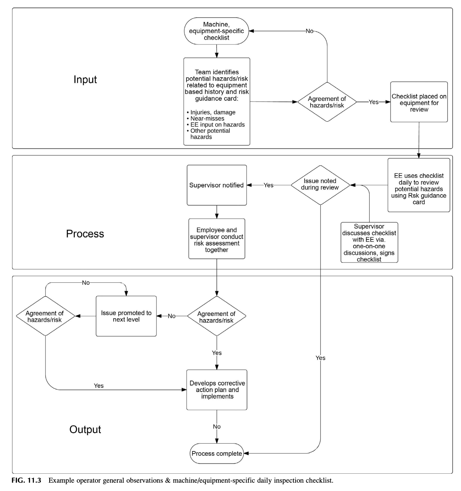
<!--  -->

### FIG. 11.3 Example operator general observations & machine/equipment-specific daily inspection checklist.

If the employee who reviews the checklist finds that an item is unacceptable, based on the risk guidance card, the supervisor is contacted, and a review is conducted by reviewing the machine or equipment.

Also, the completed checklist can be used as part of the one-on-one discussions with employees where the supervisor and employee will discuss elements on the list and validate the review is acceptable to both the employee and the supervisor. In reviewing the checklist as described before, and if there is a safety issue identified, an agreement needs to be reached between the employee and the supervisor as to the nature, type of the hazard, and the potential risk before the equipment can be put in operation.

As discussed in Chapter 9, Defining Risk Perception, if no agreement is reached, the next level of leadership is contacted and a second discussion begins. The intent of having these discussions is to reduce the potential and probability that employees will continue to operate machinery or equipment that is not functioning as intended and believing they have no alternative but to use the machinery or equipment in an unsafe condition.

An active safety culture reduces the acceptance of unnecessary risk, and the machine/equipment checklist provides an immediate discussion and correction.

### FOLLOW-UP TEAM

A follow-up team provides the important function of ensuring safety-related work order requests are discussed and completed promptly. This team should consist of a maintenance technician, several employees, and a supervisor depending on the number of work orders that are under review. Refer Chapter 8, Getting Employees Involved in the Safety Management System.

### OBSERVATION 3

A team was created by James to assess and identify hazards. This team was comprised of a manager, supervisor, maintenance technician, and production employees. The team was to talk with employees about potential or perceived safety hazards, establish corrective action priorities, and resolve as many issues as possible with their allotted funds. The employee reporting potential issues was a member of the team and was kept in the communication loop until the reported hazards were corrected based on input from the employee. If the team did not feel a hazard exists, the findings would be discussed with the employee for further insights followed by a team assessment of any further activities. The key is that the employee understands hazards better than anyone else, as they do the job day-in and day-out.

The process is established with the reporting employee and is identified if the issue is a real hazard with an associated risk. The reporting employee has the opportunity to either agree or not agree with the analysis. If there is an agreement between the team and the employee, then the work order is closed, and everyone signs off. If there is no agreement, the issue is further pursued until an agreement is reached. This program was a success because only real hazards associated with risk were identified and corrected. In the past, unsupported complaints about safety were used to have changes made even when it was not a viable hazard or associated risk. After this process had begun, safety was no longer used as a prop to get something done.

The previous observation demonstrates that employee involvement is necessary to promote awareness. Which means that the process allows employees and the follow up team to “own” the decision. Establishing a process to best provide timely and appropriate feedback is an essential part of determining why a potential hazard and risk are either corrected or not corrected, and actions are implemented.

In this situation, the follow-up team provides an unbiased review of each safety-related work order created, scheduled, and completed within a designated period, or that remains outstanding. The team is charged with reviewing all safetyrelated work orders, using the risk guidance card to establish a priority for corrective action or moving the request to the next level of decision makers.

The team is designed to break down barriers existing between production or services, maintenance, employees, and the leadership team. The team uses a “peer-to-peer” approach to ensure hazards and associated risks are assessed to close potential gaps in risk communication. By involving employees exposed to hazards and risk, the follow-up team ensures the submitted work order is valid, the reported hazard and associated risk are valid concerns that need correction. When the work order is completed, that is, corrections or repairs made, a member of the follow-up team reviews the changes with the employee who requested the work order. If the employee agrees to the corrective actions, the work order is signed off as completed and documented.

---

## ABSS ROLES AND RESPONSIBILITIES DEFINED

The following is an example overview of roles and responsibilities for each level of the organization and can be modified as necessary to fit the organization best (refer Fig. 11.4).

### SUPERVISOR

The Supervisor’s role is critical to presenting a common and consistent message to their area of responsibility. The supervisor documents the various activities of the ABSS process in a safety activity report. Supervisors will participate each week in the following safety activities:
* Develop and present daily shift reviews.

---

<!-- [그림 11.4 스크린샷 삽입 위치] -->
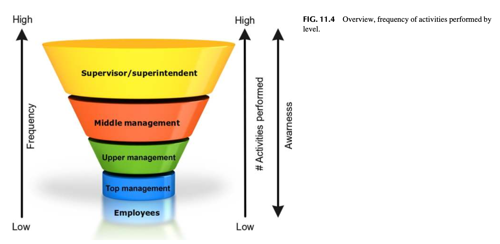
<!--  -->

### FIG. 11.4 Overview, frequency of activities performed by level.

* One-on-one discussions with employees.
* Reviewing machine/equipment-specific safety checklist.
* Coordinate with the follow-up team to correct safety-related issues.
* Participate each month in a safety walk-through.

### MIDDLE MANAGEMENT

Middle management should participate in safety-related activities for a minimum of the selected number of hours per month, as determined by the leadership team. Their involvement will reinforce the safety culture and promote an individual and department commitment to safety. These activities help create a positive safety environment and demonstrate leadership and commitment to safety. They will participate each month in the following safety activities:
* Attend at least one daily shift review.
* Contact at least five employees to conduct a one-on-one discussion with employees. They should participate quarterly in the following safety activities:
* Reviewing machine/equipment-specific safety checklist with operators.
* Safety walk-through tours.

### SENIOR LEADERSHIP

Senior leadership should participate in or conduct Safety Walk-Through Tours at a minimum of one time per quarter. All areas of their responsibility should be covered annually. They will participate each month in the following safety activities:
* Attend at least one daily shift review.
* Contact at least five employees to conduct one-on-one discussions. They will participate quarterly in the following safety activities:
* Reviewing machine/equipment-specific safety checklist with operators.
* Safety walk-through tours. Senior leadership should consider an “open-door” policy, schedule semiannual roundtable meetings with selected employees, conduct unannounced semiannual visits to designated areas to meet at random one-on-one with employees.

### SITE SAFETY PROFESSIONAL

Safety professionals are expected to participate each week in the following safety activities:
* Assist supervision in developing daily shift reviews, week and monthly safety meeting.
* Conduct at random five one-on-one discussions with employees.
* Conduct at random five machine/equipment-specific safety checklist.
* Coordinate with the follow-up team to correct safety-related issues.
* Assist supervision each month on safety walk-through tours. The Site Safety professional supports the ABSS process by providing safety-related materials, suggestions, and guidance to the leadership team. The primary responsibility is to be part of the leadership team, side by side assisting, advising, guiding, and supporting the team.

---

## TRAINING IDEAS AND CREATIVE APPROACHES

As part of a Six Sigma Project, James managed a study to provide specific information concerning the improvement of the work environment. The study was conducted to assess the potential use of Six Sigma methods to evaluate how to improve the retention of safety information. A joint leadership and employee team was established to conduct the project using selected Six Sigma tools. At the time, the use of quality control-based methods was still not readily accepted or considered viable. The idea was to determine if employees, including leadership and supervision, were able to recall and discuss specific risk information as presented in the daily preshift review. The review sessions were followed up by one-on-one discussions held during the day that the information was presented, after one week, and one month. The retention rate was not what was expected. The project included determining ways to improve the learning retention rates of employees about hand safety.

Hand Safety related to this six sigma project will be discussed in more detailed in Chapter 12 Using the Job Hazard Analysis.

A limited Six Sigma tool, Gage Repeatability, and Reproducibility (R&R) study (Gage R&R, 2017) was conducted using supervisors and employees who knew the production process. The study was conducted to determine if excessive variability existed in the measurement system. In this project, it was used to assess the potential for the use of Six Sigma tools in determining the variability of training instructions and materials given to employees and how effectively the information was retained.

The study indicated a significant gap existed between what the supervisors believed was being communicated and the retention rate of employees remembering the various discussions. The bottom line was that the desired safety message was not getting through to employees. This was based on an interview with selected employees after preshift meetings.

Training ideas and creative approaches can be found being used in a range of venues. For example, during a safety committee brainstorming session searching for ideas on how to improve Shift-Review Retention Effectiveness, a member of the six sigma team brought up the concept of “Blues Clues?” Most members were not familiar with the concept. This member explained that his kids had learned some behaviors using the methods taught through repetition that was presented by the cartoon “Blues Clues.” As a team listened to this member’s discussion, it started to make some sense of how the process of retention could be improved.

---

> What is “Blues Clues?” "Blue’s Clues” is a cartoon series developed for children, ages 3 to 5 years. Where “…researchers found that preschoolers have a longer attention span and a stronger need to interact with characters than previous shows like Sesame Street had provided)” (Tracy, 2002). “Blue’s Clues for Success provides eight clues to achieving phenomenal success, for example,…Mobilize the energy in your organization by turning your MISSION into a ‘mantra’ ... and Consciously manage your CULTURE the way you manage every other aspect of your business” (Tracy, 2002). “Too many of us have allowed our ‘childlike’ values to be programmed right out of us-and. As a result, too many companies are failing to live up to their full potential” (Tracy, 2002). The comment presented a challenge to the team by asking the question: What If we encouraged everyone to keep an open mind and just think about how training was currently being presented and the consistency of its message. The question was expanded to What if we made safety training simple where immediate results could be observed. A great take away concept from “Blues Clues” included the following statement, “If companies could harness the imagination and creativity of the” child within “their people, they would have no competition” (Tracy, 2002). Adults have different behaviors than children, but the process of learning is the same. Of importance is the understanding that we cannot provide one orientation or one session and expect long-term retention of information. Training programs have long stressed the need for understanding the employee learning curve and how important knowledge is forgotten in a short period.

---

### LESSON LEARNED 2

Based on the “Blues Clues” theory of repetition, the team realized, “the act of repeating, or doing, saying, or writing something again” (Repetition, 2018), could potentially build retention rates for employees. The team decided when specific identified at-risk behaviors were observed they would be discussed during the daily shift review to keep reinforcing the message. This message was incorporated into verbal and pictures (refer Table 11.1 and Figs. 11.5 and 11.6).

### TABLE 11.1 Communication Methods for the Project (Roughton, 2005)

<!-- [표 11.1 이미지 또는 표 확인] -->

| Method | Communication Method | Type of Visual Aids |
| :---: | :--- | :--- |
| **1** | Face-to-face discussion | No visuals aids (no picture or description of hazard provided) |
| **2** | No discussion | Visual aids provided with description of hazard only |
| **3** | No discussion | Visual aids provided with picture only, no description of hazard |
| **4** | Face-to-face discussion | Visual aids provided with picture and discussion of hazard |

---

<!-- [그림 11.5 스크린샷 삽입 위치] -->
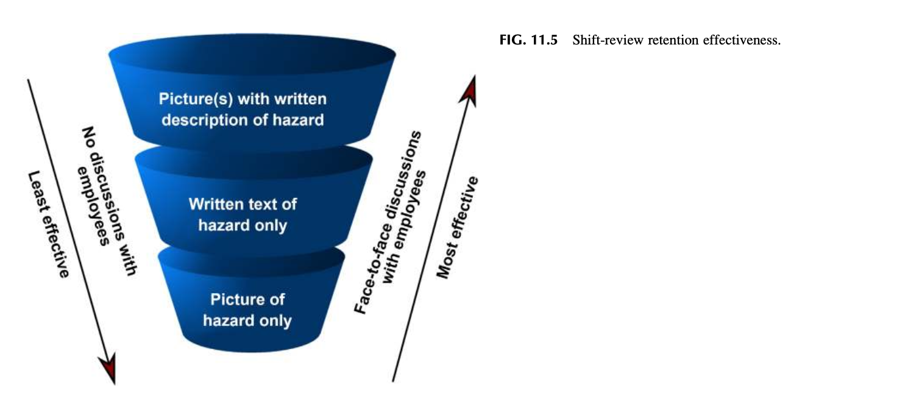
<!--  -->

### FIG. 11.5 Shift-review retention effectiveness.

---

<!-- [그림 11.6 스크린샷 삽입 위치] -->
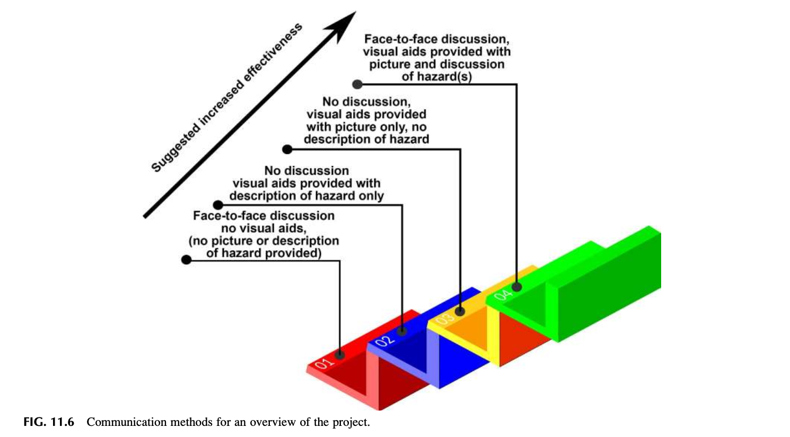
<!--  -->

### FIG. 11.6 Communication methods for an overview of the project.

---

## SHIFTING THE THOUGHT PROCESS TO RISK REDUCTION WITH EMPLOYEE RETENTION

The significant problems of our time cannot be solved by the same level of thinking that created them.
Albert Einstein

### DESIGN OF EXPERIMENT

A Design of Experiment (DOE) was used to determine the effectiveness of training. The project DOE studied a series of communication methods based on four training scenarios. Design of Experiments (DOE) is a Six Sigma technique used to determine the cause-and-effect relationship between factors affecting a process to find ways for optimizing the output of the process (Sundararajan, 2017).

An issue the team had to consider was how the current training program was designed. The research discovered that providing training on any topic requires considering the volume of content both sent and received by employees. The team found the design of the material is as important as its content.

Training material should be visually appealing to encourage employees to understand what the intent is to communicate. Comprehension of information requires an understanding of the skills and literacy of its audience and balanced use of content and illustrations to explain the text (Best practices for the development, delivery, and evaluation of susan harwood training grants, 2010). The project DOE led to questions on why the safety message was not being retained by employees. Different concepts were tested for communicating the desired safe behavior.

Supervisors were also asked to describe any at-risk behaviors they believed needed to be changed. The team found when risk identification was directed at carefully selected activities; it bought into view peripheral issues concerning high risk issues that should be addressed.

Studies have shown a 70% rate of understanding and retention of text-only materials. Text combined with illustrations and pictures increases to comprehension and retention to 95%. Individuals tend to follow instructions three times better with written text and images versus those that only communicate with only written text (Bladon, 2017; refer Table 11.1 and Figs. 11.5 and 11.6).

When the data was collected, the team recommended developing and implemented an enhanced shift-review process based on its findings. It was found that the best actions for improving information employee retention included a combination of verbal presentations, pictures with text during preshift reviews, and the follow-up from supervisor/employee during one-on-one discussions to verify the information was retained by the demonstration. Refer Table 11.1 for an overview of the communication methods for the project.

### OBSERVATION 4

People following directions with text and illustration do 323% better than people the following direction without illustrations. Dowse & Ehlers, 2005; Levie & Lentz, 1982) Humans are visual creatures, and we process visual data 60,000 times faster than text.…90% of information transmitted to the brain is visual. (The big challenge, 2018) We are incredible at remembering pictures. Hear a piece of information, and three days later you’ll remember 10% of it. Add a picture, and you’ll remember 65%. (Medina, 2017) Based on the results of the DOE, a second Gauge R&R study was conducted with the same employees using a modified training format. The results of the second Gauge R&R concluded that seventy-one percent of the employees could identify at-risk behaviors when the Supervisor gave information verbally with pictures, a 35% improvement from the first gauge study.

Specific training elements will be discussed in more detail in Chapter 13, Developing Safety Training Needs.

### LESSON LEARNED 3

It was further determined that the organization’s supervisor training did not address or include the fundamentals of one-onone communication. Supervisor training assumed a high-level overview of basic communication methods was adequate and consisted of, mostly “I read, and you listen.” Insights learned from the project included the following:
* A fundamental need exists for including direct experience in training by demonstrating the required safety-related behavior.
* Leadership, supervisors, employees, involved in training should change their behaviors if a process is to be improved. Improving training is not just an employee issue.
* The decision-making process should be data driven. By using a Six Sigma data collection and assessment process, the team gained insight into how training should include assessing methods of communication as well as training content.
* Properly designed training criteria can increase the retention of knowledge and improve skills necessary for improving control of workplace hazards. Any risk assessment is subject to the ’perception of risk’ in the eyes of the individual undertaking the risk assessment. While the information available to different individuals is the same, those individuals can perceive surprisingly different levels of risk. (Improving health, improving services (risk form assessment), 2012; Mishap prevention program, 2011)

---

## ESSENTIAL TIPS FOR USING ABSS

When viewed from the perspective of risk, limited or no feedback combined with a lack of immediate loss experience of many employees and leadership, the importance of control programs can be lost. The following are several tips for improving implementation and use of the ABSS:
* Listen and pay attention to what employees are saying. In many cases, the authors have found an employee may be providing valid insights, but leadership ignored what was being communicated. Part of the issue may be a defensive measure to shift responsibility, ego, or hidden agendas. One individual cannot have all the answers and by involving employees who directly perform a job or activity, insights can be gained on what works or should be modified to work correctly.
* Build time for employees’ feedback. Regular, one-on-one meetings with each employee are essential. These sessions are not to be considered part of the formal personnel review used by Human Resources. The intent is to reach out to those employees who best know the workplace and its ongoing potential for change.
* When having a one-on-one discussion with employees, maintain full attention with no distractions, that is, take the time to discuss safety, quality, and so on, and nothing else. Eliminate interruptions, no phone calls, e-mails, texting, and so on.
* Keep the message consistent with the desired value of the safety management system. Leadership and supervision should know their craft, understand the safety management system and its intended mission. A trusting relationship with employees allows for better personal decisions or at least better more informed decisions. If mixed messages have been sent concerning safety-related issues, a one-on-one discussion can help to correct this miscommunication.
* A tendency is only to approach an employee when something negative has happened, that is, “Why is the machine down?” “Why did you get hurt?”, “Didn’t you know better?” Both positive and negative feedback can be used. As employees are valuable problem-solvers because they are closest to the action and can provide valuable feedback, efforts must be made to keep the lines of communication open. An ongoing effort of simple, straightforward refresher training each day using the ABSS format should be a part of the ongoing Safety process.

---

## MEASURING THE ABSS PERFORMANCE

Safety performance and safety management system elements are of no benefit unless they are clearly and routinely communicated throughout the organization. 

> *"The majority of measures should be leading indicators that focus on proactive activities on the part of all employees—measures that track what people are doing daily to prevent accidents. With such measures in place, immediate and certain consequences can be engineered in to ensure those activities occur."*  
> — *(Judy Agnew & Aubrey Daniels, 2011)*

 

> *"It is often said that only those things that get measured, get done; and that, since only certain things can be measured, it is hardly a surprise when managers or organizations are assessed on short-term criteria."*  
> — *(Safety Culture in Nuclear Installations, 2002)*

 Various performance indicators can be used to measure the organization’s safety management system criteria. Specific assessments provide information on whether actions are being implemented as designed, assessing trends, or patterns related to those actions. Indicators provide information along with a time line of activities:
* Lagging. Measure outcomes after events have occurred. Loss-producing events are lagging indicators. Incident rates and loss analyses can provide trends and patterns of possible problems but do not necessarily predict future events or provide links to why events occur. They can be used to direct activities to areas of concern.
* Leading. Measures prevent conditions and activities which, if correctly implemented reduce the hazards and risks within an organization. The activities of the safety management system are leading indicators. Risk assessment is a type of leading indicator. These indicators are used to assess the potential of future performance and measure organizational “health” (Human performance tools for individuals, work teams, and management, 2009) Specific indicators offer insights on gaps in responsibility, for example, activities being skipped, thoroughness of reports, corrective actions effectiveness, and so on.

---

## TOOLS THAT SUPPORT AND ADD VALUE TO THE SAFETY PROCESS

A six sigma project can take on a life of its own and lead the project manager in many directions, as was discussed, regarding the training retention rates. At each juncture of the project, the project manager needs to stop, think, and decide if the discussions through the brainstorming sessions offer a better alternative to enhance the safety process. The problem is that, for example, in the hand laceration project, as the team was brainstorming ideas, there were several directions that were discussed that could relate to the original intent. In this example, the project needed to be expanded to enhance the safety management system based on some gaps noted in the system such as:
* Improvement in the incident investigation guidelines.
* Development of an incident information management system to include a “Grab N Go Kit” of selected forms (Create a Grab n Go-Kit & Effectively Manage Incidents, 2018).
* Developing an ergonomics awareness checklist to aid in managing alleged reports of soft tissue.
* Identifying of the appropriate Glove and Knife equipment and updated procedures. The glove and knife and procedures will be discussed in detail in Chapter 12, Using the Job Hazard Analysis.

### INCIDENT INVESTIGATION GUIDELINES

Changes in the type and scope of operational risks can increase the potential for all types of incidents. An essential element of the safety management system is the effective administration of incident investigations and the development of an incident management process. An investigation process addresses weaknesses found in the safety process and determines the necessary controls and actions needed to reduce overall loss potential. Leadership should be provided with an understanding of what creates the conditions leading to loss-producing events to structure the formal reports required for operational, legal, regulatory, and insurance purposes.

The intent of this section is not to provide a comprehensive incident investigation procedure. Incident investigation is too complicated a topic to be fully covered in this section. The information presented, provides a brief framework for a basic incident investigation guideline with references selected to aid in developing or improving an investigative process to support a safety culture.

At its core, active investigations incorporate the use of a structured problem-solving format. The investigation process should be designed to include an objective evaluation of all available facts, opinions, statements, and related information, the identification of the root cause(s), including behaviors, and actions to be taken to help prevent recurrence.

The incident investigation subcommittee as discussed in Chapter 8, Getting Employees Involved in the Safety Management System, will help to guide the process and establishing criteria for its continued improvement. Use of the subcommittee and involvement of senior leadership can reduce the potential for an organization not taking recommended corrective actions seriously or corrective actions not being implemented promptly. The potential for failure to implement corrective actions is well documented. The investigation examples as we discussed previously in Chapter 2, Analyzing the Organizational Culture, the two NASA space shuttle losses noted safety culture and safety management system concerns which remained uncorrected.

The US Department of Energy (DOE) notes, “The best metaphor for how accidents are investigated is a simple maze. If a group of people is asked to solve the maze as quickly as possible and the ‘winners’ are asked how they did it, invariably the answer will be that they worked it from the Finish to the Start.” (Accident and operational safety analysis, volume I:
Accident analysis techniques, 2012) The DOE further notes that “Like a maze, accident investigations look backward. What was uncertain for the people working forward through the maze becomes clear for the investigator looking backward.” (Accident and operational safety analysis, volume I: Accident analysis techniques, 2012; Course 702, effective accident investigation, the basics, 2017; refer Fig. 11.7). Refer Appendix 11.8, for an example basic incident investigation guideline framework.

---

<!-- [그림 11.7 스크린샷 삽입 위치] -->
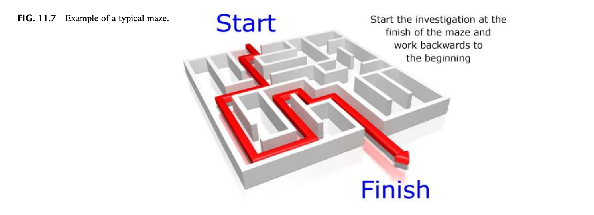
<!--  -->

### FIG. 11.7 Example of a typical maze.

### INCIDENT INFORMATION MANAGEMENT

The incident management criteria should be designed to identify the specific details and the circumstances leading to an incident and to gather information about what occurred. This information should be collected as soon as possible after any loss-producing event to ensure those involved are interviewed before memories fade as time passes. An important component of an investigation is to maintain open, trusted, and two-way communication with everyone involved. This can be accomplished by using an Injury Management Process Booklet.

### INJURY MANAGEMENT PROCESS BOOKLET

The purpose of an Injury Management Process Booklet is to create a “Grab N Go Kit” so that all of the documents that are needed to capture the details of an injury, beginning with the circumstances that led to the injury and all of the fact(s) of what occurred (Create a Grab n Go-Kit & Effectively Manage Incidents, 2018) This Grab N Go Kit will include specific guidelines for investigators and information on how the process will be followed by employees, the leadership team, and medical providers. The guidelines would provide for the investigation of all types of incidents such as property or equipment damage, employee injury, vehicle accidents, third-party injury or damage, product or services losses.

A sample incident management booklet is provided for reference only and should be modified to meet the needs of an organization. Refer Appendix11.9 for the procedure and forms that can be used to capture and control all of the information that is needed to document the Injury Management Process. This booklet is considered a living document and must be updated with any discussions with the employee, the medical provider, any member of the leadership team, Human Resources, and so on. The key is that the booklet will become a permanent part of an employee’s record with any changes in condition or challenges.

The information collected by this procedure must be accurate, as it can assist in identifying the root cause analysis and corrective actions of any event, as well as preventive steps that will be taken to prevent recurrence.

The order of completion of the documents is crucial, based on the nature of the incident. The goal is to apply problemsolving methods with comprehensive reports to leadership consistently. The documentation of an incident should be completed logically to ensure all required information is timely and appropriately captured.

Refer Fig. 11.8 for a Sample process for managing and controlling injuries. This basic flow diagram is a suggested format that can be modified based on the organizational requirements.

### OBSERVATION 5

Before implementing any Incident Management Process, ensure that all documents or forms developed are reviewed and approved by Senior Leadership, Legal, Risk Management, and Human Resources. The reason: Any loss-producing event can have significant operational, legal, or regulatory implications. The process should be devised not to violate any contractual or procedural documents. Different criteria and information may be required by each department to meet their specific needs.

---

<!-- [그림 11.8 스크린샷 삽입 위치] -->
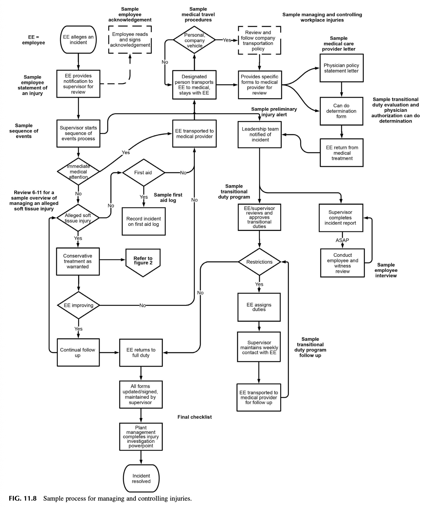
<!--  -->

### FIG. 11.8 Sample process for managing and controlling injuries.

Facts should be reported without regard to personalities, individual responsibilities, or actions, with bias removed as much as possible. Blame and fault finding should never be a part of the investigation process. Every effort should be made to align the information collected. The depth and scope of the investigative process will vary depending on the severity of the incident. Developing and maintaining a written incident management process will reduce the confusion that occurs with any crisis.

### OVERVIEW OF ALLEGED SOFT TISSUE INJURY

One of the most difficult types of alleged injuries to identify and control is related to “Soft Tissue Injuries.” Each time that this type of alleged injury is reported, a decision needs to be made when to transition from handling a simple report of discomfort and when to seek medical attention.

### OBSERVATION 6

To help resolve this type of injury the lessons learned regarding ergonomics can be utilized. “Ergonomics is the science of matching a job to a worker... The goal of ergonomics is to eliminate injuries associated with the overuse of muscles and tendons, generally known as musculoskeletal disorders or MSDs” (Easy ergonomics: A practical approach for improving the workplace, 2017; Ergonomics, n.d.; White, 2015).

An “Ergonomics Awareness Checklist” may not be the best method for addressing your particular workplace problem (Easy ergonomics: A practical approach for improving the workplace, 2017). But, a checklist is a good starting point, to help understand and resolve these types of soft issue injuries. The checklist can be used to help provide a basic awareness of potential Contributing Factors associated with specific tasks. Understanding the Contributing Factors will provide clues on how to make effective improvements (Easy ergonomics: A practical approach for improving the workplace, 2017; Vanichkachorn et al., 2014; White, 2015).

The “Easy ergonomics: a practical approach for improving the workplace” outline three steps:
1. Look for clues.
2. 3. Prioritize the tasks in each job. Observe the work (Easy ergonomics: A practical approach for improving the workplace, 2017; White, 2015). The key is to focus on prioritizing the tasks in each job as identified based on the checklist provided (Easy ergonomics: A practical approach for improving the workplace, 2017; White, 2015; refer Fig. 11.9 and Appendix 11.9, page 15 of the “Grab N Go Kit,” Ergonomics Awareness Checklist).

---

## SUMMARY

In the ideal safety culture system, the leadership team is regularly communicating and emphasizing their vision, the goals and objectives it believes are required for the organization to be successful. The advantage of the ABSS format is that it uses each supervisor’s experience and areas of responsibilities to build safety-related issues information for discussion with employees.

ABSS consist of the following elements:
* Enhancing better communication Methods through preshift reviews and one-on-one communication.
* Employee meetings (daily preshift reviews, weekly meetings, monthly meeting).
* One-on-one discussions with employees.
* Area walk-through tours (housekeeping, hunting for hazards, etc.).
* Machine/equipment-specific checklist.
* Follow-up team.
* Performance metrics. Interpersonal skills are needed for the ABSS to be successful. In many cases, an employee may be talking, trying to get a message through to leadership. One individual does not have all the answers to real or perceived problems and involving the person who directly performs the job can provide insights on what is needed to improve the work environment.

In Chapter 12, using the job hazard analysis, we will discuss how “Jobs” are defined, and individual activities, responsibilities, and authorities are necessary for the completion of tasks to meet specific goals and objectives. We will highlight how the Job Hazard Analysis (JHA) is an essential tool used to assess operational hazards and risks linked to jobs and task activities.

---

<!-- [그림 11.9 스크린샷 삽입 위치] -->
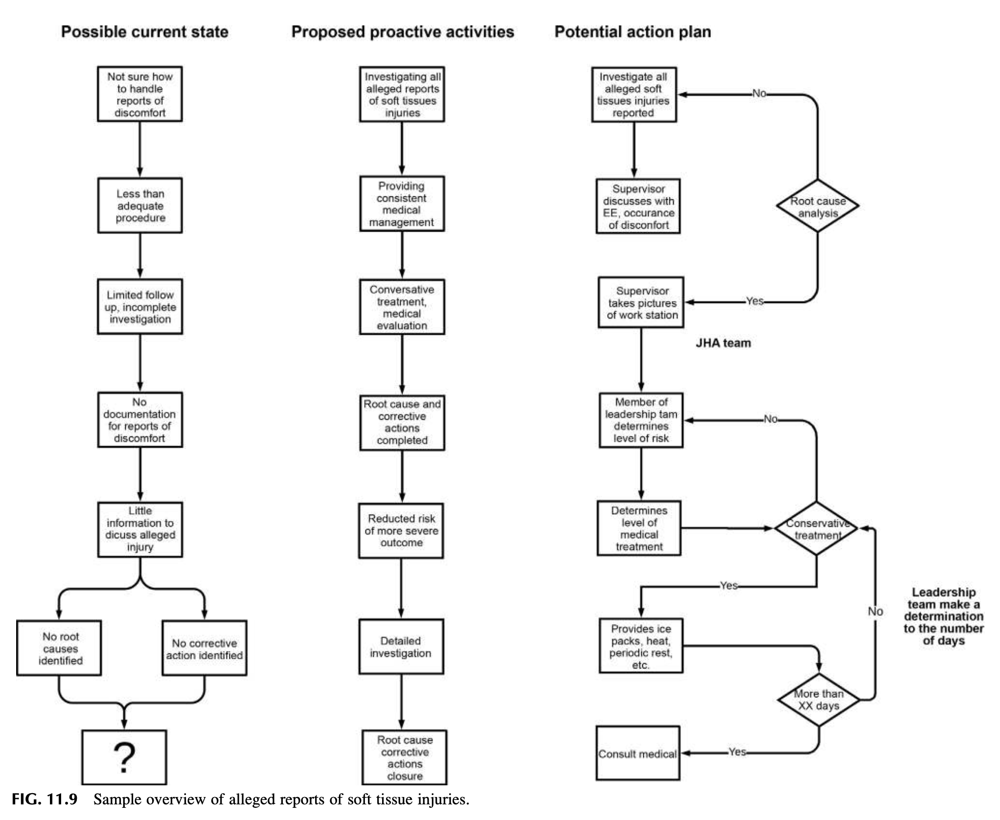
<!--  -->

### FIG. 11.9 Sample overview of alleged reports of soft tissue injuries.

The JHA is a vital part of the foundation for any successful safety management system. Hazard and Risk Control can only exist when leadership and employees have a full understanding of the types of hazards inherent in their jobs, steps, and tasks of required activities.

By implementing a JHA process throughout an organization, the leadership team and employees gain an in-depth understanding of task-specific hazards and associated risks. Hazards and associated risks can only be identified and controlled through the use of an ongoing comprehensive assessment process.

The JHA process adds value by improving the safety culture through identifying hazard and risk controls at the job level.

A JHA process strategy provides the administrative structure, time, and budget for recommended hazards and associated risk controls.

---

## CHAPTER REVIEW QUESTIONS

1. Define the use of the activity-based safety system.
2. Explain ways to communicate with specific levels of the organization.
3. Define daily shift reviews, weekly, and monthly meetings.
4. Explain the importance of one-on-one discussions with employees.
5. Explain the benefits of safety walk-through tours.
6. Explain the concept behind the implementation of a machine/equipment-specific safety checklist.
7. Define how to use a follow-up team to correct safety-related issues.
8. Define the roles of the various levels of the leadership team.
9. Define and explain the difference between the daily preshift review and the regular weekly safety meeting.
10. Why is the multishift operation important?
11. Explain why different levels of the leadership difference Responsibilities Defined in the ABSS system have.

---

---

## APPENDIX 11.1 SAMPLE ACCOUNTABILITY AND RESULTS MEASUREMENTS

A list of activities and measurements need to be defined to develop an effective ABSS process. The idea is to use specific activities and measurements that fit the organization. Developing the process may take some time to hone in and determine the most relevant activities and measurements which appropriately promote the safety culture efforts. The following is a DRAFT suggested list of activities that will need to be defined to fit each organization:

### 1. The Leadership Team

The Leadership Team needs to visually demonstrate support for the safety culture efforts by establishing goal-setting activities and objectives based on operational procedures and the employee perception of credibility. This will be accomplished by defining the number of activities and the percentage accomplished:

**The number of:**
* Times the leadership participates in preshift safety meetings.
* Physical hazard inspections with leadership involvement.
* Times safety action plans are reviewed with employees.
* Safety-related walk-throughs conducted with employees.
* Safety goals identified in performance reviews.
* Safety goals that are met on schedule.
* Times that communication has been provided to employees on the status of corrective actions completed.

**The percentage of:**
* Actions completed in the Safety Action Plan.
* Projects discussed with predesign safety review team.
* Employees and members of the leadership team involved in the goal-setting process.
* Loss-producing reports reviewed by members of the leadership team.
* Managers with specific Safety roles.
* Employees who can state organization safety goals and objectives.
* Timely feedback provided to employees on safety suggestions, corrective actions, and so on.
* Safety suggestions acted upon.
* Ratio of safety suggestions implemented versus submitted.

### 2. Employee Involvement

Each employee must be tracked using “meaningful” safety-related activities. The intent is to identify the level of involvement of each employee in the safety management system. An ideal safety culture will allow employees to be involved in various safety-related activities. Employees are not expected to be involved in every safety-related activity, but should have safety assignments based on their skills and experience.

**An example of activities will be accomplished by defining the number of:**
* Hazard surveys conducted and reviewed.
* Investigations reviewed.
* Standard operating procedures reviewed.
* Job hazard analyses (JHA) completed.
* Safety committee meetings attended.
* Preshift reviews conducted.
* Times safety meetings are led or presentations made.
* Objectives of action plan controlled by employees.

*(For example, if an employee is assigned or volunteering to do hazard surveys, how many were completed in the desired period? If not completed, what were the circumstances that prevented completion?)*

### 3. Hazard Recognition & Control

Hazard Recognition and Control activities should track leadership and employee involvement using elements of the safety management system, the number of activities, and the percentage accomplished:

**The number of:**
* New products/processes analyzed utilizing a hazard identification method.
* Hazard inspections performed.
* Hazards identified from the inspections.
* Time elapsed between hazard identification and abatement completion.

**The percentage of:**
* Employees involved in hazard identification.
* Employees trained in hazard recognition techniques.
* Employees involved in hazard correction.
* Hazards assessed for severity using the Risk Guidance Card.
* Hazards corrected promptly (timeliness is defined).
* Physical hazards that have been identified, but have not been corrected.
* Tasks that have a job hazard analysis completed, developed/reviewed/revised vs. expected.

### 4. Education & Training

**The number of:**
* Employees receiving new employee orientation training.
* Employees receiving annual refresher job safety training.
* Employees relocated/transferred receiving refresher/area-specific safety training.
* Employees trained in incident investigation.
* Employees trained divided by the total number required to be trained.

**The percentage of:**
* Employees receiving new employee orientation training.
* Employees receiving annual refresher job safety training.
* Employees relocated/transferred receiving refresher/area-specific safety training.
* Safety training performed and documented correctly.

---

## APPENDIX 11.2 EXAMPLE LIST OF ABSS DUTIES AND RESPONSIBILITIES

ABSS addresses fundamental issues through the assignment of responsibilities for specific activities at all levels of leadership. This appendix provides suggestions for performance measurement activities:

### 1. Leadership Members Core Performance Activities

1. **Attendance**:
   * Attend safety committee meetings to present a monthly safety report.
   * Attend weekly shift safety meetings and review facility safety performance.
2. **Incident investigation and reporting**:
   * Review all incident reports weekly to ensure quality and identification of appropriate corrective and preventive actions.
   * Follow-up with department managers weekly to ensure completion of corrective and preventive actions.
3. **Workplace inspections**:
   * Review inspection reports monthly to identify trends, repeat items, and ensure completion of appropriate corrective and preventive actions.
4. **Training activities**:
   * Review incident reports, area inspections, and other ABSS safety information to identify trends and recommend training.
   * Work with Human Resources to revise new employee orientation and onboarding, ensuring adequate time and resources allocated for safety training.
   * Attend a minimum of 2 safety training courses annually.
5. **Ergonomic job observations and personal safety contacts**:
   * Perform job observations with department managers and ergonomics specialists, providing constructive feedback to employees.
   * Document all job observations per process standards.
6. **Safety culture**:
   * Become safety advocates through continuous demonstration of commitment to safety improvement and the promotion of a positive safety environment.
   * Support managers and supervisors on their safety improvement initiatives.
   * Organize and participate actively in all safety promotions.
   * Monitor safety recognition and rewards.
   * Work with HR to revise the employee evaluation process to measure safety accountabilities and reward safety contributions.

### 2. Safety Committee Suggested Activities

The Safety Committee provides oversight of ABSS by ensuring collected data is accurate and consistently applied by:
* Reviewing facility safety performance monthly and discussing the status of Leadership accountability with team members.
* Inviting subcommittee members to present their specific accomplishments.
* Suggesting recommendations for improving gaps in safety performance and initiating coaching or corrective actions to ensure ABSS functions effectively.
* Ensuring individual accountability is maintained and updated in performance reviews (demonstrated commitment to safety, support of direct reports' safety performance).
* Appointing Ad Hoc Subcommittees (JHA Committee, Ergonomic Committee, Follow-up Committee, etc.).

### 3. Department Managers Suggested Activities

1. **Weekly Safety Report**: Summarize weekly safety accountabilities and submit report to safety professional and senior management (daily safety warm-ups, incident investigations, area inspections, personal contacts, training, committee participation).
2. **Department inspections**: Perform weekly department inspections, report observed behaviors/conditions, evaluate hazard frequency/severity/probability, and track safety work orders.
3. **Safety Preshift reviews (Safety Huddles / 2-Minute Drills)**: Conduct short daily preshift safety reviews emphasizing current safety issues and area-specific hazards.
4. **Personal Safety Contacts (1-on-1)**: Perform a minimum of 2–3 daily contacts per shift focusing on employee safety accountabilities, safe/at-risk behaviors, recognizing and reinforcing safe practices.
5. **Safety training**: Identify department training needs, coordinate with safety staff, and ensure timely completion.
6. **Meetings**: Attend monthly safety meetings, monthly safety committee meetings, and quarterly management safety reviews.
7. **Safety culture**: Identify at least 3 activities per week demonstrating commitment to safety improvement.

### 4. Shift Supervisors / Shift Leader Suggested Activities

* **Hourly Employee Safety Accountabilities**: Establish individual accountability for all direct reports through positive reinforcement, coaching, and hazard reporting promotion.
* **Incident Investigation and Reporting**: Complete investigation reports for all assigned injuries occurring during the shift; submit report by shift end; conduct root cause analysis (RCA) and close action plans.
* **Safety Training**: Complete hazard awareness training for all new/transferred employees and review facility safety rules.
* **Shift Safety Reviews**: Conduct daily short reviews before shift starts.
* **Personal Safety Contacts & Spot Observations**: Perform 2–3 spot observations per shift (unplanned, quick observation to reinforce safe behavior or coach at-risk behavior). Ensure positive contacts equal or exceed disciplinary actions.
* **Area Observations**: Perform minimum 1 planned area observation (5–10 minutes) per shift against facility standards.
* **Meetings & Reporting**: Attend shift safety meetings and submit weekly reporting forms every Monday.

---

## APPENDIX 11.3 EXAMPLE OF SUGGESTED ABSS METRICS

<!-- [부록 11.3 스크린샷: 추천 ABSS 성과지표 매트릭스] -->

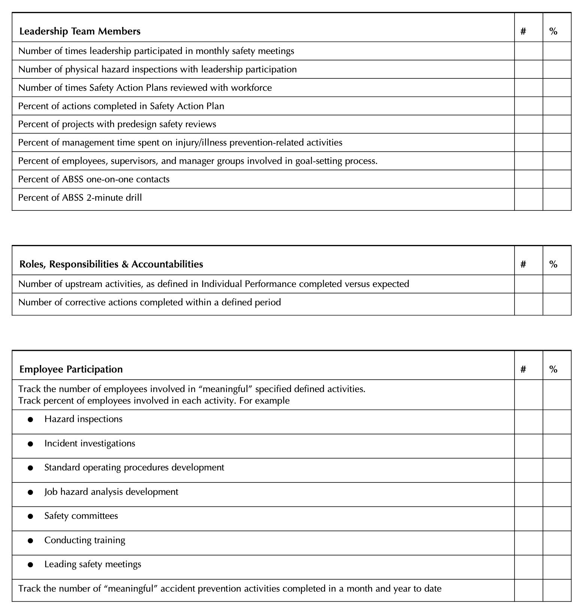

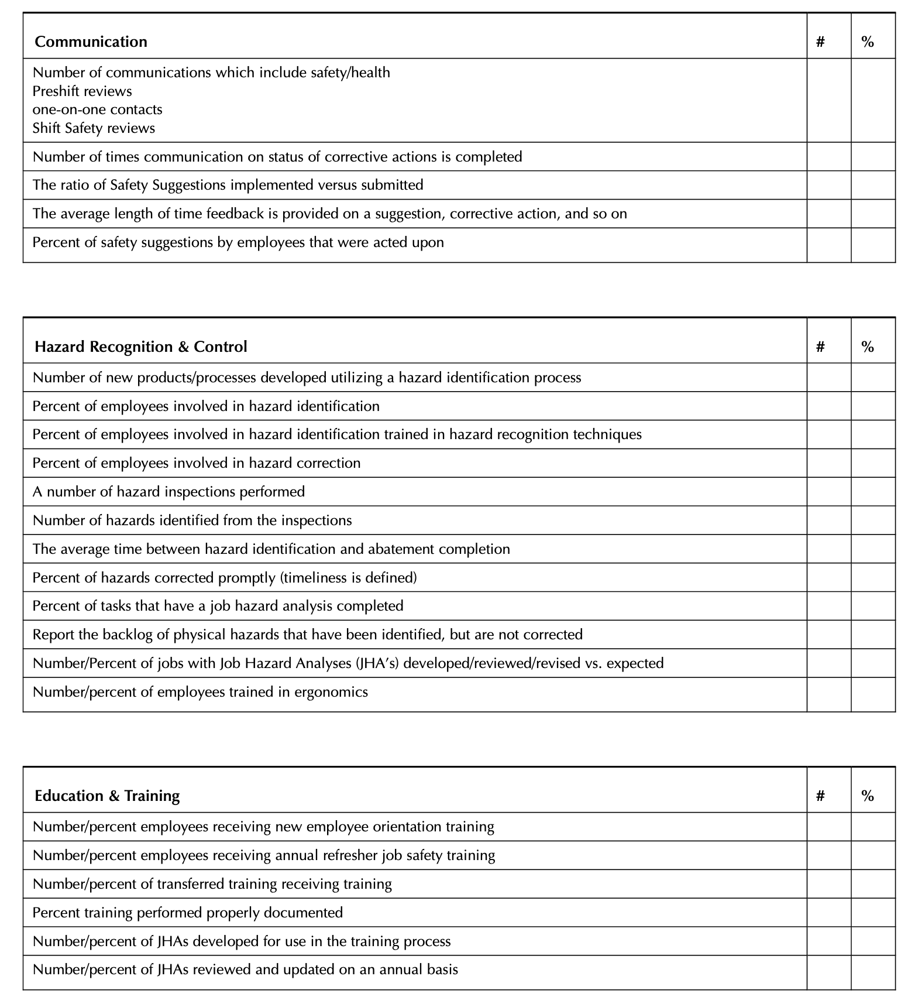

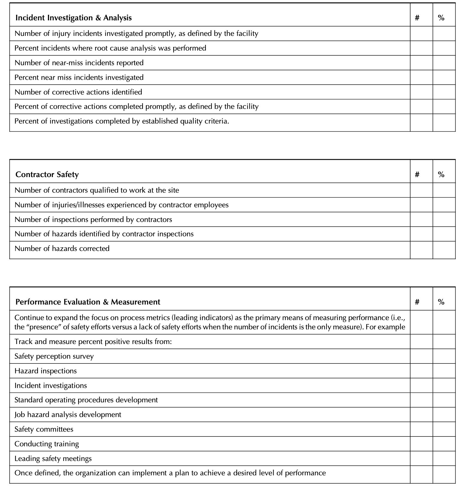

---

## APPENDIX 11.4 SAMPLE DAILY LEADERSHIP TEAM ACTIVITY REPORT

<!-- [부록 11.4 스크린샷: 일일 리더십팀 활동 보고서 서식] -->

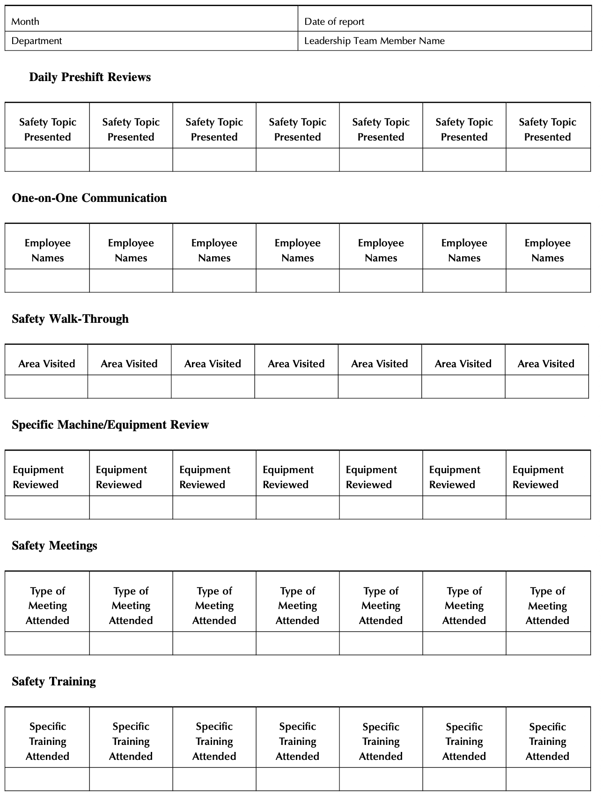

---

## APPENDIX 11.5 SAMPLE DAILY PRESHIFT REVIEWS REPORT

<!-- [부록 11.5 스크린샷: 작업 전 안전브리핑(Preshift Review) 일일 보고서 서식] -->

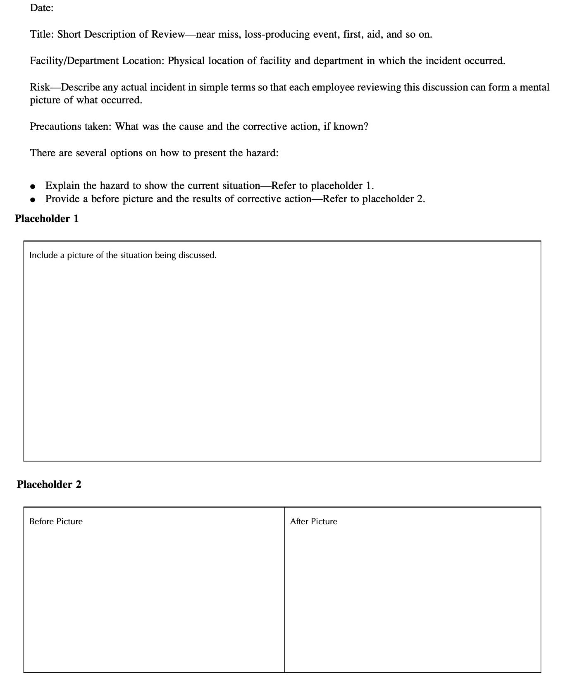

---

## APPENDIX 11.6 SAMPLE WEEKLY SUMMARY, LEADERSHIP ACTIVITY REPORT

<!-- [부록 11.6 스크린샷: 주간 리더십 활동 요약 보고서 서식] -->

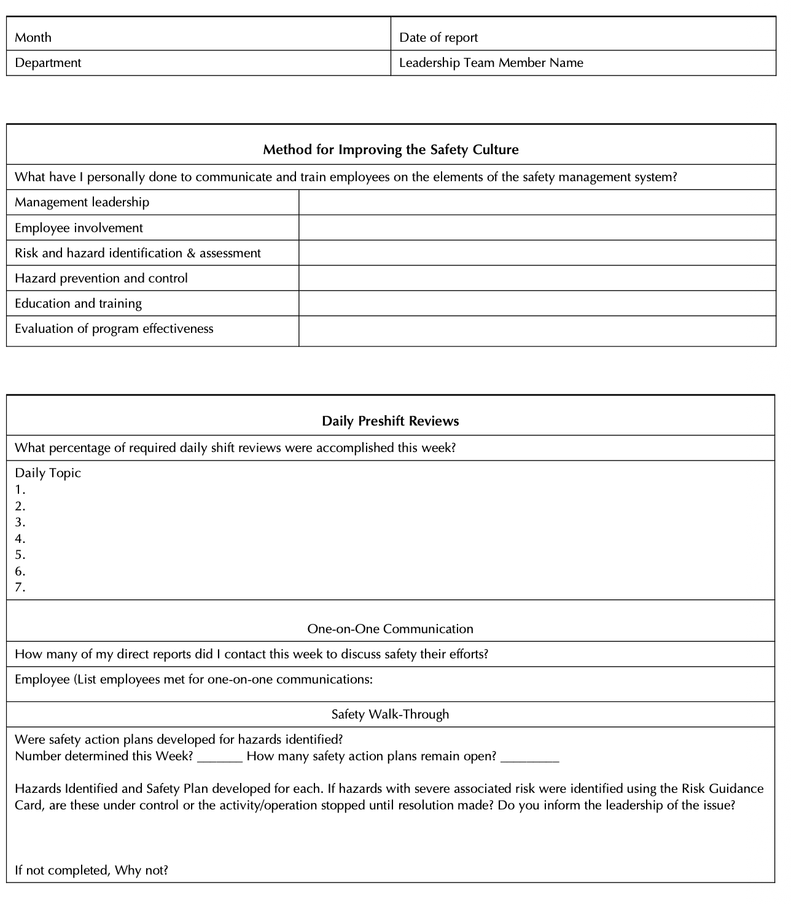

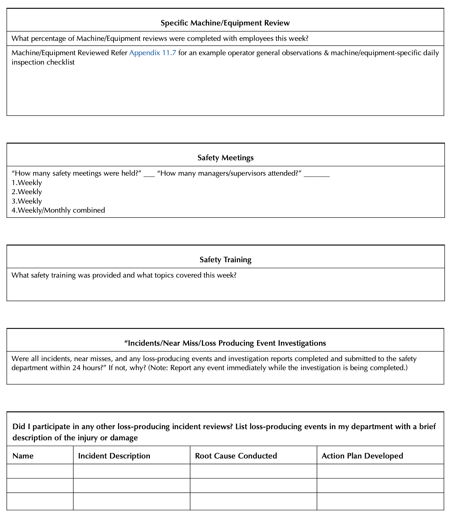

---

## APPENDIX 11.7 SAMPLE OPERATOR GENERAL OBSERVATIONS & MACHINE/EQUIPMENT-SPECIFIC DAILY INSPECTION CHECKLIST
*(Customize this checklist for each type of machine and equipment)*

<!-- [부록 11.7 스크린샷: 작업자 일반 관찰 및 기계·설비별 일일 점검 체크리스트] -->

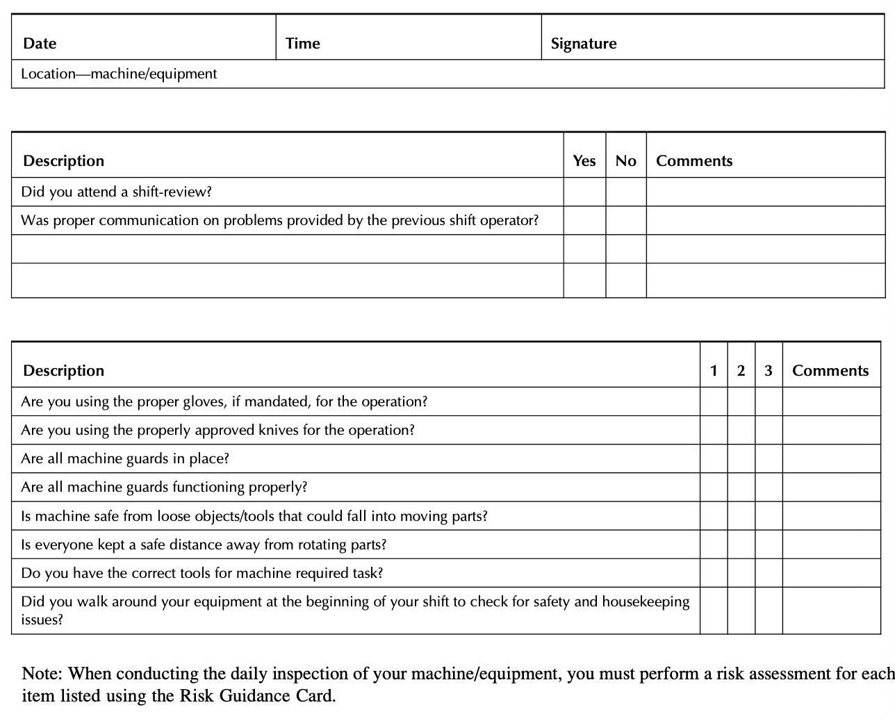

---

## APPENDIX 11.8 EXAMPLE BASIC INCIDENT INVESTIGATION GUIDELINES FRAMEWORK

The information presented in this Example Basic Incident Investigation Guidelines is for informational purposes only and is not a substitute for provisions of OSHA or any governmental regulatory agency. To develop an effective Incident Investigation process, consult OSHA and relevant industry standards.

To provide consistency, this guideline utilizes the **“Injury Management Process Booklet” (Grab N Go Kit)** with example forms presented in Appendix 11.9.

### 1. Introduction and Core Purpose

Effective and prompt investigation of incidents is an integral part of a successful safety management system. Investigations should be directed at identifying underlying systemic factors (root causes) and corrective measures to prevent recurrence. Findings must be shared with affected employees to maximize organizational learning.

> [!IMPORTANT]
> Investigators have a strong tendency to draw conclusions based on educated guesses, intuitive judgment, or "common sense" instead of valid rules of logic. Investigations must be a conscientious examination of **ALL the facts**, free from blame, fault-finding, hearsay, or personal bias.

**Key Definitions:**
* **Near Miss**: An unplanned sequence of events that could reasonably have resulted in undesirable consequences but did not.
* **Loss-producing Event (Incident)**: An unplanned sequence of events resulting in, or having the potential for, injury, illness, or property damage.
* **Root Cause**: The most basic cause(s) that can reasonably be identified, that leadership has control to fix, and for which effective recommendations for preventing recurrence can be generated.

### 2. Responsibilities and Timing of Investigation

* **Immediate Supervisor**: Responsible for initiating the prompt investigation by the end of the shift, or no later than 24 hours after the incident was reported.
* **Joint Investigation Team**: For serious loss-producing events, establish a team led by a trained investigator, including the Production Manager, Maintenance Superintendent, Safety Professional, and Safety Committee representatives.
* **Promptness**: Scene evaluation, physical evidence preservation, and witness statements must occur immediately before conditions change or memories fade. In serious incidents, photographs of the scene should be taken before releasing the area.

### 3. Interviewing Injured Employees and Witnesses

* **Injured Employees**: Explain that the purpose is to prevent recurrence, NOT to place blame. Establish what happened and what the employee was doing before asking why. Complete the *Employee First Report of an Injury*.
* **Witnesses**: Interview promptly, individually (in private, avoiding intimidating desk setups), and informally. Ask open-ended questions (*"Tell me what you saw"*), let the witness proceed at their own pace, and never use leading or intimidating questions.
* **Reenacting Accidents**: Demonstrate what occurred only with extreme caution so the reenactment itself does not cause another injury.

### 4. Incident Tree Root Cause Analysis & Contributing Factors

---

### TABLE 11.2 Procedure for Completing Incident Tree Method—Getting to the Root Cause (Accident analysis report, n.d.)

<!-- [표 11.2 이미지: 인시던트 트리 작성 절차] -->

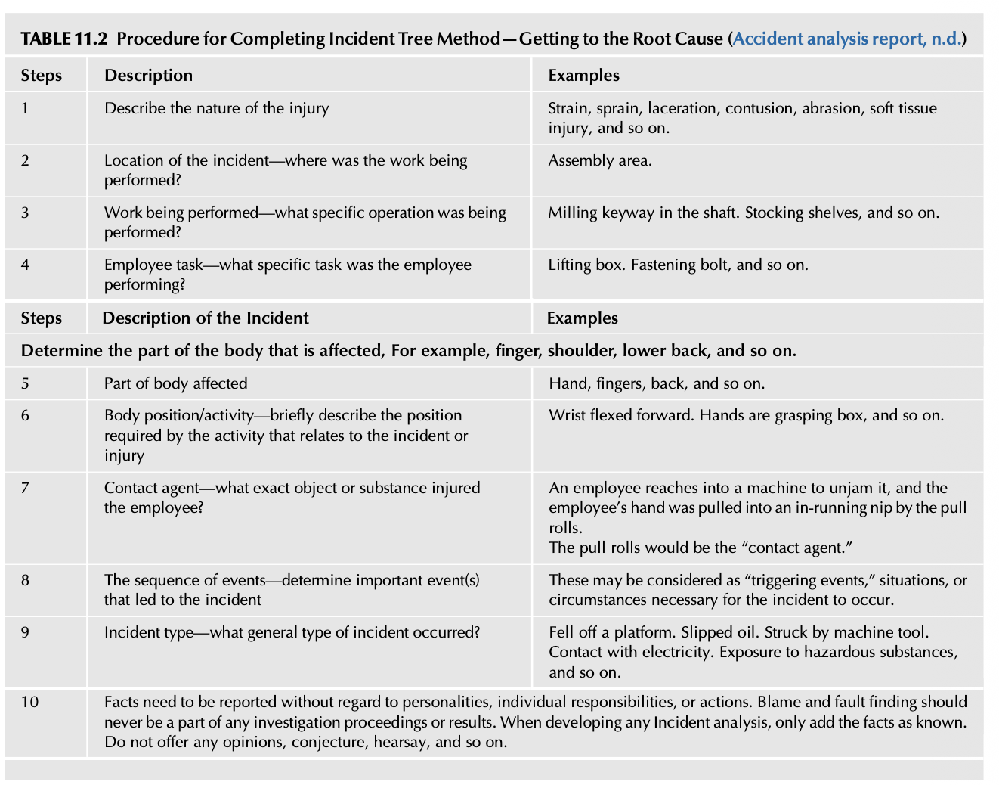

---

### TABLE 11.3 Analysis of Contributing Factors

<!-- [표 11.3 이미지: 기여 요인 분석표] -->

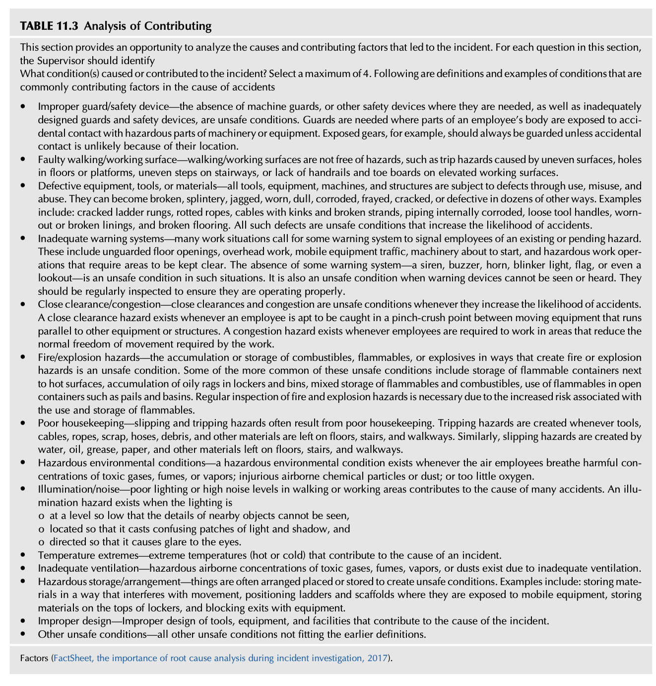

---

### TABLE 11.4 What Action(S) Caused or Contributed to the Incident?

<!-- [표 11.4 이미지: 사고 유발/기여 행동 분석표] -->

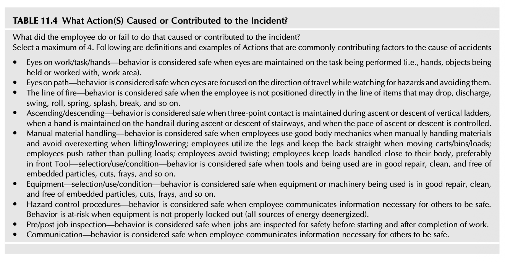

---

### TABLE 11.5 Injury Information—Incident Type (Hazard recognition, 2018)

<!-- [표 11.5 이미지: 재해 형태 및 사고 유형 분류표] -->

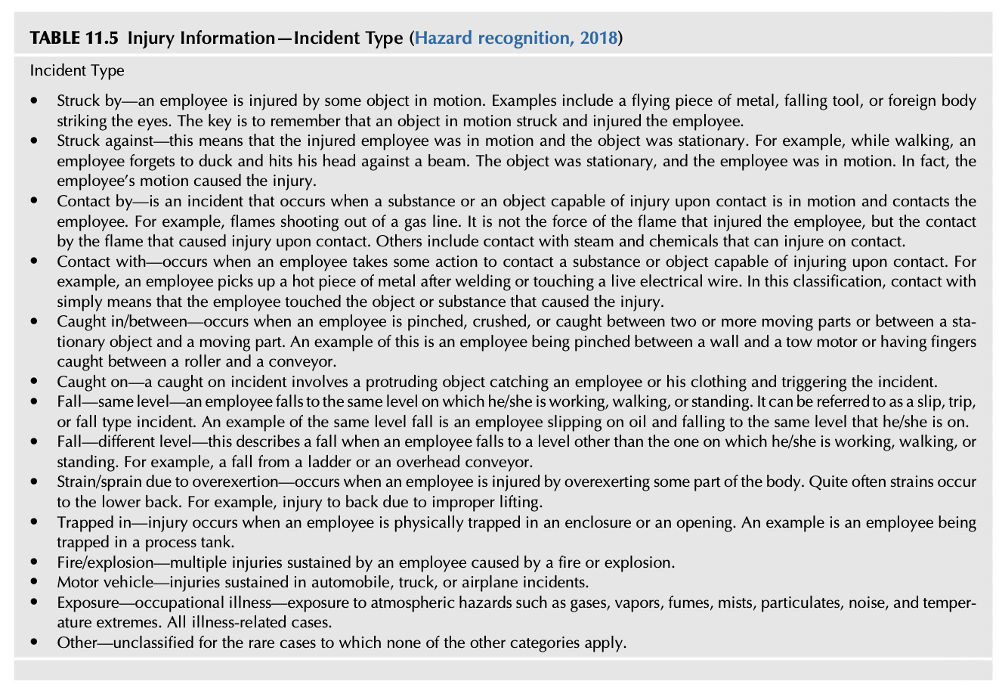

**Key Incident Type Classifications:**
* **Struck by**: Injured by an object in motion (e.g., flying metal fragment, falling tool).
* **Struck against**: Employee in motion strikes a stationary object (e.g., bumping head against an overhead beam).
* **Contact by**: Contacted by a moving hazardous substance/energy (e.g., chemical splash, steam leak, flames).
* **Contact with**: Employee initiates contact with a hazardous object (e.g., touching a hot surface or live electrical wire).
* **Caught in/between**: Pinched, crushed, or trapped between moving parts or between a moving part and a fixed object.
* **Caught on**: Protruding object catches employee clothing or body part, triggering the incident.
* **Fall (same level)**: Slip, trip, or fall occurring on the working surface.
* **Fall (different level)**: Falling from an elevated surface (ladder, platform, stairs, scaffold).
* **Strain/sprain due to overexertion**: Injury caused by excessive physical force or improper lifting (most frequently lower back).
* **Trapped in**: Physically trapped inside an enclosure, vessel, or trench.
* **Fire/explosion**: Thermal or blast injuries resulting from rapid combustion.
* **Motor vehicle**: Collisions involving automobiles, powered industrial trucks, or mobile equipment.
* **Exposure (Occupational illness)**: Health damage from atmospheric contaminants, noise, vibration, or radiation.

### 5. Corrective Actions and Quality Review

* **Action Criteria**: Every root cause must have at least one measurable, feasible corrective action with designated ownership and completion deadlines.
* **Quality Review Checklist**: Evaluate report timeliness (within 24 hours), completeness of sequence of events, depth of 5-Why analysis, appropriateness of preventive actions, and sign-offs from senior management.

---

## APPENDIX 11.9 INJURY MANAGEMENT PROCESS BOOKLET ("Grab N Go Kit")

The purpose of the **Injury Management Process Booklet ("Grab N Go Kit")** is to organize all required forms and procedures into a single, standardized packet so that any loss-producing event or injury can be handled systematically, professionally, and without delay.

### Overview of Grab N Go Kit Forms and Review Responsibilities

| Page # | Form / Procedure Name | Employee | Supervisor | Leadership Team | Safety Pro | Medical Provider |
| :---: | :--- | :---: | :---: | :---: | :---: | :---: |
| **0** | Initial Injury Prevention Checklist (Front Cover) | - | **X** | **X** | **X** | - |
| **1** | Employee Acknowledgment of Reporting and Managing an Injury | **X** | **X** | - | **X** | - |
| **2** | Employee Statement of First Report of an Injury | **X** | **X** | **X** | **X** | - |
| **3** | Supervisor Initial Statement | - | **X** | **X** | **X** | - |
| **4** | Medical Care Provider Letter | - | **X** | **X** | **X** | **X** |
| **5** | Basic Job Description | - | **X** | **X** | **X** | **X** |
| **6** | Transitional Duty Evaluation & Physician Authorization ("Can Do") | - | **X** | **X** | **X** | **X** |
| **7** | Travel Policy & Transportation Procedure | - | **X** | **X** | **X** | - |
| **8** | Preliminary Injury Alert | - | **X** | **X** | **X** | - |
| **9** | Transitional Duty Program Notification | **X** | **X** | **X** | **X** | **X** |
| **10** | Transitional Duty Program Follow-Up | **X** | **X** | **X** | **X** | - |
| **11** | Sequence of Events (Timeline) | - | **X** | **X** | **X** | - |
| **12** | First Aid Log | - | **X** | **X** | **X** | - |
| **13** | Witness Statement of Facts | - | **X** | **X** | **X** | - |
| **14** | Employee Interview Form | **X** | **X** | **X** | **X** | - |
| **15** | Ergonomics Awareness Checklist (Soft Tissue Injury) | - | **X** | **X** | **X** | - |
| **16** | Sample Injury Reporting Presentation | - | **X** | **X** | **X** | - |

---

### [Form Page 0] Initial Injury Management Checklist (Front Cover)
<!-- [서식 스크린샷 위치: image-xxx.png] -->

* **목적**: 부상 접수 시 누락 없이 모든 관련 서류와 초기 정보(피해자 인적사항, 부상 일시, 장비, 근무시간 등)를 일괄 확인·통제하는 표지 체크리스트.
* **실무 팁 (Lesson Learned 3)**: 각 부상 건마다 반드시 독립된 1개의 북클릿을 부여하여 관리해야 하며, 서류 누락 시 보상 관리 및 재발 방지 체계 전체가 무력화됩니다.

---

### [Form Page 1] Sample Employee Acknowledgment of Reporting and Managing an Injury
<!-- [서식 스크린샷 위치: image-xxx.png] -->

* **목적**: 부상 발생 전 근로자에게 재해 보고 권리와 의무, 산재 보상 지원 절차를 사전에 안내하고 서명받는 문서.
* **실무 팁 (Observation 7)**: 근로자에게 산재 권리를 숨기려 하지 말고 사전 교육을 통해 신뢰를 구축해야 합니다. *"지식이 있는 근로자가 곧 정보에 밝은 안전한 근로자(A knowledgeable employee is an informed employee)"*입니다.

---

### [Form Page 2] Sample Employee Statement of First Report of an Injury
<!-- [서식 스크린샷 위치: image-xxx.png] -->

* **목적**: 부상자가 직접 자신의 진술로 사고 경위, 수행 작업, 재발 방지 아이디어를 작성하는 최초 진술서.
* **실무 팁 (Lesson Learned 4 & Observation 8~10)**:
  - 모든 사실이 객관적으로 확인되기 전까지는 "근로자 주장(The employee alleges)"이라는 표현을 사용합니다.
  - 진술서 작성보다 응급 처치와 병원 이송이 항상 최우선이어야 합니다.
  - 업무 외 부상(Non-work-related)도 명확히 기록하여 향후 산재 전환 분쟁을 예방합니다.

---

### [Form Page 3] Sample Supervisor Initial Statement
<!-- [서식 스크린샷 위치: image-xxx.png] -->

* **목적**: 감독자가 작성하는 초기 사고 개요, 치료 시설 및 이송 경위, 잠재 근본 원인 분석 보고서.
* **핵심 원칙**: 개인을 비난하지 않고 시스템적 결함(절차 미비, 교육 부족, 장비 결함 등)을 발굴하는 데 초점을 둡니다.

---

### [Form Page 4] Sample Medical Care Provider Letter
<!-- [서식 스크린샷 위치: image-xxx.png] -->

* **목적**: 지정 진료 의료기관에 회사의 안전 철학과 조기 복귀(Transitional Duty) 프로그램을 설명하고 적극적인 협조를 요청하는 공문.
* **핵심 내용**: 단순 '휴업 권고' 대신 보존적 치료와 회사 복귀 가능한 경업무 배려 의지를 전달합니다.

---

### [Form Page 5] Sample Basic Job Description
<!-- [서식 스크린샷 위치: image-xxx.png] -->

* **목적**: 근로자의 실제 업무(앉기, 서기, 걷기 비율, 중량물 운반, 굴곡, 반복 동작 등)를 정량적으로 정리한 직무 기술서.
* **활용**: 의사가 진료 시 환자의 실제 신체 부담도를 정확히 평가할 수 있도록 진료 시 지참합니다.

---

### [Form Page 6] Sample Transitional Duty Evaluation & Physician Authorization ("Can Do" Determination)
<!-- [서식 스크린샷 위치: image-xxx.png] -->

* **목적**: 의사에게 "할 수 없는 것(Restrictions)"만 적게 하지 않고, **"현재 환자가 안전하게 수행할 수 있는 작업(Can Do)"**을 체크하도록 유도하는 서식.
* **실무 팁 (Observation 11)**: 의사는 작업장 환경을 잘 모르기 때문에 포괄적 휴업을 내리기 쉽습니다. 'Can Do' 서식을 통해 단계적 복귀가 가능한 잔여 신체 역량을 구체화합니다.

---

### [Form Page 7] Sample Travel Policy & Transportation Procedure
<!-- [서식 스크린샷 위치: image-xxx.png] -->

* **목적**: 부상자 이송 시 교통수단 선택(1순위: 앰뷸런스, 2순위: 계약 운송/택시 바우처, 최후 수단: 회사/개인 차량) 및 관리자 동행 지침.
* **필수 수칙**: 응급 상황을 제외하고는 반드시 감독자나 회사 지정 대리인이 병원에 동행하여 진료 과정을 지원해야 합니다.

---

### [Form Page 8] Sample Preliminary Injury Alert
<!-- [서식 스크린샷 위치: image-xxx.png] -->

* **목적**: 사고 발생 직후 전사 및 경영진에게 발송하는 신속 예비 경보 서식 (발생 개요, 잠재 오류, 초기 조치 및 현장 사진).

---

### [Form Page 9] Sample Transitional Duty Program Notification
<!-- [서식 스크린샷 위치: image-xxx.png] -->

* **목적**: 근로자에게 제공되는 전환 업무(행정 지원, 경작업, 재작업 구역, 부품 정리 등)의 내용, 근무 시간, 임금을 공식 통지하고 수락을 확인하는 서식.

---

### [Form Page 10] Sample Transitional Duty Program Follow Up
<!-- [서식 스크린샷 위치: image-xxx.png] -->

* **목적**: 전환 업무 수행 중 근로자의 상태 변화, 주간 면담 결과, 30일 주기 재평가를 추적 관리하는 양식.

---

### [Form Page 11] Sample Sequence of Events (Timeline)
<!-- [서식 스크린샷 위치: image-xxx.png] -->

* **목적**: 사고 당일 전후 및 치료 경과의 모든 사실, 대화, 병원 방문 이력을 시간대별로 촘촘히 기록하는 타임라인 시트.

---

### [Form Page 12] Sample First Aid Log
<!-- [서식 스크린샷 위치: image-xxx.png] -->

* **목적**: 경미한 찰과상, 밴드 부착 등 사소한 구급 처치 건까지 전수 기록하여 잠재 중대 위험의 전조 증상을 포착하는 대장.
* **실무 팁 (Observation 12)**: "과실자 색출"이 아닌 "무과실(No-fault) 사실 추적" 분위기가 정착되어야 경미 사고도 숨김없이 보고됩니다.

---

### [Form Page 13] Sample Witness Statement of Facts
<!-- [서식 스크린샷 위치: image-xxx.png] -->

* **목적**: 목격자로부터 객관적 사실, 당시 작업 행동, 주변 환경을 청취하여 기록하는 목격자 진술서.

---

### [Form Page 14] Sample Employee Interview Form
<!-- [서식 스크린샷 위치: image-xxx.png] -->

* **목적**: 치료 완료 후 공식 인터뷰를 통해 6하원칙에 입각한 상세 정황을 확인하고 당사자 서명을 받는 면담지.

---

### [Form Page 15] Sample Ergonomics Awareness Checklist (Soft Tissue Injury)
<!-- [서식 스크린샷 위치: image-xxx.png] -->

* **목적**: 근골격계 질환(MSD) 및 연부조직 부상(Soft tissue injury)을 선제 예방하기 위한 인체공학적 기여 요인(부적절한 자세, 반복성, 과도한 힘, 진동 등) 자가 진단 체크리스트.
* **평가 방법**: 작업 난이도(1~5점) × 작업 빈도(1~5점) 점수 매트릭스를 통해 고위험 작업 우선순위 도출.

---

### [Form Page 16] Sample Injury Reporting Presentation
<!-- [서식 스크린샷 위치: image-xxx.png] -->

* **목적**: 조사 결과, 근본 원인(RCA), 시정 대책, 교훈을 경영진 및 안전위원회에 보고하는 최종 프레젠테이션 템플릿.

---

## BIBLIOGRAPHY

* A step-by-step guide: Incident investigations. (n.d.). Occupational Safety and Health Administration (OSHA), Public Domain. Retrieved from http://bit.ly/ 2DvE4oN. Accident analysis report. (n.d.). Ohio Bureau of Workers’ Compensation Division of Safety & Hygiene, Public Domain, Modified and Adapted for Use. Retrieved from http://bit.ly/2Chsb9Q. Accident and operational safety analysis, volume I: Accident analysis techniques. (2012). US Department of Energy (DOE), Public Domain. Accident investigation, instructor guide. (2018). Oregon OSHA Public Domain. Retrieved from http://bit.ly/2DunbKY. Accident investigation online course. (n.d.). Oregon OSHA, Public Domain. Retrieved from http://bit.ly/2CtVcf1. Accident investigator—slideshare. (2016). Retrieved from http://bit.ly/2DyB9LS. Best practices for the development, delivery, and evaluation of susan harwood training grants. (2010). Occupational Safety and Health Administration (OSHA), OSHA 3686-09, Public Domain, Based on Information as Presented on and Adapted for Use. Retrieved from http://1.usa.gov/Z5nKoy. Bladon, B. (2017). Crash course infographics. Retrieved from http://bit.ly/2GVmqAO. Christakis, N. A., & Fowler, J. H. (2009). Connected: The surprising power of our social networks and how they shape our lives. Little, Brown. Claim? take pictures!. (2018). Thompsoninsagency.com. Retrieved from http://bit.ly/2j7yXCW. Collins, J., & Hansen, M. T. (2011). Great by choice: Uncertainty, chaos, and luck—Why some thrive despite them all. HarperCollins. Connors, R., & Smith, T. (2004). Create a culture of accountability. Dietary Manager, June. Retrieved from http://bit.ly/2xP1ymZ. Course 702, effective accident investigation, the basics. (2017). OSHAcademy Occupational Safety and Health Training is a Division of Geigle Safety Group. Retrieved from http://bit.ly/2Dw95ZC. Create a Grab n Go-Kit & Effectively Manage Incidents. (2018). Montana State Fund. Retrieved from http://bit.ly/2kspGWs. Dowse, R., & Ehlers, M. (2005). Medicine labels incorporating pictograms: do they influence understanding and adherence? Patient Education and Counseling, 58(1), 63 70. Easy ergonomics: A practical approach for improving the workplace. (2017). Oregon Occupational Safety and Health Division (Oregon OSHA) Public Domain, Based on Information as Presented and Adapted for Use. Retrieved from http://osha.oregon.gov/OSHAPubs/3347.pdf. Effective accident investigation. (2018). OSHAcademy Course 702 Study, Geigle Safety Group. Retrieved from http://bit.ly/2j3NqQ7. Ergonomics. (n.d.). Occupational Safety and Health Administration (OSHA), Public Domain. Retrieved from http://bit.ly/2CFP9mB. FactSheet, the importance of root cause analysis during incident investigation. (2017). Occupational Safety and Health Administration (OSHA) (OSHA), Public Domain. Retrieved from http://bit.ly/2Cgpu3W. Gage R&R. (2017). iSixSigma. Retrieved from http://bit.ly/1fwxBxG. Georgia State Board of workers’ compensation employee handbook. (2007). The State Board of Workers’ Compensation. July. Retrieved from http://bit.ly/ 2qwf8dv. Hazard recognition. (2018). Bureau of Workers’ Compensation PA Training for Health & Safety, PPT-147-01. Retrieved from http://bit.ly/2CdvudO. Human performance tools for individuals, work teams, and management. Human Performance Improvement Handbook. Vol. 2. (2009). US Department of Energy, Public Domain. Improving health, improving services (risk form assessment). (2012). Lincoln: NHS Lincolnshire, Cross O’Cliff, Bracebridge Heath, Public Domain, Based on Information as Presented and Adapted for Use. March. Retrieved from http://bit.ly/XOLXZo. Incident [accident] investigations: A guide for employers. (2015). Occupational Safety and Health Administration (OSHA), Public Domain. December, Retrieved from http://bit.ly/2CviHnX. Incident investigation. (n.d.). Occupational Safety and Health Administration (OSHA), Public Domain. Retrieved from http://bit.ly/2DwzQ07. Incident investigation form. (2018). Infrastructure Health & Safety Association. Retrieved from http://bit.ly/2Cssw69. Incident investigation report form. (2013). Builders Insurance Group. Retrieved from http://bit.ly/2CvTtpP. Investigating accidents and incidents, HSG245. (2004). Health and Safety Executive. Retrieved from http://bit.ly/2Cskb2l. Investigation and root cause analysis guidelines. (2007). Air Force Research Laboratory, Air Force Material Command, Wright-Patterson Air Force Base, Public domain, Based on Information as Presented and Adapted for Use. January, Retrieved from http://bit.ly/2Cz3SRk. Judy Agnew, P. D., & Aubrey Daniels, P. D. (2011). Developing high-impact leading indicators for safety. Performance Management Magazine, November. Retrieved from http://bit.ly/WTK66g. Just the facts, Ma’am. (2017). The Free Dictionary by Farlex. Retrieved from http://bit.ly/2BNHMZW. Leadership development, field manual, 6-22. (2015). Headquarters, Department of the Army, Public Domain. June. Retrieved from http://bit.ly/2iX1V8n. Levie, W. H., & Lentz, R. (1982). Effects of text illustrations: a review of research. ECTJ, 30(4), 195 232. Martin Luther King, Jr. (2018). Goodreads—quotes. Retrieved from http://bit.ly/2DyL4SM. Medina, J. (2017). Brain rule rundown, rule 10: Vision trumps all other senses. Pear Press. Retrieved from http://bit.ly/2zOfVel. Mishap prevention program. (2011). United States Air Force, Instruction 91-202. August. Retrieved from http://1.usa.gov/XMhhrU. Near miss reporting systems—Our mission is safety. (n.d.). National Safety Council. Retrieved from http://bit.ly/2lwOKMi Peters, T. J., & Waterman, R. H. (2004). In search of excellence: Lessons from America’s best-run companies. HarperBusiness. Repetition. (2018). Dictionary.com. Retrieved from http://bit.ly/2AassK1. Robotham, G. (2014). More on 10 sure fire ways to stuff up a safety management system. In Health and safety risk management October. Retrieved from http://bit.ly/2yjnU31. Roege, W. H. (n.d.). The human performance improvement formula? and mathematics. Highly Reliable Performance. Retrieved from http://bit.ly/ 2CvVW3z. Root cause analysis. (2018). U.S. Department of Energy Office of Nuclear Energy Office of Nuclear Safety Policy and Standards. Retrieved from http:// bit.ly/2CcSXMg. Roughton, J. (2005). Safety black belt projects, certified by BMG. Breakthrough Management Group. August (unpublished document). Roughton, J., & Crutchfield, N. (2013). In Butterworth Heinemann (Ed.), Safety culture: An innovative leadership approach. Massachusetts: Butterworth Heinemann Retrieved from http://amzn.to/1qoD4oN. Safety Culture in Nuclear Installations. (2002). International Atomic Energy Agency (IAEA), guidance for use in the enhancement of safety culture, IAEA-TECDOC-1329. Retrieved from http://bit.ly/V1KsKt. State of Wisconsin guidelines for developing an Effective Health and Safety Committee. (1998). State of Wisconsin, Public Domain. Retrieved from http:// bit.ly/2lyUoRm. Sundararajan, K. (2017). Design of experiments—A primer. iSixSigma. Retrieved from http://bit.ly/2Dz8Uwy. The big challenge. (2018). VideoScribe. Retrieved from http://bit.ly/2DPoSEg. Tracy, D. (2002). Blue’s clues for success: The 8 secrets behind a phenomenal business. Dearborn Trade Publishing. US Coast Guard Leadership Development Center (2014). Performance improvement guide (6th ed.). Boston, MA: US Government Printing Office. Vanichkachorn, G., Roy, B., & Lopez, R. (2014). Evaluation and treatment of the acutely injured worker. January American Family Physician, Retrieved from http://bit.ly/2DB2xJ0. What is first aid?. (2017). Occupational Safety and Health Administration (OSHA), Public Domain. Retrieved from http://bit.ly/2rokFDz. What is root cause analysis (RCA)?. (2018). American Society for Quality. Retrieved from http://bit.ly/2Cvt1fL. White, C. (2015). Proactive ergonomics: stopping injuries before they occur. Professional Safety, 60(6), 69. Your accident prevention program (APP). (2017). Department of Labor and Industries, Washington State, Public Domain. Retrieved from http://bit.ly/ 2pOuXNn.
