# Chapter 12 Using the Job Hazard Analysis (직무 위험성 평가의 활용) 서브노트

> *"우리는 생산과 별개의 안전 프로그램을 원하거나, 생산과 안전, 혹은 안전을 동반한 생산을 원하는 것이 아닙니다. 우리가 진정으로 원하는 것은 '안전한 생산(Safe Production)' 그 자체입니다."*  
> — **댄 피터슨 (Dan Petersen)**  
> 
> *출처: Safety Culture (Elsevier, 2019, pp. 289-326), PART IV Tools to Enhance Your Safety Management System, Chapter 12*  
> *DOI: https://doi.org/10.1016/B978-0-12-814663-7.00012-1*

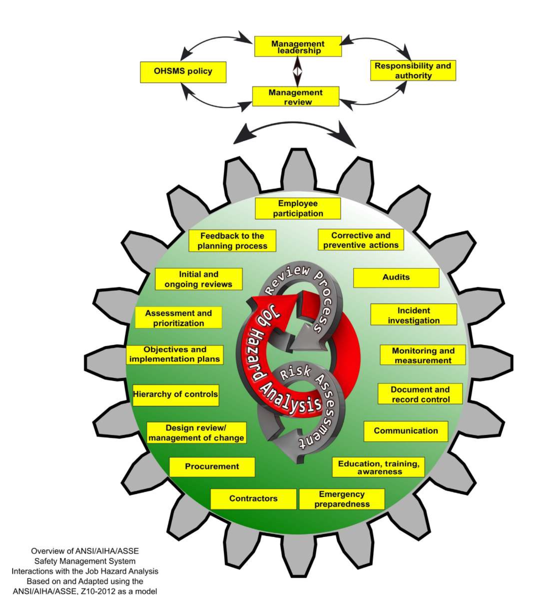

---

## 1. INTRODUCTION (도입: 안전경영시스템의 초석으로서의 JHA)

조직이 존재하는 근본적인 이유는 고객에게 다양한 제품과 서비스를 제공하기 위한 최적의 구조를 확립하는 데 있습니다. 이를 달성하기 위해 경영시스템과 업무 네트워크가 구축되며, 그 안에서 **'직무(Jobs)'는 목표 달성에 필요한 개별 활동, 책임, 권한을 구체적으로 규정**합니다.

이러한 맥락에서 **직무 위험성 평가(Job Hazard Analysis, JHA)**는 조직의 모든 운영 활동과 직무에 내재된 위험요인(Hazards)과 관련 리스크(Associated Risks)를 정밀하게 평가하기 위한 가장 필수적인 핵심 도구입니다.

### 1.1 JHA의 본질적 위상과 안전의 발현적 속성 (Emergent Property)
* **안전경영시스템(SMS)의 확고한 기초**: 공학적 대책과 관리적 통제는 리더십 팀과 근로자가 자신들의 직무(Jobs), 절차(Steps), 세부 과업(Tasks)에 내재된 위험의 유형을 총체적으로 이해할 때에만 비로소 실효성을 갖습니다.
* **통제 상호작용의 발현 결과로서의 안전**: 본서 제1장(Defining The Perception of Safety)에서 강조했듯이, 저자들은 안전을 고정된 상태가 아니라 **조직 내 수많은 통제 메커니즘 간의 유기적 상호작용에서 발생하는 '발현적 속성(Emergent Property)'**으로 정의합니다. JHA는 이러한 상호작용이 일어나는 현장 접점(Sharp End)을 정밀 타격하여 통제력을 확보하는 수단입니다.
* **직무 단위 위험 통제를 통한 안전문화 증진**: 전사적 JHA 프로세스는 직무 수준에서 위험요인을 통제함으로써 안전문화를 실질적으로 격상시킵니다. 체계적인 JHA 전략은 권고된 통제 대책이 현장에 뿌리내릴 수 있도록 행정적 구조, 수행 시간, 필요 예산을 안정적으로 뒷받침합니다.

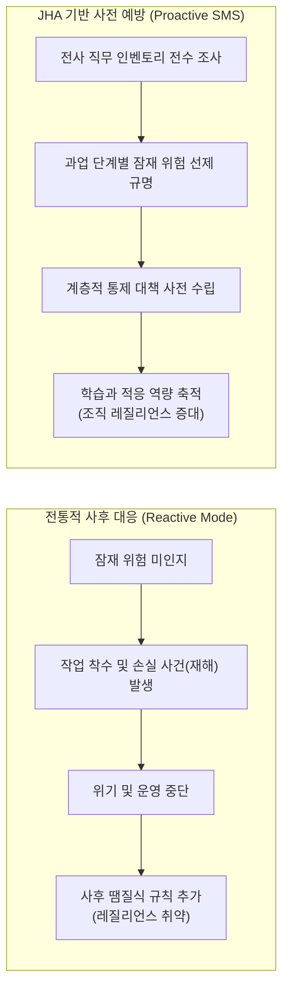

### 1.2 제12장 10대 핵심 학습 목표
1. 안전문화 관점에서 JHA의 결정적 중요성과 기대 편익 설명.
2. JHA 프로세스가 지닌 효용성과 운영상의 제약 조건(단점) 비교 대조.
3. JHA 전 과정에 근로자 참여(Employee Involvement)가 절대적으로 필수적인 이유 논증.
4. JHA 임시 전담팀(Ad Hoc Team)의 선발 기준과 다기능 팀 운영의 이점 규명.
5. 분석 대상 직무(Job), 단계(Steps), 세부 과업(Task)의 체계적 선정 방법 설명.
6. 직무 위험성 평가(JHA)와 직무 안전 분석(JSA)의 개념적·시간적 차이 정의.
7. JHA 프로세스가 전사 조직 운영 및 안전경영시스템 전반에 통합되는 메커니즘 설명.
8. JHA가 조직 전체를 관통하는 위험 소통 도구(Communication Tool)로 기능하는 방식 설명.
9. 조직문화(Organizational Culture)가 직무 완수 및 안전 행동에 미치는 영향 분석.
10. 인간 수행 개선(Human Performance Improvement, HPI)의 핵심 원칙과 오류 방지 적용 방안 설명.

---

## 2. BEGINNING THE JOB HAZARD ANALYSIS PROCESS—JOB INVENTORY (JHA 프로세스의 착수: 전사 직무 인벤토리 구축)

모든 직무 과업에는 심각도와 발생 확률이 다양한 숨겨진 잠재 위험(Hidden hazards)이 도사리고 있습니다. JHA의 궁극적 초점은 특정 도구, 재료, 장비를 사용하는 일상적 활동을 정밀 검토하여, 위험을 완전히 제거하거나 허용 가능한 수준(Acceptable Level) 이하로 저감 및 통제하는 데 있습니다.

### 2.1 조직의 복잡 적응성과 레질리언스(Resilience) 구축
* **사후 대응적 운영의 한계**: 수많은 조직이 복잡하고 적응적인 구조(Adaptive and complex structures)를 지니고 있지만, 대다수는 조건이 강제하거나 쓰라린 재해를 겪은 후에야 변화를 꾀하는 '사후 대응 모드(Reactive mode)'로 작동합니다.
* **레질리언스 선제 장착**: JHA의 핵심 목적은 작업이 이미 시작되었거나 비극적인 손실 사건이 터진 후에야 비로소 위험을 발견하는 치명적 맹점을 제거하는 것입니다. 작업 착수 전에 위험을 선제적으로 통제함으로써 조직 내에 높은 수준의 **적응적 복원력(Resilience)**을 구축합니다.

### 2.2 직무 인벤토리(Job Inventory) 4단계 구축 프로세스
JHA 프로세스는 조직 전반에 대한 총체적 진단에서 출발합니다:
1. **전사 직무 전수 조사**: 조직의 목표를 달성하기 위해 수행되는 모든 직무 목록을 빠짐없이 도출.
2. **내재적 위험 분석**: 각 활동과 직무에 내포된 선천적 위험(Inherent hazards)을 정밀 분석.
3. **리스크 평가 도구 매핑**: 제9장(Defining Risk Perception)에서 학습한 위험 지침 카드(Risk Guidance Card) 또는 리스크 매트릭스를 적용하여 위험도 산정.
4. **위험도 기반 우선순위 정렬**: 최고 위험 직무부터 최저 위험 직무까지 정렬(Rank, order, sort)하여 자원과 해결책을 최우선 리스크에 집중 투입.

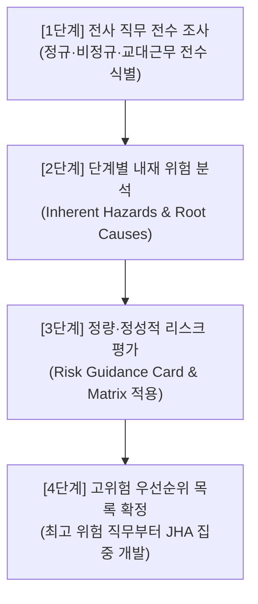

### 2.3 LESSON LEARNED: 기준선 평가(Baseline Assessment)의 착시와 함정

> **[교훈: 기준선 평가의 실질적 난점]**  
> 기준선 평가(Baseline assessment)는 언뜻 보기에 매우 단순하고 명확해 보이지만, 실제로는 속기 쉬운 착각을 불러일으킵니다. 대부분의 조직은 직무 인벤토리를 작성하는 과정에서 **자신들의 사업장에서 실제로 얼마나 방대하고 다양한 작업이 이루어지고 있는지 전혀 파악하지 못하고 있다는 충격적인 사실**을 깨닫게 됩니다.
> 
> * **비일상 작업의 누락**: 1년에 단 한 번 설비 대정비(Overhaul) 기간에만 수행되는 비일상적(Nonroutine) 정비 작업은 쉽게 인벤토리에서 누락됩니다.
> * **심야 교대조의 사각지대**: 2교대, 3교대 등 심야 야간조에서 작업자들끼리 암묵적으로 처리하는 변형된 일상 활동들은 본사나 주간 관리자의 인벤토리 작성 시 완벽히 배제됩니다.

### 2.4 근로자 참여와 문화 형성 (Capra & Luisi 네트워크 이론)
JHA 프로세스의 성공을 가르는 절대적 요건은 **직무의 전 생애주기 개발 단계에 현장 근로자를 깊이 참여(Employee Involvement)**시키는 것입니다. 현행 작업 표준(SOP)과 교육훈련의 실효성을 꿰뚫어 보는 근로자의 생생한 통찰 없이는 결코 실질적인 JHA가 탄생할 수 없습니다.

> *"문화는 의미가 생성되는 커뮤니케이션 네트워크에 의해 창조되고 유지된다. 문화의 물질적 구현체에는 유물(Artifacts)과 문헌 텍스트(Written texts)가 포함되며, 이를 통해 세대에서 세대로 의미가 전승된다."*  
> — **프리티오프 카프라 & 피에르 루이지 루이지 (Capra & Luisi, 2014)**

---

## 3. THE JHA AS A COMMUNICATION TOOL & WHY IS A JHA IMPORTANT? (소통 도구로서의 JHA와 그 중요성)

JHA는 단순히 작업자의 개별 행동을 규제하거나 규정을 적어 놓은 문서 양식(Form)이 아닙니다. JHA는 **조직 전체의 유해위험요인 및 리스크 소통망(Risk Communication Network)의 핵심 엔진**입니다.

### 3.1 소통 도구로서의 JHA의 다차원적 기능
* **위험 소통의 공식 채널**: 현장 작업 단위에서 일어나는 위험 회피, 저감, 통제 방안에 대해 관리자와 근로자가 격의 없이 논리적이고 깊이 있는 대화를 나눌 수 있는 공식 통로(Conduit)를 제공합니다.
* **다목적 실무 연계성**: 완결된 JHA는 현장 안전뿐만 아니라 ① 맞춤형 교육훈련 개발, ② 현장 운영 검토, ③ 적정 인재 선발 및 최적 배치, ④ 기계·설비 및 작업 공정 재설계의 핵심 기준선으로 활용됩니다.
* **동적 유연성(Dynamic Flexibility)**: 현장의 공정 변화, 설비 교체, 환경 변화에 기민하게 연동되도록 상시 업데이트되어야 합니다.

### 3.2 JHA가 왜 중요한가? (TABLE 12.1 정밀 분석)

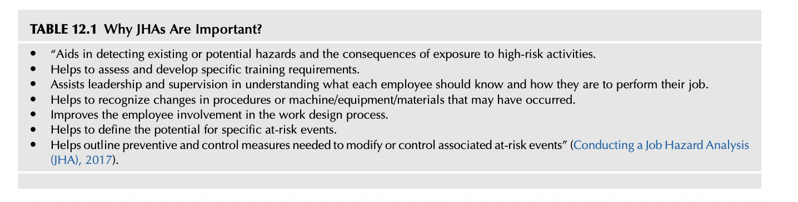

### TABLE 12.1 Why JHAs Are Important? (JHA가 중요한 핵심 이유)

* **선제적 위험 포착**: 기존에 은폐되어 있던 잠재적 위험을 포착하고, 고위험 활동에 노출되었을 때 초래될 결과(Consequences)를 명확히 규명.
* **맞춤형 훈련 수립 지원**: 추상적 교육을 지양하고 작업별 세부 위험에 기반한 구체적 교육훈련 요건을 평가·도출.
* **리더십의 현장 이해도 증진**: 경영진과 감독자가 근로자가 무엇을 알아야 하고, 실제로 작업을 어떻게 안전하게 완수해야 하는지 정확히 파악하도록 지원.
* **현장 변경점(MOC) 감지**: 표준 작업 절차, 기계, 설비, 원자재 등에서 발생한 미세한 현장 변경 사항을 신속히 인지.
* **작업 설계에 근로자 주도권 보장**: 근로자가 자신이 일하는 작업 환경과 프로세스 설계에 직접 발언하고 참여할 기회를 극대화.
* **위험 사건(At-Risk Events)의 잠재력 규정**: 잠재적 사고 발생 시나리오를 구체적으로 정의.
* **예방 및 통제 조치의 명확한 가이드라인 제공**: 위험 사건을 통제하고 완화하는 데 필수적인 구체적 방지책을 명문화.
*(출처: Conducting a Job Hazard Analysis, 2017; Roughton & Crutchfield, 2013)*

---

### 3.3 JHA 개발 프로세스 프레임워크 (FIG. 12.1 정밀 분석)

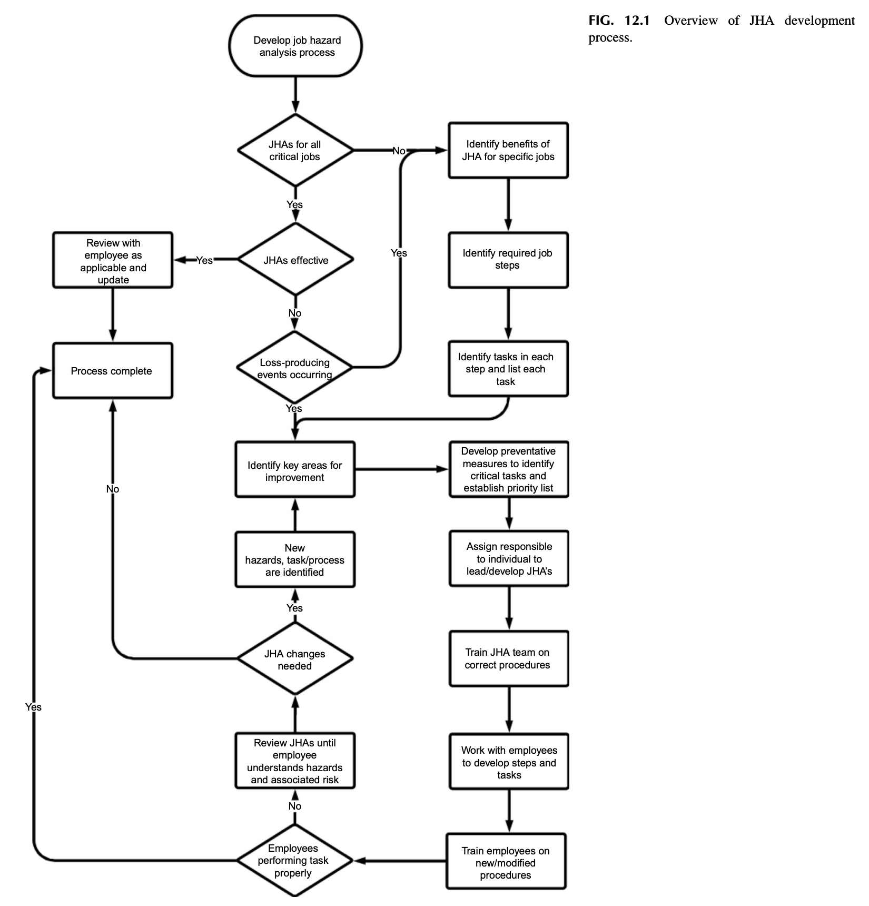

### FIG. 12.1 Overview of JHA development process (JHA 개발 및 지속적 개선 프로세스 개요)

원문의 FIG. 12.1 플로우차트는 JHA가 한 번 작성하고 캐비닛에 보관하는 정적 문서가 아니라, 끊임없이 현장 피드백을 통해 진화하는 **동적 피드백 루프(Dynamic Feedback Loop)**임을 명확히 보여줍니다:

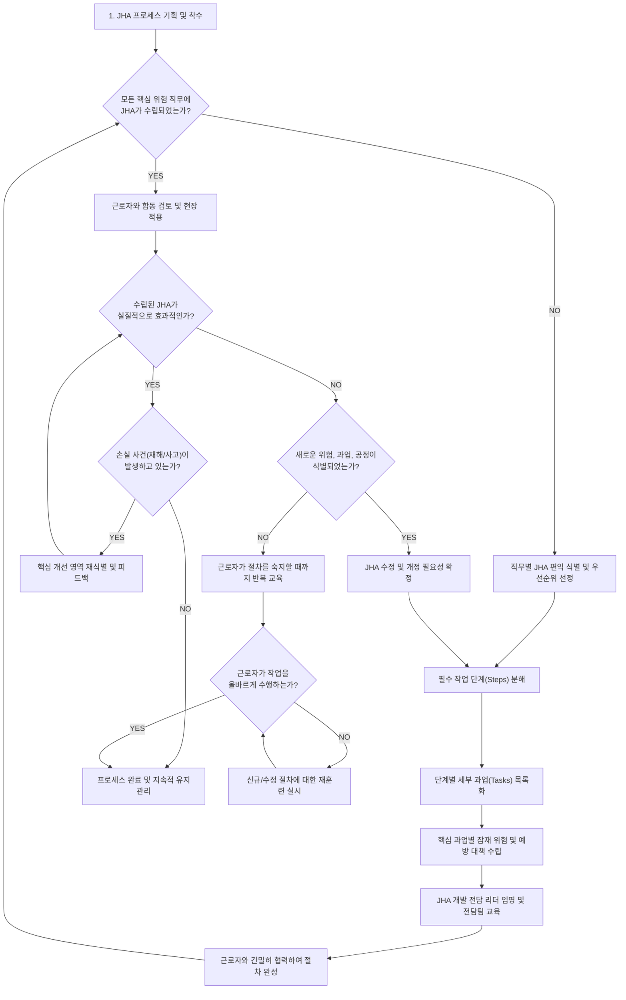

---

## 4. STRATEGY FOR IMPLEMENTATION & DEFINING JHA VS JSA (실행 전략과 JHA vs JSA의 개념적 차이)

### 4.1 과학적 관리법의 기원과 'Job'의 2가지 정의
JHA의 기원은 20세기 초 프레더릭 테일러(Frederick Taylor)가 창안한 과학적 관리법(Scientific Management)과 근대 산업안전의 태동기로 거슬러 올라갑니다. 시대가 변함에 따라 '직무(Job)'라는 용어의 의미는 크게 두 가지 차원으로 분화되었습니다:

* **정의 1 (미시적 단위 작업)**: *"개인의 직업적 일과의 일부로 수행되는 구체적이고 특정한 과업(A specific task done as part of the routine)"* (Job, 2018).
* **정의 2 (거시적 직무 타이틀)**: *"한 사람에게 기대되거나 의무화된 모든 일의 총체, 책무, 권한(Duty, responsibility)"* (Job, 2018).

전통적인 테일러리즘 기반의 JHA는 **'정의 1'**에 입각하여 개별 직무를 단계별로 쪼개고 위험을 통제했습니다. 반면 **'정의 2'**는 직무기술서상의 모든 활동을 포괄하므로, 여러 작업의 복합적 상호작용과 누적 유해요인을 분석할 수 있는 확장된 시각을 요구합니다.

### 4.2 Parent-Child Theme (모체-파생 테마) 개념의 혁신적 적용
저자들은 소프트웨어 프로그래밍의 모체 테마(Parent Theme)와 파생 테마(Child Theme) 구조를 JHA에 접목할 것을 제안합니다:
* **Parent JHA (모체 JHA)**: 유사하거나 중복되는 모든 작업 과업을 아우르는 전사적 기준선(Baseline). 특정 직무 타이틀에 보편적으로 요구되는 핵심 기능과 안전 요건을 규정하여 뼈대가 훼손되지 않도록 보호.
* **Child JHA (파생 JHA)**: 동일한 설비라도 작업 현장, 사용 자재, 구체적 작업 방식의 미세한 차이에 따라 추가로 발생하는 고유한 위험요인을 세부적으로 분석하고 맞춤 통제책을 설정.
* *실무 적용 예시*: 공장 내 5대의 기계가 동일한 메커니즘으로 가동될 경우, 기계 본체의 공통 위험을 다루는 단일 모체 JHA(Parent)를 구축하고, 작업 위치나 가공 자재에 따른 차이점은 파생 JHA(Child)로 관리함으로써 문서 낭비를 줄이고 위험 식별의 정밀성을 극대화합니다.

---

### 4.3 JHA 전사 실행 프로세스 (FIG. 12.2 정밀 분석)

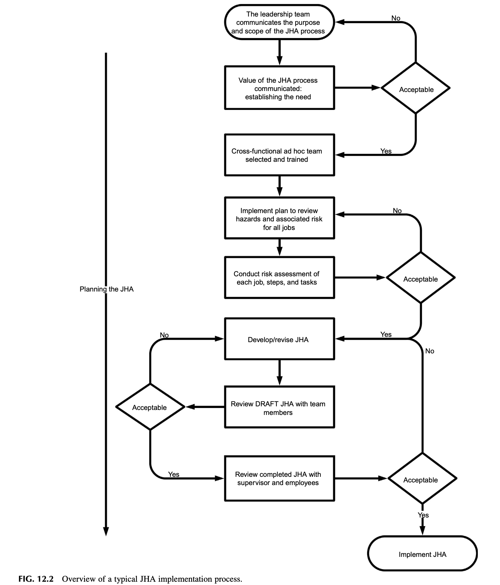

### FIG. 12.2 Overview of a typical JHA implementation process (전형적인 JHA 실행 프로세스 흐름)

FIG. 12.2는 리더십 팀의 명확한 목적 선언에서 시작하여 현장 이행까지 이어지는 엄격한 단계별 게이트웨이(Acceptable / No)를 제시합니다:

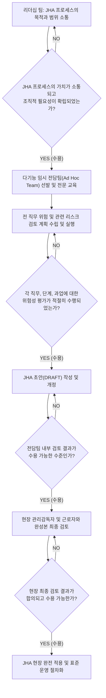

---

### 4.4 OBSERVATION: JHA vs JSA의 본질적 차이 (급성 돌발 재해 vs 만성 누적 손상)

현장에서는 직무 위험성 평가(JHA)와 직무 안전 분석(JSA)이라는 용어가 종종 혼용되지만, 저자들은 안전문화의 고도화를 위해 두 개념을 명확히 구분해야 한다고 역설합니다.

> **[핵심 관찰: JHA와 JSA의 차별적 정의]**  
> * **JHA (Job Hazard Analysis)**: 특정 시점(Point in time)의 과업 단계와 세부 행동을 고립시켜, **돌발적이고 급성인 손실 사건(Sudden, acute loss-producing events)**을 유발하는 직접적 위험과 리스크를 통제하는 기법.
> * **JSA (Job Safety Analysis)**: 전체 직무 노출(Total job exposures)과 시간의 흐름(Time dimension)을 고려하여, **점진적이고 만성적인 손상(Gradual, cumulative damage)**을 초래하는 유해요인을 통제하는 기법 (예: 인간공학적 부담 작업, 유해화학물질 만성 노출, 소음/진동 환경 등).

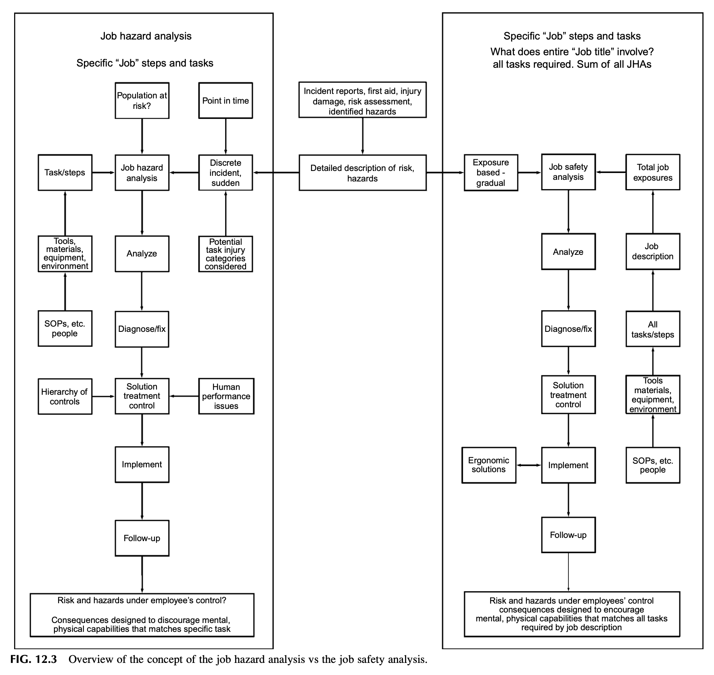

### FIG. 12.3 Overview of JHA vs JSA (직무 위험성 평가와 직무 안전 분석의 비교)

| 비교 항목 | 직무 위험성 평가 (JHA) | 직무 안전 분석 (JSA) |
| :--- | :--- | :--- |
| **분석 초점** | 특정 작업 단계(Steps) 및 세부 과업(Tasks) | 전체 직무 타이틀 및 직무기술서상의 모든 활동 |
| **사건 성격** | **돌발적·급성 손실 사건 (Sudden, Acute Events)** | **점진적·만성적 누적 노출 (Gradual, Cumulative Damage)** |
| **시간 차원** | 특정 시점의 단면적 분석 (Snapshot in time) | 장기적 누적 효과를 고려한 다차원 시간 분석 |
| **주요 대상 위험** | 기계적 협착, 추락, 감전, 절단 등 직접 물리적 위험 | 근골격계 부담(인간공학), 직업병, 만성 유해환경 |
| **통제 솔루션** | 안전장치 설치, 인터록, 표준 절차, 방호구 | 작업장 인체공학적 재설계, 직무 순환, 노출시간 제한 |

---

## 5. BENEFITS AND DRAWBACKS OF DEVELOPING JHAS (JHA의 다차원적 효과와 저항 극복)

### 5.1 JHA 개발이 가져오는 4대 운영 개선 효과
JHA가 안전경영시스템의 핵심 축으로 안착되면, 조직은 다음 4대 영역에서 실질적인 질적 도약을 이룹니다:
1. **절차, 작업 방법 및 프로토콜의 표준화**: 안전 기준이 내재화된 실효성 있는 SOP 확립.
2. **원자재, 장비 및 공구 선별의 최적화**: 작업 부하와 유해성을 고려한 적격 장비 선정.
3. **인재 선발 및 교육훈련의 과학화**: 직무에 요구되는 신체적·인지적 역량과 근로자 매칭.
4. **작업 환경 및 잠재적 환경 이슈의 선제적 발굴**: 조명, 환기, 소음 등 위험 사전 제거.

### 5.2 JHA 도입 시 예상되는 조직적 저항(Drawbacks)과 돌파 전략
* **시간과 예산에 대한 부담감**: JHA 프로세스는 현장 분석과 미팅에 상당한 시간과 자원을 요구합니다.
* **"우리는 일하는 법을 이미 다 안다"는 치명적 타성**: 현장에 눈에 띄는 대형 사고가 없었을 경우, *"지금까지 아무 문제 없었는데 왜 귀찮게 서류 작업을 늘리느냐"*는 강력한 조직적 저항이 발생합니다.
* **돌파구**: JHA를 일회성 요식행위가 아닌 **'일상적 공식 루틴(Routine formal use)'**으로 정착시켜, 작업 환경의 실질적 개선과 생산성 향상으로 직결되는 가치를 체감시켜야 합니다.

### 5.3 근로자 참여(Employee Involvement)의 절대적 필요성
* **'서류상의 작업(Work-as-Imagined)'과 '실제 일하는 방식(Work-as-Done)'의 괴리 극복**: 관리자는 모르는 현장의 숨겨진 장애물, 비공식적 우회 작업(Work-around)은 현장 작업자만이 알고 있습니다.
* **신뢰 구축과 심리적 안전감**: JHA는 작업자의 생산성을 감시하거나 인사고과를 평가하는 도구가 아니라, **"작업 환경의 위험을 함께 제거하는 보호 장치"**라는 확신을 심어주어야 근로자의 진솔한 증언을 이끌어낼 수 있습니다.

---

## 6. SELECTING A TEAM & BUILDING THE CASE FOR A JHA PROCESS (임시 전담팀 선발과 경영진 설득 비즈니스 케이스 구축)

### 6.1 JHA 프로세스 관리자(Administrator)의 5대 필수 역량
안전위원회 산하에서 전사 JHA 프로세스를 총괄하는 관리자는 다음과 같은 다차원적 자질을 갖추어야 합니다:
1. **커뮤니케이션 및 보고 역량**: 최고경영진과 현장 근로자를 잇는 탁월한 구두·서면 소통력.
2. **비즈니스 가치 설파력**: JHA가 단순 규제 준수를 넘어 생산성과 원가 절감에 기여함을 입증.
3. **현장 운영 프로세스에 대한 전문성**: 공정, 기술, 작업 생태계에 대한 깊은 이해.
4. **고도화된 리스크 평가 및 문제해결 기법**: 숨겨진 잠재 위험을 발굴하는 분석적 안목.
5. **손실 인과 메커니즘에 대한 통찰력**: 위험요인이 중대사고로 전이되는 메커니즘 파악.

### 6.2 다기능 임시 전담팀(Ad Hoc Team)의 운영 원칙
* **차터(Charter) 수립**: 안전위원회의 승인을 받아 팀의 목적, 권한, 역할을 명시한 헌장 제정.
* **정기 회의 및 문서화**: 회의록을 작성하여 중앙안전위원회 및 경영진과 투명하게 공유.
* **현장 밀착 분석**: 현장 감독자와 근로자를 조사 과정에 직접 참여시켜 다각적 관점 확보.

### 6.3 비즈니스 케이스(Business Case) 구축을 통한 경영진 설득
경영진의 실질적 자원 배분과 전폭적 지지를 이끌어내기 위해서는 재무적·운영적 데이터에 근거한 비즈니스 케이스를 제시해야 합니다:
* 과거 산업재해율, 산재보상 청구액(Workers' Comp costs), 아차사고 빈도 분석.
* 장비 고장 다운타임(Downtime), 결근율, 설비 정비 비용과 특정 직무 위험 간의 상관관계 입증.
* JHA 도입에 따른 손실 예방 효과를 정량적 선행지표와 재무적 가치로 환산하여 제시.

---

## 7. TELLING THE JHA STORY (JHA 스토리텔링: 5W 1H 질문법 체계)

JHA는 무미건조한 체크리스트가 아니라, **"현장에서 실제로 어떤 일이 일어나고 있는가?"를 생생하게 증언하는 이야기(Storytelling)**입니다. 사이먼 시넥(Simon Sinek, 2009)이 강조했듯이, 위대한 변화는 *"우리가 이 일을 왜 하는가?"*라는 목적의식(WHY)에서 출발합니다.

### 7.1 The 5 W’s and 1 H 질문 프레임워크 (TABLE 12.2 ~ 12.7 정밀 분석)

````carousel
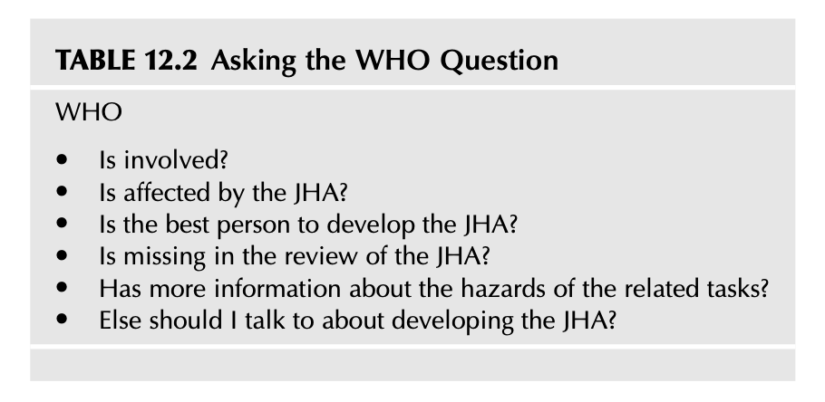
<!-- slide -->
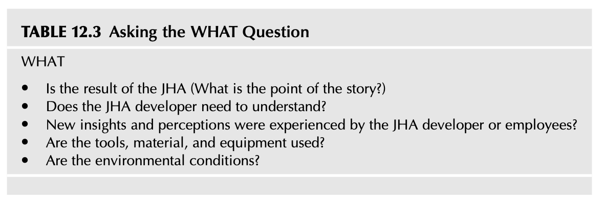
<!-- slide -->
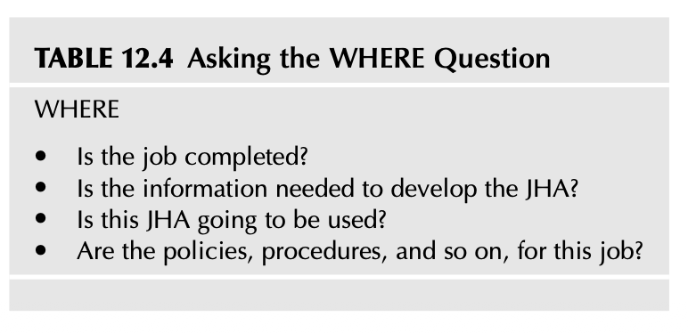
<!-- slide -->
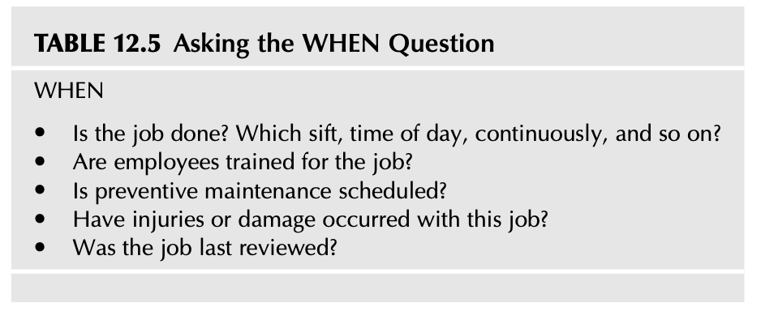
<!-- slide -->
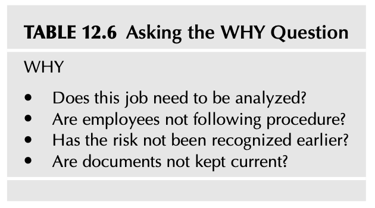
<!-- slide -->
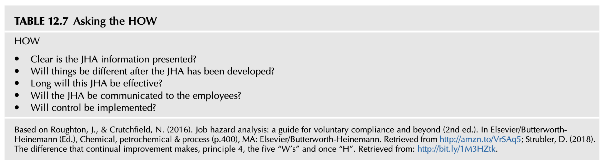
````

| 구분 | 핵심 질문 (Questions) | 안전문화 및 위험성 평가 시사점 |
| :---: | :--- | :--- |
| **TABLE 12.2<br/>WHO (누가)** | • 누가 작업에 참여하는가?<br/>• JHA의 직접적 영향을 받는 자는 누구인가?<br/>• JHA를 개발하기에 가장 적합한 전문가는 누구인가?<br/>• 검토 과정에서 누락된 이해관계자는 없는가?<br/>• 관련 과업 위험에 대해 더 깊은 정보를 가진 자는 누구인가? | **다원주의 및 다중 관점 확보**:<br/>작업자, 정비사, 도급업체 등 이해관계자 전원 참여 |
| **TABLE 12.3<br/>WHAT (무엇을)** | • JHA의 최종 결과(이야기의 핵심)는 무엇인가?<br/>• JHA 개발자가 반드시 이해해야 할 것은 무엇인가?<br/>• 개발자와 근로자가 경험한 새로운 통찰과 인식은 무엇인가?<br/>• 사용되는 도구, 재료, 장비는 무엇인가?<br/>• 작업 환경 조건은 어떠한가? | **의미구성 (Sensemaking)**:<br/>단순 데이터 수집을 넘어 작업의 물리적·인지적 실체 파악 |
| **TABLE 12.4<br/>WHERE (어디서)** | • 작업이 실제로 어디서 수행되는가?<br/>• JHA 개발에 필요한 정보는 어디에 존재하는가?<br/>• 이 JHA는 향후 어디에서 어떻게 활용될 것인가?<br/>• 관련 방침, 절차서, 매뉴얼은 어디에 있는가? | **공간적 맥락 파악**:<br/>밀폐공간, 고소, 옥외, 협소 구역 등 환경적 제약 규명 |
| **TABLE 12.5<br/>WHEN (언제)** | • 작업이 언제 이루어지는가? (주간, 야간조, 연속작업 등)<br/>• 작업자에 대한 교육은 언제 실시되는가?<br/>• 예방정비는 언제 예정되어 있는가?<br/>• 과거 부상이나 물적 손실은 언제 발생했는가?<br/>• 이 직무는 최근 언제 재검토되었는가? | **시간적 차원과 피로도 연계**:<br/>야간 교대, 계절적 요인, 정비 주기별 위험도 평가 |
| **TABLE 12.6<br/>WHY (왜)** | • 왜 이 직무를 최우선으로 분석해야 하는가?<br/>• 근로자들은 왜 표준 절차를 준수하지 않는가?<br/>• 왜 위험이 사전에 인지되지 못했는가?<br/>• 왜 관련 문서가 최신 상태로 유지되지 못했는가? | **근본 원인 분석 (RCA)**:<br/>작업 우회(Shortcut)의 배후에 놓인 구조적 압박 규명 |
| **TABLE 12.7<br/>HOW (어떻게)** | • JHA 정보가 얼마나 명확하게 제시되었는가?<br/>• JHA 개발 후 현장은 어떻게 달라질 것인가?<br/>• 이 JHA의 유효성은 얼마나 오래 지속될 것인가?<br/>• 근로자들에게 어떻게 전파·소통될 것인가?<br/>• 통제 대책은 어떻게 실행될 것인가? | **실행력과 지속가능성 보장**:<br/>측정 가능한 실행 계획 및 모니터링 체계 확립 |

---

## 8. STRUCTURE OF THE JHA & SELECTING HIGH PRIORITY JOBS (JHA의 구조와 고위험 직무 우선순위화)

### 8.1 JHA 기본 용어 체계 (TABLE 12.8 정밀 분석)

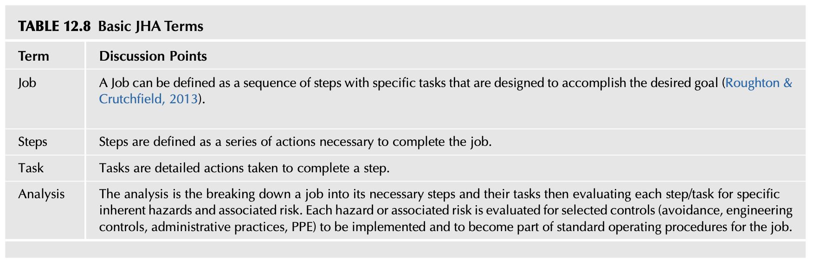

### TABLE 12.8 Basic JHA Terms (JHA 기본 용어 정의)

* **직무 (Job)**: 원하는 궁극적 목표를 달성하기 위해 설계된 **일련의 단계(Steps)와 구체적 과업(Tasks)의 연속체** *(Roughton & Crutchfield, 2013)*.
* **단계 (Steps)**: 직무를 완수하는 데 필요한 **핵심 행동의 연속적인 흐름**.
* **과업 (Task)**: 하나의 단계를 완수하기 위해 수행되는 **구체적이고 상세한 행위**.
* **분석 (Analysis)**: 직무를 필수 단계와 과업으로 세분화하고, 각 단계/과업의 선천적 위험(Inherent hazards)과 관련 리스크를 평가한 후, 최적의 통제 수단(위험 회피, 공학적 대책, 관리적 대책, 개인보호구)을 선정하여 표준 절차로 정립하는 체계적 과정.

### 8.2 우선 분석 대상 16대 고위험 직무 요건 (TABLE 12.9 정밀 분석)

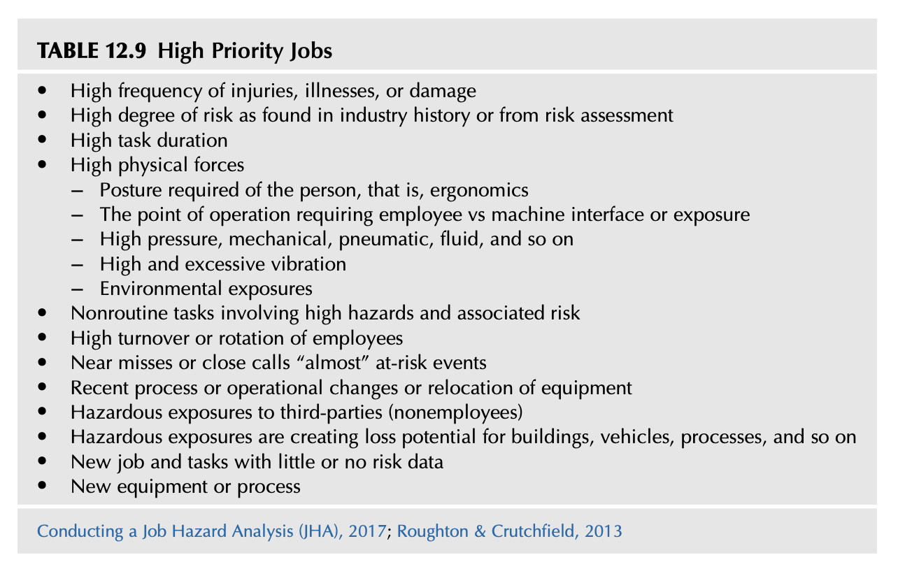

### TABLE 12.9 High Priority Jobs (우선 분석 대상 고위험 직무)

1. 과거 부상, 질병, 물적 손실의 발생 빈도가 높은 직무.
2. 업계 과거 이력이나 사전 위험성평가 결과 높은 위험도를 지닌 직무.
3. 작업 수행 시간이 지나치게 길어 피로도가 누적되는 직무 (High task duration).
4. 과도한 신체적 물리력을 요구하는 직무 (High physical forces).
5. 부적절하거나 기형적인 작업 자세를 강요하는 인간공학적 고위험 직무.
6. 작업자와 기계 설비가 직접 맞닿는 위험점(Point of operation) 노출 직무.
7. 고압, 기계식, 유압식, 공압식 에너지원에 노출된 직무.
8. 극심한 진동이나 충격에 지속적으로 노출되는 직무.
9. 유독물질, 고열, 한랭, 방사선 등 극한 환경에 노출된 직무.
10. 고위험 및 높은 위험도를 수반하는 비일상적(Nonroutine) 직무.
11. 이직률이 높거나 작업자 교체/순환이 빈번한 직무.
12. 아차사고(Near misses, close calls)가 빈번히 보고되는 직무.
13. 최근 공정, 설비 이전, 운영 방식의 변경이 발생한 직무.
14. 도급, 파견, 방문객 등 제3자(Nonemployees)에게 유해 위험을 초래하는 직무.
15. 건물, 차량, 핵심 공정 시설물에 막대한 손실을 초래할 잠재력이 있는 직무.
16. 축적된 위험 데이터가 거의 없는 신설 직무 및 신규 도입 설비/공정.

---

### 8.3 위험 개선 모델과 JHA 통합 구조 (FIG. 12.4 정밀 분석)

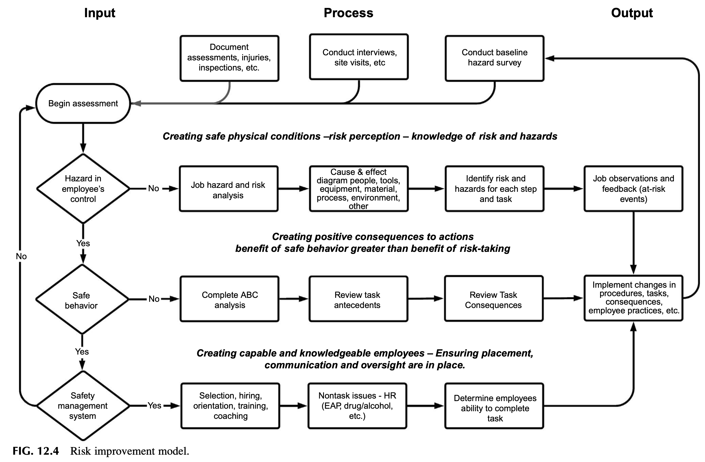

### FIG. 12.4 Risk improvement model (위험 개선 모델 내 JHA 작동 체계)

FIG. 12.4는 JHA가 작업 현장의 물리적 조건, 행동 결과, 인적 역량을 안전경영시스템 내에서 어떻게 유기적으로 결합하여 위험을 선순환적으로 개선하는지 보여줍니다:

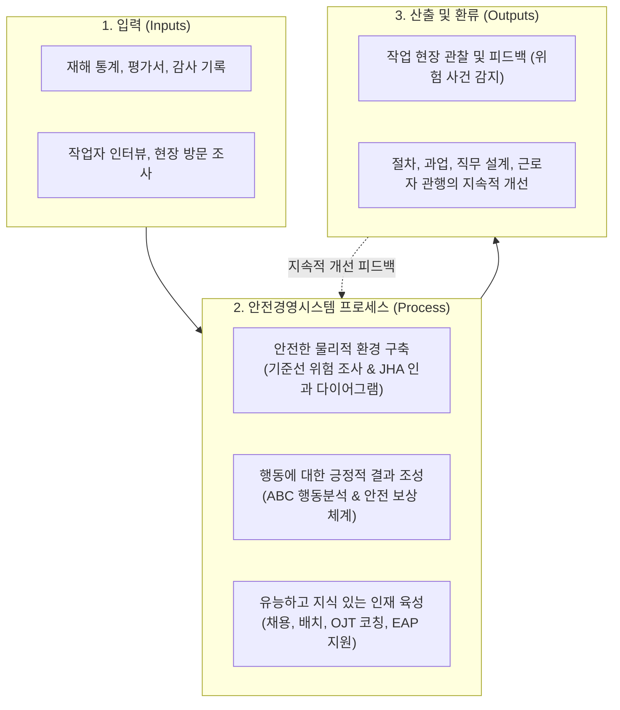

---

## 9. JHA AND HUMAN PERFORMANCE IMPROVEMENT (HPI) PRINCIPLES (JHA와 인간 수행 개선 원칙의 융합)

전통적인 JHA의 치명적 결함은 위험요인을 주로 물리적 위험(Physical hazards)으로만 단순화하고, 위험의 정도(Risk level)나 **인간의 인지적 한계, 정신적 부하, 심리적 조건, 인간 과실의 가능성**을 분석 틀에 담아내지 못했다는 점입니다.

### 9.1 제임스 리즌(James Reason)의 오류 관리론과 HPI 5대 기본 원칙
인간은 저마다 고유한 지각(Perception), 경험, 지식, 선호도, 숙련도를 지니고 있으며, 이는 직무 수행에 지대한 영향을 미칩니다. 제임스 리즌(James Reason, 2009)은 다음과 같이 갈파했습니다:

> *"조직 구성원, 특히 관리자들은 인간의 오류 잠재력뿐만 아니라 오류의 발생 가능성과 결과를 결정짓는 과업 환경 및 조직적 요인을 반드시 명확히 인식해야 한다. 불안전한 행동이 '어떻게', 그리고 '왜' 발생하는지 이해하는 것이 효과적인 오류 관리의 가장 본질적인 첫걸음이다."*

**DOE(미국 에너지부) HPI 핸드북의 5대 핵심 지도 원칙**:
1. **인간의 불완전성**: 인간은 누구나 실수할 수 있으며, 최고의 전문가조차 실수를 저지른다 (People are fallible).
2. **오류 유발 상황의 예측 가능성**: 오류가 발생하기 쉬운 상황은 사전에 예측 가능하고, 관리 가능하며, 예방할 수 있다 (Error-likely situations are predictable).
3. **조직 프로세스와 가치의 결정력**: 개인의 행동은 조직의 시스템, 프로세스, 가치관에 의해 직접적으로 유도되고 형성된다 (Individual behavior is influenced by organizational processes).
4. **격려와 강화의 힘**: 사람들은 리더, 동료, 부하직원의 진정성 있는 격려와 긍정적 강화를 받을 때 최고의 안전 수행을 달성한다.
5. **사건을 통한 학습**: 과거의 실수와 사건으로부터 교훈을 얻고 이를 현장에 적용함으로써 미래의 재해를 원천 차단할 수 있다.

---

### 9.2 오류 전조 요건 (Error Precursors) 정밀 분석

오류 전조 요건(Error Precursors)이란 **특정 작업 도중 인간의 오류 발생 확률을 급격히 증가시키는 불리한 사전 조건(Unfavorable prior conditions)**을 의미합니다. JHA는 이러한 전조 요건을 사전에 탐지하고 통제하는 최강의 도구여야 합니다.

````carousel
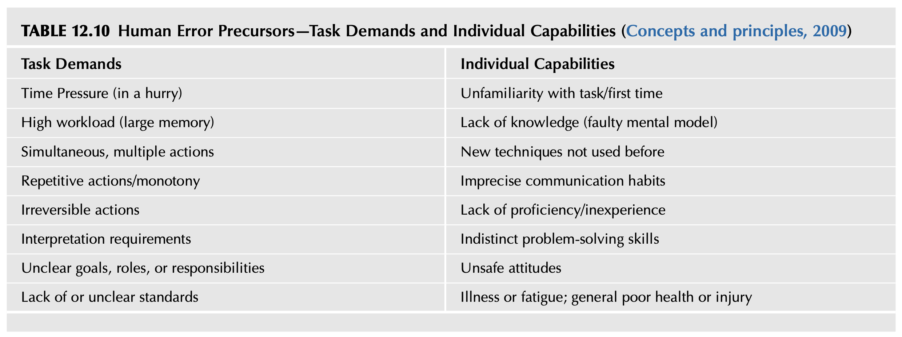
<!-- slide -->
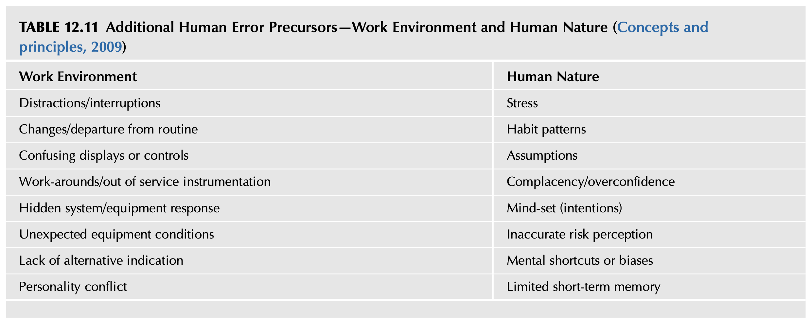
````

### TABLE 12.10 & 12.11 인간 오류 전조 요건 4대 차원 종합 비교

| 범주 | 전조 요건 세부 항목 (Precursors) | 직무 위험성 평가(JHA) 반영 대책 |
| :---: | :--- | :--- |
| **과업 요구조건<br/>(Task Demands)** | • 촉박한 시간 압박 (서두름, 마감 독촉)<br/>• 과도한 작업 부하 (많은 기억량 요구)<br/>• 동시 다발적인 복수 작업 수행<br/>• 반복 작업 및 극심한 단조로움<br/>• 비가역적 행동 (되돌릴 수 없는 조작)<br/>• 복잡한 해석과 판단 요구<br/>• 불명확한 목표, 역할, 책임 분담<br/>• 표준 및 기준의 결여 또는 모호성 | • 작업 표준 시간 재설계 및 인력 지원<br/>• 체크리스트 도입을 통한 인지 부하 경감<br/>• 인터록 및 역작동 방지 물리적 차단<br/>• 단계별 명확한 책임과 권한(RAA) 명시 |
| **개인 역량<br/>(Individual Capabilities)** | • 과업 미숙 및 최초 작업 수행<br/>• 지식 부족 및 왜곡된 심성 모형(Mental model)<br/>• 익숙하지 않은 신기술·신공법 적용<br/>• 불명확하고 부정문화된 소통 습관<br/>• 숙련도 결여 및 경험 부족<br/>• 직관에만 의존하는 문제해결 방식<br/>• 안전 경시 태도 및 불안전한 고집<br/>• 질병, 피로, 수면 부족, 건강 이상 | • 최초 작업 전 1:1 집중 멘토링 지정<br/>• 3방향 소통(3-Way Communication) 의무화<br/>• 작업 전 건강 상태 및 피로도 모니터링<br/>• 전문 역량 인증제 통과자만 과업 투입 |
| **작업 환경<br/>(Work Environment)** | • 주의 산만 및 빈번한 작업 중단(방해)<br/>• 통상적 루틴에서의 갑작스러운 이탈<br/>• 혼란을 초래하는 계기판 디스플레이 및 제어기<br/>• 계측기 고장 및 임의 우회(Work-around)<br/>• 시스템 및 설비 반응의 은폐(미확인)<br/>• 예기치 못한 설비 이상 징후<br/>• 대안 지표의 부재<br/>• 작업자 간의 성격 충돌 및 갈등 | • 집중 구역 "방해 금지(Do Not Disturb)" 설정<br/>• 인간공학적 조작반 및 명확한 시각 라벨링<br/>• 우회 배선/장치 엄격 금지 및 고장 즉시 수리<br/>• 팀워크 및 소통 촉진 프로그램 가동 |
| **인간 본성<br/>(Human Nature)** | • 정신적·신체적 스트레스<br/>• 관성에 젖은 굳어진 습관 패턴<br/>• 근거 없는 예단과 가정(Assumptions)<br/>• 안주(Complacency) 및 과도한 자신감<br/>• 위험에 대한 편향된 마인드셋<br/>• 왜곡된 위험 지각 (Inaccurate risk perception)<br/>• 정신적 지름길 (Mental shortcuts / 휴리스틱)<br/>• 극히 제한된 단기 기억 용량 | • 질문하는 태도(Questioning Attitude) 내면화<br/>• 가정 검증(Validate Assumptions) 프로토콜<br/>• 자기 점검(STAR: Stop-Think-Act-Review)<br/>• 현장 작업 정지 권한(Stop-Work) 활성화 |

---

### 9.3 조직문화와 안전 패러다임의 진화 (FIG. 12.5 정밀 분석)

조직문화는 에드거 샤인(Edgar Schein)의 정의대로, 구성원들이 외부 적응과 내부 통합 문제를 해결하는 과정에서 학습한 **'공유된 기본 가정(Shared basic assumptions)'의 총체**입니다. 조직의 문화가 위험을 어떻게 수용하느냐에 따라 인간 과실에 대한 대응 방식이 완전히 달라집니다.

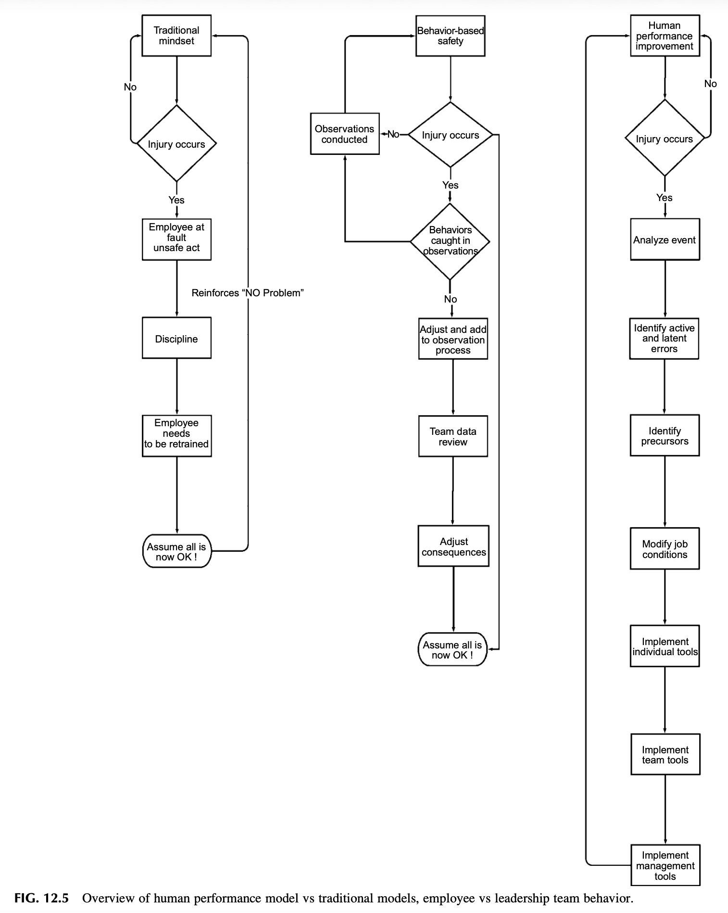

### FIG. 12.5 안전 관리 패러다임의 3단계 진화 비교

```mermaid
flowchart TD
    subgraph Traditional["1. 전통적 안전 (Traditional)"]
        T1["재해 발생"] --> T2["근로자의 불안전한 행동 지목<br/>(Employee at fault)"]
        T2 --> T3["징계 및 재교육 처벌<br/>(Discipline)"]
        T3 --> T4["'이제 문제없다'는 안도<br/>(근본 결함 은폐)"]
    end
    
    subgraph BBS["2. 행동기반 안전 (Behavior-Based)"]
        B1["현장 관찰 실시"] --> B2["관찰된 행동 데이터 분석"]
        B2 --> B3["부적합 행동 교정 및 재교육"]
        B3 --> B4["관찰 항목 조정 및 추가"]
    end
    
    subgraph HPI["3. 인간 수행 개선 (HPI - 현대적 SMS)"]
        H1["사건 정밀 분석"] --> H2["능동적 오류와 잠재적 조건 동시 분리 규명"]
        H2 --> H3["시스템적 전조 요건(Precursors) 식별"]
        H3 --> H4["개인/팀/경영진 도구 종합 가동 & 직무 조건 재설계"]
    end
```

> **[캐시 시브룩(Kathy A. Seabrook, CSP) 전 ASSE 회장의 통찰]**  
> *"글로벌 기업들의 재해 통계를 살펴보면, 경미한 재해율의 감소세는 둔화되었고, 사망 및 중대재해(Fatal and serious injuries) 발생률은 수년째 정체되어 있다. 진정한 추가 개선을 이루기 위해서는 완전히 다른 차원의 접근법(A different Approach)이 요구된다."*

---

## 10. JOB COMPLEXITY, PERFORMANCE TYPES & ERROR MECHANISMS (직무 복잡성, 3대 직무 수행 유형 및 오류 메커니즘)

### 10.1 단순 직무(Simple Jobs)라는 치명적 착각
현장에서 흔히 들리는 *"이건 로켓 과학(Rocket Science)이 아니다, 누구라도 할 수 있는 단순한 일이다"*라는 식의 언사는 근로자의 자존감을 깎아내릴 뿐만 아니라, **"사고가 없었으니 위험도 없다(No loss equals no risk)"는 치명적인 집단적 안전 불감증**을 형성합니다.
* 아무리 단순해 보이는 직무라도 수많은 세부 동작, 전용 공구, 자재의 특성, 주변 환경과의 상호작용이 얽혀 있는 복잡한 시스템입니다.
* JHA의 제1원칙은 **"아무리 단순해 보이는 작업이라도, 그 안에는 부상과 손실을 유발할 수 있는 잠재 위험이 반드시 숨겨져 있음을 절대 잊지 않는 것"**입니다.

---

### 10.2 라스무센(Rasmussen)의 3대 직무 수행 유형과 오류 메커니즘
JHA는 직무의 성격에 따라 다음 3가지 수행 유형을 구분하여 통제책을 설계해야 합니다:

| 수행 유형 | 특성 및 인지 메커니즘 | 주요 오류 형태 | JHA 기반 통제 전략 |
| :---: | :--- | :--- | :--- |
| **숙련 기반<br/>(Skill-Based)** | • 고도로 숙련된 대뇌 무의식적 물리적 행동<br/>• 의식적 모니터링이 거의 불필요한 자동화 상태 | • **실행 오류(Execution errors)**<br/>• 행동 슬립(Action slips)<br/>• 일시적 주의 집중 상실(Lapses) | • 인터록 및 물리적 방호가드 설치<br/>• 작업 공간 가시성 확보<br/>• 정기적 현장 관찰 및 피드백 유지 |
| **규칙 기반<br/>(Rule-Based)** | • 사전 설정된 해결책과 절차를 따름<br/>• **'If-Then' 의사결정** 구조 (상황 X 발생 시 Y 조치) | • 절차서 및 규칙의 오해석<br/>• 잘못된 규칙의 적용<br/>• 절차 미준수 및 단축 | • 표준 작업 지침서(SOP) 명확화<br/>• 상황별 분기 흐름도(Flowchart) 제공<br/>• 모호한 규정 전면 정비 |
| **지식 기반<br/>(Knowledge-Based)** | • 완전히 생소한 낯선 상황에 직면<br/>• 기존 기술이나 규칙이 전혀 통하지 않는 미지의 문제 | • 부정확한 심성 모형(Mental model)<br/>• 인지적 과부하 및 오판<br/>• 위험의 복합성 간과 | • 작업 착수 전 정밀 JHA 사전 작성<br/>• 작업 전 브리핑 및 동료 검토(Peer Review)<br/>• 전문가 그룹의 위험성평가 지원 |

---

### 10.3 오류의 2가지 유형: 능동적 오류 vs 잠재적 조건

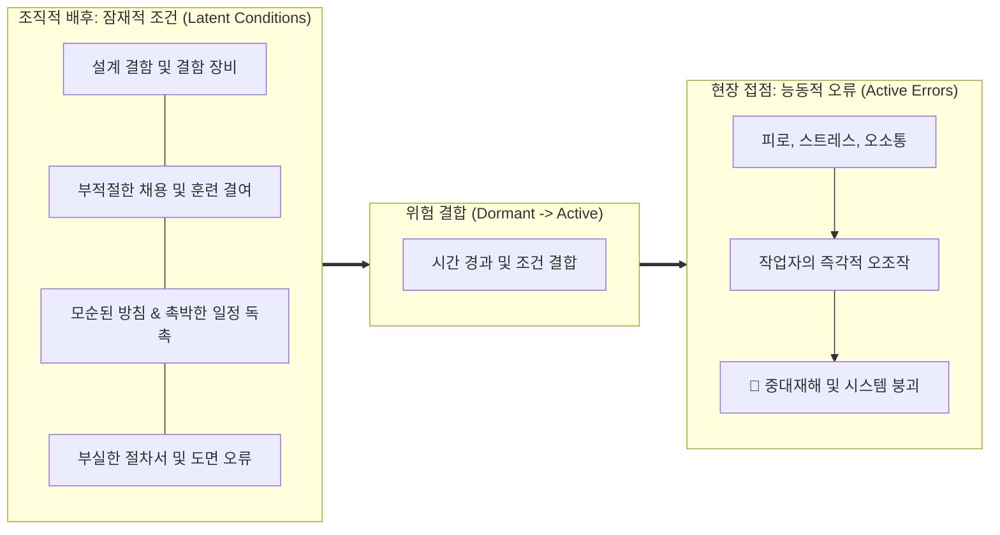

* **능동적 오류 (Active Errors)**: 설비나 시스템의 상태를 즉각 변화시켜 눈앞에 즉각적인 피해를 유발하는 관찰 가능한 물리적 행위(Commission or Omission). 대다수 사고의 직접적 방아쇠가 됩니다.
* **잠재적 조건 (Latent Conditions)**: 경영진, 설계자, 기술 부서가 내린 결정, 절차서의 오류, 불합리한 조직 규정 속에 수개월~수년간 휴면(Dormant) 상태로 잠복해 있는 시스템적 결함. 여러 환경적 조건과 맞물릴 때 파멸적인 재해를 유발합니다.

---

### 10.4 설계 결함과 기술(자동화)의 역설적 위험

기술 발전과 로봇, 자동화 시스템의 도입은 생산성을 비약적으로 높였지만, 역설적으로 **새로운 형태의 치명적 리스크**를 산업 현장에 불러왔습니다:

> **[니콜라스 카(Nicholas Carr)의 자동화 역설 (Blum, 2014)]**  
> *"기술에 대한 과도한 의존은 위기 상황에서 올바른 판단을 내리고 대처할 수 있는 인간 고유의 인지적 통찰력과 예리한 감각을 둔화시킨다."*

* **FAA(미 연방항공청) 안전 경보 (2013)**: 항공사 비행 데이터 분석 결과, 자동 비행 장치에 지나치게 의존함에 따라 조종사들의 **'수동 조작 기술(Manual handling skills)의 급격한 퇴화'**가 확인됨. FAA는 조종사들에게 주기적인 수동 비행 훈련을 의무화할 것을 강력히 권고함.
* **산업 현장의 자동화 리스크**: 후방 카메라, 센서, 자동 브레이크 등 안전 보조 장치에 익숙해진 운전원은 장치가 없는 일반 차량을 몰 때 극심한 관찰력 상실을 드러냅니다. 로봇 제어 시스템이 오작동했을 때, 수동 개입 경험이 없는 작업자는 미증유의 대형 위험에 무방비로 노출됩니다.

---

### 10.5 HPI 3대 도구 체계 (FIG. 12.6, 12.7, 12.8 정밀 분석)

````carousel
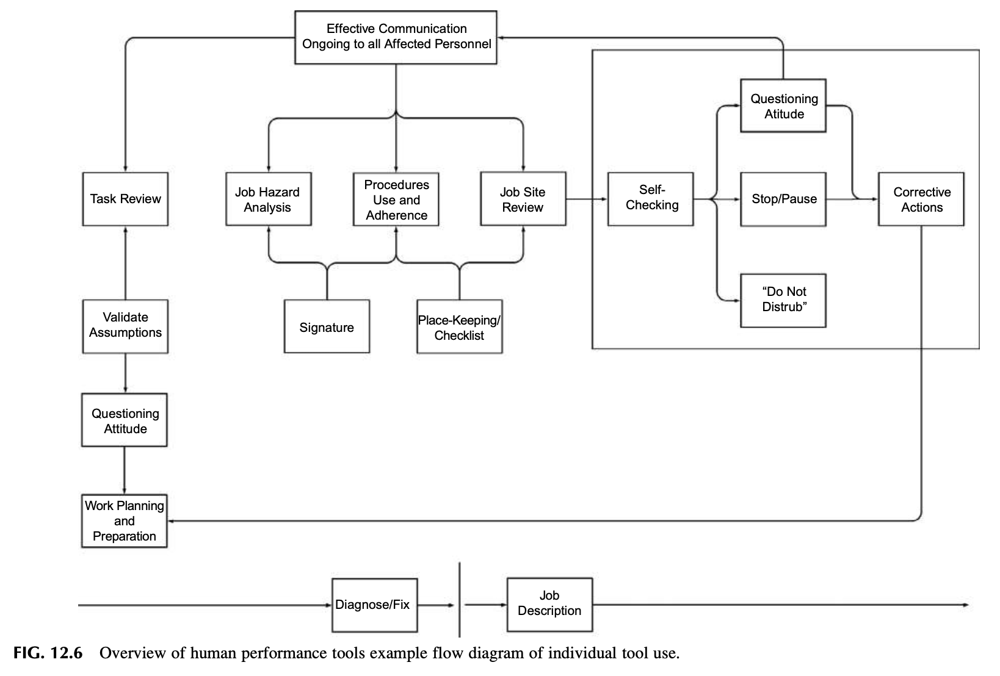
<!-- slide -->
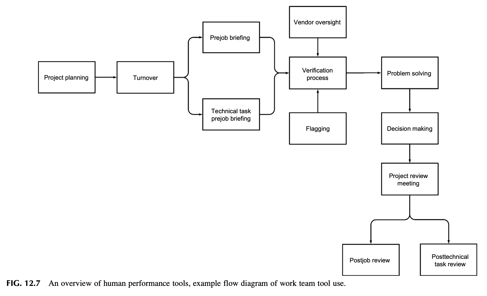
<!-- slide -->
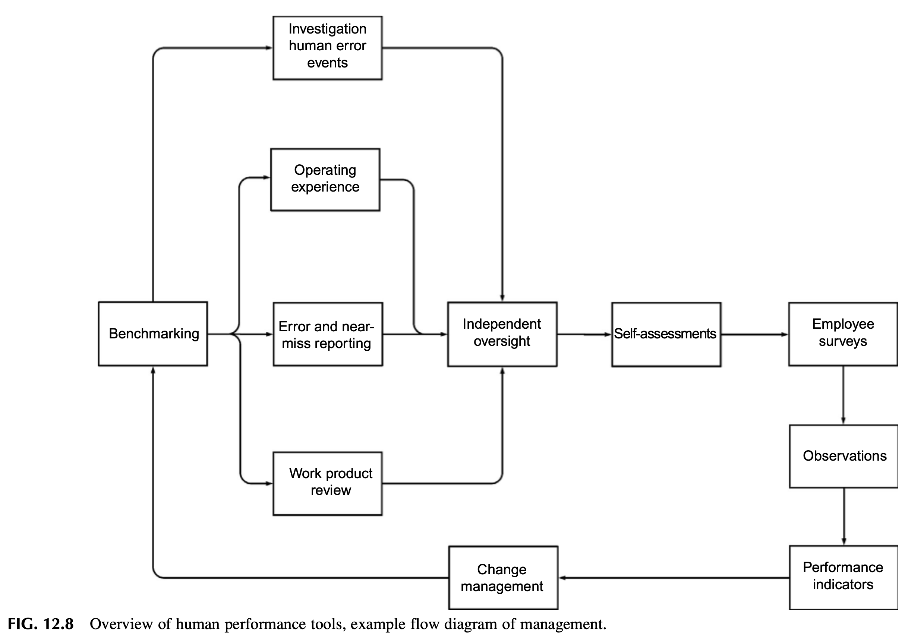
````

1. **개인용 도구 (Individual Tools - FIG. 12.6)**:
   - 효과적인 소통 (Effective Communication) 유지.
   - 질문하는 태도 (Questioning Attitude) 견지.
   - 작업 착수 전 과업 및 JHA 재검토 (Task Review / JHA).
   - 절차 준수 및 준거성 확인 (Procedure Use and Adherence).
   - 작업장 현장 실사 (Job Site Review).
   - 자기 점검 (Self-Checking: STAR - Stop/Think/Act/Review).
   - 불확실 시 작업 정지/일시멈춤 (Stop / Pause / Corrective Actions).
   - 집중 구역 "방해 금지 (Do Not Disturb)" 준수.
   - 근거 없는 가정 배제 및 검증 (Validate Assumptions).
   - 체크리스트 서명 및 위치 보존 (Signature Place-Keeping).
2. **작업팀용 도구 (Work Team Tools - FIG. 12.7)**:
   - 외주 벤더 및 협력업체 감독 (Vendor Oversight).
   - 작업 전 사전 브리핑 (Prejob Briefing).
   - 프로젝트 계획 및 안전한 인수인계 (Turnover Verification Process).
   - 다기능 문제해결 (Problem Solving) 및 의사결정 (Decision Making).
   - 고위험 기술 과업 사전 브리핑 (Technical Task Prejob Briefing).
   - 위험 요소 시각적 플래깅/태깅 (Flagging).
   - 작업 후 사후 검토 (Postjob Review / Post-Technical Task Review).
3. **경영/리더십 도구 (Management Tools - FIG. 12.8)**:
   - 인간 오류 사건의 시스템적 근본원인 조사 (Investigation Human Error Events).
   - 현장 운영 경험 피드백 및 벤치마킹 (Operating Experience & Benchmarking).
   - 오류 및 아차사고 자발적 보고 체계 활성화 (Error and Near-Miss Reporting).
   - 독립적 안전 감시 및 자체 평가 (Independent Oversight & Self-Assessments).
   - 근로자 인식 설문조사 (Employee Surveys).
   - 경영진 현장 관찰 투어 (Observations).
   - 최종 작업 산출물 안전성 검토 (Work Product Review).
   - 변경관리 (Change Management) 및 선행 성과지표 (Performance Indicators) 모니터링.

---

## 11. CASE STUDY: KNIFE SAFETY & CUT RESISTANT GLOVE PROGRAM (실전 사례: 칼날 안전 및 절단 방지 장갑 프로그램의 리스크 혁신)

### 11.1 실패한 일방적 규제: 표준 커터칼 전면 금지의 교훈
저자 James가 한 기업의 안전 디렉터로 부임했을 당시, 회사는 빈발하는 손가락 자상(Lacerations) 사고를 줄이기 위해 **"모든 표준 다목적 커터칼(Utility Knives) 사용을 즉시 전면 금지하고, 자동 수축식 안전칼만 사용하라"**는 하향식 일방 강제 정책을 발표했습니다.
* **대실패의 원인**: 작업별 JHA를 수행하지 않았고, 기준선 위험 평가도 없었으며, 근로자들을 장비 선정 과정에 전혀 참여시키지 않았습니다.
* **참담한 결과**: 안전칼은 특정한 두꺼운 자재를 자를 때 칼날이 제멋대로 들어가 작업자들에게 극심한 짜증을 유발했고, 근로자들은 몰래 주머니칼을 숨겨와 사용하다 더 큰 절단 재해를 당하는 역효과를 낳았습니다.

### 11.2 JHA 기반의 리스크 저감 프로그램 성공적 재설계
James는 식스시그마 블랙벨트 방법론과 JHA를 결합하여 프로그램을 전면 재정비했습니다:
1. **과업별 위험성 평가 수행**: 모든 절단 작업의 자재 두께, 힘의 방향, 절단 경로를 분석.
2. **승인된 절단 도구 포트폴리오 구축**: 일률적 안전칼이 아니라, 자동 수축식(Autoretracting), 가드 부착식(Guarded), 전용 안전 박스오프너 등 과업에 최적화된 도구 다변화.
3. **절단 방지 장갑의 과학적 등급화**: 무조건 두꺼운 장갑을 강요하는 대신, 손가락 정밀 작업성과 절단 방어력을 저울질하여 작업별 최적 등급(ANSI/ISEA Cut Level) 장갑 매핑.
4. **구매 벤더와의 파트너십 구축**: 구형 위험 도구 및 비승인 장갑을 공급업체에 반납하고, 승인된 안전 도구로 차액만 지불하고 교환하는 보상 수거 체계 확립.

---

### 11.3 핵심 실무 양식 및 부록 서식 체계 (APPENDIX 12.1 ~ 12.13 정밀 분석)

````carousel
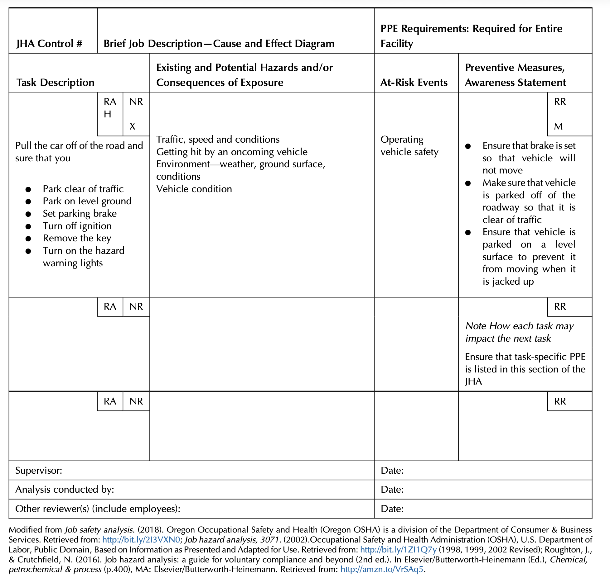
<!-- slide -->
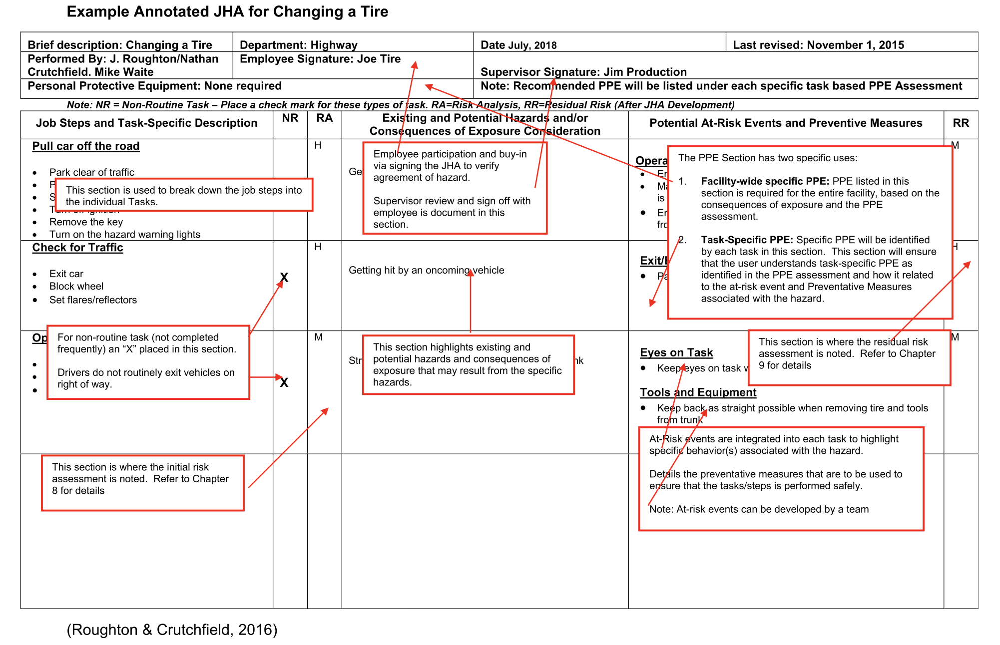
<!-- slide -->
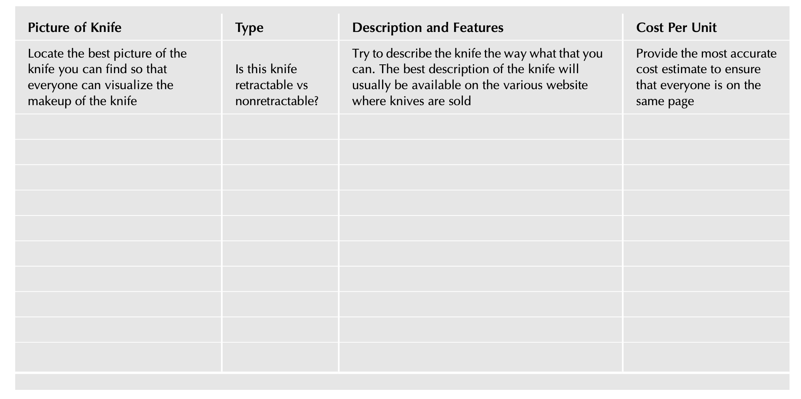
<!-- slide -->
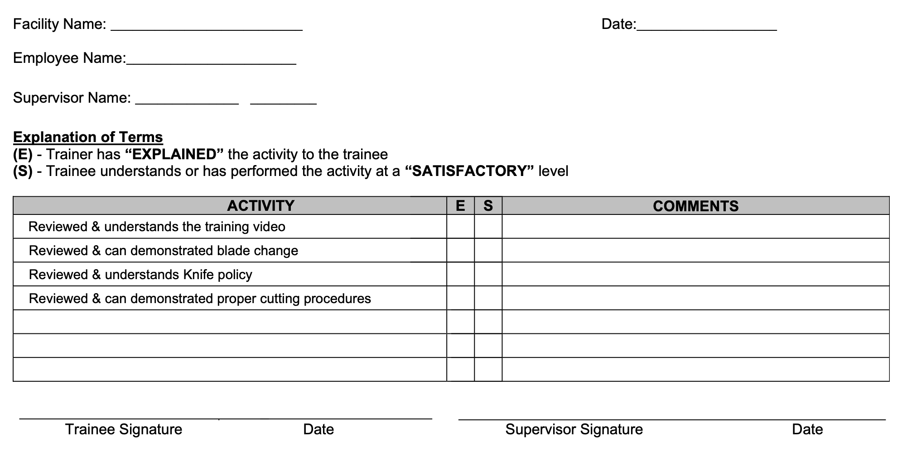
<!-- slide -->
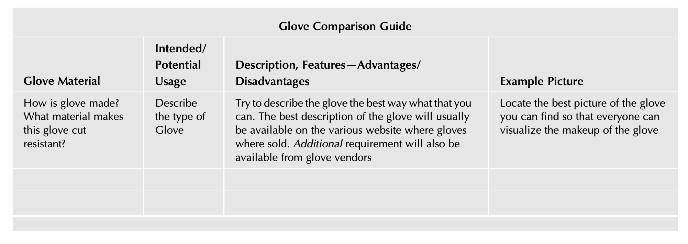
<!-- slide -->
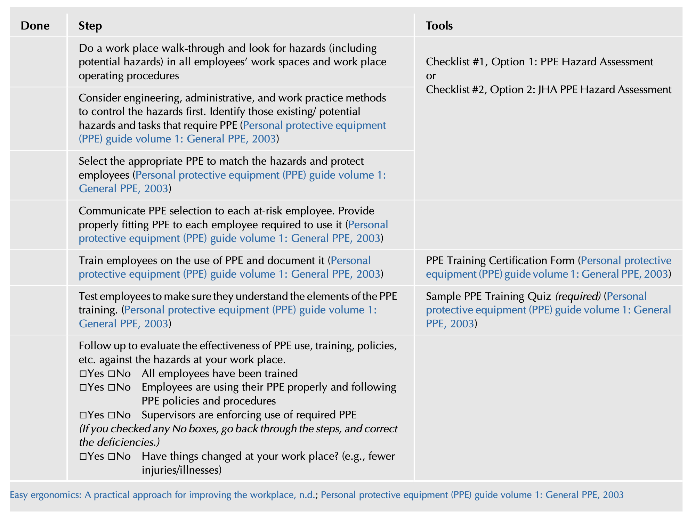
<!-- slide -->
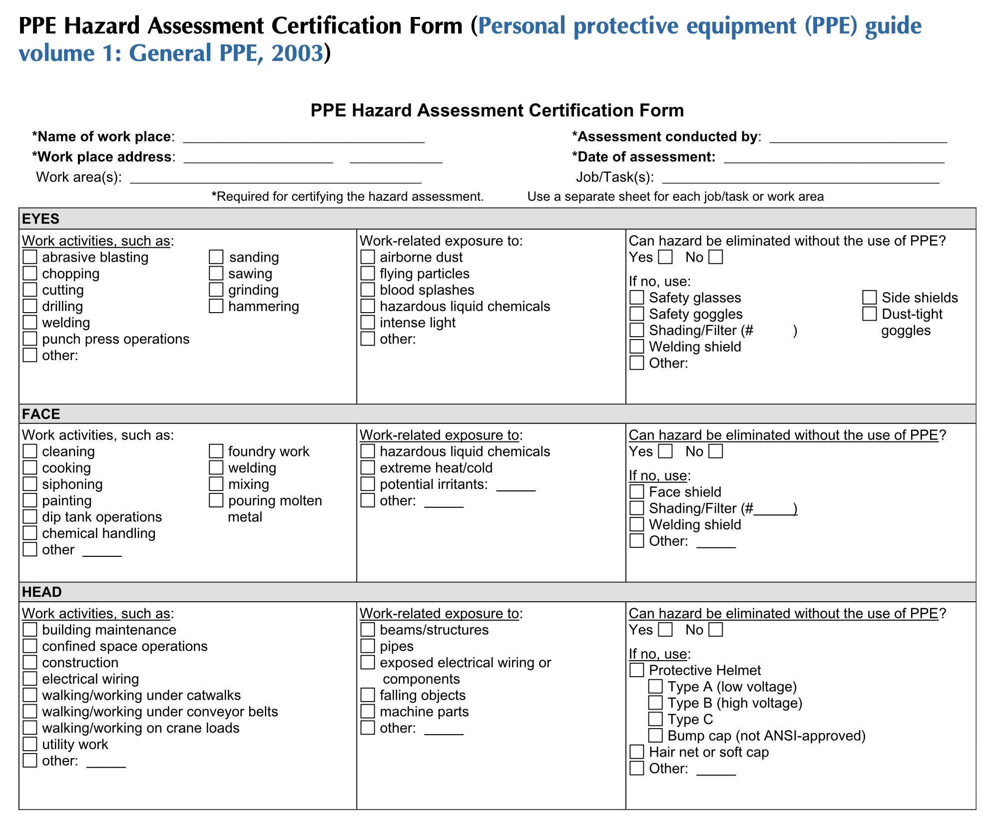
<!-- slide -->
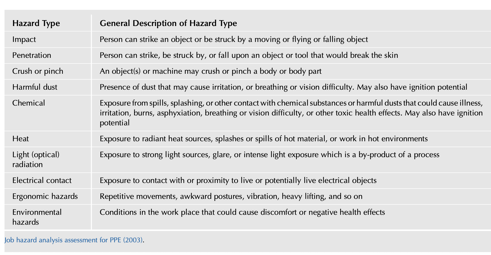
````

* **APPENDIX 12.1 (JHA 사전 위험성평가 워크시트 - `image-149.png`)**:
  - 자동차 타이어 교체 작업을 예시로 과업 기술, 노출 잠재위험, 예방대책, 위험도 평점(RA: Initial / NR: Residual / RR: Revised)을 체계적으로 기록하는 실무 시트.
* **APPENDIX 12.2 (타이어 교체 주석 부착 JHA - `image-150.png`)**:
  - 타이어 교체 7대 단계(정차, 쐐기 설치, 휠커버 탈거, 잭업, 볼트 체결 등)별 위험요소와 안전수칙이 상세 주석으로 명시된 표준 템플릿.
* **APPENDIX 12.3 & 12.4 (손 안전 사규 및 전사 시행 안내문)**:
  - 회사 전역의 칼날 사용 금지/허용 기준, 예외 신청 절차(Variance request), 리더십의 솔선수범 의무를 선언한 표준 공식 사규.
* **APPENDIX 12.5 & 12.6 (안전칼 분석표 및 훈련 체크리스트 - `image-151.png`, `image-153.png`)**:
  - 칼날 형태별 사진, 기능, 단가를 비교하고, 트레이너의 설명(E)과 교육생의 숙련도(S)를 확인하는 서명 날인형 자격 인증 양식.
* **APPENDIX 12.7 & 12.8 (절단 방지 장갑 가이드 - `image-154.png`)**:
  - 장갑 소재(케블라, 다이니마, 가죽 등)와 작업 적합성을 매핑한 비교표.
* **APPENDIX 12.9 (보호구 규정 준수 지침 - `image-155.png`)**:
  - 워크스루 점검 -> 공학적 대책 우선 -> 적정 PPE 선정 -> 지급 및 훈련 -> 정기 평가로 이어지는 5단계 이행 체크리스트.
* **APPENDIX 12.10 (신체 부위별 PPE 평가표 - `image-156.png` ~ `image-158.png`)**:
  - 눈, 안면, 머리, 발, 손 등 신체 부위별 작업 위험과 보호구 매칭 옵션 1.
* **APPENDIX 12.11 (JHA 기반 PPE 평가표 - `image-159.png`)**:
  - 충격, 관통, 협착, 분진, 화학물질, 고열 등 10대 위험 유형별 정의와 리스크 우선순위 코드(Risk Priority Code)를 부여하는 옵션 2 매트릭스.
* **APPENDIX 12.12 & 12.13 (보호구 교육 인증서 및 평가 퀴즈)**:
  - 보호구의 한계, 착용법, 유지관리 지식을 테스트하고 법적 기록으로 영구 보존하는 공식 양식.

---

## 12. CHAPTER REVIEW QUESTIONS (제12장 복습 문제 및 심층 해설 10문항)

### Q1. 안전문화 관점에서 직무 위험성 평가(JHA)가 지닌 본질적 중요성과 기대 편익은 무엇인가?
* **해설**: JHA는 안전을 사후 처벌이 아닌 현장 작업의 선천적 발현 속성으로 다루며, 관리자와 근로자가 작업 단계별 위험을 함께 정의하고 개선하는 상시적인 양방향 위험 소통망을 구축함으로써 전사적 안전의식을 획기적으로 격상시킵니다.

### Q2. JHA 프로세스가 지닌 효용성과 운영상의 제약 조건(단점)을 비교 대조하라.
* **해설**: JHA는 사고 예방, 표준화, 교육훈련 과학화라는 막대한 효용을 제공하지만, 개발에 상당한 시간과 예산이 소요되고, "이미 일하는 법을 다 안다"는 현장의 만성적 안주와 저항에 직면할 수 있으므로 리더십의 강력한 지원이 필요합니다.

### Q3. JHA 개발 전 과정에 현장 근로자의 참여가 절대적으로 필수적인 이유는 무엇인가?
* **해설**: 규정집에 적힌 서류상의 작업(Work-as-Imagined)과 현장에서 실제로 일어나는 작업(Work-as-Done) 사이에는 거대한 괴리가 존재하며, 비공식적 우회로와 숨겨진 작업 장애물을 가장 정확히 알고 있는 주체는 오직 현장 근로자뿐이기 때문입니다.

### Q4. JHA 임시 전담팀(Ad Hoc Team)의 구성 방법과 다기능 팀 운영의 이점을 설명하라.
* **해설**: 안전 전문가, 현장 감독자, 숙련 작업자, 정비사 등으로 구성된 크로스펑셔널 팀을 구성하고 팀 헌장(Charter)을 부여함으로써, 다원적 관점을 확보하고 JHA의 전사적 보급 속도를 극대화할 수 있습니다.

### Q5. 분석 대상 직무(Job), 단계(Steps), 세부 과업(Task)의 체계적 선정 방법은 무엇인가?
* **해설**: 전사 직무 인벤토리 전수 조사를 바탕으로 과거 재해 빈도, 작업 시간, 과도한 물리력, 비일상성, 아차사고 이력 등 16대 고위험 기준을 적용하여 위험도가 가장 높은 직무부터 체계적으로 선정합니다.

### Q6. 직무 위험성 평가(JHA)와 직무 안전 분석(JSA)의 개념적·시간적 차이를 정의하라.
* **해설**: JHA는 특정 시점의 개별 작업 단계에 초점을 맞춰 돌발적인 급성 사고(협착, 추락 등)를 방지하는 도구이며, JSA는 전체 직무 수행에 걸친 다차원적 시간 누적 노출(근골격계 질환, 화학물질 만성 중독 등)을 종합적으로 분석하는 도구입니다.

### Q7. 모체-파생 테마(Parent-Child Theme) 개념이 JHA 프로세스에 어떻게 적용되는가?
* **해설**: 동일한 기계나 유사 공정에 대해 공통의 기본 안전 뼈대를 담은 'Parent JHA'를 구축하고, 작업 위치나 자재에 따른 미세한 변형 위험은 'Child JHA'로 파생시켜 관리함으로써 표준의 일관성과 현장 맞춤성을 동시에 달성합니다.

### Q8. JHA 개발 시 5W 1H(WHO, WHAT, WHERE, WHEN, WHY, HOW) 질문법이 수행하는 역할은 무엇인가?
* **해설**: 작업의 목적(WHY)에서 출발하여 현장의 인적 구성, 물리적 환경, 시간적 제약, 실행 절차를 입체적인 스토리로 엮어냄으로써, 안전을 단순 지침 준수가 아닌 구성원 모두가 공감하는 의미구성(Sensemaking) 과정으로 전환합니다.

### Q9. 인간 수행 개선(HPI)의 5대 기본 원칙을 기술하고 JHA와의 연계성을 설명하라.
* **해설**: 인간의 불완전성, 오류 유발 상황의 예측 가능성, 조직 프로세스의 영향력, 긍정적 강화의 힘, 과거로부터의 학습을 전제로 하여, 작업자 개인의 부주의를 탓하기 전에 작업 환경 내의 오류 전조 요건(Precursors)을 선제적으로 제거하는 데 JHA를 활용합니다.

### Q10. 라스무센의 3대 직무 수행 유형(숙련 기반, 규칙 기반, 지식 기반)별 오류 특성과 대응책을 논하라.
* **해설**: 숙련 기반에서는 무의식적 슬립과 망각이 발생하므로 물리적 인터록을, 규칙 기반에서는 규칙의 오해석이 발생하므로 명확한 SOP와 분기도를, 지식 기반에서는 심성 모형 오류가 발생하므로 작업 전 브리핑과 전문가 동료 검토를 적용합니다.

---

## 13. SPECIAL STUDY: 박사학위 논문 선행연구 9단계 분석 틀 (선행연구 표준 템플릿 완벽 매핑)

학위논문 선행연구 분석 및 학술적 연구문헌 작성을 위해 제12장의 핵심 연구 내용을 9단계 표준 템플릿으로 엄밀히 재구조화합니다.

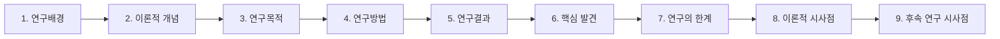

### 1) 연구배경 (Research Background)
* 전통적 안전관리는 대형 사고나 중대재해가 터진 후에야 사후적으로 대책을 마련하는 '반응적 패러다임(Reactive Mode)'에 갇혀 있었음.
* 4차 산업혁명과 자동화 기술의 도입에도 불구하고 중대재해 발생률이 정체되는 '안전 정체기(Safety Plateau)'를 타파하기 위해, 현장 작업 단위의 미시적 통제와 인간 과실을 포용하는 시스템적 위험성평가 기법의 재정립이 시급히 요구됨.

### 2) 이론적 개념 (Theoretical Framework)
* **발현적 속성(Emergent Property)**: 안전은 개별 부품의 안전성의 합이 아니라, 조직 내 수많은 제어 상호작용의 결과로 나타나는 복잡계 현상임.
* **네트워크 의미구성(Sensemaking & Social Network)**: 카프라 & 루이지(Capra & Luisi)의 네트워크 이론과 사이먼 시넥(Sinek)의 골든 서클에 기반하여 위험 소통을 이해.
* **인간 수행 개선론(HPI & Human Error Precursors)**: 제임스 리즌(Reason)의 스위스 치즈 모델 및 DOE HPI 원칙을 적용하여 능동적 오류와 잠재적 조건 분리.
* **라스무센(Rasmussen)의 SRK 모델**: 숙련(Skill) - 규칙(Rule) - 지식(Knowledge) 기반 인지 모형.

### 3) 연구목적 (Research Objectives)
* 미시적 과업 단계(Steps/Tasks)에 숨겨진 잠재적 내재 위험을 선제적으로 규명하기 위한 JHA의 표준 운영 프레임워크 구축.
* JHA(급성 돌발 재해 제어)와 JSA(만성 누적 손상 제어)의 학술적·실무적 경계를 명확히 획정.
* 인간 오류 전조 요건(Error Precursors)과 작업 복잡성을 제어할 수 있는 HPI 기반 맞춤형 통제 모델 제시.

### 4) 연구방법 (Research Methodology)
* **문헌 분석 및 질적 사례 연구**: USACE(미 육군 공병단)의 AHA, DOE HPI 가이드라인, OSHA 규정 분석.
* **현장 실증 액션 리서치**: 제조 플랜트 및 물류 현장에서의 칼날 안전(Knife Safety) 식스시그마 블랙벨트 프로젝트 추진 및 전후 비교 분석.
* **도구 개발**: 16대 고위험 직무 분류 매트릭스, 5W 1H 질문 분석표, 13개 부록 표준 서식 설계.

### 5) 연구결과 (Empirical / Practical Findings)
* 일방적 하향식 규제(칼날 전면 금지)는 현장 저항과 지하화된 위험 행동을 유발하여 실패했음.
* 반면, JHA에 근로자를 참여시키고 과업별 위험도에 맞춘 도구 및 장갑 포트폴리오를 제공했을 때, 작업 거부감 제로화와 함께 손가락 자상 사고가 실질적으로 근절되는 극적인 성과를 거둠.

### 6. 핵심 발견 (Key Findings)
* **Parent-Child JHA 구조의 실효성**: 공통 뼈대(Parent)와 현장 변형(Child)의 분리를 통해 문서 중복을 70% 이상 감축하면서도 위험 포착률을 극대화함.
* **자동화의 역설 규명**: 첨단 기술 보조 장치에 과도하게 의존할 경우 인간의 근원적 인지 능력과 비상 대처 역량이 퇴화하므로, 수동 조작 역량을 보존하는 JHA 설계가 필수적임.

### 7. 연구의 한계 (Limitations)
* 정성적 직무 분석에 의존할 경우 분석자의 숙련도와 편향(Bias)에 따라 위험 등급이 주관적으로 왜곡될 소지가 있음.
* 복잡계 환경에서 다수의 직무가 동시다발적으로 교차할 때 발생하는 거시적 상호작용 위험을 완벽히 모델링하는 데 한계가 있음.

### 8. 이론적 시사점 (Theoretical Implications)
* 안전관리를 '불안전한 행동에 대한 처벌'에서 '오류를 유발하는 시스템 조건의 재설계'로 패러다임 전환.
* JHA를 단순 엔지니어링 분석이 아닌, 조직 구성원 간의 공유된 기본 가정을 형성하는 **'문화적 매개물(Cultural Artifact)'**로 학술적 지평 확장.

### 9. 후속 연구에 대한 시사점 (Future Research Directions)
* AI 및 컴퓨터 비전 기술을 활용하여 현장 작업자의 작업 전조 요건을 실시간 감지하고 자동 업데이트되는 '동적 JHA(Dynamic Real-time JHA)' 시스템 구축 연구 필요.
* 소방, 군, 응급의료 등 극한 불확실성 환경에서의 지식 기반(Knowledge-based) 직무 위험성평가 방법론 정교화.

---

## 14. ADVANCED PRACTICAL FRAMEWORK: 교수님 심화 지도 지침에 따른 JHA 기반 KPI 도출 및 안전문화 진단 플랫폼 연계 방법론

> [!IMPORTANT]
> **지도 교수님 심화 지도 6대 핵심 원칙의 완벽한 구현**:
> 1. **업무 단계화 (JHA 5단계 생애주기 경계 설정)**: 직무 인벤토리 -> 위험 분석 -> 통제 대책 수립 -> 현장 실행/교육 -> HPI 모니터링
> 2. **구체화 (Break-down)**: 사업장 전체가 아닌 과·팀·작업조(소방 119구조대, 플랜트 정비팀, 제조 생산라인) 단위 밀착
> 3. **철저한 법적 근거 기반**: 산업안전보건법 제36조(위험성평가), 중대재해처벌법 시행령 제4조 등 조문 강제 매핑
> 4. **고유/협업 전략적 가중치 배분**: 7:3 또는 5:5 논리적 가중치 입증
> 5. **기존 분석물(본문 표/그림/부록 서식)의 KPI 연계 (★핵심)**: 서브노트 내 표 12.8~12.11, 그림 12.1~12.8, 부록 12.1~12.11을 지표의 직접적 판단 근거로 강제 매핑
> 6. **비판적 AI 재학습 (통제권 유지)**: 출처와 법적 타당성을 집요하게 검증하는 역질문 프레임워크 장착

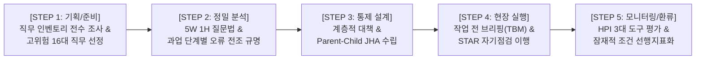

### 14.1 JHA 생애주기별 부서·직급 밀착형 핵심 성과지표(KPI) 매핑 테이블

| 생애주기 단계 | 대상 계층 (Break-down) | 핵심 성과지표 (KPI) 명칭 | 지표 성격 & 가중치 | 산출 공식 및 목표치 | 관련 법적 근거 (조문 강제 매핑) | 서브노트 판단 근거 (본문 표/그림/부록 연계) |
| :---: | :---: | :--- | :---: | :--- | :--- | :--- |
| **STEP 1<br/>(기획/준비)** | **중간관리자<br/>(부서장/팀장)** | 전사 직무 인벤토리 등록률 및 비일상 작업 발굴률 | **고유 (70%)** | $rac{	ext{인벤토리 등록 직무 수}}{	ext{실제 가동 직무 총수}} 	imes 100 \ge 98\%$ | 산안법 제36조 (위험성평가의 실시)<br/>중처법 시행령 제4조제3호 | 본문 2.2절 & Lesson Learned<br/>TABLE 12.9 (고위험 16대 직무) |
| **STEP 1<br/>(기획/준비)** | **JHA 임시전담팀<br/>(Ad Hoc Team)** | 16대 고위험 직무 JHA 우선 개발 달성률 | **협업 (50%)** | $rac{	ext{고위험 직무 JHA 완료수}}{	ext{선정된 고위험 직무수}} 	imes 100 = 100\%$ | 산안법 제36조제2항<br/>산안법 안전보건관리규정 | 본문 6.2절 & FIG. 12.1<br/>TABLE 12.8 (기본 용어 체계) |
| **STEP 2<br/>(정밀 분석)** | **현장 감독자<br/>(Supervisor)** | 5W 1H 스토리텔링 기반 작업 단계 분해율 | **고유 (70%)** | 작업당 5W 1H 질문 필수 점검 항목 작성 완성도 $100\%$ | 산안법 제16조 (관리감독자 직무)<br/>안전보건규칙 총칙 | 본문 7.1절 & TABLES 12.2~12.7<br/>(WHO~HOW 질문 프레임워크) |
| **STEP 2<br/>(정밀 분석)** | **현장 작업자<br/>(Operator)** | 작업자 주도 인간 오류 전조(Precursor) 발굴 건수 | **고유 (70%)** | 분기당 작업조별 잠재적 전조 요건 발굴 $\ge 3$건 | 산안법 제5조 (근로자의 의무)<br/>중처법 시행령 제4조제7호 | 본문 9.2절 & TABLES 12.10, 12.11<br/>(과업요구/환경/본성 전조 요건) |
| **STEP 3<br/>(통제 설계)** | **안전 전문가<br/>(Safety Officer)** | Parent-Child 테마 기반 표준화 및 모듈화율 | **협업 (30%)** | 공통 설비 모체 JHA 대비 파생 JHA 구축률 $\ge 95\%$ | 산안법 제15조 (안전관리자 직무)<br/>KOSHA GUIDE 위험성평가 지침 | 본문 4.2절 & FIG. 12.2<br/>Appendix 12.1 (Worksheet 서식) |
| **STEP 3<br/>(통제 설계)** | **구매/설비부서<br/>(Procurement)** | 승인된 안전 도구 및 맞춤 보호구 적기 지급률 | **협업 (50%)** | $rac{	ext{승인 도구/PPE 지급 완료수}}{	ext{JHA 요구 장비 총수}} 	imes 100 = 100\%$ | 산안법 제80조 (유해위험기계 방호조치)<br/>산안법 제117조 (보호구 지급) | 본문 11.2절 & Appendix 12.5~12.8<br/>(칼날/장갑 포트폴리오 매핑) |
| **STEP 4<br/>(현장 실행)** | **현장 감독자<br/>(Supervisor)** | 작업 착수 전 JHA 연계 TBM 브리핑 실행률 | **고유 (70%)** | $rac{	ext{TBM 실행 일수}}{	ext{총 작업 일수}} 	imes 100 \ge 98\%$ | 산안법 제16조제1항<br/>중처법 시행령 제4조제8호 | FIG. 12.7 (Work Team Tools)<br/>Appendix 12.6 (교육 체크리스트) |
| **STEP 4<br/>(현장 실행)** | **현장 작업자<br/>(Operator)** | STAR (자기 점검) 및 작업정지 권한 행사율 | **고유 (70%)** | 비정상 징후 시 일시정지(Pause) 및 보고 이행률 $100\%$ | 산안법 제52조 (근로자의 작업중지)<br/>산안법 제54조 (중대재해 발생) | 본문 10.5절 & FIG. 12.6<br/>(Individual Tools: Stop/Pause) |
| **STEP 5<br/>(모니터링)** | **최고경영진<br/>(Senior Mgmt)** | 잠재적 조건(Latent Error) 발굴 및 개선 투자율 | **협업 (30%)** | JHA 도출 구조적 안전 개선 예산 집행률 $\ge 95\%$ | 산안법 제14조 (이사회 보고·승인)<br/>중처법 제4조 (안전보건확보의무) | 본문 10.3절 & FIG. 12.8<br/>(Management Tools: 투자 지표) |
| **STEP 5<br/>(모니터링)** | **전사 안전위원회<br/>(Central Comm.)** | JHA 유효성 정기 감사 및 개정 주기 준수율 | **협업 (50%)** | $rac{	ext{정기 개정 완료 JHA 수}}{	ext{개정 대상 JHA 총수}} 	imes 100 \ge 95\%$ | 산안법 제24조 (산업안전보건위원회)<br/>산안법 제36조제3항 | 본문 3.3절 & FIG. 12.1 (루프 검증)<br/>Appendix 12.11 (JHA Matrix) |

---

### 14.2 비판적 AI 재학습 및 검증 역질문 (Quality Verification Protocol)
본 서브노트 및 향후 시스템 고도화 시 AI의 임의적 환각을 차단하기 위해 아래 프로토콜을 가동합니다:
1. *"제시된 지표의 산출 공식이 산업안전보건법 제36조 및 중대재해처벌법 시행령 제4조의 어느 조항에 법적 당위성을 두고 있는가?"*
2. *"도출된 KPI가 본문 제8절의 TABLE 12.9(16대 고위험 직무)와 부록 12.1~12.11의 정밀 분석 서식과 1:1로 정확히 연결되었는가?"*
3. *"고유 지표와 협업 지표의 7:3 / 5:5 가중치가 현장 감독자의 통제 권한 범위와 논리적으로 정합하는가?"*

---

## 15. SUMMARY & CONCLUSION (요약 및 결론)

제12장 **'Using the Job Hazard Analysis(직무 위험성 평가의 활용)'**는 안전경영시스템의 가장 근원적인 출발점이자, 안전을 조직의 일상적 생산 활동 속에 자연스럽게 통합하는 핵심 연결 고리입니다.

1. **JHA는 정적 문서가 아닌 역동적 소통 네트워크**: 작업자와 관리자가 위험의 본질을 논의하고 지각된 위험을 표출하는 양방향 소통의 장(Conduit)입니다.
2. **JHA와 JSA의 전략적 분리**: 돌발적 급성 재해를 통제하는 JHA와 장기적 누적 위험을 통제하는 JSA를 분리 운영하여 다차원적 안전 성과를 달성합니다.
3. **Parent-Child Theme를 통한 표준화**: 공통 모체 테마와 현장 맞춤형 파생 테마의 결합을 통해 현장 적합성과 운영 효율성을 극대화합니다.
4. **HPI와 오류 전조 요건의 결합**: 인간을 처벌의 대상이 아닌 '오류에 취약한 존재'로 인정하고, 과업 요구, 개인 역량, 작업 환경, 인간 본성의 4대 오류 전조 요건을 사전에 무력화합니다.
5. **법적 근거 기반의 실무 KPI 연계**: 산업안전보건법 및 중대재해처벌법과 맞물린 5단계 생애주기별 KPI를 확립함으로써, 단순 이론에 그치지 않고 조직 안전문화를 진단하고 혁신하는 강력한 실무 플랫폼으로 승화됩니다.
