<!-- Block B01 -->
# 제12장 직무위험성평가(JHA)의 활용 (Using the Job Hazard Analysis)

*안전문화(Safety Culture). https://doi.org/10.1016/B978-0-12-814663-7.00012-1*  
*©2019 Elsevier Inc. All rights reserved. pp. 289–326*

<!-- Block B02 -->
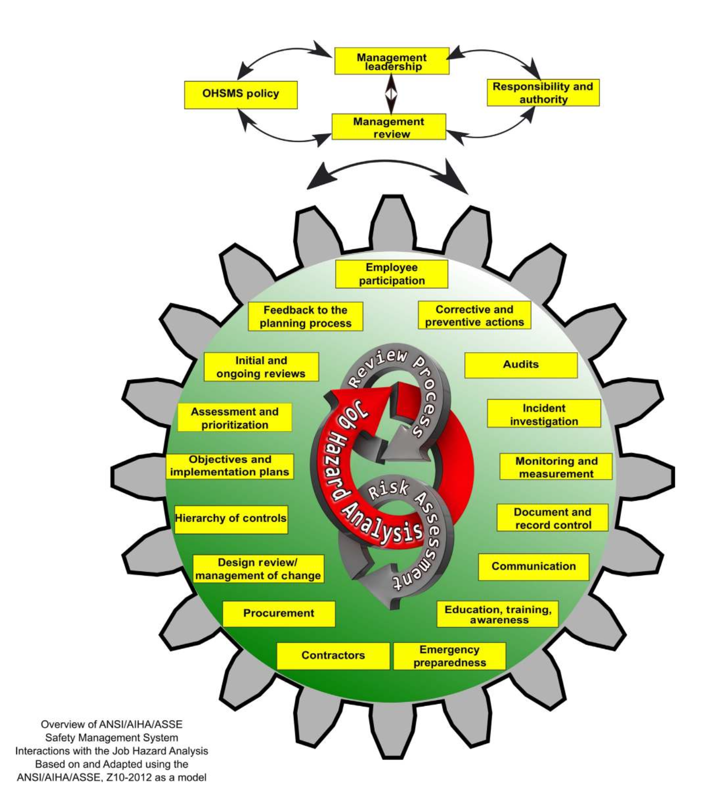

> "우리는 생산과 별개의 안전 프로그램을 원치 않으며, 생산과 안전의 단순한 병렬이나, 안전을 곁들인 생산을 원치 않는다. 우리가 진정으로 원하는 것은 바로 '안전한 생산(safe production)' 그 자체이다."  
> — 댄 피터슨(Dan Petersen)

---

<!-- Block B03 -->
## 서론 (INTRODUCTION)

기업 조직이 존재하는 근본적인 이유는 고객에게 다양한 제품과 서비스를 제공하기 위한 유기적인 조직 구조를 확립하는 데 있다. 경영 시스템과 내부 소통 네트워크는 이러한 궁극적 목표를 달성하기 위해 구축된다. "직무(Jobs)"는 조직의 목표를 달성하는 데 필요한 세부 과업을 완수하기 위해 요구되는 개별 활동, 책임(responsibilities), 그리고 권한(authorities)을 명확히 규정한다. 바로 이것이 직무위험성평가(JHA, Job Hazard Analysis)가 조직의 제반 작업 활동 속에 내재된 운영상의 유해위험요인과 위험을 과학적으로 평가하는 데 없어서는 안 될 절대적인 핵심 도구인 이유이다.

JHA는 성공적인 모든 안전보건경영시스템의 가장 견고한 기초를 이루는 중추적인 핵심 일환이다. 유해위험요인 및 위험 통제는 리더십과 현장 근로자가 자신들의 직무, 세부 단계, 그리고 필수 과업 활동 속에 내재된 다양한 유해위험요인의 본질을 완벽히 이해하고 있을 때에만 비로소 실효성 있게 작동할 수 있다.

제1장 '안전 지각의 정의'에서 논의한 바와 같이, 본서의 저자들은 안전을 조직 내부에서 일어나는 수많은 안전 통제 상호작용의 결과로서 발현되는 '창발적 속성(emerging property)'으로 바라본다. 조직 전반에 걸쳐 JHA 프로세스를 구축 및 실행함으로써, 리더십 팀과 현장 근로자들은 세부 작업 과업별로 특화된 구체적인 유해위험요인과 그에 연계된 위험에 대한 심층적인 통찰을 획득하게 된다. 유해위험요인과 연계된 위험은 오직 지속적이고 포괄적인 위험성 평가 프로세스를 통해서만 정확히 식별되고 안전하게 통제될 수 있다.

JHA 프로세스는 구체적인 직무 레벨(job level)에서 유해위험요인과 위험에 대한 실질적인 통제 대책을 규명해냄으로써 안전문화를 획기적으로 개선하고 조직에 강력한 실질적 부가가치를 더해준다. 체계적인 JHA 프로세스 전략은 권고된 유해위험요인 및 연계 위험 통제 조치들을 현장에 차질 없이 구현하는 데 필요한 행정적 조직 구조, 충분한 작업 시간, 그리고 적정 예산을 빈틈없이 제공한다.

본 장을 학습한 후 여러분은 다음을 수행할 수 있어야 한다:
* JHA가 조직의 안전문화에 미치는 결정적 중요성과 다차원적 이점을 설명할 수 있다.
* JHA 프로세스가 지닌 구체적인 장점과 잠재적 단점을 비교·설명할 수 있다.
* JHA 프로세스에 현장 근로자를 직접 동참시키는 것이 왜 절대적으로 중요한지 설명할 수 있다.
* JHA 특별 전담팀(Ad Hoc Team)을 선발하는 방법과 그에 따른 실무적 이점을 설명할 수 있다.
* 위험성 분석을 위해 특정 직무, 세부 단계, 그리고 작업 과업을 올바르게 선별하는 방법을 설명할 수 있다.
* 직무위험성평가(JHA)와 작업안전분석(JSA)의 개념적 차이점을 명확히 정의하고 설명할 수 있다.
* JHA 프로세스가 전사적 조직 체계 속에 어떻게 유기적으로 통합되는지 설명할 수 있다.
* JHA가 조직 전반에 걸쳐 위험 정보를 소통시키는 메커니즘을 설명할 수 있다.
* 조직의 고유한 문화가 일상적인 직무 완수 과정에 어떠한 영향을 미치는지 설명할 수 있다.
* 인적 수행도 향상(HPI, Human Performance Improvement)의 기본 개념들을 명확히 설명할 수 있다.

---

<!-- Block B04 -->
## 직무위험성평가 프로세스의 착수—직무 목록(인벤토리) 작성 (BEGINNING THE JOB HAZARD ANALYSIS PROCESS—JOB INVENTORY)

그 어떤 직무 과업이라 할지라도 다양한 수준의 심각도와 발생 확률을 지닌 숨겨진 잠재 위험요인을 수반할 수 있다. 직무위험성평가(JHA)는 특정 직무를 완수하는 데 요구되는 세부 단계와 작업 과업 속에 내재되어 있는 고유한 유해위험요인과 위험을 정확히 식별하고 통제하는 데 초점을 맞춘다. 특정한 공구, 자재, 기계 장비를 사용하는 일련의 작업 활동들을 면밀히 검토하고, 유해위험요인과 위험을 완전히 제거하거나 허용 가능한 수준으로 낮추기 위한 구체적인 현장 조치들이 수립된다.

기업 조직은 다양한 수준의 회복탄력성(resilience)을 지닌 적응형 복합 시스템(adaptive and complex structures)이다. 수많은 조직들은 상황이 강요하거나 쓰라린 사고 경험을 겪고 난 뒤에야 비로소 변화가 필요함을 깨닫는 사후 대응적 방식(reactive mode)으로 운영되는 경향이 짙다. 대부분의 경우, 치명적인 손실 유발 조건이 위기 상황을 초래하거나 더 이상 감내할 수 없는 운영상의 파국을 야기하고 난 뒤에야 뒤늦게 개선 조치가 취해진다. JHA 프로세스를 구축하는 궁극적 목적은 특정 작업이나 활동이 이미 시작되었거나 비극적인 손실 사고가 터지고 난 뒤에야 위험요인을 뒤늦게 발견하는 치명적인 취약성을 근본적으로 제거하는 데 있다. JHA 프로세스는 작업 활동이 본격적으로 시작되기 전에 유해위험요인과 연계된 위험을 선제적으로 통제함으로써 조직 내에 높은 수준의 회복탄력성을 사전에 구축하는 데 활용된다.

JHA 프로세스는 조직 전반에 대한 철저한 전면적 평가로 시작된다. 이 평가는 조직의 비즈니스 목표를 달성하기 위해 현재 현장에서 수행되고 있는 모든 직무를 빠짐없이 발굴하여 초기 직무 목록(initial inventory)을 체계적으로 작성한다. 이후 제9장 '위험 지각의 정의'에서 상세히 논의한 위험 가이드 카드(risk guidance card)나 위험 매트릭스(risk matrix)와 같은 정밀 위험성 평가 도구를 활용하여, 각 작업 활동이나 직무를 심층 분석함으로써 잠재된 고유 위험과 연계 위험을 정밀하게 식별한다.

최종적인 인벤토리 구축 단계는 식별된 직무들을 가장 높은 위험부터 가장 낮은 위험 순으로 순위를 매기고 정렬하여(rank, order, sort), 도출된 안전 개선 솔루션이 가장 치명적인 고위험 영역을 최우선적으로 타격할 수 있도록 만드는 것이다. 이 평가는 현장에 상존하는 잠재적 심각도, 위험 노출 빈도, 그리고 인간의 실수(human errors) 및 착오의 발생 가능성과 무엇이 잘못될 수 있는가에 대한 최악의 시나리오를 총체적으로 고려한다. 유해위험요인이 구체적으로 어디에 존재하며, 연계된 위험의 본질이 무엇이고, 그 잠재적 심각성이 얼마나 파멸적인지를 정확히 파악하는 것은 절대적으로 중요하다. 정밀한 위험성 평가는 한정된 자원을 가장 위험한 곳에 집중 투입할 수 있도록 명확한 우선순위를 확립해 준다.

---

<!-- Block B05 -->
### 학습 교훈 (LESSON LEARNED)

직무 인벤토리를 작성할 때 관리자들은 종종 사무실에 앉아 형식적인 서류상의 직무 기술서만을 보고 목록을 만드는 치명적인 실수를 범한다. 그러나 현장의 실제 작업은 서류상의 기술서와는 완전히 다르게 돌아가는 경우가 허다하다. 근로자들은 현장의 설비 노후화, 작업 공간의 협소함, 부품의 치수 불량, 또는 촉박한 납기 압박을 극복하기 위해 나름의 비공식적인 작업 요령(workarounds)을 고안하여 작업하고 있기 때문이다. 이러한 현장의 '실제 작업 방식'을 온전히 반영하지 못한 채 책상머리에서 작성된 직무 인벤토리는 현장의 치명적인 숨은 위험을 완전히 놓쳐버리는 무용지물로 전락하게 된다. 따라서 관리감독자는 반드시 작업 현장에 직접 나가 실제 작업을 온몸으로 관찰하고 작업자와 긴밀히 대화하며 인벤토리를 완성해야 한다.

---

<!-- Block B06 -->
## 소통 도구로서의 JHA (THE JHA AS A COMMUNICATION TOOL)

JHA는 단순히 위험을 목록화하는 건조한 기술적 양식이 결코 아니다. JHA의 가장 강력한 본질은 바로 조직의 각 계층과 부서 간을 끈끈하게 연결해 주는 '구조화된 양방향 소통 도구(communication tool)'로 기능한다는 점이다. 현장 작업자와 관리감독자가 마주앉아 JHA를 작성하고 검토하는 과정 자체가, 작업의 실제 위험이 무엇이고 이를 어떻게 통제할 것인지에 대한 열린 대화를 촉발하는 가장 이상적인 소통의 장이 된다.

JHA를 통해 도출된 명확한 안전 기준과 핵심 위험 통제 조치들은 신규 입사자 교육, 작업 전 TBM(툴박스 미팅), 주간 안전 회의 등 다양한 채널을 통해 조직 전반으로 신속하고 투명하게 확산된다. 이를 통해 안전에 관한 조직 구성원들의 지각과 인식이 완벽히 일치되는 강력한 공감대가 형성된다.

---

<!-- Block B07 -->
## JHA는 왜 중요한가? (WHY IS A JHA IMPORTANT?)

많은 기업들이 일상적으로 반복되는 작업에 대해 "이미 수년간 아무 사고 없이 해오던 일인데 굳이 번거롭게 JHA를 작성해야 하는가?"라는 회의적인 의문을 제기하곤 한다. 그러나 과거에 사고가 없었다고 해서 위험이 없다는 것을 의미하지는 않는다는 '무손실=무위험 신화'의 오류는 이미 앞선 장들에서 명백히 입증되었다.

JHA가 결정적으로 중요한 이유는 일상 업무의 당연한 관행 뒤에 은폐되어 있던 잠재 위험요인들을 과학적으로 분해하여 가시화해 주기 때문이다. JHA는 단순한 안전 점검을 넘어, 작업 절차의 표준화, 설비 개선, 교육 훈련 니즈 도출, 그리고 근골격계 질환과 같은 만성적 유해요인을 종합적으로 걸러내는 다목적 안전 나침반 역할을 수행한다 (표 12.1 참조).

---

<!-- Block B08 -->
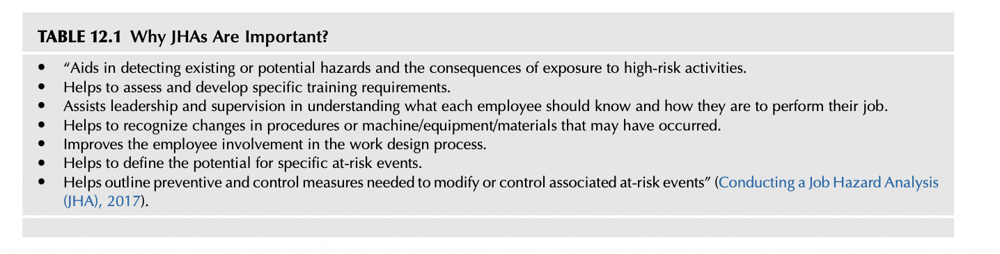

<!-- Block B09 -->
### 표 12.1 JHA가 왜 결정적으로 중요한가? (TABLE 12.1 Why JHAs Are Important?)

* 현존하거나 잠재적인 유해위험요인과 고위험 작업 활동에 대한 노출이 초래할 치명적인 결과를 사전에 탐지하도록 돕는다.
* 구체적이고 실질적인 현장 교육 훈련 요구사항을 정밀하게 평가하고 개발할 수 있도록 지원한다.
* 리더십과 현장 관리감독자가 각 근로자가 무엇을 반드시 숙지해야 하고 자신의 직무를 어떻게 안전하게 수행해야 하는지를 명확히 이해하도록 돕는다.
* 작업 절차나 현장 기계, 설비, 원자재 등에서 은밀하게 발생했을 수 있는 미세한 변경 사항들을 적시에 포착하도록 돕는다.
* 작업 설계 및 공정 개선 프로세스에 대한 근로자의 적극적인 참여와 몰입을 획기적으로 개선한다.
* 구체적인 잠재 위험 사건(at-risk events)이 발생할 가능성을 명확히 규명하도록 돕는다.
* 연계된 위험 사건들을 수정, 차단, 또는 안전하게 통제하는 데 필요한 예방적 통제 대책의 윤곽을 확립하도록 돕는다.

*(Conducting a Job Hazard Analysis (JHA), 2017)*

---

<!-- Block B10 -->
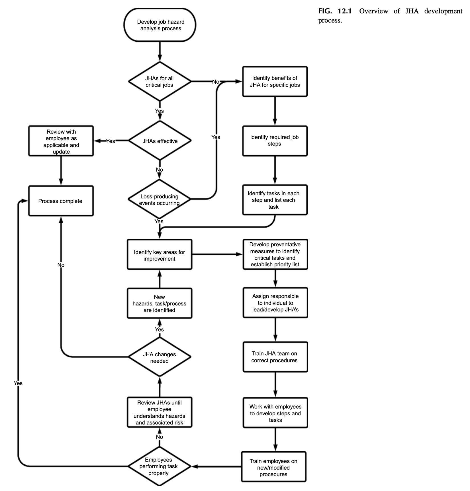

<!-- Block B11 -->
### 그림 12.1 JHA 개발 프로세스의 전사적 개요 (FIG. 12.1 Overview of JHA development process)

---

<!-- Block B12 -->
## JHA 구축 및 실행 전략 (STRATEGY FOR IMPLEMENTATION)

오늘날 우리가 활용하는 JHA의 원형은 20세기 초 프레더릭 테일러(Frederick Taylor)에 의해 과학적 관리법(Scientific Management)이 확립되고 산업 안전이 태동하던 시기에 처음 개발된 것으로 파악된다 (Frederick Taylor and scientific management, understanding Taylorism and early management theory, 2017). 세월이 흐르면서 "직무(job)"라는 용어의 의미는 특정한 단일 활동을 지칭하던 협소한 개념에서부터, 다양한 작업 활동과 포괄적 책임을 한데 아우르는 '직무 직책(job title)'을 뜻하는 거시적 정의로 진화하였다. 다음의 상이한 두 가지 정의를 비교해 보라:
* **정의 1 (Definition 1)**: 직무란 "한 조각의 작업 단위, 특히 한 사람의 직업적 일상의 일환으로 수행되는 구체적인 세부 과업"을 의미한다 (Job, 2018).
* **정의 2 (Definition 2)**: 직무란 "어떤 개인이 수행할 것으로 기대되거나 의무가 부여된 모든 것, 즉 부여된 임무이자 책무 전체"를 의미한다 (Job, 2018).

전통적인 고전적 JHA는 정의 1을 채택한다. 즉 테일러식 접근법에 따라, 특정 작업을 몇 개의 세부 단계(steps)로 잘게 쪼갠 뒤 각 단계 내부에서 유해위험요인을 식별한다. 그리고 각 단계에 필요한 하위 작업(subtasks)과 결부된 복합적 위험을 깊이 있게 통찰하지 못한 채 단계별 통제 대책을 수립하여 적용한다. 이 경우 작업을 수행하는 사람이 각 단계별로 지정된 통제 지침만을 기계적으로 준수한다면 그 '작업' 자체는 안전한 것으로 간주된다.

반면 정의 2에서 규정하는 직무는 단일한 공식 직무 기술서 산하에 포괄되는 방대한 활동들의 집합체를 의미한다. 이 경우 정의 1에서 규정하는 각각의 배정된 세부 '직무'마다 일련의 수많은 JHA들이 개별적으로 작성되어야 한다. 그러나 이러한 파편화된 접근법 하에서는 여러 작업들이 중첩되어 수행될 때 발생하는 유해한 누적 효과와 상호작용의 위험을 완전히 간과해 버릴 치명적인 위험이 상존한다. 전통적인 JHA 방법론은 하나의 직책을 가진 근로자가 여러 작업을 동시에 수행할 때 발생하는 시간적 압박과 누적적 위험 노출 효과를 제대로 고려하지 못하기 때문이다.

이러한 두 가지 유형의 직무 정의를 효과적으로 조화시키는 훌륭한 방법 중 하나는 컴퓨터 프로그래밍에서 널리 활용되는 **'부모-자식 개념(parent and child concept)'**을 적용하는 것이다. 웹사이트 개발에서 부모 테마(parent theme)는 웹사이트가 표시되어야 하는 핵심 틀이자 함부로 변경되어서는 안 되는 기본 메인 뼈대를 이룬다. 이를 통해 다양한 '자식 테마(child themes)'가 업데이트되거나 수정되더라도 메인 테마의 핵심 기능이 덮어쓰여 지워지지 않도록 완벽히 보호된다.

이와 동일한 지혜를 JHA 개발에 적용하면, **'부모 JHA(parent JHA)'**는 중첩되거나 유사한 모든 직무 과업들을 총괄하여 고려하는 거시적인 최상위 직무 분석이 된다. 이는 해당 직무에 부여된 전반적인 책임과 작업 활동의 표준 기준선(baseline)을 제공한다. 부모 JHA는 해당 직무의 핵심 기능을 형성하고 보편적으로 적용되는 핵심 공통 요소들을 포괄한다. 반면 **'자식 JHA(child JHA)'**는 실제로 현장에서 요구되는 개별적이고 구체적인 세부 작업 활동마다 고유한 유해위험요인과 위험을 정밀하게 평가하고 맞춤형 통제 대책을 제공한다.

예를 들어, 완전히 동일하게 작동하는 5대의 기계 설비가 배치된 작업장이라면, 해당 설비들의 공통적인 기계적 유해위험요인을 총괄 분석하는 1개의 대표 부모 JHA를 수립한다. 그러나 설비 자체는 유사할지라도 작업 구역의 물리적 배치, 투입되는 원자재의 성상, 작업자의 동선 등 구체적인 세부 과업을 수행하는 과정에서 현장별 특수한 위험 차이나 변동성이 얼마든지 발생할 수 있다. 이때 자식 JHA가 각 라인별 세부 단계와 과업에서 요구되는 이러한 잠재적 추가 위험요인과 연계 위험을 정밀하게 분석하여 보완해 주는 것이다 (Roughton & Crutchfield, 2016; Why use a child theme?, 2018).

---

<!-- Block B13 -->
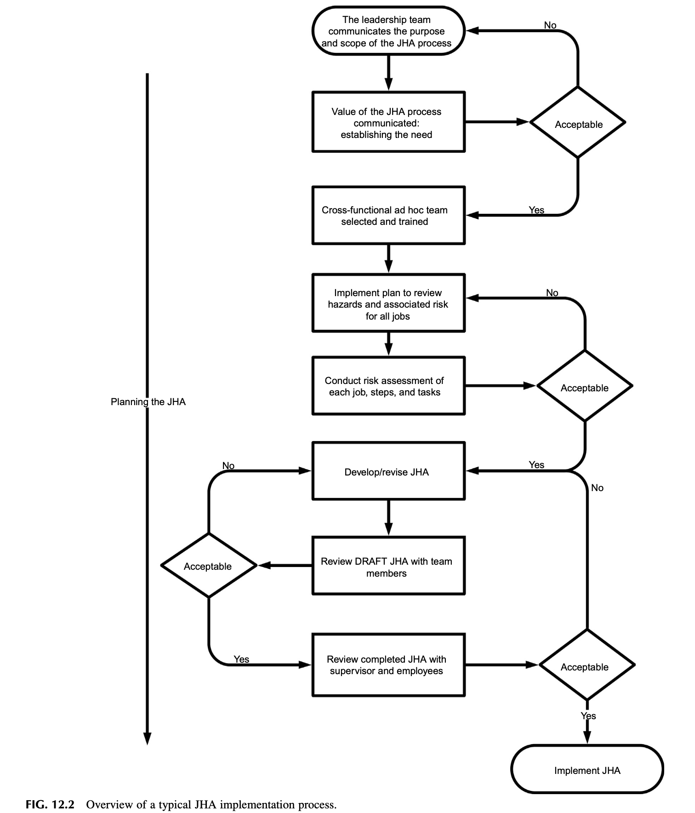

<!-- Block B14 -->
### 그림 12.2 전형적인 JHA 실행 프로세스의 전사적 개요 (FIG. 12.2 Overview of a typical JHA implementation process)

---

<!-- Block B15 -->
## JHA 대 JSA의 명확한 개념 정의 (DEFINING JHA VS JSA)

실무 현장에서 **"직무위험성평가(JHA, Job Hazard Analysis)"**와 **"작업안전분석(JSA, Job Safety Analysis)"**이라는 두 용어는 종종 명확한 구분 없이 상호 혼용되어 사용되고 있다. 산업 분야에 따라 직무과업분석(JTA, Job Task Analysis), 활동과업분석(ATA, Activity Task Analysis) 등 다양한 명칭들이 혼재되어 사용되기도 한다. 전통적인 초기 JHA/JSA 개념은 테일러식 공정 분석에 기초하여, 기계적 위험요인을 제거하거나 통제하여 산업재해 부상을 줄이는 데 주된 초점을 맞추었다 (Frederick Taylor and scientific management, understanding Taylorism and early management theory, 2017). 그러나 시대가 흐르면서 오늘날의 JHA는 훨씬 더 포괄적이고 정밀한 위험 기반 다차원 평가 접근법으로 눈부시게 진화하였다.

---

<!-- Block B16 -->
### 관찰 및 핵심 통찰 (OBSERVATION)

> JHA 프로세스의 실효성을 극대화하기 위해, 본서의 저자들은 **JHA와 JSA를 상호 구별되는 독자적이고 고유한 두 가지 전문 도구**로 정의한다.
>
> **직무위험성평가(JHA)**는 작업 단계 및 세부 과업 내에 내재되어 돌발적이고 급격한 손실 사고(sudden loss-producing events, 즉 추락, 협착, 폭발, 감전 등 급성 재해)를 유발할 잠재력을 지닌 유해위험요인과 연계된 위험을 정확히 식별하는 데 초점을 맞추는 기법으로 간주되어야 한다.
>
> 반면 **작업안전분석(JSA)**은 만성적이고 누적적인 유해위험요인과 연계된 장기적 위험을 식별하고 통제하는 데 초점을 맞추는 기법으로 간주되어야 한다. 예를 들어 돌발적인 급성 사고보다는 직업성 질환, 연부조직 손상(근골격계 질환), 또는 장기적인 만성 손상을 유발하는 인체공학적 유해요인이나 유해 환경 조건에 대한 지속적 노출이 이에 해당한다. JSA는 직무 전체와, 해당 직무를 구성하는 모든 요구 단계 및 과업들이 유발하는 '누적적 영향(accumulative effects)'을 거시적으로 분석한다.
>
> 전통적인 JHA 접근법은 특정 시점의 단면만을 스냅샷(snapshot)처럼 포착하여 특정 단계나 과업의 즉각적인 위험만을 고립시켜 분석하는 한계를 지닌다. 즉, 시간이라는 차원(time dimension)과 여러 과업 군에 걸쳐 지속적으로 누적되는 노출의 파급 효과를 제대로 포착하지 못한다.
>
> 따라서 연구자와 실무자는 자신이 현재 분석하고 있는 대상이 특정 세부 단계의 즉각적 위험(JHA)인지, 아니면 시간에 걸쳐 누적되는 복합 과업의 누적적 영향(JSA)인지를 명확히 판별해야 한다. 직무 분석에 '시간'이라는 결정적 변수를 반영하는 다차원적 접근법(Multidimensional Approach)을 구축하기 위해 그림 12.3에 상세히 제시된 차이점을 깊이 고찰하라.

---

<!-- Block B17 -->
## JHA 개발이 가져다주는 다차원적 이점 (BENEFITS OF DEVELOPING JHAS)

JHA 프로세스가 안전보건경영시스템의 핵심 기둥으로 확고히 자리 잡을 때, 현장 근로자들이 실제로 수행하는 작업의 본질에 관한 모든 논의에 생생한 현실감과 구체성을 부여한다. JHA의 완성은 단순히 안전에 대한 피상적 이해를 넘어, 조직의 모든 계층에게 전체 직무를 구성하는 다양한 세부 작업 과업들의 가치를 깊이 있게 재인식하고 존중하는 계기를 제공한다. 세부 과업들이 정밀하게 평가됨에 따라 유해위험요인과 연계 위험에 대한 통제 대책이 한층 명확히 정의되고 투명하게 소통되며, 결과적으로 다음과 같은 획기적인 개선으로 이어진다:
* 구체적인 안전 기준을 빈틈없이 통합함으로써 작업 표준 절차(SOP), 작업 방법, 그리고 현장 프로토콜의 획기적 개선.
* 작업에 적합한 표준 공구, 적정 자재, 안전한 기계 장비가 오차 없이 올바르게 선정되도록 보장.
* 해당 직무가 요구하는 신체적 조건과 전문 기술 숙련도를 작업자의 역량과 완벽히 매칭시킴으로써 근로자 선발 및 교육 훈련의 고도화.
* 작업장 내 유해 환경 문제 및 잠재적 취약 요인의 선제적 식별 및 개선.

현장 관리감독자는 JHA 분석 결과를 십분 활용하여 잠재 위험을 사전에 제거하고 예방함으로써 산업재해 부상을 획기적으로 줄일 수 있다. 이는 특정 과업에 대해 훨씬 더 안전하고 효율적인 작업 방식을 제공하며, 산재보상보험 비용을 대폭 절감하고, 궁극적으로 생산성을 비약적으로 향상시키는 선순환을 창출한다. 또한 JHA는 신규 채용 근로자들에게 자신의 직무를 안전하게 완수하는 데 필요한 필수 과업 요령을 교육하는 가장 귀중한 실전 교재가 된다 (Roughton & Crutchfield, 2016).

나아가 JHA는 신규 입사자, 다른 부서에서 전입해 온 배치전환 근로자, 그리고 수십 년 경력의 베테랑 근로자 모두에게 일관된 안전 지침을 상기시켜 주는 영구적인 나침반 역할을 한다. 이는 일부 작업 단계나 세부 과업이 새롭게 변경되었을 때 즉각 개정되어 현장에 적용될 수 있으며, 비정상 작업(non-routine tasks)이나 고위험 비일상 작업을 수행하기 직전 현장 맞춤형 특별 안전 교육 및 위험 점검 도구로 탁월하게 활용된다 (How to identify job hazards, 2017; Roughton & Crutchfield, 2013).

---

<!-- Block B18 -->
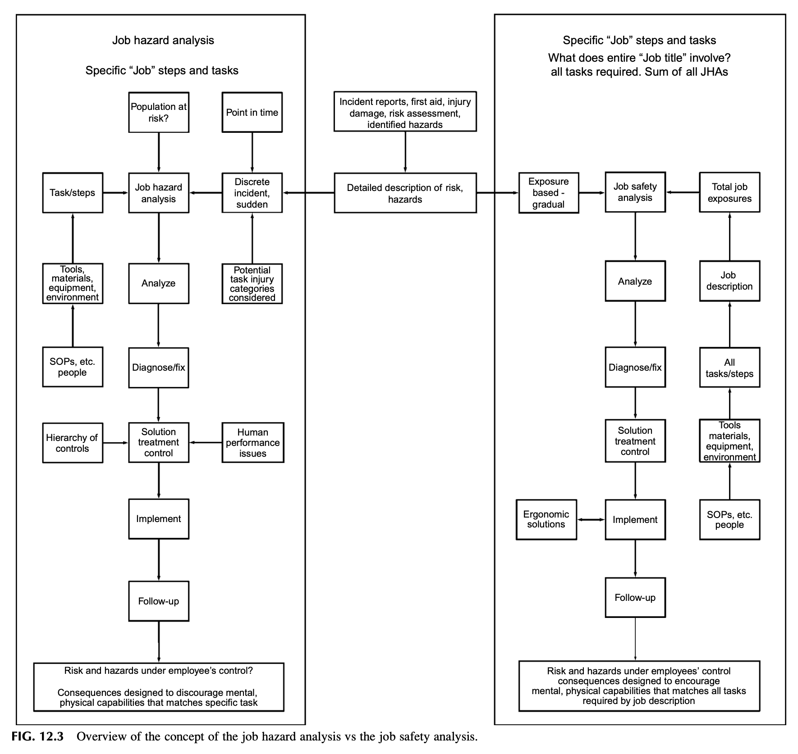

<!-- Block B19 -->
### 그림 12.3 직무위험성평가(JHA)와 작업안전분석(JSA)의 개념 비교 개요 (FIG. 12.3 Overview of the concept of the job hazard analysis vs the job safety analysis)

---

<!-- Block B20 -->
## JHA 프로세스의 잠재적 단점과 장애요인 (DRAWBACKS OF THE JHA)

JHA 프로세스를 성공적으로 구축하기 위해서는 상당한 시간과 전용 예산의 배정이 필수적으로 수반된다. 그러나 현장에는 "우리 근로자들은 수십 년간 일해 와서 자기 일은 자기가 가장 잘 알고 있다"는 식의 안일한 자만심과 고정관념이 팽배해 있어, 눈앞에 당장 가시적인 대형 사고가 보이지 않는 한 JHA 도입에 대한 강력한 현장의 심리적 저항과 반발이 나타나기 쉽다. JHA를 어쩌다 한 번 마지못해 작성하는 일회성 형식주의에서 벗어나 일상적이고 공식적인 정기 업무 프로세스로 완전히 안착시킬 때에만, 작업 환경을 실질적으로 개선하는 JHA 본연의 막대한 가치를 경영 리더십과 현장 근로자 모두에게 온전히 납득시킬 수 있다 (Roughton & Crutchfield, 2013).

---

<!-- Block B21 -->
## 근로자를 JHA 프로세스에 동참시키는 것이 왜 절대적으로 중요한가? (WHY IS IT IMPORTANT TO GET EMPLOYEES INVOLVED IN THE PROCESS?)

앞서 거듭 강조했듯이, 근로자의 적극적인 참여는 성공적인 안전보건경영시스템의 가장 핵심적인 초석이다. 근로자들은 자신들이 매일 수행하는 직무의 개선 및 재설계 과정에 직접 참여할 수 있는 소중한 기회가 주어졌을 때, 현장에 도입되는 변화를 훨씬 더 흔쾌히 수용하고 주인의식을 갖게 된다. 근로자들은 특정 직무가 현장에서 구체적으로 어떻게 완수되는지를 가장 정확하게 꿰뚫고 있는 진정한 전문가들이다. 그들은 해당 직무 속에 내재된 숨은 난관과 잠재적 문제점들을 그 누구보다 잘 알고 있다. 근로자들은 경영진이 미처 알지 못하는 사이에, 현장의 현실적 어려움을 극복하기 위해 나름의 비공식적인 작업 편법을 스스로 만들어 사용해 왔을 수 있다. 공식적인 JHA 검토가 수반되지 않는다면, 이러한 임의적 작업 변경은 겉보기에는 생산성을 일시적으로 높였을지 몰라도 현장의 치명적인 잠재 위험요인을 극적으로 증폭시키는 시한폭탄이 되었을 수 있다.

상호 간의 깊은 신뢰가 확고히 뿌리내린 작업 환경 속에서, 근로자들은 JHA 팀과 경영 리더십, 그리고 안전 관리자에게 작업이 현장에서 '실제로 완수되는 진정한 방식(the real way jobs are completed)'에 대한 생생하고 가감 없는 진실을 들려줄 수 있다.

많은 직무에 대한 관리자들의 초기 인상은 "대단히 단순한 작업이므로 굳이 복잡한 JHA까지 작성할 필요가 없다"는 식의 방심이다. 그러나 겉보기에 가장 단순해 보이는 직무라 할지라도 수많은 세부 구성요소와 신체적 동작들의 정밀한 조율을 필수적으로 요구한다. "손쉽게 시작할 수 있는 자연스러운 출발점"으로 여겨졌던 단순한 작업조차도, 그 세부 단계와 과업들, 요구되는 공구·설비·자재의 물리적 특성, 작업자의 숙련도 및 신체 역량, 주변 작업장 환경, 그리고 잠재적 인적 실수의 가능성 등을 꼼꼼히 분해해 보면 놀라울 정도로 복잡다단한 고위험 요소들이 얽혀 있다는 사실이 드러나게 된다.

---

<!-- Block B22 -->
## JHA 전담 추진팀의 선발과 구성 (SELECTING A TEAM)

JHA를 가장 성공적으로 추진하기 위해서는 작업 현장에 정통한 다기능 핵심 인력들로 구성된 'JHA 특별 전담팀(Ad Hoc Team)'을 선발해야 한다. 이 전담팀은 특정 직무의 세부 과업을 가장 잘 이해하는 현장 근로자, 직속 관리감독자, 설비 정비를 책임지는 공무 기사, 그리고 사업장 안전 전문가로 구성된다.

JHA 특별 전담팀의 핵심 임무와 기능은 다음과 같다:
* JHA를 직접 개발하는 하위 태스크포스 팀들에게 전문적인 조언과 현장 피드백을 제공한다.
* 현장 직무 관찰, 작업 실사, 그리고 근로자와의 심층 인터뷰를 바탕으로 작성된 JHA의 완전성과 실효성을 엄격히 평가한다.
* 사업장에서 부상이나 아차사고 등 손실 유발 사건이 발생했을 때, 해당 JHA를 사고 조사 및 원인 규명의 기초 지침으로 적극 활용한다.
* JHA가 현재의 최신 운영 공정, 첨단 기술, 변경된 작업 과업, 그리고 근로자의 기술 및 훈련 요구수준을 제대로 반영하고 있는지 정기적으로 재평가하고 최신화한다.
* 개정된 JHA를 현장 근로자들과 함께 정밀 검토함으로써, 그들에게 기대되는 안전 행동이 무엇인지 확실히 이해시키고 새로운 작업 절차에 대한 고충과 우려 사항을 경청한다 (Managing worker safety and health, 2016; Roughton & Crutchfield, 2013).

JHA 특별 전담팀의 기본 운영 원칙은 다음과 같다:
* 팀의 운영 목적과 JHA 활용 방안을 명문화한 공식 '운영 헌장(charter)'을 수립하고 중앙 안전위원회의 공식 승인을 받는다.
* 정기적인 회의를 개최하고 회의록을 중앙 안전위원회의 JHA 총괄 간사에게 성실히 제출한다.
* JHA의 본질적 가치와 현장 활용법을 전파함으로써 근로자들의 자발적인 동참을 적극 독려한다.
* 직무, 단계, 과업을 치밀하게 분석하여 숨은 위험을 발굴하고 연계 위험을 정밀 평가한다.
* 식별된 위험을 사회적으로 용인 가능한 수준(ALARP)으로 낮추기 위한 실행 가능한 통제 대책을 권고한다.
* 다양한 직무 관점을 융합하기 위해 다기능 팀 접근법(cross-functional team approach)을 견지한다.
* 현장에 적용된 JHA의 실질적 유효성을 정기적으로 재평가한다 (Managing worker safety and health, 2016; Roughton & Crutchfield, 2013).

---

<!-- Block B23 -->
## JHA 도입을 위한 설득력 있는 비즈니스 케이스 구축 (BUILDING THE CASE FOR A JHA PROCESS)

JHA 프로세스를 성공적으로 현장에 도입하기 위해서는, 추진팀이 경영진과 구성원들에게 JHA의 본질적 가치, 추진 범위, 구체적 활용법, 그리고 기대되는 정량적 성과를 설득력 있게 전달할 수 있어야 한다. 리더십 팀과 현장 근로자가 JHA의 명확한 목적과 세부 과제를 온전히 이해할 때, 비로소 JHA가 안전한 일터를 구축하고 현장 운영 효율을 획기적으로 개선하는 강력한 잠재력을 지녔음을 인정하게 된다.

JHA 특별 추진팀은 JHA의 비즈니스 가치를 객관적으로 입증하기 위해 다양한 데이터 지표를 적극 활용할 수 있다. 사고 발생률(TRIR), 산재보상보험금 지급액, 아차사고 보고 건수, 비계획적 설비 가동 중단 시간(downtime), 이직률, 그리고 불필요한 유지보수 정비 비용 등 사내의 기존 데이터를 정밀 분석함으로써, 특정한 고위험 직무가 조직에 얼마나 막대한 재정적 손실을 끼치고 있는지를 생생하게 규명할 수 있다. 이러한 객관적 데이터를 확보하고 나면, 팀은 현재 상태에 대한 명확한 기준선(baseline)을 확립하고 가장 치명적인 잠재 위험이 어디에 도사리고 있는지를 한눈에 식별할 수 있다. 이 기준선은 향후 구체적인 안전 목표를 설정하고 선행 및 후행 지표를 수립하여 추진 경과를 정밀하게 추적하는 나침반이 된다.

경영 리더십은 JHA 프로세스가 가져다줄 유무형의 명확한 기대 편익에 대해 확신을 가질 수 있어야 한다. 논리적이고 정교한 비즈니스 케이스(business case)가 성공적으로 제시될 때, 최고 경영진은 전폭적인 예산 자원을 배정하고 조직 전반에 걸쳐 JHA를 강력하게 선도하는 최고의 챔피언이 되어 줄 것이다.

---

<!-- Block B24 -->
## JHA 스토리텔링 기법 (TELLING THE JHA STORY)

JHA를 수행한다는 것은 해당 직무 현장에서 실제로 무슨 일이 벌어지고 있는지에 대한 '살아 숨 쉬는 이야기(story)'를 입체적으로 들려주는 과정과 같다. 육하원칙(5W1H: Who, What, Where, When, Why, How)에 기반한 정밀 질문법은 수집된 현장 정보를 체계적으로 범주화하여 직무의 진정한 이야기를 풀어내는 강력한 틀을 제공한다. 현장 데이터와 근로자들의 생생한 피드백이 결합될 때, 이 이야기는 현장의 실태를 가감 없이 보여주는 명확하고 간결한 그림으로 완성된다.

분석 대상 직무의 복잡성에 따라 JHA 개발자는 다양한 방식으로 질문을 던질 수 있다. 육하원칙에 입각한 심층 질문의 기본 프레임워크는 표 12.2부터 표 12.7까지를 참조하라 (Roughton & Crutchfield, 2016).

> "자신들이 '무엇을(WHAT)' 하는지 설명할 수 있는 사람과 조직은 많지만, 자신들이 '왜(WHY)' 그 일을 하는지 명확하게 말할 수 있는 사람이나 조직은 극히 드물다. '왜'라는 질문은 목적이자 대의이며 신념이다. 그것은 우리가 아침에 침대에서 왜 일어나는지, 우리 회사가 도대체 왜 존재해야 하는지, 그리고 그것이 왜 다른 사람들에게 중요한 의미를 갖는지에 대한 명쾌한 해답을 제공해 준다."  
> — 사이먼 사이넥(Simon Sinek, 2009)

---

<!-- Block B25 -->
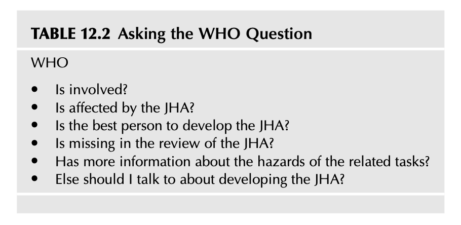

<!-- Block B26 -->
### 표 12.2 '누가(WHO)'에 관한 질문 프레임워크 (TABLE 12.2 Asking the WHO Question)

* 해당 직무 과업에 구체적으로 **누가(Who)** 참여하고 관여하는가?
* JHA의 개발 및 실행 결과로 인해 직접적인 영향을 받는 사람은 **누구인가(Who)**?
* 해당 직무의 JHA를 가장 정확하게 개발할 수 있는 최적의 적임자는 **누구인가(Who)**?
* JHA 검토 과정에서 배제되거나 누락된 핵심 이해관계자는 **누구인가(Who)**?
* 연관된 작업 과업의 잠재 유해위험요인에 대해 가장 풍부한 정보를 가진 사람은 **누구인가(Who)**?
* JHA를 완성하기 위해 내가 추가로 인터뷰하고 상의해야 할 대상은 또 **누구인가(Who)**?

---

<!-- Block B27 -->
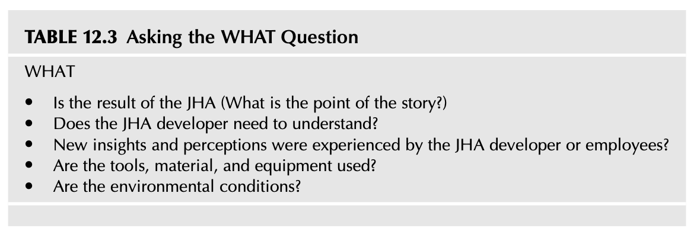

<!-- Block B28 -->
### 표 12.3 '무엇을(WHAT)'에 관한 질문 프레임워크 (TABLE 12.3 Asking the WHAT Question)

* JHA의 최종 산출물은 구체적으로 **무엇인가(What)**? (이 직무 이야기의 핵심 교훈은 무엇인가?)
* JHA 개발자가 반드시 완벽히 이해해야 할 핵심 작업 본질은 **무엇인가(What)**?
* JHA 개발자나 근로자가 분석 과정에서 새롭게 얻게 된 결정적인 통찰과 위험 지각은 **무엇인가(What)**?
* 작업에 실제로 사용되는 공구, 원자재, 기계 설비는 구체적으로 **무엇인가(What)**?
* 작업이 이루어지는 현장의 물리적 환경 조건은 **어떠한가(What)**?

---

<!-- Block B29 -->
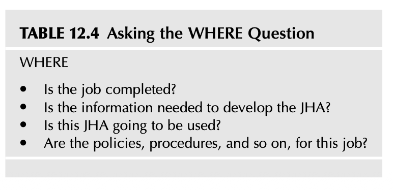

<!-- Block B30 -->
### 표 12.4 '어디서(WHERE)'에 관한 질문 프레임워크 (TABLE 12.4 Asking the WHERE Question)

* 해당 직무 과업은 구체적으로 **어디에서(Where)** 완수되는가?
* JHA를 정밀하게 개발하는 데 필요한 핵심 데이터와 현장 정보는 **어디에(Where)** 있는가?
* 완성된 JHA는 현장의 **어느 구역에서(Where)** 집중적으로 활용될 것인가?
* 이 직무에 적용되는 표준 운영 방침, 작업 절차서, 매뉴얼 등은 **어디에(Where)** 보관되어 있는가?

---

<!-- Block B31 -->
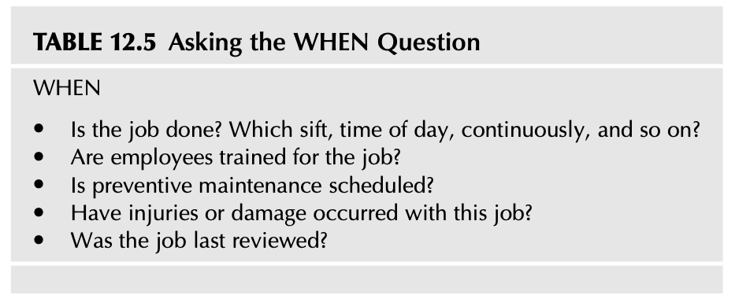

<!-- Block B32 -->
### 표 12.5 '언제(WHEN)'에 관한 질문 프레임워크 (TABLE 12.5 Asking the WHEN Question)

* 해당 직무는 구체적으로 **언제(When)** 수행되는가? (어느 교대조, 하루 중 어느 시간대, 혹은 연속적으로 계속 수행되는가?)
* 작업자들은 해당 직무에 대해 **언제(When)** 교육 훈련을 받았는가?
* 관련 설비에 대한 예방 보전(preventive maintenance) 정비는 **언제(When)** 계획되어 있는가?
* 과거 이 작업에서 부상이나 물적 손상이 발생했던 시점은 **언제인가(When)**?
* 이 직무에 대한 공식 검토가 마지막으로 이루어진 것은 **언제였는가(When)**?

---

<!-- Block B33 -->
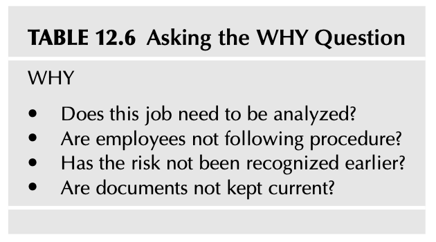

<!-- Block B34 -->
### 표 12.6 '왜(WHY)'에 관한 질문 프레임워크 (TABLE 12.6 Asking the WHY Question)

* 이 직무는 도대체 **왜(Why)** 우선적으로 분석되어야만 하는가?
* 근로자들은 **왜(Why)** 공식 표준 작업 절차를 그대로 따르지 않고 있는가?
* 현장에 상존하는 치명적인 잠재 위험을 **왜(Why)** 진작에 조기에 인지하지 못했는가?
* 안전 문서와 관련 규정들은 **왜(Why)** 최신 상태로 제때 업데이트되지 못했는가?

---

<!-- Block B35 -->
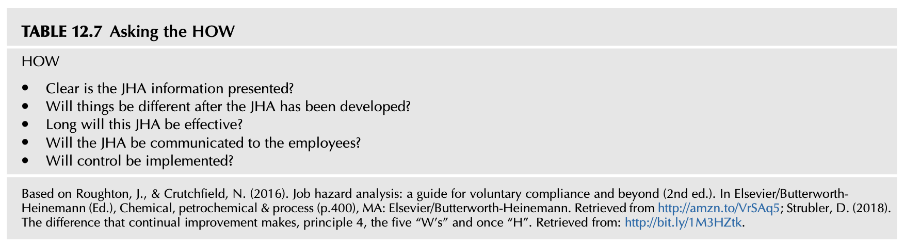

<!-- Block B36 -->
### 표 12.7 '어떻게(HOW)'에 관한 질문 프레임워크 (TABLE 12.7 Asking the HOW Question)

* JHA에 수록된 핵심 안전 정보는 얼마나 명확하고 이해하기 쉽게 제시되어 있는가(**How clear**)?
* JHA가 완전히 개발되고 현장에 안착된 후, 기존의 작업 방식은 구체적으로 **어떻게 달라질 것인가(How)**?
* 새롭게 개발된 JHA의 유효 기간은 과연 **얼마나 지속될 것인가(How long)**?
* JHA의 핵심 수칙들은 현장 근로자들에게 구체적으로 **어떤 방식으로 전달되고 소통될 것인가(How)**?
* 도출된 필수 안전 통제 대책들은 현장에 **어떻게 실질적으로 구현되고 집행될 것인가(How)**?

*(Roughton, J., & Crutchfield, N. (2016). Job hazard analysis: a guide for voluntary compliance and beyond (2nd ed.); Strubler, D. (2018). The difference that continual improvement makes, principle 4, the five “W’s” and one “H” 에 기초함)*

'JHA 스토리텔링 기법'에 제시된 내용을 더욱 깊이 발전시키기 위해, 제6장 부록 6.6 '자동차 타이어 교체 방법에 관한 점검표 샘플', 부록 12.1 'JHA 사전 유해위험요인 평가 시트 샘플', 그리고 부록 12.2 '타이어 교체 작업에 관한 상세 해설 JHA 샘플'을 참조하라.

---

<!-- Block B37 -->
## JHA의 기본 구조 (STRUCTURE OF THE JHA)

미 육군 공병단(US Army Corps of Engineers)은 건설 현장에서 JHA 프로세스의 특화된 형태인 **활동위험분석(AHA, Activity Hazard Analysis)**을 공식적으로 활용하고 있다. AHA는 그 어떤 새로운 작업 과업이 착수되기 전에 반드시 사전에 수립되어야 한다. "이전 프로젝트 운영에서 경험하지 못했던 새로운 유형의 유해위험요인을 수반하는 작업 활동을 시작하기 전, 또는 새로운 작업 팀이나 하도급 협력업체가 해당 작업을 수행하기 전, 그 작업을 직접 수행하는 도급 계약업체는 반드시 AHA를 사전에 철저히 작성해야 한다" (EM 385-1-1, 미국 공병단 안전보건 요구조건 매뉴얼, 2014). 표 12.8은 JHA를 개발할 때 사용되는 핵심 표준 용어들의 전반적 개요를 제공한다.

---

<!-- Block B38 -->
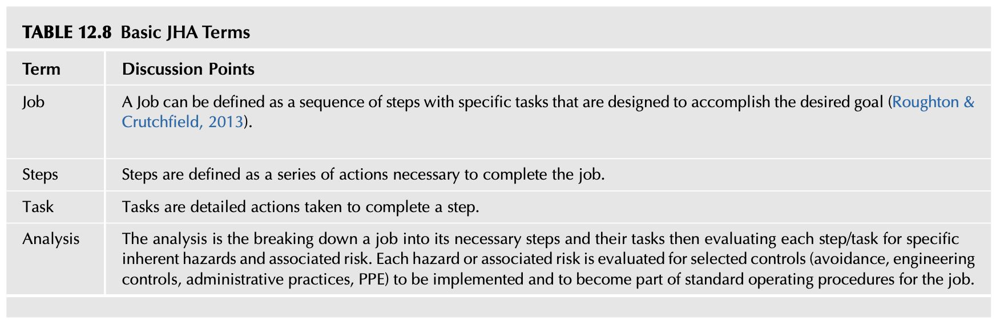

<!-- Block B39 -->
### 표 12.8 JHA 기본 핵심 용어 (TABLE 12.8 Basic JHA Terms)

| 용어 (Term) | 상세 논의 및 정의 (Discussion Points) |
| :--- | :--- |
| **직무 (Job)** | 직무는 조직이 바라는 최종 목표를 성공적으로 완수하도록 설계된 일련의 세부 과업들을 수반하는 일련의 단계적 연속 과정으로 정의될 수 있다 (Roughton & Crutchfield, 2013). |
| **단계 (Steps)** | 단계는 전체 직무를 성공적으로 완수하는 데 필요한 일련의 체계적인 연속 행동들로 정의된다. |
| **과업 (Task)** | 과업은 하나의 세부 단계를 완수하기 위해 현장에서 취해지는 구체적이고 세밀한 개별 실행 행위들을 의미한다. |
| **분석 (Analysis)** | 분석이란 직무를 구성하는 필수 단계들과 그 세부 과업들로 정밀하게 분해한 뒤, 각 단계 및 과업 속에 내재된 구체적인 고유 유해위험요인과 연계된 위험을 과학적으로 평가하는 일련의 체계적 프로세스이다. 식별된 각 위험요인과 연계 위험에 대해 엄선된 통제 대책(위험 회피, 엔지니어링 공학적 통제, 관리적 절차, 개인보호구 지급 등)을 평가하고, 이를 현장의 표준 운영 절차(SOP)의 영구적 핵심 일환으로 통합시키는 작업을 포함한다. |

---

<!-- Block B40 -->
## 분석 대상 직무의 우선순위 선별 (SELECTING THE JOBS FOR ANALYSIS)

표 12.9는 잠재적으로 심각한 손실 유발 사건을 초래할 가능성이 높아 최우선적으로 JHA를 실시해야 하는 대표적인 대상 직무들의 예시 목록을 제공한다.

JHA를 수행할 때에는 해당 산업 분야에서 특화하여 규정한 적용 가능한 산업 안전보건 표준뿐만 아니라, 법적으로 강제되는 정부 규제 기준을 면밀히 고려해야 한다. 이러한 공인 표준의 준수는 자율적이거나 법적 의무일 수 있다. 표준의 요구조건들을 JHA 속에 완벽히 통합시킴으로써 현장의 규제 준수성을 확고히 보장할 수 있다 (Roughton & Crutchfield, 2013).

---

<!-- Block B41 -->
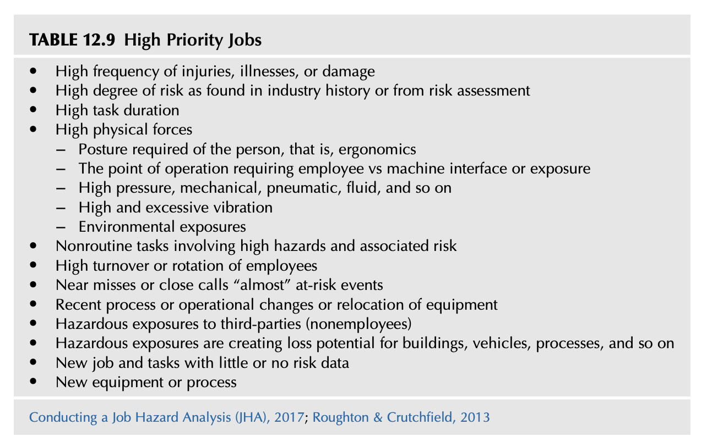

<!-- Block B42 -->
### 표 12.9 최우선 분석 대상 고위험 직무 기준 (TABLE 12.9 High Priority Jobs)

* 과거 산업재해 부상, 직업병 질환, 또는 설비 파손 사고의 발생 빈도가 높은 직무.
* 업계의 역사적 재해 기록이나 사전 정밀 위험성 평가를 통해 높은 수준의 잠재 위험이 확인된 직무.
* 한 번에 지속되는 과업의 작업 지속 시간(duration)이 매우 긴 직무.
* 작업자에게 과도한 신체적 물리적 힘(high physical forces)의 행사를 요구하는 직무.
* 작업자에게 부자연스럽고 왜곡된 신체 자세를 강요하는 인체공학적(ergonomics) 고부담 직무.
* 작업자와 가동 기계 설비 사이의 직접적인 인터페이스나 신체 접촉 노출이 발생하는 위험점(point of operation).
* 기계적, 공압식, 유압식 등 고압 에너지(high pressure)가 작용하는 설비 취급 직무.
* 고강도의 극심하고 과도한 진동(excessive vibration)이 작업자에게 전달되는 직무.
* 극심한 소음, 분진, 유독가스, 극한 온도 등 열악한 환경적 유해인자에 노출되는 직무.
* 평소에 자주 하지 않지만 고도의 잠재 위험을 수반하는 비일상적 비정상 작업(nonroutine tasks).
* 작업자의 이직률이나 잦은 보직 변경 및 순환 배치가 극심한 직무.
* 조금만 삐끗했으면 중대 사고로 이어질 뻔했던 아차사고(near misses / close calls)가 빈발하는 직무.
* 최근에 공정이 변경되었거나, 운전 조건이 바뀌었거나, 기계 설비가 다른 장소로 이전 배치된 직무.
* 하도급 협력업체나 방문객 등 제3자(비임직원)에게 치명적인 유해 위험을 노출시키는 직무.
* 공장 건물, 차량, 핵심 공정 라인 등에 심각한 화재·폭발 등의 잠재 손실을 초래할 위험 노출.
* 과거의 축적된 안전 데이터나 위험 정보가 거의 또는 전혀 존재하지 않는 완전 신규 직무 및 신규 과업.
* 사업장에 새롭게 도입된 최신 첨단 기계 장비 또는 신규 화학 공정.

*(Conducting a Job Hazard Analysis (JHA), 2017; Roughton & Crutchfield, 2013)*

그림 12.4는 직무의 세부 분석, 직무 내에 내재화되어야 할 행동적 결과, 그리고 안전보건경영시스템 내부의 행정적 관리 체계를 통합하는 위험 개선 모델 속에서 직무위험성평가가 차지하는 유기적 관계를 명확히 보여준다.

---

<!-- Block B43 -->
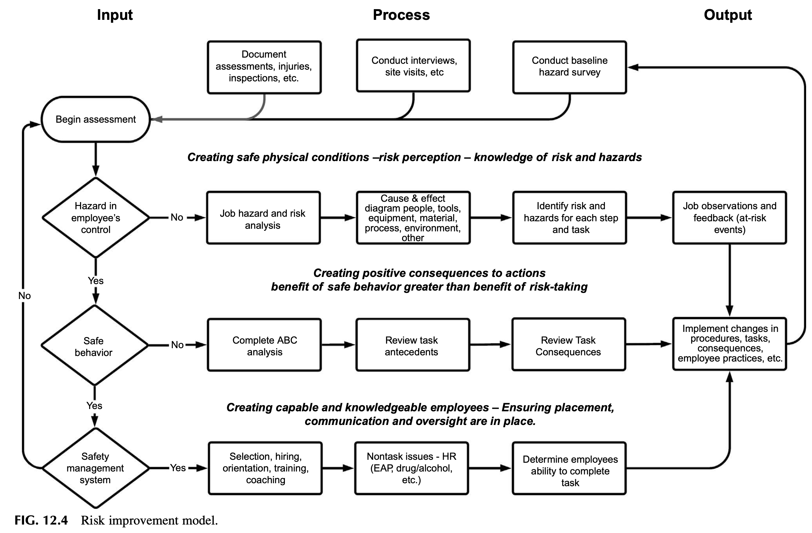

<!-- Block B44 -->
### 그림 12.4 위험 개선 모델 내에서의 JHA 연계 체계 (FIG. 12.4 Risk improvement model)

---

<!-- Block B45 -->
## JHA와 인적 수행도(Human Performance) 원칙의 융합 (JHA AND HUMAN PERFORMANCE PRINCIPLES)

전통적인 고전적 JHA가 지닌 가장 치명적인 한계 중 하나는 기계적 유해위험요인은 찾아내지만, 각 단계별로 구체적인 '위험(risk)'의 본질을 명시적으로 규명하지 못한다는 점이다. 고전적 JHA는 공정을 오직 눈에 보이는 물리적 위험요인으로만 단순화하려는 경향을 보인다 (Job hazard analysis, 3071, 2002). 따라서 특정 직무나 유사 직무 군을 정밀 검토할 때에는, 작업자에게 요구되는 정신적·인지적 및 신체적 요구조건, 사고 발생 시 너무나 쉽게 유일한 원인으로 전가되어 버리는 '인간의 실수(human error)'의 발생 잠재력, 그리고 사용되는 기술 및 인터페이스에 내재된 복합적 취약성을 반드시 총체적으로 고려해야 한다.

모든 인간은 각자 고유한 주관적 위험 지각, 개인적·전문적 경험과 지식, 선호도, 기술 및 숙련도를 가지고 있으며, 이러한 다채로운 인적 특성들이 일상적인 직무 수행도에 지대한 영향을 미친다는 사실을 항상 명심해야 한다.

제임스 리즌(Reason, 2009)의 탁월한 연구에 따르면, "현장 인력과 특히 관리감독자들이 인간의 본질적인 실수 잠재력과, 실수의 발생 확률 및 그 파멸적 결과를 좌우하는 작업 과업, 작업장 환경, 그리고 조직적 요인들에 대해 깊이 인식하는 것이 절대적으로 중요하다. 불안전한 행동이 구체적으로 '어떻게, 그리고 왜' 발생하는지를 심층적으로 이해하는 것이야말로 실효성 있는 오류 관리(error management)를 실현하기 위한 필수불가결한 첫 번째 단계이다" (Concepts and principles, 2009).

미국 에너지부(DOE)의 인적 수행도 향상(HPI) 핸드북은 안전보건경영시스템과 JHA 프로세스를 올바르게 인도하는 5대 핵심 원칙을 다음과 같이 명쾌하게 제시한다:
1. **인간은 오류를 범하기 쉬운 불완전한 존재이며, 가장 뛰어난 최고의 전문가라도 실수를 저지른다.**
2. **오류가 발생하기 쉬운 취약한 상황(Error-likely situations)은 사전에 예측 가능하고, 관리 가능하며, 충분히 예방할 수 있다.**
3. **개인의 안전 행동은 조직의 거시적 프로세스와 공유된 가치관에 의해 결정적인 영향을 받는다.**
4. **사람들은 리더, 동료, 그리고 부하 직원들로부터 따뜻한 격려와 긍정적인 행동 인정을 받을 때 최고의 탁월한 안전 성과를 달성한다.**
5. **실수가 발생하는 근본 원인을 깊이 이해하고 과거의 사건이나 오류로부터 도출된 교훈을 현장에 철저히 적용함으로써 치명적인 대형 재해를 완벽히 회피할 수 있다.** *(Concepts and principles, 2009)*

> "진정한 인적 수행도 향상(HPI)은 오직 조직의 모든 계층에 속한 구성원들이 이러한 5대 기본 원칙을 가슴 깊이 수용하고, 이를 강력하게 뒷받침하는 선진 개념과 현장 실천들을 기꺼이 포용할 때에만 비로소 실현될 수 있다."  
> — *(Concepts and principles, 2009)*

---

<!-- Block B46 -->
## 인간 오류의 전조 요인 (ERROR PRECURSORS)

인간의 실수율을 급격히 증가시키는 불리한 사전 조건인 '오류 전조 요인(Error Precursors)'이 안전한 직무 및 과업 완수에 미치는 파괴적인 영향을 반드시 평가해야 한다. 예를 들어, 촉박하게 정해진 제한 시간 내에 작업을 무리하게 끝내야 한다는 시간적 압박은 근로자로 하여금 필수 안전 절차를 건너뛰는 지름길 편법(shortcuts)을 쓰게 만들거나, 마감 시한을 맞추기 위해 위험을 무릅쓰고 감수하게 만든다. "오류 전조 요인이란 특정한 작업 행동 중에 인간의 실수가 발생할 확률을 극적으로 증폭시키는 불리한 사전 조건(unfavorable prior conditions)을 의미한다" (Concepts and principles, 2009). 과업 요구조건 및 개인의 역량과 관련된 오류 전조 요인에 대해서는 표 12.10을, 작업 환경 및 인간 본성과 관련된 추가적인 오류 전조 요인에 대해서는 표 12.11을 참조하라.

JHA의 필수 세부 단계와 과업들은 유해위험요인에 대한 물리적 통제와 병행하여, 인간의 실수를 유발하는 이러한 오류 전조 요인들을 현장에서 가능한 한 최대한 축소하거나 완전히 제거하려는 확고한 의도를 가지고 평가되어야 한다. 만약 "오류를 유발하기 쉬운 상황이 충분히 예측 가능하고, 관리 가능하며, 예방 가능한 것"이라면 (Concepts and principles, 2009), 직무위험성평가(JHA)는 이러한 취약 상황을 사전에 완벽히 통제할 수 있는 가장 강력한 기본 도구가 된다.

---

<!-- Block B47 -->
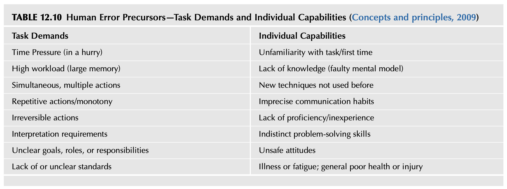

<!-- Block B48 -->
### 표 12.10 인간 오류 전조 요인—과업 요구조건 및 개인의 역량 (TABLE 12.10 Human Error Precursors—Task Demands and Individual Capabilities) *(Concepts and principles, 2009)*

| 과업 요구조건 (Task Demands) | 개인의 역량 (Individual Capabilities) |
| :--- | :--- |
| **시간적 압박 (서두름, Time Pressure)** | 작업 과업에 대한 생소함 / 최초 수행 (Unfamiliarity) |
| **과도한 작업 부하 (과중한 기억 용량 요구)** | 지식 부족 (잘못된 멘탈 모델, Faulty mental model) |
| **동시 다발적인 복수 작업 수행 (Multiple actions)** | 과거에 사용해 본 적 없는 새로운 기법 및 기술 |
| **단조로운 반복 작업 (Monotony)** | 부정확하고 모호한 소통 습관 (Imprecise communication) |
| **되돌릴 수 없는 비가역적 작업 (Irreversible actions)** | 숙련도 부족 / 실무 경험 미숙 (Inexperience) |
| **복잡한 해석 및 판단 요구 (Interpretation requirements)** | 모호하고 불명확한 문제 해결 능력 |
| **불명확한 목표, 모호한 역할 및 책임** | 불안전한 태도 및 안일한 성향 |
| **표준 작업 기준의 부재 또는 모호함** | 질병, 육체적 피로, 전반적인 건강 악화 또는 기존 부상 |

---

<!-- Block B49 -->
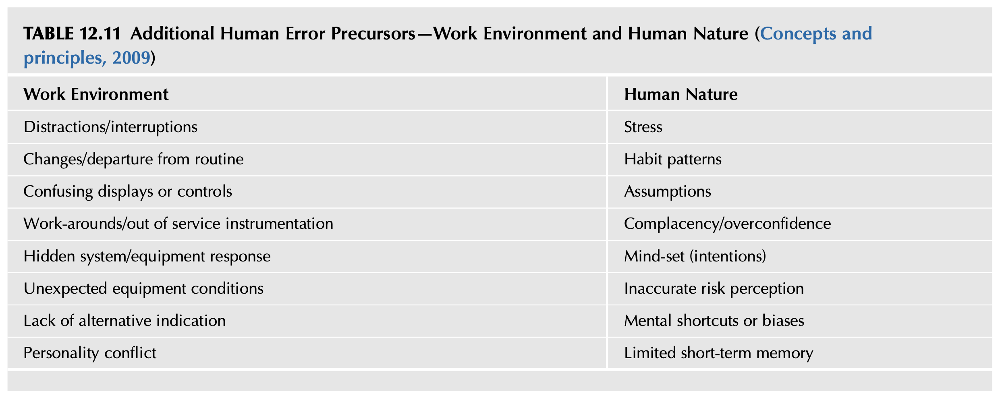

<!-- Block B50 -->
### 표 12.11 추가적인 인간 오류 전조 요인—작업 환경 및 인간 본성 (TABLE 12.11 Additional Human Error Precursors—Work Environment and Human Nature) *(Concepts and principles, 2009)*

| 작업 환경 (Work Environment) | 인간의 본성 (Human Nature) |
| :--- | :--- |
| **주의 산만 및 외부 방해 (Distractions/interruptions)** | 과도한 정신적 스트레스 (Stress) |
| **일상 루틴에서의 급격한 변경 및 이탈** | 굳어진 낡은 습관 패턴 (Habit patterns) |
| **혼란스럽고 오독하기 쉬운 계기판 또는 조작 스위치** | 근거 없는 독단적 가정 (Assumptions) |
| **임의적 편법(Work-arounds) / 고장난 계측기 방치** | 현실 안주 / 근거 없는 과도한 자신감 (Overconfidence) |
| **시스템 및 기계 설비의 숨겨진 잠재적 반응** | 고정관념 및 편향된 의도 (Mind-set) |
| **설비의 돌발적인 이상 상태 및 비정상 조건** | 왜곡되고 부정확한 위험 지각 (Inaccurate risk perception) |
| **대체 지시계나 보조 경보 시스템의 부재** | 머릿속 지름길 편향(Mental shortcuts) 및 확증 편향 |
| **작업자 간의 인간관계 갈등 및 불화** | 단기 기억 용량의 한계 (Limited short-term memory) |

---

<!-- Block B51 -->
## 조직문화의 심층적 영향 (ORGANIZATIONAL CULTURE)

조직문화는 인간의 직무 수행도를 개선할 수 있는 잠재력에 대한 현실적인 평가를 포함한다. 거시적인 조직문화의 우산 아래에서 작동하는 강력한 안전문화의 핵심 목표는 인간의 실수 발생 잠재력을 근본적으로 줄이는 데 있다. 조직의 문화적 본질과 위험을 수용하는 방식은 안전보건경영시스템의 현재 위상과 리더십이 부여하는 강조점에 의해 명확히 판별될 수 있다.

HPI 원칙과 인간 오류 전조 요인에 대한 깊은 이해는 JHA 프로세스의 개발 수준을 비약적으로 끌어올리는 데 탁월하게 활용될 수 있다. 인간이 지닌 가장 근본적인 속성은 모든 인간이 누구나 실수와 잘못된 결정을 내릴 수 있다는 점이다. 이 엄연한 사실을 직시할 때, 현장의 직무 요구조건들이 인간의 신체적·인지적 한계에 맞추어 올바르게 분석되고 재설계되어야 한다는 당위성이 명백해진다.

> "조직문화란 특정 집단이 외부 적응과 내부 통합의 문제들을 해결해 나가는 과정에서 학습하여 공유하게 된 기본적인 가정들의 패턴이다. 오랜 세월에 걸쳐 이 공유된 가정들의 패턴은 충분히 잘 작동하는 것으로 입증되었고, 따라서 유효한 것으로 간주되어 새로운 구성원들에게 그 문제들을 지각하고, 생각하고, 느끼는 올바른 방식으로 전수된다."  
> — 에드거 샤인(Edgar Schein), *(Concepts and principles, 2009 인용)*

초기 평가는 조직이 일상적인 목표와 과업을 달성하기 위해 현재 직무와 세부 작업을 어떠한 방식으로 개발하고 설계하고 있는지를 면밀히 검토해야 한다. JHA 프로세스는 조직이 현재 문제 해결을 위해 사용하고 있는 의사결정 방식과 고유한 개념 체계 속에 자연스럽게 융합되도록 현장 맞춤형으로 최적화되어야 한다.

JHA의 적극적인 현장 적용은 가능한 한 많은 작업 활동 속에서 결정적인 유해위험요인과 연계된 위험을 선제적으로 평가하고 식별해냄으로써 인간 오류의 발생 가능성을 원천 차단해 준다.

---

<!-- Block B52 -->
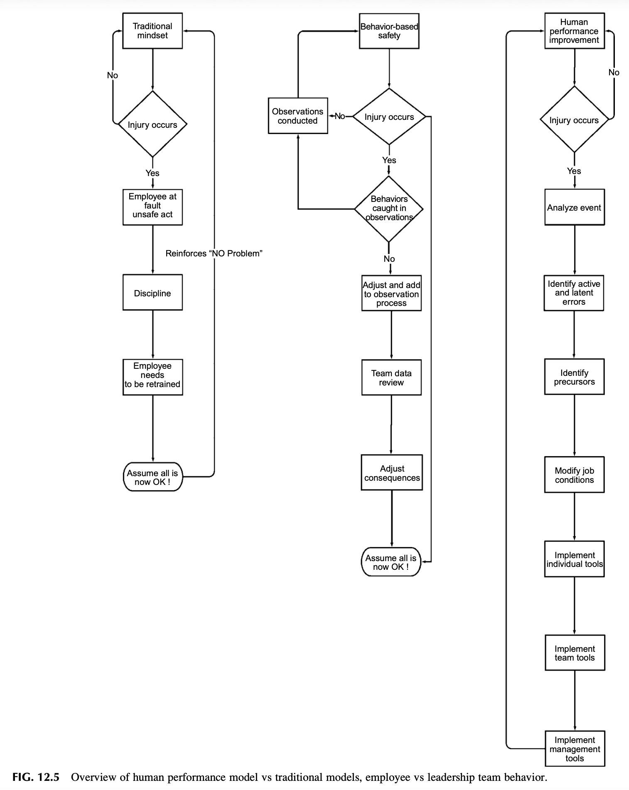

<!-- Block B53 -->
### 그림 12.5 인적 수행도(HPI) 모델 대 전통적 모델의 비교, 근로자 대 리더십 행동 (FIG. 12.5 Overview of human performance model vs traditional models, employee vs leadership team behavior)

---

HPI 원칙은 JHA 프로세스에 완전히 새로운 차원의 깊이를 부여한다. 전통적인 안전 프로세스는 오랜 세월 동안 상당한 성과를 거두어 온 사후 재해 부상 감소에 일차적인 초점을 맞추었다. 이는 즉각적으로 눈에 보이는 불안전한 행동이나 활동적 오류(active errors)를 표적으로 삼는 가시적 행동주의 접근법을 강조해 왔다 (Concepts and principles, 2009). 반면 현대의 HPI는 눈앞의 즉각적인 활동적 오류뿐만 아니라, 시스템 설계와 조직 관리 체계 속에 조용히 웅크리고 있는 '잠재적 오류(latent errors)'까지 동시에 근원적으로 제거하는 데 총력을 기울인다 (그림 12.5 참조).

> 미국안전전문가협회(ASSP)의 캐시 시브룩(Kathy A. Seabrook, CSP, CMIOH)은 다음과 같이 강력히 역설하였다: "기업들과 그 글로벌 공급망 내부의 최근 산업재해 및 직업병 추세를 살펴보면, 전반적인 재해율 지표의 개선 속도가 현저히 둔화되었으며, 치명적인 중대재해 및 사망 사고율은 수년 동안 거의 요지부동의 답보 상태를 유지하고 있다. 앞으로 실질적인 추가 개선을 이끌어내기 위해서는 과거와 완전히 다른 근본적인 새로운 접근법(different Approach)이 반드시 요구된다."  
> — *(위험평가연구소, Risk Assessment Institute, 2017 인용)*

---

<!-- Block B54 -->
## 단순 작업에서도 도사리고 있는 '직무 복잡성' (JOB COMPLEXITY—EVEN FOR “SIMPLE JOBS”)

현장 관리자들은 종종 겉보기에 "단순해 보이는" 작업에는 어떠한 위험도 없을 것이며 대체로 사고 없이 끝마칠 수 있을 것이라는 안일한 착각에 빠지곤 한다. 다시 말해 많은 직무들이 너무나 단순해서 "로켓 과학자(rocket scientist) 같은 천재가 아니더라도 누구나 손쉽게 할 수 있는 일"로 치부되어 버린다. 이러한 경솔한 언사는 해당 작업을 매일 묵묵히 수행하는 현장 근로자의 존엄성을 심각하게 훼손할 뿐만 아니라, 단순하고 하찮은 일회용 작업은 저임금 비숙련 노동자나 하는 것이라는 왜곡된 편견을 조장한다. 그리고 이러한 천대받는 작업에는 굳이 번거로운 JHA 검토가 전혀 필요 없다는 위험천만한 방심을 낳는다. 앞서 엄중히 경고했던 "손실이 없으면 위험도 없다"는 치명적인 미신이, 단순해 보이는 작업의 단계와 과업 속에 치명적인 위험요인들이 버젓이 숨겨져 있음에도 불구하고 싹트게 되는 것이다.

이러한 위험한 마인드셋은 평소 지극히 단순하고 평범해 보였던 작업에서 어느 날 갑자기 치명적인 중대재해 참사가 터져 나와 경영 리더십의 뒤통수를 사정없이 가격하는(blindsided) 비극적인 사태를 초래한다. JHA 프로세스를 구축할 때 견지해야 할 제1의 절대 법칙은 다음과 같다: **어떤 직무가 겉보기에 아무리 단순해 보일지라도, 그 내부에 어떤 형태로든 인명 부상이나 물적 파괴를 초래할 수 있는 잠재 위험요인과 치명적인 위험이 결코 숨겨져 있지 않다고 절대로 지레짐작해서는 안 된다.** JHA는 겉보기에는 아무리 사소해 보이는 작업이라 할지라도, 안전하게 완수하기 위해서는 수많은 복잡한 세부 단계와 정밀한 과업들의 완벽한 조율이 요구된다는 엄연한 사실을 명쾌하게 증명해 준다.

---

<!-- Block B55 -->
## 직무 수행의 3가지 인지 행동 유형 (TYPES OF JOB PERFORMANCE)

표 12.10과 표 12.11에서 다룬 인간 오류 전조 요인들과 더불어, 모든 작업 직무는 인간의 3가지 인지 수행 유형인 **숙련 기반(Skill-based)**, **규칙 기반(Rule-based)**, 그리고 **지식 기반(Knowledge-based)** 수행 행동 요소들을 복합적으로 결합하여 구성된다:

<!-- Block B56 -->
### 숙련 기반 수행 (SKILL-BASED PERFORMANCE)

숙련 기반 수행(Skill-based performance)은 "의식적인 주의 집중이나 모니터링이 거의 없이도 익숙한 상황 속에서 고도로 숙달되어 주로 신체적으로 행해지는 무의식적 일상 행동"을 요구한다. "이 단계에서 발생하는 오류는 주로 실행상의 오류로서, 행동의 미끄러짐(slips)이나 주의력 및 집중력의 일시적 깜빡임(lapses)에서 비롯된다" (Concepts and principles, 2009). 고전적이고 전통적인 JHA의 기원은 바로 이러한 유형의 반복 작업에 적용하기 위해 고안된 것으로 보인다. 주로 숙련에 의존하는 단순 작업은 고도의 복잡한 사고나 의사결정을 거의 요구하지 않는다. 작업 단계와 유해위험요인이 일단 명확히 규명되고 나면 이에 상응하는 안전 통제 장치가 배치되며, 이후에는 적용된 모든 통제 조치들이 현장에서 지속적으로 사용되고 있는지를 확인하는 모니터링이 뒤따른다. 이 경우의 JHA는 대단히 단순하고 직관적으로 수립될 수 있다.

<!-- Block B57 -->
### 규칙 기반 수행 (RULE-BASED PERFORMANCE)

규칙 기반 수행(Rule-based performance)은 사전에 정해진 일련의 구체적인 조치를 취함으로써 미리 확립된 기성의 솔루션을 그대로 따르는 것을 요구한다. 이러한 수행 방식은 **"만약 ~라면, 그렇다면 ~를 하라(If-Then)"**는 조건부 의사결정 프로세스를 적극적으로 활용한다. 즉, 만약 "X"라는 상황이 발생하면, 반드시 "Y"라는 대응 조치가 요구되는 식이다 (Concepts and principles, 2009). JHA는 표준 운영 절차(SOP), 사내 안전 규칙, 공식 가이드라인, 그리고 명확한 업무 구조가 절대적으로 필수적인 구체적 작업 시나리오들을 정의한다. 이 단계에서의 인간 오류는 안전 규칙이나 프로토콜을 잘못 해석하거나, 확립된 절차를 이해하지 못하고 무시했을 때 주로 발생한다.

<!-- Block B58 -->
### 지식 기반 수행 (KNOWLEDGE-BASED PERFORMANCE)

지식 기반 수행(Knowledge-based Performance)은 "과거의 숙련도나 사전에 확립된 규칙으로는 개인이 전혀 인식할 수 없는 생소하고 낯선 미지의 상황에 대한 대응"을 의미한다 (Concepts and principles, 2009). 이러한 최고 난도의 수행 레벨에서는, 통제 대책이 빈틈없이 구현되도록 보장하기 위해 전례 없는 고유한 문제나 특수한 현안을 수반하는 각각의 새로운 경험마다 특화된 JHA가 필수적으로 작성되어야 한다. 이때 포괄적인 전체 직무 요구조건이 '부모(parent)'가 되고, 향후 유사 상황에서 활용할 수 있도록 축적된 다양한 경험들의 포트폴리오가 개발되어 정기적으로 유사성을 검토받게 된다. 이러한 경험 기반의 지식은 어떤 유형의 새로운 위험요인들이 발생할 수 있으며, 그것들이 상호 결합하여 어떻게 위험의 심각도를 극적으로 증폭시킬 수 있는지에 대한 깊이 있는 통찰을 제공한다.

지식 기반 수행을 안내해 줄 사전에 개발된 '규칙'이 전무하기 때문에, 문제 해결 능력, 심층적인 위험 식별, 작업 전 사전 계획 수립 및 브리핑(prejob planning and briefing), 그리고 권고된 통제 대책에 대한 동료 검토(peer review)에 절대적인 방점이 찍힌다 (Human performance tools for individuals, work teams, and management, 2009). 이 경우 JHA는 작업이 본격적으로 시작되기 전에 사전에 작성되어 각 접근법의 단계들을 정의하고 발생 가능한 다양한 최악의 시나리오를 가시화해 준다.

---

<!-- Block B59 -->
## 인간 오류 잠재력의 선제적 통제 (HUMAN ERROR POTENTIAL)

이론적으로 볼 때, 만약 어떤 직무가 논리적으로 완벽하게 설계되고 근로자들이 그 직무를 수행하는 요령을 철저히 교육받았다면, 안전은 저절로 뒤따라올 것처럼 보인다. 이러한 순진한 시나리오에서 안전은 언젠가 도달할 수 있는 정적인 목적지로 간주된다. 그러나 이 방식은 전체 생산 시스템의 설계 결함으로부터 비롯되는 잠재적이고 내재적인 인간 오류의 가능성을 전혀 고려하지 않고 직무가 개발될 수 있다는 비현실적인 전제를 깔고 있다. 즉, 설계 엔지니어링 팀이 직무를 완수하는 데 필요한 수많은 변동성과 예외 상황을 완벽하게 예측할 수 있었다고 오만하게 가정하는 것이다. 나아가 설계 팀이 위험 식별과 정밀 위험성 평가에 대해 완벽한 전문성을 지니고 있다고 전제해 버린다. 그러나 저자들의 수많은 실무 경험에 비추어 볼 때, 설계 단계에서 내장되는 잠재적 오류의 발생 가능성은 대단히 농후하며, 바로 이것이 ANSI/AIHA/ASSE Z10 등 선진 안전보건경영시스템 표준들이 엔지니어링 설계 및 사전 검토 팀의 필수 일원으로 안전경영시스템 전문가를 반드시 참여시키도록 의무화하고 있는 결정적인 이유이다 (Occupational health & safety management systems, 2012).

만약 어떤 직무의 세부 단계와 과업들이 인간 오류의 발생 잠재력을 충분히 고려하여 설계된다면, 그 과업들은 훨씬 더 높은 확률로 안전하게 완수될 수 있다. 근로자들은 과거의 단편적인 경험에만 의존하여 기계적으로 작업을 반복하고 있을 수 있으며, 현장을 어떻게 근본적으로 개선할 수 있는지에 대해서는 거의 주의를 기울이지 못하고 있을 수 있다. JHA가 완성되어 가는 과정은 기존의 직무 설계를 원점에서 면밀히 재검토할 수 있는 가장 훌륭한 황금 같은 기회를 제공한다.

JHA는 직무와 그 세부 작업 단계들을 효과적이고 안전하게 완수하는 데 필요한 핵심 역량과 필수 숙련 기술을 정확히 식별하는 작업을 반드시 포함해야 한다.

---

<!-- Block B60 -->
## 인간 오류의 두 가지 유형: 활동적 오류 대 잠재적 오류 (ERROR TYPES)

앞서 언급한 두 가지 유형의 오류는 손실 유발 사건을 즉각적으로 촉발하거나, 혹은 오랫동안 은폐되어 웅크리고 있으면서 장기적인 대형 참사의 불씨로 작용한다.

**활동적 오류(Active errors)**는 "장비, 시스템, 또는 시설의 물리적 상태를 급격히 변화시켜 즉각적이고 바람직하지 않은 결과를 초래하는 관찰 가능한 물리적 행동"으로 정의된다 (Concepts and principles, 2009). 이러한 유형의 오류는 극심한 정신적·육체적 피로, 소통의 오류, 무리한 육체 노동 요구, 촉박한 시간적 압박, 그리고 과도한 스트레스 속에서 근로자가 성급하게 행동을 결행하고 그 즉시 파멸적인 부정적 결과를 맛보게 되는 작업 활동에서 전형적으로 발생한다.

> "활동적 오류란 즉각적이고 관찰 가능한 바람직하지 못한 결과를 초래하는 오류로서, 작위(commission, 하지 말아야 할 행동을 함) 또는 부작위(omission, 해야 할 행동을 빠뜨림)의 형태를 띤다. 대부분의 사고 촉발 행동(initiating actions)은 활동적 오류이다. 따라서 사고를 예방하기 위한 전략적 접근법은 이러한 활동적 오류의 사전 예측과 방지를 필히 포함해야 한다."  
> — *(Concepts and principles, 2009)*

**잠재적 오류(Latent errors)**는 "조직 차원의 감추어진 취약점이나 설비의 기저 결함으로 귀결되는 오류"를 의미한다 (Concepts and principles, 2009). 이들은 '잠재적'인 속성을 지니고 있기 때문에, 다양한 악조건과 환경적 결함들이 불행하게 서로 맞물려 비극적인 참사로 폭발하기 전까지 수개월 혹은 수년 동안 긴 시간 동안 아무런 징후 없이 잠복해 있을 수 있다.

> "잠재적 오류는 눈에 띄지 않게 휴면 상태로 잠복해 있는 조직의 은폐된 취약점이나 설비의 결함을 초래한다. 이러한 오류들은 발생 당시에는 전혀 감지되지 않으며 현장 시설이나 인력에 즉각적인 외형적 악영향을 미치지 않는다. 잠재적 조건에는 오류의 사전 전제조건을 조성하거나, 물리적 시설에 미치는 오류의 악영향을 사전에 방지·포착·완화하지 못하는 조직의 방침, 지침, 의사결정이 모두 포함된다. 경영자, 관리감독자, 기술 엔지니어링 스태프, 그리고 최전선의 현장 근로자 모두가 이러한 잠재적 조건을 만들어낼 수 있다. 부정확한 오류들은 절차서, 사규, 설계도면, 엔지니어링 설계 근거 문서 등 서류 기반의 지침 속에 깊숙이 내재화된다."  
> — *(Concepts and principles, 2009)*

---

<!-- Block B61 -->
## 설계 결함의 위험성 (DESIGN FLAWS)

현재 현장에 존재하는 수많은 안전 규칙과 정부 법적 규제들은 과거 수많은 대형 참사를 초래했던 뼈아픈 설계 결함과 조직적 실패의 유구한 역사로부터 비롯되었다. 설계 결함은 근로자 채용 관행이나 취약한 인력 숙련도 체계에서도 고스란히 발견될 수 있으며, 이는 교육 훈련이 부족하거나 부적격한 인력이 자신의 역량을 훌쩍 뛰어넘는 고위험 과업에 무방비로 투입되도록 방치하는 치명적인 결과를 낳는다 (그림 12.6~그림 12.8 참조). 이 흐름도들은 개인, 작업 팀, 그리고 경영 리더십 차원에서 인간 오류의 잠재력을 원천적으로 줄이기 위해 활용할 수 있는 다양한 전문 도구와 기법의 생생한 예시를 제공한다.

---

<!-- Block B62 -->
## 새로운 위험으로서의 테크놀로지 (TECHNOLOGY AS A RISK)

JHA는 특정 직무 내에 적용된 자동화(automation)의 수준을 면밀히 고려해야 하며, 자동화 프로세스가 오작동하거나 붕괴했을 때 발생할 수 있는 잠재적 충격을 반드시 평가해야 한다. 예를 들어 자동차에 장착된 후방 카메라나 사이드미러 사각지대 감지 센서 등 첨단 운전자 보조 장치들은 후진이나 차선 변경 시 운전자에게 근거 없는 허위의 안전감(false sense of security)을 심어줄 수 있다. 이러한 첨단 장치가 장착되지 않은 일반 차량을 운전할 때 운전자의 취약성이 극명하게 드러나며, 이는 오랜 세월 동안 운전 경험을 통해 체득했던 인간 고유의 공간 관찰 능력이 첨단 기술에 의존하는 과정에서 얼마나 심각하게 퇴화되었는지를 여실히 보여준다.

---

<!-- Block B63 -->
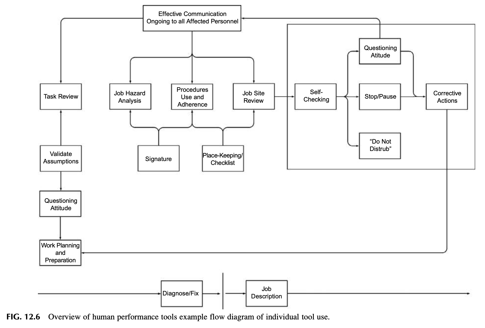

<!-- Block B64 -->
### 그림 12.6 인적 수행도 도구 개요—개인 차원의 도구 활용 흐름도 (직무 기술서 진단 및 개선) (FIG. 12.6 Overview of human performance tools example flow diagram of individual tool use)

---

<!-- Block B65 -->
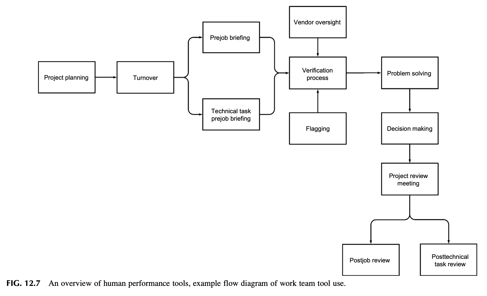

<!-- Block B66 -->
### 그림 12.7 인적 수행도 도구 개요—작업 팀 차원의 도구 활용 흐름도 (FIG. 12.7 An overview of human performance tools, example flow diagram of work team tool use)

---

<!-- Block B67 -->
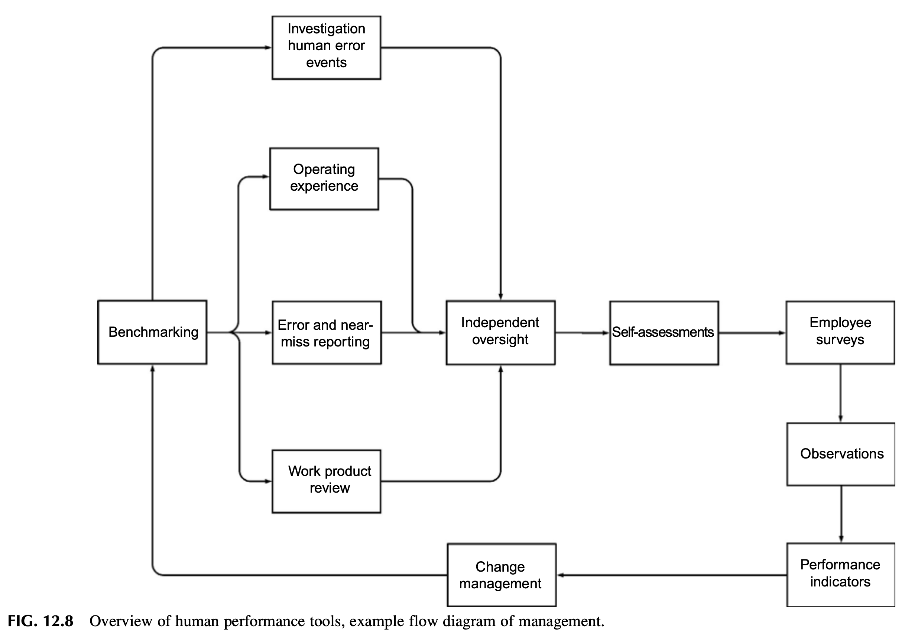

<!-- Block B68 -->
### 그림 12.8 인적 수행도 도구 개요—경영진 차원의 도구 활용 흐름도 (변경 관리) (FIG. 12.8 Overview of human performance tools, example flow diagram of management - Change management)

---

작업장에 산업용 로봇과 컴퓨터로 제어되는 자동화 설비가 폭발적으로 급증함에 따라 현장에는 완전히 새로운 차원의 위험과 복잡성이 유입되고 있다. 만약 자동화 안전 시스템에 치명적인 오작동이 발생하면 결국 인간 오퍼레이터가 수동으로 제어권을 넘겨받아야만 한다. 그러나 평소 자동화에 전적으로 의존해 왔던 근로자들은 실무 경험과 전문 숙련도가 부족하여, 자동화가 없었더라면 겪지 않았을 극도로 위험천만한 사지에 무방비로 내몰리게 된다.

안전을 증진시키기 위해 정교하게 설계된 최첨단 기술이, 역설적이게도 인간의 오류와 비극적인 착오를 유발할 잠재력을 오히려 증폭시키고 있다는 충격적인 사실이 수많은 산업 현장에서 속속 드러나고 있다. 자동화 메커니즘에 대한 인간의 과도한 맹종(overreliance)은 반드시 경계되어야 한다. 니콜라스 카(Nicholas Carr)의 명쾌한 통찰에 따르면, "테크놀로지에 대한 지나친 의존은 긴급한 위기 상황이 닥쳤을 때 인간이 올바른 판단을 내리는 고유의 인지적 통찰력을 심각하게 무디게 만들 수 있다" (Blum, 2014, 제4장 인용).

이러한 맥락에서 미국 연방항공청(FAA)은 실제 항공 운항 데이터에서 심각한 위험을 포착하고 전 세계 항공사들에게 긴급 안전 경보를 발령하여 **"적절한 상황에서는 항공기 조종사들이 수동 비행 조종(manual flight operations)을 적극적으로 연습하고 장려하라"**고 공식 권고하였다. FAA는 "정상 운항, 준사고, 그리고 실제 항공기 사고를 망라한 최근 비행 운항 데이터를 정밀 분석한 결과, 자동 비행 장치에 대한 과도한 의존으로 인해 조종사들의 수동 조작 실수가 급격히 증가하고 있음을 확인하였다"고 엄중히 경고하였다 (Safety alert for operations, manual flight operations, 2013).

나아가 FAA는 "항공사 운항사들이 노선 운항과 조종사 정기 교육 훈련(신규, 승격, 정기 보수 훈련) 모두에 수동 비행 조종의 비중을 대폭 강화하는 통합적 접근법을 취할 것"을 강력히 권고하였다 (Safety alert for operations, 2013).

오늘날 자율주행 차량이 일상에 본격적으로 등장하기 시작했으며 무인 자율주행에 대한 사회적 의존과 수용은 거스를 수 없는 대세가 되었다. 위험성 평가 및 공학적 안전 설계와 결합된 JHA는 이러한 신기술로 인한 대형 참사의 발생 가능성을 낮출 수 있을 것이다. 그러나 항공기 운항의 쓰라린 교훈과 마찬가지로, 운전자의 인간 고유의 위험 대처 운전 기술은 세월이 흐르며 점차 심각하게 퇴화되고 저하될 수밖에 없다는 점을 결코 잊어서는 안 된다.

---

<!-- Block B69 -->
## 안전 칼 및 절단 방지 장갑 프로그램: 위험 저감 사고로의 전환 (KNIFE SAFETY AND CUT RESISTANT GLOVE PROGRAM, SHIFTING THE THOUGHT PROCESS TO RISK REDUCTION)

제임스(James)는 앞선 여러 장에서 자신이 직접 총괄했던 식스 시그마 블랙벨트 프로젝트의 다양한 요소들을 소개한 바 있다. 거듭 강조하듯이, 정교한 식스 시그마 프로그램은 현장에 도입되는 순간 그 자체로 강력한 생명력을 띠고 작동하기 시작한다.

---

<!-- Block B70 -->
## 실제 현장 사례 (CASE IN POINT)

제임스가 어느 대기업의 전사 안전 총괄 디렉터로 재직하던 시절, 회사는 기존의 일반 다목적 커터칼(utility knives)을 전량 퇴출시키고 칼날이 자동으로 칼집 안으로 들어가는 안전 칼(safety knives, 칼날 자동 접이식 칼)로 전면 교체함으로써 수공구 칼 부상을 근절하겠다는 공격적인 안전 프로그램을 수립하였다. 손 베임 열상(hand lacerations)은 현장에서 가장 빈번하게 발생하는 골칫거리 재해였기에, 안전 칼만 전사적으로 지급하면 손 베임 사고가 단번에 사라질 것이라고 경영진은 굳게 믿었다. 본사 경영진은 일반 커터칼의 사내 사용을 전면 엄금하고 오직 안전 칼만을 의무적으로 사용하라는 최고경영자 지침을 전격 하달하였다. 그러나 치명적인 실수는, 그들이 현장 작업에 대한 **사전 JHA를 전혀 실시하지 않았고**, 기초적인 유해위험요인 평가도 거치지 않았으며, **도구 선정 과정에 현장 근로자들을 단 한 명도 참여시키지 않았다**는 점이다. 그 결과 이 일방적인 탑다운 프로그램은 현장 근로자들의 거센 반발과 극심한 저항(major resistance)에 직면하여 처참한 실패를 맛보아야 했다.

---

<!-- Block B71 -->
## 다목적 커터칼의 위험 실태 (UTILITY KNIVES)

표준 다목적 커터칼은 수많은 산업 현장에서 널리 쓰이고 있으며 올바르게만 사용된다면 대단히 유용한 공구이다. 문제는 현장에서 이 커터칼이 본래 설계된 목적이 아닌 엉뚱한 용도로 함부로 오용된다는 사실이다. 즉 틈새를 억지로 비틀어 벌리는 지렛대(prying)로 쓰거나, 표면을 긁어내는 스크래퍼(scraping)로 사용하고, 칼날의 강도를 훌쩍 초과하는 지나치게 두껍고 질긴 고중량 자재를 무리하게 자르는 데 사용된다. 설상가상으로 마모되어 무뎌진 칼날을 억지로 쓰다 보면 작업자는 과도한 물리적 힘을 주게 되고, 순간적으로 칼날이 미끄러지면서 치명적인 신경 절단 및 동맥 파열이라는 대형 열상 사고를 초래하게 된다.

---

<!-- Block B72 -->
## 절단 방지 장갑 프로그램의 전략적 구축 (GENERIC CUT RESISTANT GLOVES PROGRAM)

절단 방지 안전장갑 프로그램은 반드시 전사적인 손 안전 통합 전략(total hand safety strategy)의 유기적인 핵심 일환으로 구현되어야 한다. 정밀한 사전 위험성 평가, 근로자들에 대한 올바른 착용 교육, 그리고 현장 준수 관리 체계가 뒷받침되지 않은 채 단순히 안전장갑만을 쥐여주는 것은 결코 부상을 근절하지 못한다. 보호 장갑마다 제공하는 절단 방호 등급, 손가락 조작의 정밀도(dexterity), 그리고 미끄럼 방지 그립력(grip)이 극명하게 다르다. 현장 작업의 특성에 맞지 않는 엉뚱한 장갑을 잘못 지급할 경우, 작업자가 공구를 제대로 움켜쥐지 못해 미끄러뜨리거나, 장갑 원단이 고속 회전하는 회전체 설비에 말려들어 손 전체가 으스러지는 끔찍한 2차 참사를 유발할 수 있다.

---

<!-- Block B73 -->
## 요약 (SUMMARY)

직무위험성평가(JHA)는 작업장의 잠재 유해위험요인과 연계된 위험을 과학적으로 식별하고 통제하는 데 있어 없어서는 안 될 절대적인 핵심 도구이다. 정교하게 설계된 JHA는 모든 근로자가 자신에게 부여된 과업의 핵심 안전 요구조건을 명확히 숙지하고, 실제 작업을 수행할 때 어떻게 가장 안전한 선택을 내릴 수 있는지를 온몸으로 터득하게 해주는 가장 종합적이고 실전적인 교육 훈련 교재로 활용된다.

JHA 프로세스가 안전보건경영시스템의 핵심 기둥으로 자리매김할 때, 현장 근로자들이 매일 수행하는 작업의 진정한 본질에 대한 모든 대화에 생생한 현실감과 구체성을 부여한다. JHA의 성공적인 완성은 조직의 모든 계층에게 직무에 대한 피상적 이해를 넘어, 전체 직무를 구성하는 다채로운 세부 과업들의 가치와 위험을 깊이 있게 통찰하고 존중하는 계기를 제공한다 (Roughton & Crutchfield, 2016).

저자들의 오랜 실무 경험에 비추어 볼 때, 겉보기에 가장 단순해 보이는 작업이라 할지라도 작업의 세부 단계와 과업, 투입되는 공구·설비·자재, 작업자의 역량과 신체적 숙련도, 전반적인 환경 조건, 그리고 행정적 관리 지침을 하나하나 뜯어보면 놀라울 정도로 수많은 요소들의 정밀한 조율을 요구한다는 사실을 알 수 있다. "손쉽게 시작할 수 있는 만만한 출발점"으로 여겨졌던 단순 작업조차도 그 내막을 들여다보면 상상을 초월할 정도로 복잡한 고위험 요소들이 얽혀 있는 것이다 (Roughton & Crutchfield, 2016).

중앙 안전위원회의 위원 중 한 명이 JHA 프로세스를 총괄 지휘하고 행정적으로 지원하는 전담 책임자로 지정되어야 한다. 이 총괄 간사는 사업장 전체의 종합적인 JHA 포트폴리오를 개발하고 지속적으로 유지·관리하기 위해, 다양한 직무 경험과 전문성을 두루 갖춘 다기능 특별 전담팀(Ad Hoc Teams)을 선발하고 운영해야 한다.

JHA 특별 전담팀을 본격적으로 교육 훈련하기에 앞서, 팀에 기대되는 명확하고 간결한 역할과 책임이 사전에 정의되어야 한다. 모든 위원회와 분과위원회가 공식 운영 헌장을 구비해야 하듯이, 전사적 JHA 포트폴리오를 성공적으로 개발하는 과정에서 팀이 담당해야 할 고유한 역할과 책임을 명시한 'JHA 프로세스 헌장(JHA Process Charter)'이 반드시 사전에 수립되어야 한다 (Roughton & Crutchfield, 2016).

JHA 프로세스는 직무 안전 정보를 조직 전반으로 신속히 전파하고 안전한 행동을 확산시키는 거대한 사내 소통 네트워크의 핵심 일환으로 작동한다. 이는 작업 설계에 내재된 잠재적이고 은폐된 시스템 결함(latent errors)뿐만 아니라, 현장 근로자가 저지를 수 있는 즉각적인 활동적 실수(active errors)까지 빈틈없이 방어해 준다.

제13장 '안전 교육 훈련 니즈의 개발'에서는 역량 있고 종합적인 안전 교육 훈련 프로그램을 통해 강력하게 뒷받침되는 안전문화와 안전 프로세스에 대한 논의를 심도 있게 이어갈 것이다. 조직의 고유한 문화는 근로자들이 일상 과업을 완수하는 과정에서 형성하는 규범, 습관, 그리고 실제 행동에 지대한 영향력을 행사한다. 조직 내부 깊숙이 무의식적으로 자리 잡고 있는 위험 지각, 사고방식, 신념 체계의 힘은, 인간의 행동을 변화시키기 위해 고안된 그 어떤 훌륭한 안전 교육 훈련의 효과조차도 일거에 무력화해 버릴 수 있을 정도로 강력하다.

교육 훈련은 안전의 숭고한 가치와 중요성에 대한 신념을 고취하고자 애쓰지만, 교육장을 나서는 순간 현장의 작업 관리 방식이 과거와 조금도 달라지지 않았다면 근로자들은 즉시 과거의 낡은 타성으로 되돌아가고 만다. 교육 훈련의 기대 성과는 오직 조직 내부의 제도적 제약 조건, 촉박한 시간 압박, 예산 부족, 경영진의 일방적 지시 등 조직문화를 지배하는 기저의 제약 요인들이 정확히 이해될 때에만 지속될 수 있다. 따라서 모든 안전 교육은 이러한 현장의 실질적인 제약 조건들을 극복하거나 완화할 수 있도록 정교하게 설계되고 구조화되어야 한다.

저자들은 풍부한 경험을 통해, 진정한 교육 훈련이란 제한된 짧은 시간 안에 근로자에게 일방적으로 작업 요령을 훈화하는 것보다 훨씬 더 고차원적이고 복잡한 과정임을 깨달았다. 참된 교육 훈련은 지정된 '교수자(trainer)'로부터 현장의 '학습자(learner)'에게 필수적인 직무 안전 지식을 온전히 전수할 수 있어야 한다. 교육과 훈련은 현장 근로자가 직관적으로 이해하고, 가슴으로 수용하며, 자신에게 부여된 실제 작업 과업에서 즉각적으로 실천할 수 있는 가장 효과적인 성인 학습 방법론을 통해 제공되어야 한다.

---

<!-- Block B74 -->
## 장 복습 문제 (CHAPTER REVIEW QUESTIONS)

* 직무위험성평가(JHA)가 조직의 안전문화에 기여하는 결정적 중요성과 다차원적 이점을 설명하라.
* JHA 프로세스가 지닌 구체적인 장점과 잠재적인 단점(장애요인)을 비교·설명하라.
* JHA 개발 과정에 현장 근로자를 직접 동참시키는 것이 왜 절대적으로 중요한지 설명하라.
* JHA 특별 전담팀(Ad Hoc Team)을 선발하고 구성하는 최적의 방법과 그에 따른 실무적 이점을 설명하라.
* 위험성 평가를 수행하기 위해 분석 대상 고위험 직무를 올바르게 선별하는 기준을 설명하라.
* 직무(Job)를 구성하는 세부 단계(Steps)와 구체적 과업(Tasks)의 개념적 차이를 명확히 정의하고 설명하라.
* 실효성 있는 JHA를 개발하기 위해 필수적으로 요구되는 핵심 요소들은 무엇인가?
* JHA 프로세스를 현장에 성공적으로 구축하기 위해 반드시 사전에 답해야 할 핵심 질문들은 무엇인가?
* 컴퓨터 프로그래밍의 '부모-자식 개념(parent/child concept)'이 JHA 개발 프로세스에 어떻게 혁신적으로 적용되는지 설명하라.
* 인간의 3대 인지 직무 수행 유형(숙련 기반, 규칙 기반, 지식 기반)을 각각 구체적 사례와 함께 정의하라.

---

<!-- Block B75 -->
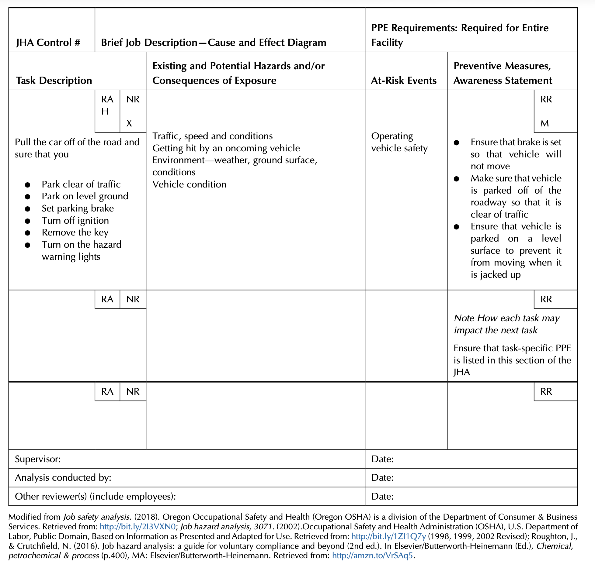

<!-- Block B76 -->
## 부록 12.1 JHA 사전 유해위험요인 평가 시트 샘플 (APPENDIX 12.1 SAMPLE JHA PREHAZARD ASSESSMENT WORKSHEET)

페이지: ___ / ___  
JHA 관리번호: ___ | 직무 요약 기술서: 인과관계 다이어그램(Cause and Effect Diagram) 기반  
필수 개인보호구(PPE) 요구조건: 전사 공통 필수 착용 보호구 명시  

| 과업 기술 (Task Description) | 현존 및 잠재적 유해위험요인 / 노출의 결과 (Hazards & Consequences) | 잠재 위험 사건 (At-Risk Events) | 예방 통제 대책 및 안전 인식 수칙 (Preventive Measures) | 위험 평가 (RA) | 잔여 위험 (RR) |
| :--- | :--- | :--- | :--- | :---: | :---: |
| **차량을 도로변 안전지대로 이동하여 정차** * 주행 차선 및 교통 흐름에서 완전히 벗어나 주차 * 평탄하고 단단한 지면에 주차 * 주차 브레이크(사이드 브레이크) 체결 * 시동을 끄고 엔진 정지 * 자동차 키 탈거 * 비상 점멸 표시등(비상등) 점등 | 도로 주행 교통량, 고속 주행 차량 및 도로 조건 다가오는 후속 차량에 의한 추돌 및 충돌 위험 외부 환경—기상 악화, 노면 상태, 지반 침하 차량 자체의 결함 및 비상 상태 | 주행 차량과의 충돌 차량 밀림 및 전도 | * 주차 브레이크를 확실히 체결하여 차량의 불시 움직임을 완벽 차단 * 주행 차선에서 충분히 벗어나 안전지대에 주차하여 교통 흐름 간섭 제거 * 잭(작기)으로 들어 올릴 때 차량이 넘어지지 않도록 반드시 수평 지면에 주차 | **H** (높음) (NR: 위험 미저감) | **M** (중간) (RR: 잔여 위험) |

*각 과업이 다음 후속 과업에 어떠한 연쇄적 영향을 미치는지 주의 깊게 분석할 것.*  
*해당 과업에 특화된 전용 개인보호구(PPE)를 본 란에 빠짐없이 명시할 것.*  

관리감독자: ________ (서명) | 일자: ________  
평가 실시자: ________ (서명) | 일자: ________  
기타 검토자 (현장 근로자 포함): ________ (서명) | 일자: ________  

*(출처: Oregon OSHA Job safety analysis, 2018; US OSHA Job hazard analysis 3071, 2002; Roughton & Crutchfield, 2016)*

---

<!-- Block B77 -->
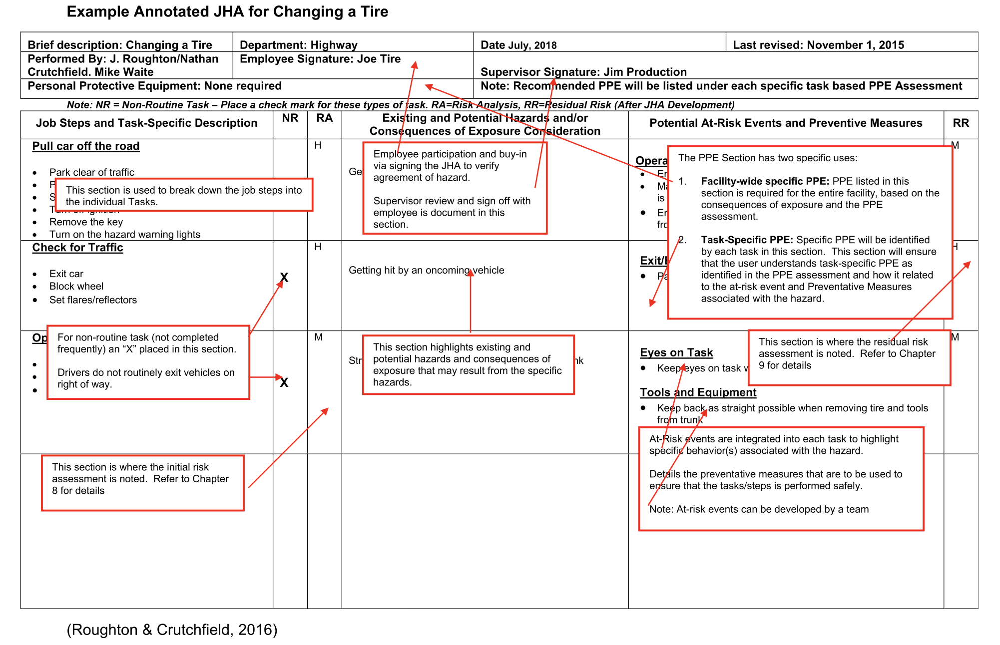

<!-- Block B78 -->
## 부록 12.2 자동차 타이어 교체 작업에 관한 상세 해설 JHA 샘플 (APPENDIX 12.2 EXAMPLE OF AN ANNOTATED JHA FOR CHANGING A TIRE)

*(ROUGHTON & CRUTCHFIELD, 2016)*

본 부록은 일상에서 가장 흔하게 접할 수 있는 자동차 타이어 교체 작업을 예시로 삼아, 직무를 구성하는 세부 단계(Steps), 각 단계별 세부 과업(Tasks), 내재된 물리적 유해위험요인, 잠재적 위험 사건, 그리고 잭 미끄러짐이나 도로 주행 차량 충돌을 방지하기 위한 정밀 예방 통제 대책을 상세한 해설과 함께 입체적으로 보여주는 표준 교육용 JHA 실전 모델이다.

---

<!-- Block B79 -->
## 부록 12.3 칼 안전 사용 및 절단 방지 장갑 표준 운영 절차 샘플 (APPENDIX 12.3 SAMPLE KNIFE SAFETY AND CUT RESISTANT GLOVES PROCEDURE)

본 '칼 안전 사용 및 절단 방지 장갑 프로그램'은 사업장에서 칼날 자동 접이식 안전 칼(autoretracting knives)을 사용할 때 손의 베임 및 열상 재해를 근원적으로 차단하기 위한 현장 구축 가이드라인을 제공하는 것을 목적으로 한다.

본 표준 절차는 사업장 내의 모든 해당 작업 구역(해당 구역 목록 명시)에 엄격히 적용되며, 커터칼, 다목적 유틸리티 칼, 또는 날카로운 칼날을 지닌 모든 절단 수공구를 사용하는 일체의 모든 과업에 포괄적으로 적용된다.

**핵심 표준 용어 정의:**
* **칼날 자동 접이식 안전 칼 (Autoretracting knife)**: 절단 대상물로부터 칼날이 벗어나는 순간, 스프링 장치 등에 의해 칼날이 사용자의 신체에 닿지 않는 안전한 칼집 내부로 자동으로 즉각 수납되는 특수 안전 칼.
* **방호 가드 장착 칼 (Guarded knife)**: 칼날 주변에 특수 안전 방호 가드가 장착되어 있어, 절단 대상물 표면에 닿는 순간을 제외하고는 칼날이 가드 외부로 돌출되지 않도록 설계된 칼.
* **절단 방지 안전장갑 (Cut resistant gloves)**: 특수 고강도 절단 방지 원단(케블라, 고밀도 폴리에틸렌 등)으로 직조되어 작업 중 칼날과의 접촉으로부터 손과 손가락의 열상을 전문적으로 방호하도록 설계된 안전장갑.

---

<!-- Block B80 -->
### 관찰 및 필수 실무 수칙 (Observation)

> **[주의] 현장에 보급되는 대부분의 안전장갑은 '절단 저항(cut resistant)' 성능을 지닌 것이지, 결코 그 어떤 칼날도 뚫지 못하는 '절단 무적(cut proof)'이 아니다.**  
> *(Geng, 2016)*

**책임, 권한 및 상호 연계성 (Responsibilities/authorities/interrelationships)**: 자신이 관할하는 현장 구역에서 본 표준 안전 절차가 한 치의 오차도 없이 100% 준수되고 있는지를 지속적으로 감독하고 점검하는 것은 리더십 팀의 모든 구성원과 전 임직원의 양보할 수 없는 법적·조직적 책무이다. 일체의 위반 사항이나 불일치가 발견될 경우 즉각적인 현장 시정 조치가 단행되어야 한다. 사업장 전담 안전 전문가는 현장 근로자 및 리더십 팀과 긴밀히 협력하여 작업별 최적의 안전 칼 선정, 대체 절단 공법 발굴 등 필요한 기술적 지원을 전폭적으로 제공해야 한다. 모든 구성원은 칼 안전 사용 및 절단 방지 장갑 절차를 준수함에 있어 항상 건전한 안전 판단력과 경각심을 견지해야 한다.

<!-- Block B81 -->
### 표준 작업 절차 (Procedure)

---

<!-- Block B82 -->
### 손 안전을 위한 일반 수칙 (General Rules for Hand Safety)

손 베임 및 열상 재해는 손이 위험 반경(line of fire, 사선)에 무방비로 놓여 있거나 날카로운 모서리를 지닌 칼, 공구, 기계 설비와 직접 접촉할 때 발생한다. 이러한 베임 부상은 올바른 안전 수공구를 적절히 사용함으로써 완벽히 예방하거나 최소화할 수 있다.

절단 방지 안전장갑은 다음의 경우에 반드시 의무적으로 착용해야 한다:
* 손이나 손가락에 베임, 열상, 찰과상 등의 위험이 초래될 수 있는 작업 과업을 수행할 때.
* 노출된 칼날로 절단 작업을 수행하거나 날카로운 모서리를 지닌 원자재 및 기계 설비를 취급하거나 그 주변에서 작업할 때.  
*일상 업무 수행 중 개인 휴대용 주머니칼(pocket knives)을 꺼내 사용하는 행위는 사내에서 일절 엄격히 금지된다.*

---

<!-- Block B83 -->
### 칼 안전 사용 수칙 (Knife Safety)

현장에서 사용 승인된 절단 공구는 반드시 [회사명 삽입]에 의해 공식 지급되어야 한다.
* 칼날 고정식 칼(fixed blades)이나 표준 일반 커터칼(box knives)의 사내 사용은 **일절 엄금(PROHIBITED)**된다.
* 본 표준 절차서에 명시되지 않은 그 어떤 절단 도구라도 사용하고자 할 경우, 사전에 개인보호구(PPE) 분과위원회의 공식 심의와 승인을 필히 득해야 한다.
* 모든 절단 작업은 칼날의 진행 방향이 작업자 자신의 신체 부위 반대쪽(away from the body part)을 향하도록 당기거나 밀어야 한다.
* 결함이 발견된 안전 칼이나 마모되어 무뎌진 칼날은 그 즉시 현장에서 폐기하고 라인에서 격리 제거해야 한다.
* 만약 작업의 특수성으로 인해 상기 표준 절차를 준수할 수 없는 불가피한 예외 상황이 발생할 경우, 작업자는 사전에 리더십 팀에 서면 '예외 승인 신청서(variance request)'를 공식 제출해야 하며 다음 사항들이 반드시 포함되어야 한다:
  - 담당 직무 및 직책 (Job/position)
  - 구체적인 대상 작업 과업 (Specific task)
  - 공인 안전 칼을 정상적으로 사용할 수 없는 불가피한 사유
  - 제안하는 대체 절단 공구에 대한 상세 기술서
절단 방지 안전장갑을 착용하지 않거나 금지된 절단 도구를 임의로 사용하여 열상 부상을 입은 근로자는 사규에 따라 엄격한 인사 징계 조치의 대상이 된다.

**근로자의 핵심 준수 책임:**
* 그 어떤 절단 도구를 사용하든, 칼을 쥐지 않은 반대편 손(noncutting hand)에는 반드시 절단 방지 안전장갑을 상시 착용해야 한다.
* 절단 장비를 점검하거나, 칼날을 교체하거나, 날카로운 모서리를 지닌 설비를 취급할 때는 반드시 양손 모두에 절단 방지 장갑을 착용해야 한다.
* [회사명 삽입]의 공식 승인을 거쳐 구매 부서를 통해 정식 조달된 칼날 자동 접이식 안전 칼, 방호 가드 장착 칼, 또는 안전 매립형 절단 도구만을 엄격히 사용해야 한다.

**리더십 팀 구성원의 핵심 관리 책임:**
* 관할 책임 구역 내의 모든 근로자가 본 표준 절차에 대한 교육을 완벽히 이수하고 그 내용을 능숙하게 숙지하고 있음을 정기적으로 검증한다.
* 빈번한 현장 순회 점검을 통해 관할 구역 내 모든 근로자의 본 절차 준수 여부를 상시 철저히 감독한다.
* 새롭게 도입되거나 업데이트된 안전 공구 및 안전장갑에 대해 작업자들에게 적정 수준의 교육 훈련을 즉시 제공한다.
* 현장에서 일체의 위반 사항이나 절차적 불일치가 발견될 경우 즉각적인 시정 조치를 단행한다.
* 사업장 내 안전 칼 및 절단 방지 장갑 프로그램의 완전한 정착을 달성하기 위한 구체적인 추진 일정을 수립하고 집행한다.

---

<!-- Block B84 -->
### 공식 승인 절단 공구 및 안전장갑 지침 (Approved Cutting Tools)

* 칼날 자동 접이식 안전 칼(Self-Retractable Knives)의 상세 분석 및 올바른 사용법은 부록 12.5를 참조하라. 안전 칼 교육 점검표 샘플은 부록 12.6을 참조하라.
공식 승인 절단 방지 안전장갑:
* 절단 방지 안전장갑 선정 가이드 샘플은 부록 12.7을 참조하라.
* 개인보호구(PPE) 평가 샘플은 부록 12.8을 참조하라.
* PPE 요구조건 준수 가이드라인 샘플은 부록 12.9를 참조하라.
* 유해위험요인 평가 옵션 1 샘플은 부록 12.10을 참조하라.
* JHA 기반 PPE 평가 옵션 2 샘플은 부록 12.11을 참조하라.
* 개인보호구 교육 훈련 인증서 양식은 부록 12.12를 참조하라.
* 개인보호구 교육 훈련 퀴즈 평가지는 부록 12.13을 참조하라.

---

<!-- Block B85 -->
### 선별된 전문 참고 자료 (Selected Resources)

* ERI 안전 비디오 시리즈: 《작업장에서의 칼 안전(Knife safety in the workplace)》(2004)
* 《직무 현장에서의 칼 부상을 예방하라!(Avoid knife injuries on the job!)》(2009)
* 마토(Martor) 안전 칼을 활용한 안전한 절단 작업 (2018)
* 핸디 세이프티 나이프(Handy safety knife) 실무 매뉴얼 (2016)
* 영국 산업 안전: 시민의 의무인가? (2018)

---

<!-- Block B86 -->
## 부록 12.4 칼 안전 및 절단 방지 장갑 프로그램 전사 공문 초안 (APPENDIX 12.4 DRAFT COMPANY-WIDE LETTER TO IMPLEMENT KNIFE SAFETY AND CUT RESISTANT GLOVE PROGRAM)

[회사명 삽입]은 작업장 내 열상(베임) 재해의 위험을 근원적으로 줄이기 위해 필요한 핵심 기여 요인과 구체적 실행 조치를 규명하고자 '칼 안전 및 절단 방지 장갑에 관한 전사적 위험성 평가 프로젝트'를 실시하였습니다. 본 평가의 핵심 목적은 가능한 모든 작업에서 칼의 사용 자체를 원천 배제하고, 저위험 대체 절단 공구를 지정하며, 각 작업 과업별로 최적화된 적정 수준의 개인보호구(절단 방지 장갑)를 명확히 규정하는 데 있습니다.

본 정밀 평가 결과를 바탕으로, [회사명 삽입]은 실제 현장에서 수행되는 다양한 세부 과업들에 완벽히 부합하는 '공식 승인(approved)' 절단 방지 장갑 및 절단 공구 목록을 확정하였습니다. 승인 목록에 등재된 안전 칼과 보호 장갑은 회사의 대표적인 다양한 사업장 현장에서 실시된 실사 평가의 엄밀한 객관적 결과를 바탕으로 엄선되었습니다.

이 실행 계획을 성공적으로 완수하기 위해, 각 사업장은 다음과 같은 세부 현장 실천 계획을 즉시 수립하고 실행해야 합니다:
* 작업에 적합한 표준 공구와 필수 개인보호구의 의무적 착용 규정을 명확히 수립할 것.
* 위험에 노출된 모든 현장 작업자들에게 신형 안전 칼 조작법과 보호 장갑 관리 요령에 대한 실습 교육을 철저히 실시할 것.
* 기존의 위험한 일반 커터칼을 전량 수거하여 폐기하고 공인된 안전 칼로 100% 교체할 것.
* 현장 관리감독자의 일일 점검을 통해 임의적인 비공인 공구 반입을 엄격히 통제할 것.

---

<!-- Block B87 -->
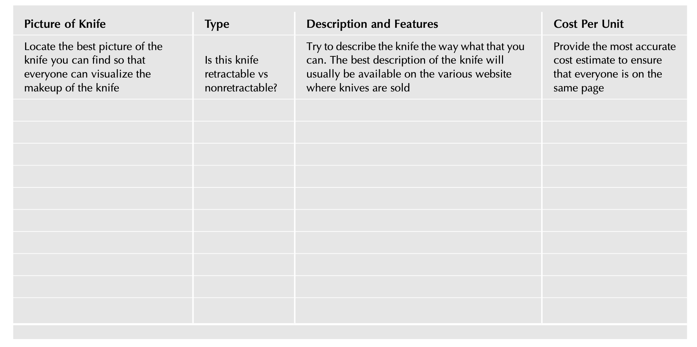

<!-- Block B88 -->
## 부록 12.5 칼날 자동 접이식 안전 칼 분석 샘플 (APPENDIX 12.5 SAMPLE ANALYSIS OF SELF-RETRACTABLE KNIVES)

본 분석 양식은 현장에 도입할 안전 칼 후보 모델들의 성능을 객관적으로 비교·검토하기 위해 작성된다. 칼날의 자동 수납 메커니즘, 인체공학적 그립감, 칼날 교체의 안전성, 내구성, 그리고 도입 단가를 정량적으로 분석하여 최적의 모델을 선정하는 템플릿을 제공한다.

---

<!-- Block B89 -->
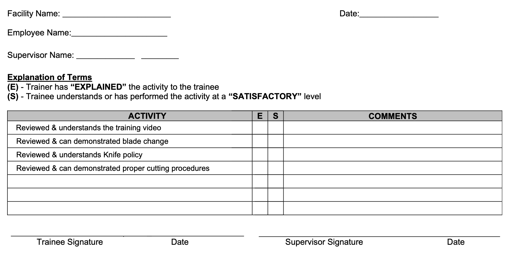

<!-- Block B90 -->
## 부록 12.6 안전 칼 교육 훈련 점검표 샘플 (APPENDIX 12.6 SAMPLE SAFETY KNIFE TRAINING CHECKLIST)

사업장명: __________________________ 일자: ___________________  
근로자 성명: _______________________ 사번: ___________________  
관리감독자 성명: ___________________  

---

<!-- Block B91 -->
### 용어 및 평가 기준 설명 (Explanation of Terms)

* **(E)** - 교육자가 교육생에게 해당 안전 수칙을 충분히 "설명(EXPLAINED)"하였음.
* **(S)** - 교육생이 해당 과업의 안전 기준을 완벽히 이해하였거나 "만족스러운(SATISFACTORY)" 수준으로 직접 시연해 보였음.

| 세부 평가 활동 | (E) | (S) | 상세 검토 의견 |
| :--- | :---: | :---: | :--- |
| 안전 교육 비디오 시청 및 핵심 수칙 숙지 여부 | | | |
| 안전 칼 분해 및 안전한 칼날 교체 절차 직접 시연 여부 | | | |
| 사내 칼 안전 사용 공식 정책 및 징계 규정 이해 여부 | | | |
| 신체 반대 방향으로 자르는 올바른 절단 작업 절차 시연 여부 | | | |

교육생 서명: _________________ 일자: ________ | 관리감독자 서명: _________________ 일자: ________

---

<!-- Block B92 -->
## 부록 12.7 절단 방지 장갑 선정 가이드 분석 샘플 (APPENDIX 12.7 SAMPLE ANALYSIS OF CUT RESISTANT GLOVES SELECTION GUIDE)

본 가이드는 작업자가 특정 직무 과업에 가장 적합한 절단 방지 안전장갑을 올바르게 선택할 수 있도록 지원하기 위해 정교하게 설계되었다. 본 분석 가이드는 장갑을 구성하는 원단 소재의 특성, 권장되는 주된 용도, 장갑 모델별 구체적인 장단점, 그리고 실물 예시 사진을 제공하여 오선택으로 인한 2차 사고를 원천 방지한다 (Oregon OSHA PPE Quick Guide, n.d.; Washington L&I PPE Guide, 2003 참조).

---

<!-- Block B93 -->
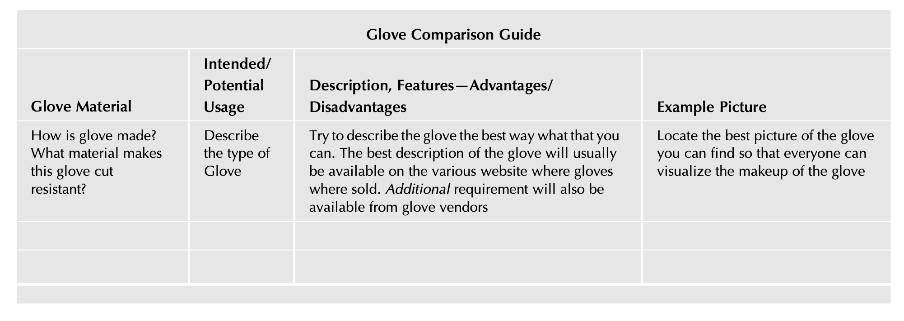

<!-- Block B94 -->
## 부록 12.8 개인보호구(PPE) 평가 샘플 (APPENDIX 12.8 SAMPLE PERSONAL PROTECTIVE EQUIPMENT ASSESSMENT)

<!-- Block B95 -->
### 보호 장갑 비교 가이드 (Glove Comparison Guide)

| 장갑 원단 소재 | 권장 및 잠재적 용도 | 주요 특징, 장점 및 단점 | 실물 사진 |
| :--- | :--- | :--- | :---: |
| **케블라 (Kevlar)** | 고온 취급 및 중등도 절단 위험 작업 | 뛰어난 내열성과 우수한 절단 저항력 제공 / 습기에 약하며 마모 저항력이 다소 낮음 | 실물 사진 참조 |
| **다이니마 / 스펙트라 (HPPE)** | 정밀 기계 가공 및 고위험 절단 작업 | 강철보다 10배 강한 초고강도, 뛰어난 유연성과 정밀 조작성 / 고온 열기에는 취약함 | 실물 사진 참조 |
| **스테인리스 스틸 메쉬** | 육가공, 도축 및 고위험 칼날 취급 | 절대적인 물리적 칼날 관통 방어 / 무게가 무겁고 전기 절연성이 전혀 없음 | 실물 사진 참조 |
| **가죽 / 코팅 복합 섬유** | 일반 중작업 자재 운반 및 건축 공사 | 우수한 마찰 및 인열 저항성, 뛰어난 내구성 / 미세 정밀 조작에는 한계 | 실물 사진 참조 |

본 부록과 참고문헌은 워싱턴주 노동산업부(OSHA)의 공식 자료를 바탕으로 사업장에서 성공적인 개인보호구 평가를 수행할 수 있도록 체계화된 것이다 (Personal protective equipment guide volume 1: General PPE, 2003).

---

<!-- Block B96 -->
### 추가 전문 참고 자료 (Additional Resources)

* OSHA 3151-12R: 《개인보호구(Personal Protective Equipment) 실무 지침서》(2004)
* OSHA 1915 Subpart I App A: 《유해위험요인 평가, PPE 선정 및 훈련 프로그램 비의무 가이드라인》
* 오레곤 OSHA: 《PPE 위험성 평가 퀵 가이드(PPE hazard assessment quick guide)》
* Roughton & Crutchfield: 《직무위험성평가: 자율 안전보건 준수 및 그 너머를 위한 실무 지침》(제2판, 2016)

---

<!-- Block B97 -->
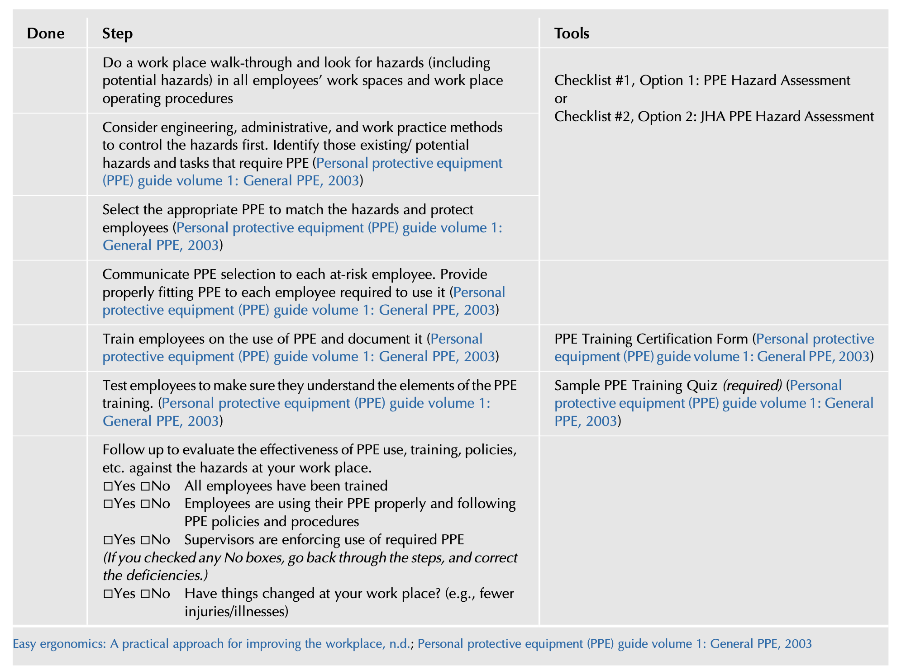

<!-- Block B98 -->
## 부록 12.9 개인보호구(PPE) 법적 요구조건 준수 가이드라인 샘플 (APPENDIX 12.9 SAMPLE GUIDELINES FOR COMPLYING WITH PERSONAL PROTECTIVE EQUIPMENT REQUIREMENTS)

사업장의 PPE 관리 체계가 관련 산업안전보건 법령의 모든 요구조건을 완벽히 충족하고 있는지 검증하기 위해 본 점검 가이드라인을 활용하라. 관리감독자는 우측 열에 제시된 실무 도구들을 활용하여 각 단계별 이행 상태를 확인하고 체크박스를 완료해 나가야 한다.

**핵심 이행 5단계:**
1. **작업장 위험성 평가 실시**: 사업장 내 모든 직무에 대해 눈, 안면, 머리, 발, 손, 호흡기 등의 위험요인을 전수 조사하고 공식 문서로 인증한다.
2. **적정 PPE 선정 및 피팅**: 식별된 위험에 완벽히 대응하는 공인 규격 합격품을 선정하고 작업자 신체에 맞게 피팅한다.
3. **근로자 교육 훈련**: PPE 착용 시기, 착용 방법, 조절법, 한계점, 유지관리 및 폐기 요령을 전원 교육한다.
4. **교육 훈련 공식 인증서 작성**: 교육을 이수한 근로자의 성명, 사번, 교육 일자, 교육 내용을 명시한 공식 인증서를 작성·보존한다.
5. **정기 재평가 및 개정**: 공정 변경, 신규 설비 도입, 사고 발생 시 PPE 적합성을 원점에서 재평가한다.

---

<!-- Block B99 -->
### PPE 교육 훈련 인증서 및 평가 양식 (PPE Training Certification Form)

근로자들이 PPE 교육 훈련의 핵심 요소들을 완벽히 숙지하고 있는지 객관적으로 검증하기 위해 교육 직후 필기 또는 실기 퀴즈 테스트를 의무적으로 실시해야 한다 (Personal protective equipment guide volume 1: General PPE, 2003).

---

<!-- Block B100 -->
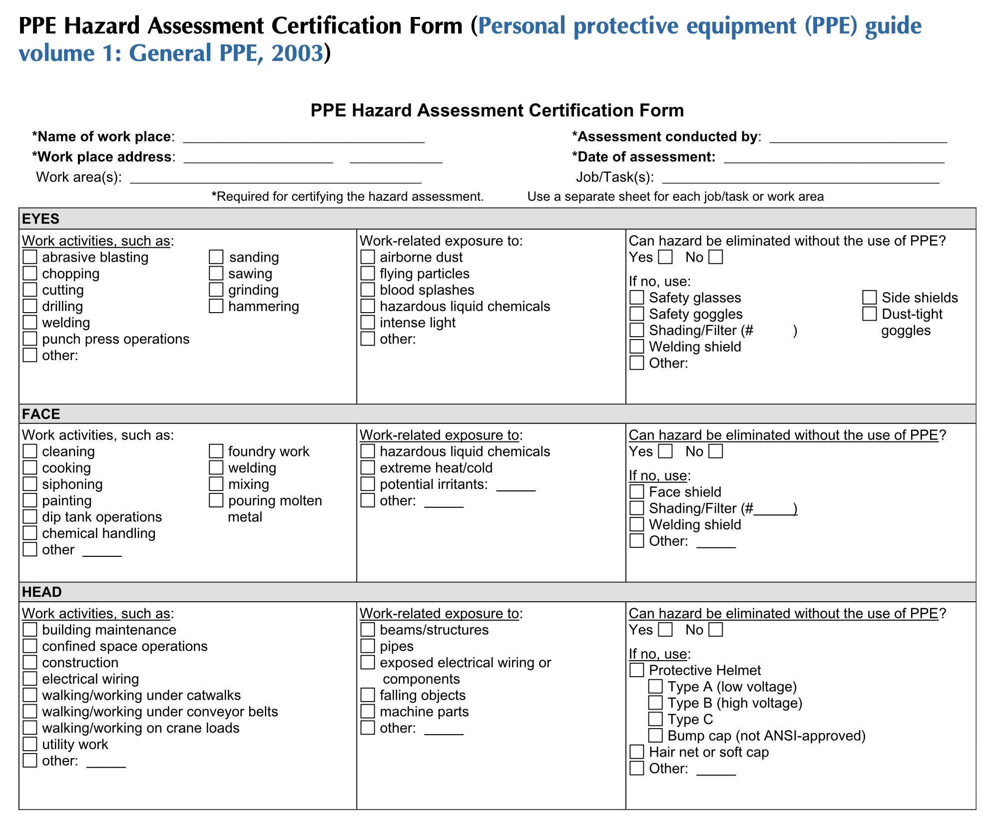

<!-- Block B101 -->
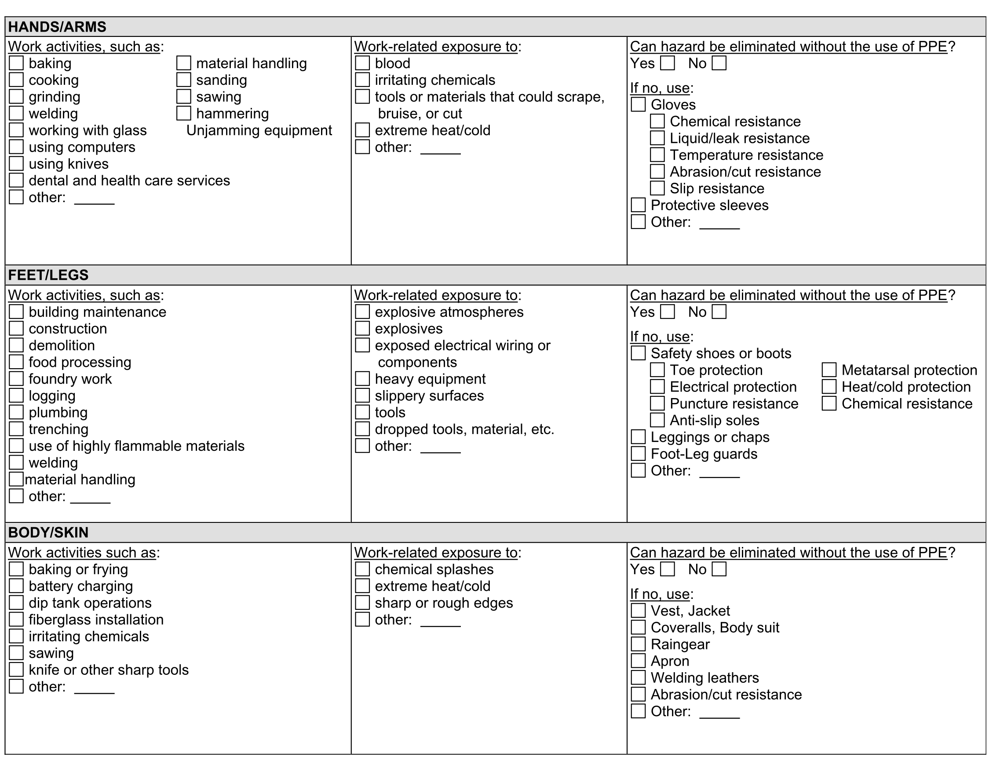

<!-- Block B102 -->
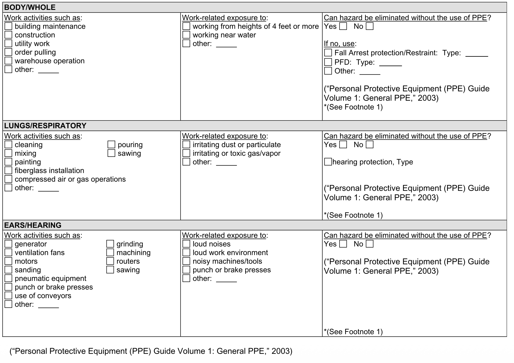

<!-- Block B103 -->
## 부록 12.10 개인보호구를 위한 위험성 평가 도구: 옵션 1 (APPENDIX 12.10 HAZARD ASSESSMENT FOR PPE, OPTION 1)

본 도구는 현장 근로자들에게 구체적으로 어떤 개인보호구(PPE)가 필요한지 판별하기 위해 작업장 내의 잠재 유해위험요인을 신체 부위별로 체계적으로 식별할 수 있도록 지원한다. 유해 작업 활동들은 신체 부위별로 다음과 같이 범주화된다:
* **눈 및 안면 (Eyes and Face)**: 비산물, 분진, 용융 금속, 화학물질 액적 및 증기, 유해 광선(용접광 등).
* **머리 (Head)**: 낙하물, 상부 돌출 구조물 충돌, 감전 위험.
* **발 및 다리 (Feet and Legs)**: 중량물 낙하 및 구름, 날카로운 못 등 바닥 관통물, 화학물질 누출, 미끄러운 바닥.
* **손 및 팔 (Hands and Arms)**: 날카로운 칼날 절단, 타박상, 화학 화상, 극심한 온도, 감전.
* **호흡기 및 전신 (Respiratory & Body)**: 유독가스, 산소 결핍, 분진 흡입, 고온 복사열, 유해물질 오염.

---

<!-- Block B104 -->
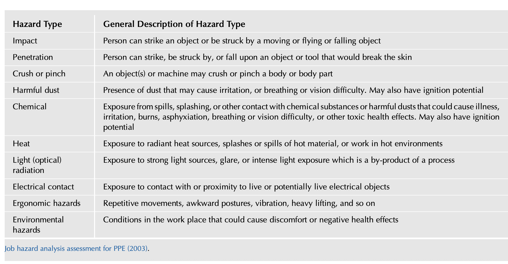

<!-- Block B105 -->
## 부록 12.11 JHA 기반 개인보호구 평가 도구: 옵션 2 (APPENDIX 12.11 JOB HAZARD ANALYSIS ASSESSMENT FOR PPE, OPTION 2)

JHA 기반의 PPE 위험성 평가 접근법은 유해위험요인이 복잡하고 다양한 안전 이슈가 얽혀 있는 대규모 비즈니스 사업장에 매우 탁월하다. 이는 각 유해위험요인마다 위험 우선순위 코드(Risk Priority Code)를 부여하여 통제 대책의 실행 순서를 과학적으로 결정하도록 이끌어 준다.

---

<!-- Block B106 -->
### 상세 평가 지침 (Instructions)

1. **현장 순회 조사 실시**: 각 직무 및 세부 과업 단계마다 다음의 유해위험요인 유형의 존재 여부, 발생 근원, 그리고 위험에 노출되는 신체 부위를 꼼꼼히 기록한다:
   * 충격 및 낙하·비래 (Impact)
   * 날카로운 물체에 의한 관통 (Penetration)
   * 협착 및 압착 (Compression)
   * 유해 화학물질 접촉 (Chemical exposures)
   * 고온 및 극한 저온 (Heat / Cold)
   * 유해 분진 및 가스 (Harmful dust)
   * 유해 광선 및 방사선 (Light / Radiation)
2. **위험도 매트릭스 평가**: 부상의 잠재 심각도(Severity)와 사고 발생 확률(Probability)을 결합하여 위험 우선순위 등급(1~4등급)을 정밀하게 산출한다.

---

<!-- Block B107 -->
### JHA 위험성 평가 매트릭스 (Job Hazard Analysis Matrix)

| 부상 잠재 심각도 (Severity) | 빈번함 (A: Frequent) | 수회 발생 (B: Several Times) | 가끔 발생 (C: Occasional) | 발생 가능 (D: Possible) | 극히 희박 (E: Improbable) |
| :--- | :---: | :---: | :---: | :---: | :---: |
| **I 등급: 사망 또는 영구 전폐 장애** | **1** | **1** | **1** | **2** | **3** |
| **II 등급: 중대재해 및 심각한 질병** | **1** | **1** | **2** | **2** | **3** |
| **III 등급: 경미한 부상 또는 질병** | **2** | **2** | **3** | **3** | **4** |
| **IV 등급: 응급처치 수준 이하 경미 피해** | **3** | **3** | **4** | **4** | **4** |

* **우선순위 1**: 즉각적인 작업 중단 및 엔지니어링 통제와 최상급 PPE 즉각 배치 필수.
* **우선순위 2**: 신속한 개선 대책 수립 및 적정 보호구 의무화.
* **우선순위 3**: 관리적 통제 절차 수립 및 정기 모니터링.
* **우선순위 4**: 일상적 작업 주의 및 기본 안전 수칙 준수.

---

<!-- Block B108 -->
### 위험성 평가 공식 인증서 (Certification of Assessment)

사업장 명칭: ____________________________________  
평가 실시자: _________________________ 직책: ________________________  
사업장 주소: ____________________________________  
평가 실시 일자: ____________________  
개인보호구 및 위험 통제 대책 최종 승인자: ____________________ (서명)  

---

<!-- Block B109 -->
## 부록 12.12 개인보호구 교육 훈련 공식 인증서 서식 (APPENDIX 12.12 EXAMPLE PERSONAL PROTECTIVE EQUIPMENT TRAINING CERTIFICATION FORM)

근로자 성명: ______________________ 사번: ___________________  
직무 명칭 및 작업 부서: ____________________________________  
교육 실시자 성명 및 서명: __________________________________ 일자: ________  

본인은 오늘 안전보건 규정에 의거하여 직무 수행에 필요한 개인보호구(PPE)에 대해 다음의 핵심 사항들을 철저히 교육받고 실습을 완료하였음을 공식 확인합니다:
* 언제 개인보호구를 착용해야 하는가?
* 구체적으로 어떤 보호구를 착용해야 하는가?
* 개인보호구를 올바르게 착용하고, 벗고, 신체에 맞게 조절하는 방법.
* 지급된 개인보호구가 제공하는 방호의 한계점.
* 개인보호구의 올바른 유지관리, 수명 주기, 보관 방법 및 폐기 절차.

근로자 서명: ____________________________________ 일자: ________

---

<!-- Block B110 -->
## 부록 12.13 개인보호구 교육 훈련 평가 퀴즈 (APPENDIX 12.13 EXAMPLE PERSONAL PROTECTIVE EQUIPMENT TRAINING QUIZ)

*(근로자가 교육 내용을 완벽히 숙지했는지 검증하기 위한 10문항 표준 평가 퀴즈 샘플)*

1. 개인보호구(PPE)의 1차적인 핵심 목적은 무엇인가?  
   (a) 작업 속도를 빠르게 하기 위해  
   (b) 물리적·화학적 유해위험요인으로부터 작업자의 신체를 보호하기 위해  
   (c) 유니폼을 깔끔하게 맞추기 위해  
   *(정답: b)*  
2. 안전 칼을 사용할 때 절단 방지 장갑은 어느 손에 착용해야 하는가?  
   (a) 칼을 쥔 손  
   (b) 칼을 쥐지 않은 반대편 손 (칼날 진행 방향의 손)  
   (c) 착용할 필요 없음  
   *(정답: b)*  
3. 마모되거나 손상된 개인보호구를 발견했을 때 취해야 할 올바른 조치는 무엇인가?  
   (a) 테이프로 감아서 계속 사용한다  
   (b) 즉시 사용을 중단하고 관리감독자에게 보고하여 새것으로 교체한다  
   (c) 퇴근할 때까지 그냥 쓴다  
   *(정답: b)*  
4. 안전모(Hard Hat)의 내부 충격 흡수 서스펜션 끈과 외피 사이의 적정 간격이 유지되어야 하는 이유는 무엇인가?  
   (충격 완충 공간 확보 및 두개골 골절 방지)  
5. 보호 안경과 보안면(Face Shield)의 올바른 착용 관계는 무엇인가?  
   (보안면은 보안경을 대체할 수 없으며, 반드시 보안경 위에 이중으로 착용해야 함)

---

<!-- Block B111 -->
## 참고문헌 (BIBLIOGRAPHY)

* Avoid knife injuries on the job!. (2009). Occupational Safety and Health Administration (OSHA), Omaha Area Office.
* Blum, D. (2014). The best American science and nature writing 2014. Mariner (October).
* Capra, F., & Luisi, P. L. (2014). The systems view of life: A unifying vision. Cambridge: Cambridge University Press.
* Carr, N. (2014). The glass cage: Automation and us. New York: W. W. Norton & Company.
* Concepts and principles. Human Performance Improvement Handbook. (2009). Vol. 1 US Department of Energy.
* Conducting a Job Hazard Analysis (JHA). (2017). Environmental Health and Safety, Texas A&M University. Retrieved from http://bit.ly/2s0eC6t.
* EM 385-1-1, Safety and health requirements manual. (2014). US Army Corps of Engineers, (November). Retrieved from http://bit.ly/1x15E9x.
* Frederick Taylor and scientific management, understanding Taylorism and early management theory. (2017). Mind Tools. Retrieved from http://bit.ly/2j7h8uW.
* Geng, H. (2016). Cut resistance vs cut proof: Understanding glove performance standards. Professional Safety.
* Google advance search. (n.d.). Google. Retrieved from http://bit.ly/2L12j2L.
* Handy safety knife. (2016). Retrieved from http://bit.ly/2rZp7eG.
* How to identify job hazards. (2017). Health and Safety Executive (HSE). Retrieved from http://bit.ly/2rZ51tE.
* Human performance tools for individuals, work teams, and management. (2009). Vol. 2 US Department of Energy (DOE).
* Industrial safety in the UK: A civic duty?. (2018). History of Occupational Safety and Health. Retrieved from http://bit.ly/2k904yC.
* Job. (2018). Dictionary.com. Retrieved from http://bit.ly/2rYJ0gW.
* Job hazard analysis, 3071. (2002). Occupational Safety and Health Administration (OSHA), US Department of Labor.
* Kahneman, D. (2011). Thinking, fast and slow. New York: Farrar, Straus and Giroux.
* Knife safety in the workplace. (2004). ERI Safety Videos. Retrieved from http://bit.ly/2rZp7eG.
* Managing worker safety and health. (2016). Voluntary Protection Programs Participants’ Association (VPPPA).
* Occupational health & safety management systems. (2012). ANSI/AIHA/ASSE Z10-2012.
* Oregon OSHA’s quick guide to the PPE hazard assessment. (n.d.). Oregon OSHA. Retrieved from http://bit.ly/2j7h8uW.
* Personal protective equipment (PPE) guide volume 1: General PPE. (2003). Washington State Department of Labor and Industries.
* Reason, J. (2009). The human contribution: Unsafe acts, accidents and heroic recoveries. Farnham: Ashgate Publishing.
* Risk Assessment Institute. (2017). American Society of Safety Engineers (ASSE). Retrieved from http://bit.ly/2k8z8uW.
* Roughton, J., & Crutchfield, N. (2013). Safety culture: An innovative approach. Butterworth-Heinemann.
* Roughton, J., & Crutchfield, N. (2016). Job hazard analysis: A guide for voluntary compliance and beyond (2nd ed.). Butterworth-Heinemann.
* Safe cutting. With the safety knives of Martor. (2018). Martor USA. Retrieved from http://bit.ly/2s0eC6t.
* Safety alert for operations, manual flight operations. (2013). Federal Aviation Administration (FAA), SAFO 13002.
* Sinek, S. (2009). Start with why: How great leaders inspire everyone to take action. Portfolio/Penguin.
* Strubler, D. (2018). The difference that continual improvement makes, principle 4, the five “W’s” and one “H”.
* Why use a child theme?. (2018). WordPress Codex. Retrieved from http://bit.ly/2j7h8uW.

---

<!-- Block B112 -->
## 추가 권장 도서 (FURTHER READING)

* Job safety analysis. (2018). Oregon Occupational Safety and Health (Oregon OSHA), Department of Consumer & Business Services. Retrieved from http://bit.ly/2I3VXN0.
* Martor knives: The gold standard in industrial cutting safety. (2017). Martor USA. Retrieved from http://bit.ly/2s0eC6t.
* System Safety Engineering and Management. (2015). Harold E. Roland and Brian Moriarty, John Wiley & Sons.

