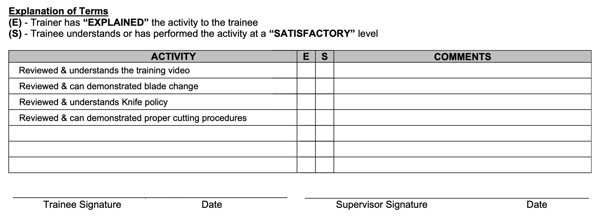

<!-- Block B01 -->
# 제12장 직무 유해·위험요인 분석(JHA)의 활용 (Chapter 12 Using the Job Hazard Analysis)

*Safety Culture.* https://doi.org/10.1016/B978-0-12-814663-7.00012-1

<!-- Block B02 -->

> "우리는 결코 무작위적인 절차를 원하지 않는다. 우리는 인간 행동에 대한 깊은 이해를 바탕으로 현장의 안전 수칙을 체계적으로 수립하고자 한다." – W. 에드워즈 데밍 (W. Edwards Deming)

<!-- Block B03 -->
## 서론 (INTRODUCTION)

조직이 존재하는 일차적 이유는 고객이 요구하는 제품을 생산하거나 서비스를 제공하는 것이다. 모든 작업 활동은 본질적으로 다양한 위험에 노출될 수밖에 없다.
**직무 유해·위험요인 분석(JHA, Job Hazard Analysis)**은 특정 직무를 구성하는 개별 작업 단계를 분해하고, 각 단계마다 잠재된 유해·위험요인을 찾아내며, 이를 안전하게 통제하기 위한 최적의 작업 방법을 규명하는 가장 강력하고 과학적인 위험성평가 도구이다.

본 장을 마친 후 당신은 다음을 수행할 수 있어야 한다:
* JHA의 정의와 그 역사적 발전 배경을 설명할 수 있다.
* 직무 인벤토리(Job Inventory) 작성과 기준선 평가(Baseline Assessment)의 중요성을 논의할 수 있다.
* JHA와 JSA(Job Safety Analysis)의 개념적 차이와 발전 관계를 규명할 수 있다.
* JHA 개발 과정에 현장 근로자를 참여시키는 이유와 팀 구성 방법을 설명할 수 있다.
* 5W1H(누가, 무엇을, 어디서, 언제, 왜, 어떻게) 질문 기법을 JHA에 적용할 수 있다.
* JHA 결과를 표준 작업 절차서(SOP)와 교육 훈련으로 전환하는 프로세스를 구축할 수 있다.

<!-- Block B04 -->
## JHA 프로세스의 출발점: 직무 인벤토리 (BEGINNING THE JOB HAZARD ANALYSIS PROCESS—JOB INVENTORY)

JHA를 체계적으로 수행하기 위한 첫 번째 필수 조치는 사업장 내에서 수행되는 모든 직무와 과업의 목록을 총망라하는 **직무 인벤토리(Job Inventory)**를 작성하는 것이다.
인벤토리가 없으면 조직은 어떤 작업이 존재하는지, 어떤 작업이 가장 위험한지조차 파악하지 못한 채 주먹구구식으로 안전관리를 수행하게 된다.
일상적인 정규 작업뿐만 아니라, 정비·보수, 청소, 시운전과 같은 비일상적(Non-routine) 고위험 작업까지 누락 없이 인벤토리에 등재되어야 한다.

<!-- Block B05 -->
### 교훈: 기준선 평가 (LESSON LEARNED)

> **기준선 평가 (Baseline Assessment):** 조직 전체의 현재 안전 상태와 위험 프로파일을 최초로 총괄 측정하는 기준점이다.
기준선 평가를 통해 어떤 직무가 가장 높은 사고 빈도와 심각성을 지니고 있는지 객관적으로 파악할 수 있으며, 이를 바탕으로 JHA의 우선순위가 결정된다.

<!-- Block B06 -->
## 의사소통 도구로서의 JHA (THE JHA AS A COMMUNICATION TOOL)

JHA는 단순히 안전 부서의 책장에 꽂아두는 서류가 아니라, 경영진과 현장 근로자 사이의 안전 대화를 촉진하는 최고의 **의사소통 도구(Communication Tool)**로 간주되어야 한다.
작업자가 직무의 각 단계에서 마주하는 위험이 무엇이며 왜 특정 보호구와 안전 절차를 지켜야 하는지 논리적으로 설득하고 소통하는 핵심 매개체 역할을 한다.

<!-- Block B07 -->
## 왜 JHA가 중요한가? (WHY IS A JHA IMPORTANT?)

JHA는 작업의 각 단계에 내재된 위험을 사전에 규명함으로써 사고와 부상을 원천 차단한다.
또한 작업 절차를 표준화하여 생산 효율성과 품질을 동시에 향상시키고, 신규 입사자 및 작업자 교육의 가장 완벽한 교재가 된다.

<!-- Block B08 -->

표 12.1 왜 JHA가 중요한가?

<!-- Block B09 -->
### 표 12.1 JHA가 중요한 핵심 이유 요약
* 작업장 내 숨겨진 유해·위험요인과 불안전 행동의 조기 발견 지원
* 관리자와 근로자 간의 안전 지식 및 위험 인식 격차 해소
* 표준 작업 절차서(SOP) 및 안전 작업 표준의 확립 기반 제공
* 사고 발생 시 책임 전가가 아닌 시스템적 개선 대책 도출 유도
* 신규 작업자 및 전환 배치자를 위한 표준 교육 자료 활용

<!-- Block B10 -->

그림 12.1 JHA 개발 프로세스 개요.

<!-- Block B11 -->
### 그림 12.1 JHA 개발 4단계 표준 프로세스 흐름도
1단계: 직무 선정 → 2단계: 작업 단계 분해 → 3단계: 유해·위험요인 식별 → 4단계: 예방 및 통제 조치 수립으로 이어지는 표준 사이클.

<!-- Block B12 -->
## 실행 전략 (STRATEGY FOR IMPLEMENTATION)

성공적인 JHA 구현을 위해서는 전사적인 추진 전략이 요구된다.
모든 작업을 한꺼번에 분석하려 들면 조직은 과부하에 걸려 중도 포기하게 된다.
철저한 우선순위 원칙에 따라 과거 중대재해 발생 직무, 높은 잠재 위험 직무, 신규 도입 설비 직무부터 단계적으로 추진해야 한다.

<!-- Block B13 -->

그림 12.2 전형적인 JHA 실행 프로세스 개요.

<!-- Block B14 -->
### 그림 12.2 JHA 실행 로드맵 해설
준비 단계부터 팀 구성, 현장 관찰, 분석표 작성, 검토 및 승인, 현장 적용 및 정기 갱신에 이르는 전 생애주기 관리 절차.

<!-- Block B15 -->
## JHA와 JSA의 정의 및 개념적 차이 (DEFINING JHA VS JSA)

산업 현장에서는 직무재해분석(JHA, Job Hazard Analysis)과 직무안전분석(JSA, Job Safety Analysis)이라는 용어가 종종 혼용된다.
전통적인 JSA가 작업의 안전 수칙 준수 여부에 초점을 맞추었다면, 현대의 **JHA는 위험의 근원인 '유해·위험요인(Hazard)' 그 자체를 과학적으로 분석하고 위험성(Risk)을 정량 평가하는 보다 발전된 시스템적 접근법**이다.

<!-- Block B16 -->
### 관찰 (OBSERVATION)

저자들은 현장 점검 중 안전 관리자가 작성한 JHA와 현장 작업자가 실제로 일하는 방식 사이에 극심한 괴리가 있음을 자주 목격했다.
작업자가 참여하지 않고 사무실 책상에서 작성된 JHA는 현장의 현실을 전혀 반영하지 못하는 죽은 문서에 불과하다.

<!-- Block B17 -->
## JHA 개발의 기대 효익 (BENEFITS OF DEVELOPING JHAS)

체계적인 JHA 개발은 산업재해율 감소뿐만 아니라, 작업 낭비 제거, 작업자 피로도 경감, 생산성 증대 및 조직 내 신뢰와 안전문화 향상이라는 포괄적인 경영 성과를 창출한다.

<!-- Block B18 -->

그림 12.3 직무 유해·위험요인 분석 프로세스 개념도.

<!-- Block B19 -->
### 그림 12.3 JHA의 핵심 개념 구조도
작업(Job)을 단계(Steps)로 쪼개고, 각 단계의 위험(Hazards)을 도출하며, 이에 대응하는 통제 조치(Controls)를 매핑하는 3단 매트릭스 모델.

<!-- Block B20 -->
## JHA의 잠재적 한계와 극복 과제 (DRAWBACKS OF THE JHA)

JHA 프로세스는 초기 구축 시 상당한 시간과 인력 투입을 요구한다.
적절한 교육과 훈련이 뒷받침되지 않으면 형식적인 체크리스트 작성으로 변질될 위험이 있으며, 이를 방지하기 위한 경영진의 확고한 자원 지원이 필수적이다.

<!-- Block B21 -->
## 근로자 참여가 절대적으로 중요한 이유 (WHY IS IT IMPORTANT TO GET EMPLOYEES INVOLVED)

현장 근로자는 매일 위험과 직접 마주하며 작업하는 당사자이므로, 기계의 미세한 결함이나 잠재 위험을 가장 잘 알고 있다.
근로자가 직접 작성에 참여한 JHA만이 현장에서 실질적으로 지켜지며, 이는 작업자에게 강력한 안전 주인의식(Buy-in)을 심어준다.

<!-- Block B22 -->
## JHA 전담 팀의 구성 (SELECTING A TEAM)

JHA는 결코 한 사람이 독단적으로 작성해서는 안 되며, 다기능 팀(Cross-Functional Team)에 의해 수행되어야 한다.
팀 구성원은 현장 관리감독자, 숙련된 작업자, 비숙련 작업자(신선한 시각 제공), 보전 정비 기술자, 그리고 안전 전문가로 구성하는 것이 가장 이상적이다.

<!-- Block B23 -->
## JHA 도입의 당위성 구축 (BUILDING THE CASE FOR A JHA PROCESS)

경영진과 부서장들을 설득하기 위해 JHA 도입의 비즈니스 케이스(Business Case)를 논리적으로 제시해야 한다.
사고로 인한 간접 손실 비용(생산 중단, 설비 수리, 브랜드 가치 하락)의 방지 효과를 입증해야 한다.

<!-- Block B24 -->
## JHA 스토리텔링과 5W1H 질문 기법 (TELLING THE JHA STORY)

JHA를 수행할 때 작업의 전체 맥락을 온전히 파악하기 위해 **5W1H(누가, 무엇을, 어디서, 언제, 왜, 어떻게)** 질문 기법이 체계적으로 적용되어야 한다.

<!-- Block B25 -->

표 12.2 '누가(WHO)' 질문 기법.

<!-- Block B26 -->
### 표 12.2 '누가(WHO)' 질문 가이드라인
* 누가 이 작업을 수행하는가?
* 보조 작업자나 협력업체 직원이 함께 참여하는가?
* 작업자에게 요구되는 신체적 조건과 전문 자격 면허는 무엇인가?

<!-- Block B27 -->

표 12.3 '무엇을(WHAT)' 질문 기법.

<!-- Block B28 -->
### 표 12.3 '무엇을(WHAT)' 질문 가이드라인
* 작업자가 무엇을 하고 있는가?
* 어떤 공구, 중장비, 화학물질을 다루고 있는가?
* 이 작업의 최종 결과물과 산출물은 무엇인가?

<!-- Block B29 -->

표 12.4 '어디서(WHERE)' 질문 기법.

<!-- Block B30 -->
### 표 12.4 '어디서(WHERE)' 질문 가이드라인
* 이 작업이 물리적으로 어디에서 수행되는가?
* 밀폐공간, 고소 작업대, 지하, 또는 위험 화학물질 배관 인근인가?
* 조명, 환기, 온도, 소음, 통행로 등 주변 환경 조건은 어떠한가?

<!-- Block B31 -->

표 12.5 '언제(WHEN)' 질문 기법.

<!-- Block B32 -->
### 표 12.5 '언제(WHEN)' 질문 가이드라인
* 이 작업이 언제 수행되는가 (주간, 야간, 교대 시간대, 정기 셧다운 기간)?
* 다른 부서나 협력업체의 작업과 시간대가 겹치는가?
* 기상 악화(폭우, 강풍, 혹서, 혹한) 조건에서도 수행되는가?

<!-- Block B33 -->

표 12.6 '왜(WHY)' 질문 기법.

<!-- Block B34 -->
### 표 12.6 '왜(WHY)' 질문 가이드라인
* 왜 이 작업이 반드시 이 방식으로 수행되어야 하는가?
* 더 안전하고 효율적인 대체 방법이나 자동화 수단은 없는가?
* 왜 특정 안전 방호장치나 보호구를 착용해야 하는가?

<!-- Block B35 -->

표 12.7 '어떻게(HOW)' 질문 기법.

<!-- Block B36 -->
### 표 12.7 '어떻게(HOW)' 질문 가이드라인
* 작업자가 각 단계를 어떻게 구체적으로 수행하는가?
* 절차서의 내용이 얼마나 명확하고 실행 가능한가?
* 예상치 못한 이상 상황 발생 시 작업자는 어떻게 대응하도록 훈련받았는가?

<!-- Block B37 -->
## JHA의 기본 구조 (STRUCTURE OF THE JHA)

미 공병단(US Army Corps of Engineers) 등 선진 기관들은 JHA를 체계적으로 작성하기 위해 표준화된 서식을 사용한다.
기본 서식은 직무 개요 정보, 과업 단계별 세부 분해, 각 단계별 유해·위험요인 식별, 그리고 그에 대응하는 엔지니어링 및 관리적 통제 대책의 명시로 구성된다.

<!-- Block B38 -->

표 12.8 기본 JHA 핵심 용어 정의.

<!-- Block B39 -->
### 표 12.8 기본 JHA 핵심 용어 정의 (TABLE 12.8 Basic JHA Terms)

| 용어 (Term) | 상세 논의점 및 정의 (Discussion Points) |
| :--- | :--- |
| **직무 (Job)** | 작업자에게 배정된 독립된 업무 단위 (예: 지게차 운전, 배관 용접 등). |
| **과업 (Task)** | 직무를 구성하는 주요 활동 (예: 팔레트 상하차, 배관 절단). |
| **단계 (Step)** | 과업을 완수하기 위해 순차적으로 수행되는 최소 단위 행동. |
| **유해·위험요인 (Hazard)** | 부상, 질병, 설비 손실을 유발할 수 있는 잠재적 원천. |
| **통제 조치 (Controls)** | 유해·위험요인의 노출을 제거하거나 최소화하기 위한 안전 대책. |

<!-- Block B40 -->
## 분석 대상 직무의 우선순위 선정 (SELECTING THE JOBS FOR ANALYSIS)

조직의 모든 직무에 대해 동시에 JHA를 작성하는 것은 불가능하다.
따라서 사고 위험도와 잠재적 파급력을 고려하여 가장 시급한 직무부터 선정하는 우선순위화 작업이 선행되어야 한다.

<!-- Block B41 -->

표 12.9 최우선 순위 직무 선정 기준.

<!-- Block B42 -->
### 표 12.9 최우선 순위 직무 선정 5대 기준 (TABLE 12.9 High Priority Jobs)
1. **과거 높은 부상 빈도를 기록한 직무 (High frequency of injuries):** 반복적으로 아차사고나 경미 부상이 발생하는 작업.
2. **잠재적 중대재해 위험 직무 (High potential severity):** 발생 빈도는 낮으나 사망이나 영구 장애를 초래할 수 있는 고위험 작업.
3. **새롭게 도입된 공정 및 설비 직무 (Newly established jobs):** 작업자들에게 아직 익숙하지 않은 신규 작업.
4. **공정 및 절차가 변경된 직무 (Modified jobs):** 기계나 자재의 변경으로 새로운 위험이 유입된 작업.
5. **비일상적이고 복잡한 정비 직무 (Infrequently performed jobs):** 연 1~2회 수행되는 정기 보수 및 오버홀 작업.

<!-- Block B43 -->

그림 12.4 위험 개선 모델.

<!-- Block B44 -->
### 그림 12.4 지속적 위험 저감 모델 해설
JHA를 통해 발굴된 위험이 통제의 위계를 거쳐 점진적으로 안전한 영역으로 수렴하는 개선 경로를 도식화한다.

<!-- Block B45 -->
## JHA와 인적 오류 예방 원리 (JHA AND HUMAN PERFORMANCE PRINCIPLES)

전통적인 안전관리는 사고의 원인을 작업자의 '부주의'나 '실수'로 돌리고 처벌하는 경향이 있었다.
그러나 미국 에너지부(DOE)의 인적오류예방(Human Performance Improvement, HPI) 원리에 따르면:
**인간은 누구나 오류를 범할 수밖에 없는 불완전한 존재이며, 인간 오류는 근본 원인이 아니라 시스템 결함의 결과이자 증상(symptom)이다.**
JHA는 작업자를 탓하기 위한 것이 아니라, 작업자가 실수하기 쉬운 시스템적 함정과 작업 환경을 찾아내어 방어벽을 구축하기 위한 도구여야 한다.

<!-- Block B46 -->
## 오류 전조 요인 (ERROR PRECURSORS)

인간 과오를 유발하는 작업 환경 및 작업 특성상의 불리한 조건들을 **오류 전조 요인(Error Precursors)**이라 부른다.
JHA는 작업 단계마다 어떤 오류 전조 요인이 도사리고 있는지 선제적으로 규명해야 한다.

<!-- Block B47 -->

표 12.10 인적 오류 전조 요인—과업 요구도 및 개인 역량.

<!-- Block B48 -->
### 표 12.10 과업 요구도 및 개인 역량 차원의 오류 전조 요인
* **과업 요구도 (Task Demands):** 극심한 시간 압박, 높은 작업 복잡성, 모호한 작업 지침, 잦은 주의 분산 및 업무 중단.
* **개인 역량 (Individual Capabilities):** 작업 경험 부족, 안전 지식 미흡, 피로 및 수면 부족, 과도한 스트레스.

<!-- Block B49 -->

표 12.11 인적 오류 전조 요인—작업 환경 및 인간 본성.

<!-- Block B50 -->
### 표 12.11 작업 환경 및 인간 본성 차원의 오류 전조 요인
* **작업 환경 (Work Environment):** 어둡거나 눈부신 조명, 극심한 소음, 극한의 온습도, 비좁은 작업 공간, 불량한 공구 상태.
* **인간 본성 (Human Nature):** 습관적 편법 추구, 낙관주의 편향("나에겐 사고가 안 날 거야"), 확증 편향, 주의력 한계.

<!-- Block B51 -->
## 조직 문화와 심리적 안전감 (ORGANIZATIONAL CULTURE)

오류 전조 요인이 아무리 많더라도 조직 문화가 개방적이고 건강하다면 작업자는 자유롭게 작업을 멈추고 도움을 요청할 수 있다.
반면 처벌 중심의 경직된 문화에서는 작업자가 실수를 숨기고 위험을 감수하다가 결국 파멸적인 대형 재해를 맞이하게 된다.

<!-- Block B52 -->

그림 12.5 인적 오류 모델과 전통적 안전 모델의 비교.

<!-- Block B53 -->
### 그림 12.5 인적오류예방(HPI) 모델과 전통적 책임 추궁 모델 비교 해설
전통적 모델이 '작업자 징계와 서약서 징구'로 끝난다면, HPI 모델은 '작업 환경 개선, 방호장치 보강, 절차서 단순화' 등 다중 방어 시스템 구축으로 나아간다.

<!-- Block B54 -->
## 작업 복잡성—"단순 작업"의 치명적 함정 (JOB COMPLEXITY—EVEN FOR “SIMPLE JOBS”)

산업 현장에서는 소위 "단순한 작업"으로 치부되는 일상 작업에서 가장 많은 사망·중대재해가 발생한다.
작업이 단순해 보일수록 작업자는 긴장을 풀고 자동 조종(Autopilot) 모드로 일하게 되며, 이때 발생하는 예기치 못한 돌발 상황에 뇌가 반응하지 못해 치명적인 협착이나 추락 사고를 당하게 된다.

<!-- Block B55 -->
## 인간 행동의 3가지 유형 (TYPES OF JOB PERFORMANCE)

라스무센(Rasmussen)의 인지 모형(SRK 모델)에 따르면 인간의 작업 행동은 다음 3가지 유형으로 구분된다:
1. **숙련 기반 행동 (Skill-based Performance):** 고도로 숙련되어 무의식적으로 자동 수행되는 행동 (단순 실수/Slip 발생 위험).
2. **규칙 기반 행동 (Rule-based Performance):** 정해진 절차나 규칙을 기억하여 적용하는 행동 (잘못된 규칙 적용/Mistake 발생 위험).
3. **지식 기반 행동 (Knowledge-based Performance):** 전례 없는 낯선 문제 상황에서 깊은 사고를 통해 해결책을 모색하는 행동 (인지 과부하 및 오판 위험).

<!-- Block B56 -->
### 숙련 기반 행동 (SKILL-BASED PERFORMANCE)

숙련 기반 행동은 의식적인 주의 집중 없이 거의 자동적으로 수행되는 행동 패턴이다. 작업자는 아주 적은 인지적 노력만으로 능숙하게 과업을 완수한다.
그러나 바로 이러한 익숙함 때문에 **주의력 분산이나 깜빡 잊음으로 인한 단순 실수(Slips & Lapses)**가 발생하기 가장 쉬운 취약점이 존재한다.

<!-- Block B57 -->
### 규칙 기반 행동 (RULE-BASED PERFORMANCE)

규칙 기반 행동은 작업자가 과거 경험이나 절차서를 통해 기억하고 있는 "만약 ~라면, ~하라(IF-THEN)" 규칙을 상황에 적용하여 의사결정을 내리는 행동이다.
이 단계에서의 주요 오류는 상황을 잘못 오판하여 엉뚱한 규칙을 적용하거나, 잘못된 규칙을 맹목적으로 따르는 실수(Rule Mistakes)이다.

<!-- Block B58 -->
### 지식 기반 행동 (KNOWLEDGE-BASED PERFORMANCE)

지식 기반 행동은 기존의 절차나 규칙이 존재하지 않는 완전히 새롭거나 불확실한 이상 상황에 직면했을 때 나타난다.
작업자는 자신의 기본 과학 지식과 공학적 원리에 의존하여 머릿속으로 해결책을 시뮬레이션해야 하므로 인지 과부하가 걸리기 쉽고, 스트레스 상황에서 치명적인 판단 오류(Knowledge Mistakes)를 범할 위험이 극도로 높아진다.

<!-- Block B59 -->
## 인간 과오의 잠재력 (HUMAN ERROR POTENTIAL)

이론적으로 직무가 인간의 인지적·물리적 한계에 맞추어 완벽하게 공학적으로 설계된다면 오류는 크게 줄어들 수 있다.
그러나 현실의 작업장은 수많은 방해 요소와 압박으로 가득 차 있다.
JHA는 행동의 의도(Intent)와 실행(Execution) 사이의 괴리를 분석하여, 의도는 올바랐으나 실행이 빗나간 **'실수(Slips/Lapses)'**와, 애초에 잘못된 판단을 내린 **'착오(Mistakes)'**를 명확히 구분하여 통제책을 설계해야 한다.

<!-- Block B60 -->
## 오류의 유형 (ERROR TYPES)

* **실행상의 오류 (Slip / Lapse):** 행동의 의도는 완벽했으나 주의력 결핍, 순간적 착각, 피로로 인해 스위치를 엉뚱한 방향으로 누르거나 단계를 깜빡 빼먹는 오류.
* **계획상의 오류 (Mistake):** 작업자가 상황을 잘못 판단하여 애초에 잘못된 행동 계획을 수립하고 실행한 오류.
* **의도적 위반 (Violation):** 시간 절약이나 편의를 위해 정해진 안전 절차를 의도적으로 무시하거나 건너뛰는 행위. JHA는 위반을 유발하는 현장의 근본 원인을 제거해야 한다.

<!-- Block B61 -->
## 설계 결함과 안전 설계 원칙 (DESIGN FLAWS)

산업 현장의 수많은 안전 수칙과 경고 표지는 사실 기계나 공정의 **'설계 결함(Design Flaws)'**을 보완하기 위해 덧붙여진 임시방편에 불과한 경우가 많다.
진정한 위험 통제는 설계를 변경하여 유해·위험요인을 원천 제거하는 **안전설계(PtD, Prevention through Design)**에서 비롯되어야 한다.

<!-- Block B62 -->
## 새로운 위험으로서의 신기술 (TECHNOLOGY AS A RISK)

자동화 설비, 협동 로봇, 인공지능 등 신기술의 도입은 전통적인 위험을 줄여주는 동시에, 예상치 못한 새로운 유형의 고위험(소프트웨어 오작동, 복합 인터록 실패 등)을 현장에 유입시킨다.
JHA는 이러한 신기술이 가져오는 잠재 위험을 철저히 사전 평가해야 한다.

<!-- Block B63 -->

그림 12.6 개인 차원의 인적오류예방 도구 개요.

<!-- Block B64 -->
### 그림 12.6 개인 작업자를 위한 인적오류예방(HPI) 도구 흐름도
자기 점검(STAR: Stop, Think, Act, Review), 질문하는 태도, 절차서 준수 등 개인이 실천하는 오류 방어 기법.

<!-- Block B65 -->

그림 12.7 작업 팀 차원의 인적오류예방 도구 개요.

<!-- Block B66 -->
### 그림 12.7 작업 팀을 위한 HPI 도구 흐름도
교대 전 사전 브리핑(Pre-job Briefing), 3방향 의사소통(Three-Way Communication), 교차 동료 확인(Peer Checking) 등 팀워크 기반 안전 기법.

<!-- Block B67 -->

그림 12.8 관리자 및 조직 차원의 인적오류예방 도구 개요.

<!-- Block B68 -->
### 그림 12.8 리더십 및 조직 차원의 HPI 도구 해설
현장 순회 관찰 및 코칭, 무비난 보고 문화(Just Culture) 조성, 사후 사후 브리핑(Debriefing) 등 관리적 방어벽 모델.

<!-- Block B69 -->
## 칼 안전 및 절삭 방지 장갑 프로그램 (KNIFE SAFETY AND CUT RESISTANT GLOVE PROGRAM)

산업 현장에서 가장 흔히 사용되면서도 무수한 자상 사고를 유발하는 다목적 커터칼과 절삭 위험을 통제하기 위해 혁신적인 안전 프로그램이 요구된다.

<!-- Block B70 -->
## 실제 사례 연구 (CASE IN POINT)

제임스가 안전 이사로 재직할 당시, 공장 전체에서 박스 개봉용 칼로 인한 손가락 절단 및 베임 사고가 매달 수건씩 발생하고 있었다.
단순히 "조심하라"는 훈계 대신, 날이 자동으로 들어가는 안전 칼(Auto-retractable Safety Knife)로 전면 교체하고 고기능 절삭 방지 장갑을 지급하자 자상 사고가 0건으로 사라졌다.

<!-- Block B71 -->
## 다목적 칼(커터칼)의 위험성 (UTILITY KNIVES)

표준 커터칼은 날이 노출되어 있어 칼날이 미끄러지거나 힘을 줄 때 작업자의 허벅지나 반대쪽 손을 심각하게 베기 쉽다.
스프링 장착형 안전 칼, 무딘 칼끝(Blunt-tip) 안전 칼날 도입 등 엔지니어링 개선이 선행되어야 한다.

<!-- Block B72 -->
## 범용 절삭 방지 장갑 프로그램 (GENERIC CUT RESISTANT GLOVES PROGRAM)

ANSI/ISEA 105 절삭 등급에 맞추어 현장 위험도에 적합한 절삭 방지 장갑(Level A1~A9)을 선정하고 전 작업자에게 지급하는 체계적인 관리 프로그램이 확립되어야 한다.

<!-- Block B73 -->
## 제12장 본문 요약 (SUMMARY)

직무 유해·위험요인 분석(JHA)은 안전문화를 성공적으로 구축하고 유지하기 위한 절대적인 기본 도구이다.
1. JHA는 직무 인벤토리 작성과 기준선 평가에서 출발한다.
2. 5W1H 질문 기법을 통해 현장의 잠재 위험을 다각도에서 온전히 규명한다.
3. 인적오류예방(HPI) 원리를 결합하여 작업자를 비난하는 대신 오류를 유발하는 시스템적 전조 요인을 제거한다.
4. 안전설계(PtD)와 통제의 위계를 적용하여 근본적인 엔지니어링 개선 대책을 도출한다.

<!-- Block B74 -->
## 장 복습 문제 (CHAPTER REVIEW QUESTIONS)

1. JHA와 JSA의 차이점을 설명하고 왜 JHA가 더 현대적인 위험성평가 도구인지 논하라.
2. 직무 인벤토리(Job Inventory)의 정의와 작성 목적을 설명하라.
3. JHA 팀에 현장 근로자가 반드시 포함되어야 하는 핵심 이유 3가지를 제시하라.
4. JHA에서 5W1H 질문 기법이 어떻게 적용되는지 구체적 사례를 들어 설명하라.
5. 인적 오류의 3가지 행동 유형(숙련, 규칙, 지식 기반)과 각각의 오류 특성을 비교하라.
6. 칼 안전 프로그램에서 안전 칼 도입과 절삭 방지 장갑의 역할 분담을 설명하라.

<!-- Block B75 -->

부록 12.1 JHA 사전 위험성평가 워크시트 양식.

<!-- Block B76 -->
## 부록 12.1 샘플 JHA 사전 위험성평가 워크시트 (APPENDIX 12.1 SAMPLE JHA PREHAZARD ASSESSMENT WORKSHEET)

작업명, 분석 일자, 분석 참여자 명단, 작업 개요, 사용 설비 및 공구, 작업 환경 조건, 주요 잠재 유해·위험요인을 사전에 도출하는 표준 1페이지 워크시트 서식.

<!-- Block B77 -->

부록 12.2 타이어 교체 작업의 주석이 달린 JHA 예시.

<!-- Block B78 -->
## 부록 12.2 타이어 교체 직무의 단계별 JHA 실무 작성 샘플 (APPENDIX 12.2)

1단계 차량 안전 정차부터 고임목 설치, 잭 리프팅, 휠 너트 체결에 이르기까지 24개 작업 단계별 세부 위험요인과 공학적·관리적 안전 통제 대책을 완벽하게 매핑한 실전 교재용 JHA 예시.

<!-- Block B79 -->
## 부록 12.3 칼 안전 및 절삭 방지 장갑 사내 규정 샘플 (APPENDIX 12.3 SAMPLE KNIFE SAFETY AND CUT RESISTANT GLOVE POLICY)

사내에서 사용 가능한 공인 안전 칼의 목록, 칼날 교체 절차, 폐칼날 수거함 운영, 절삭 방지 장갑 착용 의무화 구역 및 위반 시 조치를 명시한 표준 사규 템플릿.

<!-- Block B80 -->
### 관찰 노트: 절삭 방지 장갑의 한계 (Observation)

주의: 절삭 방지 장갑은 베임(Cut)에는 강하지만 찌름(Puncture)이나 드릴 등 회전체 말림 위험에는 오히려 신체가 말려 들어갈 수 있으므로 회전 기계 작업 시 착용을 엄격히 금지해야 한다.

<!-- Block B81 -->
### 절차 (Procedure)

<!-- Block B82 -->
### 수부(손) 안전을 위한 일반 원칙 (General Rules for Hand Safety)

절삭 및 베임 부상은 손이 움직이는 절단면, 날카로운 모서리 또는 공구의 진행 방향에 노출될 때 발생한다.
작업자는 항상 공구를 자신의 신체 반대 방향으로 향하게 하여 절단해야 하며, 절단물이 움직이지 않도록 고정하는 반대쪽 손에는 반드시 최고 등급의 절삭 방지 장갑을 착용해야 한다.

<!-- Block B83 -->
### 칼 사용 안전 지침 (Knife Safety)

회사에서 공식 승인한 안전 절단 공구만이 사업장 내에서 사용되어야 한다.
개인 소장의 접이식 칼이나 고정식 공업용 칼날의 사용은 사내에서 엄격히 금지된다. 칼날을 교체할 때는 전용 디스펜서를 사용하고, 사용 후 마모된 폐칼날은 밀폐형 수거통에 즉시 폐기해야 한다.

<!-- Block B84 -->
### 공인 안전 절단 공구 목록 (Approved Cutting Tools)

자동안전칼(Self-retractable knife), 은닉형 칼날 박스 커터(Concealed blade cutter), 원형 안전 가위 등 승인된 공구 목록 및 사양은 부록 12.5를 참조하라.

<!-- Block B85 -->
### 주요 안전 교육 영상 및 자료 (Selected Resources)

작업자 안전 교육에 활용할 수 있는 나이프 세이프티 비디오 시리즈 및 시각 자료 안내.

<!-- Block B86 -->
## 부록 12.4 전사 칼 안전 정책 시행 공문 샘플 (APPENDIX 12.4 DRAFT COMPANY-WIDE LETTER)

최고경영자(CEO) 명의로 전 임직원 및 협력업체에 발송되는 칼 안전 정책 시행 공식 서한.
정책 도입 배경, 안전 칼 전면 지급 계획, 기존 위험 칼날 회수 일정, 그리고 안전 수칙 위반 시 조치 사항을 명시한 최고경영진의 강력한 안전 의지 천명문.

<!-- Block B87 -->

부록 12.5 자동복귀형 안전 칼 기능 분석표.

<!-- Block B88 -->
## 부록 12.5 샘플 자동복귀형 안전 칼 비교 분석 (APPENDIX 12.5)

스프링 복귀형, 스마트 감지형, 은닉형 등 다양한 안전 칼 제품별 안전성, 내구성, 작업 편의성 및 인체공학적 그립감 비교 평가표.

<!-- Block B89 -->

부록 12.6 안전 칼 사용 교육 훈련 체크리스트.

<!-- Block B90 -->
## 부록 12.6 샘플 안전 칼 교육 훈련 점검표 (APPENDIX 12.6)

교육 이수자 성명, 일자, 교육 강사, 실습 항목(올바른 파지법, 칼날 교체법, 절단 자세)에 대한 평가 점검표.

<!-- Block B91 -->
### 평가 용어 설명 (Explanation of Terms)
* **(E) 설명 완료 (Explained):** 강사가 해당 수칙의 이론적 배경과 위험성을 설명함.
* **(S) 시연 완료 (Showed):** 강사가 올바른 작업 방법을 직접 시범을 보여줌.
* **(P) 실습 완료 (Practiced):** 작업자가 올바른 동작을 스스로 완벽히 실습하고 입증함.

<!-- Block B92 -->
## 부록 12.7 절삭 방지 장갑 선정 기준 분석 (APPENDIX 12.7 SAMPLE ANALYSIS OF CUT RESISTANT GLOVES)

케블라(Kevlar), 다이니마(Dyneema), 스테인리스 스틸 와이어 등 장갑 재질별 내절삭성, 마모성, 통기성 및 화학물질 저항성 비교표.

<!-- Block B93 -->

부록 12.8 개인보호구 장갑 비교 가이드.

<!-- Block B94 -->
## 부록 12.8 개인보호구(PPE) 안전 장갑 비교 가이드 (APPENDIX 12.8)

<!-- Block B95 -->
### 장갑 재질별 성능 및 용도 비교 가이드 (Glove Comparison Guide)

| 장갑 재질 (Material) | 잠재적 용도 및 장점 | 단점 및 취약성 |
| :--- | :--- | :--- |
| **천연 고무/라텍스 (Latex)** | 유연성 우수, 수용성 화학물질 차단 | 알레르기 유발 가능, 유기용제 취약 |
| **니트릴 (Nitrile)** | 내마모성, 기름 및 석유계 솔벤트 차단 | 극한의 저온에서 경화 |
| **네오프렌 (Neoprene)** | 내화학성 우수, 산 및 알칼리 차단 | 인열 강도 다소 취약 |
| **케블라/아라미드 (Kevlar)** | 탁월한 내절삭성, 고온 내열성 | 자외선 노출 시 열화 |
| **메탈 메쉬 (Metal Mesh)** | 최고 등급 절삭 및 슬라이스 방호 | 무게 부담, 전기 작업 시 감전 위험 |

<!-- Block B96 -->
### 추가 참고 자료 (Additional Resources)
장갑 선정 시 산업안전보건공단 및 ANSI 규격을 확인하기 위한 기술 가이드 목록.

<!-- Block B97 -->

부록 12.9 OSHA 개인보호구 요구사항 준수 지침.

<!-- Block B98 -->
## 부록 12.9 개인보호구(PPE) 준수 지침 샘플 (APPENDIX 12.9)

미국 OSHA 29 CFR 1910.132에 따른 보호구의 의무적 위험성평가(Hazard Assessment), 적정 보호구 선정, 지급, 착용 및 관리 절차 가이드.

<!-- Block B99 -->
### 보호구 교육 훈련 이수 인증서 서식 (PPE Training Certification Form)
작업자가 필요한 보호구의 착용법, 한계점, 점검 및 폐기 요령을 완벽히 교육받았음을 증명하는 서명 양식.

<!-- Block B100 -->

부록 12.10 보호구 위험성평가 옵션 1 (1페이지).

<!-- Block B101 -->

부록 12.10 보호구 위험성평가 옵션 1 (2페이지).

<!-- Block B102 -->

부록 12.10 보호구 위험성평가 옵션 1 (3페이지).

<!-- Block B103 -->
## 부록 12.10 작업장별 보호구 위험성평가 양식 옵션 1 (APPENDIX 12.10 HAZARD ASSESSMENT FOR PPE, OPTION 1)

눈·얼굴, 머리, 발, 손, 호흡기 등 신체 부위별 작업 위험 요소를 점검하고 필수 요구 보호구를 결정하는 3페이지 표준 인증 양식.

<!-- Block B104 -->

부록 12.11 JHA 기반 보호구 위험성평가 옵션 2.

<!-- Block B105 -->
## 부록 12.11 JHA 기반 보호구 위험성평가 서식 옵션 2 (APPENDIX 12.11)

<!-- Block B106 -->
### 평가 작성 지침 (Instructions)
1. 현장 순회 조사를 실시하여 각 작업별 충격, 열, 화학물질, 분진, 방사선 위험을 체크하라.
2. 유해·위험요인이 공학적 통제로 제거 불가능한 경우에만 최종 방어선으로 보호구를 지정하라.
3. 평가 결과를 공식 서명하고 사업장에 영구 보관하라.

<!-- Block B107 -->
### 직무 유해·위험요인 분석 매트릭스 (Job Hazard Analysis Matrix)
작업 단계, 잠재 위험, 부상 심각성 및 발생 확률 평가, 요구되는 보호구 사양 매핑 테이블.

<!-- Block B108 -->
### 평가 공식 인증란 (Certification of Assessment)
사업장 명칭, 평가자 성명, 평가 일자, 사업장 책임자 서명 날인란.

<!-- Block B109 -->
## 부록 12.12 영문 보호구 교육 훈련 이수 확인서 서식 (APPENDIX 12.12)
글로벌 사업장용 영문 PPE 트레이닝 공식 인증서 템플릿.

<!-- Block B110 -->
## 부록 12.13 스페인어 보호구 교육 훈련 이수 확인서 서식 (APPENDIX 12.13)
다국적 작업자를 위한 스페인어 PPE 트레이닝 공식 인증서 템플릿.

<!-- Block B111 -->
## 참고문헌 (BIBLIOGRAPHY)

* Avoid knife injuries on the job!. (2009). Occupational Safety and Health Administration (OSHA).
* ANSI/AIHA/ASSE Z10-2012. Occupational Health and Safety Management Systems.
* Deming, W. E. (1986). Out of the Crisis. MIT Center for Advanced Engineering Study.
* Human Performance Improvement Handbook, Vol. 1 & 2. (2009). U.S. Department of Energy (DOE).
* Job Hazard Analysis (OSHA 3071). (2002). OSHA.
* Prevention through Design (PtD): Plan for the National Initiative. (2010). CDC/NIOSH.
* Rasmussen, J. (1983). Skills, rules, and knowledge; signals, signs, and symbols, and other distinctions in human performance models. IEEE Transactions on Systems, Man, and Cybernetics.
* Reason, J. (1990). Human Error. Cambridge University Press.
* Roughton, J. E., & Crutchfield, N. (2008). Job Hazard Analysis: A Guide for Voluntary Compliance and Beyond. Butterworth-Heinemann.
* Roughton, J. E., & Crutchfield, N. (2016). Safety Leadership and Professional Development. Elsevier / Butterworth-Heinemann.

<!-- Block B112 -->
## 추가 권장 도서 (FURTHER READING)

* Job safety analysis. (2018). Oregon OSHA.
* Safety by Design. (2012). National Safety Council (NSC).

