# Chapter 12 Using the Job Hazard Analysis

*Safety Culture. https://doi.org/10.1016/B978-0-12-814663-7.00012-1*  
*©2019 Elsevier Inc. All rights reserved. pp. 289–326*

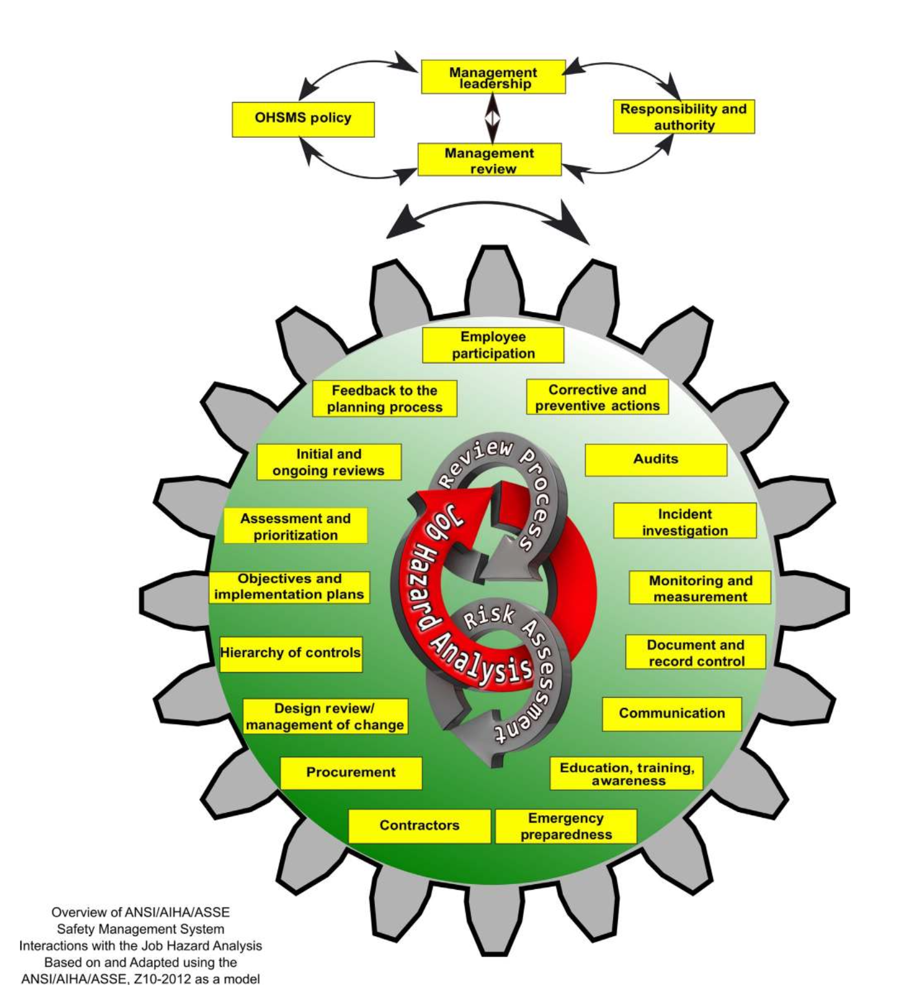

> "We do not want production and a safety program, or production and safety, or production with safety, but, rather, we want safe production."  
> — Dan Petersen

---
## INTRODUCTION

The primary reason organizations exist is to establish a structure for providing various products and services to customers. Management systems and networks are established to meet their goals. “Jobs” define individual activities, responsibilities, and authorities necessary for the completion of tasks to meet those goals. This is why a Job Hazard Analysis (JHA) is an essential tool used to assess operational hazards and risks linked to jobs within an organization’s activities.

The JHA is a vital part of the foundation for any successful safety management system. Hazard and Risk Controls can only exist when leadership and employees have a full understanding of the types of hazards inherent in their jobs, steps, and tasks of required activities.

As discussed in Chapter 1, Defining The Perception of Safety, the authors view safety as an emerging property resulting from the multitude of control interactions within an organization. By implementing a JHA process throughout an organization, the leadership team and employees gain an in-depth understanding of task-specific hazards and associated risks. Hazards and associated risks can only be identified and controlled through the use of an ongoing comprehensive assessment process.

The JHA process adds value to the organization by improving the safety culture through identifying hazard and risk controls at the job level. A JHA process strategy provides the administrative structure, time, and budget for recommended hazards and associated risk controls.

After completing this chapter, you should be able to:
* Explain the importance and benefits of the JHA to a safety culture.
* Explain and contrast the benefits and drawbacks of a JHA process.
* Explain why is important to get employees involved in the JHA process.
* Explain how to select a JHA Ad Hoc Team and its benefits.
* Explain how to select a job, steps, and task for analysis.
* Explain and define the difference between the JHA and job safety analysis (JSA).
* Explain how the JHA process fits into the overall organization.
* Explain how the JHA communicates information through the organization.
* Explain how the culture of the organization impacts job completion.
* Explain the concepts of human performance improvement (HPI).

---
## BEGINNING THE JOB HAZARD ANALYSIS PROCESS—JOB INVENTORY

Any job assignment can involve hidden hazards of varying levels of risk severity and probability. The Job Hazard Analysis (JHA) focuses on identifying and controlling those inherent hazards and risks built into the steps and tasks required for a job. Activities and tasks using specific tools, material, and equipment are reviewed, and actions are taken to eliminate, reduce, or control hazards or risks to an acceptable level.

Organizations are adaptive and complex structures having varying levels of resilience. Many organizations tend to operate in a reactive mode making a change as conditions dictate or experience shows that changes are needed. Changes are made in many cases only after loss-producing conditions create a crisis or unacceptable operational conditions. The objective of a JHA process is to reduce the potential of finding hazards only after a job or activity has begun, or a loss-producing event has occurred. The JHA process can be used to build in an increased resilience into the organizations as a hazard and associated risk is controlled before an activity is begun.

The JHA Process begins with a full assessment of the organization. The assessment develops an initial inventory and lists all jobs being performed to accomplish the goals of the organization. Each activity or job is further analyzed to identify potential inherent or built-in hazards and associated risk, using a risk assessment tool or method such as the risk guidance card or similar risk matrix as discussed in Chapter 9, Defining Risk Perception.

The final inventory is to rank, order, and sort jobs from the highest to the lowest risk so that solutions identified will target the highest potential risk. The assessment considers the potential severity and frequency of exposure existing and the possibility of human errors and mistakes, and what could go wrong. It is important to know where hazards exist, what are the associated risks, and the potential severity of those risks. A risk assessment allows prioritizing of jobs needing immediate attention.

### LESSON LEARNED

> **Baseline Assessment**—The baseline assessment can be deceptively simple. Most organizations find when completing this inventory that they do not have a good grasp of the real scope and number of jobs being conducted. It is easy to overlook routine or nonroutine jobs. For example, some jobs may only be done when equipment requires maintenance and considered possible as little as only once per year. Also, routine jobs or activities can be on second or third shifts also missed during the inventory.

The critical point is to include employees in all phases of the JHA process and its development. Employee involvement in reviewing current job criteria as well as providing insights into the effectiveness of standard operating procedures (SOP) and training is critical to creating a useful process.

> Culture is created and sustained by a network of communications in which meaning is generated. The culture’s material embodiments include artifacts and written texts, through which meaning is passed on from generation to generation.  
> — *(Capra & Luisi, 2014)*

---
## THE JHA AS A COMMUNICATION TOOL

The JHA should be considered more than a tool used to define individual activities. It should be regarded as part of the overall hazard and associated risk communication. The JHA determines what is to be communicated about ongoing activities and be viewed as an essential part of the safety management system. Its format and use encapsulate the scope of operational hazards and their associated risks found directly within an activity. If used routinely and consistently, JHAs provide a conduit for in-depth logical discussions about the significant hazard and risk avoidance, reduction, and control.

The JHA provides a useful communication tool used for a variety of purposes. For example, a comprehensive JHA can be used for training development, operational reviews, employee selection and placement, and specific job design or modification. JHAs should be routinely used and flexible enough to adjust to the ongoing changes in the workplace to be effectively used.

---
## WHY IS A JHA IMPORTANT?

JHAs provide an understanding of hazards at their point of beginning, where job tasks and activities are completed, and exposure to hazards are present. As a structured format, they can focus on specific problems or issues for immediate correction or relay to decision makers. The JHA increases the potential for removing administrative and job design obstacles hindering activities designed to reduce the consequences of loss-producing events.

The JHA further provides a consistent method for developing effective training programs highlighting desired safer and more efficient work methods. The JHA can be used as a comprehensive training aid to ensure employees know the primary requirements of each assignment and how to make safe choices best when performing specific tasks. Refer Table 12.1 to review a list of why JHAs are important (Roughton & Crutchfield, 2013).

The JHA process provides a better method to identify opportunities for improvement in the safety management system and provides the foundation for ongoing hazard and risk-based analysis. If a structured process is routinely followed, problems may be uncovered requiring the leadership team to make decisions if a specific task requires modification. By comprehensively and routinely using the JHA, a performance measurement system can be established to determine if jobs and activities are safely performed (Figs. 12.1 and 12.2).

---

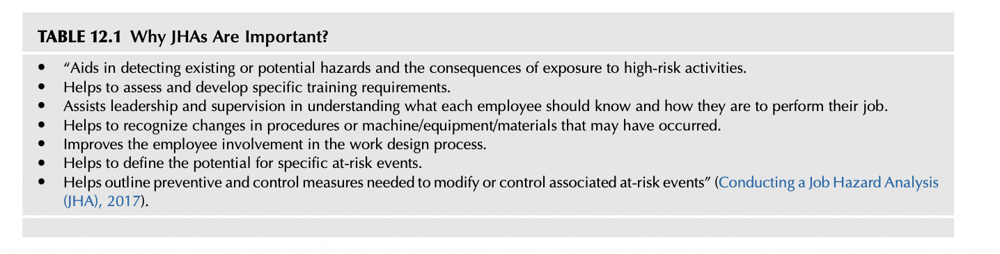

### TABLE 12.1 Why JHAs Are Important?

* Aids in detecting existing or potential hazards and the consequences of exposure to high-risk activities.
* Helps to assess and develop specific training requirements.
* Assists leadership and supervision in understanding what each employee should know and how they are to perform their job.
* Helps to recognize changes in procedures or machine/equipment/materials that may have occurred.
* Improves the employee involvement in the work design process.
* Helps to define the potential for specific at-risk events.
* Helps outline preventive and control measures needed to modify or control associated at-risk events.

*(Conducting a Job Hazard Analysis (JHA), 2017)*

---

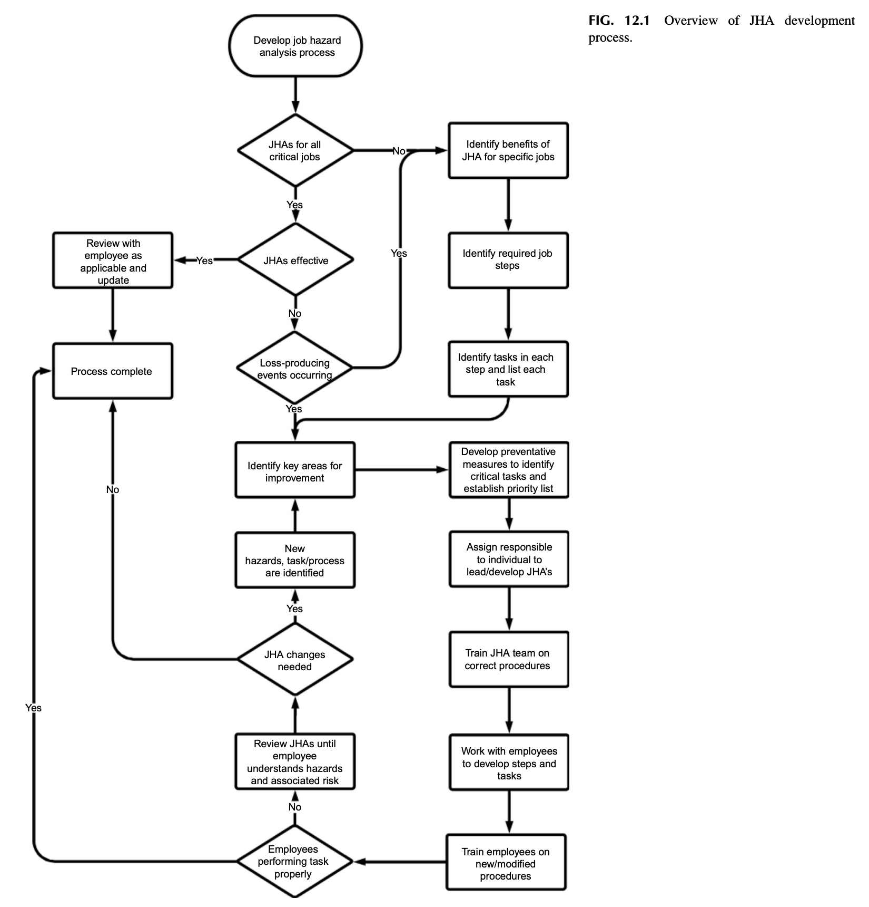

### FIG. 12.1 Overview of JHA development process.

---
## STRATEGY FOR IMPLEMENTATION

Some form of the JHA appears to have been developed in the early 20th century after Scientific Management was developed by Fredrick Taylor and at the beginning of industrial safety (Frederick Taylor and scientific management, understanding Taylorism and early management theory, 2017). Over the years, the term “job” has changed from being a specific limited activity to an overall definition as a “job title” which may cover some various activities and responsibilities. Consider the following definitions:
* Definition 1. A job is “a piece of work, especially a specific task done as part of the routine of one’s occupation” (Job, 2018).
* Definition 2. “Anything a person is expected or obliged to do; duty; responsibility” (Job, 2018).

The traditional JHA uses Definition 1. Using the Taylor Approach, a specific job is broken down into steps with hazards identified within each step. Controls for each hazard are defined and then implemented without the benefit of knowing about any required subtask associated risks. The “job” itself is considered safe if the person doing the work uses the designated controls determined for each step.

A Job as defined in Definition 2 would include an array of activities under one job description. A series of JHAs would be completed for each assigned “Job” as defined by Definition 1. The potential in this definition exists for the accumulative harmful effects of multiple “jobs” and their interactions to be overlooked. The traditional JHA method does not consider the time and accumulative effects of multiple “jobs” being done by that “job” title.

One way of describing the two types of job definitions is as a parent and child concept. This concept is used in computer programming for overall theme development where the parent is the primary theme that should not be changed, the way that a website is to be viewed. This ensures that the important features of the main theme are not overwritten when the various “child” themes are updated.

If the same concept is applied to the JHA development, the parent becomes the primary overall job analysis that takes into account all of the overlapping or similar job tasks. It provides a baseline for the overall assigned responsibilities and activities. The parent JHA contains the core elements that create the function and are universal to that job. The child JHAs provides hazard and risk assessment and defined controls for each required specific individual activity.

For example, a situation where five pieces of equipment operate the same would develop one generic JHA, that is, the parent that would cover the equipment hazard analysis. The differences or potential variations in how specific tasks are performed can develop no matter if the equipment is similar. The child JHA would provide for these potentially additional hazards and associated risk in the analysis of the steps and tasks required (Roughton & Crutchfield, 2016; Why use a child theme?, 2018).

---

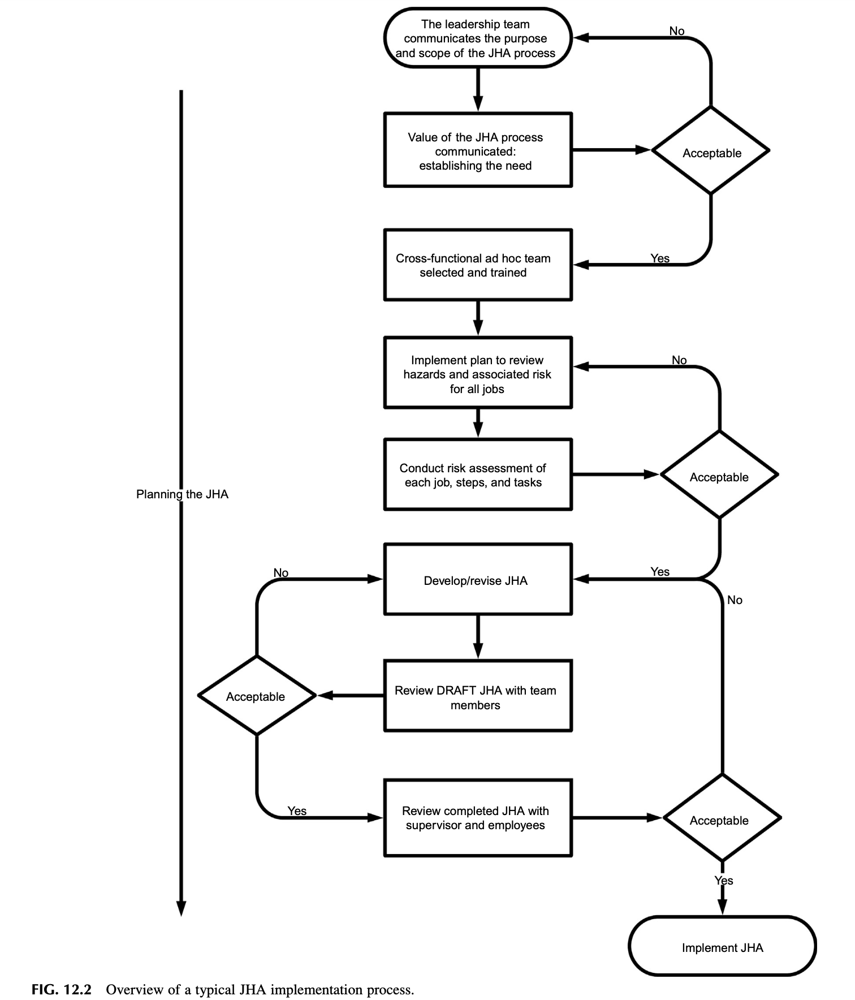

### FIG. 12.2 Overview of a typical JHA implementation process.

---
## DEFINING JHA VS JSA

The terms “Job Hazard Analysis (JHA)” and “Job Safety Analysis (JSA)” are used somewhat interchangeably. A variety of other terminologies such as Job Task Analysis (JTA), Activity Task Analysis (ATA), and others are also used depending on the industry. The initial concept for the traditional JHA/JSA used the Taylor approach, was focused on eliminating or controlling hazards and reducing injuries (Frederick Taylor and scientific management, understanding Taylorism and early management theory, 2017). Over time the JHA has evolved to encompass a more comprehensive hazard and risk-based assessment approach.

### OBSERVATION

> To enhance the JHA process, the authors view the JHA and JSA as two distinct and unique tools. A JHA should be considered a technique focusing on identifying hazards and associated risks within job steps and their tasks with the potential for sudden loss-producing events.
>
> A JSA should be considered a technique focusing on identifying and controlling cumulative hazards and associated risks. For example, exposure to ergonomic or environmental conditions that produce an illness, soft tissue damage, or long-term chronic damage rather than sudden acute events. A JSA would analyze the total job and the accumulative effects of all required steps and tasks.
>
> The traditional JHA approach takes a snapshot in time and isolates the immediate hazards and associated risk of a step or task. It does not provide for a time dimension and the cumulative effect of exposures across a group of tasks.
>
> It is important to know if you are analyzing a specific step or task (JHA) or the cumulative effect of multiple tasks over time (JSA). Consider the differences as detailed in Fig. 12.3 to understand how time will be factored into the analysis for a Multidimensional Approach to the analysis of a job.

---

## BENEFITS OF DEVELOPING JHAS

When the JHA process is considered a primary component of the safety management system, it provides a method to bring reality to discussions about the nature of work being performed by employees. The completion of JHAs offers all levels of the organization, not just a better understanding but a greater appreciation of the various tasks included in the entire job. As tasks are assessed, the control of hazards and associated risk is better defined and communicated, resulting in improved:
* Procedures, methods, and protocols by incorporating safety-related criteria.
* Selection of materials, equipment, and tools by ensuring these are correctly selected.
* Selection and training of employees by matching the skills and physical requirements of the job.
* Identification of environmental problems and issues.

Supervisors can use the findings of a JHA to eliminate and prevent hazards, thereby helping in reducing injuries; providing a safer and more effective work method for a given task; reduced workers’ compensation costs, and in the result can increase productivity. The analysis can be a valuable tool for training new employees in the tasks required to perform their jobs safely. (Roughton & Crutchfield, 2016)

The JHA provides a consistent reminder for all new, relocated, and seasoned employees. It can be Applied to specific job steps or tasks that have been modified. It can be used as an awareness tool for those who need updated training and site-specific review of the non-routine task. (How to identify job hazards, 2017; Roughton & Crutchfield, 2013)

---

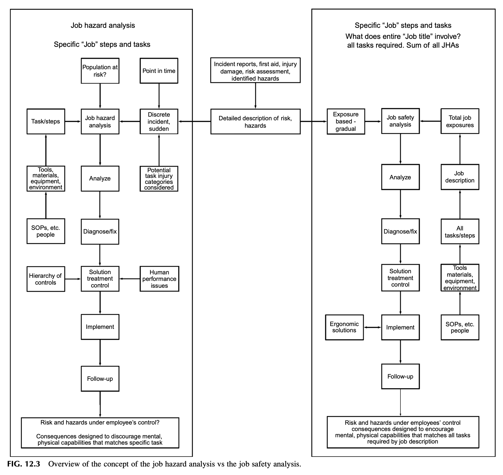

### FIG. 12.3 Overview of the concept of the job hazard analysis vs the job safety analysis.

---
## DRAWBACKS OF THE JHA

The JHA process does require time and budget. As the assumption is made that “our employees know how to do their jobs” is common, resistance can be expected especially if no visible problems are evident with the job. By moving the process from just occasional use to routine formal use, its value can be made clear to leadership and employees as to its potential for improving the work environment (Roughton & Crutchfield, 2013).

---

## WHY IS IT IMPORTANT TO GET EMPLOYEES INVOLVED IN THE PROCESS?

As previously discussed, employee involvement is a critical element of any successful safety management system. Employees are more apt to accept changes when provided an opportunity to become involved in the design and development of changes in the jobs they perform. Employees are knowledgeable in how a job is completed. They know its obstacles and problems that may be inherent in the job. Employees may have devised methods to modify a job unbeknownst to leadership. Without a formal JHA review, these changes may have increased productivity while increasing hazards.

In a trusting environment, employees can provide the JHA team, leadership, and safety management a better understanding of the “real way jobs” are completed.

The initial impression of many jobs is that they are simple and a JHA is unnecessary. Even the simplest of jobs may require the coordination of many components and actions. A simple job thought to be “a natural point of beginning” can be surprisingly complex when its steps and tasks, required tools, equipment and materials, skills and abilities levels, the general work environment and required administrative guidelines are considered (Roughton & Crutchfield, 2013).

> When employees are involved in the JHA development process they will be in a better position to understand the concepts and why it is important to develop the JHA.  
> — *(Roughton & Crutchfield, 2013)*

It is important for employees to understand the intended purpose of the JHA process. It is the job that is under review from a hazard and associated risk, safety-related perspective and not an evaluation of their job performance or their productivity (Roughton & Crutchfield, 2013).

---

## SELECTING A TEAM

As discussed in Chapter 8, Getting Employees Involved in the Safety Management System, an Ad Hoc Team can be established as part of the safety committee to help develop and review JHAs.

A team leader such as the safety professional or a member of the safety committee can be designated to guide and administer the JHA process. This person would use a cross-functional Ad Hoc Team to involve and maintain the knowledge and expertise for the development of a portfolio of JHAs. The JHA Ad Hoc Team would develop designated JHAs based on an initial hazard and risk assessment list produced from the job inventory. They would draw on experience and expertise of employees and supervisors in the department or area where the jobs are being completed.

Use of an Ad Hoc JHA team can promote a more efficient process and ensure that a variety of perspectives and opinions are considered. Using multiple teams allows quicker development and completion of JHAs. This approach spreads the time requirements through the organization and allows for more employee involvement. More involvement disseminates JHA expertise and increases the flow of safety-related information through the organization.

The individual selected to be the JHA process Ad Hoc team administrator should have a combination of the traits:
* Be a good representative of the JHA process and able to communicate verbally, in writing and provide updates on the process of leadership.
* Be able to communicate the value and benefits of the JHA process.
* Be knowledgeable about operations and understand the various production and service processes and methods used by the organization.
* Be able to apply risk assessment and problem-solving techniques to uncover hidden hazards and associated risk.
* Understand the nature and relationship of hazards and associated risk with potential loss-producing events.

This individual should have the communication and negotiation skills to overcome barriers or resistance to change that may occur during the implementation of JHAs and reinforce the leadership team’s commitment to the process. The JHA administrator would use a variety of methods and procedures to include:
* Providing input and advice to the Ad Hoc Teams developing JHAs.
* Assisting with evaluating the completeness and effectiveness of the JHAs based on job reviews, observations, and employee discussions.
* Assisting in using the JHAs in loss-producing events investigations and reviews.
* Assisting in the periodic evaluation of JHAs to ensure that they are using the current operational process, technology, task, and employee skill/training requirements.
* Assisting in reviewing the JHAs with employees to ensure that there is an understanding of what is expected of them and if they have any concerns about new procedures or actions required (Managing worker safety and health, 2016; Roughton & Crutchfield, 2013).

The Ad Hoc JHA Team was discussed in Chapter 8, Getting Employees Involved in the Safety Management System, but we wanted to reinforce the concepts as follows:
* Use a charter to define how they will operate and use the JHA Process. The charter would be authorized by the leadership team as approved by the central safety committee.
* Hold regular meetings and provide written documentation of meeting minutes to the JHA Process administrator on the central safety committee.
* Encourage employee involvement by communicating the value and use of JHAs.
* Analyze jobs, steps, and tasks to uncover hidden hazards and assess associated risk.
* Recommend feasible controls to reduce or eliminate identified hazards and associated risk to an acceptable level.
* Use a team approach to encourage different perspectives.
* Periodically evaluate the effectiveness of the JHA (Managing worker safety and health, 2016; Roughton & Crutchfield, 2013).

---

## BUILDING THE CASE FOR A JHA PROCESS

To build a compelling case for implementing the JHA process, the team should be able to communicate effectively its value, scope, and use as well as the expected results. This was discussed in Chapter 8, Getting Employees Involved in the Safety Management System. When the leadership team and employees understand the purpose, scope, and objectives of the JHA, they will be in a better position to recognize its potential to provide a safer work environment and improve operations.

The JHA Ad Hoc Team can use various metrics to demonstrate the value of a JHA process. Information from existing records such as incident rates, workers’ compensation costs, near-miss reports, downtime, employee turnover, and general maintenance costs can be analyzed to determine if specific jobs are creating unwanted and unneeded financial loss. Once the information is gathered, the team can establish a baseline of current conditions and identify where the greatest potential risk exists. This baseline can be used to set goals and establish leading and lagging metrics to track progress.

Leadership should be convinced of the tangible and intangible benefits of the JHA process. When the business case is effectively made, leadership is more likely to allocate resources and champion the process throughout the organization.

---

## TELLING THE JHA STORY

When conducting a JHA, the process attempts to tell the story of what is happening in the job. The “Five Why’s” plus “H” questions (Who, What, Where, When, Why, and How) are used to categorized information to begin telling the story. The story becomes a clear and concise picture when used with accompanying data and feedback from employees.

Depending on the complexity of the JHA (the story), the JHA developer might ask questions in several different ways. Refer Tables 12.2–12.7 for a basic description of The Five “Why’s” and “H” for consideration (Roughton & Crutchfield, 2016).

> Very few people and organizations can clearly articulate WHY they do what they do. Why is a purpose, a cause or a belief? It provides a clear answer to Why we get out of bed in the morning, Why our company even exists and why that should matter to anyone else.  
> — *(Sinek, 2009)*

---

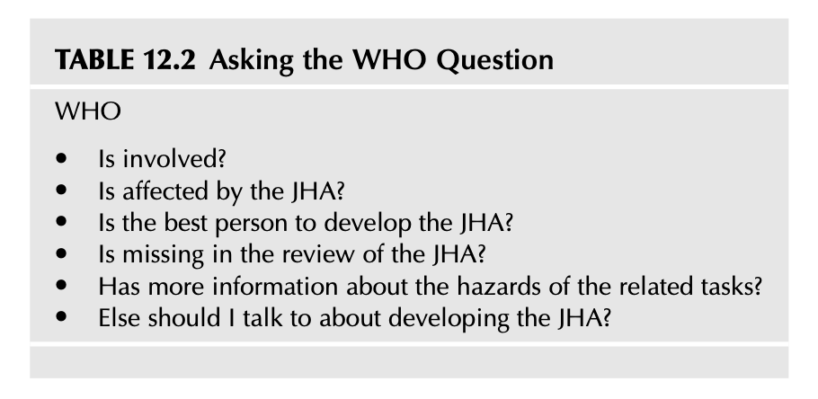

### TABLE 12.2 Asking the WHO Question

* Who is involved?
* Who is affected by the JHA?
* Who is the best person to develop the JHA?
* Who is missing in the review of the JHA?
* Who has more information about the hazards of the related tasks?
* Who else should I talk to about developing the JHA?

---

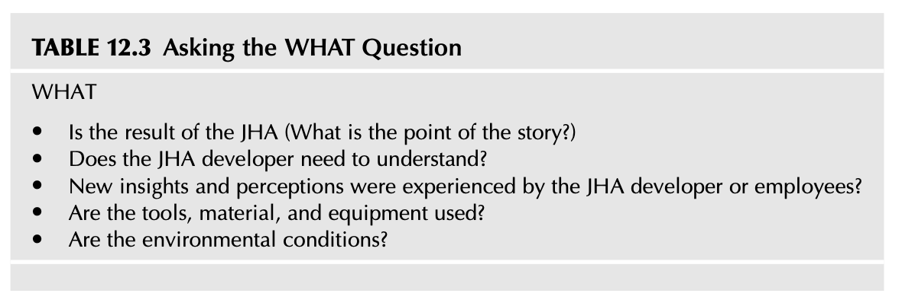

### TABLE 12.3 Asking the WHAT Question

* What is the result of the JHA (What is the point of the story?)
* What does the JHA developer need to understand?
* What new insights and perceptions were experienced by the JHA developer or employees?
* What are the tools, material, and equipment used?
* What are the environmental conditions?

---

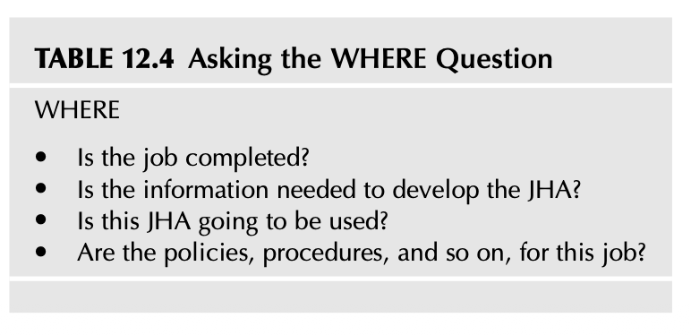

### TABLE 12.4 Asking the WHERE Question

* Where is the job completed?
* Where is the information needed to develop the JHA?
* Where is this JHA going to be used?
* Where are the policies, procedures, and so on, for this job?

---

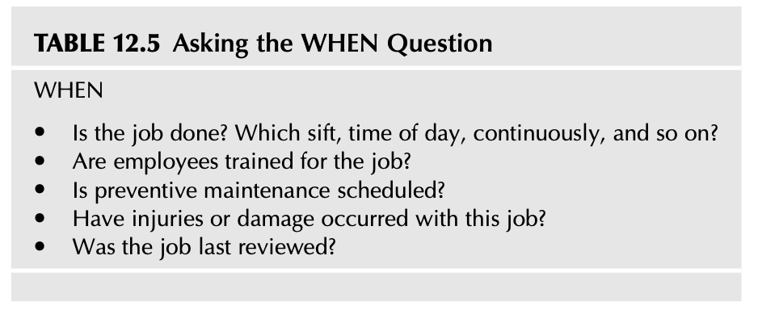

### TABLE 12.5 Asking the WHEN Question

* When is the job done? Which shift, time of day, continuously, and so on?
* When are employees trained for the job?
* When is preventive maintenance scheduled?
* When have injuries or damage occurred with this job?
* When was the job last reviewed?

---

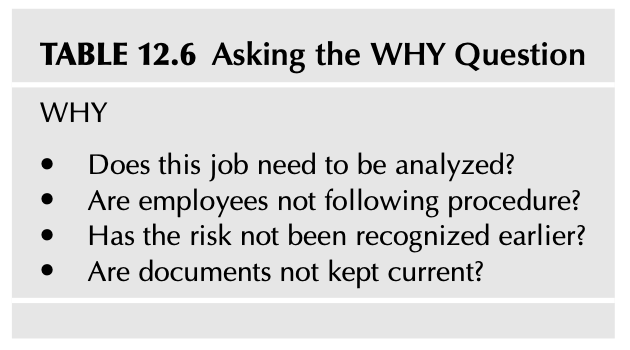

### TABLE 12.6 Asking the WHY Question

* Why does this job need to be analyzed?
* Why are employees not following procedure?
* Why has the risk not been recognized earlier?
* Why are documents not kept current?

---

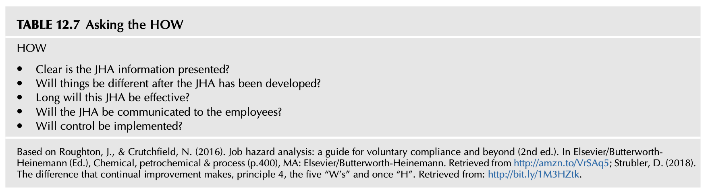

### TABLE 12.7 Asking the HOW Question

* How clear is the JHA information presented?
* How will things be different after the JHA has been developed?
* How long will this JHA be effective?
* How will the JHA be communicated to the employees?
* How will control be implemented?

*(Based on Roughton, J., & Crutchfield, N. (2016). Job hazard analysis: a guide for voluntary compliance and beyond (2nd ed.); Strubler, D. (2018). The difference that continual improvement makes, principle 4, the five “W’s” and once “H”)*

To build on what is presented in Telling the JHA Story, refer Appendix 6.6, Creating the Safety Process, for a Sample Checklist on How to Change A Tire On A Car, Appendix 12.1 for a Sample JHA Pre-Hazard Assessment Worksheet, and Appendix 12.2 for an example of an Annotated JHA for Changing a Tire.

---

## STRUCTURE OF THE JHA

The Corps of Engineers uses a form of the JHA process called Activity Hazard Analysis (AHA) on construction sites. The AHA is developed before performing any new task. “Before beginning each work activity involving a type of work presenting hazards not experienced in previous project operations or where a new work crew or sub-contractor is to perform the work, the Contractor(s) performing that work activity shall prepare an AHA” (EM 385-1-1, Safety and health requirements manual, 2014). Table 12.8 provides an overview of terms that are used in developing the JHA.

---

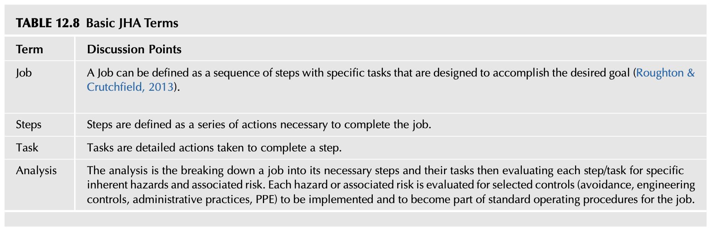

### TABLE 12.8 Basic JHA Terms

| Term | Discussion Points |
| :--- | :--- |
| **Job** | A Job can be defined as a sequence of steps with specific tasks that are designed to accomplish the desired goal (Roughton & Crutchfield, 2013). |
| **Steps** | Steps are defined as a series of actions necessary to complete the job. |
| **Task** | Tasks are detailed actions taken to complete a step. |
| **Analysis** | The analysis is the breaking down a job into its necessary steps and their tasks then evaluating each step/task for specific inherent hazards and associated risk. Each hazard or associated risk is evaluated for selected controls (avoidance, engineering controls, administrative practices, PPE) to be implemented and to become part of standard operating procedures for the job. |

---

## SELECTING THE JOBS FOR ANALYSIS

Table 12.9 provides an example list of jobs considered as having the potential for loss-producing events.

When conducting a JHA, consideration should be given to determine Applicable safety-related standards specified by the specific industry as well as mandated regulatory criteria. Compliance with these standards can be voluntary or mandatory. By incorporating their requirements into the JHA ensures known requirements (Roughton & Crutchfield, 2013).

---

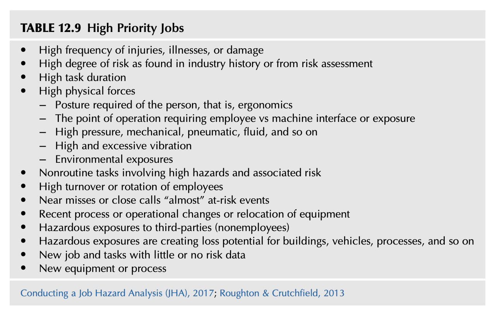

### TABLE 12.9 High Priority Jobs

* High frequency of injuries, illnesses, or damage
* High degree of risk as found in industry history or from risk assessment
* High task duration
* High physical forces
* Posture required of the person, that is, ergonomics
* The point of operation requiring employee vs machine interface or exposure
* High pressure, mechanical, pneumatic, fluid, and so on
* High and excessive vibration
* Environmental exposures
* Nonroutine tasks involving high hazards and associated risk
* High turnover or rotation of employees
* Near misses or close calls “almost” at-risk events
* Recent process or operational changes or relocation of equipment
* Hazardous exposures to third-parties (nonemployees)
* Hazardous exposures are creating loss potential for buildings, vehicles, processes, and so on
* New job and tasks with little or no risk data
* New equipment or process

*(Conducting a Job Hazard Analysis (JHA), 2017; Roughton & Crutchfield, 2013)*

Fig. 12.4 shows the relationship of the Job Hazard Analysis within a risk improvement model incorporating an analysis of the job, behavioral consequences to be built into the job, the structure of its administrative within the safety management system.

---

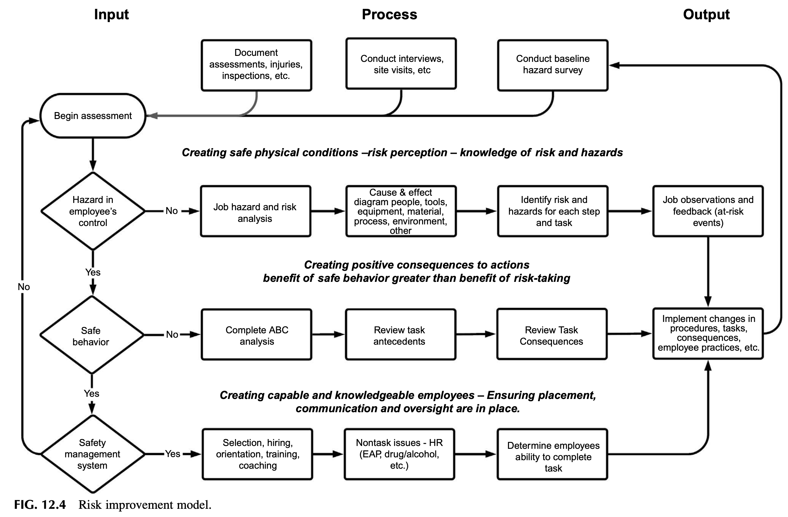

### FIG. 12.4 Risk improvement model.

---

## JHA AND HUMAN PERFORMANCE PRINCIPLES

One of the issues with the format or structure of the traditional JHA is that hazards can be identified, but the risk is not explicitly defined for each step. The JHA attempts to simplify a process to only physical hazards (Job hazard analysis, 3071, 2002). Additional criteria should be considered in reviewing a job or families of jobs to include employee mental and physical requirements, the potential for human error, which too many times becomes the selected default problem, and the potential within the technology used.

An attempt should be made to keep in mind people have their perceptions, personal and professional experiences, and knowledge, preferences, skills, and ability, all of which can affect job performance.

According to Reason (2009), as cited in (Concepts and principles, 2009), “It is crucial that personnel and particularly their managers become more aware of the human potential for errors, the task, workplace, and organizational factors that shape their likelihood and their consequences. Understanding how and why unsafe acts occur is the essential first step in effective error management” (Concepts and principles, 2009).

The HPI Handbook identifies five principles useful in guiding the safety management system and in turn the JHA process:
1. “People are fallible, and even the best people make mistakes.
2. Error-likely situations are predictable, manageable, and preventable.
3. Individual behavior is influenced by organizational processes and values.
4. People achieve high levels of performance because of the encouragement and reinforcement received from leaders, peers, and subordinates.
5. Events can be avoided through an understanding of the reasons mistakes occur and Application of the lessons learned from past events (or errors)” *(Concepts and principles, 2009)*.

> …human performance can only be realized when individuals at all levels of the organization accept these principles and embrace concepts and practices that support them.  
> — *(Concepts and principles, 2009)*

---

## ERROR PRECURSORS

Potential error precursors, conditions that increase error rates, should be assessed as to their impact on safe job and tasks completion. For example, the pressure to complete a job in a set time period may result in employees taking shortcuts or accepting the risk to meet a time demand. “Error precursors are unfavorable prior conditions…that increase the probability of error during a specific action” (Concepts and principles, 2009). Refer Table 12.10 for comparison of human error precursors concerning task demands and individual capabilities and Table 12.11 for additional human error precursors concerning work environment and human nature.

The necessary steps and tasks should be evaluated with the intent of reducing or eliminating as many errors provoking precursors as possible in combination with hazard controls. If “error-likely situations are predictable, manageable, and preventable” (Concepts and principles, 2009), then the JHA becomes the foundational tool for the potential control of these situations.

---

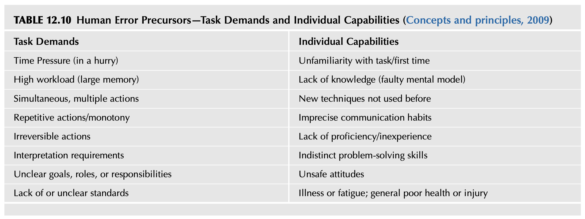

### TABLE 12.10 Human Error Precursors—Task Demands and Individual Capabilities *(Concepts and principles, 2009)*

| Task Demands | Individual Capabilities |
| :--- | :--- |
| Time Pressure (in a hurry) | Unfamiliarity with task/first time |
| High workload (large memory) | Lack of knowledge (faulty mental model) |
| Simultaneous, multiple actions | New techniques not used before |
| Repetitive actions/monotony | Imprecise communication habits |
| Irreversible actions | Lack of proficiency/inexperience |
| Interpretation requirements | Indistinct problem-solving skills |
| Unclear goals, roles, or responsibilities | Unsafe attitudes |
| Lack of or unclear standards | Illness or fatigue; general poor health or injury |

---

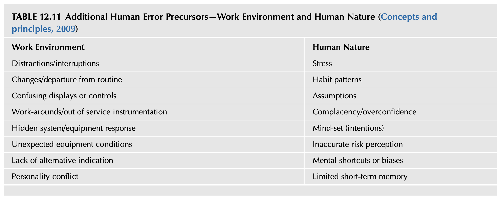

### TABLE 12.11 Additional Human Error Precursors—Work Environment and Human Nature *(Concepts and principles, 2009)*

| Work Environment | Human Nature |
| :--- | :--- |
| Distractions/interruptions | Stress |
| Changes/departure from routine | Habit patterns |
| Confusing displays or controls | Assumptions |
| Work-arounds/out of service instrumentation | Complacency/overconfidence |
| Hidden system/equipment response | Mind-set (intentions) |
| Unexpected equipment conditions | Inaccurate risk perception |
| Lack of alternative indication | Mental shortcuts or biases |
| Personality conflict | Limited short-term memory |

---

## ORGANIZATIONAL CULTURE

Organizational culture includes a realistic appraisal of the potential for improving human performance. One objective of a strong safety culture operating within an overarching organizational culture is to reduce the potential for human error. The nature of the organization’s culture and its acceptance of risk can be assessed by determining the status and emphasis of the safety management system.

The HPI principles along with an understanding of human error precursors can be used to enhance the development of the JHA process. A fundamental attribute of humans is that everyone can make mistakes and wrong decisions. Knowing this, it is important to ensure that job requirements are properly analyzed and designed.

> A pattern of shared basic assumptions that the group learned as it evolved its problems of external adaptation and internal integration. Over time this pattern of shared assumptions has worked well enough to be considered valid and, therefore, to be taught to new members as the correct way you perceive, think, and feel about those problems.  
> — *(Concepts and principles, 2009)*

An initial assessment should review how the organization currently develops and designs jobs and task required to meet its daily goals and objectives. The JHA process should be customized to ensure that it fits within the current methods and concepts used to solve problems.

The use and application of the JHA help to reduce the potential for human error by assessing and identifying critical hazards and associated risk in as many activities as possible.

---

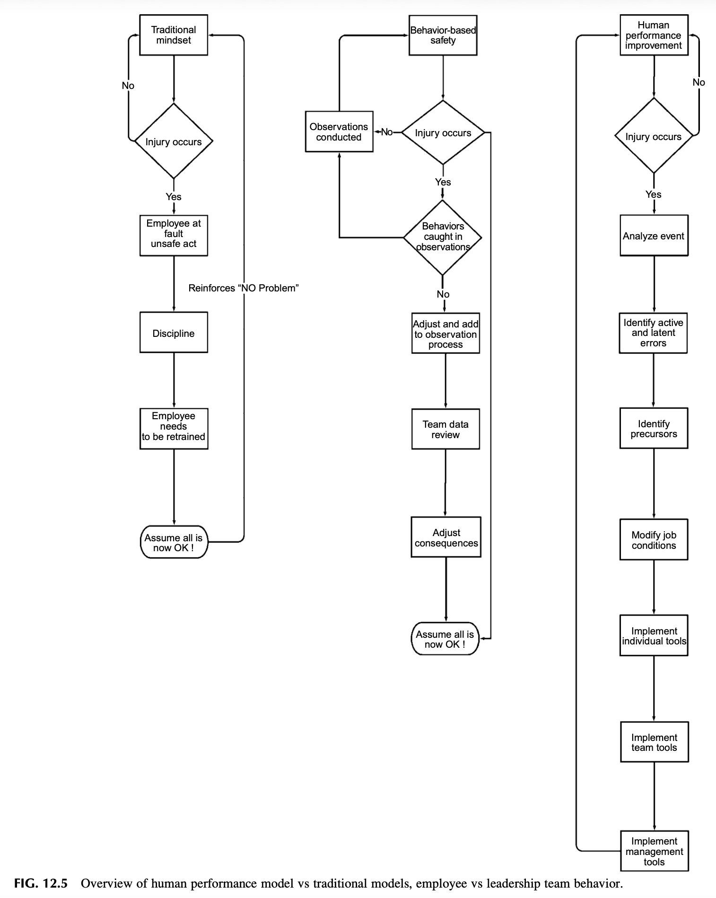

### FIG. 12.5 Overview of human performance model vs traditional models, employee vs leadership team behavior.

---

HPI principles provide a new dimension for the JHA process. The traditional safety process focuses primarily on injury reduction, an effort that has had considerable success over time. It stresses a behavioral approach aimed at observable acts or active errors that can be immediately seen (Concepts and principles, 2009). HPI focuses on the reduction of both potential active errors as well as latent errors (refer Fig. 12.5).

> Kathy A. Seabrook, CSP, CMIOH stated “Recent injury and illness trends within companies and their global supply chains indicate that overall incident rate improvement has slowed, and rates of fatal and serious injuries have remained steady for some years. A different Approach is required if further improvements are to be made.”  
> — *As cited in (Risk Assessment Institute, 2017)*

---

## JOB COMPLEXITY—EVEN FOR “SIMPLE JOBS”

Too often, “Simple” jobs may not appear to have any hazards or associated risks, and they may, in general, be completed without loss. In other words, many jobs are considered “simple” and many do not think that it takes a “rocket scientist” to do the job. This type of statement demeans the employee assigned to do the task as well as establishes a mind-set of simple Throwaway jobs that are completed by low-grade employees. These menial tasks are thought as needing a JHA review. The mind-set previously discussed “no loss equals no risk” develops even though hazards and inherent risk can be hidden within a simple job’s steps and tasks.

This dangerous mind-set allows the development of situations where the leadership team is blindsided by a serious or severe loss-producing event stemming from what appeared to be a straightforward job. The first rule for the development of a JHA process is never to assume that because a job looks simple, it does not incorporate inherent hazards buried within it, having elements of risk with the potential for injury or damage in some form. The JHA can demonstrate even if a job looks simply, it can still be very complicated and require many steps and tasks to be completed.

---

## TYPES OF JOB PERFORMANCE

In addition to error precursors as discussed in Table 12.10 for comparison of human error precursors concerning task demands and individual capabilities and Table 12.11 for additional human error precursors concerning work environment and human nature, jobs can easily combine elements of each of three performance types, skill-based, rule-based, and knowledge-based:

### SKILL-BASED PERFORMANCE

Skill-based performance requires “highly practiced largely physical actions in a familiar situation in which there is little conscious monitoring.” “Errors are primarily from execution errors, involving action slips and lapses in attention or concentration” (Concepts and principles, 2009). The origination of the traditional JHA Appears to have been for this type of work. Types of primarily skill-based jobs require minimum thought or decision making. Once the steps and hazards are established and identified, controls are put in place, and the job is then monitored to ensure all implemented controls remain in use. The JHA can be simple and straightforward.

### RULE-BASED PERFORMANCE

Rule-based performance requires following preset solutions by taking prearranged specific actions. This performance uses the applying the “If-Then” decision-making process. If “X” occurs, then “Y” is required (Concepts and principles, 2009). The JHA defines scenarios where standard operating procedures, rules, guidelines, and structure are essential. Errors can occur when rules or protocols are misinterpreted, or established procedures not followed or understood.

### KNOWLEDGE-BASED PERFORMANCE

Knowledge-based Performance “is a response to an unfamiliar situation (no skill or rule is recognizable to the individual)” (Concepts and principles, 2009). At this performance level, a JHA should be completed for each new experience with unique issues or problems to ensure controls are implemented. The overall job requirements become the parent and a portfolio of experiences developed for future use and periodically reviewed for similarities. This experience-based knowledge provides an understanding of types of hazards that could be created and how they might combine to increase risk severity.

As “no rules” may be present or developed to guide knowledge performance, the emphasis is on problem-solving, in-depth hazard identification, prejob planning and briefing, and peer review for recommended controls (Human performance tools for individuals, work teams, and management, 2009). The JHA would be developed before the job begins to define various scenarios showing the steps of each Approach and what various worst-case situations might occur.

---

## HUMAN ERROR POTENTIAL

In theory, if a job is designed logically and employees trained on how to do the job, then safety will naturally follow. In this scenario, safety is a destination to be achieved. This approach assumes a job can be developed without the potential of latent, built-in human errors from the overall design of the production system. It assumes a design team was able to predict all the many variations of what might be needed to complete a Job. The further assumption is the team has a solid grasp of hazard identification and risk assessment. The authors’ experience has observed that latent error, built-in, the potential is highly probable and is why safety management system, such as ANSI/AIHA/ASSE, Z10, and so on, have placed the safety management system as part of design and review teams (Occupational health & safety management systems, 2012).

If a job’s steps and tasks are designed to consider the potential for human error, the tasks will have a higher probability of safe completion. Employees may be just going through the various required steps based on experience but without much attention having been given to how improvements can be made. An opportunity exists to review the existing job design as JHAs are completed.

The JHA should include identifying critical skills and capabilities needed to effectively and safely complete jobs and their series of required steps and tasks.

---

## ERROR TYPES

The two types of error mentioned previously can create loss-producing events immediately or remain hidden with a long-term potential for loss-producing events.

Active errors are “observable, physical actions that change equipment, system, or facility state, resulting in immediate undesired consequences” (Concepts and principles, 2009). This type of error can develop from activities where, due to mental and physical fatigue, miscommunication, manual requirements, time, pressure, and stress set up the conditions where an employee decides and receives immediate negative feedback.

> Active errors are those errors that have immediate, observable, undesirable outcomes and can be either act of commission or omission. Most of initiating actions are active errors. Therefore, a strategic Approach to preventing events should include the anticipation and prevention of active errors.  
> — *(Concepts and principles, 2009)*

Latent errors are those errors that “result in hidden organization-related weakness or equipment flaws” (Concepts and principles, 2009). By being “latent,” they may go for long periods of time before the various factors and conditions come together and result in a tragic loss-producing event.

> Latent errors result in hidden organization-related weaknesses or equipment flaws that lie dormant. Such errors go unnoticed at the time they occur and have no immediate apparent outcome to the facility or personnel. Latent conditions include actions, directives, and decisions that either create the preconditions for error or fail to prevent, catch, or mitigate the effects of error on the physical facility. Managers, supervisors, and technical staff, as well as front-line workers, can create latent conditions. Inaccuracies become embedded in paper-based directives, such as procedures, policies, drawings, and design basis documentation.  
> — *(Concepts and principles, 2009)*

---

## DESIGN FLAWS

Many safety rules and regulations currently in place are derived from a long history of design flaws and organizational issues that resulted in such events. Design flaws may be found in hiring practices and poor workforce skills that allow untrained or inadequate personnel to do tasks beyond their capabilities (refer Figs. 12.6–12.8). These flow diagrams provide examples of the various tools and techniques that can be used to reduce the potential for human error by individuals, work teams, and the leadership team.

---

## TECHNOLOGY AS A RISK

The JHA should also consider the level of automation within a job and what is the potential impact of the failure of the process. For example, vehicles with backup or side mirror cameras and other devices may give a false sense of security in backing and lane changing. This becomes more apparent when operating a vehicle without these devices and highlights the loss of observational skills acquired through experience.

---

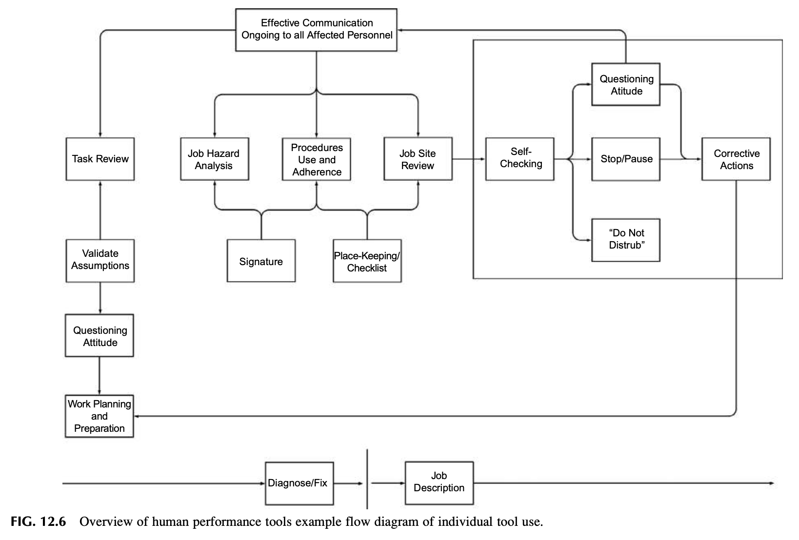

### FIG. 12.6 Overview of human performance tools example flow diagram of individual tool use (Diagnose/Fix Job Description).

---

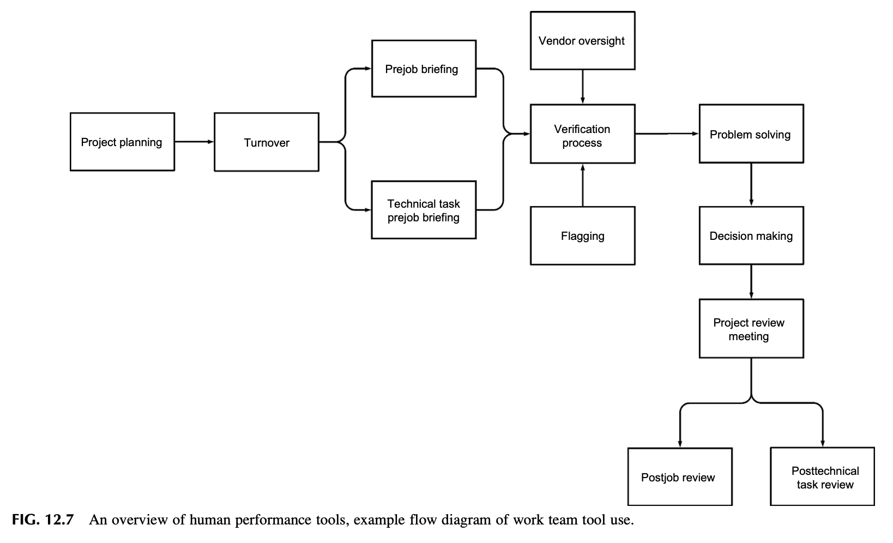

### FIG. 12.7 An overview of human performance tools, example flow diagram of work team tool use.

---

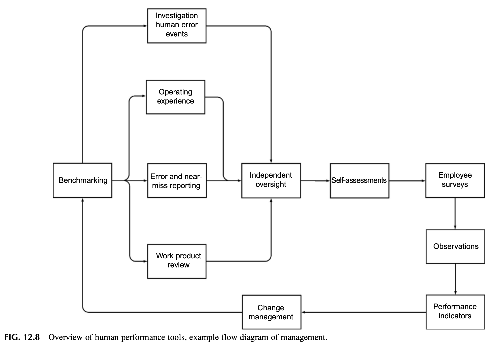

### FIG. 12.8 Overview of human performance tools, example flow diagram of management (Change management).

---

The continued dramatic increase in the use of robotics and computer-driven equipment brings additional risk and complications into the workplace. If the safety system fails, human operators may have to take over. Their lack of experience and expertise puts them at risk they would not otherwise have had without reliance on the automation.

Several situations indicate that technology designed to improve safety may be increasing the potential for errors and tragic mistakes. Overreliance on these mechanisms is to be considered. According to Nicholas Carr (as cited in Blum, 2014, chapter 4), “it can be found that technology can take the edge off the ability to make proper decisions during crisis situations” (Blum, 2014).

Also, the FAA’s concern with flight operations data, issued a safety alert to the airlines encouraging “operators to promote manual flight operations when Appropriate.” The FAA stated that “A recent analysis of flight operations data (including normal flight operations, incidents, and accidents) identified an increase in manual handling errors” (Safety alert for operations, manual flight operations, 2013).

The FAA further recommended that “Operators are encouraged to take an integrated Approach by incorporating emphasis of manual flight operations into both line operations and training (initial/upgrade and recurrent)” (Safety alert for operations, manual flight operations, 2013).

Self-driving vehicles are beginning to appear, and the increased reliance and acceptance of driverless vehicles is well underway. The JHA in combination with risk assessment and engineering design may be able to decrease the potential for a severe incident; however, as with flight operations, driving skills may begin to deteriorate or degrade over time.

---

## KNIFE SAFETY AND CUT RESISTANT GLOVE PROGRAM, SHIFTING THE THOUGHT PROCESS TO RISK REDUCTION

James previously discussed elements of the Black Belt project that he initiated in several chapters. As stated, a six sigma program can take on a life its own.

---

## CASE IN POINT

When James was a safety director, the organization set up an aggressive program to reduce knife injuries by replacing standard utility knives with safety knives (knives with blades that retract). Hand lacerations were a frequent injury, and by providing a safety knife, they thought hand lacerations would decrease. A corporate policy mandated that standard utility knives could not be used and that safety knives would be used. They did not complete a JHA, baseline hazard assessment, or involve employees in the selection process. The resulting program met with major resistance.

---

## UTILITY KNIVES

Standard utility knives are used in many operations and are useful tools when used properly. The problem is that utility knives are often used for tasks for which they were not designed, such as prying, scraping, and cutting materials that are too thick or heavy for the blade. In addition, worn or dull blades require additional force, increasing the risk of slippage and severe lacerations.

---

## GENERIC CUT RESISTANT GLOVES PROGRAM

A cut-resistant glove program must be implemented as part of a total hand safety strategy. Simply providing cut-resistant gloves without proper assessment, employee training, and enforcement will not eliminate injuries. Different gloves provide varying levels of cut protection, dexterity, and grip. Selecting the wrong glove can create additional hazards if employees cannot manipulate tools properly or if the glove gets caught in rotating machinery.

---

## SUMMARY

The Job Hazard Analysis (JHA) is an essential tool for identifying and controlling workplace hazards and associated risks. A properly designed JHA is used as a comprehensive training aid that ensures all employees know the primary requirements of each assignment and how to make safe choices when performing specific tasks.

When the JHA process is considered a primary component of the safety management system, it provides a method to bring reality to discussions about the nature of work being performed by employees. The completion of JHAs provides all levels of the organization, not just a better understanding but a greater appreciation of the various tasks that are included in the job (Roughton & Crutchfield, 2016).

From our experience, even the simplest of jobs may require the coordination of many components when reviewing the job’s steps and tasks, tools/equipment/material, skills and abilities, general environment and administrative guidelines. A simple job thought to be “an easy point of beginning” can be surprisingly complex (Roughton & Crutchfield, 2016).

A member of the central safety committee would be designated to guide and administer the JHA process. This person would use cross-functional Ad Hoc Teams to develop and maintain diversity and expertise for the development of a portfolio of JHAs.

Clear and concise expectations should be defined before training an Ad Hoc JHA team. As each committee and subcommittee should have a charter, the JHA Process Charter is developed to define and outline the team’s roles and responsibilities in the development of a comprehensive portfolio of JHAs (Roughton & Crutchfield, 2016).

The JHA process becomes part of the network of communications that spreads job information and influences safe behaviors through the organization. It covers both the job design for potential latent, hidden built-in errors, and possible active errors by the employee.

In Chapter 13, Developing Safety Training Needs, we will continue our discussion on the safety culture and the safety process that is supported by a competent, comprehensive education and training program. The culture of an organization has a powerful influence on employee norms, habits, and behaviors as they complete their daily assignments and tasks. The strength of the underlying unconscious perceptions, thoughts, beliefs, and so on, of the organization, can override the best safety-related training designed to influence behavior.

Training may attempt to promote beliefs about the value and importance of safety, yet on leaving the training session, if nothing has changed in how work is managed, employees return to the behavior driving the organization. The desired impact of training can only be sustained when the internal organizational constraints, time pressure, budgets, mandates, leadership skills, and so on, driving the culture is understood. Training would then be designed and structured to overcome or reduce these constraints.

Through experience, the authors found that training is more complicated than telling employees how to perform their jobs in a limited time frame. Information and training should be able to transfer necessary job knowledge from the designated “trainer” to a “learner.” Education and training should be provided using methods employees can understand, accept, and immediately use in their assigned task.

---

## CHAPTER REVIEW QUESTIONS

* Explain the importance and benefits of the JHA to the safety culture.
* Explain and contrast the benefits and drawbacks of a JHA process.
* Explain the importance of having employees involved in the JHA process.
* Explain how to select a JHA Ad Hoc Team and its benefits.
* Explain how to select a job for analysis.
* Explain and define steps and tasks of a job.
* What is required to develop a JHA?
* What questions should be answered about the JHA process implementation?
* How does a parent/child concept apply to the JHA process?
* Define the three performance types.

---

---

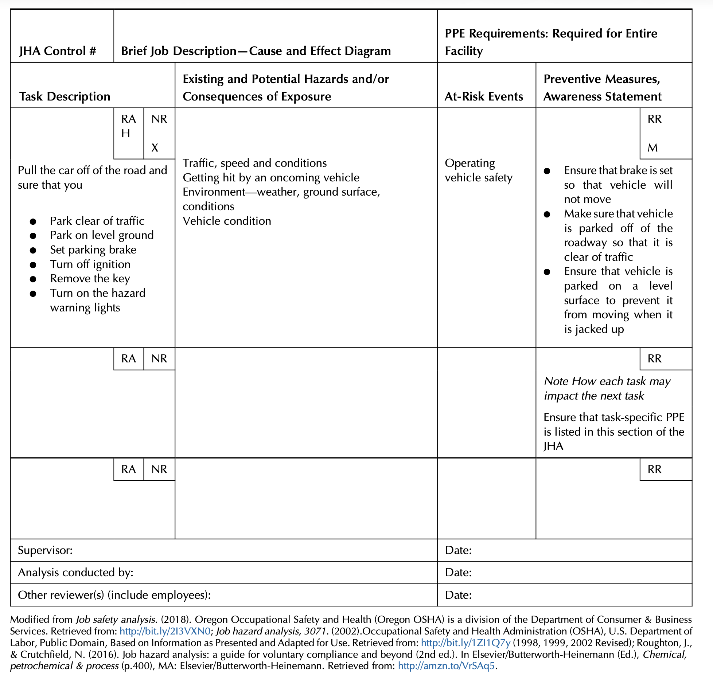

## APPENDIX 12.1 SAMPLE JHA PREHAZARD ASSESSMENT WORKSHEET

Page ___ of ___
JHA Control # Brief Job Description—Cause and Effect Diagram
PPE Requirements: Required for Entire
Facility
Task Description
Existing and Potential Hazards and/or
Consequences of Exposure At-Risk Events
Preventive Measures,
Awareness Statement
RA
H
NR
X
RR
M
Pull the car off of the road and
sure that you
* Park clear of traffic
* Park on level ground
* Set parking brake
* Turn off ignition
* Remove the key
* Turn on the hazard
warning lights
Traffic, speed and conditions
Getting hit by an oncoming vehicle
Environment—weather, ground surface,
conditions
Vehicle condition
Operating
vehicle safety
* Ensure that brake is set
so that vehicle will
not move
* Make sure that vehicle
is parked off of the
roadway so that it is
clear of traffic
* Ensure that vehicle is
parked on a level
surface to prevent it
from moving when it
is jacked up
RA NR RR
Note How each task may
impact the next task
Ensure that task-specific PPE
is listed in this section of the
JHA
RA NR RR
Supervisor: Date:
Analysis conducted by: Date:
Other reviewer(s) (include employees): Date:
Modified from Job safety analysis. (2018). Oregon Occupational Safety and Health (Oregon OSHA) is a division of the Department of Consumer & Business
Services. Retrieved from: http://bit.ly/2I3VXN0; Job hazard analysis, 3071. (2002).Occupational Safety and Health Administration (OSHA), U.S. Department of
Labor, Public Domain, Based on Information as Presented and Adapted for Use. Retrieved from: http://bit.ly/1ZI1Q7y (1998, 1999, 2002 Revised); Roughton, J.,
& Crutchfield, N. (2016). Job hazard analysis: a guide for voluntary compliance and beyond (2nd ed.). In Elsevier/Butterworth-Heinemann (Ed.), Chemical,
petrochemical & process (p.400), MA: Elsevier/Butterworth-Heinemann. Retrieved from: http://amzn.to/VrSAq5.

---

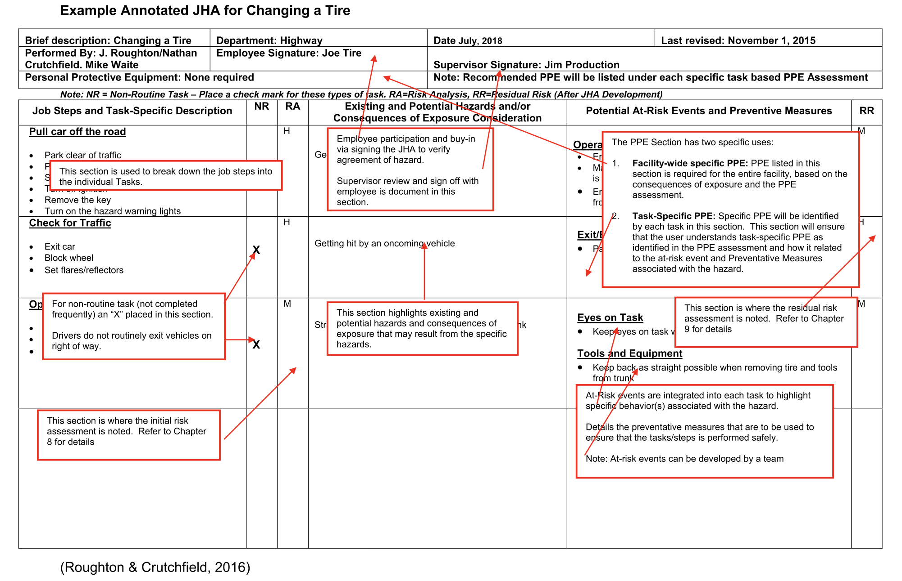

## APPENDIX 12.2 EXAMPLE OF AN ANNOTATED JHA FOR CHANGING A TIRE

(ROUGHTON & CRUTCHFIELD, 2016)

---

## APPENDIX 12.3 SAMPLE KNIFE SAFETY AND CUT RESISTANT GLOVES PROCEDURE

This Knife Safety and Cut Resistant Gloves Program is to guide some implementation guidelines to help reduce cuts and
lacerations of the hand while using autoretracting knives.
This procedure applies to all areas (List the areas of Concern) and covers all tasks where cutting devices such as razor
knives, utility knives, or other cutting devices with sharp edges are used.
Definitions:
* Autoretracting knife—This is a knife where the cutting blade will automatically retract into an unexposed (safe)
condition once the blade leaves the item being cut
* Guarded knife—This is a knife which contains a guard around the blade that will not allow the blade to extend beyond
the guard once it comes in to contact with the service being cut.
* Cut resistant gloves—Cut resistant gloves are made of cut resistant material and are specifically designed for protection
from cuts.
### Observation

Note: Most gloves presented are cut resistant and not cut proof.
(Geng, 2016)
Responsibilities/authorities/interrelationships: It is the responsibility of all members of the leadership team and
employees to continually review their respective areas of responsibility to ensure there is complete compliance with this
procedure. Appropriate actions will be taken to correct any discrepancies. The Safety Professional, working in conjunction
with employees and the leadership team will assist as needed (Selection of knives, alternative cutting methods, etc.).
Everyone must use good judgment when using this Knife Safety and Cut Resistant Gloves Procedure
### Procedure

### General Rules for Hand Safety

Cut injuries occur when hands are in the line of fire and come in contact with knives, equipment, or machines with sharp
edges. These cuts can be prevented or minimized using the proper hand tools.
Cut resistant gloves must be worn when:
* Performing tasks where there may be a risk of cuts, laceration, scrapes, and so on, to the hands or fingers.
* Cutting with an open blade or working with or around materials or equipment with sharp edges. Pocket knives are pro-
hibited from use when performing job tasks.
### Knife Safety

Approved cutting tools shall be provided by [Insert Company Name].
* Fixed blades or standard box knives are PROHIBITED.
* Any cutting device not listed in this procedure must be approved by the Personal Protective Equipment (PPE)
subcommittee.
* Any cutting should be in a direction away from the body part.
* Defective knives and blades must immediately be removed from service.
* If the previous steps cannot be followed, a written request for a variance must be submitted to a member of the lead-
ership team and will include the following information
* Job/position
* Specific task
* Reason approved knife cannot be used
* A description of the proposed alternative cutting tool.
Any employee incurring a laceration due to failure to wear the cut resistant gloves or using a prohibited cutting tool will be
subject to disciplinary action.
Employees are responsible for:
* Wearing a cut resistant glove on the noncutting hand when using any cutting device.
* Wearing cut resistant gloves on both hands when handling or changing cutting devices, or equipment with sharp edges
* Using only autoretracting, guarded, or safety recessed cutting devices that are approved by [Insert Company Name] and
purchased through the Procurement Department.
Members of the Leadership Team are responsible for the following activities
* Ensuring that all employees in their areas of responsibility have been trained on this procedure and can demonstrate
knowledge of its contents.
* Ensuring compliance with this procedure by all employees in their area of responsibility through frequent area reviews.
* Provided the appropriate level of training employees on any new/updated tool and gloves.
* Taking immediate steps to correct any discrepancies.
* Establishing a schedule to complete implementation of the cutting tools and gloves programs.
### Approved Cutting Tools

* Refer Appendix 12.5 for a Sample Analysis of Self-Retractable Knives procedures and in the proper use of the cutting
tools and cut resistance gloves. Refer Appendix 12.6 for a Sample Knife Safety Training Checklist.
Approved Cut Resistant Gloves:
* Refer Appendix 12.7 for a Sample Analysis of Cut Resistant Gloves Selection Guide
* Refer Appendix 12.8 for a Sample PPE Assessment
* Refer Appendix 12.9 for a Sample Guideline for Complying with PPE Requirements
* Refer Appendix 12.10 for a Sample Hazard Assessment Option, 1
* Refer Appendix 12.11 for a Sample JHA Assessment Option 2
* Refer Appendix 12.12 for a Sample Personal Protective Equipment Training Certification
* Refer Appendix 12.13 for a Example Personal Protective Equipment Training Quiz
### Selected Resources

ERI safety videos series—(Knife safety in the workplace, 2004)
Avoid knife injuries on the job!—(Avoid knife injuries on the job!, 2009)
Safe cutting. With the safety knives of Martor—(Safe cutting. With the safety knives of Martor, 2018)
Handy safety knife—(Handy safety knife, 2016)
Industrial safety in the UK: A civic duty?—(Industrial safety in the UK: A civic duty?, 2018)

---

## APPENDIX 12.4 DRAFT COMPANY-WIDE LETTER TO IMPLEMENT KNIFE SAFETY AND CUT RESISTANT GLOVE PROGRAM

[Insert Company Name] conducted a risk assessment project regarding Knife Safety and Cut Resistant Glove to help
identify contributing factors and actions necessary to reduce the risk of laceration-type injuries. The purpose of the assess-
ments was to eliminate the use of knives wherever possible, specify lower risk cutting tools, and identify the proper level of
personal protection (cut resistant gloves) for specific tasks.
Based on the assessment, [Insert Company Name] has identified a selection of “approved” cut resistant gloves and
cutting tools matched to specific tasks being performed. The knives and gloves on the approved list were selected based
on findings from the on-site assessments that were conducted at a representative mix of locations.
To accomplish the implementation plan, each facility should implement and develop a specific plan as follows:
* Address the required use of proper tools and personal protective equipment (PPE) for the identified task. For any level of
PPE, Use the PPE assessment and other forms to document the initial assessment (PPE assessment, n.d.). Refer
Appendix 12.8 for a sample Personal Protective Equipment (PPE) Assessment.
* Establish a schedule to complete implementation of the cutting tools and gloves programs. Refer Appendix 12.5
Sample Analysis of Self-Retractable Knives, and Appendix 12.7 Sample Analysis of Cut Resistant Gloves
Selection Guide.
* Provided the appropriate level of training employees on the new/updated procedures and in the proper use of the cutting
tools and cut resistance gloves. Refer Appendix 12.6 for a Sample Knife Safety Training Checklist.
* Distribute the cutting tools and cut resistance gloves to each required task. Eliminate the use of and remove the non-
approved equipment. For sites that currently purchase PPE from [insert vendor name], please ensure that these vendors
indicate a willingness to work with the sites on returning nonapproved knifes and cut resistant gloves in exchange for
approved gloves (at cost differential).
The Safety & Health Support team is available to assist in implementing these procedures.
Thank you in advance for your help in improving our safety programs.

---

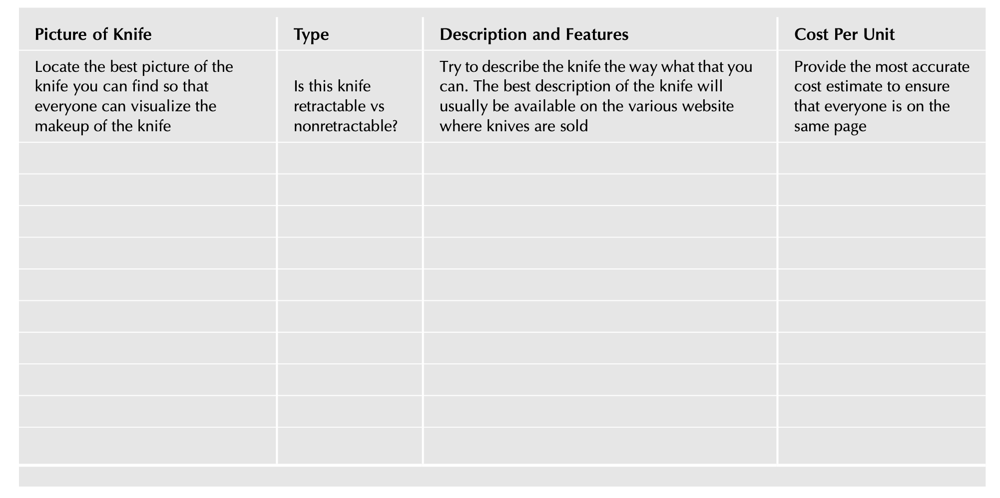

## APPENDIX 12.5 SAMPLE ANALYSIS OF SELF-RETRACTABLE KNIVES

Insert a general statement regarding retractable vs nonretractable
Picture of Knife Type Description and Features Cost Per Unit
Locate the best picture of the
knife you can find so that
everyone can visualize the
makeup of the knife
Is this knife
retractable vs
nonretractable?
Try to describe the knife the way what that you
can. The best description of the knife will
usually be available on the various website
where knives are sold
Provide the most accurate
cost estimate to ensure
that everyone is on the
same page

---

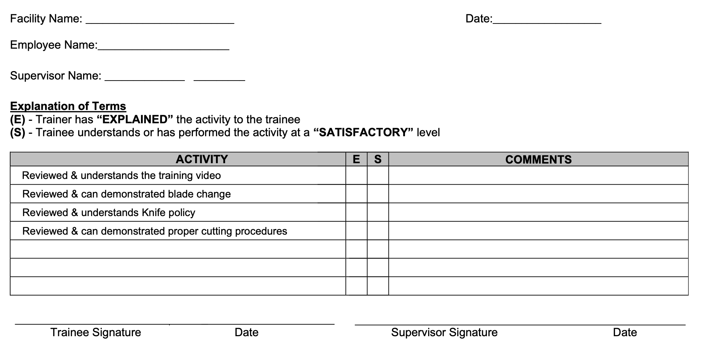

## APPENDIX 12.6 SAMPLE SAFETY KNIFE TRAINING CHECKLIST

Facility Name: __________________________ Date:___________________
Employee Name:_______________________
Supervisor Name: ______________ _________
### Explanation of Terms

(E) - Trainer has “EXPLAINED” the activity to the trainee
(S) - Trainee understands or has performed the activity at a “SATISFACTORY” level
ACTIVITY E S COMMENTS
Reviewed & understands the training video
Reviewed & can demonstrated blade change
Reviewed & understands Knife policy
Reviewed & can demonstrated proper cutting procedures
Trainee Signature Date Supervisor Signature Date

---

## APPENDIX 12.7 SAMPLE ANALYSIS OF CUT RESISTANT GLOVES SELECTION GUIDE

GLOVE
The following guide is designed to help the user to choose the appropriate type of Cut Resistant Gloves for a specific task.
The Analysis of Cut Resistant Gloves guide provides a discussion of the types of material that the glove is comprised, the
intended/potential usage, the advantages and disadvantages for specific glove types, and an example picture.
To ensure that regulatory guidance is used to develop a PPE assessment, refer to the following Sample
Protective Equipment Guide and associated form based on the Personal Protective Equipment Guide (Oregon
OSHA’s quick guide to the PPE hazard assessment, n.d.; Personal protective equipment (PPE) guide volume 1: General
PPE, 2003).

---

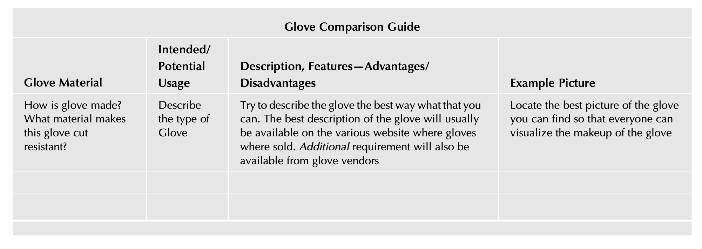

## APPENDIX 12.8 SAMPLE PERSONAL PROTECTIVE EQUIPMENT (PPE) ASSESSMENT

### Glove Comparison Guide

Glove Material
Intended/
Potential
Usage
Description, Features—Advantages/
Disadvantages Example Picture
How is glove made?
What material makes
this glove cut
resistant?
Describe
the type of
Glove
Try to describe the glove the best way what that you
can. The best description of the glove will usually
be available on the various website where gloves
where sold. Additional requirement will also be
available from glove vendors
Locate the best picture of the glove
you can find so that everyone can
visualize the makeup of the glove
This appendix and the references listed as follows provides several resources, was taken directly from Washington
State Department of Labor and Industries, (OSHA) and adapted to help with the process in developing a Successful
Personal Protective Equipment (PPE) Assessment. (Personal protective equipment (PPE) guide volume 1: General
PPE, 2003)
* Sample Guidelines for Complying with PPE Requirements, Refer Appendix 12.9
* Hazard Assessment for PPE, Option 1. Refer Appendix 12.10
* Job Hazard Analysis Assessment for PPE, Option 2, Refer Appendix 12.11
* Example Personal Protective Equipment Training Certification Form, Refer Appendix 12.12
* Example Personal Protective Equipment Training Quiz, Refer Appendix 12.13
To understand these concepts in detail, the original document must be a review for completeness and consistency. (Personal
protective equipment (PPE) guide volume 1: General PPE, 2003)
This appendix was taken directly from Washington State Department of Labor and Industries, OSHA and adapted to help with the
process in developing a Successful Personal Protective Equipment (PPE) Assessment (Personal protective equipment (PPE) guide
volume 1: General PPE, 2003).
### Additional Resources

Other resources are included for your convenience. Please review and compare all resources to verify accuracy.
Personal Protective Equipment (Personal Protective Equipment, OSHA 3151-12R 2003, 2004)
Nonmandatory Guidelines for Hazard Assessment, Personal Protective Equipment (PPE) Selection, and PPE Training
Program (Personal protective equipment, 1915 subpart I App A, non-mandatory guidelines for hazard assessment, personal
protective equipment (PPE) selection, and PPE training program, n.d.)
PPE hazard assessment quick guide—Oregon OSHA Oregon OSHA’s quick guide to the PPE hazard assessment, n.d.)
Adapted for use from “Job hazard analysis: a guide for voluntary compliance and beyond”, 2nd edition (Roughton &
Crutchfield, 2016)
Note: Web links are subject to change. If any web links do not work as provided, you can use the Google advanced
search by searching for the title of what is presented in this appendix (Google advance search, n.d. Refer Chapter 16,
Appendix 16.1, Software Tools for Curating Information that can help with this research.

---

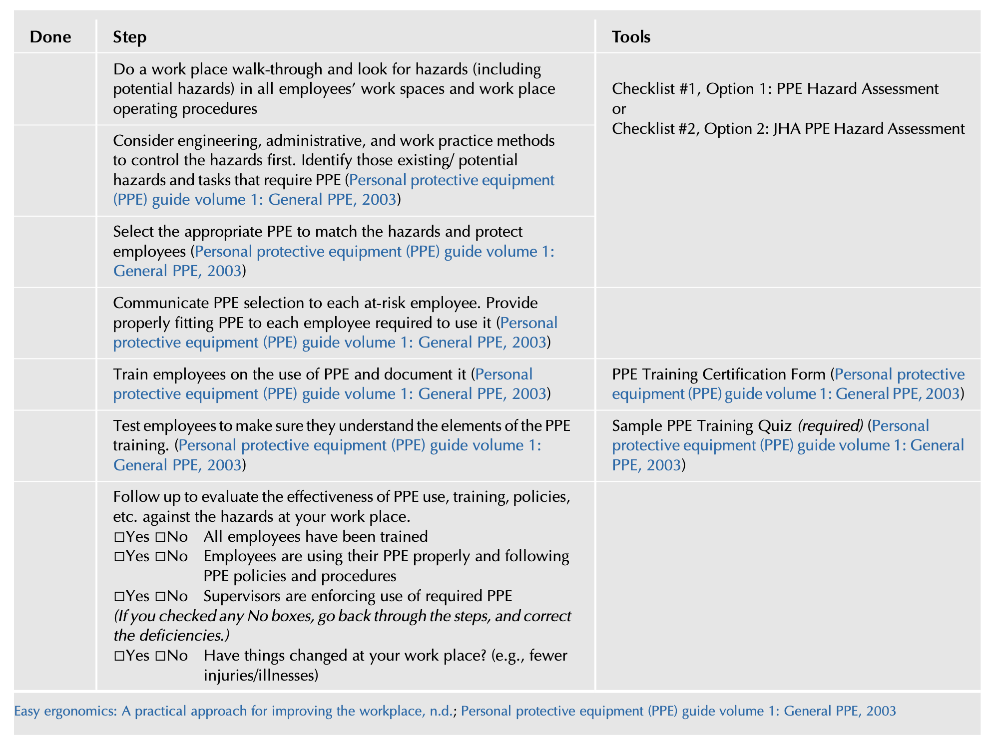

## APPENDIX 12.9 SAMPLE GUIDELINES FOR COMPLYING WITH PERSONAL PROTECTIVE EQUIPMENT (PPE) REQUIREMENTS

Use this checklist to help determine the PPE requirements at your workplace. You can use the available tools in the far-right
column to help you accomplish the step. Check off the boxes in the far-left column as you complete each step. (Easy
ergonomics: A practical approach for improving the workplace, n.d.; Personal protective equipment (PPE) guide
volume 1: General PPE, 2003; White, 2015)
This appendix was taken directly from Washington State Department of Labor and Industries, OSHA and adapted to help with the process in
developing a Successful Personal Protective Equipment (PPE) Assessment
(Personal protective equipment (PPE) guide volume 1: General PPE, 2003)
Done Step Tools
Do a work place walk-through and look for hazards (including
potential hazards) in all employees’ work spaces and work place
operating procedures
Checklist #1, Option 1: PPE Hazard Assessment
or
Checklist #2, Option 2: JHA PPE Hazard Assessment
Consider engineering, administrative, and work practice methods
to control the hazards first. Identify those existing/ potential
hazards and tasks that require PPE (Personal protective equipment
(PPE) guide volume 1: General PPE, 2003)
Select the appropriate PPE to match the hazards and protect
employees (Personal protective equipment (PPE) guide volume 1:
General PPE, 2003)
Communicate PPE selection to each at-risk employee. Provide
properly fitting PPE to each employee required to use it (Personal
protective equipment (PPE) guide volume 1: General PPE, 2003)
Train employees on the use of PPE and document it (Personal
protective equipment (PPE) guide volume 1: General PPE, 2003)
### PPE Training Certification Form

 (Personal protective
equipment (PPE) guide volume 1: General PPE, 2003)
Test employees to make sure they understand the elements of the PPE
training. (Personal protective equipment (PPE) guide volume 1:
General PPE, 2003)
Sample PPE Training Quiz (required) (Personal
protective equipment (PPE) guide volume 1: General
PPE, 2003)
Follow up to evaluate the effectiveness of PPE use, training, policies,
etc. against the hazards at your work place.
Yes No All employees have been trained
Yes No Employees are using their PPE properly and following
PPE policies and procedures
Yes No Supervisors are enforcing use of required PPE
(If you checked any No boxes, go back through the steps, and correct
the deficiencies.)
Yes No Have things changed at your work place? (e.g., fewer
injuries/illnesses)
Easy ergonomics: A practical approach for improving the workplace, n.d.; Personal protective equipment (PPE) guide volume 1: General PPE, 2003

---

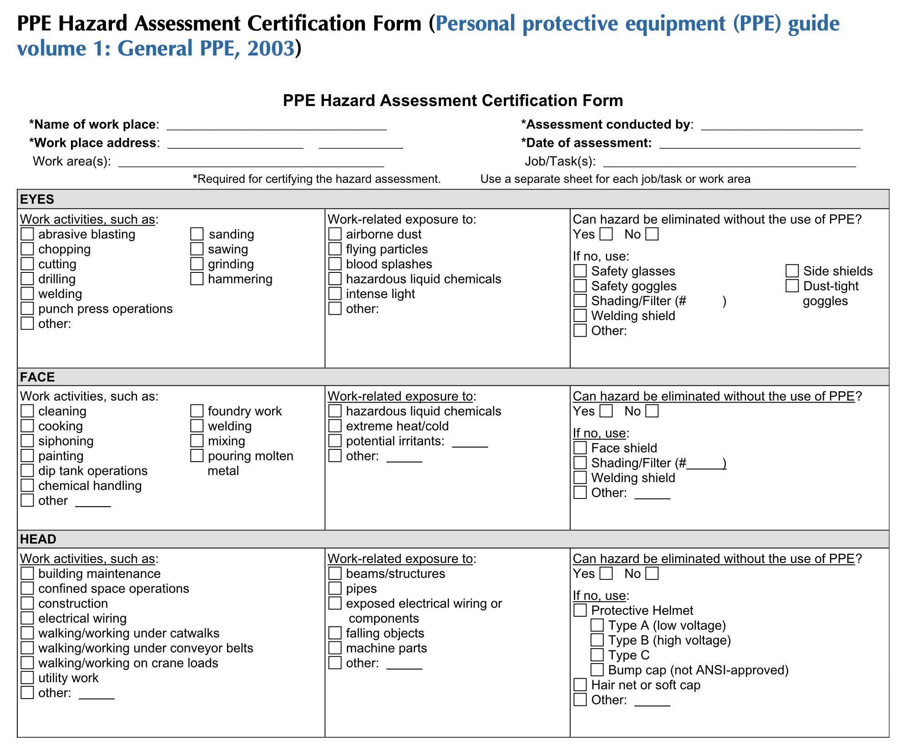

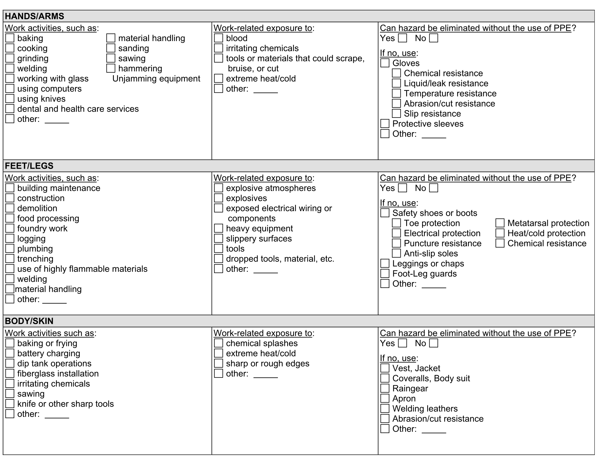

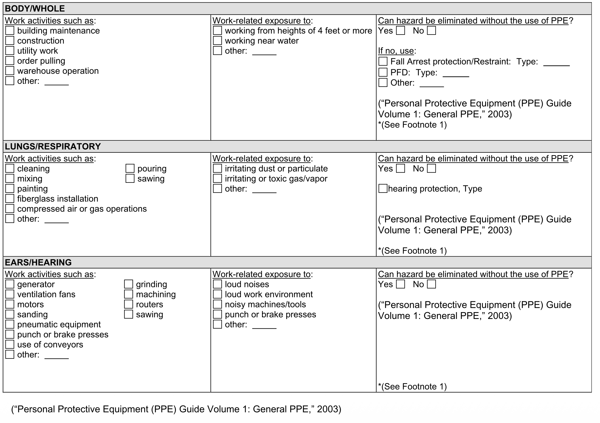

## APPENDIX 12.10 HAZARD ASSESSMENT FOR PPE, OPTION 1

This tool can help you conduct a hazard assessment to determine if your employees need to use personal protective
equipment (PPE) by identifying activities that may create hazards for your employees. The activities are grouped according
to what part of the body might need PPE (Personal protective equipment (PPE) guide volume 1: General PPE, 2003).
This tool can serve as written documentation that you have completed a hazard assessment. Make sure that the blank
fields at the beginning of the checklist (indicated by ) are filled out (see later, Instructions #4) (Personal protective
equipment (PPE) guide volume 1: General PPE, 2003).
This appendix was taken directly from Washington State Department of Labor and Industries, OSHA and adapted to help with the process in
developing a Successful Personal Protective Equipment (PPE) Assessment
(Personal protective equipment (PPE) guide volume 1: General PPE, 2003)
1. 2. 3. Instructions:
Do a walk-through survey of each work area and job/task. Read the list of work activities in the first column, putting a
check next to the activities performed in that work area or job.
Read the list of hazards in the second column, putting a check next to the hazards to which employees may be exposed
while performing the work activities or while present in the work area. (e.g., work activity: chopping wood; work-
related exposure: flying particles) (Personal protective equipment (PPE) guide volume 1: General PPE, 2003).
Decide how you are going to control the hazards. Consider engineering, work place, and/or administrative controls to
eliminate or reduce the hazards before resorting to using PPE. If the hazard cannot be eliminated without using PPE,
indicate which type(s) of PPE will be required to protect your employee from the hazard (Personal protective equipment
(PPE) guide volume 1: General PPE, 2003).
Make sure that you complete the following fields on the form (indicated by ) to certify that a hazard assessment was done:
Name of your work place
Address of the work place where you are doing the hazard assessment
Name of person certifying that a workplace hazard assessment was done
Date the hazard assessment was done
PPE Hazard Assessment Certification Form (Personal protective equipment (PPE) guide
volume 1: General PPE, 2003)

---

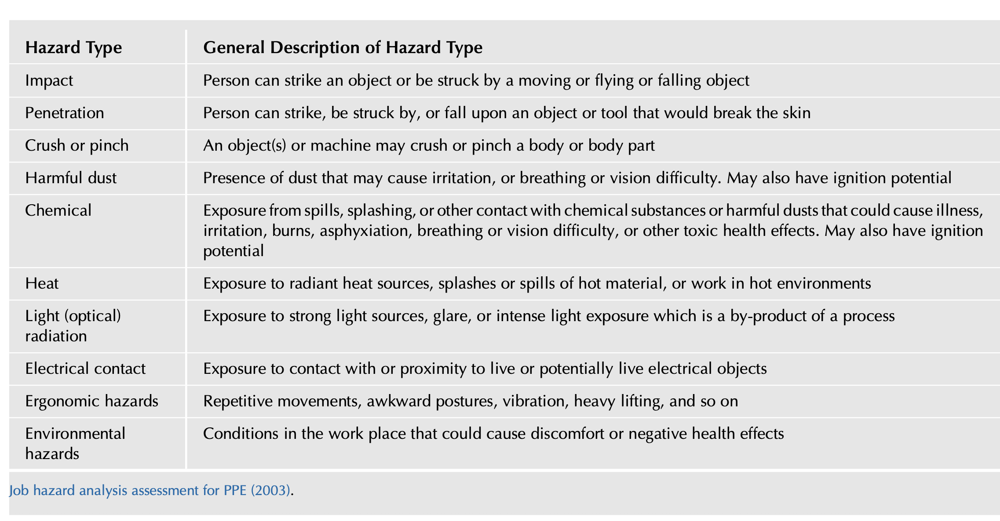

## APPENDIX 12.11 JOB HAZARD ANALYSIS ASSESSMENT FOR PPE, OPTION 2

The Job Hazard Analysis (JHA) approach to doing a hazard assessment for PPE is useful in larger businesses with many
hazards and complex safety issues. It also helps you assign a Risk Priority Code to the hazard to determine the course of
actions you need to take to control the hazard ( Job hazard analysis assessment for PPE, 2003).
Refer Chapter 9, “Defining Risk Perception” and Chapter 10, “Understanding Basic Risk Management Principles.”
Follow the instructions as you conduct your hazard assessment and fill in the hazard assessment form. Customize the
form to fit the needs of your work place.
This tool can also serve as written documentation that you have done a hazard assessment to document your hazard
assessment for PPE. Make sure that the blank fields at the bottom of the form (indicated by ) are filled out.
* Name of your work place
* Address of the work place where you are doing the hazard assessment
* Name of person certifying that a workplace hazard assessment was done
* Date the hazard assessment was done ( Job hazard analysis assessment for PPE, 2003)
Job Hazard Analysis Assessment for PPE
### Instructions

1. Conduct a walk-through survey of your business. For each job/task step, note the presence of any of the following
hazard types (see following table), their sources, and the body parts at risk. Fill out the left side of the hazard assessment
form. Gather all the information you can ( Job hazard analysis assessment for PPE, 2003).
* Look at all steps of a job and ask the employee if there are any variations in the job that are infrequently done and that
you might have missed during your observation.
* For purposes of the assessment, assume that no PPE is being worn by the affected employees even though they may
be wearing what they need to do the job safely.
* Note all observed hazards. This list does not cover all possible hazards that employees may face or for which per-
sonal protective equipment may be required. Noisy environments or those which may require respirators must be
evaluated with appropriate test equipment to quantify the exposure level when overexposure is suspected (Job hazard
analysis assessment for PPE, 2003).
Hazard Type General Description of Hazard Type
Impact Person can strike an object or be struck by a moving or flying or falling object
Penetration Person can strike, be struck by, or fall upon an object or tool that would break the skin
Crush or pinch An object(s) or machine may crush or pinch a body or body part
Harmful dust Presence of dust that may cause irritation, or breathing or vision difficulty. May also have ignition potential
Chemical Exposure from spills, splashing, or other contact with chemical substances or harmful dusts that could cause illness,
irritation, burns, asphyxiation, breathing or vision difficulty, or other toxic health effects. May also have ignition
potential
Heat Exposure to radiant heat sources, splashes or spills of hot material, or work in hot environments
Light (optical)
radiation
Exposure to strong light sources, glare, or intense light exposure which is a by-product of a process
Electrical contact Exposure to contact with or proximity to live or potentially live electrical objects
Ergonomic hazards Repetitive movements, awkward postures, vibration, heavy lifting, and so on
Environmental
hazards
Conditions in the work place that could cause discomfort or negative health effects
Job hazard analysis assessment for PPE (2003).
2. Analyze the hazard. For each job task with a hazard source identified, use the Job Hazard Analysis Matrix table,
and discuss the hazard with the affected employee and supervisor. Fill out the right side of the hazard assessment
form:
* Rate the SEVERITY of injury that would reasonably be expected to result from exposure to the hazard.
* Rate the PROBABILITY of an accident happening (Job hazard analysis assessment for PPE, 2003).
* Assign a RISK CODE based upon the intersection of the SEVERITY and PROBABILITY ratings on the
matrix.
### Job Hazard Analysis Matrix

Severity of Injury Probability of an Accident Occurring
Level Description
A
Frequent
B
Several Times
C
Occasional
I Fatal or permanent disability 1 1 II Severe illness or injury 1 1 III Minor injury or illness 2 2 2 3 D
Possible
E
Extremely
Improbable
1 2 3
2 2 3
3 3
IV No injury or illness 3 3 3 3 3
Risk Priority
Code Risk Level Action Required
1 High Work activities must be suspended immediately until hazard can be eliminated or controlled or reduced
to a lower level
2 Medium Job hazards are unacceptable and must be controlled by engineering, administrative, or personal
protective equipment methods as soon as possible
3 Low No real or significant hazard exists
Controls are not required but may increase the comfort level of employees
3. Take action on the assessment. Depending on the assigned Risk Level/Code (or Risk priority), take the corresponding
action according to the previous table:
* If Risk priority is LOW (3) for a task step requires no further action.
* If Risk priority is MEDIUM (2) select and implement appropriate controls.
* If Risk priority is HIGH (1) immediately stop the task step until appropriate controls can be implemented.
* A high-risk priority means that there is a reasonable to high probability that an employee will be killed or perma-
nently disabled doing this task step and/or a high probability that the employee will suffer severe illness or injury!
(Job hazard analysis assessment for PPE, 2003).
4. Select PPE:
* Try to reduce employee exposure to the hazard by first implementing engineering, work practice, and/or adminis-
trative controls. If PPE is supplied, it must be appropriately matched to the hazard to provide effective protection,
durability, and proper fit to the worker. Note the control method to be implemented in the far-right column.
5. Certify the hazard assessment:
* Certify on the hazard assessment form that you have done the hazard assessment and implemented the needed
controls.
* Incorporate any new PPE requirements that you have developed into your written accident prevention program.
( Job hazard analysis assessment for PPE, 2003).
Job Hazard Analysis for Personal Protective Equipment (PPE) Assessment (Job hazard analysis
assessment for PPE, 2003)
Job/Task: ______________________________ Location: ______________________________
Job/Task
Step
Hazard
Type
Hazard
Source Body Parts at Risk Severity Probability
Risk
Code Control Method
Note: Engineering, work practice, and administrative hazard controls such as guarding must be used, if feasible, before requiring employees to use personal
protective equipment.
### Certification of Assessment

Name of work place: ________________________________ Assessment Conducted By: _________________________ Title: ________________________ Address _________________________________
Date(s) of
Assessment ________________
Page
Implementation of Controls Approved By: ________________ Title: _______________ Date: _________________
( Job hazard analysis assessment for PPE, 2003)

---

## APPENDIX 12.12 EXAMPLE PERSONAL PROTECTIVE EQUIPMENT TRAINING CERTIFICATION FORM

This Training Certification was taken direct from (Personal protective equipment (PPE) guide volume 1: General
PPE, 2003)
Employee’s Name: ______________________ Employee ID No. ___________________
Job Title/Work area: ______________________________
Employer: ___________________________________________________________________
Trainer’s Name (person completing this form): ______________________________________
Date of Training: _______________________
Types of PPE employee is being trained to use:
_____________________________ ____________________________
_____________________________ ____________________________
_____________________________ ____________________________
The following information and training on the personal protective equipment (PPE) listed before were covered in the
training session:
____ ____ ____ ____ ____ The limitations of personal protective equipment: PPE alone cannot protect the employee from on-the-job hazards.
What works place hazards the employee faces, the types of personal protective equipment that the employee must
use to be protected from these hazards, and how the PPE will protect the employee while doing his/her tasks.
When the employee must wear or use the personal protective equipment.
How to use the personal protective equipment properly on-the-job, including putting it on, taking it off, and wearing
and adjusting it (if applicable) for a comfortable and effective fit.
How to properly care for and maintain the personal protective equipment: look for signs of wear, clean and disinfect,
and dispose of PPE (Personal protective equipment (PPE) guide volume 1: General PPE, 2003)
Note to employee: This form will be made a part of your personal file. Please read and understand its contents before
signing.
(Employee) I understand the training I have received, and I can use PPE properly.
_________________________________ ______________________
Employee’s signature Date
(Trainer must check off)
____ ____ Employee has shown an understanding of the training.
Employee has shown the ability to use the PPE properly.
_________________________________ ______________________
Trainer’s signature Date
This appendix was taken directly from Washington State Department of Labor and Industries, OSHA and adapted to help with the process
in developing a Successful Personal Protective Equipment (PPE) Assessment. (Personal protective equipment (PPE) guide volume 1:
General PPE, 2003)

---

## APPENDIX 12.13 EXAMPLE PERSONAL PROTECTIVE EQUIPMENT TRAINING QUIZ

This Personal Protective Equipment Training Quiz was taken directly from (Personal protective equipment (PPE) guide
volume 1: General PPE, 2003)
(This is a sample quiz that you can use to make sure an employee has understood the training and can demonstrate the proper
use and care of personal protective equipment. Also, quiz an employee who has been retrained due to improper use of the
PPE in performing his/her job tasks. You can keep this form in the employee’s file with the PPE Certification Form)
(Personal protective equipment (PPE) guide volume 1: General PPE, 2003).
1. What are the limitations of personal protective equipment?
2. List the types of personal protective equipment you must use when doing your work/tasks.
3. What are the hazards in your job for which you must use each type of PPE, and when must you use your personal
protective equipment?
4. hat are the procedures for the proper use, care, and maintenance of your PPE?
5. What should you look for to determine that your PPE is in good working condition?
6. What do you do when your PPE is no longer usable?
7. (Trainer/Supervisor:) Have the employee demonstrate putting on, wearing, and adjusting, and taking off each PPE
properly. Also have employee demonstrate how to clean and disinfect each PPE (Personal protective equipment
(PPE) guide volume 1: General PPE, 2003).
Has employee demonstrated proper use
and care of each PPE?
PPE #1: _______________________________ Yes _____ No _____
PPE #2: _______________________________ Yes _____ No _____
PPE #3: _______________________________ Yes _____ No _____
PPE #4: _______________________________ Yes _____ No _____
The employee has answered all the questions adequately and has demonstrated the ability to properly use and care for
the PPE needed to do his/her job.
______________________________ _________________
Trainer’s/Supervisor’s signature Date
______________________________ _________________
Employee’s signature Date
This appendix was taken directly from Washington State Department of Labor and Industries, OSHA and adapted to help with the process
in developing a Successful Personal Protective Equipment (PPE) Assessment. (Personal protective equipment (PPE) guide volume 1:
General PPE, 2003)

---

## BIBLIOGRAPHY

Avoid knife injuries on the job!. (2009). Occupational Safety and Health Administration (OSHA), Omaha Area Office.
Blum, D. (2014). The best American science and nature writing 2014. Mariner (October).
Capra, F., & Luisi, P. L. (2014). The systems view of life: A unifying vision. Cambridge: Cambridge University Press, University Printing House.
Concepts and principles. Human performance improvement handbook. Vol. 1. US Department of Energy.
Conducting a Job Hazard Analysis (JHA). (2017). Oregon Occupational Safety and Health Division (Oregon OSHA). Public Domain, Based on Infor-
mation as Presented on and Adapted for Use. Retrieved from, http://bit.ly/WXGJhK.
Easy ergonomics: A practical approach for improving the workplace. (n.d.). Oregon Occupational Safety and Health Division (Oregon OSHA). Public
Domain, Based on Information as Presented and Adapted for Use. Retrieved from, http://osha.oregon.gov/OSHAPubs/3347.pdf
EM 385-1-1, Safety and health requirements manual. (2014). US Army Corps of Engineers. Public Domain, Based on Information as Presented on and
Adapted for Use. Retrieved from, http://1.usa.gov/1Fu8Yfo.
Frederick Taylor and scientific management, understanding Taylorism and early management theory. (2017). MindTools. Retrieved from, http://bit.ly/
2igx9r0.
Geng, J. (2016). Cut-proof gloves (and other misconceptions about cut resistance). Superior Gloves. November, Retrieved from, http://bit.ly/2pTDRX3.
Google advance search. (n.d.). Google. Retrieved from, http://bit.ly/15lPe8Y
Handy safety knife. (2016). Thomson Reuters Canada Limited. June, Retrieved from, http://bit.ly/2pSUGl1.
How to identify job hazards. (2017). Saskatchewan Labour, Occupational Health& Safety, Partners in Safety. Based on Information as Presented and
Adapted for Use. Retrieved from, http://bit.ly/2xbAyvW.
Human performance tools for individuals, work teams, and management. Human performance improvement handbook. Vol. 2. US Department of Energy
Public Domain.
Industrial safety in the UK: A civic duty?. (2018). Slice. March, Retrieved from, http://bit.ly/2pTAorv.
Job. (2018). The American Heritage® Idioms Dictionary. Retrieved from, http://bit.ly/1C5c2Pb.
Job hazard analysis, 3071. (2002). Occupational Safety and Health Administration (OSHA). Public Domain, Based on Information as Presented and
Adapted for Use. Retrieved from, http://bit.ly/1ZI1Q7y.
Job hazard analysis assessment for PPE. 2003. Washington State Department of Labor and Industries, Public Domain, Based on Information as Presented
on and Adapted for Use. Retrieved from, http://bit.ly/2CKdckd
Job safety analysis: A fundamental tool for safety. (2017). Commonwealth of Virginia, Workers’ Compensation Services. Based on Information as Pre-
sented and Adapted for Use. Retrieved from, http://bit.ly/U1YXPd.
Knife safety in the workplace. (2004). ERI safety videos series.
Managing worker safety and health. (2016). Missouri Occupational Safety and Health Administration (OSHA), Office of Cooperative Programs. Public
Domain, Based on Information as Presented and Adapted for Use. Retrieved from, http://on.mo.gov/15C4FyS.
Occupational health & safety management systems. (2012). The American Society of Safety Engineers. ANSI/AIHA/ASSE Z10. Retrieved from, http://
bit.ly/1MsT6MG.
Oregon OSHA’s quick guide to the PPE hazard assessment. (n.d.). Oregon Occupational Safety and Health Division (Oregon OSHA). Public Domain,
Permission to Reprint, Based on Information as Presented and Adapted for Use. Retrieved from, http://bit.ly/1LOiQDC
Personal protective equipment (PPE) guide volume 1: General PPE. (2003). Washington Industrial Safety and Health Act. Public Domain. Retrieved
from, http://bit.ly/2iqTLVS.
Personal protective equipment, 1915 subpart I App A, non-mandatory guidelines for hazard assessment, personal protective equipment (PPE) selection,
and PPE training program. (n.d.). Occupational Safety & Health Administration (OSHA). Public Domain, Based on Information as Presented and
Adapted for Use. Retrieved from, http://1.usa.gov/1CdxSxu
Personal protective equipment, OSHA 3151-12R 2003. (2004). Occupational Safety and Health Administration (OSHA). Public Domain. Retrieved from,
http://bit.ly/1LOi75q.
PPE assessment. (n.d.). Occupational Safety and Health Administration (OSHA). Public Domain, Based on Information as Presented and Adapted for Use.
Retrieved from, http://1.usa.gov/14LzifU
Rammel, T. (2018). The utility knife. Ohio Bureau of Worker’s Compensation. Retrieved from, http://bit.ly/2K2eVIU.
Risk Assessment Institute. (2017). American Society of Safety Engineers, Risk Assessment Institute. Retrieved from, http://bit.ly/1GYTij1.
Roughton, J. (2005). Safety Black Belt Projects, Certified by BMG. Breakthrough Management Group. August. Unpublished Document.
Roughton, J., & Crutchfield, N. (2013). In Butterworth Heinemann (Ed.), Safety culture: An innovative leadership approach. MA: Butterworth Heinemann
Retrieved from, http://amzn.to/1qoD4oN.
Roughton, J., & Crutchfield, N. (2016). Job hazard analysis: a guide for voluntary compliance and beyond. In Elsevier/Butterworth-Heinemann (Ed.),
Chemical, petrochemical & process (p. 400). (2nd ed.). MA: Elsevier/Butterworth-Heinemann. Retrieved from, http://amzn.to/VrSAq5.
Safe cutting. With the safety knives of Martor. Martor KG. Retrieved from, http://bit.ly/2pTBoMh.
Safety alert for operations, manual flight operations. (2013). Federal Aviation Administration (FAA) January.
Sinek, S. (2009). Start with why: How great leaders inspire everyone to take action. Penguin. Retrieved from, http://bit.ly/1Lfs2zr.
White, C. (2015). Proactive ergonomics: stopping injuries before they occur. Professional Safety, 60(6), 69.
Why use a child theme?. (2018). Wordpress.org. Retrieved from, http://bit.ly/2CDfbIl.

---

## FURTHER READING

Job safety analysis. (2018). Oregon Occupational Safety and Health (Oregon OSHA) is a Division of the Department of Consumer & Business Services.
Retrieved from, http://bit.ly/2I3VXN0.
Martor knives. (2017). Martor USA, Permissions to Use Pictures Knives. Retrieved from, http://bit.ly/2ikO4Jk.
Strubler, D. (2018). The difference that continual improvement makes, principle 4, the five “W’s” and once “H”. Retrieved from, http://bit.ly/1M3HZtk.