# Chapter 13 Developing Safety Training Needs (안전 교육훈련 니즈 개발) 서브노트

> *"자신이 가르쳐야만 하는 상황에 직면한 사람만큼 어떤 주제에 대해 깊이 배우는 사람은 없다."*  
> — **피터 드러커 (Peter F. Drucker)**  
> 
> *출처: Safety Culture (Elsevier, 2019, pp. 327-343), PART IV Tools to Enhance Your Safety Management System, Chapter 13*  
> *DOI: https://doi.org/10.1016/B978-0-12-814663-7.00013-3*

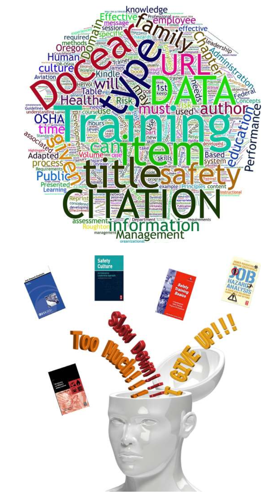

---

## 1. INTRODUCTION (도입: 안전문화와 역량 기반 교육훈련 프로그램)

안전문화와 안전 프로세스는 유능하고 총체적인 교육 및 훈련 프로그램(Competent, comprehensive education and training program)에 의해 든든하게 뒷받침됩니다. 조직의 문화는 구성원들이 일상적인 과업과 배정된 작업을 완수하는 과정에서 발현하는 규범(Norms), 습관(Habits), 행동(Behaviors)에 막대한 영향력을 행사합니다.

조직 내면에 깊숙이 자리 잡은 무의식적인 지각(Perceptions), 사고방식(Thoughts), 신념(Beliefs)의 힘은 행동을 변화시키기 위해 세심하게 설계된 최고의 안전 교육훈련조차 무력화할 만큼 강력합니다.

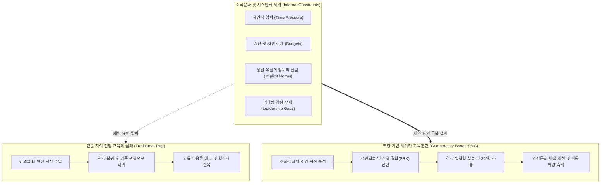

### 1.1 문화적 제약 극복과 지식 이전(Knowledge Transfer)의 본질
* **조직적 제약 조건의 사전 이해**: 교육훈련을 통해 안전의 가치와 중요성에 대한 신념을 고취하려 해도, 교육장을 벗어났을 때 일하는 방식과 관리 시스템에 아무런 변화가 없다면 근로자들은 다시 조직을 지배하는 본래의 행동 양식으로 회귀합니다. 교육의 실질적 효과가 지속되기 위해서는 조직문화의 기저를 이루는 **내부적 제약 조건(시간 압박, 예산, 상부 지침, 리더십 역량 등)**을 사전에 명확히 이해하고, 이를 극복하거나 완화하도록 교육이 설계되어야 합니다.
* **단순 작업 지시를 넘어선 지식 이전**: 교육훈련은 제한된 시간 안에 근로자에게 일하는 방법을 일방적으로 말해주는 단순 행위가 아닙니다. 지정된 '훈련자(Trainer)'로부터 '학습자(Learner)'에게 필수적인 직무 지식을 온전히 이전(Transfer)하는 고도의 커뮤니케이션 과정입니다.
* **즉시 적용 가능성(Immediate Usability)**: 교육과 훈련은 근로자가 즉각 이해하고 수용하며, 자신에게 할당된 작업 현장에서 즉시 활용할 수 있는 방식으로 제공되어야 합니다.

> **"희망은 전략이 아니다 (Hope Is Not a Strategy)"**  
> — *(Page, 2003)*  
> 근로자가 교육을 받았으니 막연히 안전하게 행동할 것이라는 '희망'에 의존해서는 안 되며, 체계적인 교육 요구도 평가와 검증 프로세스가 작동해야 합니다.

### 1.2 제13장 6대 핵심 학습 목표
1. **교육(Education)**과 **훈련(Training)**의 학술적·실무적 차이점 규명.
2. 교육훈련 요구도 평가(Training Needs Assessment)를 수행하는 체계적 방법 설명.
3. 교육훈련 목표 수립 시 **SMART 기법**을 구체적으로 적용하는 방안 설명.
4. 다양한 교육훈련 방법론(Training Methods)의 유형과 특성 열거 및 비교.
5. 교육훈련 콘텐츠 개발 시 **근로자의 기존 경험(Employee Experience)**에 대한 이해가 필수적인 이유 논증.
6. 안전 커뮤니케이션(Communication)이 안전문화의 성패를 좌우하는 핵심 동인인 이유 설명.

---

## 2. INITIAL EDUCATION AND TRAINING ASSESSMENT (초기 교육훈련 평가 및 전사 네트워크 연계)

효과적인 교육훈련 프로그램을 개발하기 위한 첫걸음은 해당 조직이 과거에 수행해 온 교육훈련의 역사적 궤적(Training History)을 면밀히 분석하는 것입니다.

### 2.1 과거 교육 이력 분석을 통한 현장 통찰 확보
* **조직 교육 이력 조사의 목적**:
  1. 현재 조직 내 교육훈련의 실질적 범위(Scope) 파악.
  2. 과거에 성공을 거두었던 교육적 노력과 성공 요인 식별.
  3. 가장 효과적이었던 교육 매체(Media) 및 전달 콘텐츠 분석.
  4. 훈련자(Trainer)에게 요구되는 전문성(Expertise)의 본질 규명.
* **근로 조건과의 연계성**: 교육 이력 분석은 현재의 실제 작업 조건(Work conditions)과 결합될 때 교육의 실효성에 대한 매우 깊은 통찰력을 제공합니다.

### 2.2 전사 커뮤니케이션 네트워크로서의 교육부서 협력
* **교육부서와의 전략적 파트너십**: 안전 전문가는 조직 내 기존 교육부서(Training Department)와 강력하고 긍정적인 네트워크 링크를 구축해야 합니다. 안전관리자(Safety Professional)와 안전경영시스템(SMS)이 기존에 사내에서 운영 중인 교육 프로그램과 마찰이나 갈등을 빚지 않도록 긴밀한 관계를 유지해야 합니다.
* **팀 접근법(Team Approach)의 가동**: 교육 전담 인력은 규정된 고유 직무로 인해 핵심 안전 교육을 전담하기 어려울 수 있습니다. 그러나 양 부서 간의 관계가 확고하다면, 안전경영시스템 구축 및 안전 기준 수립·설계·전달 과정에서 **'다기능 팀 접근법(Team Approach)'**을 가동할 수 있습니다.
* **학습조직(Learning Organization) 문화의 구축**: 견고한 안전문화를 가진 조직은 안전경영시스템이 조직에 가져다주는 긍정적 가치를 최우선으로 강조합니다. 리더와 근로자의 지속적인 교육훈련에 대한 신념을 내재화하여, 전 직원이 안전경영시스템의 작동 원리와 지속적 학습 책무를 명확히 이해하도록 보장합니다.

### 2.3 전담 인력 부재 조직의 현실적 한계와 극복 과제
일부 사업장(중소규모 사업장 등)은 교육 훈련을 기획·개발할 전문 스태프가 전혀 존재하지 않으며, 안전관리자 1인이 교육 업무까지 홀로 도맡아 처리하는 현실에 처해 있습니다. 현장 경험상, 1인의 안전관리자가 모든 법적·실무적 요건을 완벽히 충족하면서도 질 높은 프레젠테이션과 실습 교재를 단독 개발하는 것은 극히 어려운 과제입니다. 따라서 표준화된 모듈과 외부 전문 네트워크의 지원 체계 구축이 필수적입니다.

---

## 3. EDUCATION AND TRAINING PERFORMANCE (교육훈련 성과 및 교수설계)

강력한 안전문화는 곧 **'학습하는 조직(Learning Organization)'**의 산물입니다. 현장에서 유해위험요인(Hazards)과 관련 리스크(Associated Risks)가 식별되었을 때, 이 정보를 신속히 분석하여 필수적인 통제 대책(Controls)으로 전환하는 역량이 안전의 성패를 가릅니다.

### 3.1 SMART 원칙 기반의 교육훈련 목표 설정
교육훈련의 궁극적 목표는 바람직한 현장 운영 행동을 정착시켜 근로자의 직무 수행 역량(Performance)을 변화시키고 향상하는 것입니다. 교육훈련 개선을 위한 목표 설정은 제4장(Establishing the Direction for the Safety Culture)에서 논의된 **SMART 목표 체계**를 따라야 합니다:
* **Specific (구체성)**: 무엇을 어떻게 학습할 것인지 명확히 정의.
* **Measurable (측정 가능성)**: 수행 수준의 변화를 관찰하고 정량·정성적으로 측정 가능해야 함.
* **Achievable (달성 가능성)**: 학습자의 역량과 현장 여건상 현실적으로 도달 가능해야 함.
* **Relevant (관련성)**: 실제 현장 직무와 위험 통제에 직접적으로 기여해야 함.
* **Time-bound (시간 제약성)**: 달성 시점과 주기가 명확히 설정되어야 함.

---

### 3.2 성공적인 훈련 기법 (FIG. 13.1 정밀 분석)

전통적인 안전 교육은 주로 강의실에 모여 앉아 일방적인 강의를 듣거나, 안전 비디오를 시청하고, 유인물을 읽는 수동적 방식으로 진행되어 왔습니다. 그러나 유익한 정보가 제공되었을지라도, **체험형 실습(Hands-on)과 물리적 시연(Physical demonstration)**이 적절한 시점의 사후 피드백과 결합되지 않는다면 지식의 이해도와 기억 유지율은 급격히 추락합니다.

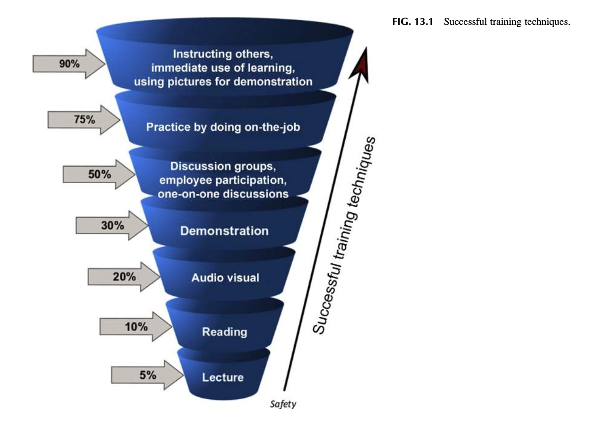

### FIG. 13.1 Successful training techniques (성공적인 교육훈련 기법 프레임워크)

* **FIG. 13.1의 핵심 구조 분석**:
  * **수동적 학습(Passive Learning)의 한계**: 단순 청취(Lectures) 및 시각 자료 열람(Reading/Videos)은 단기 기억에 머물며 현장 실행으로 전이되지 않음.
  * **능동적 학습(Active Learning)의 결합**: 시연(Demonstration), 토론(Discussion), 실습(Hands-on Practice)이 결합될 때 기억 유지율(Retention Rate)이 극대화됨.
  * **적시 피드백(Timely Follow-up)**: 교육 직후 현장 작업과의 연계성을 확인하는 적시의 지도와 코칭이 수반되어야 함.

---

### 3.3 기성품(Off-the-shelf) 교육의 폐해와 Mager의 의사결정 트리

수많은 조직이 시간과 예산을 절감하기 위해 시중에서 판매되는 **'기성품 교육 프로그램(Off-the-shelf programs)'**을 무비판적으로 도입합니다. 그러나 특정 작업 그룹의 구체적 위험 특성을 반영하지 못한 일반론적 교육은 근로자들에게 해당 규칙을 "왜(Why)" 준수해야 하는지 설득하지 못합니다. 결국 교육은 무의미한 암기식(Rote) 요식행위로 전락하여 현장의 본질적 문제를 해결하지 못합니다.

> *"믿기 어렵겠지만, 교육 강사들은 사람들이 이미 알고 있는 내용을 가르치도록 요구받거나, 결코 '교육'으로는 해결될 수 없는 시스템 문제를 교육으로 해결하라는 부당한 요청을 끊임없이 받고 있다."*  
> — **로버트 메이거 (Robert Mager)**

---

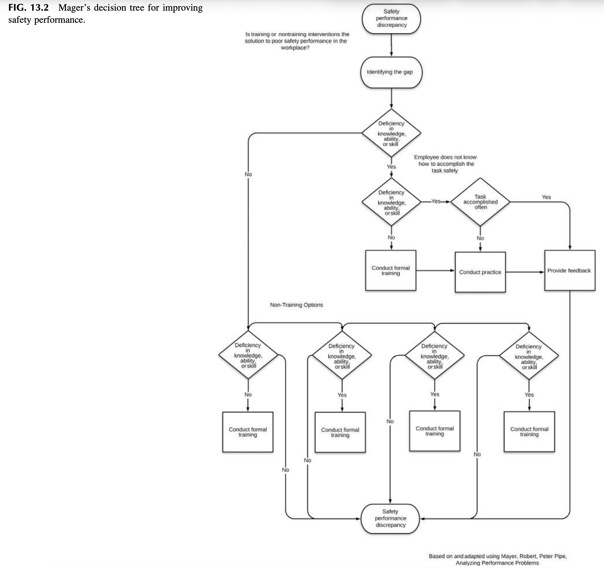

### FIG. 13.2 Mager’s decision tree for improving safety performance (수행 개선을 위한 Mager의 의사결정 트리)

* **FIG. 13.2의 구조적 통찰 (수행 결함 분석 알고리즘)**:
  1. **수행 결함(Performance Discrepancy)의 식별**: 기대되는 안전 행동과 실제 행동 간에 차이가 존재하는가?
  2. **중대성 평가(Is it important?)**: 이 문제가 실제 재해나 운영 중단을 초래할 만큼 중요한가?
  3. **역량 결함 여부 검증(Skill deficiency?)**: "목숨이 걸려 있어도 그 행동을 할 수 없는가(Could he do it if his life depended on it)?"
     * **할 수 있다면 (Skill 결함 아님)**: 교육이 필요한 것이 아니라, **동기 부여, 피드백 부재, 상충되는 인센티브, 혹은 물리적 장애물**을 제거해야 함.
     * **할 수 없다면 (Skill 결함 맞음)**: 과거에 해본 적이 있는지, 자주 사용하는 기술인지에 따라 **체계적 훈련(Training) 또는 정기적 연습(Practice)**을 처방해야 함.
  4. **비교육적 해결책 우선 탐색**: 공정 재설계, 도구 교체, 표준 작업 지침 개선 등이 선행되어야 함.

---

## 4. LEADERSHIP SUPPORT FOR TRAINING (교육훈련에 대한 리더십 지원과 표준 가이드라인)

안전 교육훈련이 성공을 거두기 위해서는 최고경영진부터 일선 감독자까지 조직의 모든 위계에서 전폭적인 지지가 뒷받침되어야 합니다. 안전경영시스템(SMS)이 수립되면 안전 교육은 리더십 팀이 공식적으로 승인하고 자원을 배분하는 공식 제도로 정착됩니다.

### 4.1 일선 감독자의 코치/멘토화 (제11장 ABSS 연계)
제11장(Developing an Activity-Based Safety System)에서 다룬 활동 기반 안전 시스템을 적용하면, 현장 감독자와 팀 리더는 정규 교육 시간에 배운 안전 지식을 현장에서 지속적으로 강화해 주는 **'멘토(Mentor)'이자 '코치(Coach)'**로 거듭납니다.
* **작업 전 회의(Daily Preshift Reviews)**: 당일 작업의 위험과 안전 수칙을 매일 아침 구체적으로 상기.
* **주간 요약 및 심층 월간 회의**: 교육 내용의 현장 실효성을 피드백받고 개선점을 도출하는 양방향 소통 가동.

---

### 4.2 ANSI Z10 및 OSHA 교육 개발 가이드라인

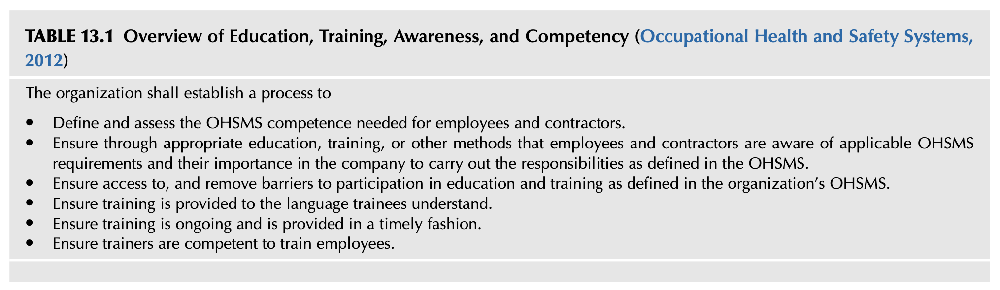

### TABLE 13.1 Overview of Education, Training, Awareness, and Competency (ANSI/AIHA Z10-2012 안전보건경영시스템 규격)

조직은 반드시 다음을 충족하는 프로세스를 구축해야 한다:
1. **역량 정의 및 평가**: 근로자와 도급업체(Contractors)에 요구되는 OHSMS 역량을 명확히 정의하고 평가할 것.
2. **인식 제고 및 중요성 주지**: 적절한 교육, 훈련 또는 기타 방법을 통해 근로자와 계약업체가 해당 OHSMS 요구사항과 책무의 중요성을 명확히 인지하도록 보장할 것.
3. **참여 장벽 제거**: 조직의 OHSMS에 정의된 교육훈련에 대한 접근성을 보장하고, 참여를 가로막는 장애물(시간, 업무 과다 등)을 제거할 것.
4. **이해 가능한 언어로 제공**: 교육생이 완벽히 이해할 수 있는 언어(모국어, 쉬운 용어)로 훈련을 제공할 것.
5. **지속성 및 적시성**: 교육훈련이 일회성에 그치지 않고 지속적으로 운영되며, 적시에(Timely fashion) 제공되도록 보장할 것.
6. **강사의 전문 역량 확보**: 근로자를 교육하는 사내외 강사가 충분한 적격성과 전문 역량을 갖추도록 보장할 것.

---

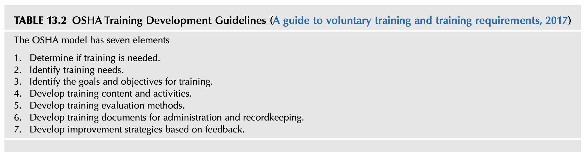

### TABLE 13.2 OSHA Training Development Guidelines (OSHA 7단계 교육훈련 개발 모델)

미국 직업안전위생국(OSHA)의 표준 훈련 개발 가이드라인은 체계적인 안전 교육 프로그램을 설계·운영하기 위한 7대 핵심 요소를 규정하고 있습니다:

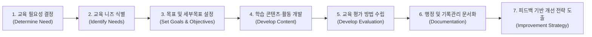

1. **교육 필요성 결정 (Determine if training is needed)**: 문제가 교육으로 해결 가능한지, 공학적·관리적 개선이 필요한지 메이거 트리 등을 통해 판별.
2. **교육 니즈 식별 (Identify training needs)**: 직무 분석 및 위험성평가를 통해 현장 맞춤형 결함 식별.
3. **목표 및 세부목표 설정 (Identify the goals and objectives for training)**: 명확하고 측정 가능한 SMART 학습 목표 수립.
4. **학습 콘텐츠 및 활동 개발 (Develop training content and activities)**: 성인학습 원칙을 반영한 실습 및 교재 설계.
5. **교육 평가 방법 수립 (Develop training evaluation methods)**: 커크패트릭 4단계 평가 모형 등을 활용한 효과성 측정 기준 마련.
6. **행정 및 기록관리 문서화 (Develop training documents for administration and recordkeeping)**: 법적 준수와 이력 관리를 위한 문서 체계 구축.
7. **피드백 기반 개선 전략 도출 (Develop improvement strategies based on feedback)**: 현장 피드백을 반영한 지속적 개선 루프 확립.

---

## 5. CONDUCTING EDUCATION AND TRAINING NEEDS ASSESSMENT (교육훈련 니즈 평가 및 갭 분석)

교육훈련 니즈 평가는 **조직이 요구하는 안전 관련 기대 수행 수준(Required Performance)과 근로자의 현재 실제 수행 수준(Current Performance) 사이의 '격차(Gap)'를 정밀하게 규명하는 체계적 과정**입니다.

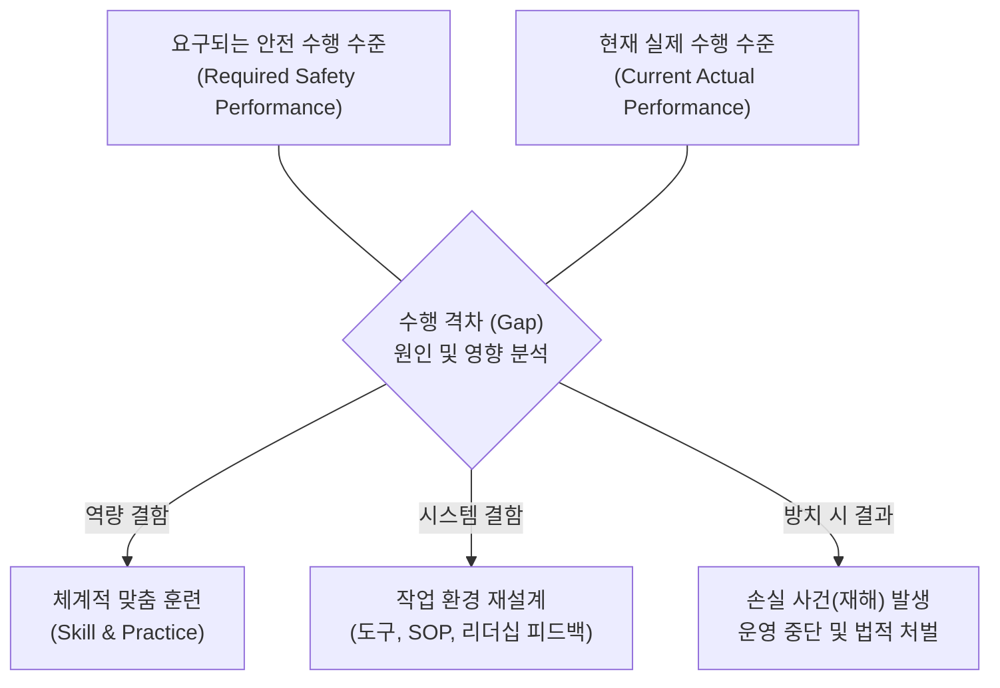

> *"니즈 평가(Needs Assessment)는 요구되는 수행 수준과 현재 수행 수준 간의 '갭(Gap)'을 식별하는 과정이다. 차이가 존재할 때, 그 갭이 발생한 원인과 이유를 탐색하고 이를 좁히거나 제거하기 위한 최적의 방법을 모색한다. 완전한 니즈 평가는 **이러한 갭을 방치했을 때 초래될 치명적 결과(Consequences of ignoring the gaps)**까지 반드시 고려해야 한다."*  
> — *(Training and development, planning, & evaluating, 2017)*

### 5.1 비즈니스 환경 변화와 동적 니즈 평가
산업 환경과 작업 조건은 끊임없이 진화합니다. 새로운 공정, 설비, 원자재가 도입되면 새로운 위험이 등장하고, 이로 인해 지식의 공백(Knowledge gaps)이 발생합니다. 기존의 오래된 지침과 교육 방식은 새로운 위험을 통제하기에 역부족입니다. 따라서 다음과 같은 다각적 도구를 통합하여 지속적인 니즈 평가를 수행해야 합니다:
* **제9장 위험 지침 카드 (Risk Guidance Cards)**: 현장 리스크의 상대적 크기와 심각도 지속 측정.
* **제11장 활동 기반 안전 시스템 (ABSS)**: 일상 점검 및 월간 회의를 통한 피드백 수집.
* **제12장 직무 위험성 평가 (JHA)**: 과업 단계별 내재 위험과 세부 안전 조치의 변화 감지.
* **SMS 정기 감사 및 사후 검토**: 안전경영시스템 감사를 통한 전사적 지식 공백 추적.

---

## 6. E-LEARNING (이러닝의 기회와 구조적 한계)

지난 20년간 웹 기반 이러닝(E-learning)은 비용 효율성과 접근성, 사용 편의성을 무기로 전 세계 사업장에 폭넓게 보급되었습니다. 그러나 안전관리 관점에서 이러닝은 명확한 명암을 지니고 있습니다.

### 6.1 이러닝의 순기능과 구조적 취약점
* **장점**: 법적 의무 교육 요건을 대규모로 저렴하게 충족시킬 수 있으며, 시공간의 제약 없이 학습자에게 접근 가능함.
* **치명적 위험**: 단순히 컴퓨터 앞에 직원을 앉혀두고 화면을 응시하며 마우스 클릭으로 다음 페이지를 넘기게(Click through) 만드는 방식은 결코 진정한 학습 환경을 형성하지 못함. 현장의 구체적 작업 맥락, 업계 고유의 용어, 근로자 개개인의 문해력(Literacy) 차이를 무시한 범용(Generic) 교육은 현장 적응력이 전무함. 더욱이 이는 **근로자 교육에 대한 일선 리더십의 직접적 관심과 지도를 배제시키는 부작용**을 낳음.

### 6.2 성공적 이러닝 시스템의 3대 핵심 요건 (Cheng et al., 2011)
Wang, Ran 등의 연구에 따르면 효과적인 직장 이러닝 시스템은 다음 3대 요건을 충족해야 합니다:
1. **개인과 조직의 학습 니즈 정렬**: 조직의 미션·비전·직무 설계와 연계하여 교육 요건을 도출하고, 직원의 개인별 학습 목표를 조직의 요구와 정렬시킬 것.
2. **학습 내용과 실제 직무 과업의 밀착 연계**: 각 직무에 필요한 핵심 전문성을 정확히 정의하고, 이를 개발하는 데 최적화된 학습 자원과 지침을 제공할 것.
3. **학습 커뮤니티 내 사회적 상호작용 및 지식 교환 촉진**: 유사한 학습 배경과 관심을 가진 동료 학습자들을 네트워크로 연결하여 실무 지식의 공유와 전이를 촉진할 것.

### 6.3 이러닝에서 강사의 결정적 역할 (Ruey, 2010)
Ruey의 연구에 따르면, 온라인 교육일수록 학습자에게 정밀한 피드백을 제공하고 명확한 평가 계획과 측정 가능한 결과를 제시하는 **'유능한 강사와의 상호작용'**이 학습 효과를 좌우합니다. 강사의 준비가 미흡할 경우 학습자의 동기는 급격히 저하되며, 실제 운영에 필요한 직무 숙련도를 유지하지 못하게 됩니다 (Leadership development, 2015).

---

## 7. THE CHALLENGE TO TRAINERS (교육 담당자의 도전과제 및 체계적 개발)

스마트폰과 디지털 기기가 일상화된 오늘날, 교육 시간 동안 학습자의 주의를 집중시키는 것은 강사에게 엄청난 도전과제입니다.

### 7.1 디지털 세대의 집중력 저하와 정보의 진위 검증
* **상시 연결된 디지털 환경**: 근로자들은 일상적으로 모바일 기기를 통해 방대한 정보를 소비하고 있습니다. 강사는 이들을 사로잡을 수 있는 혁신적이고 창의적인 교수 기법을 개발해야 합니다.
* **인터넷 허위 정보(False Information)의 범람**: 누구나 인터넷에 접근할 수 있게 됨에 따라 잘못되거나 검증되지 않은 안전 정보가 현장에 유입될 위험이 커졌습니다. 심지어 교육생이 스마트폰으로 즉석 검색하여 강사의 설명을 반박하는 상황도 발생합니다. 따라서 강사는 교육 자료를 설계하기 전에 정보의 **관련성(Relevance), 최신성(Currency), 정확성(Accuracy), 공신력 있는 출처(Source)**를 철저히 검증해야 합니다.

---

### 7.2 체계적 과정 개발 및 니즈 분석 프레임워크

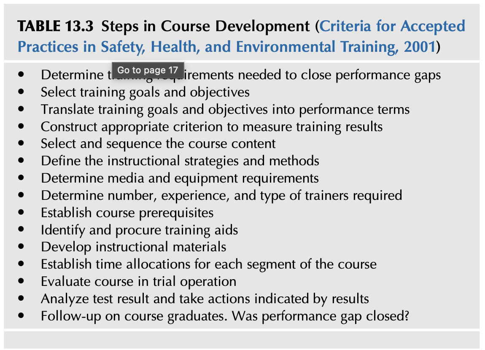

### TABLE 13.3 Steps in Course Development (ANSI/ASSE Z490.1 안전·보건·환경 교육 표준 15단계 과정 개발 절차)

1. 수행 격차(Performance gaps)를 해소하는 데 필요한 교육훈련 요건 결정
2. 교육 목표 및 세부 목표(Goals & Objectives) 선정
3. 교육 목표를 관찰 가능한 수행 용어(Performance terms)로 변환
4. 교육 결과를 측정하기 위한 적절한 평가 기준(Criterion) 구축
5. 교육과정 콘텐츠의 체계적 선정 및 배열(Sequence)
6. 교수 전략 및 구체적 교육 방법론 확정
7. 필요 미디어 및 교육 장비 요건 결정
8. 요구되는 강사의 수, 실무 경험, 강사 자격 요건 확정
9. 선수 학습(Prerequisites) 조건 수립
10. 교육 보조 자료 및 실습 교구 파악 및 조달
11. 세부 교수 자료(교안, 워크북 등) 개발
12. 과정의 각 세그먼트별 소요 시간 배분 확정
13. 시범 운영(Trial operation)을 통한 파일럿 코스 평가
14. 테스트 결과 분석 및 결과에 따른 수정·보완 조치 단행
15. 교육 수료생에 대한 현장 사후 추적(Follow-up) 실시: **"실제 현장에서 수행 격차가 해소되었는가?"**

---

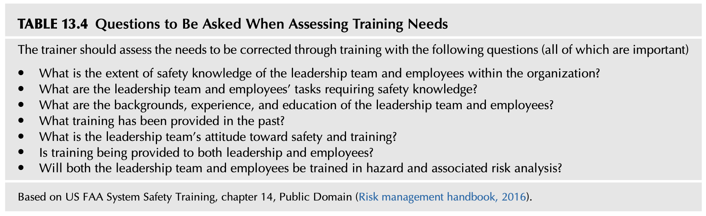

### TABLE 13.4 Questions to Be Asked When Assessing Training Needs (미 FAA 시스템 안전 교육 7대 핵심 진단 질문)

교육 담당자는 교육을 통해 개선해야 할 니즈를 평가할 때 다음 7가지 핵심 질문을 반드시 던져야 합니다:
1. **조직 내 리더십 팀과 근로자들의 안전 지식 수준은 어느 정도인가?**
2. **리더십 팀과 근로자가 수행하는 작업 중 안전 지식을 필수적으로 요구하는 과업은 무엇인가?**
3. **리더십 팀과 근로자의 과거 배경, 현장 경험, 교육 수준은 어떠한가?**
4. **과거에 어떤 유형의 교육훈련이 제공되었는가?**
5. **안전과 교육훈련에 대한 리더십 팀의 실질적 태도(Attitude)는 어떠한가?**
6. **교육이 일선 근로자뿐만 아니라 리더십(경영진·관리자) 계층 모두에게 균형 있게 제공되고 있는가?**
7. **리더십 팀과 근로자 모두가 유해위험요인 및 관련 리스크 분석(Hazard & Risk Analysis) 기법을 함께 교육받고 있는가?**

*(출처: US FAA System Safety Training, chapter 14; Risk management handbook, 2016)*

---

## 8. UNDERSTAND THE DIRECTION OF TRAINING (교육훈련의 방향성과 커뮤니케이션 노드)

안전 교육훈련 세션은 단순한 강의실 수업이 아니라, **조직 전체 네트워크 연결망 속에서 작동하는 핵심적인 커뮤니케이션 "노드(Node)"**로 인식되어야 합니다 (제3장 Analyzing and Using Your Network 연계).

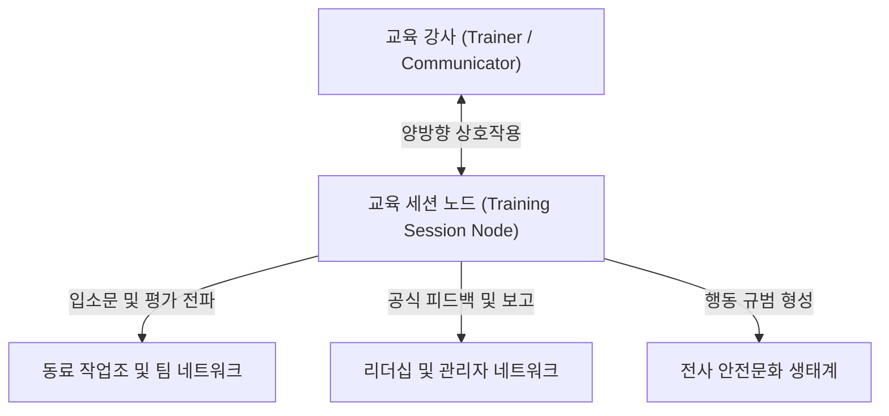

### 8.1 교육 세션이 조직 네트워크에 미치는 파급력
* **문화적 확산(Viral Impact)**: 강사가 교육생들 앞에서 진행하는 교육은 그 순간의 청중에게만 머물지 않습니다. 제공된 교육이 가치 있었는지, 아니면 쓸모없는 시간 낭비였는지에 대한 평가는 교육 직후 사내 커뮤니케이션 네트워크(입소문, 비공식 대화 등)를 타고 조직 전체로 신속히 퍼져나갑니다.
* **형식적 교육의 위험성**: 교육이 비전문적인 태도로 진행되거나, 법적 요건을 단순히 **'체크 표시(Checked off)'**하기 위한 요식행위로 비춰진다면, 강사의 무성의한 태도와 전문성 결여가 전사적으로 전파되어 조직의 안전문화를 극도로 훼손합니다.
* **경청하는 강사의 자세**: 훌륭한 교육자는 일방적으로 가르치는 사람이 아니라, 타인의 아이디어와 의견을 경청하고 자신이 이해하지 못하는 상황에 마주했을 때 솔직하게 명확한 설명을 요청할 줄 아는 사람입니다 (Enlisted professional military education opportunities, 2016).

---

## 9. THE CONCEPTS OF EDUCATION AND SAFETY TRAINING & A CAUTIONARY NOTE (교육과 훈련의 학술적 개념 구분 및 훈련 만능주의에 대한 경고)

안전 분야에서 흔히 혼용되는 '교육(Education)'과 '훈련(Training)'은 명확한 학술적·실무적 차이를 지니고 있습니다.

### 9.1 NIOSH, Oregon OSHA, CCGA의 개념 비교 정의

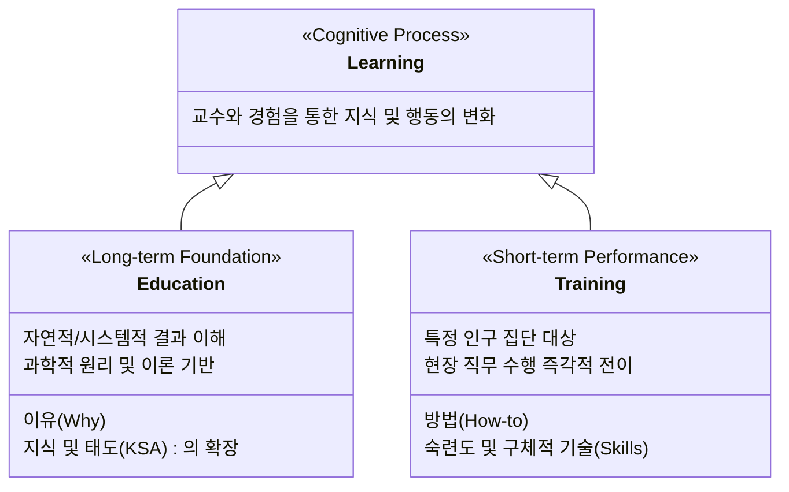

* **미국 국립직업안전위생연구소 (NIOSH, 1999)**:
  * **훈련 (Training)**: 특정 대상 집단을 향해 기술을 개발하고, 행동을 수정하며, 직무 역량을 높이기 위해 수행되는 커뮤니케이션. 철저하게 **"무엇을 알아야 하는가(What needs to be known)"**에 초점을 맞춤.
  * **교육 (Education)**: 훈련의 목표를 포괄하면서 특정 정보가 **"왜 반드시 알려져야 하는가(Why particular information must be known)"**를 설명하는 장기적 과정. 자료의 과학적·이론적 토대를 강조함.
* **오레곤주 산업안전보건청 (Oregon OSHA, 2016) — 교육(Education)의 정의**:
  * 무지(Ignorance)로부터 벗어나게 이끄는 것.
  * 지식, 기술, 태도/능력(KSAs)에 영향을 미치는 일체의 활동.
  * 안전의 **'이유(The Why)'**를 규명: 행동에 따르는 자연적 결과(부상과 건강 손상)와 시스템적 결과(징계와 보상)를 깨닫게 함.
  * 주로 **지식(Knowledge)과 태도(Attitudes)**를 격상시킴.
* **캐나다 연안경비보조대 (Canadian Coast Guard Auxiliary, 2008) — 훈련(Training)의 정의**:
  * 교육의 특수한 한 형태.
  * 안전의 **'구체적 실행 방법(The How to)'**을 체득하는 것.
  * 실무 **기술(Skills)의 개발과 개선**, 즉 **수행(Performance)**에 초점을 맞춤.

---

### 9.2 A CAUTIONARY NOTE: 훈련 만능주의(Retraining Trap)에 대한 엄중한 경고

미국 에너지부(DOE)의 인간 수행 핸드북(Human Performance Handbook)은 **교육훈련이 안전 문제의 유일하거나 만병통치약 같은 해결책이 결코 아님**을 강력히 경고합니다.

현장 사고 조사에서 수많은 관리자가 재해의 근본 원인을 파헤치는 정밀 분석을 회피한 채, 사고 보고서 양식의 결론 란에 단순히 **"작업자 재교육 실시(Retrain the employee)"**라고 적어 넣는 지름길(Shortcut)을 택하고 있습니다.

> *"작업의 특성상 의식적인 생각 없이 거의 자동적으로, 본능적으로 수행되도록 이미 완벽히 숙달된 작업을 하는 근로자에게 똑같은 작업을 다시 훈련시키는 것은 **엄청난 시간 낭비이자 작업자에 대한 모욕(an insult to the worker)**이다. 작업자가 애초에 의도하지 않았던 실수(Slips & Lapses)를 저지르지 않도록 훈련시키는 것은 불가능에 가깝다. **이러한 상황에서 교육훈련은 결코 해결책이 될 수 없다.**"*  
> — *(Concepts and principles, DOE HPI Handbook, 2009)*

---

## 10. COURSE DEVELOPMENT PROCESS & DEVELOPING LEARNING ACTIVITIES (과정 개발 프로세스, 교수법, 학습 활동 설계)

학습자의 숙련도, 전문성, 기존 경험에 따라 서로 다른 훈련 방법론이 적용되어야 합니다. 이러닝, 인쇄된 워크북 및 유인물, 1:1 맞춤 코칭, 소그룹 워크숍, 시청각 프레젠테이션 등 가장 효과적인 매체 포트폴리오를 구성해야 합니다.

### 10.1 안전 교육훈련 니즈의 주요 범주

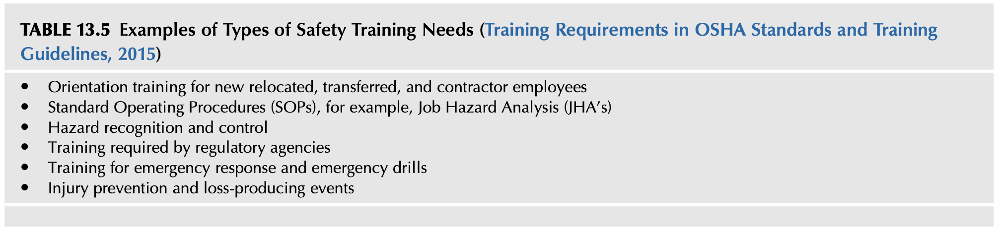

### TABLE 13.5 Examples of Types of Safety Training Needs (OSHA 기준 안전 교육훈련 니즈 유형)

* **신규 입사자, 전입자, 부서 이동자 및 협력업체(Contractor) 근로자를 위한 오리엔테이션 교육**
* **표준 작업 절차(SOP) 교육**, 특히 **직무 위험성 평가(JHA)** 기반 과업 훈련
* **위험 인지 및 통제 기법(Hazard recognition and control)** 교육
* **법정 규제 기관(OSHA, 산업안전보건법 등)이 의무화한 법정 의무 교육**
* **비상 대응(Emergency response) 및 실전 비상 대피 훈련(Emergency drills)**
* **상해 예방 및 손실 유발 사건(Loss-producing events) 방지 교육**

---

### 10.2 공통 교육훈련 방법론 정밀 분석

> *"학습 지도안(Lesson Plan)은 교수 설계 처방전이자, 강사와 학생이 코스의 목표에 도달하기 위해 참여할 활동을 설명하는 청사진이다. 그 핵심 목적은 교육 모듈 진행 중에 반드시 발생해야 하는 핵심 사건(Key Events)을 사전에 규정하는 것이다."*  
> — **로버트 메이거 (Robert Mager)**

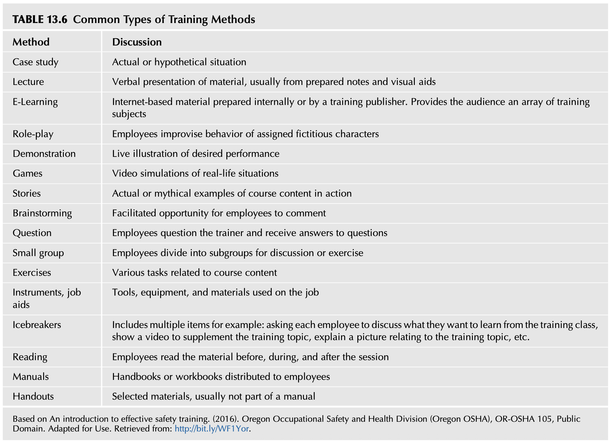

### TABLE 13.6 Common Types of Training Methods (17대 핵심 교육훈련 방법론)

| 교육 방법 (Method) | 구체적 내용 및 실무 적용 방안 (Discussion) |
| :--- | :--- |
| **사례 연구 (Case study)** | 실제 발생했던 사고 사례 또는 가상의 현장 시나리오를 심층 분석 |
| **강의 (Lecture)** | 준비된 강의 노트와 시각 자료를 활용한 언어적 내용 전달 (지식 전달에 유용) |
| **이러닝 (E-Learning)** | 사내 제작 또는 전문 출판사의 인터넷 기반 플랫폼. 다양한 주제에 대한 자율 학습 제공 |
| **역할 연기 (Role-play)** | 배정된 가상 캐릭터의 입장이 되어 현장 위험 상황에서의 행동을 즉흥적으로 시연 |
| **시연 (Demonstration)** | 기대되는 표준 안전 행동과 올바른 장비 조작법을 눈앞에서 실시간 시연 |
| **게임 및 시뮬레이션 (Games)** | 실제 현장 환경을 모사한 비디오 시뮬레이션 및 안전 게임 |
| **스토리텔링 (Stories)** | 실제 경험담이나 교훈적 이야기를 통해 교육 콘텐츠의 의미를 생생하게 전달 |
| **브레인스토밍 (Brainstorming)** | 촉진자(Facilitator)의 안내에 따라 근로자들이 위험 요소와 개선안을 자유롭게 제시 |
| **질의응답 (Question)** | 근로자가 능동적으로 강사에게 의문을 제기하고 즉각적인 답변을 수렴 |
| **소그룹 분임 토의 (Small group)** | 소규모 그룹으로 나누어 특정 안전 주제에 대해 심층 토론하거나 공동 과제 수행 |
| **실습 과제 (Exercises)** | 교육과정 내용과 직접적으로 연관된 다양한 실무 작업 및 문제해결 과제 수행 |
| **작업 도구 및 직무 보조도구 (Job aids)** | 현장에서 실제 사용하는 공구, 안전 장비, 자재 및 체크리스트 활용 실습 |
| **아이스브레이킹 (Icebreakers)** | 교육 시작 전 학습 기대 사항 공유, 인트로 비디오 시청, 관련 사진 토론 등으로 라포 형성 |
| **독서 및 사전 학습 (Reading)** | 교육 세션 전·중·후에 관련 안전 매뉴얼과 기술 자료를 학습자가 직접 정독 |
| **매뉴얼 (Manuals)** | 체계적으로 편찬된 안전 핸드북이나 실습 워크북을 배포하여 학습에 활용 |
| **유인물 (Handouts)** | 매뉴얼 외에 핵심 요약 내용이나 체크리스트 등을 별도 인쇄물로 제공 |

---

### 10.3 LESSON LEARNED 1: PowerPoint 슬라이드 과적의 함정과 3대 대안

과거 교육 프레젠테이션은 시각적 효과가 아니라 제한된 예산과 시간에 의해 왜곡되어 왔습니다. 슬라이드 인쇄 비용을 아끼기 위해 한 페이지에 너무 많은 글자와 상세 정보를 빽빽하게 채워 넣는 관행은 가독성을 떨어뜨리고 청중을 피로하게 만듭니다.

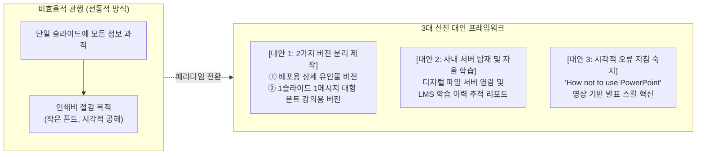

---

## 11. PERFORMANCE DEFICIENCY (수행 결함 분석: 숙련·규칙·지식 기반 수행 모델)

현장에서 발생하는 안전 문제는 단순한 규칙 위반이 아니라, 전반적인 생산성과 품질에 악영향을 미치는 **'직무 수행 결함(Performance Deficiency)'의 전조 증상**일 수 있습니다. 안전 교육은 유해위험요인, 관련 리스크, 그리고 필수 통제 대책에 대한 지식의 공백을 메움으로써 궁극적으로 현장 수행 역량을 향상시킵니다.

직무 교육훈련 니즈를 평가할 때에는 미국 에너지부(DOE) 및 옌스 라스무센(Jens Rasmussen)의 **SRK 인지 수행 3단계 모델**을 필수적으로 고려해야 합니다 (제12장 Using the Job Hazard Analysis 연계).

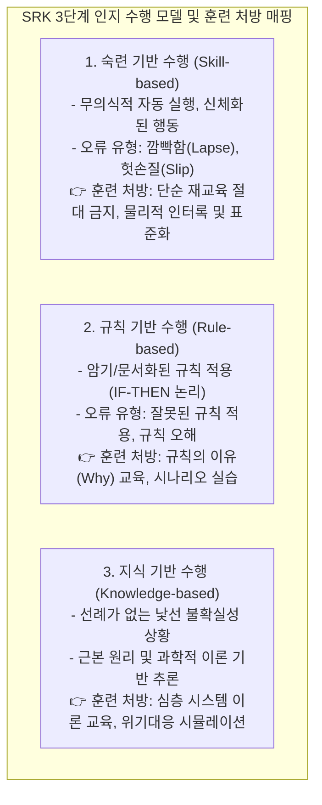

1. **숙련 기반 수행 (Skill-based performance)**:
   * **특성**: 고도로 숙련되어 의식적인 집중이나 주의 모니터링이 거의 없이 무의식적인 기억에 의해 자동적으로 신체화된 물리적 행동.
   * **훈련 시사점**: 이 단계의 실수는 부주의나 주의 분산에 기인하므로, **단순 재교육은 시간 낭비이자 모욕**임. 실수 방지 장치(Poka-yoke)나 작업 전 점검(Checklist)이 적합함.
2. **규칙 기반 수행 (Rule-based performance)**:
   * **특성**: 교육이나 경험을 통해 획득한 기억되거나 문서화된 규칙을 적용하는 수준. 의식적 통제의 수준은 지식 기반과 숙련 기반의 중간이며, **"IF (증상 X 발생 시), THEN (상황 Y 조치 수행)"**의 논리를 따름.
   * **훈련 시사점**: 규칙을 잘못 기억하거나 잘못된 규칙을 적용하는 오류가 발생하므로, 조건별 올바른 절차 적용 훈련과 규칙의 근거를 이해시키는 교육이 필요함.
3. **지식 기반 수행 (Knowledge-based performance)**:
   * **특성**: 기존의 숙련 기술이나 명문화된 규칙이 전혀 존재하지 않는 완전히 낯설고 생소한 비상 상황에 대처하는 행동. 근로자는 과거 유사 경험, 현재 상황에 대한 직관적 지각, 그리고 시스템의 과학적 원리와 기초 이론에 의존하여 문제를 해결해야 함.
   * **훈련 시사점**: 단순 암기가 통하지 않으므로, 시스템의 기본 원리, 비상 대응 추론 훈련, 고난도 시뮬레이션 교육이 필수적임.

---

## 12. ESTABLISHING LEARNING OBJECTIVES & TARGET AUDIENCE (학습 목표 수립 및 대상자 분석)

### 12.1 학습 목표의 올바른 수립 지침
안전 교육의 학습 목표는 학습 과정을 거친 후 리더십 팀과 근로자가 **"구체적으로 무엇을 수행할 수 있게 되는가(What they will be able to do)"**를 간결하고 명확하게 기술한 진술문입니다.
* **결과 지향성**: 학습의 과정이나 절차가 아니라, **'달성된 학습 성과(Results)'**를 측정 가능한 행동 동사로 기술해야 함.
* **평가 기준의 선행**: 명확한 목표가 수립되어야만 이를 측정할 평가 기법과 교육 전략이 올바르게 도출됨 (Mager).
* **출석 중심 평가 탈피**: 안전 교육의 성공 여부를 단순히 **"강의실에 몇 명이 앉아 있었는가(Seat-time)"**로 평가하는 후진적 관행을 타파하고, 전달된 지식을 현장에서 올바르게 이해하고 적용할 수 있는지 상류(Upstream) 지표로 평가해야 함.
* **변화하는 신세대 근로자(Millennials/Gen Z) 반영**: 언제 어디서나 정보에 접속하는 환경에서 성장한 신세대 인력에게 구시대적인 비디오 시청은 효과가 없음. 새로운 세대의 역량과 눈높이에 맞춘 인터랙티브 교육 설계가 필수적임 (Monnette, 2018).

---

### 12.2 교육 대상자 분석 및 문화적 저항 지표
교육을 설계할 때는 대상자의 직무, 교육 이력, 숙련도뿐만 아니라 **조직의 전반적인 정서적 분위기, 행동 규범, 교육에 대한 태도**를 면밀히 분석해야 합니다. 조직 내에서 교육훈련의 위상을 측정하는 2가지 부정적 지표는 다음과 같습니다:
1. **시간 핑계**: 근로자들이 업무가 바빠 교육받을 시간이 없다는 핑계를 대며 저항하는가?
2. **소요 시간 집착**: 리더십 팀이 교육의 취지나 니즈는 묻지 않고, **"그 교육에 시간이 얼마나 걸리는가?"**만을 즉시 따져 묻는가?

### 12.3 LESSON LEARNED 2: 녹음기 틀어놓기 식 안전 교육의 파탄적 사례
어느 건설 현장에서 협력업체 조회 시간, 강사가 사무실에서 나와 나무 펜스 기둥 위에 휴대용 카세트 녹음기를 올려놓고 재생 버튼을 누른 뒤 다시 사무실로 들어가 버렸습니다. 녹음기에서 안전 방송이 크게 흘러나오는 동안 작업자들은 삼삼오오 모여 담배를 피우고 잡담을 나누었습니다. 테이프 재생이 끝나자 담당자는 나와서 녹음기를 들고 유유히 사라졌습니다. 이는 현장과의 소통이 완전히 단절된 형식주의 교육의 극단적 비극을 보여줍니다.

> *"먼저 타인을 이해하려고 노력하고, 그 다음에 자신을 이해시켜라 (Seek first to understand, then to be understood)."*  
> — **스티븐 코비 (Stephen Covey)**

---

### 12.4 성인 학습 원칙 (TABLE 13.7 정밀 분석)

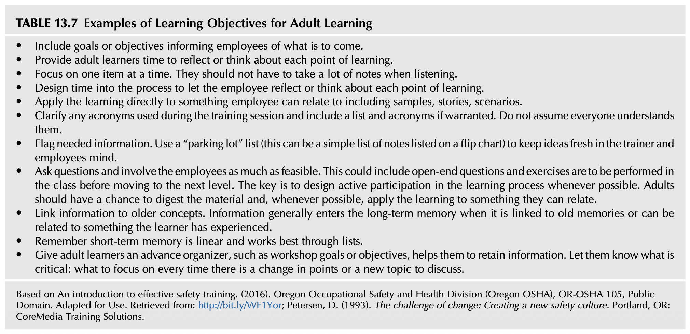

### TABLE 13.7 Examples of Learning Objectives for Adult Learning (성인 학습 촉진을 위한 11대 핵심 지침)

1. **사전 오거나이저 제공**: 워크숍의 궁극적 목표와 세부 학습 목표를 미리 제시하여 앞으로 배울 내용의 윤곽을 잡게 할 것.
2. **성찰 시간 배정**: 학습한 각 핵심 포인트에 대해 성인 학습자가 스스로 생각하고 곱씹어 볼 수 있는 충분한 성찰 시간을 설계할 것.
3. **한 번에 한 가지 주제에 집중**: 한 번에 너무 많은 정보를 쏟아붓지 말고, 강의를 들으면서 과도한 필기를 하느라 지치지 않도록 할 것.
4. **실무적 연계성 확보**: 학습 내용을 실제 현장 샘플, 생생한 스토리, 현실적 시나리오 등 학습자가 공감할 수 있는 실무에 직접 결합시킬 것.
5. **전문 용어 및 약어(Acronyms) 명확화**: 교육 중 사용되는 전문 약어의 의미를 반드시 사전에 풀어서 설명하고 약어 목록을 제공할 것.
6. **'주차장(Parking Lot)' 메모판 활용**: 질문이나 번뜩이는 아이디어가 떠올랐을 때 즉시 플립차트의 '주차장' 란에 메모해 두고 추후 다룸으로써 흐름을 유지할 것.
7. **능동적 참여 및 질문 유도**: 개방형 질문과 실습 과제를 배치하여 수동적 청취를 막고 학습자가 학습 과정에 주도적으로 참여하게 할 것.
8. **기존 경험과 기억의 연결**: 새로운 정보는 학습자의 오랜 경험이나 과거 기억과 연결될 때 비로소 장기 기억(Long-term memory)으로 이전됨.
9. **선형적 단기 기억의 특성 배려**: 인간의 단기 기억은 선형적(Linear)이므로 정돈된 목록(Lists) 형태로 제공할 때 가장 효과적으로 흡수됨.
10. **성인 학습자의 주체성 존중**: 성인은 지시받는 대상이 아니라, 자신의 경험을 투자하여 상호작용하는 대등한 주체로 대우받아야 함.
11. **핵심 강조점의 명확한 전환 알림**: 주제가 바뀌거나 새로운 포인트로 넘어갈 때마다 학습자가 어디에 주의를 집중해야 하는지 명확히 짚어줄 것.

---

## 13. CONDUCTING SITE-SPECIFIC EDUCATION AND TRAINING (현장 맞춤형 교육훈련 및 성인 학습자 특성)

### 13.1 교육 대상자 분류 및 리더십/SWOT 연계

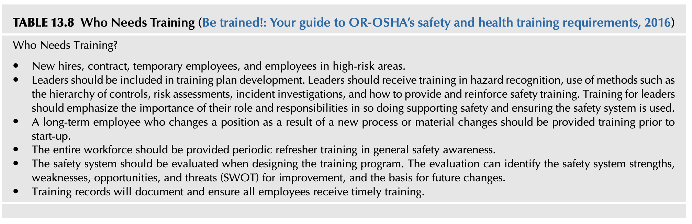

### TABLE 13.8 Who Needs Training (교육 대상자 분류 및 전사 안전역량 강화 체계)

* **신규 입사자, 계약직, 임시직, 고위험 작업 종사자**: 초기 집중 온보딩 및 위험성평가 교육 필수.
* **리더십 계층(경영진 및 관리감독자)**: 교육 계획 수립에 직접 참여해야 하며, 유해위험요인 식별, 통제 계층(Hierarchy of Controls) 적용, 위험성평가, 사고 조사, 그리고 안전 교육을 현장에서 코칭하고 강화하는 방법론을 체계적으로 이수해야 함.
* **공정 변경 근로자**: 새로운 공정 도입이나 설비·원자재 변경으로 직무가 바뀐 장기 근속자는 가동 착수 전(Prior to start-up) 선제적 교육 이수 필수.
* **전사 근로자**: 정기적인 보수 교육(Refresher training)을 통해 일반 안전 의식을 지속적으로 리프레시.
* **안전경영시스템 SWOT 평가**: 교육 프로그램을 설계할 때 SMS의 강점, 약점, 기회, 위협(SWOT) 요소를 함께 평가하여 향후 개선의 객관적 토대로 삼을 것.
* **교육 훈련 기록의 철저한 보존**: 모든 근로자가 법정 적기에 양질의 교육을 이수했음을 입증하는 문서화 체계 확립.

### 13.2 성인 학습자(Adult Learner)의 6대 핵심 특성
1. **목적 지향적 학습**: 단순 기계적 암기는 추가 시간이 필요하지만, 목적이 명확한 학습(Purposeful learning)은 젊은 층보다 훨씬 빠르게 흡수함. 평생 학습 능력을 보유하고 있음.
2. **"Big Picture"와 실용성 추구**: "이 교육이 나에게 왜 가치 있는가?", "실제 현장 생활에 어떻게 적용할 수 있는가?"에 대한 답을 즉각 원함.
3. **학습 의사결정에 참여 갈망**: 수동적 피교육자가 아니라, 자신의 학습 방식과 내용 결정에 능동적으로 참여하기를 원함.
4. **존중과 자존감 요구**: 어린이처럼 취급당하는 것을 극도로 싫어하며, 다른 사람들 앞에서 공개적으로 질책당하는 것을 결코 용납하지 않음.
5. **풍부한 고유 경험의 보유**: 성인은 방대한 현장 경험을 학습 자산으로 투입하며, 새로운 지식을 오랜 경험에 투사하여 해석함.
6. **탁월한 교육 감별력**: 좋은 교육과 형편없는 부실 교육을 즉각 알아채는 냉철한 안목을 지니고 있음.

---

## 14. COMMUNICATION (안전 커뮤니케이션과 3방향 소통 모델)

커뮤니케이션은 안전경영시스템에서 가장 중요하지만 가장 흔히 간과되는 요소입니다. 단순히 "위험한 상태를 보면 보고하라"고 말해놓고, 구체적으로 어떻게 보고해야 하는지, 보고 후 조치는 어떻게 피드백되는지 설명하지 않는다면 소통망은 즉시 붕괴합니다.

### 14.1 밈(Meme) 이론과 구두 소통의 위험성
* **정보의 패킷, 밈(Meme)**: 정보는 한 사람의 뇌에서 다른 사람의 뇌로 전달되는 '생각의 패킷(Packet of information)'인 밈(Meme)으로 작동합니다 (제3장 연계). 정보가 수신자의 인지 체계에 단단히 결합되도록 전송되어야 합니다.
* **구두 소통의 취약성**: 구두(Oral) 소통은 문서 소통에 비해 치명적인 오해를 낳을 위험이 매우 높습니다. 대화에 참여하는 작업자마다 상황에 대한 멘탈 모델(Mental models)이 다르고 모호한 용어를 사용할 수 있기 때문입니다.

---

### 14.2 3방향 소통 모델 (Three-way Communication Protocol)

구두 정보 교환의 오류를 근절하기 위해 미국 원자력 및 에너지부(DOE) 등 고신뢰조직에서 사용하는 **3방향 소통(Three-way Communication)** 기법이 모든 안전 교육과 현장 지시에 의무 적용되어야 합니다.

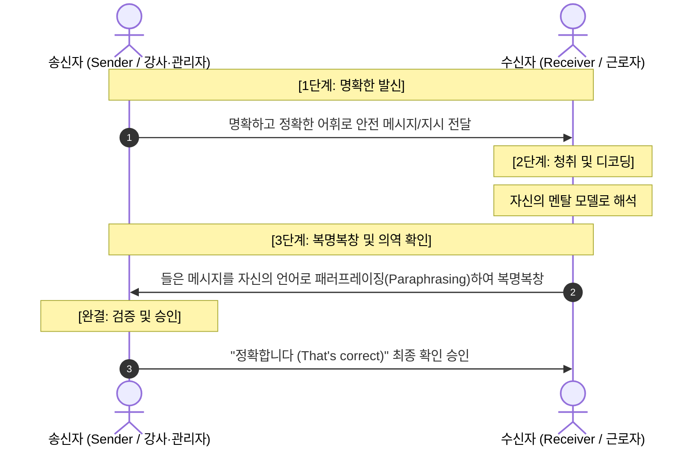

1. **1단계 (Sender 발신)**: 송신자(강사 또는 지시자)가 명확하고 정제된 언어로 메시지를 발신.
2. **2단계 (Receiver 수신 및 디코딩)**: 수신자(근로자)가 메시지를 듣고 자신의 인지 틀에서 의미를 해석.
3. **3단계 (Confirmation 확인/복명복창)**: 수신자가 들은 내용을 그대로 흉내 내는 데 그치지 않고, **자신의 언어로 의미를 의역(Paraphrase)하여 되물음으로써 송신자가 수신 상태를 검증**하게 함. 송신자가 최종 승인할 때 비로소 커뮤니케이션이 성립됨.

---

### 14.3 LESSON LEARNED 3: 구두 소통 오해와 잠금/표지(LOTO) 미실시가 낳은 참사

고장 난 기계를 수리하던 정비 기사가 동료에게 전원 스위치 옆에 서 있으라고 부탁했습니다. 그는 기계 내부에 손을 집어넣으며 동료에게 다음과 같이 외쳤습니다:
> **"전원이 켜져 있지 않은지 확인해줘! (Make sure it’s not on!)"**

그러나 시끄러운 공장 소음 속에서 동료는 **"전원을 켜줘! (Make sure it’s on!)"**로 잘못 알아듣고 즉시 작동 스위치를 켜버렸습니다. 이로 인해 기계 내부에 손을 넣었던 기사는 끔찍한 중상을 입었습니다.

* **이 참사가 남긴 2가지 근원적 실패**:
  1. **절차적 실패 (LOTO 위반)**: 설비 전원을 물리적으로 차단하고 자물쇠를 채우는 잠금/표지(Lockout/Tagout)라는 절대적인 안전 절차를 무시하고, 동료의 구두 감시로 대체할 수 있다는 치명적인 착각.
  2. **소통적 실패 (3방향 소통 부재)**: 모호한 부정문 구두 지시를 사용했으며, 동료가 자신의 말을 올바르게 알아들었는지 확인하는 3방향 복명복창 절차를 거치지 않음.

---

## 15. SUMMARY (제13장 16대 핵심 명제 요약)

1. 안전문화와 안전경영시스템은 체계적이고 총체적인 교육훈련 프로그램에 의해 유지된다.
2. 조직의 문화는 일상 작업을 수행하는 근로자의 규범, 습관, 행동에 지대한 영향을 미친다.
3. 강력한 안전문화를 확립하기 위해 조직은 평생 학습과 교육훈련의 긍정적 가치를 깊이 내재화해야 한다.
4. 안전문화는 학습조직의 산물이며, 위험 정보를 통제 대책으로 신속히 전환하는 능력이 핵심이다.
5. 교육훈련 니즈 평가는 요구되는 안전 수행 수준과 현재 수행 수준 간의 "갭(Gap)"을 규명하는 과정이다.
6. 교육훈련 세션은 조직 전체 커뮤니케이션 네트워크 속의 '노드(Node)'이며, 부실한 교육은 전사 안전문화를 즉각 훼손한다.
7. 성공적인 교육 니즈 평가를 위해서는 성인 학습 이론(Adult learning theory)에 대한 깊은 이해가 필수적이다.
8. 학습자의 숙련도와 배경에 맞추어 다양한 교육 방법론과 최적의 미디어가 선택되어야 한다.
9. 안전 교육은 지식의 공백을 메우는 과정이며, 안전 문제는 일반적 수행 결함의 전조 증상일 수 있다.
10. 학습 목표는 직무 오리엔테이션 및 지속적 학습의 기틀이며, 안전 규범의 표류(Scope drift)를 차단한다.
11. 학습 목표는 학습의 과정이 아니라 구체적으로 달성된 '결과(Outcome)'를 기술해야 한다.
12. 조직의 문화적 기후가 학습에 적대적이라면 아무리 잘 짜인 교육과정도 실효를 거둘 수 없다.
13. 커뮤니케이션은 손실 사건을 예방하기 위한 안전경영시스템의 가장 결정적인 핵심 요소이다.
14. 구두 소통의 위험을 차단하기 위해 반드시 3방향 소통(Three-way communication)과 패러프레이징을 적용해야 한다.
15. 교육훈련은 모든 문제의 만병통치약이 아니며, 자동화된 숙련 행동의 실수에 대해 단순 재교육을 남발해서는 안 된다.
16. 이어지는 제14장(Assessing Your Safety Management System)에서는 안전경영시스템의 전반적 효과성과 문화적 신념을 진단하는 총체적 감사 평가 방법론을 학습한다.

---

## 16. CHAPTER REVIEW QUESTIONS (복습 질문 및 핵심 해설 가이드)

### Q1. 교육(Education)과 훈련(Training)의 차이점을 비교 대조하시오.
* **해설**:
  * **훈련(Training)**은 특정 인구 집단을 대상으로 직무에 필요한 구체적 기술을 습득시키고 행동을 수정하며 역량을 높이기 위한 단기적·수행 중심의 과정으로, **"무엇을 어떻게 해야 하는가(The What and How to)"**에 집중합니다.
  * **교육(Education)**은 훈련의 목표를 포괄하면서 특정 안전 원칙과 정보가 왜 필수적인지 과학적 기초와 근본 원리를 설명하는 장기적 과정으로, **"왜 그것을 준수해야 하는가(The Why)"**에 집중하며 지식과 가치관, 태도를 형성합니다.

### Q2. 교육훈련 니즈 평가(Needs Assessment)를 수행하는 체계적 방법론을 설명하시오.
* **해설**:
  * 현행 직무 분석(JHA) 및 위험성평가를 바탕으로 **'요구되는 안전 수행 수준(Required Performance)'**을 정의합니다.
  * 현장 관찰, 인터뷰, 작업 전 회의(ABSS), 사고/아차사고 이력을 분석하여 **'현재 실제 수행 수준(Current Performance)'**을 측정합니다.
  * 양자 간의 **'수행 갭(Gap)'**을 도출하고, 그 원인이 지식·기술의 결함인지, 아니면 환경·도구·동기부여의 결함인지를 Mager 의사결정 트리를 통해 분석하여 교육적 처방과 시스템 개선을 분리 적용합니다.

### Q3. SMART 기법을 활용하여 교육훈련 목표를 설정하는 방안을 설명하시오.
* **해설**:
  * **Specific**: "크레인 작업 시 안전을 확보한다"가 아니라 "크레인 인양 전 3줄 체결 상태 및 샤클 체결 상태를 점검할 수 있다"처럼 구체적 행동으로 진술.
  * **Measurable**: 교육 후 실습 평가에서 10대 점검 항목을 100% 완수하는지 관찰 및 측정 가능해야 함.
  * **Achievable**: 교육생의 지적·신체적 수준과 실습 환경을 고려할 때 달성 가능한 수준이어야 함.
  * **Relevant**: 현장 직무와 실제 중대재해 예방에 직접 연계되어야 함.
  * **Time-bound**: 교육 수료 시점, 혹은 현장 배치 후 1주일 이내 등 측정 시한을 명시.

### Q4. 교육훈련 방법론(Training Methods)의 다양한 유형을 열거하고 그 특징을 설명하시오.
* **해설**:
  * 전통적 강의(Lecture), 이러닝(E-learning) 등은 이론과 지식 전달에 효과적입니다.
  * 실제 현장 적용력을 극대화하기 위해 사례 연구(Case study), 역할 연기(Role-play), 현장 시연(Demonstration), 시뮬레이션 게임(Games), 실습 과제(Exercises), 작업 도구 실물 조작(Job aids) 등 체험형 기법이 균형 있게 통합되어야 합니다.

### Q5. 교육 콘텐츠를 개발할 때 근로자의 기존 경험(Employee Experience)에 대한 이해가 필수적인 이유를 논증하시오.
* **해설**:
  * 성인 학습 이론에 따르면 성인은 백지상태가 아니라 방대한 고유 경험을 지닌 주체입니다.
  * 인간의 두뇌는 새로운 정보가 기존의 친숙한 경험이나 기억과 연결될 때 비로소 장기 기억으로 저장하고 내면화합니다.
  * 근로자의 경험을 무시하고 유치한 주입식 교육을 강요하면 학습자는 모욕감을 느끼고 저항하며 방어 기제를 형성합니다.

### Q6. 커뮤니케이션이 안전문화의 성패를 좌우하는 핵심 요소인 이유를 논증하시오.
* **해설**:
  * 문화는 조직 내 소통 네트워크에서 의미가 공유되고 재생산되는 과정입니다.
  * 안전 지식은 밈(Meme) 형태로 전파되므로, 현장의 의사소통이 왜곡되면 안전 규칙이 현장에서 변형되어 중대재해로 이어집니다.
  * 3방향 소통(Three-way communication)과 같은 정밀한 커뮤니케이션 프로토콜이 가동될 때 비로소 관리자와 작업자 간에 공유된 멘탈 모델이 확립되고 강력한 안전문화가 정착됩니다.

---

## 17. APPENDIX 분석

### 부록 13.1 우수 교육 프로그램의 4대 핵심 특성 (Susan Harwood Grants 기준)
1. **정확성 (Accurate)**: 교육 자료는 성인 교수법을 깊이 이해하는 자격을 갖춘 숙련된 강사에 의해 작성되고 지속적으로 업데이트되어야 함.
2. **신뢰성 (Credible)**: 강사는 안전 분야의 실무 경험과 전문 지식(SME)을 겸비해야 하며, 성인 교육 진행 역량을 갖추어 현장 근로자로부터 높은 공신력을 얻어야 함.
3. **명확성 (Clear)**: 교육 내용은 학술적 난독증이나 현장과 동떨어진 전문 은어를 배제하고, 현장 작업자의 일상 언어와 문해력 수준에 맞춰 명확하고 간결하게 서술되어야 함.
4. **실용성 (Practical)**: 교육받은 지식과 기술이 작업자의 실제 근무 환경에 즉각적이고 직접적으로 유용하게 적용될 수 있어야 함.

---

### 부록 13.2 OSHA 규정별 교육 요구사항 지침 (OSHA Publication 2254)

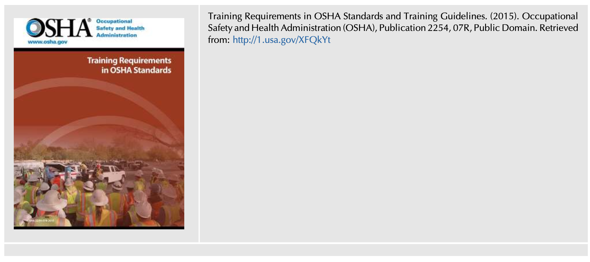

* **핵심 가치**: 미국 노동부 OSHA가 발행한 'Training Requirements in OSHA Standards and Training Guidelines (Pub 2254)'는 일반 산업(General Industry), 건설업(Construction), 해양업(Maritime), 농업(Agriculture) 등 전 산업군에 걸친 법정 의무 안전 교육 요건과 교육 시간, 주기, 자격 요건을 총망라한 미국 연방 표준 가이드라인입니다.

---

## 18. 박사학위 논문 선행연구 분석 템플릿 (9단계 표준 템플릿 준수)

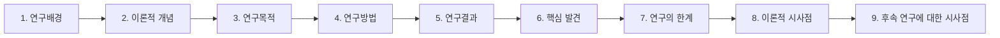

### 1) 연구배경 (Research Background)
* 산업 현장에서 안전 교육은 재해 예방의 기본 수단으로 간주되어 왔으나, 대부분의 조직에서 법적 최소 기준을 맞추기 위한 일방적 주입식 '출석 체크(Seat-time)' 위주로 운영되어 실질적인 현장 재해 감축에 기여하지 못하고 있음.
* 사고 발생 시 근본 원인 분석 없이 "작업자 재교육"으로 종결짓는 훈련 만능주의 관행이 만연하여 작업자의 냉소주의를 조장하고 있음.
* 디지털 세대 유입, 복잡한 신기술 도입 등 작업 환경의 급격한 변화에 부응하는 역량 기반의 체계적 교육훈련 모델 정립이 시급함.

### 2) 이론적 개념 (Theoretical Framework)
* **안전의 발현적 속성(Emergent Property)과 학습조직론**: 안전은 개별 규정의 집합이 아니라 조직 내 소통과 학습의 상호작용 속에서 발현됨 (Senge, Capra & Luisi).
* **Mager의 교수 설계 이론 및 수행 결함 모형**: 역량 결함(Skill deficiency)과 비역량 결함을 분리 판별하는 의사결정 트리.
* **Rasmussen의 SRK 인지 모형**: 숙련(Skill) - 규칙(Rule) - 지식(Knowledge) 기반 수행별 차별화된 훈련 접근법.
* **DOE HPI 인적 오류 예방 이론**: 재교육의 한계 인식 및 3방향 소통(Three-way Communication) 모델.
* **성인 학습 이론(Andragogy)**: Knowles의 자기주도적, 목적 지향적, 경험 통합적 학습 원칙.

### 3) 연구목적 (Research Objectives)
* 조직 내 실제 안전 수행 격차를 식별하기 위한 체계적인 교육훈련 니즈 평가(Needs Assessment) 표준 프레임워크 구축.
* Mager 트리와 Rasmussen SRK 모델을 통합하여 '교육으로 해결 가능한 영역'과 '시스템/환경 개선이 필요한 영역'의 명확한 판단 기준 확립.
* 일선 관리자의 코칭 역량 강화 및 3방향 소통 프로토콜을 안전경영시스템(SMS)에 제도화하는 실천 모델 제안.

### 4) 연구방법 (Research Methodology)
* **표준 규격 및 가이드라인 비교 분석**: ANSI/AIHA Z10-2012, ANSI/ASSE Z490.1, OSHA 7단계 훈련 가이드라인(Pub 2254)의 프로세스 비교.
* **정성적 오류 사례 분석 (Incident Case Studies)**: 구두 소통 왜곡으로 인한 LOTO 미실시 중대재해 사례 심층 분석.
* **교육 효과성 측정 척도 개발**: 커크패트릭(Kirkpatrick) 4단계 평가 모형과 연계된 현장 수행 전이 측정 도구 설계.

### 5) 연구결과 (Empirical Findings)
* 단순 강의식 교육과 일방적 이러닝은 근로자의 안전 인식 변화 및 현장 행동 전이에 거의 기여하지 못함을 실증.
* 현장 실습(Hands-on), 시연(Demonstration), 작업 전 회의(ABSS)를 통한 관리감독자의 일상 코칭이 결합되었을 때 지식 유지율과 안전 수칙 준수율이 유의미하게 향상됨.
* 부정문 구두 지시를 배제하고 3방향 소통(복명복창 및 의미 의역)을 적용했을 때 작업 현장의 소통 오류율이 급감함.

### 6) 핵심 발견 (Key Findings)
* **재교육의 역설(Retraining Paradox)**: 무의식적 숙련 기반 행동에서 발생한 실수는 재교육으로 교정되지 않으며, 오히려 물리적 방호장치와 작업 환경 개선이 필수적임.
* **커뮤니케이션 노드로서의 교육**: 교육 세션의 성패는 강의실 내부를 넘어 비공식 사내 네트워크를 통해 전사 안전문화에 긍정적 혹은 파괴적인 바이럴 밈(Viral meme)으로 확산됨.

### 7) 연구의 한계 (Limitations)
* 정성적 갭 분석 과정에서 평가자의 주관이나 조직 내 정치적 역학에 따라 교육 니즈가 왜곡될 가능성 존재.
* 이러닝 시스템과 집합 교육의 최적 배분 비율(Blended Learning Ratio)에 대한 업종별 정량적 표준 데이터 부족.

### 8) 이론적 시사점 (Theoretical Implications)
* 교육훈련을 단순한 '규정 준수(Compliance) 도구'에서 조직의 회복탄력성(Resilience)과 적응적 역량을 배양하는 **'문화적 학습 엔진(Cultural Learning Engine)'**으로 재개념화.
* 인지심리학의 SRK 모델을 안전 교수설계(Instructional Design)에 직접 매핑하는 융합적 이론 체계 완성.

### 9) 후속 연구에 대한 시사점 (Future Research Directions)
* 가상현실(VR) 및 메타버스 시뮬레이션 기반의 지식 기반(Knowledge-based) 비상대응 교육훈련이 위험 지각(Perception)에 미치는 실증적 효과 연구 필요.
* 소방, 군, 화학 플랜트 등 고위험 직무 종사자의 3방향 소통 프로토콜 숙달도가 긴급 재난 대응 성과에 미치는 구조방정식 모형 검증.

---

## 19. ADVANCED PRACTICAL FRAMEWORK: 교수님 심화 지도 지침에 따른 안전 교육훈련 KPI 도출 및 안전문화 진단 플랫폼 연계 방법론

> [!IMPORTANT]
> **지도 교수님 심화 지도 6대 핵심 원칙의 완벽한 구현**:
> 1. **업무 단계화 (교육 생애주기 5단계 경계 설정)**: [STEP 1] 니즈 평가/기획 ➔ [STEP 2] 교수 설계/목표 ➔ [STEP 3] 과정 개발/표준 ➔ [STEP 4] 현장 실행/전달 ➔ [STEP 5] 평가/환류/감사
> 2. **구체화 (Break-down)**: 포괄적 기관 단위가 아닌 현장 접점의 **과·팀·작업조 단위(소방서 119구조대, 화학 플랜트 운전반, 항공정비팀 등)**에 밀착 설계.
> 3. **철저한 법적 근거 (조문 단위 강제 매핑)**: 산업안전보건법 제29조, 제31조, 제32조, 동법 시행규칙 [별표 4], [별표 5], 중대재해처벌법 시행령 제4조제5호·제8호, 소방공무원 보건안전 및 복지 기본법 제10조 등 조문 직결.
> 4. **고유/협업 전략적 가중치 배분**: 통제 가능한 고유 업무(70%)와 타 부서 연계 협업 업무(30% 또는 50%) 논리적 가중치 부여.
> 5. **기존 분석물(서브노트 표/그림/부록)의 KPI 연계 (★핵심)**: FIG 13.1, FIG 13.2, TABLE 13.1~13.8, Appendix 13.1, 13.2를 지표의 직접적 판단 근거로 1:1 강제 매핑.
> 6. **비판적 AI 재학습 (통제권 유지)**: 법적 타당성과 문헌 출처를 집요하게 역질문하는 검증 프로토콜 장착.

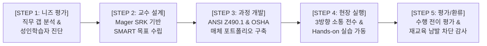

---

### 19.1 교육훈련 생애주기별 부서·직급 밀착형 핵심 성과지표(KPI) 매핑 테이블

| 생애주기 단계 | 대상 계층 (Break-down) | 핵심 성과지표 (KPI) 명칭 | 지표 성격 & 가중치 | 산출 공식 및 목표치 | 관련 법적 근거 (조문 강제 매핑) | 서브노트 판단 근거 (본문 표/그림/부록 연계) |
| :---: | :---: | :--- | :---: | :--- | :--- | :--- |
| **STEP 1 (니즈 평가)** | **안전관리부서 (Safety Officer)** | 직무별 안전 역량 요구도 및 수행 갭(Gap) 분석 완료율 | **고유 (70%)** | $\frac{\text{갭 분석 완료 직무 수}}{\text{전사 관리 대상 직무 총수}} \times 100 \ge 98\%$ | 산안법 제29조 (안전보건교육) 중처법 시행령 제4조제5호 | 본문 5.1절 & FIG. 13.2 TABLE 13.4 (FAA 7대 진단 질문) |
| **STEP 1 (니즈 평가)** | **현장 감독자 (Supervisor)** | 성인 학습자 특성 진단 및 교육 참여 저항 요인 발굴 건수 | **협업 (30%)** | 반기별 작업조원 학습 장애 요인(시간/업무량) 발굴 및 개선 $\ge 2$건 | 산안법 제16조 (관리감독자 직무) 중처법 시행령 제4조제8호 | 본문 12.2절 & 13.2절 TABLE 13.7 (성인 학습 지침) |
| **STEP 2 (교수 설계)** | **교육 기획팀 (Training Staff)** | Mager 모형 및 SRK 기반 SMART 학습 목표 수립률 | **고유 (70%)** | $\frac{\text{SMART 충족 교육 모듈 수}}{\text{개설 교육 모듈 총수}} \times 100 = 100\%$ | 산안법 시행규칙 제26조 [별표 4] (교육과정별 시간) | 본문 3.1절 & 11.1절 FIG. 13.2 (Mager 트리) |
| **STEP 2 (교수 설계)** | **현장 부서장 (팀장/현장대응단장)** | 슬라이드 정보 과적 방지 및 2가지 버전 교재(강의용/유인물용) 구축률 | **협업 (50%)** | 부서 내 기술 교육 자료 2버전 분리 제작 준수율 $\ge 95\%$ | 산안법 시행규칙 제26조 [별표 5] (교육대상별 교육내용) | 본문 10.3절 & Lesson Learned 1 (PowerPoint 대안 프레임워크) |
| **STEP 3 (과정 개발)** | **사내외 강사진 (Trainers)** | ANSI Z490.1 15단계 기준 준수 및 4대 품질(정확·신뢰·명확·실용) 적격률 | **고유 (70%)** | 강사 적격성 심사 및 교안 평가 점수 $\ge 90$점 달성 | 산안법 제32조 (직무교육) ANSI/ASSE Z490.1 규격 | 본문 7.2절 & TABLE 13.3 Appendix 13.1 (우수 교육 4특성) |
| **STEP 3 (과정 개발)** | **도급/협력 총괄부서 (Contract Mgmt)** | 협력업체 및 특수형태근로종사자 법정 안전 교육 지원 및 콘텐츠 제공률 | **협업 (50%)** | $\frac{\text{안전교육 지원 협력업체 수}}{\text{사내 도급업체 총수}} \times 100 = 100\%$ | 산안법 제30조 (관계수급인 지원) 중처법 제5조 (도급·위탁 평가) | 본문 4.2절 & TABLE 13.1 (ANSI Z10 도급업체 요건) |
| **STEP 4 (현장 실행)** | **현장 작업조 (Work Team/119구조대)** | 실습·시연(Hands-on) 비중 및 3방향 소통(Three-way) 현장 적용 이행률 | **고유 (70%)** | 총 교육시간 중 실습 비중 $\ge 50\%$, 현장 작업 전 3방향 소통 이행률 $100\%$ | 산안법 제29조제1항 소방공무원 보건안전법 제10조 | 본문 3.2절 & FIG. 13.1 본문 14.2절 (3방향 소통 다이어그램) |
| **STEP 4 (현장 실행)** | **일선 감독자 (Supervisor/팀장)** | 작업 착수 전 회의(ABSS) 연계 안전 코칭 및 TBM 실시 주기 준수율 | **고유 (70%)** | $\frac{\text{TBM 안전 코칭 실행 일수}}{\text{총 작업 일수}} \times 100 \ge 98\%$ | 산안법 제16조제1항 중처법 시행령 제4조제8호 | 본문 4.1절 (ABSS 멘토링 연계) TABLE 13.8 (Who Needs Training) |
| **STEP 5 (평가/환류)** | **최고경영진 (Senior Mgmt)** | 재교육 남발(Retraining Trap) 차단율 및 시스템 개선 예산 배정률 | **협업 (30%)** | 사고 조사 결과 단순 재교육 처방 건수 $0$건, 도구/환경 개선 예산 집행률 $\ge 95\%$ | 산안법 제14조 (이사회 보고·승인) 중처법 제4조 (안전보건확보의무) | 본문 9.2절 (A Cautionary Note) DOE HPI Handbook (2009) |
| **STEP 5 (평가/환류)** | **안전보건위원회 (Safety Committee)** | 교육 수료 후 3개월 현장 행동 전이율 및 지식 공백 해소율 | **협업 (50%)** | 수료자 현장 수행 평가 및 갭 클로징 달성률 $\ge 90\%$ | 산안법 제24조 (산업안전보건위원회) 중처법 시행령 제4조제5호 | 본문 7.2절 & TABLE 13.3 (15단계) Appendix 13.2 (OSHA Pub 2254) |

---

### 19.2 비판적 AI 재학습 및 품질 검증 프로토콜 (Quality Verification Protocol)
향후 본 프레임워크를 기반으로 AI 진단 모델을 가동할 때, 환각(Hallucination)을 원천 방지하기 위해 다음 3대 역질문을 필수적으로 수행합니다:
1. *"제시된 교육 지표의 법적 근거가 산업안전보건법 제29조, 동법 시행규칙 [별표 4], [별표 5] 및 중대재해처벌법 시행령 제4조제5호의 구체적 조문과 정합하는가?"*
2. *"도출된 KPI가 본문 제3절의 FIG 13.1(성공적 훈련 기법), FIG 13.2(Mager 트리), 제7절의 TABLE 13.3(ANSI Z490.1 15단계), 제14절의 3방향 소통 프로토콜을 판단 근거로 엄격히 연계하고 있는가?"*
3. *"사고 원인을 근로자의 단순 부주의로 몰아 재교육으로 때우려는 훈련 만능주의(Retraining Trap)를 방지하는 시스템적 통제 지표가 명확히 확립되어 있는가?"*

---

## 20. CONCLUSION (결론 및 제14장 연계)

제13장 **'Developing Safety Training Needs(안전 교육훈련 니즈 개발)'**는 안전을 단순한 지식 전달의 영역에서 **'조직의 지속적인 학습과 성과 개선(HPI)의 핵심 기제'**로 승화시키는 결정적 장입니다.

* **교육과 훈련의 엄밀한 분리**: 이론적 기반(Why)을 형성하는 교육과 현장 수행력(How-to)을 연마하는 훈련의 조화.
* **Mager 트리 기반의 탈(脫)형식주의**: 교육이 필요한 문제와 시스템적 개선이 필요한 문제를 냉철하게 분리하여 '재교육 남발의 함정'을 타파함.
* **3방향 소통의 현장 체질화**: 구두 소통의 치명적 오해를 근절하는 3단계 복명복창과 상호 확인 프로토콜 구축.
* **법령 기반의 5단계 생애주기 KPI 매핑**: 산업안전보건법과 중대재해처벌법의 준수를 넘어, 실제 현장의 위험을 선제적으로 통제하고 조직 문화를 혁신하는 실행 플랫폼 완성.

이어지는 **제14장(Assessing Your Safety Management System)**에서는 이와 같이 구축된 안전경영시스템의 각 요소가 현장에서 의도한 대로 실효성 있게 작동하고 있는지, 조직의 실제 안전문화 수준을 객관적으로 측정하고 진단하는 전사적 안전 감사 및 평가 체계를 심층적으로 탐구합니다.
