<!-- Block B01 -->
# 제13장: 안전 교육훈련 니즈 개발 (Developing Safety Training Needs)

*Safety Culture. https://doi.org/10.1016/B978-0-12-814663-7.00013-3*  
*©2019 Elsevier Inc. All rights reserved. pp. 327–343*

<!-- Block B02 -->
<!-- [그림 삽입 위치: Chapter 13 Overview] -->
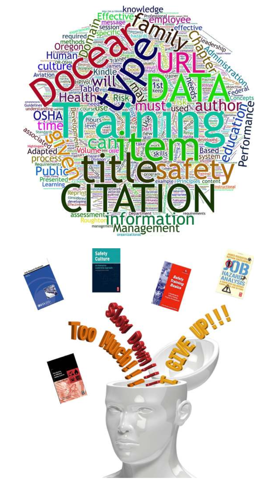
<!--  -->

> "누군가를 가르쳐야만 하는 상황에 놓인 사람만큼 그 주제에 대해 깊이 배우는 사람은 없다."  
> — 피터 F. 드러커 (Peter F. Drucker)

<!-- Block B03 -->
## 서론 (INTRODUCTION)

안전문화와 안전 프로세스는 유능하고 종합적인 교육 및 훈련(Education and Training) 프로그램에 의해 지탱됩니다. 조직의 문화는 직원들이 일상 업무와 과업을 수행할 때 그들의 규범, 습관 및 행동에 막강한 영향을 미칩니다. 조직 내에 깊이 뿌리박힌 무의식적 지각, 사고방식, 신념 등의 강력한 힘은 행동에 긍정적인 영향을 미치도록 설계된 최선의 안전 관련 훈련조차도 무력화(Override)시킬 수 있습니다.

<!-- Block B04 -->
훈련은 안전의 가치와 중요성에 대한 신념을 촉진하려고 시도할 수 있지만, 훈련 세션을 마친 후 현장의 업무 관리 방식에 아무런 변화가 없다면 직원들은 결국 조직을 지배하는 기존의 행동 방식으로 되돌아가게 됩니다. 훈련이 기대하는 바람직한 효과는 문화를 이끄는 내부적 조직 제약요인, 시간적 압박, 예산 한계, 법적 의무사항, 리더십 역량 등을 완벽히 이해할 때에만 지속될 수 있습니다. 그래야만 이러한 제약요인들을 극복하거나 완화하도록 훈련을 설계하고 구조화할 수 있습니다.

<!-- Block B05 -->
저자들은 오랜 실무 경험을 통해, 교육훈련이란 제한된 시간 내에 직원들에게 직무 수행 요령을 단순히 말해주는 것보다 훨씬 더 복잡한 과정임을 깨달았습니다. 정보와 훈련은 지정된 '교수자(Trainer)'로부터 '학습자(Learner)'에게 필수적인 직무 지식을 온전히 전이(Transfer)시킬 수 있어야 합니다. 교육과 훈련은 직원들이 충분히 이해하고, 기꺼이 수용하며, 할당된 업무에 즉시 활용할 수 있는 방식으로 제공되어야 합니다.

<!-- Block B06 -->
> **희망은 전략이 아니다 (Hope Is Not a Strategy)**  
> — (Page, 2003)

<!-- Block B07 -->
본 장을 학습한 후 독자는 다음 사항을 수행할 수 있어야 합니다:
* 교육(Education)과 훈련(Training)의 본질적 차이점을 설명할 수 있다.
* 훈련 니즈 평가(Training Needs Assessment)를 수행하는 데 활용되는 방법들을 설명할 수 있다.
* SMART 기법을 활용하여 교육훈련 목표 및 세부 목표를 설정하는 방식을 설명할 수 있다.
* 다양한 교육훈련 방법의 유형을 열거하고 설명할 수 있다.
* 훈련 콘텐츠를 개발할 때 작업자의 현장 경험을 이해해야 하는 이유를 설명할 수 있다.
* 의사소통(Communication)이 안전문화에 결정적인 영향을 미치는 이유를 설명할 수 있다.

<!-- Block B08 -->
## 초기 교육 및 훈련 평가 (INITIAL EDUCATION AND TRAINING ASSESSMENT)

어떠한 교육훈련 프로그램을 개발하기 전에도 반드시 해당 조직의 과거 훈련 추진 이력을 철저히 검토해야 합니다. 역사적 관점에서의 고찰은 현재의 훈련 범위, 과거의 성공적인 시도, 가장 효과적이었던 매체와 콘텐츠, 그리고 요구되는 교수자의 전문성 수준을 명확히 식별해 줍니다. 훈련 이력 분석은 현재의 작업 환경 조건을 종합적으로 고려할 때 훈련의 실질적 유효성에 대한 깊은 통찰을 제공합니다.

<!-- Block B09 -->
의사소통 네트워크의 일환으로서, 조직 내 교육훈련 부서와의 강력하고 긍정적인 연계는 필수적입니다. 안전 전문가와 안전보건경영시스템(OHSMS)이 기존의 기업 교육 프로그램과 마찰이나 갈등을 빚지 않도록 사내 교육훈련 부서와 긴밀한 관계를 유지해야 합니다. 훈련 부서의 전담 인력은 그들에게 부여된 기본 업무 범위에 따라 핵심 안전 훈련을 직접 제공하지 못할 수도 있습니다. 그러나 교육 부서와의 관계가 확고하다면, 필수 안전경영시스템 및 안전 관련 교육 기준의 니즈 평가, 체계화, 설계 및 실행 전 과정에서 협업 팀 접근법(Team approach)을 효과적으로 가동할 수 있습니다.

<!-- Block B10 -->
강력한 안전문화를 정착시키기 위해, 조직은 안전보건경영시스템이 조직 전체에 가져다주는 긍정적인 가치를 전사적으로 강조해야 합니다. 안전문화는 리더와 구성원 모두를 위한 지속적인 교육과 훈련의 가치에 대한 내재화된 신념을 지속적으로 강화해야 합니다. 학습 문화가 강력한 조직은 모든 직원이 안전보건경영시스템의 작동 원리와 지속적 학습에 있어서 자신의 책무(Responsibilities)를 실무적으로 숙지하도록 보장합니다.

<!-- Block B11 -->
반면, 일부 조직은 구체적인 교육훈련 니즈를 개발할 전담 교육 인력이 전무할 수도 있습니다. 이러한 경우 훈련 개발 업무 전체가 안전보건 전문가의 임무를 홀로 맡은 단 한 사람의 몫이 되기도 합니다. 현장 경험에 비추어 볼 때, 혼자의 힘으로 조직이 요구하는 모든 기준을 충족하는 고품질의 교육 자료를 개발하기란 대단히 어려운 일입니다.

<!-- Block B12 -->
## 교육 및 훈련의 성과 (EDUCATION AND TRAINING PERFORMANCE)

강력한 안전문화는 '학습하는 조직(Learning Organization)'의 산물이기도 합니다. 유해위험요인(Hazards)과 그에 수반되는 위험성(Risk)이 식별됨에 따라, 이러한 정보를 활용하는 역량은 필수적인 통제 대책을 수립하고 실행하는 데 핵심적인 열쇠가 됩니다. 리더십과 현장 근로자는 안전보건경영시스템의 핵심 개념을 명확히 이해하고 숙지해야 합니다. 조직이 끊임없이 진화하고 변화함에 따라, 교육 및 훈련 프로세스는 전사적으로 최신 정보가 원활히 유통되도록 유지시켜 줍니다. 이 프로세스는 적시에 제공되어야 하며, 변화하는 작업 환경 조건에 부합하도록 설계되어야 합니다.

<!-- Block B13 -->
교육과 훈련의 궁극적인 목표는 조직이 요구하는 바람직한 운영 행동을 배양함으로써 구성원의 직무 성과를 변화시키거나 획기적으로 개선하는 데 있습니다. 교육 및 훈련의 발전을 위한 훈련 목표와 세부 학습 목표의 설정은 제4장(안전문화의 방향 설정)에서 논의된 바와 같이 구체적이고, 측정 가능하며, 성과 기반인 SMART 목표에 기초해야 합니다. 우수한 교육훈련 프로그램이 갖추어야 할 주요 특성의 예시는 부록 13.1을 참조하십시오.

<!-- Block B14 -->
예를 들어, 전통적인 안전 교육 세션은 주로 강의실에서의 주입식 집체 강의, 안전 주제 동영상 시청, 또는 안전 관련 인쇄 유인물 배포로 구성되었습니다. 이러한 방식도 유용한 정보를 전달할 수는 있지만, 시의적절한 후속 조치와 함께 실습 및 신체적 시연(Hands-on and physical demonstration)이 조화롭게 결합되지 않는다면 전달된 정보의 습득률과 이해도는 극적으로 떨어지게 됩니다. 그림 13.1은 성공적인 교육훈련 기법의 개요를 보여줍니다.

<!-- Block B15 -->
<!-- [그림 13.1 스크린샷 삽입 위치: Successful training techniques] -->
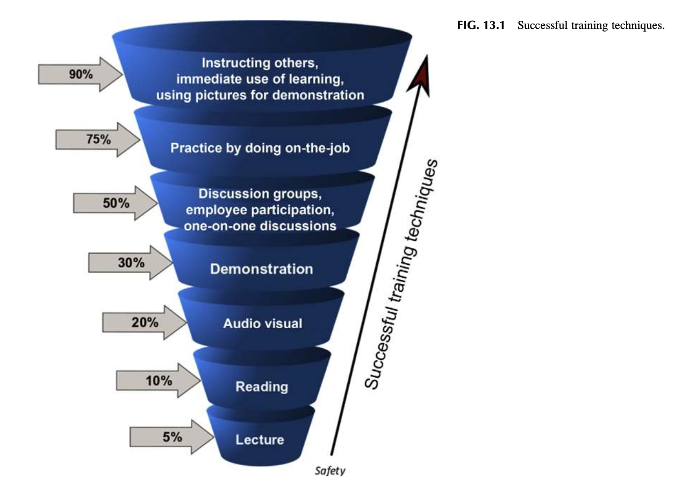
<!--  -->

### 그림 13.1 성공적인 교육훈련 기법 (FIG. 13.1 Successful training techniques)

<!-- Block B16 -->
무엇이 적절한 교육훈련인가에 대한 이러한 고정관념은 전통적 교육기관들이 수십 년간 고수해 온 방식에 기초하고 있으며, 여전히 많은 기업 조직에 뿌리 깊게 박혀 있습니다. 시간과 예산을 절감하기 위해 시중의 '기성품(Off-the-shelf)' 교육 프로그램이 흔히 사용되며, 특정 대상 집단에 맞추어 교육을 최적화하려는 노력은 거의 없거나 극히 제한적입니다. 이러한 획일적인 범용 훈련 방식은 직원들에게 왜 정해진 사내 규칙을 준수해야 하는지에 대한 근본적인 이해를 심어주지 못합니다. 이로 인해 작업자 교육은 단순 암기식 기계적 주입으로 전락하여 현장의 실질적 문제를 해결하지 못하고 정확한 지식을 습득시키지도 못합니다. 훈련은 보충 정보와 함께 체계적으로 고안된 가이드라인에 따라 정밀하게 설계되어야 합니다 (Roughton & Lyons, 1999; 그림 13.2 참조).

<!-- Block B17 -->
> "믿기 힘들겠지만, 교수자들은 사람들이 이미 잘 알고 있는 내용을 가르치기 위한 강좌를 개발하거나, 교육훈련으로는 결코 해결할 수 없는 문제를 훈련으로 해결해 달라는 요구를 빈번하게 받는다."  
> — 로버트 메이거 (Robert Mager)

<!-- Block B18 -->
<!-- [그림 13.2 스크린샷 삽입 위치: Mager’s decision tree for improving safety performance] -->
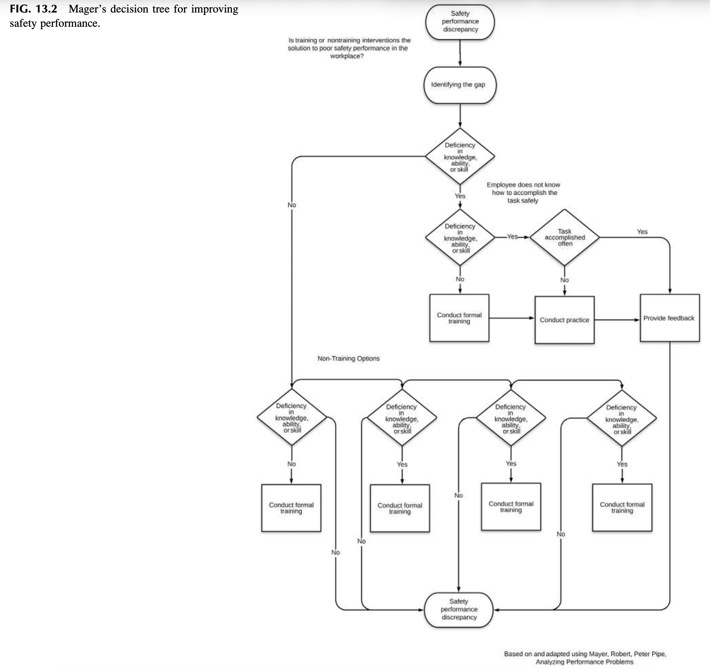
<!--  -->

### 그림 13.2 안전 성과 향상을 위한 메이거의 의사결정나무 (FIG. 13.2 Mager’s decision tree for improving safety performance)

<!-- Block B19 -->
## 훈련에 대한 리더십의 지원 (LEADERSHIP SUPPORT FOR TRAINING)

안전 교육훈련이 성공을 거두기 위해서는 조직 내 모든 계층의 전폭적인 지지를 받아야 합니다. 안전보건경영시스템이 조직에 도입되고 정착되었다면, 안전 교육훈련은 경영진 리더십 팀에 의해 공식적으로 승인되고 지원받는 제도적 구조의 핵심 축이 됩니다.

<!-- Block B20 -->
예를 들어 ANSI Z10-2012 규격에서는 조직이 "안전 역량을 규정하는 프로세스를 개발하고, 적절한 교육과 훈련을 제공하며, 구성원이 훈련에 쉽게 접근할 수 있고 이해할 수 있는 언어로 제공되도록 보장하며, 훈련이 시의적절하고 교수자가 전문 역량을 갖추도록 보장해야 한다"고 명시하고 있습니다 (Occupational Health and Safety Systems, 2012; System safety training, 2000; 표 13.1 참조).

<!-- Block B21 -->
제11장(활동 기반 안전 시스템 구축)에서 논의된 접근법을 활용할 경우, 일선 관리감독자와 팀 리더는 공식 훈련 세션 중에 제공된 안전 관련 정보를 일상 작업에서 지속적으로 강화해 주는 멘토 또는 코치로 발전할 수 있습니다. 매일의 작업 전 안전 점검(Preshift review), 주간 요약, 그리고 심층 월간 회의를 통해 직원들은 배운 지식을 자유롭게 토론하고 교육 자료와 콘텐츠의 실효성에 대한 생생한 피드백을 공유할 수 있습니다.

<!-- Block B22 -->
미국 직업안전보건청(OSHA)의 기본 훈련 지침에서 제시하는 교육훈련 요소들은 권장되는 교육훈련 프로그램의 설계 및 실행에 대한 명확한 프레임워크를 제공합니다. OSHA 훈련 개발 지침 목록은 표 13.2를 참조하십시오.

<!-- Block B23 -->
<!-- [표 13.1 스크린샷 삽입 위치: Overview of Education, Training, Awareness, and Competency] -->
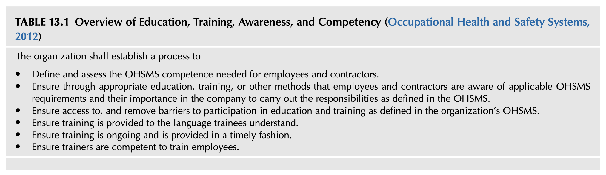
<!--  -->

### 표 13.1 교육, 훈련, 인식 및 역량 개요 (TABLE 13.1 Overview of Education, Training, Awareness, and Competency - ANSI Z10)

<!-- Block B24 -->
**조직은 다음을 수행하기 위한 공식 프로세스를 수립해야 합니다:**
* 임직원 및 외주 협력업체 인력에게 요구되는 OHSMS 안전보건 역량을 정의하고 체계적으로 평가한다.
* 적절한 교육, 훈련 또는 기타 실효성 있는 방식을 통해, 근로자와 도급업체가 적용 가능한 OHSMS 요구사항과 OHSMS에 정의된 책무를 이행하는 데 있어 사내 규정 준수가 갖는 중요성을 완벽히 인식하도록 보장한다.
* 조직의 OHSMS에 정의된 바에 따라 교육 및 훈련에 대한 접근성을 보장하고, 훈련 참여를 가로막는 제약 장벽을 능동적으로 제거한다.
* 피교육자가 직관적으로 이해할 수 있는 모국어 및 눈높이 언어로 훈련이 제공되도록 보장한다.
* 훈련이 일회성에 그치지 않고 지속적으로 운영되며 적시에 시의적절하게 제공되도록 보장한다.
* 직원들을 가르치는 교수자(강사)가 검증된 역량과 자격을 갖추도록 철저히 보장한다.

<!-- Block B25 -->
<!-- [표 13.2 스크린샷 삽입 위치: OSHA Training Development Guidelines] -->
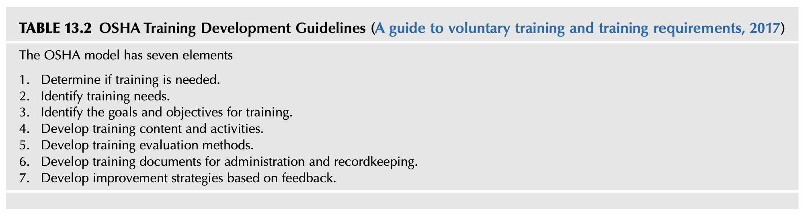
<!--  -->

### 표 13.2 OSHA 훈련 개발 가이드라인 (TABLE 13.2 OSHA Training Development Guidelines - 2017)

<!-- Block B26 -->
**OSHA 교육훈련 모델은 다음의 7대 핵심 요소로 구성됩니다:**
1. 훈련의 필요성 여부 결정 (Determine if training is needed)
2. 구체적 훈련 니즈 식별 (Identify training needs)
3. 훈련의 목표 및 세부 목표 설정 (Identify the goals and objectives for training)
4. 훈련 콘텐츠 및 학습 활동 개발 (Develop training content and activities)
5. 훈련 평가 방법 개발 (Develop training evaluation methods)
6. 훈련 행정 관리 및 기록 보존 문서 체계 구축 (Develop training documents for administration and recordkeeping)
7. 현장 피드백에 기초한 지속적 개선 전략 수립 (Develop improvement strategies based on feedback)

<!-- Block B27 -->
OSHA 교육훈련 모델은 사내 안전 교육 프로그램을 고도화하도록 설계되었습니다. 이 모델을 적용하면 안전 훈련 프로그램의 체계적 개선과 우수한 행정적 관리를 위한 탄탄한 구조를 확보할 수 있습니다. 이 구조는 사업장별 맞춤형 현안을 해결하고, 직원의 학습 니즈를 충족시키며, 전사적 안전보건경영시스템을 한층 강화할 수 있습니다. 귀사의 사내 규정 및 라이브러리에 내려받아 활용할 수 있는 OSHA의 퍼블릭 도메인 문서인 “Training Requirements in OSHA Standards”(2015)에 대한 세부사항은 부록 13.2를 참조하십시오.

<!-- Block B28 -->
## 교육 및 훈련 니즈 평가 수행 (CONDUCTING EDUCATION AND TRAINING NEEDS ASSESSMENT)

교육훈련 니즈 평가는 교육 및 훈련이 사업장의 안전 문제를 실제로 해결할 수 있는 올바른 접근법인지 여부를 판별하는 데 결정적인 도움을 줍니다. 니즈 평가는 원하는 성과 수준(바람직한 표준)과 실제 성과 수준(현장의 현재 모습) 사이의 격차(Gap)를 체계적으로 분석하는 프로세스입니다.

<!-- Block B29 -->
> "니즈 평가란 조직이 바라는 것과 현재 실제로 일어나는 것 사이의 '격차(Gap)'를 규명하는 과정이다. 이러한 격차가 정확히 파악되고 나면, 교육훈련 부서는 그 차이를 좁히기 위한 최적의 전략을 수립할 수 있다."  
> — (Gupta, 1999)

<!-- Block B30 -->
산업과 시장 환경이 역동적으로 변화함에 따라 조직 또한 끊임없이 변화하고 진화합니다. 기술의 발전, 새로운 공정 설비의 도입, 또는 작업 인력의 세대교체는 새로운 유해위험요인을 현장에 유입시킬 수 있습니다. 이러한 변화는 안전을 유지하고 새로운 위험을 선제적으로 통제하기 위해 기존의 작업 방식과 훈련 체계에 대한 지속적인 니즈 재평가를 필연적으로 요구합니다.

<!-- Block B31 -->
## 이러닝 (E-LEARNING)

지난 20년 동안 이러닝(E-learning)은 직업안전보건 교육 분야에서 대단히 유용하고 효과적인 도구로 급부상했습니다. 기술의 급격한 발전으로 인해 데스크톱 컴퓨터, 태블릿 PC 및 스마트폰을 통해 온라인 교육에 어디서나 쉽게 접근할 수 있게 되었습니다. 이러한 유연성은 안전 전문가와 교육 강사에게 전통적인 집체 강의실 교육의 한계를 뛰어넘어 직원들을 교육할 수 있는 새로운 차원의 기회를 제공합니다.

<!-- Block B32 -->
이러닝은 직원에게 단순히 컴퓨터를 한 대 배정하고 화면의 텍스트나 슬라이드를 묵묵히 읽도록 내버려 두는 것 이상의 의미를 갖습니다. 이러닝 시스템은 학습자가 콘텐츠에 적극적으로 몰입하고 능동적으로 참여할 수 있도록 대화형(Interactive) 시뮬레이션, 퀴즈, 실시간 피드백 및 멀티미디어 요소를 갖추어 설계되어야 합니다. 그렇지 않으면 교육은 형식적인 '체크박스 채우기'로 전락하여 실질적인 지식 습득이나 태도 변화를 이끌어내지 못합니다.

<!-- Block B33 -->
Wang, Ran 등의 연구에 따르면, "이러닝 시스템은 첫째, 학습자가 안전 지식을 체계적으로 탐색하고 획득할 수 있도록 지원해야 하며; 둘째, 학습자가 직무 현장에서 안전 지식을 실제로 적용하고 실천할 수 있도록 유도해야 하고; 셋째, 동료 학습자 및 전문가와의 협력적 학습을 촉진할 수 있어야 한다"고 강조합니다.

<!-- Block B34 -->
직장 내 학습자가 자신의 고유한 작업 일정과 학습 속도에 맞추어 자기주도적으로 온라인 과정을 수강할 수 있을 때 이러닝은 대단히 유용할 수 있습니다. 특히 교대근무가 잦거나, 원격지 및 분산된 사업장에서 근무하는 인력에게 이러닝은 교육의 시공간적 제약을 극복할 수 있는 획기적인 해결책을 제공합니다. 다만, 신체적 실습이나 촉각적 감각이 요구되는 고위험 작업의 경우에는 단독 이러닝보다는 대면 실습과 결합된 블렌디드 러닝(Blended Learning) 모델이 필수적입니다.

<!-- Block B35 -->
학습 테크놀로지의 지속적인 발전은 앞으로 가상현실(VR), 증강현실(AR), 그리고 인공지능 기반 맞춤형 학습을 통해 현실과 유사한 고위험 가상 환경에서 근로자가 안전하게 위기 대처 역량을 체득할 수 있는 혁신적인 교육 생태계를 창출해 낼 것입니다.

<!-- Block B36 -->
## 강사 및 교수자에게 주어지는 도전 과제 (THE CHALLENGE TO TRAINERS)

소셜 미디어와 즉각적인 정보 검색이 일상화된 오늘날의 환경에서, 안전 교육 강사들은 학습자의 집중력을 유지하고 안전 메시지를 효과적으로 전달해야 하는 새로운 차원의 도전에 직면해 있습니다. 짧고 자극적인 영상 콘텐츠에 익숙해진 현대의 직원들은 전통적인 텍스트 위주의 지루한 강의에 쉽게 피로감을 느끼며 집중력을 상실하기 쉽습니다.

<!-- Block B37 -->
인터넷에 대한 접근이 전 세계적으로 보편화됨에 따라, 안전보건에 관한 방대한 정보와 교육 자료를 손쉽게 확보할 수 있게 되었습니다. 그러나 동시에 검증되지 않은 부정확한 정보나 현장과 동떨어진 잘못된 안전 지식이 무분별하게 확산될 위험성 또한 상존합니다. 따라서 교수자는 단순히 지식을 전달하는 자를 넘어, 올바른 안전 지식을 선별하고 조직의 특성에 맞게 재구성하는 '큐레이터'이자 '퍼실리테이터'로서의 고도화된 역량을 갖추어야 합니다.

<!-- Block B38 -->
명확하게 정의된 교육 목표와 세부 학습 목표(Goals and Objectives)는 훈련 과정을 체계적으로 구조화하고 평가할 수 있는 필수적인 나침반을 제공합니다. 학습 목표가 모호하면 훈련의 초점이 흐려지고, 강사가 가르치고자 하는 바와 작업자가 현장에서 필요로 하는 실무 역량 사이에 심각한 괴리가 발생하게 됩니다.

<!-- Block B39 -->
미국안전공학회(ASSE, 현 ASSP)의 표준 규격인 ANSI/ASSE Z490.1(안전·보건 및 환경 교육훈련에 대한 인정 실무 기준, 2001)에 근거한 교육훈련 개발의 단계별 표준 절차는 표 13.3을 참조하십시오.

<!-- Block B40 -->
표 13.4는 직원의 특화된 교육 니즈를 정밀하게 파고들기 위해 미국 연방항공청(FAA)에서 고안한 핵심 질문 리스트를 제시합니다.

<!-- Block B41 -->
<!-- [표 13.3 스크린샷 삽입 위치: Steps in Course Development] -->
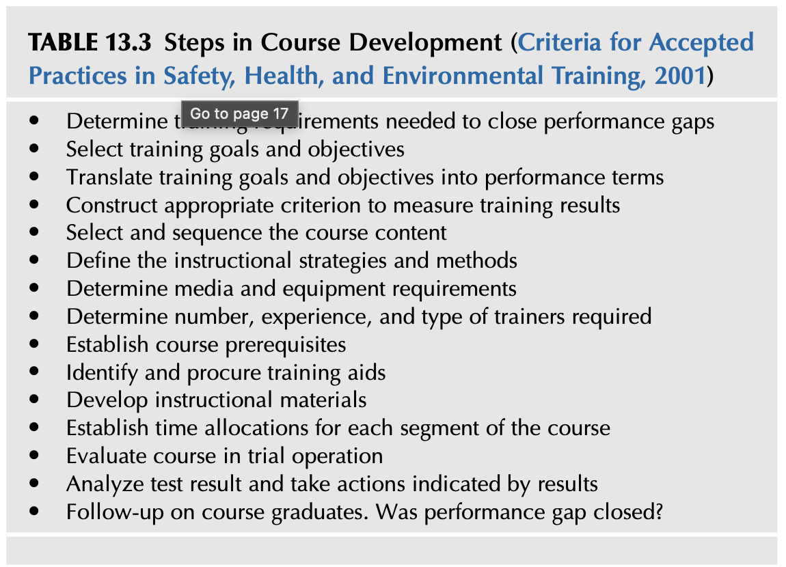
<!--  -->

### 표 13.3 교육과정 개발 단계 (TABLE 13.3 Steps in Course Development - ANSI/ASSE Z490.1)

<!-- Block B42 -->
* 직무 성과 격차(Performance gaps)를 해소하기 위해 요구되는 교육훈련 요건을 결정한다.
* 교육훈련의 전반적 목표(Goals)와 구체적 세부 목표(Objectives)를 선정한다.
* 교육훈련 목표와 세부 목표를 구체적인 성과 용어(Performance terms)로 변환한다.
* 교육훈련 결과를 정량적·정성적으로 측정하기 위한 적절한 평가 준거(Criteria)를 구축한다.
* 교육과정의 콘텐츠를 엄선하고 논리적 학습 순서에 따라 배열한다.
* 교수 전략(Instructional strategies) 및 구체적 교육방법을 정의한다.
* 필요한 교육 매체와 시청각 기자재 요구사항을 결정한다.
* 투입될 강사의 소요 인원, 필요 경력 및 전문성 유형을 결정한다.
* 교육과정 선수 요건(Prerequisites)을 수립한다.
* 교육 보조 교재 및 실습 도구를 식별하고 조달한다.
* 구체적인 교수 학습 교재 및 매뉴얼을 개발한다.
* 교육과정의 각 세부 세그먼트별 소요 시간을 배정한다.
* 시범 운영(Trial operation)을 통해 교육과정을 사전 평가한다.
* 시험 및 평가 결과를 분석하고 결과가 가리키는 개선 조치를 단행한다.
* 교육 이수자에 대한 사후 추적(Follow-up)을 실시한다. 현장의 성과 격차가 실질적으로 해소되었는가?

<!-- Block B43 -->
<!-- [표 13.4 스크린샷 삽입 위치: Questions to Be Asked When Assessing Training Needs] -->
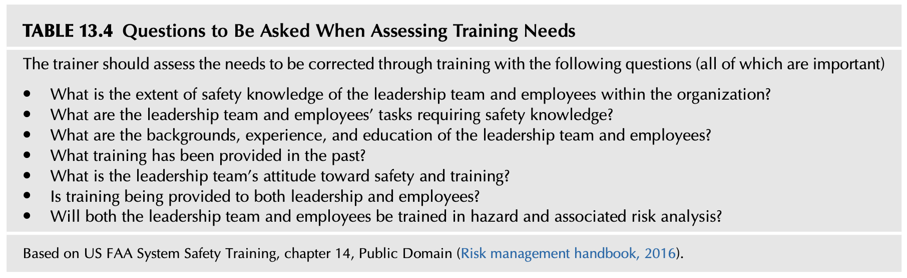
<!--  -->

### 표 13.4 훈련 니즈 평가 시 던져야 할 핵심 질문 (TABLE 13.4 Questions to Be Asked When Assessing Training Needs)

<!-- Block B44 -->
교육 강사는 교육훈련을 통해 교정해야 할 니즈를 평가할 때 다음의 핵심 질문들(모두가 결정적으로 중요함)을 면밀히 검토해야 합니다:
* 조직 내 경영진 리더십 팀과 현장 근로자의 안전 지식 수준은 어느 정도인가?
* 안전 지식을 필수로 요구하는 리더십 팀과 근로자의 구체적인 직무 과업은 무엇인가?
* 리더십 팀과 현장 직원들의 배경, 실무 경력 및 학력 수준은 어떠한가?
* 과거에 어떠한 교육훈련이 제공되었으며 그 결과는 어떠했는가?
* 안전과 교육훈련에 대한 경영진 및 리더십 팀의 태도와 의지는 어떠한가?
* 교육훈련이 현장 근로자뿐만 아니라 리더십 계층에게도 동등하게 제공되고 있는가?
* 리더십 팀과 근로자 모두 유해위험요인 식별 및 관련 위험성 평가(Risk analysis) 기법을 교육받을 것인가?

<!-- Block B45 -->
*(미국 FAA 시스템 안전 교육 제14장 기반, Public Domain (Risk management handbook, 2016))*

<!-- Block B46 -->
## 훈련의 방향성 이해 (UNDERSTAND THE DIRECTION OF TRAINING)

안전 관련 교육훈련 세션을 개발할 때, 제3장(네트워크 분석 및 활용)에서 논의된 바와 같이 훈련 세션 자체를 조직 내 연결망 속의 하나의 커뮤니케이션 '노드(Node)'로 바라볼 수 있습니다. 강사나 교수자가 리더십 팀이나 현장 직원 집단 앞에서 강의를 진행할 때, 그들은 단순히 눈앞의 청중만을 상대하는 것이 아닙니다. 제공된 교육훈련의 실질적 가치(혹은 가치 없음)에 대한 입소문이 사내에 급속히 퍼져나감에 따라, 전달된 정보는 더 거대한 조직 네트워크, 즉 노드 전체에 막대한 파급 효과를 미칩니다. 교육이 조잡하게 진행되거나 현업에 도움이 되지 않는 무가치한 것으로 여겨진다면, 이는 전사적 안전문화를 심각하게 저하시키는 결과를 초래합니다.

<!-- Block B47 -->
교육훈련은 직원들이 그저 고통스럽게 견뎌내야만 하는 지루한 통과의례나 억지스러운 시간이 되어서는 결코 안 됩니다. 교육은 활력이 넘치고, 상호작용이 살아있으며, 현장의 안전과 건강을 지키는 데 즉각적인 도움을 주는 보람찬 학습 경험이 되어야 합니다.

<!-- Block B48 -->
요구되는 교육훈련의 핵심 개념들을 현장 작업의 현실과 조화롭게 융합하는 작업은 강사에게 매우 도전적인 과제입니다. 강사는 규정이나 이론에만 얽매이지 않고, 현장 작업자들이 매일 직면하는 실질적인 애로사항과 위험 요인을 교육 내용에 자연스럽게 녹여내야 합니다.

<!-- Block B49 -->
> 성공적인 강사는 "...타인의 아이디어와 견해에 진심으로 귀를 기울이며, 청중을 존중하고, 강의실 내에서 일방적인 가르침이 아닌 쌍방향의 활발한 대화를 이끌어낸다."  
> — (Roughton & Mercurio, 2002)

<!-- Block B50 -->
## 교육과 안전 훈련의 개념적 차이 (THE CONCEPTS OF EDUCATION AND SAFETY TRAINING)

모든 구성원이 명확한 개념을 공유할 수 있도록 '교육(Education)'과 '훈련(Training)'의 개념적 경계를 엄격히 정의할 필요가 있습니다. 이에 대해 미국 국립산업안전보건연구원(NIOSH)은 훈련과 교육에 대해 다음과 같은 탁월한 학술적 정의를 제시합니다:

<!-- Block B51 -->
> **훈련(Training)**은 특정 직무 역량을 개발하고, 행동을 수정하며, 숙련도를 높이기 위해 명확히 정의된 집단을 대상으로 이루어지는 의사소통으로 널리 이해된다. 일반적으로 훈련은 작업자가 '무엇을 알아야 하는가(What needs to be known)'에 독점적으로 초점을 맞춘다.  
> — *(A model for research on training effectiveness, 1999)*

<!-- Block B52 -->
> **교육(Education)**은 훈련의 목표를 포괄하면서, 왜 특정 정보를 반드시 알아야만 하는가(Why particular information must be known)를 설명해 주는 보다 장기적인 과정이다. 교육은 제시된 지식의 과학적·이론적 토대를 강조한다. 훈련과 교육 모두 '학습(Learning)'을 유도하며, 학습이란 교수(Teaching)와 경험(Experience)을 통해 지식과 행동을 근본적으로 변화시키는 과정이다.  
> — *(A model for research on training effectiveness, 1999)*

<!-- Block B53 -->
오리건주 직업안전보건국(Oregon OSHA)은 효과적인 안전 교육 소개 지침서에서 '교육이란 무엇인가'에 대해 다음과 같은 명쾌한 정의를 제시합니다:

<!-- Block B54 -->
**“교육(Education)”이란 무엇인가?**
* 무지(Ignorance)로부터 벗어나도록 이끌어주는 것.
* 우리의 지식, 기술, 태도 및 능력(KSAs: Knowledge, Skills, Attitudes/Abilities)에 영향을 미치는 모든 것.
* 안전에서의 '이유(Why)'를 깨우치는 것으로, 행동의 자연적 결과(부상과 건강 손상)와 시스템적 결과(징계, 보상)에 대해 가르치는 것.
* 주로 지식과 긍정적 태도를 증진시키는 것.  
*(An introduction to effective safety training, 2016)*

<!-- Block B55 -->
이와 대조적으로, 캐나다 연안경비대 태평양 보조단(Canadian Coast Guard Auxiliary, Pacific)은 '훈련이란 무엇인가'에 대해 다음과 같은 실무적 정의를 제시합니다:

<!-- Block B56 -->
**“훈련(Training)”이란 무엇인가?**
* 교육을 달성하기 위한 하나의 구체적 방법.
* 안전에서의 '실행 방법(How to)'.
* 주로 구체적인 지식과 실무 기술을 증진시키는 것.
* 직무 기술을 개발하거나 향상시키는 데 초점을 맞추며, '현장 성과(Performance)'에 집중하는 교육의 특화된 형태.  
*(Training the trainer, 2008)*

<!-- Block B57 -->
## 주의 사항 (A CAUTIONARY NOTE)

미국 에너지부(DOE)의 인적 수행도 핸드북(Human Performance Handbook)은 교육훈련이 안전 문제에 대한 유일무이한 만병통치약이 결코 아니라는 점을 강력히 경고합니다. 예를 들어, 저자들은 사고 조사 과정에서 교육훈련이 모든 문제의 궁극적 해결책인 양 남용되는 사례를 숱하게 목격했습니다. 사고 보고서의 시정 조치란에 "해당 직원을 재교육함(Retrain the employee)"이라고 적는 것은 형식적인 서류 처리를 끝내기 위한 손쉬운 지름길로 악용되며, 정작 손실을 유발한 근본적인 시스템 결함 분석은 미결 상태로 방치하게 만듭니다.

<!-- Block B58 -->
아무리 강조해도 지나치지 않습니다: 많은 경우, 훈련은 가장 손쉽게 선택되는 기본 디폴트 해결책으로 오용됩니다. 그러나 훈련이나 재교육이 현장의 모든 문제를 해결할 수는 없습니다. 훈련은 우수한 안전보건경영시스템을 구성하는 여러 요소 중 단 하나에 불과합니다.

<!-- Block B59 -->
> "...작업의 특성상 이미 기본적으로 암기되어 있고 거의 무의식적으로 자동 수행되는 일상 업무에 대해 근로자를 재교육하는 것은 시간 낭비일 뿐만 아니라 근로자에 대한 모욕이다. 애초에 근로자 자신이 의도하지 않았던 실수를 반복하지 않도록 근로자를 훈련시키는 것은 불가능에 가깝다. 이러한 상황에서 훈련은 결코 올바른 해결책이 될 수 없다."  
> — *(DOE Human Performance Concepts and principles, 2009)*

<!-- Block B60 -->
## 교육과정 개발 프로세스 (COURSE DEVELOPMENT PROCESS)

피교육자의 숙련도, 전문성 및 현장 경험 수준에 따라 상이한 교육 방법론이 적용되어야 합니다. 모든 교육 자료는 가장 적합한 훈련 콘텐츠와 최적의 교육 매체가 무엇인지를 결정하여 맞춤형으로 작성되고 조정되어야 합니다. 적용되는 방법과 매체는 현장에서 가장 효과적인 방식에 따라 달라집니다: 이러닝 및 인터넷 기반 학습, 하드카피 워크북 또는 유인물, 일대일 코칭 또는 소집단 실습 세션, 시청각 비디오 프레젠테이션 등 (An introduction to effective safety training, 2016). 활용 가능한 자원은 그 깊이, 범위, 품질 및 비용 면에서 대단히 다양합니다.

<!-- Block B61 -->
안전 교육훈련 니즈의 대표적인 유형에 대한 예시는 표 13.5를 참조하십시오.  
일반적으로 널리 활용되는 교육훈련 방법의 유형은 표 13.6을 참조하십시오.

<!-- Block B62 -->
<!-- [표 13.5 스크린샷 삽입 위치: Examples of Types of Safety Training Needs] -->
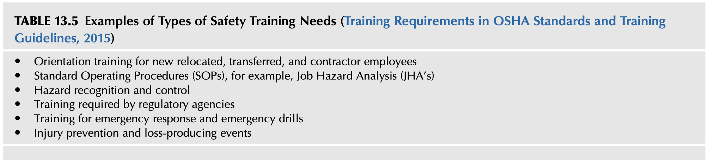
<!--  -->

### 표 13.5 안전 교육훈련 니즈 유형의 예시 (TABLE 13.5 Examples of Types of Safety Training Needs - OSHA 2015)

<!-- Block B63 -->
* 신규 입사자, 전보 발령자, 부서 이동자 및 사내 하도급 도급업체 근로자를 위한 신규 채용/배치 시 오리엔테이션 교육
* 표준작업절차(SOP) 교육, 예를 들어 직무 위험 분석(JHA) 기반 작업 표준
* 유해위험요인의 선제적 식별 및 위험성 통제 기법 교육
* 정부 규제 기관 및 관련 법률에서 법적으로 강제하는 법정 의무 안전 교육
* 비상 대응(Emergency Response) 및 실전 비상 대피 훈련
* 산업재해 예방 및 손실 유발 사고(Loss-producing events) 방지 교육

<!-- Block B64 -->
<!-- [표 13.6 스크린샷 삽입 위치: Common Types of Training Methods] -->
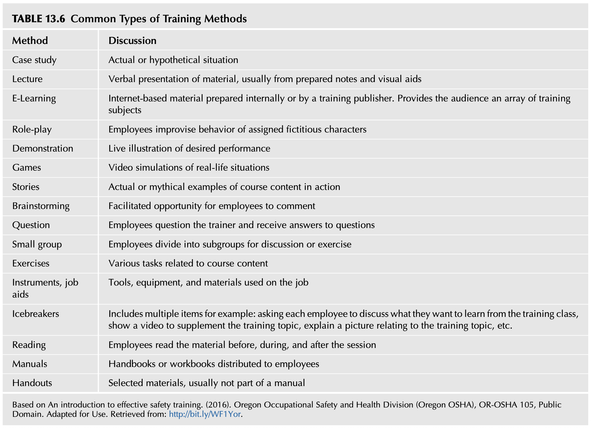
<!--  -->

### 표 13.6 일반적인 교육훈련 방법의 유형 (TABLE 13.6 Common Types of Training Methods)

<!-- Block B65 -->
| 교육 방법 (Method) | 세부 설명 및 적용 (Discussion) |
| :--- | :--- |
| **사례 연구 (Case study)** | 실제 발생했던 사고 사례 또는 가상의 시나리오를 심층 분석 |
| **강의식 교육 (Lecture)** | 사전에 준비된 강의 노트와 시청각 보조 자료를 활용한 구두 설명 및 발표 |
| **이러닝 (E-Learning)** | 사내에서 자체 제작하거나 외부 교육 전문 기관이 개발한 인터넷 기반 교육 콘텐츠. 학습자에게 다양한 안전 교육 과목을 자율적으로 제공 |
| **역할 연기 (Role-play)** | 직원들이 가상의 인물이나 역할을 맡아 실제 상황에서의 안전 행동을 모의 실연 |
| **실물 시연 (Demonstration)** | 바람직한 표준 작업 및 안전 절차를 현장에서 실시간으로 직접 보여주는 라이브 시연 |
| **게임 및 시뮬레이션 (Games)** | 실제 현장 상황을 가상으로 재현한 비디오 시뮬레이션 및 상호작용형 게임 |
| **스토리텔링 (Stories)** | 교육 콘텐츠의 핵심 원리가 생생하게 작동한 실제 성공/실패 스토리나 상징적 사례 공유 |
| **브레인스토밍 (Brainstorming)** | 직원들이 유해위험요인과 개선 아이디어를 자유롭게 개진하도록 유도하는 퍼실리테이션 토의 |
| **질의응답 (Question & Answer)** | 교육생이 강사에게 질문하고 궁금증과 현장 애로사항에 대한 즉각적인 피드백을 수렴 |
| **소집단 분임 토의 (Small group)** | 교육생을 소규모 그룹으로 나누어 주어진 안전 과제나 실습 문제를 함께 토론하고 해결 |
| **실습 및 과제 (Exercises)** | 교육과정의 핵심 내용과 직접 연계된 다양한 실무 작업 및 실습 수행 |
| **도구 및 직무 보조 도구 (Job aids)** | 현장 직무에서 실제로 사용되는 공구, 개인보호구(PPE), 장비 및 체크리스트 활용 |
| **아이스브레이킹 (Icebreakers)** | 교육 시작 전 긴장을 풀기 위한 다양한 도입 활동 (예: 본 교육에서 배우고 싶은 점 공유, 주제 관련 동영상 시청, 현장 위험 사진 해석 등) |
| **독서 및 자료 검토 (Reading)** | 교육 세션 전, 진행 중, 세션 종료 후에 지정된 안전 문헌 및 표준 자료를 정독 |
| **매뉴얼 (Manuals)** | 체계적으로 정리되어 직원들에게 정식 배포된 핸드북 또는 워크북 교재 |
| **유인물 (Handouts)** | 매뉴얼에 포함되지 않은 핵심 요약표, 플로우차트 등 엄선된 보충 학습 자료 |

<!-- Block B66 -->
*(오리건주 직업안전보건국(Oregon OSHA) 효과적인 안전 훈련 가이드(2016) 기반, Public Domain. Adapted for Use.)*

<!-- Block B67 -->
## 학습 활동의 개발 (DEVELOPING LEARNING ACTIVITIES)

> "강의 계획서(Lesson Plan)란 교수 학습 처방전이자 청사진이다. 이는 강사와 학생이 해당 과정의 목표에 도달하기 위해 함께 수행할 구체적인 활동들을 명시한다. 주된 목적은 교육 모듈 진행 중에 반드시 발생해야 하는 핵심 학습 사건들을 규정하는 데 있다."  
> — 로버트 메이거 (Robert Mager)

<!-- Block B68 -->
현재 산업 현장에 진입하고 있는 신세대 인력은 엔터테인먼트 미디어, 비디오 게임, 인터넷 등 고도로 시각적이고 인터랙티브한 디지털 환경 속에서 성장해 왔습니다. 이들은 일방적인 텍스트 낭독이나 지루한 슬라이드 나열식 강의에 매우 취약하며 즉각적인 반응을 기대합니다.

<!-- Block B69 -->
그 결과, 현장에 새롭게 들어오는 많은 근로자들은 이미 방대한 양의 정보를 시각적으로 신속하게 처리하는 인지적 습관을 가지고 있습니다. 이러한 특성을 고려할 때, 텍스트가 빽빽한 슬라이드를 단순히 읽어주는 전통적 강의 방식은 학습자의 몰입을 즉시 차단시키는 치명적인 결과를 낳습니다.

<!-- Block B70 -->
### 교훈 1 (LESSON LEARNED 1)

가용한 시간과 예산의 압박으로 인해 효과적인 시각화 기법 대신 왜곡된 프레젠테이션이 만들어지는 전형적인 사례로 다음의 상황을 고려해 보십시오:

<!-- Block B71 -->
마이크로소프트 파워포인트(PowerPoint©)나 유사한 프레젠테이션 소프트웨어는 교육 슬라이드를 빠르게 제작할 수 있다는 편리함 때문에 널리 사용되어 왔습니다. 그러나 주제에 따라 수많은 발표 자료들이 슬라이드 한 장에 너무 많은 텍스트와 복잡한 도표를 쑤셔 넣어 '슬라이드쇼에 의한 죽음(Death by PowerPoint)'을 유발합니다.

<!-- Block B72 -->
더 많은 시간과 정성이 요구되지만 훨씬 더 우수한 대안은 프레젠테이션을 두 가지 버전으로 분리하여 제작하는 것입니다. 첫 번째 버전은 인쇄 유인물 형태로, 각 페이지에 여러 슬라이드와 함께 상세한 해설 및 메모 공간을 배치하여 교육생이 직접 필기하고 소장할 수 있도록 설계합니다. 두 번째 버전은 실제 강의 발표용으로, 화면에는 최소한의 핵심 키워드와 강력한 고화질 시각 이미지, 다이어그램만을 배치하여 청중의 시선이 슬라이드의 깨알 같은 글씨가 아닌 강사의 설명과 시연에 집중되도록 합니다.

<!-- Block B73 -->
많은 현대 조직이 도입하고 있는 세 번째 접근법은 완성된 프레젠테이션과 교재를 사내 인트라넷 서버나 학습관리시스템(LMS)에 탑재하여, 교육생들이 수업 전후에 언제든지 스마트폰이나 PC로 자유롭게 예습하고 복습할 수 있도록 상시 접근 권한을 부여하는 것입니다.

<!-- Block B74 -->
인터넷 동영상인 “파워포인트를 쓰지 말아야 하는 법(How not to use PowerPoint)”은 강사들이 절대 범하지 말아야 할 치명적인 시각적 오류들에 대한 대단히 흥미롭고 유익한 통찰을 제공합니다 (McMillan, 2009).

<!-- Block B75 -->
미국인재개발협회(ATD, 구 ASTD; Training development, 2018)와 같은 광범위한 전문 조직들은 효과적인 교육과정 설계, 교수 매체 활용 및 성인 학습 촉진을 위한 최고 수준의 표준 가이드와 지침을 풍부하게 제공하고 있습니다.

<!-- Block B76 -->
피교육자의 훈련 니즈, 학습 동기 부여 수준, 학력과 실무 배경, 그리고 기타 수많은 인적 요인들이 교육 환경에 결정적인 영향을 미칩니다. 완전히 동일한 특성을 가진 교육생 집단은 세상에 존재하지 않습니다. 따라서 강사는 교육장에 들어서기 전에 청중의 성향과 현장 작업 특성을 사전에 철저히 파악해야 합니다.

<!-- Block B77 -->
## 직무 성과 결함 (PERFORMANCE DEFICIENCY)

현장에서 발생하는 안전 관련 문제(불안전한 행동이나 절차 미준수)는 고립된 사건이 아니라 생산성 저하, 품질 불량, 또는 조직 전반의 운영 비효율로 이어지는 일반적인 '직무 성과 결함(Performance Deficiency)'의 전조 증상(Precursor)일 수 있습니다.

<!-- Block B78 -->
제12장(직무 위험 분석의 활용)에서 간략히 다루었던 인간 행동의 3단계 수행 모드—즉 숙련 기반(Skill-based), 규칙 기반(Rule-based), 지식 기반(Knowledge-based) 수행 수준—는 구체적인 안전 교육 훈련 기준을 설계할 때 반드시 고려되어야 합니다.

<!-- Block B79 -->
해당 직무가 요구하는 행동이 숙련 기반인지, 명문화된 규칙 기반인지, 아니면 문제 해결이 필요한 지식 기반 수행인지를 정확히 이해하는 것은, 발견된 성과 결함을 해소하기 위한 최적의 교육훈련 처방(또는 교육이 아닌 공학적 개선이나 절차서 재정비)을 결정하는 데 결정적인 도움을 줍니다.

<!-- Block B80 -->
## 학습 목표의 설정 (ESTABLISHING LEARNING OBJECTIVES)

안전 관련 교육훈련의 학습 목표(Learning Objective)는 교육을 성공적으로 이수한 후 리더십 팀과 현장 직원이 '무엇을 할 수 있어야 하는지(What they should be able to do)'를 간결하고 명확하게 진술한 공식적인 선언문입니다.

<!-- Block B81 -->
생명력 있는 강력한 안전문화 체계 하에서의 학습 목표는, 유해위험요인과 그에 수반되는 위험성 정보를 제공하는 것을 신규 채용 오리엔테이션뿐만 아니라 일상적인 작업 전 안전 회의, 정기 직무 훈련 및 재교육의 필수불가결한 핵심 과정으로 통합하여 바라봅니다.

<!-- Block B82 -->
교육훈련 니즈 평가는 사업장의 안전보건경영시스템이 손실을 유발하는 사고를 통제하거나 사전에 예방하기 위해 반드시 필요하다고 규정한 구체적인 행동(Behaviors)과 조치(Actions)의 목록을 명확히 도출해 내야 합니다.

<!-- Block B83 -->
> "이제 교육의 결과(실제로 수행해야만 하는 과업)를 구체적으로 묘사할 차례이다. 이때 당신이 설계하려는 훈련 과정의 전반적인 방향과 윤곽을 잡아줄 수 있도록, 달성하고자 하는 최종 모습을 명확한 언어로 된 그림(Verbal word picture)으로 구성해야 한다."  
> — (Mager, 1997)

<!-- Block B84 -->
교육훈련을 통해 얻고자 하는 바람직한 최종 결과가 무엇인지 사전에 명확히 알지 못한다면, 지연 지표(사고율) 이전의 '선행 지표(Upstream/preloss measures)' 관점에서 훈련의 성공 여부를 정밀하게 측정하는 것은 불가능합니다. 안전 교육의 성과는 시험 점수가 아니라 현장 작업자의 실제 행동 변화로 입증되어야 합니다.

<!-- Block B85 -->
우리는 현장의 인력 구성이 세대와 문화 면에서 빠르게 변화하고 있으며, 이에 따라 조직이 사용하는 교육훈련 기법 또한 함께 진화해야 한다는 사실을 결코 간과해서는 안 됩니다. 앞서 강조했듯이, 현대의 근로자들은 과거의 일방적 주입식 강의를 더 이상 수용하지 않습니다.

<!-- Block B86 -->
## 학습 목표 작성 가이드라인 (GUIDELINES FOR WRITING LEARNING OBJECTIVES)

학습 목표는 모호한 희망 사항이 아니라 현장에서 직접 관찰하고 평가할 수 있도록 구체적인 성과 용어로 작성되어야 합니다. 목표에는 수행해야 할 행동(Action), 그 행동이 발휘되어야 하는 조건(Conditions), 그리고 성공 여부를 판정하는 수용 가능한 성과 기준(Criteria/Standard)이 반드시 포함되어야 합니다 (Mager 모델).

<!-- Block B87 -->
## 교육 대상 청중 분석 (TARGET AUDIENCE)

교육 대상자의 일반적인 배경(실무 경력, 연령대, 언어적 장벽, 직무 특성 등)은 교육 과정을 설계하기 전에 반드시 사전에 면밀히 평가되어야 합니다. 청중의 눈높이에 맞지 않는 전문 용어의 남발이나 지나치게 초보적인 설명은 학습자의 동기를 즉시 꺾어버립니다.

<!-- Block B88 -->
### 교훈 2 (LESSON LEARNED 2)

한 대형 건설 현장에서 하도급 협력업체의 작업 전 안전 회의(Preshift safety meeting)를 참관했을 때의 실제 사례입니다: 강사가 고소작업 추락 방지 지침을 영어로만 20분 동안 장황하게 설명했으나, 정작 당일 비계 조립 작업에 투입된 인력의 80%는 영어를 전혀 구사하지 못하는 외국인 이주 노동자들이었습니다. 이들은 고개만 끄덕였을 뿐 핵심 안전 규칙을 단 하나도 이해하지 못했습니다. 청중에 대한 사전 분석이 결여된 교육은 이처럼 치명적인 참사로 이어지는 위험한 착각을 낳습니다.

<!-- Block B89 -->
실제 작업 현장이나 사업장 설비를 직접 둘러보는 현장 라운딩(Facility tour)은 일선 작업자들에게 질문을 던지고 그들이 실제로 겪는 고충과 위험 요인을 오감으로 파악할 수 있는 최상의 기회를 제공합니다.

<!-- Block B90 -->
> "먼저 이해하려고 노력하고, 그 다음에 이해받기를 추구하라."  
> — 스티븐 코비 (Stephen R. Covey)

<!-- Block B91 -->
결정적으로 중요한 핵심 사항 중 하나는, 설계된 모든 교육과정 활동이 실제 작업 현장의 물리적 현실 및 조직의 일상 운영 관행과 완벽하게 일치하도록 보장하는 것입니다. 현장과 동떨어진 비현실적인 시나리오나 실현 불가능한 규범을 주입하려 들면, 직원들은 교육 내용을 비웃으며 즉시 외면하게 됩니다.

<!-- Block B92 -->
조직문화에 대한 깊이 있는 통찰을 확보하는 것이 왜 그토록 중요한가는, 교육훈련이 사내에서 어떻게 인식되고, 개발되며, 전달되는가에 고스란히 반영되어 있습니다. 아무리 정교하고 훌륭하게 설계된 교육과정이라 할지라도, 조직의 전반적인 분위기와 풍토가 학습을 저해하고 안전 활동을 귀찮은 방해물로 취급한다면 실질적인 영향력을 거의 발휘하지 못합니다.

<!-- Block B93 -->
> "...직원들은 강의실에서 배운 공식 규칙보다는, 실제 작업 현장에서 동료와 관리자들이 보여주는 일상적인 행동 규범(Behavioral norms)과 암묵적 관행에 훨씬 더 강력한 영향을 받는다."  
> — (Roughton & Mercurio, 2002)

<!-- Block B94 -->
<!-- [표 13.7 스크린샷 삽입 위치: Examples of Learning Objectives for Adult Learning] -->
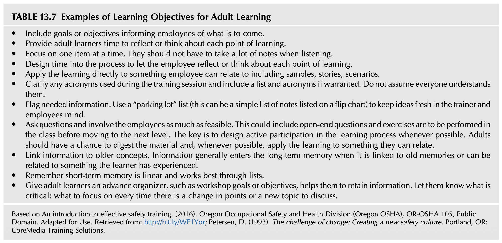
<!--  -->

### 표 13.7 성인 학습을 위한 학습 목표 설정 지침 (TABLE 13.7 Examples of Learning Objectives for Adult Learning)

<!-- Block B95 -->
* 앞으로 어떤 내용이 다루어질 것인지를 직원들에게 명확히 사전 예고하는 학습 목표를 반드시 포함한다.
* 성인 학습자가 각 학습 포인트에 대해 스스로 성찰하고 깊이 생각할 수 있는 충분한 시간을 부여한다.
* 한 번에 단 하나의 핵심 주제에만 집중한다. 강사의 설명을 듣는 동안 너무 많은 필기를 하느라 정신이 분산되지 않도록 배려해야 한다.
* 교육 진행 프로세스 내에 직원이 배운 학습 포인트를 되새김질하고 반추할 수 있는 성찰 시간을 구조적으로 설계한다.
* 실제 샘플, 현장 스토리, 구체적 작업 시나리오 등 직원이 자신의 업무와 직관적으로 연결할 수 있는 소재를 활용하여 학습 내용을 즉각 적용한다.
* 훈련 중에 사용되는 모든 전문 약어(Acronyms)의 의미를 명확히 풀어서 설명하고, 필요하다면 약어 정리 목록을 제공한다. 모든 사람이 약어를 이미 알고 있을 것이라고 지레짐작해서는 안 된다.
* 필수 정보를 시각적으로 강조한다. 강사와 직원의 머릿속에 떠오른 아이디어를 신선하게 유지하기 위해 '파킹 롯(Parking lot, 보류 질문 메모판/플립차트)' 목록을 적극 활용한다.
* 질문을 자주 던지고 가능한 한 직원들을 교육에 깊이 참여시킨다. 다음 단계로 넘어가기 전에 강의실 내에서 개방형 질문에 답하고 직접 실습을 수행하도록 유도한다. 핵심은 언제나 능동적 참여(Active participation)를 유도하도록 프로세스를 설계하는 데 있다. 성인은 학습 자료를 충분히 소화하고, 자신이 공감할 수 있는 실제 업무에 배운 바를 적용해 볼 기회를 가져야 한다.
* 새로운 지식을 기존에 알고 있던 개념과 연결시킨다. 새로운 정보는 장기 기억에 저장된 기존의 기억이나 학습자가 과거에 직접 겪었던 경험과 결합될 때 비로소 장기 기억으로 완벽히 전이된다.
* 인간의 단기 기억(Short-term memory)은 선형적(Linear)이며, 일목요연하게 정리된 목록(List) 형태로 제시될 때 가장 효율적으로 작동한다는 점을 명심한다.
* 성인 학습자에게 워크숍 목표와 같은 '선행 조직자(Advance organizer)'를 사전에 제시하여 정보의 습득과 파지를 돕는다. 논의의 초점이 바뀌거나 새로운 주제가 등장할 때마다 무엇이 가장 핵심적이고 결정적인 요소인지 학습자에게 명확히 인지시킨다.

<!-- Block B96 -->
*(오리건주 직업안전보건국(Oregon OSHA) 효과적인 안전 훈련 가이드(2016) 및 Petersen, D. (1993) 문헌 기반, Public Domain. Adapted for Use.)*

<!-- Block B97 -->
<!-- [표 13.8 스크린샷 삽입 위치: Who Needs Training] -->
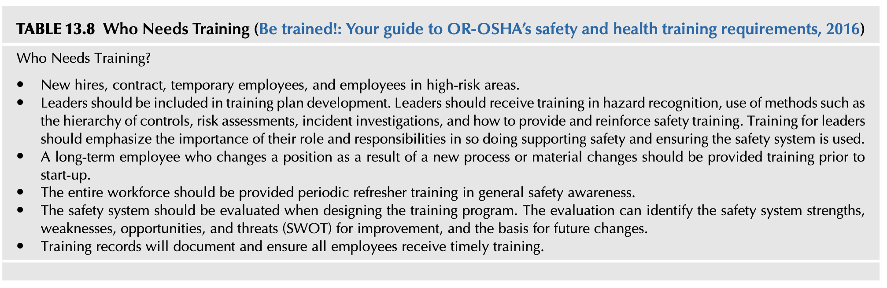
<!--  -->

### 표 13.8 누가 교육을 받아야 하는가 (TABLE 13.8 Who Needs Training - OR-OSHA 2016)

<!-- Block B98 -->
**누가 안전 교육을 받아야 하는가?**
* 신규 입사자, 계약직 및 임시직 근로자, 사내 하도급 도급업체 인력, 그리고 고위험 작업 구역에 투입되는 모든 근로자.
* 경영진 및 리더십 계층은 반드시 교육훈련 계획 수립 단계부터 포함되어야 한다. 리더들은 유해위험요인 식별 기법, 위험 통제 계층구조(Hierarchy of Controls)의 활용, 위험성 평가(Risk Assessment), 사고 조사 기법, 그리고 안전 교육을 현장에서 지원하고 솔선수범하여 강화하는 코칭 방법을 교육받아야 한다. 리더를 위한 교육은 그들이 솔선하여 안전을 후원하고 전사적 안전 시스템이 현장에서 실제로 작동되도록 보장하는 데 있어 리더의 역할과 책임이 갖는 절대적 중요성을 강조해야 한다.
* 신규 공정 도입이나 취급 화학물질 및 원자재 변경으로 인해 직무 보직이 변경된 장기근속 근로자는 설비 시운전 및 작업 착수 전에 반드시 사전 안전 교육을 이수해야 한다.
* 전사 모든 임직원을 대상으로 일반 안전 의식 고취를 위한 정기 보수 교육(Periodic refresher training)을 체계적으로 실시해야 한다.
* 교육훈련 프로그램을 설계할 때 기존 안전경영시스템 전반을 종합적으로 평가해야 한다. 이러한 시스템 평가는 안전경영시스템의 강점(Strengths), 약점(Weaknesses), 기회(Opportunities), 위협(Threats) 요인(SWOT)을 규명하여 실질적 개선의 근거와 미래 변화의 토대를 제공한다.
* 교육훈련 기록 문서를 체계적으로 보존하여 모든 직원이 법정 주기 및 필요에 따라 적시에 교육을 이수했음을 명확히 증명하고 관리해야 한다.

<!-- Block B99 -->
## 사업장 맞춤형 교육 및 훈련의 실행 (CONDUCTING SITE-SPECIFIC EDUCATION AND TRAINING)

교육훈련에 대한 비현실적인 기대는 대개 무엇이 진정으로 우수한 교육 프로그램인가에 대한 근본적인 몰이해에서 비롯됩니다. 교육 대상자의 구체적인 범위와 선정 기준에 대해서는 앞서 살펴본 표 13.8을 참조하십시오.

<!-- Block B100 -->
일반화된 성인 학습 이론이 모든 성인 학습자 개개인에게 기계적으로 들어맞는 것은 아니지만, 대부분의 성인 근로자들은 자신이 현업에서 겪는 실질적 문제 해결에 즉각적인 도움이 되는 실용적 지식을 갈망한다는 공통점을 가지고 있습니다.

<!-- Block B101 -->
강사는 교육을 진행하기에 앞서 현장에서 관찰되는 직무 성과 결함(Performance Deficiency)의 진정한 근본 원인을 규명하려고 노력해야 합니다. 결함의 원인이 지식이나 숙련도의 부족 때문인지, 아니면 결함이 발생할 수밖에 없도록 방치된 비합리적인 작업 환경, 시간 압박, 장비 노후화 때문인지를 먼저 판별해야 합니다.

<!-- Block B102 -->
## 의사소통 (COMMUNICATION)

의사소통(Communication)은 대다수 조직에서 가장 간과되기 쉬우면서도, 손실을 유발하는 사고를 예방하는 데 있어서 가장 필수불가결한 절대적 핵심 요소입니다.

<!-- Block B103 -->
학습 프로세스의 중요한 일부로서, 인간 상호작용의 가장 기본적인 원칙에 대한 교육이 병행될 필요가 있습니다. 안전 지식을 아무리 많이 알고 있어도, 위험 신호가 현장 동료나 관리자에게 정확하고 신속하게 전달되지 않는다면 그 지식은 아무런 쓸모가 없습니다.

<!-- Block B104 -->
> "구두로 전달되는 구두 의사소통(Oral communication)은 화자가 전달하고자 의도한 원래의 메시지와 청자가 실제로 받아들이고 해석한 내용 사이에 엄청난 오해와 왜곡이 발생할 수 있는 대단히 높은 위험성을 내포하고 있다."  
> — (Conklin, 2012)

<!-- Block B105 -->
모든 안전 지시와 훈련은 반드시 '3자 간 확인 대화법(Three-way communication, 3단계 복창 확인)' 절차를 준수해야 합니다:
1. 발신자가 명확하고 간결하게 안전 지시나 정보를 전달한다.
2. 수신자는 전달받은 내용을 자신의 언어로 바꾸어(Paraphrase) 정확히 복창 확인한다.
3. 발신자는 수신자가 올바르게 이해했음을 최종 확인("맞습니다")하거나 오류를 즉시 정정해 준다.

<!-- Block B106 -->
만약 전달된 메시지에 치명적인 유해위험요인 정보가 담겨 있음에도 불구하고 수신자가 이를 제대로 이해하지 못하거나 잘못 해석한다면, 이는 즉각적이고 파국적인 재해로 직결될 수 있습니다.

<!-- Block B107 -->
### 교훈 3 (LESSON LEARNED 3)

저자들은 현장 안전 지침의 전달 과정에서 의사소통의 실패가 초래한 수많은 아차사고와 손실 사건들을 직접 경험했습니다: 관리자가 "밸브 A를 잠그라"고 지시했을 때, 작업자가 이를 건너편 배관의 "밸브 B"로 오인하고 조작하여 대량의 유독 가스가 누출되었던 사례가 대표적입니다. 단순한 구두 지시 뒤에 수신자의 복창 확인과 발신자의 최종 승인이라는 3자 간 확인 대화법 절차가 단 5초만 가동되었더라도 결코 발생하지 않았을 인재(人災)였습니다.

<!-- Block B108 -->
전체 커뮤니케이션 프로세스는 수신자가 수신된 메시지의 정확한 의도를 완벽히 숙지하고 있는지, 그리고 송신자가 수신자의 이해 여부를 객관적으로 검증할 수 있는지에 전적으로 좌우됩니다.

<!-- Block B109 -->
교육훈련을 진행하기 전에 전달할 정보의 공식적인 출처와 최신 법적 기준을 철저히 검증해야 합니다. 부정확하거나 시대에 뒤떨어진 과거의 지식을 직원들에게 가르치는 것은 차라리 가르치지 않는 것보다 훨씬 더 위험합니다.

<!-- Block B110 -->
## 요약 (SUMMARY)

* 안전문화와 안전보건경영시스템은 심도 있고 종합적인 교육 및 훈련 프로그램에 의해 든든하게 지탱됩니다.
* 조직의 문화는 직원들이 일상 업무와 과업을 수행할 때 그들의 규범, 습관 및 행동에 막강한 영향을 미칩니다.
* 강력한 안전문화를 구축하기 위해, 조직은 안전보건경영시스템이 제공하는 긍정적 가치를 전사적으로 강조해야 합니다. 안전문화는 직원들의 지속적인 교육과 훈련의 가치에 대한 깊이 내재화된 신념을 갖추어야 합니다.
* 안전문화는 학습하는 조직(Learning Organization)의 산물입니다. 유해위험요인과 그에 수반되는 위험성이 식별됨에 따라, 이러한 정보를 활용하는 역량은 필수적인 통제 대책의 수립 및 실행을 위한 핵심 열쇠가 됩니다.
* 교육훈련 평가는 직무 수행 요구사항과 안전 관련 실제 수행 사이의 '성과 격차(Gap)'를 규명하는 체계적 프로세스입니다. 교육과 훈련의 궁극적 목표는 구성원의 직무 성과를 변화시키고 바람직한 안전 행동을 정착시키는 데 있습니다.
* 안전 관련 교육 세션을 기획할 때, 이 세션이 조직 내 전사적 의사소통 네트워크 속에서 수많은 연결고리를 가진 하나의 '노드(Node)'임을 명심하십시오. 교육이 부실하게 진행되면 안전경영시스템과 직결된 안전문화 전체를 즉시 저하시키게 됩니다.
* 성공적인 교육훈련 평가를 완수하기 위해서는 성인 학습 이론(Adult learning theory)에 대한 깊은 이해가 필수적입니다.
* 직원들의 숙련도, 전문성 및 현장 경험 수준에 따라 차별화된 교육 방법론을 적용해야 합니다.
* 모든 교육 자료는 각 대상 집단에 가장 적합한 교육 매체를 활용할 수 있도록 맞춤형으로 작성되고 조정되어야 합니다.
* 안전 관련 훈련의 목적은 유해위험요인과 관련 위험성에 대한 지식의 격차를 해소하고, 필수 통제 대책이 현장에서 일관되게 적용되도록 보장하는 데 있습니다. 안전 관련 문제는 생산성이나 기타 조직의 노력을 저해하는 일반적인 성과 결함의 전조 증상일 수 있습니다.
* 학습 목표를 설정함에 있어, 안전문화는 위험 요인 및 통제 정보를 제공하는 것을 필수적인 신규 채용 오리엔테이션과 기초 직무 교육의 핵심으로 바라봅니다. 이러한 초기 훈련은 미래의 바람직한 행동과 올바른 의사결정의 확고한 기틀을 마련해 줍니다.
* 학습 목표는 교육 프로세스나 절차를 나열하는 것이 아니라 최종적인 '학습 성과(Learning outcome)'를 명시하는 선언문입니다. 목표는 수단이 아닌 달성해야 할 결과를 기술합니다.
* 조직문화에 대한 깊은 통찰의 중요성은 교육훈련이 사내에서 어떻게 인식되고, 개발되며, 제공되는가에 그대로 투영됩니다. 조직의 전반적인 분위기가 학습에 적대적이라면 아무리 잘 짜인 커리큘럼도 실질적인 효과를 거둘 수 없습니다.
* 의사소통은 손실 유발 사고를 예방하는 데 있어서 가장 본질적이고 결정적인 핵심 특성입니다.
* 3자 간 확인 대화법(Three-way communication)에서, 메시지나 훈련을 수신한 사람은 발신자가 자신의 이해도를 확인할 수 있도록 수신된 내용을 자신의 말로 바꾸어 복창할 수 있어야 합니다.
* 제14장 '안전보건경영시스템의 평가(Assessing Your Safety Management System)'에서는 안전보건경영시스템의 현재 활동 상태, 행정적 관리 실태 및 전반적 유효성을 객관적으로 검증하는 포괄적 진단 평가 기법을 다룰 것입니다. 일상적으로 정기 수행되는 시스템 평가는 실제 안전문화에 대한 조직의 진정한 가치와 신념을 투영합니다. 구조화되고 정밀한 평가는 안전경영시스템뿐만 아니라 조직 전반의 잠재적 격차와 향후 개선 기회에 대한 구체적인 세부 정보를 제공할 것입니다.

<!-- Block B111 -->
## 장 검토 복습 질문 (CHAPTER REVIEW QUESTIONS)

1. 교육(Education)과 훈련(Training)의 본질적인 개념 차이를 대비하여 상세히 설명하시오.
2. 교육훈련 니즈 평가(Training needs assessment)를 수행하는 데 활용되는 체계적인 방법들을 설명하시오.
3. SMART 기법이 교육훈련의 전반적 목표 및 구체적 세부 목표를 수립하는 데 어떻게 적용되는지 설명하시오.
4. 다양한 교육훈련 방법의 주요 유형들을 열거하고 각 방법의 특성을 설명하시오.
5. 교육훈련 콘텐츠를 개발할 때 근로자의 현장 실무 경험을 깊이 이해해야 하는 이유를 설명하시오.
6. 의사소통(Communication)이 강력한 안전문화를 정착시키는 데 결정적으로 중요한 이유를 논하시오.

<!-- Block B112 -->
## 부록 13.1 우수한 교육훈련 프로그램의 핵심 특성 (APPENDIX 13.1 CHARACTERISTICS OF GOOD TRAINING PROGRAMS)

미국 직업안전보건청(OSHA)의 수잔 하우드 훈련 보조금 프로그램(Susan Harwood Training Grant Program, 2010)의 교육훈련 모범 실무 사례(Best Practices) 종합 검토에 따르면, 교육훈련 프로그램이 현장에서 실질적인 효과를 거두기 위해 반드시 갖추어야 할 4대 핵심 특성은 다음과 같습니다:

<!-- Block B113 -->
### 정확성 (Accurate)
모든 교육 자료는 성인 교육 기법을 깊이 이해하고 있는 자격을 갖춘 교수자에 의해 철저히 준비되어야 합니다. 교육 내용은 최신 법규와 현장 기술의 변화에 맞추어 지속적으로 업데이트되어야 하며, 적절한 수준의 교육 기법과 교수 방법론을 겸비한 검증되고 경험이 풍부한 강사에 의해 원활히 진행되어야 합니다.

<!-- Block B114 -->
### 신뢰성 (Credible)
강사는 전반적인 안전보건 분야의 탄탄한 배경 지식을 갖추고 있거나 해당 안전 전문 분야의 공인된 주제 전문가(Subject Matter Expert, SME)여야 합니다. 또한 성인 학습자를 능숙하게 교육할 수 있는 강의 경험을 갖추어야 합니다. 아울러 안전 실무 현장에서의 풍부한 실무 지식과 현장 경험, 그리고 토론을 이끌어내는 퍼실리테이션 역량은 강사에 대한 학습자의 높은 신뢰도 형성에 크게 기여합니다.

<!-- Block B115 -->
### 명확성 (Clear)
교육 프로그램의 개발은 정확할 뿐만 아니라 신뢰할 수 있어야 하며, 해당 주제의 모든 핵심 영역이 누락 없이 다루어지도록 다양한 전문 문헌과 공식 자료에 기초해야 합니다. 또한 교육은 현장 직원의 눈높이에서 대단히 명확하고, 간결하며, 이해하기 쉬워야 합니다. 만약 교육 자료가 대학교육을 받은 사람이나 특수 전문 용어를 아는 사람만이 이해할 수 있는 수준으로 작성되었다면, 그 프로그램은 조직의 안전 니즈를 충족시키는 데 완전히 실패한 것입니다 (Susan Harwood Best Practices, 2010).

<!-- Block B116 -->
교육과정 개발자는 교육 자료의 가독성(Readability)과 언어 선택이 실제 교육 대상 청중의 수준과 완벽히 부합하도록 철저히 검토해야 합니다. 따라서 교육 자료는 현장 근로자들이 일상에서 사용하는 자연스러운 구어체 언어와 어법으로 알기 쉽게 작성되어야 합니다 (Susan Harwood Best Practices, 2010).

<!-- Block B117 -->
### 실용성 (Practical)
교육 프로그램은 직원들이 자신의 실제 작업 환경에서 유익하고 실질적인 도움이 된다고 체감할 수 있는 실무 정보, 혁신적 아이디어 및 구체적인 직무 기술을 제공해야 합니다. 교육 세션에서 제시된 안전 관련 정보가 자신의 작업 환경에 어떻게 즉각 적용될 수 있는지를 직원이 직접 눈으로 확인하고 체득할 때 비로소 성공적인 '지식의 현장 전이(Transfer of knowledge)'가 완벽하게 일어납니다.

<!-- Block B118 -->
## 부록 13.2 OSHA 기준 및 훈련 지침의 교육훈련 요구사항 (APPENDIX 13.2 TRAINING REQUIREMENTS IN OSHA STANDARDS AND TRAINING GUIDELINES)

부록 13.2는 OSHA 기준 및 훈련 지침에서 요구하는 구체적인 교육훈련 요구사항에 대한 훌륭한 개요를 제공하는 공식 지침 문서인 “Training Requirements in OSHA Standards and Training Guidelines”를 소개합니다.

<!-- Block B119 -->
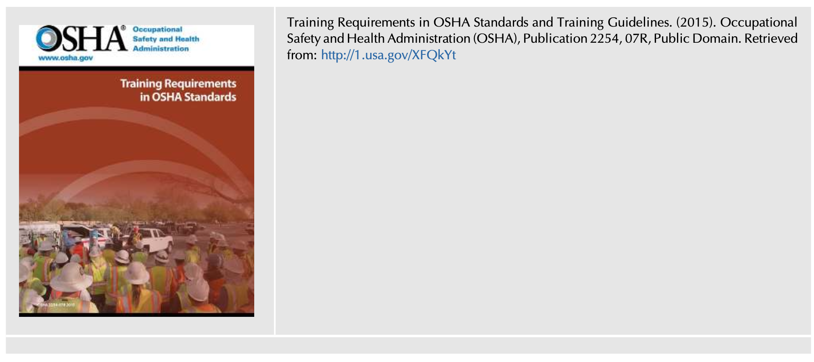

<!-- Block B120 -->
OSHA 기준 및 훈련 지침의 훈련 요구사항 (Training Requirements in OSHA Standards and Training Guidelines, 2015). 미국 직업안전보건청(OSHA), Publication 2254, 07R, Public Domain. (자료 출처: http://1.usa.gov/XFQkYt)

<!-- Block B121 -->
## 참고 문헌 (BIBLIOGRAPHY)

* A guide to voluntary training and training requirements. (2017). NC: Department of Labor, Occupational Safety and Health Division (OSHA). Public Domain.
* A model for research on training effectiveness. (1999). DHHS (NIOSH), Publication No. 99-142. CDC, NIOSH, Public Domain.
* An introduction to effective safety training. (2016). Oregon Occupational Safety and Health Division (Oregon OSHA), OR-OSHA 105, Public Domain.
* Be trained!: Your guide to OR-OSHA’s safety and health training requirements. (2016). Oregon OSHA, Public Domain.
* Best Practices for the Development, Delivery, and Evaluation of Susan Harwood Training Grants. (2010). OSHA, OSHA 3686-09 2010, Public Domain.
* Cheng, B., Wang, M., Yang, S. J., Peng, J., et al. (2011). Acceptance of competency-based workplace e-learning systems: effects of individual and peer learning support. Computers & Education, 57(1), 1317–1333.
* Concepts and principles. (2009). Human performance improvement handbook. Vol. 1. US Department of Energy.
* Criteria for Accepted Practices in Safety, Health, and Environmental Training, Z490.1. (2001). ANSI/ASSE.
* Enlisted professional military education opportunities. (2016). United States Marine Corps University, Public Domain.
* Geigle, S. J. (2017). Introduction to OSH training, train the trainer series. OSHAcademy (TM), Course 703 Study Guide.
* Human performance tools for individuals, work teams, and management. (2009). Human performance improvement handbook. Vol. 2. US Department of Energy Public Domain.
* Leadership development. Field manual. Headquarters, Department of the Army, Public Domain 6-22.
* McMillan, D. (2009). How not to use power point.
* Monnette, J. (2018). Millennials: Listening to their ideas will make the workplace a safer, more innovative space.
* Occupational Health and Safety Systems (2012). The American Industrial Hygiene Association. ANSI/AIHA Z10.
* Page, R. (2003). Hope is not a strategy: The 6 keys to winning the complex sale. McGraw-Hill Professional.
* Risk management handbook. (2016). (FAA-H-8083-2 1st ed.). Federal Aviation Administration.
* Roughton, J., & Lyons, J. (1999). Training program design, delivery, and evaluating effectiveness: an overview. The Synergist, American Industrial Association.
* Ruey, S. (2010). A case study of constructivist instructional strategies for adult online learning. British Journal of Educational Technology, 41(5), 706–720.
* System safety training. (2000). Federal Aviation Administration (FAA), Public Domain.
* Training and development, planning & evaluating. (2017). Office of personnel management, public domain.
* Training development. (2018). American Society for Training & Development.
* Training Requirements in OSHA Standards and Training Guidelines (2015). OSHA, Publication 2254, 07R, Public Domain.
* Training the trainer. (2008). Canadian Coast Guard Auxiliary—Pacific.

<!-- Block B122 -->
## 추가 권장 도서 (FURTHER READING)

* Petersen, D. (1993). The challenge of change: Creating a new safety culture. Portland, OR: CoreMedia Training Solutions.

