# Chapter 13 Developing Safety Training Needs

*Safety Culture. https://doi.org/10.1016/B978-0-12-814663-7.00013-3*  
*©2019 Elsevier Inc. All rights reserved. pp. 327–343*

---

<!-- [그림 삽입 위치: Chapter 13 Overview] -->
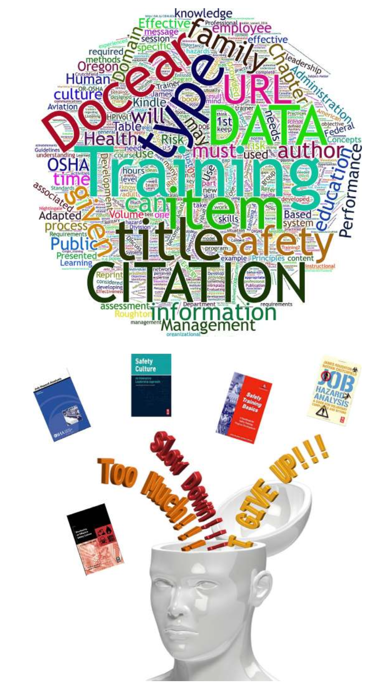
<!--  -->

> "No one learns as much about a subject as one who is forced to teach it."  
> — Peter F. Drucker

---

## INTRODUCTION

The safety culture and the safety process is supported by a competent, comprehensive education and training program. The culture of an organization has a powerful influence on employee norms, habits, and behaviors as they complete their daily assignments and tasks. The strength of the underlying unconscious perceptions, thoughts, beliefs, and so on, of the organization, can override the best safety-related training designed to influence behavior.

Training may attempt to promote beliefs about the value and importance of safety, yet on leaving the training session, if nothing has changed in how work is managed, employees return to the behavior driving the organization. The desired impact of training can only be sustained when the internal organizational constraints, time pressure, budgets, mandates, leadership skills, and so on, driving the culture is understood. Training would then be designed and structured to overcome or reduce these constraints.

Through experience, the authors found that training is more complicated than telling employees how to perform their jobs in a limited time frame. Information and training should be able to transfer necessary job knowledge from the designated “trainer” to a “learner.” Education and training should be provided using methods employees can understand, accept, and immediately use in their assigned task.

> **Hope Is Not a Strategy**  
> — (Page, 2003)

On completion of this chapter, you should be able to:
* Explain the differences between education and training.
* Explain methods used to conduct a training needs assessment.
* Explain how the SMART method can be used to set training goals and objectives.
* Explain and list the types of training methods.
* Explain why an understanding of employee experience is needed in developing training content.
* Explain why communication is critical to the safety culture.

---

## INITIAL EDUCATION AND TRAINING ASSESSMENT

The organization’s history of training efforts should be studied before developing any training program. A historical perspective would identify the current scope of training, successful past efforts, the most effective media and its content, and the nature of required trainer expertise. The training history can provide insights on training effectiveness when current work conditions are considered.

As part of a communication network, a strong positive link is essential to the training department of an organization. A close relationship should be maintained with the organization’s training staff to ensure that the safety professional and the safety management system are not in conflict with existing training programs. The training staff may not be able to provide core safety training depending on their mandated responsibilities. If relationships with the training department are solid, a team approach may be possible for assessment, structuring, design, and delivery of required safety management system and safety-related training criteria.

For a strong safety culture, the organization should place a strong emphasis on the positive value the safety management system brings to the organization. The culture should strengthen embedded beliefs in the value of continuing education and training of leaders and employees. The organization with a strong culture of learning ensures that all employees have a working knowledge of how the safety management system operates and their responsibilities in continuous learning.

In another respect, some organizations may not have any training staff to develop specific training needs. Training development may be up to one person who has been assigned duties of the safety professional. Based on experience, it is sometimes difficult to be able to develop a quality presentation that meets all desired requirements.

---

## EDUCATION AND TRAINING PERFORMANCE

A robust safety culture is also a product of a learning organization. As hazards and associated risk are identified, the ability to use this information becomes key to establishing and implementing necessary controls. Leadership and employees should know and understand the core concepts of a safety management system. As organizations evolve and change, the education and training process keeps information flowing through the organization. The process needs to be timely and designed to meet the changes in conditions.

The objective of education and training is to change or improve employee performance by developing desired operational behaviors. The setting of training goals and objectives for the improvement of education and training should be based on specific, measurable, and performance-based objectives (SMART) goals, as discussed in Chapter 4, Establishing the Direction for the Safety Culture. Refer Appendix 13.1 for an example of some characteristics of a good training program.

For example, traditional safety training sessions consist of classroom or group lectures, watching videos on safety topics, or reading handouts of safety-related materials. While useful information may be provided, the potential of retaining or understanding the information is dramatically reduced unless a blend of hands-on and physical demonstration is included with a timely follow-up. Fig. 13.1 provides an overview of successful training techniques.

---

<!-- [그림 13.1 스크린샷 삽입 위치: Successful training techniques] -->
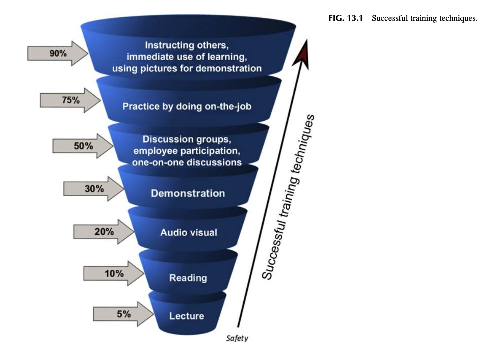
<!--  -->

### FIG. 13.1 Successful training techniques.

---

This perception of what constitutes appropriate training is based on methods educational institutions have had in place for decades and remains embedded in many organizations. “Off the shelf” training programs are often used to save time and budget with limited or no effort made to modify the training for a specific group. A generic training approach can fail to ensure that employees understand why a set of established rules should be followed. Training employees can become rote and not fix a perceived problem or gain accurate knowledge. Training should be designed with properly designed guidelines with supplemental information (Roughton & Lyons, 1999; Fig. 13.2).

> "Though it seems hard to believe, instructors are frequently asked to develop courses intended to teach people what they already know, or to use instruction to solve problems that can’t be solved by instruction."  
> — Robert Mager

---

<!-- [그림 13.2 스크린샷 삽입 위치: Mager’s decision tree for improving safety performance] -->
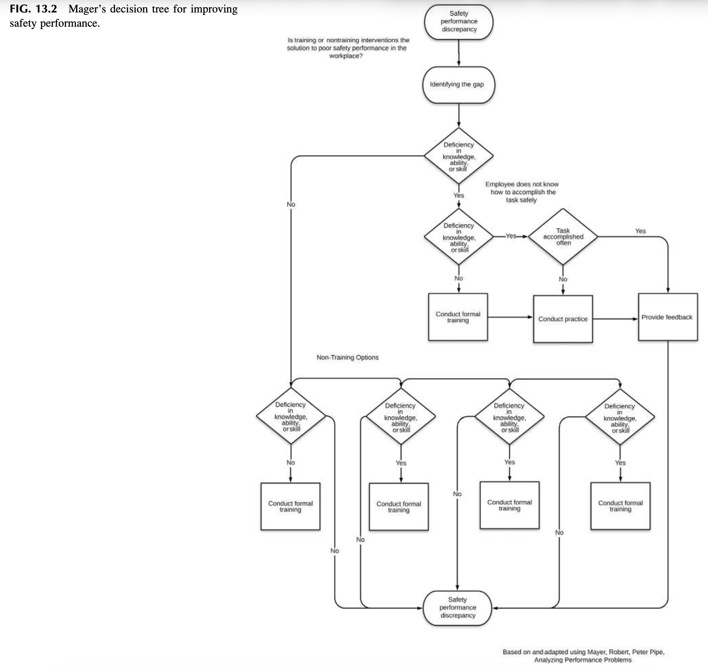
<!--  -->

### FIG. 13.2 Mager’s decision tree for improving safety performance.

---

## LEADERSHIP SUPPORT FOR TRAINING

Safety training needs to have the support of all levels of the organization to be successful. If a safety management system has been selected and established, safety training becomes part of a formal structure acknowledged by the leadership team.

For example, in ANSI Z10-2012, an organization is to “develop processes defining safety competencies, appropriate education and training are provided, employees have access to training, and it is in a language they understand, training is timely, and instructors are competent” (Occupational Health and Safety Systems, 2012; System safety training, 2000; refer Table 13.1).

When using an approach such as what was discussed in Chapter 11, Developing an Activity-Based Safety System, supervisors, and team leaders can potentially become mentors or coaches who can further reinforce safety-related information provided during formal training sessions. In the daily preshift reviews, weekly summary followed by in-depth monthly meetings, employees can discuss what they have learned and share feedback on the effectiveness of the training materials and content.

Training elements suggested in the Occupational Safety and Health Administration (OSHA) basic training guidelines provide an outline of the design and implementation of a suggested training program. Refer Table 13.2 for a list of OSHA training development guidelines.

---

<!-- [표 13.1 스크린샷 삽입 위치: Overview of Education, Training, Awareness, and Competency] -->
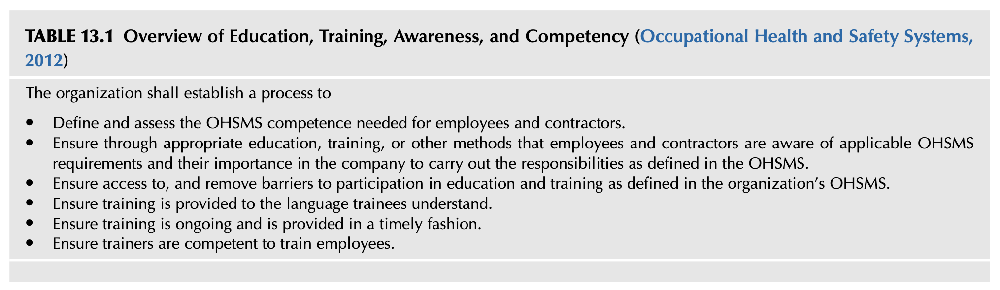
<!--  -->

### TABLE 13.1 Overview of Education, Training, Awareness, and Competency (Occupational Health and Safety Systems, 2012)

**The organization shall establish a process to:**
* Define and assess the OHSMS competence needed for employees and contractors.
* Ensure through appropriate education, training, or other methods that employees and contractors are aware of applicable OHSMS requirements and their importance in the company to carry out the responsibilities as defined in the OHSMS.
* Ensure access to, and remove barriers to participation in education and training as defined in the organization’s OHSMS.
* Ensure training is provided to the language trainees understand.
* Ensure training is ongoing and is provided in a timely fashion.
* Ensure trainers are competent to train employees.

---

<!-- [표 13.2 스크린샷 삽입 위치: OSHA Training Development Guidelines] -->
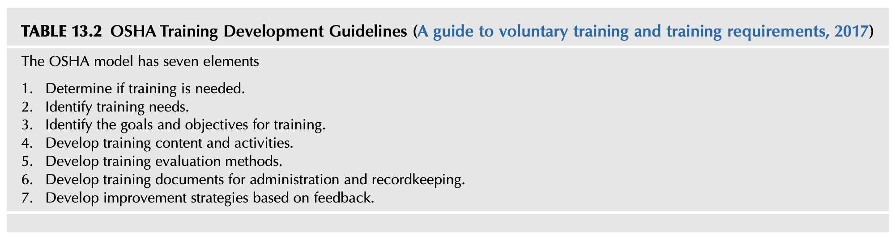
<!--  -->

### TABLE 13.2 OSHA Training Development Guidelines (A guide to voluntary training and training requirements, 2017)

**The OSHA model has seven elements:**
1. Determine if training is needed.
2. Identify training needs.
3. Identify the goals and objectives for training.
4. Develop training content and activities.
5. Develop training evaluation methods.
6. Develop training documents for administration and recordkeeping.
7. Develop improvement strategies based on feedback.

---

The OSHA training model is designed to be used to enhance a safety training program. Using this model provides a structure for improvement and better administration of safety training programs. The structure can address site-specific issues, fulfill the learning needs of employees, and strengthen the overall safety management system. Refer Appendix 13.2 for the public domain document from the Occupational Safety and Health Administration, “Training Requirements in OSHA Standards” (Training Requirements in OSHA Standards and Training Guidelines, 2015) that can be downloaded and used for your library.

---

## CONDUCTING EDUCATION AND TRAINING NEEDS ASSESSMENT

The education and training assessment is the process of identifying employee performance requirements and the "gap" between required safety-related performance and what is being completed. An ongoing training needs assessment is part of the current analysis of an organization.

> "A needs assessment is the process of identifying the 'gap' between performance required and current performance. When a difference exists, it explores the causes and reasons for the gap and methods for closing or eliminating the gap. A complete needs assessment also considers the consequences of ignoring the gaps."  
> — *(Training and development, planning, & evaluating, 2017)*

Organizations are constantly changing and evolving as industry and business conditions change. Potential knowledge gaps can create new training needs as new hazards and risk are identified. This gap may create situations where instruction becomes out of date and does not match the requirements for control of the new hazards and associated risks. A combination of ongoing assessments using a variety of methods, that is, risk guidance cards as discussed in Chapter 9, Defining Risk Perception, hazard and risks assessments, ABSS, as discussed in Chapter 11, Developing an Activity-Based Safety System, feedback activities, along with safety management system reviews and audits are critical to ensuring hazard and risk control information is current.

---

## E-LEARNING

Over the past two decades, e-learning has emerged as a widespread system of training leaders and employees in the workplace. The popularity of e-learning is due to its user-friendliness, availability, internet-based delivery system, and being a low cost per learner. The concern from a safety management system viewpoint is that existing e-learning systems fail to match learning with specific organizational operations, industry language, and individual literacy needs. The upside is that e-learning can meet government employee training mandates which confirm why e-learning is vastly sought after. Unfortunately, this takes the employee training activities out of the hands of leadership.

E-learning is more than providing an employee with a computer and web-based generic safety training session. Sitting an employee in front of a computer and simply turning it on, and clicking on play, while the employee presses the mouse or touches the screen to advance the program does not constitute a positive learning environment.

According to Wang, Ran, et al., “E-learning systems should first, align individual and organizational learning needs. This can be achieved by (a) identifying the training requirements of an organization based on its mission and vision, job design, and reward mechanism; and (b) helping employees determine their learning objectives based on the organizational request and individual performance. Second, the system should link learning with work content and the performance request. This can be achieved by (a) identifying the expertise required for a job position, and (b) providing suitable learning resources and instructions for learners to develop the required expertise. Third, the system should be able to facilitate social interaction and knowledge exchange in the learning community. The knowledge sharing and transfer processes can be directed by linking them to the work content and practices and by linking learners of similar background or learning interest” (Cheng, Wang, Yang, Peng, et al., 2011).

E-learning can be useful when workplace learners view online courses as a positive experience and are provided with proper course direction. Further, learner interaction with a proficient and knowledgeable course instructor can enhance the learning environment. Ruey’s study noted the instructor’s role in providing learners with feedback, assessment plans, and measurable outcomes (Ruey, 2010). When instructors performed in an unprepared manner, learners were found to be less enthusiastic about the course. The concern is e-learning may be ineffective, limited in motivating employees learning desire, and failing to keep skill proficiency up to needed operational performance requirements (Leadership development, 2015).

The ongoing advancement of learning technology will hopefully create a vibrant and robust workplace training environment composed of content tailored to the organization’s operations, industry language, and the employee’s literacy needs. Optimistically, this will advance and complement leadership’s existing face-to-face employee training and coaching situations. Lastly, this anticipative outcome will supplement the safety management system that can benefit the organization’s safety culture.

---

## THE CHALLENGE TO TRAINERS

In the current social media environment, keeping the attention of employees during training sessions is becoming more difficult. To say the overall population has become immersed in the use of smartphones and other devices is an understatement. Daily observation shows the almost constant use of some form of device, regardless of the nature of the job. This trend is accelerating with information published digitally and received through some sources. The challenge to training development is being creative and finding new and innovative techniques to incorporate this trend into the training process.

As access to the internet is now almost universal, the potential for erroneous or false information can easily occur. Further, training session participants can access the same resources as trainers or even challenge the information being presented. Before designing a training session, in-depth review of any required information begins by initially validating any information to be used for its relevant, currency, accuracy, and source. The goal is to identify which sources of training content are the most reliable, accurate, and can be understood and useful to the audience.

Goals and objectives provide the guidance necessary to structure new or improved training criteria by providing clear links to gaps in knowledge or skills. Training is more than just selecting a video or creating a handout. When designing or modifying safety training, a structured format should be used to meet the needs of leadership and employees.

Refer Table 13.3 for an outline of regarding steps on training development, based on ANSI/ASSE Z490.1, Criteria for Accepted Practices in Safety, Health, and Environmental Training (2001).

Table 13.4 provides suggested questions from the US Federal Aviation Administration (FAA) designed to drill down into the specialized needs of training employees.

---

<!-- [표 13.3 스크린샷 삽입 위치: Steps in Course Development] -->
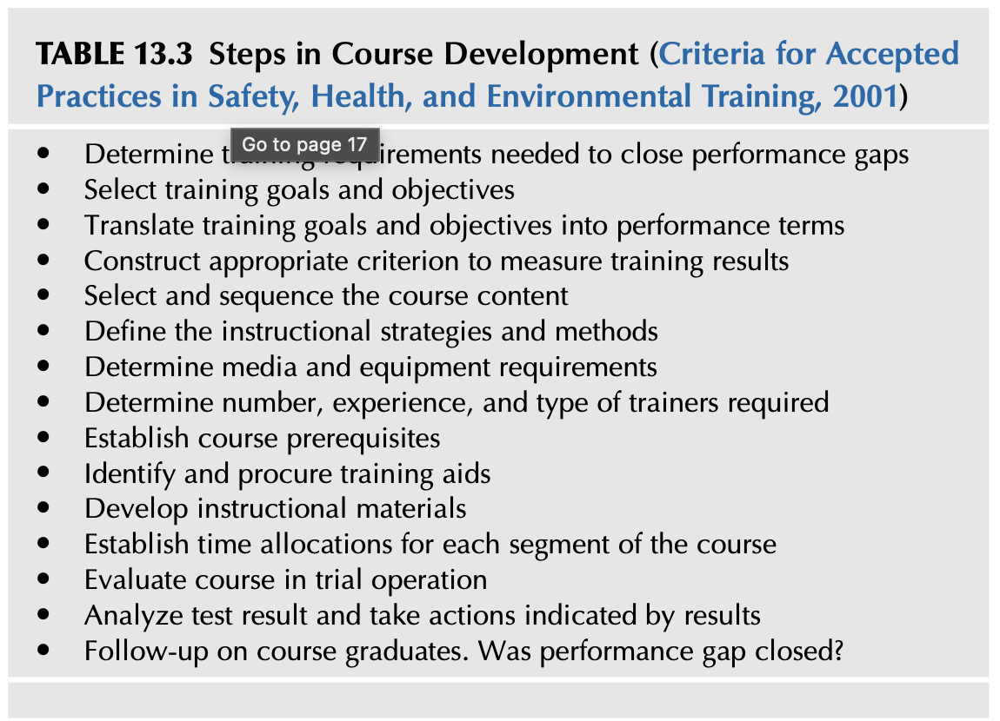
<!--  -->

### TABLE 13.3 Steps in Course Development (Criteria for Accepted Practices in Safety, Health, and Environmental Training, 2001)

* Determine training requirements needed to close performance gaps
* Select training goals and objectives
* Translate training goals and objectives into performance terms
* Construct appropriate criterion to measure training results
* Select and sequence the course content
* Define the instructional strategies and methods
* Determine media and equipment requirements
* Determine number, experience, and type of trainers required
* Establish course prerequisites
* Identify and procure training aids
* Develop instructional materials
* Establish time allocations for each segment of the course
* Evaluate course in trial operation
* Analyze test result and take actions indicated by results
* Follow-up on course graduates. Was performance gap closed?

---

<!-- [표 13.4 스크린샷 삽입 위치: Questions to Be Asked When Assessing Training Needs] -->
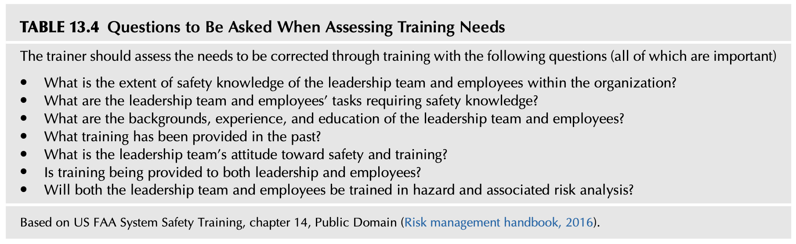
<!--  -->

### TABLE 13.4 Questions to Be Asked When Assessing Training Needs

The trainer should assess the needs to be corrected through training with the following questions (all of which are important):
* What is the extent of safety knowledge of the leadership team and employees within the organization?
* What are the leadership team and employees’ tasks requiring safety knowledge?
* What are the backgrounds, experience, and education of the leadership team and employees?
* What training has been provided in the past?
* What is the leadership team’s attitude toward safety and training?
* Is training being provided to both leadership and employees?
* Will both the leadership team and employees be trained in hazard and associated risk analysis?

*(Based on US FAA System Safety Training, chapter 14, Public Domain (Risk management handbook, 2016))*

---

## UNDERSTAND THE DIRECTION OF TRAINING

When developing a safety-related training session, the session can be viewed as a communication “node” within the network of connections within the organization, as discussed in Chapter 3, Analyzing and Using Your Network. When instructors or trainers present to the leadership team or a group of employees, they are addressing more than the immediate audience. The information presented may be impacting a greater organizational network, the node, as word spreads about the value or lack of value of the training provided. If poorly presented or considered of little value, it may degrade the safety culture.

Training should not be something that needs to be painfully endured. As such, training should never be performed in a nonprofessional manner or give the appearance that the training is a “checked off” item to be completed. If this is the case, the style, mannerism, professionalism, attitude, and expertise of the trainer may be negatively communicated throughout the organization.

The task of blending the required concepts of training can be challenging when considering the many ingredients necessary for good safety education and training program. What is communicated and the way the information is stated can go a long way toward increasing the influence of the safety management system as well as improving relationships with employees.

> A successful trainer listens “...to the ideas and opinions of others and asks for clarity when they are confronted with information or situations they do not understand.”  
> — *(Enlisted professional military education opportunities, 2016)*

---

## THE CONCEPTS OF EDUCATION AND SAFETY TRAINING

Education and training need to be defined so that everyone understands the stated concepts. As such, the National Institute for Occupational Safety and Health (NIOSH) provides a good definition for training and education as follows:

> **Training** is widely understood as communication directed at a defined population to develop skills, modifying behavior, and increasing competence. Generally, training focuses exclusively on what needs to be known.  
> — *(A model for research on training effectiveness, 1999)*

> **Education** is a longer term process that incorporates the goals of training and explains why particular information must be known. Education emphasizes the scientific foundation of the material presented. Both training and education induce learning, a process that modifies knowledge and behavior through teaching and experience.  
> — *(A model for research on training effectiveness, 1999)*

The Oregon Occupational Safety and Health (Oregon OSHA), a division of the Department of Consumer & Business Services, in its introduction to safety training, provides several definitions for What is Education:

**What is “Education”?**
* That which leads out of ignorance.
* Anything that affects our knowledge, skills, and attitudes/abilities (KSA’s).
* The “why” in safety educates about the natural (hurt and health) and system consequences (discipline, reward) of behavior.
* Primarily increases knowledge and attitudes.  
*(An introduction to effective safety training, 2016)*

In contrast, The Canadian Coast Guard Auxiliary, Pacific provides several definitions for What is Training:

**What is “Training?”**
* One method of education.
* The “how to” in safety.
* Primarily increases knowledge and skills.
* A specialized form of education that focuses on developing or improving skills, the focus on performance.  
*(Training the trainer, 2008)*

---

## A CAUTIONARY NOTE

The US Department of Energy (DOE), Human Performance Handbook warns that training is not the sole solution to safety-related issues. For example, the authors have experienced training used as the “end all” or panacea for incident investigations. “Retrain the employee” is used as a shortcut to complete the incident form, leaving a full analysis of what happened to create a loss-producing event undetermined.

It cannot be stated enough: Many times, training is the default solution. Training or retraining is not the solution for every issue. Training is only one part of a good safety management system.

> "...retraining workers to do work that is already basically memorized and automatic, performed with little conscious thought because of the nature of the work, is a waste of time and is an insult to the worker. It is difficult to train a worker not to repeat something he or she did not intend to do in the first place. Training is not the solution in these instances."  
> — *(Concepts and principles, 2009)*

---

## COURSE DEVELOPMENT PROCESS

Different training methodologies may be necessary depending on the skills, expertise, and experience of trainees. All training materials should be written and adapted to determine what is the appropriate training content and the best media to use. The method and media will vary based on what works best: eLearning and internet-based training, hardcopy workbooks or handouts, one-on-one or group training sessions, audio or video presentations, and so on (An introduction to effective safety training, 2016). The resources available are wide-ranging in depth, scope, quality, and costs.

Refer Table 13.5 for examples of some types of safety training needs.  
Refer Table 13.6 for examples of common types of training methods.

---

<!-- [표 13.5 스크린샷 삽입 위치: Examples of Types of Safety Training Needs] -->
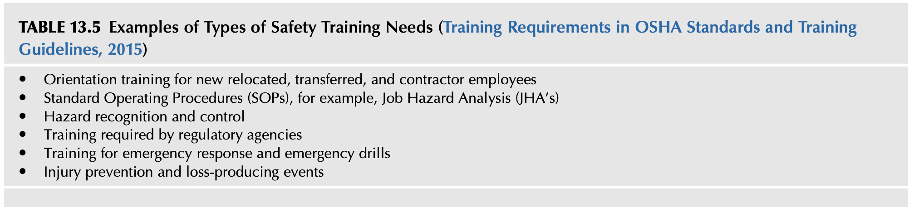
<!--  -->

### TABLE 13.5 Examples of Types of Safety Training Needs (Training Requirements in OSHA Standards and Training Guidelines, 2015)

* Orientation training for new relocated, transferred, and contractor employees
* Standard Operating Procedures (SOPs), for example, Job Hazard Analysis (JHAs)
* Hazard recognition and control
* Training required by regulatory agencies
* Training for emergency response and emergency drills
* Injury prevention and loss-producing events

---

<!-- [표 13.6 스크린샷 삽입 위치: Common Types of Training Methods] -->
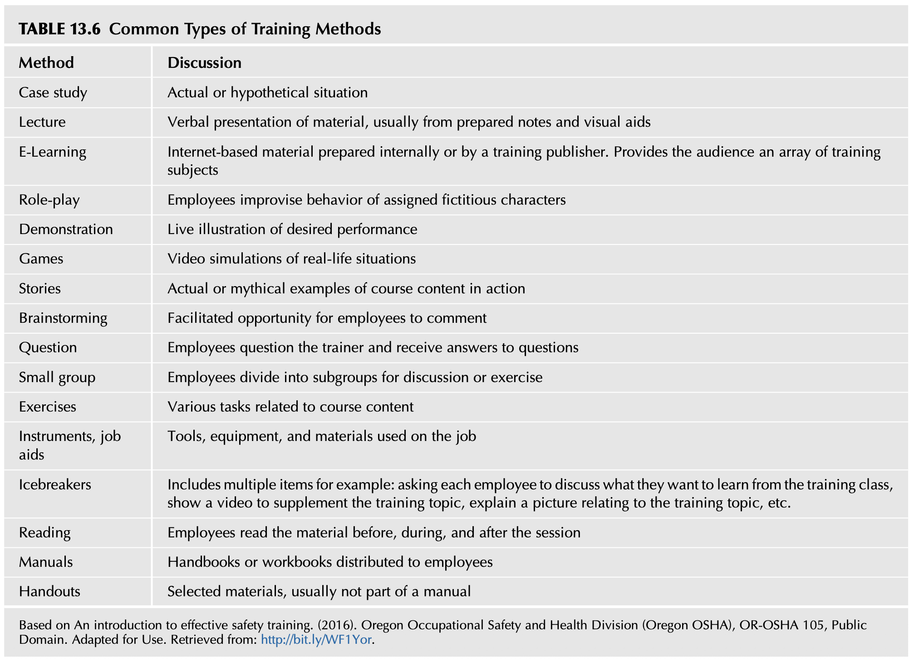
<!--  -->

### TABLE 13.6 Common Types of Training Methods

| Method | Discussion |
| :--- | :--- |
| **Case study** | Actual or hypothetical situation |
| **Lecture** | Verbal presentation of material, usually from prepared notes and visual aids |
| **E-Learning** | Internet-based material prepared internally or by a training publisher. Provides the audience an array of training subjects |
| **Role-play** | Employees improvise behavior of assigned fictitious characters |
| **Demonstration** | Live illustration of desired performance |
| **Games** | Video simulations of real-life situations |
| **Stories** | Actual or mythical examples of course content in action |
| **Brainstorming** | Facilitated opportunity for employees to comment |
| **Question** | Employees question the trainer and receive answers to questions |
| **Small group** | Employees divide into subgroups for discussion or exercise |
| **Exercises** | Various tasks related to course content |
| **Instruments, job aids** | Tools, equipment, and materials used on the job |
| **Icebreakers** | Includes multiple items for example: asking each employee to discuss what they want to learn from the training class, show a video to supplement the training topic, explain a picture relating to the training topic, etc. |
| **Reading** | Employees read the material before, during, and after the session |
| **Manuals** | Handbooks or workbooks distributed to employees |
| **Handouts** | Selected materials, usually not part of a manual |

*(Based on An introduction to effective safety training. (2016). Oregon Occupational Safety and Health Division (Oregon OSHA), OR-OSHA 105, Public Domain. Adapted for Use. Retrieved from: http://bit.ly/WF1Yor.)*

---

## DEVELOPING LEARNING ACTIVITIES

> "A lesson plan is an instructional prescription, a blueprint describing the activities the instructor and student may engage in to reach the objectives of the course. The main purpose is to prescribe the key events that should occur during the module."  
> — Robert Mager

The current workforce generation has been raised on entertainment provided through very creative media sources, and training activities should consider the various delivery methods. Media delivery systems range from smartphones, electronic tablets, computer gaming, internet resources, reality television, movies, and other social media resources. Delivering information does not require a centralized group session as these devices can bring together widely geographically scattered employees very economically.

As a result, many of the individuals entering the workforce already have years of experience with interactive and dynamic learning methods indirectly developed. Education and training should take account of this potential skill level of the audience.

### LESSON LEARNED 1

As an example of how presentations are shaped by available time and budget and not by effective visual techniques consider the following:

PowerPoint© or similar software has been used to develop training presentations quickly. Depending on the topic, many presentations place too much information on individual slides. The historical reason for putting a large amount of detailed training information on each slide is based on limited time and economics. Presentations are to serve multiple purposes. As presentation slides are usually printed out for use as a hardcopy handout to participants, the more information per slide, fewer pages need to be printed. This approach can create hard to read slides with too much detail. Less information per page leads to uneconomical handouts.

A better approach, which does require more time, is to have two versions of the presentation. One is designed as a handout with multiple slides on each printed page. The second version can be expanded to limit each slide to only one main thought or theme on each slide. This method has the benefit of using larger fonts which can be read from a distance and reduces clutter. A digital presentation can have unlimited slides, for better or worse.

A third approach is available to many organizations—place the presentation on the organization’s computer servers and give access to trainees to review or print at their convenience. The software can track and develop reports documenting who has accessed and reviewed the materials.

An internet video, “How not to use PowerPoint,” has interesting insights for trainers to avoid (McMillan, 2009).

An extensive range of professional organizations, such as the American Society of Training and Development (Training development, 2018), can provide current techniques and methods for organizational learning and adult education.

The training needs, the level of motivation, educational background, and many other factors can affect the training environment. No two training audiences are precisely alike. A wide variation in how groups respond can be experienced even when giving the same information to groups within the same organization. One session’s participants would be involved and engaged while the next session an hour later might be disengaged and bored. Preliminary discussions with leadership on the expected participation and quality training design may reduce the different levels of participation between groups.

---

## PERFORMANCE DEFICIENCY

A safety-related problem may be a precursor to general performance issues impacting productivity or other organizational endeavors. Safety-related training closes gaps in knowledge about hazards, their associated risk, and the necessary controls used. When gaps are closed, the opportunity for improving performance is created. For example, an employee may not understand the required sequence of tasks or the decision rules to follow to maintain the desired safety-related actions. A job training assessment can help to identify potential problem-solving skills that have not been provided to guide decision making.

Three types of performance, as briefly discussed in Chapter 12, Using the Job Hazard Analysis should be considered when designing specific training criteria:
* **Skill-based performance**: Involves highly practiced physical actions in common situations involving little conscious monitoring. Such actions are usually executed from memory without significant conscious thought or attention.
* **Rule-based performance**: Called the rule-based level because people apply memorized or written rules. These rules may have been learned as a result of interaction with the facility, through formal training, or by working with experienced workers. The level of conscious control is between the knowledge- and skill-based models. The rule-based level follows an IF (symptom X), THEN (situation Y) logic.
* **Knowledge-based performance**: Knowledge-based behavior is a response to an unfamiliar situation (no skill or rule is recognizable to the individual). The person should rely on his or her prior understanding and knowledge, their perceptions of present circumstances, similarities of the current situation and similarities to circumstances encountered before, and the scientific principles and fundamental theory related to the perceived situation at hand (Concepts and principles, 2009).

Understanding the type of job, the skill, rule, and knowledge-based performance, aids in identifying and determining the appropriate training solution. By analyzing the skill, rule, or knowledge gap, the role education and training will play in resolving training needs can be established.

---

## ESTABLISHING LEARNING OBJECTIVES

A safety-related training learning objective is a brief, clear statement of what the leadership team and employees will be able to do as a result of the learning process. The groundwork for the learning objective begins with the training assessment. The learning objectives should include a focus on the key jobs skills where steps and tasks have a higher potential for a loss-producing event.

Learning objectives within a viable safety culture would view the provision of hazard and associated risk information as part of employee orientation, onboarding, and training. The initial training provides the organizational framework and sets the stage for future desired behavior and decision making. A training process provides the ability to continue learning ensures leadership and employees are aware and knowledgeable about the hazards and associated risks. Over time and with loss-producing events generally being rare occurrences, the potential for “scope drift” is reduced, as discussed in Chapter 4, Establishing the Direction for the Safety Culture.

The training assessment should list the behaviors and actions the safety management system has determined to be needed in the control or prevention of injury, loss, or damage. Learning objectives are crucial because instructional strategies and evaluation techniques are an outgrowth of the learning objectives (Risk management handbook, 2016; System safety training, 2000).

> "Now it’s time to describe the instructional outcomes (the need to do’s); it’s time to construct a verbal word picture that will help guide you in developing the instruction and help guide students in focusing their efforts."  
> — Robert Mager

Unless it is known as to what the desired results of training, measuring success regarding upstream or preloss measures may not be possible. Safety-related training is too often measured by the number of people in the classroom and not their ability to understand and use the intended knowledge and information.

We should not forget and need to take into consideration that the workforce is changing, and methods used by organizations should evolve as well. As discussed previously, new employees entering the workforce are accustomed to being connected to an infinite amount of information at all times. Outdated training videos and materials will not cut it for the next generations of employees and leaders. To get the most out of new employees and attract them to an organization, an organization’s processes must match the incoming worker skill sets (Monnette, 2018).

---

## GUIDELINES FOR WRITING LEARNING OBJECTIVES

The learning objective is a statement describing the learning outcome, rather than a learning process or procedure. It describes results, rather than the means of achieving those results. All learning objectives should be well written and in clear, measurable terms, so both the trainer and the employee will understand what is expected from the training session. Training objectives ensure the design and selected instructional content and procedures are organized to take advantage of the learner’s efforts and activities (An introduction to effective safety training, 2016; Training the trainer, 2008).

---

## TARGET AUDIENCE

The general background of trainees is assessed along with assigned job duties, previous training history, and overall experience. A part of the organizational assessment would have also included reviewing the “general emotional climate, behavioral norms, and attitudes toward training” (Risk management handbook, 2016). Is training considered a necessary evil or is it considered an embedded positive activity and part of the organization’s DNA? An indicator of the status of training can be twofold:
* Whether resistance is present in the form of excuses as to why employees did not have the time to take the training, or
* If leadership ask immediately how long the training will take without considering the intent or need for the training.

### LESSON LEARNED 2

During a construction subcontractor’s preshift orientation, construction workers were milling around in front of the construction office trailer waiting for the trainer. At the designated time, a person came out of the office, placed a tape recorder on top of a wooden fence post, turned it on, and went back into the office. The recorder loudly played the safety message while the workers continued to mill around, smoking, and chatting. At the end of the tape, the person returned, got the tape recorder, and went back to the office.

---

A tour of a facility or operation provides an opportunity to ask simple and direct questions of employees. Taking the time “up front” to talk with employees regarding the safety assessment can pinpoint expectations and determine if they have mastered the prerequisite skills required for the training to be developed. The key is to listen to employees for their expectations as employees will often volunteer information to a sincere and skilled listener about what they see is needed to improve their skills (Risk management handbook, 2016).

> "Seek first to understand, then to be understood."  
> — Stephen Covey

One critical item is to ensure that any designed course activities target the adult learner. Table 13.7 provides examples of adult learning objectives.

The importance of gaining as much insight into the organizational culture is reflected in how training is currently perceived, developed, and presented. A well-designed training curriculum will not have much impact if the general climate of the organization is detrimental to learning. As with the role of safety, how the training role is viewed and perceived is an indicator of where the organization places its values.

> "...employees are mostly influenced by the behavioral norms of an organization. Behavioral norms refer to the peer pressures that result from the attitudes and actions of the employees/management as a group. Behavioral norms are the behaviors a group expects its members to display. Before attempting to make changes in an organization, it is important to identify existing norms and their effects on employees."  
> — *(Risk management handbook, 2016)*

---

<!-- [표 13.7 스크린샷 삽입 위치: Examples of Learning Objectives for Adult Learning] -->
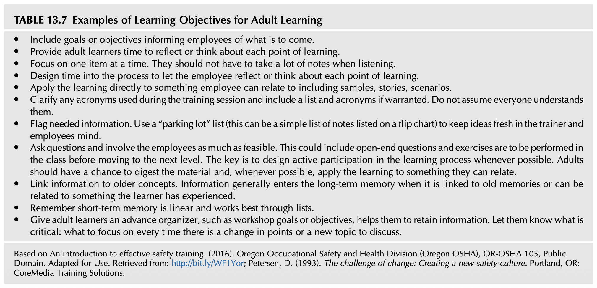
<!--  -->

### TABLE 13.7 Examples of Learning Objectives for Adult Learning

* Include goals or objectives informing employees of what is to come.
* Provide adult learners time to reflect or think about each point of learning.
* Focus on one item at a time. They should not have to take a lot of notes when listening.
* Design time into the process to let the employee reflect or think about each point of learning.
* Apply the learning directly to something employee can relate to including samples, stories, scenarios.
* Clarify any acronyms used during the training session and include a list and acronyms if warranted. Do not assume everyone understands them.
* Flag needed information. Use a “parking lot” list (this can be a simple list of notes listed on a flip chart) to keep ideas fresh in the trainer and employees mind.
* Ask questions and involve the employees as much as feasible. This could include open-end questions and exercises are to be performed in the class before moving to the next level. The key is to design active participation in the learning process whenever possible. Adults should have a chance to digest the material and, whenever possible, apply the learning to something they can relate.
* Link information to older concepts. Information generally enters the long-term memory when it is linked to old memories or can be related to something the learner has experienced.
* Remember short-term memory is linear and works best through lists.
* Give adult learners an advance organizer, such as workshop goals or objectives, helps them to retain information. Let them know what is critical: what to focus on every time there is a change in points or a new topic to discuss.

*(Based on An introduction to effective safety training. (2016). Oregon Occupational Safety and Health Division (Oregon OSHA), OR-OSHA 105, Public Domain. Adapted for Use. Retrieved from: http://bit.ly/WF1Yor; Petersen, D. (1993). The challenge of change: Creating a new safety culture. Portland, OR: CoreMedia Training Solutions.)*

---

<!-- [표 13.8 스크린샷 삽입 위치: Who Needs Training] -->
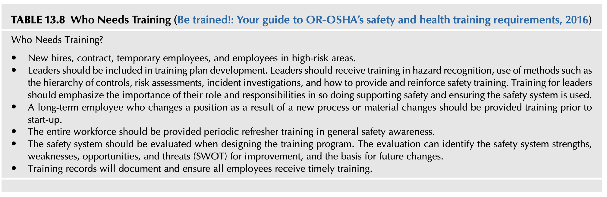
<!--  -->

### TABLE 13.8 Who Needs Training (Be trained!: Your guide to OR-OSHA’s safety and health training requirements, 2016)

**Who Needs Training?**
* New hires, contract, temporary employees, and employees in high-risk areas.
* Leaders should be included in training plan development. Leaders should receive training in hazard recognition, use of methods such as the hierarchy of controls, risk assessments, incident investigations, and how to provide and reinforce safety training. Training for leaders should emphasize the importance of their role and responsibilities in so doing supporting safety and ensuring the safety system is used.
* A long-term employee who changes a position as a result of a new process or material changes should be provided training prior to start-up.
* The entire workforce should be provided periodic refresher training in general safety awareness.
* The safety system should be evaluated when designing the training program. The evaluation can identify the safety system strengths, weaknesses, opportunities, and threats (SWOT) for improvement, and the basis for future changes.
* Training records will document and ensure all employees receive timely training.

---

## CONDUCTING SITE-SPECIFIC EDUCATION AND TRAINING

Unrealistic expectations are usually the result of a failure to understand what constitutes a good training program. Refer Table 13.8 for an overview of who needs training.

Although generalizations do not apply to every adult learner, it is helpful in planning training sessions to keep the following characteristics of adult learners in mind: (Risk management handbook, 2016)
* Older students involved in rote memorization usually require additional training time. Purposeful learning can be assimilated as fast or faster by an older adult, despite the cliche, “old dogs can’t learn new tricks,” most healthy adults are capable of lifelong learning.
* Adults want to know the “big picture” and just want answers to their questions: “Why is this training of value to me?” and “How can I apply the training to real-life?”
* Adults function in roles which mean they are capable of and desirous of participating in decision making about learning.
* Adults do not like to be treated “like children” and especially do not appreciate being reprimanded in front of others. Adults have specific objectives for learning and know how they learn best.
* Adults have experienced learning situations before and have positive and negative consequences about learning. Adults have had a wealth of unique experiences to invest in learning and can transfer knowledge when new learning is related to old learning. Adults recognize proper training and bad training when they see it (An introduction to effective safety training, 2016; Geigle, 2017).

The trainer should try to determine the causes of the performance deficiencies and tailor the training to the needs of the organization. For example, when individuals are motivated to perform well but lack skills or knowledge, an ideal training opportunity exists (Risk management handbook, 2016).

---

## COMMUNICATION

Communication is the most overlooked feature in the safety management system. It is assumed employees know how to communicate information and any concerns about immediate hazards and associated risk. The quality of the communication network should be reviewed to eliminate obstacles and resistance to the message being sent. The authors have experienced training sessions where the employee is told just to report unsafe conditions without further explanation. The overall reporting process was not explained, no insights on hazard identification and how follow-up would be handled remained unknown to the employees.

A part of the learning process is the need for training in the basics of communication. Information is defined as a “meme,” discussed in Chapter 3, Analyzing and Using Your Network, as a “packet of information” moving from one mind, a sender, to another mind, the receiver, using methods and techniques strengthening how the information “sticks” and how it is incorporated into the thought process of the receiver. Communication is defined as “a process of transferring thoughts, ideas, messages and information from one individual, or group, to another.” This perspective has communication as more than just transmitting a message. The message should be clear, accurate, and above all, understood by the person or persons the communication is directed (Enlisted professional military education opportunities, 2016).

> "Oral communication possesses a greater risk of misunderstanding as compared to the written form of communication. Misunderstandings are most likely to occur when the employee involved in the conversation may have a different understanding or mental models of the current situation or use terms that are confusing. Therefore, confirmation of verbal exchanges of operational information between individuals must occur to promote understanding and reliability of the communication."  
> — *(Human performance tools for individuals, work teams, and management, 2009)*

All training should follow the method of a three-way communication:
1. **First**, the sender is the trainer who communicates the message.
2. **Second**, the employee is the receiver who gets the message, decodes the message based on current perceptions, background, and history of similar messages. The employee may or may not interpret the meaning of the message as was intended by the sender/trainer.
3. **Third**, communication exists when the employee has shown the message was understood. The receiver of information or training should be able to repeat the message and be able to paraphrase the information as presented to ensure that the sender knows the receiver understood the information or training. The language of the message should mean the same thing to both the receiver and the sender or miscommunication will occur (Enlisted professional military education opportunities, 2016).

If the message contains hazard information and is not understood, the probability of loss-producing events increase.

### LESSON LEARNED 3

The authors have experienced a combination of miscommunication and failure of training to convey its desired message. For example, a maintenance technician was working on a broken machine and had asked a coworker to stand by its power source to make sure no one turned on the equipment. As he placed his hands into the machine, he asked his coworker to “Make sure it’s not on.” The coworker heard “Make sure it’s on” and flipped the activation switch, turning on the machine and causing a severe injury. Two failures occurred—a critical safety procedure was ignored (deenergizing or locking out equipment) in the belief a coworker would be an adequate substitution resulting in a verbal misinterpreted message.

The overall process is dependent on the receiver knowing if the message or training is not understood, they can, without fear, request a clarification, confirmation, or repetition of the message or training (Human performance tools for individuals, work teams, and management, 2009).

The resource of information should be verified before conducting any training. The internet has made easy access to incredible sources of data and information. It is also the source of fake, partial, poor, and wrong information. This will be discussed in more detail in Chapter 16, Social Media Tools for the Professional. Once “information” is released, it can go “viral” moving as a meme through the various communications networks, spreading, and influencing the organization, employees, and leadership. Both functional and poor messages can go viral through a network with mixed values for the improvement of the safety culture. Once these memes are embedded in the mental models of employees, it may be impossible to correct or extract them.

---

## SUMMARY

* The safety culture and safety management system are both supported by in-depth, comprehensive education and training.
* The culture of an organization has a powerful influence over employee norms, habits, and behaviors as they complete their daily assignments and tasks.
* For a strong safety culture, the organization has to develop a strong emphasis on the positive values of the safety management system. The culture should have deeply embedded beliefs in the value of continuing education and training of its employees.
* The safety culture is a product of a learning organization. As hazards and associated risk are identified, the ability to use the information becomes the key to the establishment and implementation of the necessary controls.
* The education and training assessment is the process of identifying employee performance requirements and the "gap" between safety-related performances required and what is being completed. The objective of education and training is to change or improve employee performance and alter behavior.
* When thinking through the development of a safety-related training session, keep in mind the session is a “node” linked to many connections in the overall network of communications within the organization. If done poorly, it immediately degrades the safety culture is directly linked to the safety management system.
* An understanding of adult learning theory is necessary to complete a successful education and training assessment.
* Different training methodologies may be necessary depending on the skills, expertise, and experience of employees.
* All training materials should be written and adapted to use the most appropriate media for each group.
* Safety-related training is to close gaps in knowledge about hazards and associated risk as well as the necessary controls are to be consistently used. A safety-related problem may be a precursor to general performance issues impacting productivity or other organizational endeavors.
* In establishing learning objectives, the safety culture would view the provision of hazard and associated risk control information as part of the required orientation and training considered essential. This initial training sets the stage for future desired behavior and decision making.
* The learning objective is a statement describing the learning outcome, rather than a learning process or procedure. It describes results, rather than the means of achieving those results.
* The importance of gaining as much insight into the organizational culture is reflected in how training is perceived, developed, and presented. A well-designed training curriculum will not have much impact if the general climate of the organization is detrimental to learning.
* Communication is the essential feature in the prevention of loss-producing events.
* In a three-way communication, the receiver of a message or training should be able to repeat the message in a paraphrased form to ensure the sender knows the receiver understood the message or training.
* In Chapter 14, Assessing Your Safety Management System, we will discuss how to assess a safety management system which is a comprehensive assessment that provides insights and validation about the current state of safety management system activities, their administration, and general effectiveness. The assessment of the safety management system, when routinely completed, reflects the real values and beliefs of the organization regards the actual safety culture. A structured and detailed assessment should provide details concerning potential gaps and opportunities for further improvement, not just in the safety management system but within the organization as well.

---

## CHAPTER REVIEW QUESTIONS

1. Explain and contrast the difference between education and training.
2. Explain methods used to conduct a training needs assessment.
3. Explain how the SMART method is used to set training goals and objectives.
4. Explain and list the types of training methods.
5. Explain why an understanding of employee experience is needed in developing training content.
6. Explain why communication is important to the safety culture.

---

## APPENDIX 13.1 CHARACTERISTICS OF GOOD TRAINING PROGRAMS

According to the Susan Harwood Training Grant Program (Best Practices for the Development, Delivery, and Evaluation of Susan Harwood Training Grants, 2010), a general review of training "best practices" reveals four characteristics of an acceptable training program should have in order to be effective:

### Accurate
All training materials should be prepared by a qualified trainer who understands training techniques. This training must be updated as needed, and facilitated by a qualified and experienced trainer with the appropriate level of training techniques and methods.

### Credible
Trainers should have a general safety background or be a subject matter expert in a safety-related field. They should also have the experience of being able to train adults. In addition, they should have practical knowledge and experience in the field of safety as well as experience in training facilitation that can contribute to a higher degree of credibility.

### Clear
The training programs development must not only be accurate and but be believable and based on many resources to ensure that all areas of the given subject are provided. In addition, the training must be clear, concise, and understandable to the employee. If the material is only understandable to everyone with a college education or someone who understands the jargon, then the program falls short of meeting the organization needs (Best Practices for the Development, Delivery, and Evaluation of Susan Harwood Training Grants, 2010).

Training developers should ensure that readability and language choices match the intended audience. Therefore, the training materials must be written in the language and grammar of the everyday speech of the employees (Best Practices for the Development, Delivery, and Evaluation of Susan Harwood Training Grants, 2010).

### Practical
The training programs must present information, ideas, and skills that employees see as beneficial and useful in their working environment. There must be a successful transfer of knowledge that occurs when the employee can see how the safety-related information presented in a training session can be applied directly to this their work environment.

---

## APPENDIX 13.2 TRAINING REQUIREMENTS IN OSHA STANDARDS AND TRAINING GUIDELINES

Appendix 13.2 provides a great document “Training Requirements in OSHA Standards and Training Guidelines” that will provide an excellent overview of specific training requirements.

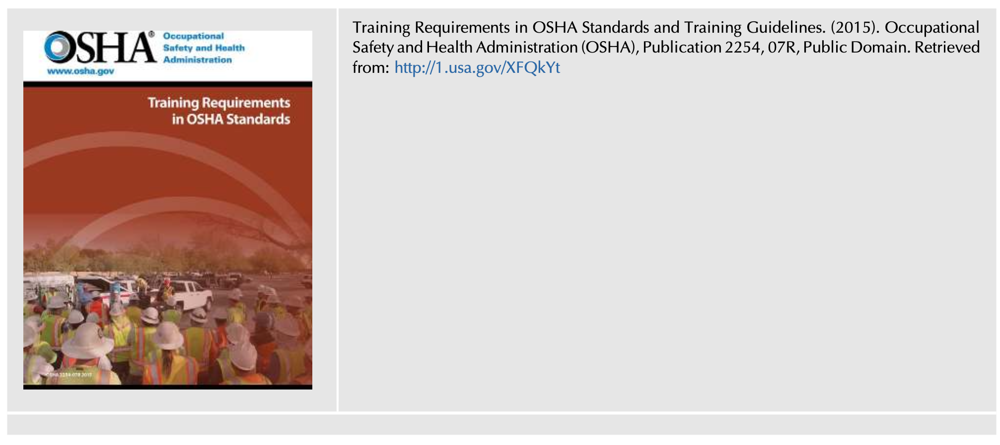

Training Requirements in OSHA Standards and Training Guidelines. (2015). Occupational Safety and Health Administration (OSHA), Publication 2254, 07R, Public Domain. Retrieved from: http://1.usa.gov/XFQkYt

---

## BIBLIOGRAPHY

* A guide to voluntary training and training requirements. (2017). NC: Department of Labor, Occupational Safety and Health Division (OSHA). Public Domain, Based on Information as Presented on and Adapted for Use. Retrieved from http://bit.ly/VPKZg3.
* A model for research on training effectiveness. (1999). DHHS (NIOSH), Publication No. 99-142. Centers for Disease Control and Prevention (CDC), National Institute for Occupational Safety and Health (NIOSH), Public Domain, Based on Information as Presented on and Adapted for Use, October. Retrieved from http://bit.ly/2y1jKMh.
* An introduction to effective safety training. (2016). Oregon Occupational Safety and Health Division (Oregon OSHA), OR-OSHA 105, Public Domain. Adapted for Use. Retrieved from http://bit.ly/WF1Yor.
* Be trained!: Your guide to OR-OSHA’s safety and health training requirements. (2016). Oregon Occupational Safety and Health Division (Oregon OSHA). Public Domain, Permission to Reprint, Based on Information as Presented on and Adapted for Use. Retrieved from http://bit.ly/11dc14h.
* Best Practices for the Development, Delivery, and Evaluation of Susan Harwood Training Grants. (2010). Occupational Safety and Health Administration (OSHA), OSHA 3686-09 2010, Public Domain, Modified and/or Adapted as Necessary. September. Retrieved from http://1.usa.gov/Z5nKoy.
* Cheng, B., Wang, M., Yang, S. J., Peng, J., et al. (2011). Acceptance of competency-based workplace e-learning systems: effects of individual and peer learning support. Computers & Education, 57(1), 1317–1333.
* Concepts and principles. (2009). Human performance improvement handbook. Vol. 1. US Department of Energy.
* Criteria for Accepted Practices in Safety, Health, and Environmental Training, Z490.1. (2001). American National Standards Institute (ANSI), Secretariat American Society of Safety Engineers (ASSE) July.
* Enlisted professional military education opportunities. (2016). United States Marine Corps Marine Corps University Enlisted Professional Military Education, Public Domain. September. Retrieved from http://bit.ly/2xSRj3v.
* Geigle, S. J. (2017). Introduction to OSH training, train the trainer series. OSHAcademy (TM), Course 703 Study Guide, Permission to Reprint, Modify, Based on Information as Presented and Adapted for Use.
* Human performance tools for individuals, work teams, and management. (2009). Human performance improvement handbook. Vol. 2. US Department of Energy Public Domain.
* Leadership development. Field manual. Headquarters, Department of the Army, Public Domain 6-22. June. Retrieved from http://bit.ly/2iX1V8n.
* McMillan, D. (2009). How not to use power point. April, Retrieved from http://bit.ly/WZvCnz.
* Monnette, J. (2018). Millennials: Listening to their ideas will make the workplace a safer, more innovative space. May, Retrieved from http://bit.ly/2HmDScO.
* Occupational Health and Safety Systems (2012). The American Industrial Hygiene Association. ANSI/AIHA Z10.
* Page, R. (2003). Hope is not a strategy: The 6 keys to winning the complex sale. Pennsylvania Plaza New York City: McGraw-Hill Professional.
* Risk management handbook. (2016). (FAA-H-8083-2 1st ed., Kindle Edition). Federal Aviation Administration. (chapter 8). Retrieved from http://bit.ly/2KqVABy.
* Roughton, J., & Lyons, J. (1999). Training program design, delivery, and evaluating effectiveness: an overview. The Synergist, (April), 31–33. American Industrial Association.
* Ruey, S. (2010). A case study of constructivist instructional strategies for adult online learning. British Journal of Educational Technology, 41(5), 706–720.
* System safety training. (2000). Federal Aviation Administration (FAA), Public Domain. December (chapter 14). Retrieved from http://bit.ly/2uumixd.
* Training and development, planning & evaluating. (2017). Office of personnel management - training and development, planning, and evaluating, public domain. Retrieved from http://1.usa.gov/WUkEzi.
* Training development. (2018). American Society for Training & Development. Retrieved from http://bit.ly/XQHOUZ.
* Training Requirements in OSHA Standards and Training Guidelines (2015). Occupational Safety and Health Administration (OSHA), Publication 2254, 07R, Public Domain. Retrieved from http://1.usa.gov/XFQkYt.
* Training the trainer. (2008). Canadian Coast Guard Auxiliary—Pacific. Retrieved from http://bit.ly/2B4L6Do.

---

## FURTHER READING

* Petersen, D. (1993). The challenge of change: Creating a new safety culture. Portland, OR: CoreMedia Training Solutions.
