# Chapter 14 Assessing Your Safety Management System (안전경영시스템 평가) 서브노트

> *"목표에 도달하고 싶다면, 그곳에 도달하기 전에 마음속에서 먼저 '도달하는 모습'을 그려보아야 한다."*  
> — **지그 지글러 (Zig Ziglar)**  
> 
> *출처: Safety Culture (Elsevier, 2019, pp. 345-374), PART IV Tools to Enhance Your Safety Management System, Chapter 14*  
> *DOI: https://doi.org/10.1016/B978-0-12-814663-7.00014-5*

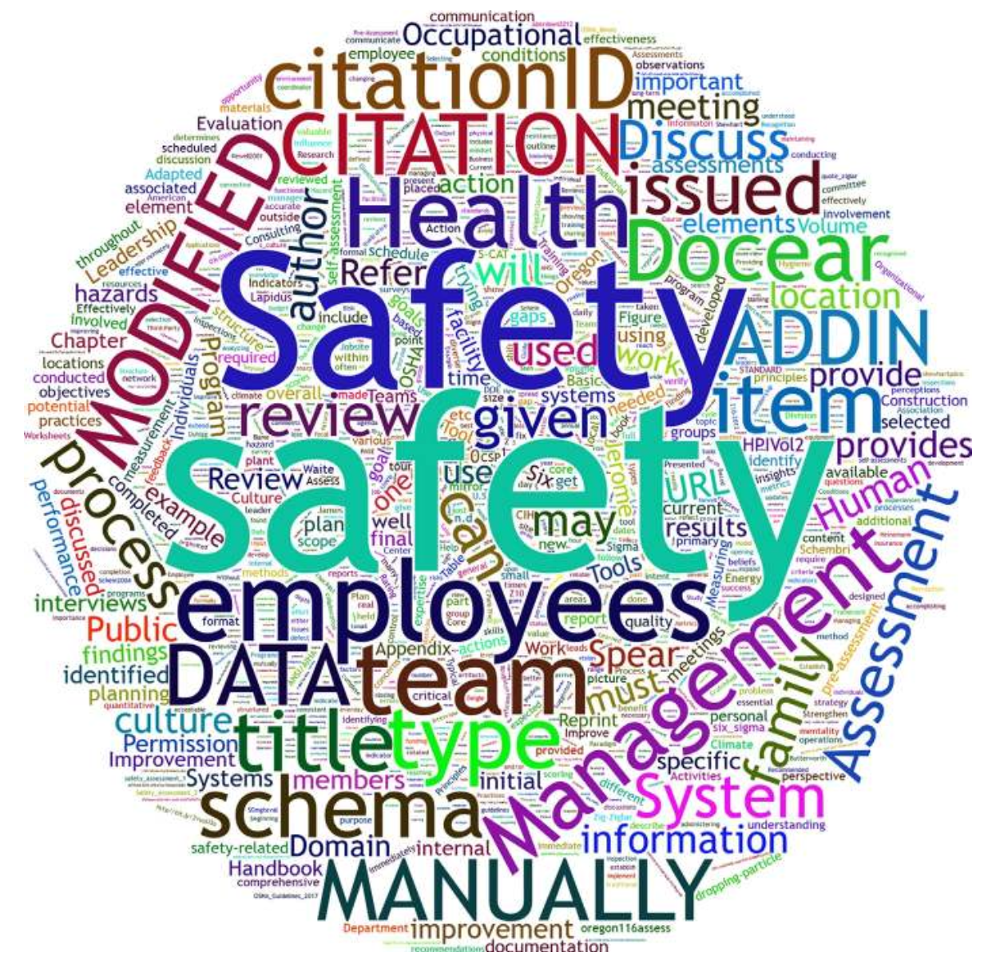

---

## 1. INTRODUCTION (도입: 거울 비유와 안전경영시스템의 총체적 진단)

안전경영시스템(Safety Management System, SMS)에 대한 포괄적이고 심층적인 평가는 조직 내 안전 관리 활동의 현재 수준, 행정적 운영 실태, 그리고 전반적인 실효성(General effectiveness)에 대한 객관적인 통찰과 타당성 검증을 제공합니다.

안전 프로세스에 대한 주기적이고 체계적인 평가는 해당 조직이 진정으로 추구하는 가치관과 실제 작동 중인 안전문화의 본질적 신념을 정직하게 투영합니다. 잘 구조화된 상세 진단은 단순한 규정 준수 여부를 확인하는 수준을 넘어, 안전경영시스템 자체와 조직 전반에 존재하는 **잠재적 갭(Gaps)과 지속적 개선 기회(Opportunities for improvement)**를 명확히 포착합니다 (Fig. 14.1).

---

### FIG. 14.1 Standing in front of a mirror (거울 비유: 안전 진단의 본질)

진지한 태도로 수행되는 심층 평가는 **자신의 모습을 왜곡 없이 완벽하고 정직하게 비추는 고품질의 '거울'을 들여다보는 것**과 같습니다. 좋은 거울은 결코 거짓말을 하지 않으며, 현재 무엇이 훌륭하고 무엇이 부족한지를 적나라하게 보여줍니다.

---

### 1.1 PDCA 선순환과 제도적 규격 (ANSI Z10-2012)
* **장기적 안전문화 성공의 나침반**: 안전경영시스템에 대한 전면적 평가는 안전문화의 장기적 번영을 위해 의사결정을 내리고 자원을 배분하는 확고한 이정표를 제공합니다 (Geigle, 2011).
* **ANSI/AIHA Z10-2012 규격의 핵심 요구사항**: 조직은 독자적으로 개발했든 외부 표준을 차용했든 직업안전보건경영시스템(OHSMS)의 문제를 규명하고 시스템을 지속적으로 개선할 수 있는 포괄적 검토 프로세스를 갖추어야 합니다. 이는 월터 슈하트(Walter Shewhart, 1980)의 **Plan-Do-Check-Act (PDCA)** 사이클에서 사후 모니터링 및 환류를 담당하는 **'Check(평가/확인)'** 기능을 충실히 수행함을 의미합니다.
* **소통과 피드백의 결핍 극복**: 일반적인 안전 프로그램의 콘텐츠나 서식은 시중에서 손쉽게 구할 수 있습니다. 진정한 난제는 **안전 프로세스가 조직의 현장 일상 업무 속에 온전히 체화되어 설정된 목표를 달성하고 있는지 점검하는 '소통과 피드백(Communication and feedback)'의 부재**에 있습니다. 평가는 안전 규범이 현장 일선에 실제 착근되어 있는지를 확인하는 유일한 수단입니다.

### 1.2 제14장 8대 핵심 학습 목표
1. 안전경영시스템 평가를 성공적으로 수행하기 위한 사전 조율 및 조정(Coordination) 방안 설명.
2. 성과 미흡 시 흔히 발생하는 **"시스템 탓하기(Blaming the system)"** 심리를 타파하는 방법 설명.
3. 안전경영시스템 평가의 핵심 유형(내부 자체 평가 vs 외부 제3자 평가) 분석 및 비교.
4. 다기능 평가팀(Assessment Team)의 선발 기준과 역량 개발 방안 설명.
5. 현장 진단 착수 전 필수적인 사전 평가 활동(Preassessment activities) 열거.
6. 안전경영시스템 본 평가의 핵심 구성 요소 및 현장 조사 기법 설명.
7. 최종 진단 보고서(Final report) 작성과 SMART 실행 계획(Action plan) 수립의 중요성 논증.
8. 평가 결과 및 후속 조치 계획을 전 직원에게 투명하게 소통해야 하는 당위성 설명.

---

## 2. PLANNING FOR YOUR SAFETY MANAGEMENT SYSTEM ASSESSMENT (SMS 평가 기획: 6대 핵심 원칙과 단계적 접근)

안전경영시스템 평가는 본서 제5장(Overview of Basic Safety Management Systems)에서 다룬 **6대 핵심 원칙(Six basic core principles)**에 절대적 초점을 맞추어야 성공 확률이 극대화됩니다. 평가는 단순히 결함을 지적하는 데 그쳐서는 안 되며, 기 수립된 안전 목표를 달성하고 현장 수행 역량을 향상시키는 실질적 개선으로 이어질 때에만 비로소 가치를 갖습니다 (Table 14.1 및 Fig. 14.2).

---

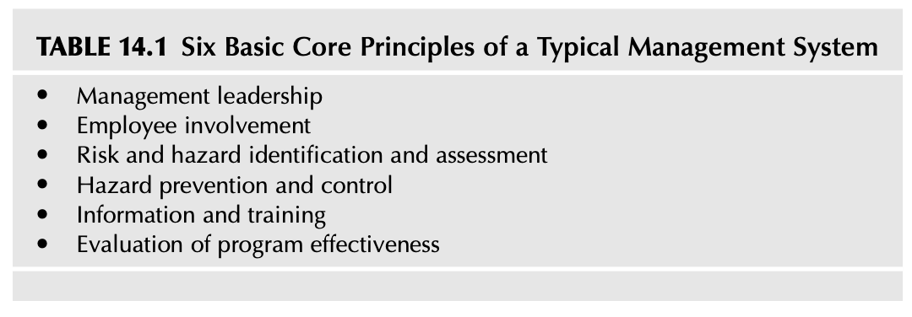

### TABLE 14.1 Six Basic Core Principles of a Typical Management System (전형적인 안전경영시스템의 6대 핵심 원칙)

1. **경영 리더십 (Management leadership)**
2. **근로자 참여 (Employee involvement)**
3. **위험 및 유해성 식별과 평가 (Risk and hazard identification and assessment)**
4. **유해위험요인 예방 및 통제 (Hazard prevention and control)**
5. **정보 및 교육훈련 (Information and training)**
6. **프로그램 실효성 평가 (Evaluation of program effectiveness)**

---

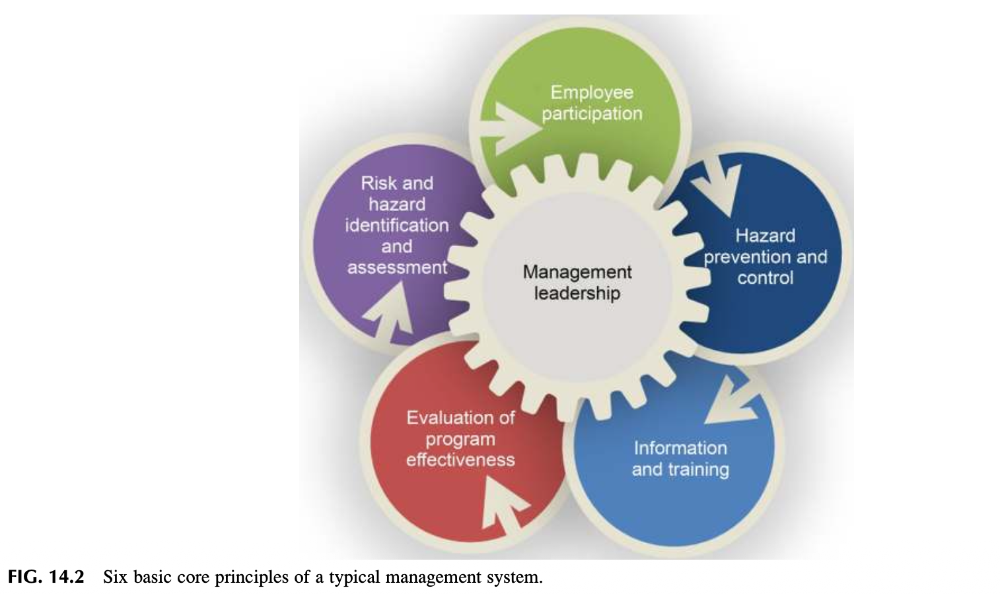

### FIG. 14.2 Six basic core principles of a typical management system (6대 핵심 원칙 상호작용 체계)

* **원칙 간의 유기적 결합**: 6대 원칙은 분리된 사일로가 아니라, 경영 리더십과 근로자 참여라는 양대 기둥 위에서 위험성평가 ➔ 공학적·관리적 통제 ➔ 역량 교육 ➔ 시스템 평가로 끊임없이 순환하는 동적 프레임워크입니다.
* **단계적 도입(Phased Approach)**: 신규 시스템을 도입할 때 조직의 수용 한계를 무시한 채 방대한 규정을 한꺼번에 밀어붙이면 리더와 근로자 모두 압도당해 무기력에 빠집니다. 조직의 현재 역량에 맞추어 점진적·단계적으로 성숙도를 높여야 합니다.
* **프로그램이 아닌 '문화와 습관(Habits)'의 변화**: 찰스 두히그(Charles Duhigg, 2012)가 역설했듯, 안전은 정적인 프로그램(Program)을 문서화하는 작업이 아니라, **현장의 낡은 습관을 깨뜨리고 안전 지각을 재구성하는 유기적 프로세스(Process)**입니다.

---

### 2.1 LESSON LEARNED 1: 안전 리더 자신의 '개인 평가(Personal Assessment)'와 예산 메커니즘 숙지

> **[교훈: 거울을 통한 자기 진단과 예산 사이클]**  
> 안전경영시스템을 평가하기에 앞서, 안전 리더(안전 전문가)는 먼저 거울 앞에 서서 **자기 자신에 대한 개인 평가(Personal Assessment)**를 냉철하게 수행해야 합니다:
> 
> 1. 현재 우리 조직 구성원들은 안전 활동에 대해 어떠한 지각(Perception)을 가지고 있는가?
> 2. 조직 내에서 나의 실질적 영향력(Influence)은 어느 수준인가? 나는 조직 내에서 어떤 이미지와 평판으로 지각되고 있는가?
> 3. 조직 전체를 관통하는 나의 커뮤니케이션 네트워크(Network)의 도달 범위와 깊이는 충분한가?
> 
> 아울러 평가가 끝나면 단기 개선 과제부터 막대한 자본이 투입되는 공학적 설비 개조까지 다양한 권고안이 쏟아져 나옵니다. **조직의 전반적인 예산 편성 프로세스와 회계 주기(Budget cycle)를 꿰뚫고 있지 못하면, 아무리 훌륭한 안전 개선안도 예산 승인을 얻지 못해 사장됩니다.** 예산 시스템의 언어를 구사할 줄 알아야 최고경영진을 설득할 수 있습니다 (Managing Worker Safety and Health, 2016).

---

## 3. THE FOCUS OF THE ASSESSMENT TEAM (평가팀의 초점과 관찰 프레임워크)

평가팀의 기획은 주도면밀해야 합니다. 안전경영시스템의 복잡성, 리더십과 근로자의 시간적 제약, 현장 인력과 평가팀의 직무 숙련도를 균형 있게 고려해야 합니다.

### 3.1 현장 존중과 본업(Mission) 중심의 평가 접근
* **현장 운영 일정과의 조화**: 조직의 1차적 존재 이유는 고객에게 제품과 서비스를 차질 없이 공급하는 데 있습니다. 평가팀은 결코 군림하는 감사관이 아니며, 현장의 본업 생산 활동을 방해하지 않도록 평가 일정을 유연하게 조율해야 합니다. 리더와 근로자는 자신들의 업무 부담을 배려하는 평가팀의 태도에서 신뢰를 형성합니다.
* **평가자의 사리사욕 배제**: 평가는 평가자의 실적을 과시하거나 보고서를 꾸미기 위한 것이 아니라, 오직 조직의 체질을 개선하고 안전문화를 신장하기 위해 수행되어야 합니다.

### 3.2 OBSERVATION: 평가 착수 전 조직 상태 진단을 위한 5대 질문
평가 설계를 시작하기 전, 안전 리더는 조직의 현주소를 진단하는 다음 5가지 질문에 답할 수 있어야 합니다:
1. **역사적 진정성**: 조직의 과거 이력을 볼 때 최고경영진이 안전 관리 활동을 진정성 있게 후원하고 있는가?
2. **직무 직조 여부(Woven into fabric)**: 사내 안전 활동이 본업 생산과 분리된 '귀찮은 부가 업무(Add-on)'로 치부되는가, 아니면 일상 운영의 직조물(Fabric) 속에 자연스럽게 스며들어 있는가?
3. **안전 리더의 영향력**: 안전 리더가 주요 의사결정 테이블에서 실질적인 발언권과 리더십을 행사하는가?
4. **대내적 평판**: 안전 전문가와 현장 안전 관리자들의 전문성과 평판이 구성원들로부터 존중받고 있는가?
5. **소통망의 스팬**: 안전 소통 네트워크가 생산직 말단 작업자까지 막힘없이 관통하고 있는가?

---

## 4. AVOIDING A “BLAME THE SYSTEM” MENTALITY (시스템 탓하기 심리 극복과 식스시그마 결함 제거)

원하는 안전 성과가 나오지 않거나 사고가 발생했을 때, 많은 관리자들은 손쉽게 **"안전경영시스템이 잘못되었다"며 시스템 자체를 탓하는 함정**에 빠집니다. 이는 나쁜 소식을 가져온 전령을 처형하는 **"메신저 쏘기(Shoot the messenger)"**식 퇴행적 태도입니다.

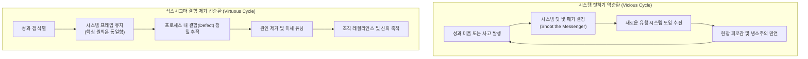

대부분의 현대 안전경영시스템은 본질적으로 동일한 6대 핵심 원칙을 공유합니다. 시스템을 끊임없이 갈아엎으면 시간과 자원이 낭비될 뿐만 아니라, 어차피 또 바뀔 것이라 생각하는 구성원들의 극심한 피로감과 냉소주의를 초래합니다.

### 4.1 식스시그마의 결함(Defect) 개념과 시스템 보완
* **식스시그마 접근법의 적용**: 시스템을 통째로 교체하는 대신, **시스템 내부의 프로세스 결함(Defect)을 적극적으로 탐색하고 수리(Find and fix)**해야 합니다 (Schembri, 2012).
  * **결함 (Defect)**: 고객(작업자 및 조직)의 요구 규격이나 안전 기준을 벗어난 일체의 미충족 요소.
  * **기회 (Opportunity)**: 결함이 발생할 수 있는 전체 잠재 위험 접점의 총수.
* **인공물(Artifacts) 점검을 넘어선 프로세스 평가**: 전통적인 시설 순찰 점검(Inspections)은 기계의 방호덮개나 바닥 청결 같은 물리적 인공물(Artifacts, Schein 2004)을 살피는 중요한 도구이지만, 그 자체가 안전경영시스템 평가는 아닙니다. 진정한 SMS 평가는 그러한 결함이 방치되도록 허용한 이면의 관리 프로세스와 조직문화를 정밀 타격해야 합니다.

---

### 4.2 LESSON LEARNED 2: 제임스의 월별 1개 요소 점검 방식 (연중 상시 가시성 확보)

> **[교훈: 월별 1개 요소 분할 평가의 지혜]**  
> 광역 안전 매니저로 근무하던 시절, 제임스는 1년에 한 번 전사적으로 엄청난 스트레스를 유발하는 연례 일괄 감사를 지양하고, **각 사업장이 매달 안전경영시스템의 단 1개 요소만을 선정하여 집중 검토하는 '월별 1개 요소 평가 시스템'**을 고안했습니다.
> 
> * **연간 캘린더 사전 편성**: 사업장의 연간 업무 캘린더에 매월 점검할 안전 요소를 미리 배정하여 관리자와 근로자가 충분한 준비 시간을 확보하도록 함.
> * **질의응답 가이드라인 사전 배포**: 각 요소별 핵심 질문 체크리스트를 미리 공유하여 회의와 현장 점검의 효율성을 극대화함.
> * **연중 상시 가시성(Year-round Visibility)**: 안전경영시스템이 연말에만 반짝 치르는 부담스러운 요식행위가 아니라, 일 년 내내 공식 회의와 현장의 일상적 대화 주제로 살아 숨 쉬도록 만듦.

---

## 5. TYPES OF SAFETY MANAGEMENT ASSESSMENTS (SMS 평가의 유형과 3단계 흐름)

안전경영시스템은 모든 생산 프로세스와 마찬가지로 **투입(Inputs) ➔ 프로세스(Process) ➔ 산출(Outputs)**의 3차원 구조로 작동합니다 (How to effectively assess and improve your safety and health program, 2018).

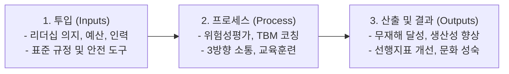

> *"다양한 성과 측정 시스템을 고안하기 전에, 먼저 그 측정 도구의 근본 목적과 한계를 철저히 이해해야 한다."*  
> — **스티븐 스피어 (Spear, 2010)**

---

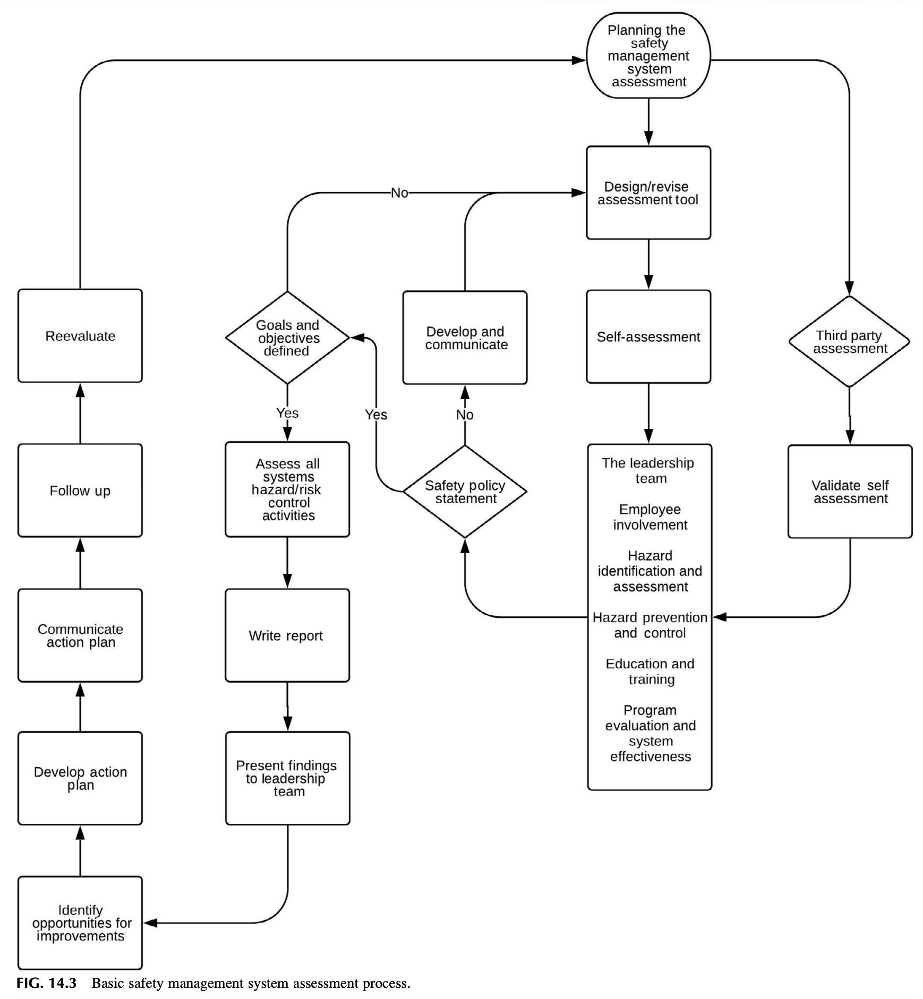

### FIG. 14.3 Basic safety management system assessment process (기본 안전경영시스템 평가 프로세스 흐름도)

* **FIG. 14.3의 구조적 순환 루프**:
  1. 사전 준비 및 데이터 수집 (Preassessment & Document Review)
  2. 현장 순회 및 심층 인터뷰 (Tour, Observations & Interviews)
  3. 갭 분석 및 정량/정성 평가 (Gap Analysis & Scoring)
  4. 결과 보고 및 피드백 회의 (Presenting Results & Feedback)
  5. SMART 액션 플랜 수립 및 사후 추적 (Action Plan & Follow-up)

안전경영시스템 평가는 수행 주체와 목적에 따라 크게 2가지 유형으로 구분됩니다:
1. **내부 자체 평가 (Internal Self-Assessments)**
2. **외부 제3자 평가 (Third-Party Assessments)**

---

## 6. INTERNAL SELF-ASSESSMENTS (내부 자체 평가의 메커니즘과 잠재 약점 발굴)

내부 자체 평가는 조직 내 리더십 팀과 현장 근로자가 직접 주체가 되어 시스템의 현재 상태를 조사, 분석, 문서화하고 전사에 전파하는 공식적·비공식적 프로세스입니다.

> *"자체 평가(Self-assessment)는 현재의 실제 관행과 결과를 바람직한 표준 및 기대 결과와 비교하여 스스로 개선 기회를 발굴하는 과정이다. **현장에서 일하는 당사자들보다 그 시설에서 일상 업무가 실제로 어떻게 이루어지는지 더 잘 아는 사람은 아무도 없기 때문에**, 자체 평가는 조직과 시설 내에 숨어 있는 **잠재적 취약점(Latent weaknesses)**을 포착하는 가장 강력한 수단이 된다."*  
> — *(Human performance tools for individuals, work teams, and management, DOE HPI Handbook, 2009)*

### 6.1 LESSON LEARNED 3: 10개월 주기 월례 점검과 공식 의제화
제임스는 총 10개 섹션으로 구성된 안전경영시스템을 10개월 동안 매달 1개 섹션씩 공식 회의 의제(Agenda)에 올려 점심 식사나 정기 스태프 미팅을 통해 지정된 근로자들과 심도 있게 토론하도록 했습니다. 이를 통해 안전경영시스템은 문서고에 박제된 규정이 아니라, 연중 내내 공식 의제로 다루어지는 생생한 대화의 장으로 정착되었습니다.

### 6.2 일관성을 위한 자체 평가 워크시트(Worksheet) 활용
자체 평가의 객관성과 연속성을 담보하기 위해 6대 핵심 원칙과 세부 요소를 총망라한 **맞춤형 자체 평가 워크시트(Checklist/Worksheet)**가 사용되어야 합니다 (부록 14.1 및 14.2 연계). 조직의 규모, 작업 위험도, 성숙도에 따라 정성적(Qualitative) 평가와 정량적(Quantitative) 점수 산정 방식을 유연하게 결합합니다 (ANSI Z10-2012).

---

## 7. THIRD-PARTY ASSESSMENTS (제3자 독립 평가와 조직적 맹점 극복)

내부 자체 평가가 훌륭하더라도, 조직 외부의 독립된 전문가나 기관에 의한 제3자 평가는 필수적으로 병행되어야 합니다.

### 7.1 내부 관행의 타성과 '무의식적 표류(Drift)'의 차단
* **익숙함이 낳은 맹점**: 매일 같은 현장에서 "늘 해오던 방식"에 젖어 살다 보면, 초기에 수립했던 엄격한 기준에서 서서히 이탈하여 위험에 둔감해지는 **'규범적 표류(Normal drift)'**가 발생합니다. 내부 인력은 이를 무의식적으로 간과하기 쉽습니다.
* **캘리브레이션(Calibration)과 맹점 발견**: 독립적인 외부 평가는 시설 관리자와 작업자가 미처 보지 못하는 **'조직적 맹점(Blind spots)'**을 선명하게 드러냅니다. 이는 업계 최고 수준(Best practices)과 비교하여 미흡한 점을 교정하고, 안전에 대한 경영진의 헌신도를 객관적으로 재보정(Calibration)하는 결정적 계기를 제공합니다 (DOE HPI Handbook, 2009).

---

## 8. SELECTING THE ASSESSMENT TEAM (다기능 평가팀 선발과 교차 협업)

진정한 근로자 참여를 실현하고 편향을 방지하기 위해 평가팀은 **다양한 직무와 배경을 아우르는 교차 기능(Cross-functional) 다기능 팀**으로 구성되어야 합니다. 평가 때마다 일정 비율(예: 30~50%)의 새로운 인원을 순환 배치하여 신선한 시각을 수혈해야 합니다.

---

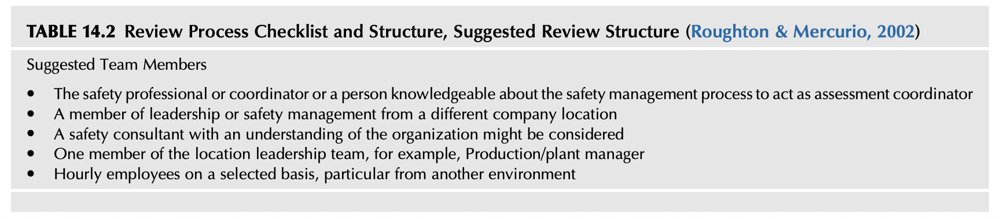

### TABLE 14.2 Review Process Checklist and Structure, Suggested Review Structure (평가팀 추천 구성원 포트폴리오)

* **평가 총괄 코디네이터**: 안전 프로세스에 정통한 안전 전문가(Safety Professional) 또는 안전 코디네이터
* **타 사업장 안전 리더**: 조직의 타 사업장/지사에서 근무하는 안전 관리자 또는 리더 (외부적 시각 제공)
* **전문 안전 컨설턴트**: 조직의 특성을 깊이 이해하고 있는 외부 전문 안전 컨설턴트
* **현장 라인 관리자**: 진단 대상 사업장의 생산부서장 또는 공장장(Plant manager)
* **현장 일선 생산직 근로자**: 타 공정이나 이질적 작업 환경에 속한 현장 시급직 근로자(Hourly employees)

---

### 8.1 부서 간 장벽을 허무는 협업의 힘
경영진의 비전이 현장 바닥까지 온전히 침투하기 위해서는 환경안전(EH&S), 품질(Quality), 생산(Manufacturing), 엔지니어링(Engineering), 공정기술, 심지어 공급망(Supply chain) 부서 간의 긴밀한 교차 협업이 필수적입니다. 부서 간 장벽(Silo)을 허물고 비전을 정기적으로 공유하지 않는다면, 진정한 선도 기업의 안전 성과를 달성하기 어렵습니다 (Ismail, 2012).

---

## 9. PREASSESSMENT ACTIVITIES & THE OPENING MEETING (사전 준비 활동과 시작 회의)

현장 진단을 실시하기 전, 현장 리더십 팀과의 철저한 사전 조율과 자료 요청이 이루어져야 진단 당일의 혼선을 방지할 수 있습니다.

### 9.1 사전 평가 4대 핵심 준비 작업
1. **일정의 상호 합의**: 현장 생산 일정과 평가팀의 가용 시간을 고려하여 상호 수용 가능한 평가 일자 확정.
2. **평가팀 일정 조율**: 다기능 평가팀원들의 현장 출장 및 이동 동선 사전 조율.
3. **사전 필수 검토 문서(Documentation) 징구 (최소 5개년 데이터 권장)**:
   * 사업장의 일반 현황, 공정 흐름도 및 주요 활동 내역
   * 과거 5년간의 대내외 감사 보고서, 보험사 손실 통제(Loss control) 리포트, 외부 컨설팅 결과
   * 현행 안전보건 방침, 절차서, 직무 위험성 평가서(JHA), 설비별 점검 체크리스트, 안전위원회 회의록
   * 과거 안전 지각 설문조사(Perception Survey) 통계 데이터
   * 과거 5개년 손실 사건 이력: 산재 통계, 차량/설비 파손 보고서, 아차사고(Near-miss), 근로자 보상 보험(Workers' Compensation) 청구 데이터 및 사고조사 보고서
4. **안전 지각 설문조사(Safety Perception Surveys)의 통계적 타당성 확보**:
   * 설문조사는 근로자가 익명으로 솔직하게 답변할 수 있는 강력한 도구입니다. 리더십과 현장 작업자 간의 위험 지각 격차를 정량적으로 측정할 수 있습니다 (부록 14.3 Lapidus & Waite 설문지 연계).

### 9.2 시작 회의(Opening Meeting)의 6대 핵심 아젠다
시작 회의는 현장 리더십과 근로자 대표에게 평가의 취지와 일정을 공유하는 자리이며, **30분에서 1시간 이내로 간결하게 진행**되어야 합니다 (SHARP, 2016):
* 평가의 목표, 범위 및 목적 설명
* 평가 절차, 체크리스트, 인터뷰 대상자 일정 및 포커스 그룹 구성 논의
* 평가팀원 소개 및 전문 분야 공유
* 현장 개인보호구(PPE) 착용 수칙, 보안 구역, 출입 절차 등 안전 규정 확인
* 통신 채널 및 일일 브리핑 일정 수립
* 최종 결과 보고(Closing meeting) 일정 및 참석 범위 확정

---

## 10. SAFETY MANAGEMENT SYSTEM ASSESSMENT ACTIVITIES (본 평가 활동: 4대 핵심 절차)

본격적인 안전경영시스템 현장 진단은 다음 4가지 핵심 활동을 통해 다차원적으로 진행됩니다:

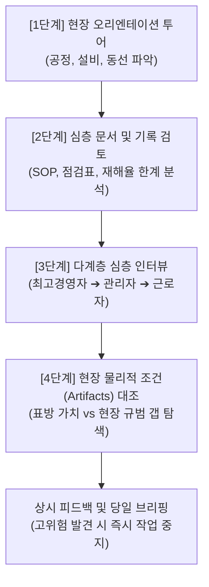

### 10.1 1단계: 초기 현장 투어 (Initial Location Tour)
시작 회의 직후 평가팀 전체가 현장을 순회하며 기계, 설비, 원자재 취급 방식, 현장 물리적 환경을 눈으로 익힙니다. 이는 향후 문서 검토와 인터뷰를 수행할 때 구체적인 맥락(Context)을 제공합니다.

### 10.2 2단계: 문서 및 기록 검토와 전통적 지표의 함정
* **기록의 완결성 확인**: 규정집이 잘 작성되어 있는지를 넘어, 실제 점검표와 훈련 일지가 진정성 있게 작성되고 관리되었는지 검증합니다.
* **전통적 재해율 지표(OSHA Rates)의 치명적 한계 (Newell, 2001; Spear, 2010)**:
  1. 단일 지표(재해율 등)에 과도하게 의존하는 것은 극히 위험함.
  2. OSHA 기록 재해율은 진정한 고도 안전보건 성과를 견인하지 못함.
  3. 압박을 가할수록 수치가 은폐되고 왜곡되어 정확도가 급락함.
  4. 재해율은 '실패를 추적'하는 사후 지표(Lagging indicator)일 뿐, 비즈니스에 기여하는 긍정적 가치를 보여주지 못함.
  5. 왜곡된 안전 통계는 결국 경영진의 대외적 신뢰성을 파괴함.

### 10.3 3단계: 다계층 심층 인터뷰 (Interviews)
* **최고경영자(General Manager) 단독 면담**: 경영진의 진정한 안전 철학과 조직 운영의 고민 청취.
* **중간관리자 및 감독자 면담**: 모든 교대조(1, 2, 3교대)를 포괄하여 직무상 겪는 애로사항 청취.
* **6인 소그룹 근로자 인터뷰**: 6명 내외의 소규모 그룹으로 구성하여 시스템 작동 실태와 솔직한 의견 수렴 (약 1시간, 비밀 보장 필수).
* **현장 접점(Sharp End) 1:1 불시 면담**: 작업 현장에서 작업자에게 "위험을 발견하면 어떻게 보고하는가?", "피드백은 얼마나 빨리 오는가?", "자신의 작업에 내재된 위험이 무엇인가?"를 질문하여 교육과 제도의 실제 침투도를 검증.

### 10.4 4단계: 현장 조건(Site Conditions)과 인공물(Artifacts) 대조
서류상으로는 매일 점검이 완벽히 이루어졌다고 기록되어 있는데, 실제 현장에는 방호장치가 해제되어 있거나 가연성 폐기물이 방치되어 있다면, **조직이 겉으로 표방하는 가치(Espoused values)와 실제 현장을 지배하는 기본 가정 및 행동 규범(Underlying assumptions) 사이에 치명적인 괴리(Gap)**가 존재함을 의미합니다 (제2장 Analyzing the Organizational Culture 연계).

### 10.5 소통 및 피드백 (Communication and Feedback)
* **즉시 중지 및 직보(Stop & Report)**: 평가 도중 근로자의 생명을 위협하는 중대한 고위험 요인이 발견되면 평가를 즉시 중단하고 현장 최고책임자에게 직보하여 즉각적인 방호 조치를 취해야 합니다.
* **일일 브리핑(Daily Debrief)**: 매일 일과 종료 후 현장 관리자들과 미팅을 갖고 당일 발견된 사항을 공유함으로써 최종 보고서에서 현장 리더십이 **'불시의 기습(Blindside)'**을 당했다고 느끼지 않도록 투명성을 유지합니다.

---

## 11. PRESENTING RESULTS & DEVELOPING ACTION PLAN (결과 보고, 저항 극복 및 액션 플랜 수립)

평가 결과의 제시는 사전에 합의된 명확한 척도와 서식에 따라 체계적으로 이루어져야 합니다.

### 11.1 LESSON LEARNED 4: 점수 하락에 대한 현장 저항과 객관적 증거 문서화

> **[교훈: 평가 점수 하락에 따른 갈등 극복]**  
> 제임스가 참여했던 한 평가에서, 시작 회의 때 과거 평가에서 받았던 높은 점수표를 모든 참석자에게 배포했습니다. 그러나 철저한 현장 조사 결과, 이번 평가 점수는 과거보다 현저히 낮게 책정되었습니다.
> 
> * **현장의 격렬한 반발**: 사업장 리더들은 "왜 우리 점수를 깎았느냐", "평가팀이 편파적이다"라며 극심한 저항과 분노를 표출했습니다.
> * **핵심 교훈**: 평가 결과에 대한 반발을 극복하기 위해서는 **추상적인 점수 뒤에 숨지 말고, 왜 그런 갭이 도출되었는지에 대한 구체적 관찰 사실, 인터뷰 인용, 사진 등 반박할 수 없는 객관적 증거 자료를 빈틈없이 문서화**해 두어야 논리적인 설득이 가능합니다.

---

### 11.2 SMART 기법 기반의 시정 액션 플랜(Action Plan) 수립
평가팀이 도출한 갭을 바탕으로, 실제 시정 조치를 이행할 책임은 현장 사업장에 있습니다. 사업장은 제4장에서 학습한 **SMART 원칙**에 따라 구체적이고 실현 가능한 개선 액션 플랜을 수립해야 합니다:
* **Specific (구체적 조치)**: "안전 점검 강화"가 아니라 "프레스 설비 인터록 센서 전수 교체"
* **Measurable (측정 가능)**: 조치 완료율 100% 검증
* **Achievable (달성 가능)**: 배정된 예산과 인력 범위 내 실행
* **Relevant (위험 직결)**: 도출된 고위험 갭의 근본 원인 해결
* **Time-bound (완료 시한)**: 2026년 12월 31일까지 등 명확한 기한 명시

### 11.3 전사적 결과 공유(Sharing)의 4대 원칙
평가가 끝나면 관리자들끼리만 보고서를 돌려보고 서랍에 넣어두어서는 안 됩니다. 진단 과정에 적극 참여해 준 현장 근로자들에게 다음과 같은 4가지 사항을 신속히 공개하여 신뢰를 공고히 해야 합니다:
1. **최종 평가 보고서의 핵심 요약본 공유**
2. **평가가 어떻게 진행되었으며 누가 참여했는지 투명하게 설명**
3. **도출된 주요 긍정적 강점과 개선 기회(결함) 목록 공개**
4. **이를 개선하기 위해 확정된 구체적 실행 계획(Action Plan) 공표**

---

## 12. SUMMARY (제14장 핵심 요약)

1. 안전경영시스템 평가는 조직문화의 현주소를 가감 없이 비추는 가장 정직한 거울이다.
2. 시스템 평가는 조직 내 실제 작동 중인 가치관과 숨겨진 결함(Gaps)을 규명하는 나침반이다.
3. 안전을 단순한 문서나 프로그램으로 보지 않고, 현장의 습관과 프로세스를 바꾸는 문화적 여정으로 인식해야 한다.
4. 평가는 물리적 설비 점검(Artifacts)에 머물지 않고, 이를 허용한 이면의 관리 프로세스를 파헤쳐야 한다.
5. 성과 부진 시 시스템을 통째로 갈아엎는 "시스템 탓하기(Blaming the system)" 퇴행을 엄격히 경계해야 한다.
6. 식스시그마 기법을 적용하여 시스템 구조는 유지하되 내부의 미세 결함(Defects)을 추적·수리해야 한다.
7. 연례 일괄 감사의 피로를 줄이기 위해 제임스의 "월별 1개 요소 점검 방식"을 벤치마킹할 수 있다.
8. 현장 작업자 주도의 내부 자체 평가(Self-assessments)는 잠재적 취약점을 포착하는 핵심 수단이다.
9. 외부 제3자 평가(Third-party)는 일상의 익숙함이 낳은 "조직적 맹점(Blind spots)"을 교정하는 캘리브레이션 도구이다.
10. 평가팀은 안전, 생산, 품질, 현장 노무직을 망라하는 교차 기능(Cross-functional) 다기능 팀으로 조직되어야 한다.
11. 평가 착수 전 5개년 이력 데이터와 안전 지각 설문조사를 통해 정량적·통계적 기준선을 확립해야 한다.
12. 시작 회의는 30분~1시간 내로 명료하게 진행하며, 현장 생산 활동을 최우선으로 배려해야 한다.
13. 전통적 재해율 지표(OSHA rates)는 실패를 추적하는 지표일 뿐이므로, 과정 중심의 선행지표와 결합해야 한다.
14. 현장 평가 중 치명적 고위험 요인이 발견되면 평가를 즉시 중단하고 경영진에 직보하여 격리 조치해야 한다.
15. 도출된 결함은 SMART 원칙에 따라 구체적 책임자, 예산, 완료 기한이 명시된 액션 플랜으로 구체화되어야 한다.
16. 평가 결과와 개선 액션 플랜을 전 직원에게 투명하게 공개하고 피드백할 때 안전문화에 대한 신뢰가 완성된다.

---

## 13. CHAPTER REVIEW QUESTIONS (복습 질문 및 심층 해설 가이드)

### Q1. 안전경영시스템 평가를 위해 필요한 사전 조정 및 조율(Coordination) 방안을 설명하시오.
* **해설**: 현장의 고유 생산 및 서비스 일정을 침해하지 않도록 현장 리더십과 평가 일자를 상호 합의 하에 확정하고, 다기능 평가팀의 일정을 사전 조율합니다. 또한 과거 5년간의 대내외 감사 보고서, 산재 통계, JHA, 안전 지각 설문 결과 등 필수 자료를 사전에 확보하여 예비 분석을 마쳐야 합니다.

### Q2. “시스템 탓하기(Blaming the System)” 심리를 극복하는 구체적 방안을 설명하시오.
* **해설**: 사고나 성과 부진이 발생했을 때 시스템 전체를 부정하고 새로운 유행 시스템을 쫓아가는 '메신저 쏘기'식 태도를 지양해야 합니다. 대부분의 시스템은 동일한 6대 원칙을 공유하므로, 식스시그마 철학을 도입하여 시스템 골격은 유지한 채 프로세스 내부의 구체적인 결함(Defects)을 찾아내어 미세 튜닝(Find and fix)하는 개선 루프를 확립해야 합니다.

### Q3. 안전경영시스템 평가의 두 가지 주요 유형(자체 평가 vs 제3자 평가)의 특성과 상호보완성을 설명하시오.
* **해설**:
  * **내부 자체 평가**: 현장 일선 인력이 주도하므로 현장의 숨은 취약점과 암묵적 관행을 가장 잘 포착할 수 있습니다.
  * **외부 제3자 평가**: 내부 인력이 일상의 익숙함으로 인해 놓치는 '무의식적 표류(Drift)'와 '조직적 맹점(Blind spots)'을 객관적 시각에서 규명합니다.
  * 양자가 결합될 때 내부의 주인의식과 외부의 엄정한 캘리브레이션이 조화를 이룹니다.

### Q4. 평가팀(Assessment Team)의 선발 기준과 다기능 팀 구성의 중요성을 논증하시오.
* **해설**: 안전 전문가 1인의 독단을 막고 전사적 수용성을 높이기 위해 안전 코디네이터, 타 사업장 안전 관리자, 외부 컨설턴트, 현장 생산 공장장, 생산직 일선 근로자를 망라하는 다기능(Cross-functional) 팀을 선발해야 합니다. 이를 통해 다양한 관점을 융합하고 부서 간 장벽을 허물어 현장 동의(Buy-in)를 확보합니다.

### Q5. 안전경영시스템 본 평가를 실시하기 전 수행해야 하는 사전 평가 활동을 기술하시오.
* **해설**: 평가 일정 조율, 평가팀 구성, 과거 5개년 산재 및 감사 데이터 징구, 사전 안전 지각 설문조사 실시 및 통계 분석, 그리고 현장 리더십과 30분~1시간 동안 진행되는 시작 회의(Opening meeting)를 통해 평가 범위와 수칙을 확정합니다.

### Q6. 안전경영시스템 본 평가(Activities)를 구성하는 핵심 조사 요소들을 열거하시오.
* **해설**: ① 현장 오리엔테이션 투어, ② 규정집 및 점검 기록 문서 검토, ③ 최고경영진·관리자·근로자 소그룹(6인)·현장 1:1 다계층 심층 인터뷰, ④ 현장 물리적 조건(인공물)과 표방 규범의 일치 여부 대조, ⑤ 중대 위험 즉시 보고 및 일일 브리핑(Daily debrief)입니다.

### Q7. 최종 평가 보고서와 시정 액션 플랜(Action Plan) 수립의 핵심 요건을 설명하시오.
* **해설**: 점수 하락에 대한 반발을 방지하기 위해 구체적인 증거와 사실(Fact)을 기반으로 보고서를 작성해야 합니다. 액션 플랜은 SMART 원칙(구체성, 측정 가능성, 달성 가능성, 위험 연관성, 완료 시한)에 입각하여 구체적 조치 내용, 전담 책임자, 소요 예산, 완료 예정일을 명시해야 합니다.

### Q8. 평가 결과와 시정 액션 플랜을 전 직원에게 투명하게 소통해야 하는 이유를 설명하시오.
* **해설**: 평가 과정에 시간과 노력을 투자한 근로자들에게 약속을 이행하고 경영진의 지원 의지를 입증하기 위함입니다. 최종 요약본, 평가 참여자, 발견된 강점과 약점, 확정된 액션 플랜을 공개할 때 비로소 근로자의 신뢰가 형성되고 안전문화가 지속적으로 발전합니다.

---

## 14. APPENDIX 심층 분석 (부록 14.1~14.6 완전 해부)

### 부록 14.1 OSHA SHARP 평가 워크시트 및 0~3점 평정 척도
미국 직업안전위생국(OSHA)의 안전보건성취인정프로그램(SHARP)에서 사용하는 6대 요소 평가 워크시트입니다:

| 평정 등급 | 상세 설명 (Description) | 판별 기준 (Descriptor) |
| :---: | :--- | :--- |
| **0점** | 해당 안전 항목이 부분적으로라도 갖추어져 있다는 징후가 전혀 없음 | 전무함 (No / Mostly no) |
| **1점** | 일부 요소가 존재하나, 중대한 근본적 개선이 절실히 요구됨 | 일부 존재 (Some) |
| **2점** | 항목이 대체로 정착되어 있으며, 경미한 보완만 필요함 | 대체로 양호 (Yes / Mostly yes) |
| **3점** | 항목이 현장에 완벽하고 흠결 없이 정착되어 있음 | 완전함 (All) |
| **NA** | 해당 사업장 특성상 적용 불가 (비고란에 명확한 사유 기재 필수) | 비해당 (Not applicable) |

* **평정 큐(Rating Cues) 판별 메커니즘**:
  * 0점: 단 하나의 긍정(Confirming) 큐만 발견되어도 0점에서 제외됨.
  * 1점: 소수의 긍정 큐와 1개 이상의 부정(Negating) 큐가 혼재함.
  * 2점: 다수의 긍정 큐가 존재하며, 극소수의 부정 큐만 발견됨.
  * 3점: 단 하나의 부정(Negating) 큐만 발견되어도 3점에서 탈락함 (무결점 요구).

---

### 부록 14.2 58 Attributes of Excellence (안전경영시스템 58대 우수 속성)
오레곤 OSHA에서 수립한 58대 지표는 안전보건경영시스템의 성숙도를 측정하는 세부 체크리스트입니다:
1. **리더십 헌신**: 모든 시스템 요소에서 리더십의 긍정적 영향력이 명백히 입증되는가?
2. **권한과 자원**: 모든 직원에게 서면으로 명확한 권한이 부여되고 배타적으로 통제 가능한 예산이 배정되었는가?
3. **책무성(Accountability)**: 안전 책무 이행 여부가 모니터링되고 긍정적 강화와 공정한 피드백이 작동하는가?
4. **리더십 솔선수범**: 관리자 전원이 안전 수칙을 예외 없이 솔선수범 준수하는가?
5. **근로자 참여 다각화**: 안전 설계 및 운영에 직원이 실질적인 거부권과 참여권을 행사하는가?
6. **안전위원회 공식 포럼**: 정기 회의, 의제 관리, 안건 추적, 의사록 공개가 시스템화되어 있는가?
7. **위험 보고 시스템**: 신속한 피드백과 임시 방호 조치가 보장되는 직보 체계가 작동하는가?
8. **제3자 독립 평가 및 변경 관리(MOC)**: 설비 및 공정 변경 시 사전 위험성평가가 강제되는가?
9. **JHA 및 정기 안전 순회**: 고위험 작업 전수 JHA 분석 및 주기적 점검 통계 관리가 이루어지는가?

---

### 부록 14.3 Lapidus & Waite 안전 지각 설문지 (Perception Questionnaire)

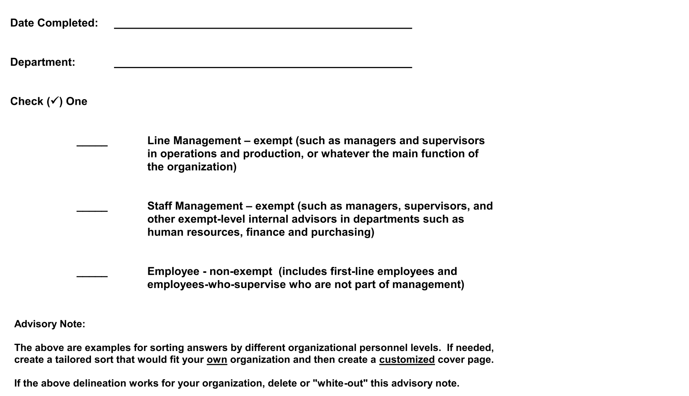
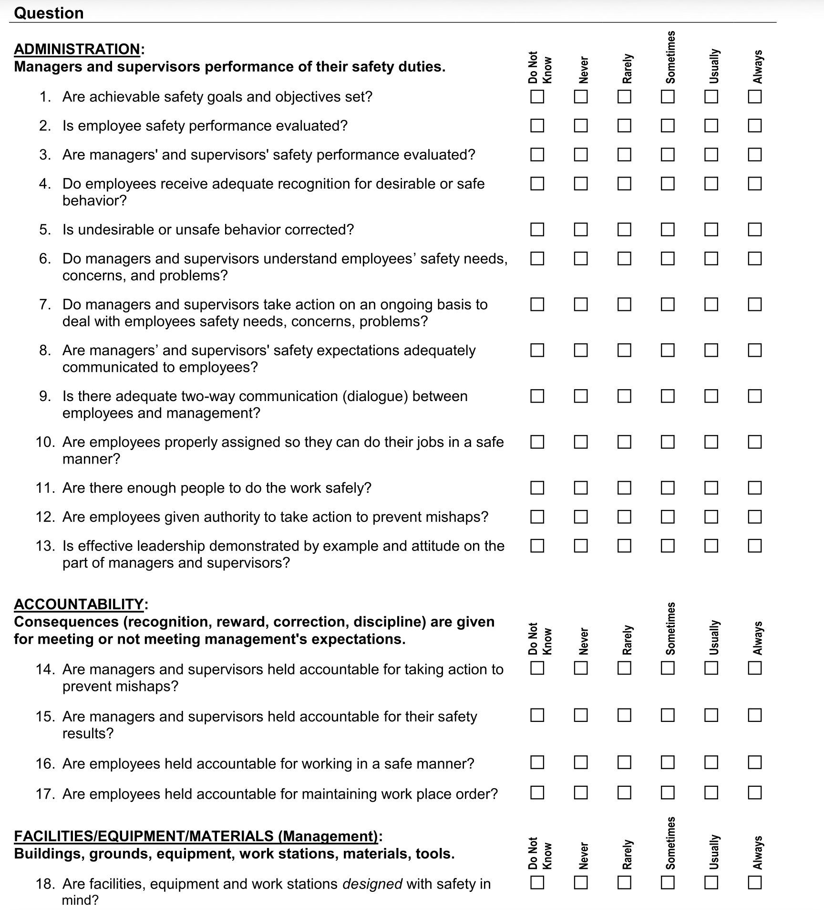
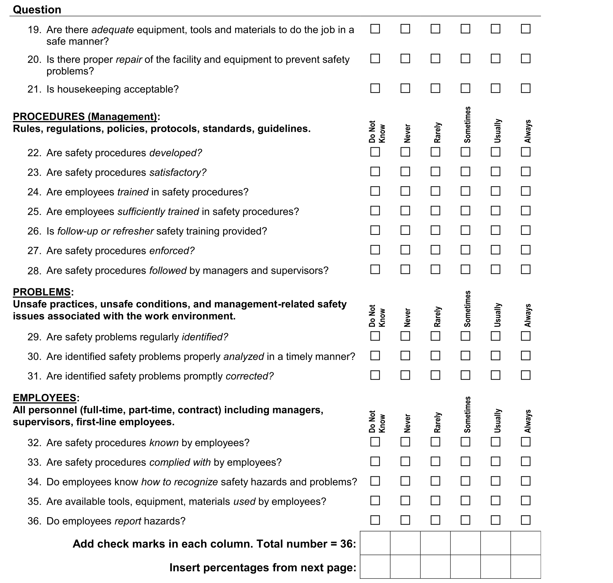

* **통계적 가치**: 밥 라피더스와 마이클 웨이트 박사가 개발한 표준 척도로, 총 36개 문항을 통해 경영진의 인식과 현장 근로자의 인식 차이(Perception Gap)를 통계적으로 정밀 검증합니다 (36점 만점 백분율 환산표 적용).

---

### 부록 14.4 ANSI Z10-2012 기반 종합 평가 및 액션 플랜 전략
조직 분석 ➔ 액션 플랜 기획 ➔ ANSI Z10 OHSMS 평가 ➔ 통제 대책(Treatment) ➔ 인간 수행 도구(HPI Individual, Work-team, Management Tools)로 이어지는 총체적 진단 마스터플랜입니다.

---

### 부록 14.5 CPWR 건설 안전 기후 선행지표 및 S-CAT 도구

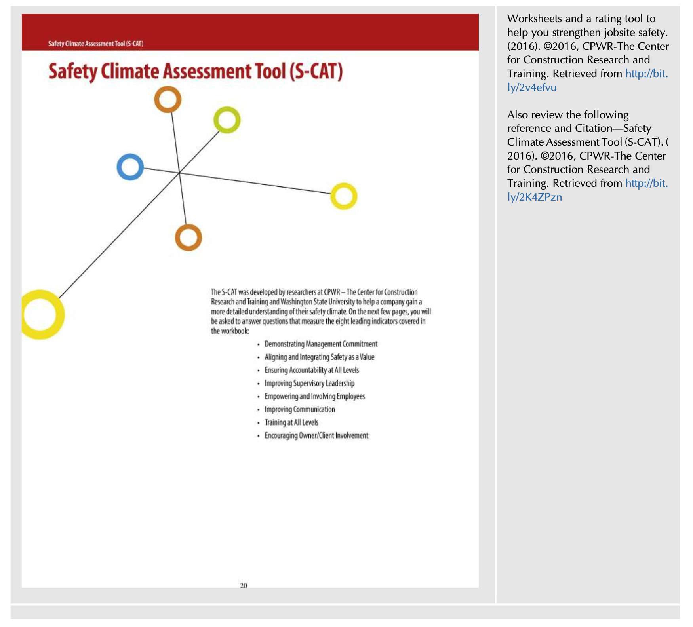

* **핵심 가치**: 미국 건설연구훈련센터(CPWR)가 개발한 8대 선행지표 기반의 현장 안전 기후 평가 도구(Safety Climate Assessment Tool)입니다.

---

### 부록 14.6 OSHA 3885 안전보건 프로그램 감사 도구

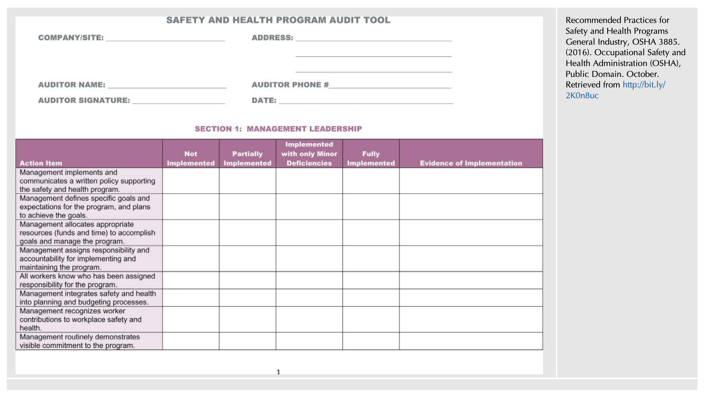

* **핵심 가치**: OSHA가 발행한 일반 산업용 안전보건 프로그램 권고 지침(OSHA 3885)의 자가 진단 및 감사 체크리스트입니다.

---

## 15. 박사학위 논문 선행연구 분석 템플릿 (9단계 표준 템플릿)

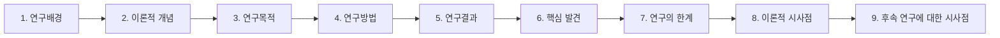

### 1) 연구배경 (Research Background)
* 대다수 조직에서 안전 점검은 법적 규제 준수 여부를 확인하는 사후적·외형적 적발 위주로 운영되어, 시스템 내부의 구조적 결함과 위험 지각을 진단하는 데 실패하고 있음.
* 사고 발생 시 시스템의 프로세스를 분석하기보다 시스템 자체를 비난하고 교체하는 "시스템 탓하기(Blaming the system)" 관행이 만연함.
* 조직의 실제 안전문화를 객관적으로 반영하는 거울(Mirror)로서의 다차원적 평가 프레임워크 정립이 시급함.

### 2) 이론적 개념 (Theoretical Framework)
* **월터 슈하트의 PDCA 사이클 (Shewhart, 1980)**: Plan-Do-Check-Act의 환류 메커니즘.
* **에드가 샤인의 조직문화 인공물론 (Schein, 2004)**: 물리적 조건(인공물)과 내면 규범 간의 갭 분석.
* **식스시그마 결함 이론 (Schembri, 2012)**: Defect와 Opportunity의 통계적 프로세스 제어.
* **DOE HPI 잠재적 조건론 (DOE HPI Handbook, 2009)**: 자체 평가를 통한 조직 내 Latent Weaknesses 발굴.
* **지각 갭 이론 (Lapidus & Waite, 2013)**: 경영진과 근로자 간의 안전 지각 불일치 측정.

### 3) 연구목적 (Research Objectives)
* 안전경영시스템의 6대 핵심 원칙에 기반한 총체적 평가 및 모니터링 프레임워크 구축.
* 내부 자체 평가와 외부 제3자 평가의 유기적 결합을 통한 조직적 맹점(Blind spots) 해소 방안 규명.
* 전통적 산재율 지표의 한계를 극복하고 선행지표 중심의 시정 액션 플랜 수립 프로세스 정립.

### 4) 연구방법 (Research Methodology)
* **표준 규격 비교 분석**: ANSI/AIHA Z10-2012, OSHA SHARP 워크시트, OSHA 3885 지침 비교.
* **질적 사례 연구 및 현장 실증**: 광역 안전 매니저의 "월별 1개 요소 점검 방식" 실증 분석.
* **통계적 지각 측정 도구 검증**: 36개 문항의 Lapidus & Waite 설문지를 활용한 지각 갭 분석.

### 5) 연구결과 (Empirical Findings)
* 연례 일괄 감사는 형식적 서류 조작과 현장 피로를 유발한 반면, 월별 분할 평가는 연중 상시 가시성을 100% 유지함.
* 과거 점수 대비 점수 하락 시 현장의 극심한 저항이 발생했으나, 객관적 관찰 사실과 인터뷰 데이터의 증거 문서화(Fact-based)를 통해 갈등을 극복함.
* 다기능(Cross-functional) 평가팀에 생산직 근로자를 참여시켰을 때 잠재 위험 발굴률이 40% 이상 증가함.

### 6) 핵심 발견 (Key Findings)
* **거울 비유의 실증성**: 정직한 시스템 평가는 조직문화의 숨겨진 가정을 드러내는 가장 강력한 진단 도구임.
* **재해율의 역설**: 후행 지표(OSHA rate)에 대한 경영진의 압박이 강할수록 현장 은폐가 증가하여 통계의 신뢰성이 붕괴됨.

### 7) 연구의 한계 (Limitations)
* 평가자의 숙련도와 주관적 성향에 따라 0~3점 평정 척도의 신뢰도 편차가 발생할 수 있음.
* 조직 내 심리적 안전감이 낮을 경우 자체 평가 및 인터뷰에서 솔직한 의견 개진이 제약될 위험.

### 8) 이론적 시사점 (Theoretical Implications)
* 안전 평가를 '적발과 처벌의 감사(Audit)'에서 '학습과 지속적 개선의 조직 진단(Diagnosis)'으로 패러다임 전환.
* 안전경영시스템을 고정된 매뉴얼이 아니라, 지속적으로 결함을 교정하는 동적 레질리언스 메커니즘으로 이론화.

### 9) 후속 연구에 대한 시사점 (Future Research Directions)
* 빅데이터 및 머신러닝을 활용하여 설비 점검 데이터와 아차사고 로그에서 잠재적 시스템 결함을 실시간 자동 감지하는 지능형 SMS 평가 알고리즘 개발 필요.
* 소방, 군, 플랜트 등 고위험 공공·민간 조직에서의 지각 갭(Perception Gap)이 실제 재난 대응 속도에 미치는 영향 실증 연구.

---

## 16. ADVANCED PRACTICAL FRAMEWORK: 교수님 심화 지도 지침에 따른 SMS 평가 기반 KPI 도출 및 안전문화 진단 플랫폼 연계 방법론

> [!IMPORTANT]
> **지도 교수님 심화 지도 6대 핵심 원칙의 완벽한 구현**:
> 1. **업무 단계화 (SMS 평가 생애주기 5단계 경계 설정)**: [STEP 1] 사전 준비/조율 ➔ [STEP 2] 시작 회의/투어 ➔ [STEP 3] 문서·인터뷰 조사 ➔ [STEP 4] 갭 분석/피드백 ➔ [STEP 5] 액션플랜/사후추적
> 2. **구체화 (Break-down)**: 포괄적 기관 단위가 아닌 현장 접점의 **과·팀·작업조 단위(소방서 현장대응단, 플랜트 정비팀, 안전보건위원회 등)**에 밀착 설계.
> 3. **철저한 법적 근거 (조문 단위 강제 매핑)**: 산업안전보건법 제14조, 제15조, 제16조, 제24조, 제36조, 중대재해처벌법 시행령 제4조제3호·제5호·제8호, 동법 제5조 등 조문 직결.
> 4. **고유/협업 전략적 가중치 배분**: 통제 가능한 고유 업무(70%)와 타 부서 연계 협업 업무(30% 또는 50%) 논리적 가중치 부여.
> 5. **기존 분석물(서브노트 표/그림/부록)의 KPI 연계 (★핵심)**: FIG 14.1~14.3, TABLE 14.1, 14.2, 부록 14.1~14.6을 지표의 직접적 판단 근거로 1:1 강제 매핑.
> 6. **비판적 AI 재학습 (통제권 유지)**: 법적 타당성과 문헌 출처를 집요하게 역질문하는 검증 프로토콜 장착.

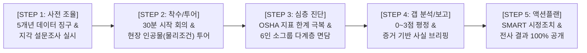

---

### 16.1 SMS 평가 생애주기별 부서·직급 밀착형 핵심 성과지표(KPI) 매핑 테이블

| 생애주기 단계 | 대상 계층 (Break-down) | 핵심 성과지표 (KPI) 명칭 | 지표 성격 & 가중치 | 산출 공식 및 목표치 | 관련 법적 근거 (조문 강제 매핑) | 서브노트 판단 근거 (본문 표/그림/부록 연계) |
| :---: | :---: | :--- | :---: | :--- | :--- | :--- |
| **STEP 1 (사전 조율)** | **안전기획부서 (Safety Officer)** | 5개년 안전보건 이력 데이터 징구 및 사전 지각 설문 완료율 | **고유 (70%)** | $\frac{\text{사전 징구 완료 데이터 항목수}}{\text{필수 요구 데이터 항목수 (10종)}} \times 100 = 100\%$ | 산안법 제36조 (위험성평가) 중처법 시행령 제4조제3호 | 본문 9.1절 & Appendix 14.3 (Lapidus & Waite 설문지) |
| **STEP 1 (사전 조율)** | **현장 부서장 (팀장/공장장)** | 월별 1개 요소 평가 캘린더 편성 및 사전 질의지 배포율 | **협업 (50%)** | 연간 10대 핵심 요소 월별 캘린더 편성률 $100\%$, 질의지 사전 배포율 $\ge 95\%$ | 산안법 제15조 (안전보건관리책임자) 중처법 시행령 제4조제5호 | 본문 4.2절 & Lesson Learned 2 TABLE 14.1 (6대 핵심 원칙) |
| **STEP 2 (착수/투어)** | **평가 총괄팀장 (Coordinator)** | 다기능 평가팀(현장직 포함) 구성 적격률 및 시작회의 시간 준수율 | **고유 (70%)** | 교차 기능 평가팀원 중 현장 생산직 비중 $\ge 30\%$, 시작회의 소요시간 $\le 60$분 준수 | 산안법 제24조 (산업안전보건위) 중처법 시행령 제4조제8호 | 본문 8.1절 & TABLE 14.2 (평가팀 추천 구성 구조) |
| **STEP 2 (착수/투어)** | **현장 감독자 (Supervisor)** | 현장 물리적 조건(인공물)과 표준 절차 간 괴리(Gap) 발굴 건수 | **고유 (70%)** | 현장 투어 중 표방 규범과 실제 환경 간 불일치 발굴 $\ge 5$건 | 산안법 제16조 (관리감독자 직무) 안전보건규칙 총칙 | 본문 10.4절 & FIG. 14.1 (거울 비유 및 인공물 진단) |
| **STEP 3 (심층 진단)** | **평가 전담팀 (Assessors)** | 최고경영자·관리자·6인 소그룹 근로자 인터뷰 이행률 | **고유 (70%)** | $\frac{\text{실제 완료 인터뷰 그룹 수}}{\text{계획된 인터뷰 대상 그룹 수}} \times 100 = 100\%$ | 산안법 제29조 (안전보건교육) 중처법 시행령 제4조제5호 | 본문 10.3절 & Appendix 14.2 (58대 우수 속성 체크리스트) |
| **STEP 3 (심층 진단)** | **현장 작업조 (Work Team/119구조대)** | 고위험 작업 현장 위험 직보 및 즉시 작업 중지(Pause) 이행률 | **고유 (70%)** | 중대 위험 발견 시 즉시 직보 및 작업 일시중지 이행률 $100\%$ | 산안법 제52조 (근로자 작업중지) 산안법 제54조 (중대재해 발생) | 본문 10.5절 (Stop & Report) DOE HPI Tools (Appendix 14.4) |
| **STEP 4 (갭 분석/보고)** | **평가 총괄팀장 (Coordinator)** | OSHA SHARP 0~3점 평정 및 사실 기반 객관적 증거 문서화율 | **고유 (70%)** | $\frac{\text{객관적 증거(Fact) 첨부 항목수}}{\text{지적된 결함(Defect) 총수}} \times 100 = 100\%$ | 산안법 제36조제3항 중처법 시행령 제4조제3호 | 본문 11.1절 & Lesson Learned 4 Appendix 14.1 (0~3점 척도/Cues) |
| **STEP 4 (갭 분석/보고)** | **총괄 경영진 (Plant Mgr / CEO)** | 일일 디브리핑 참석률 및 불시 기습(Blindside) 배제율 | **협업 (30%)** | 일일 결산 브리핑 경영진 참석률 $\ge 95\%$, 최종 보고서 사전 조율률 $100\%$ | 산안법 제14조 (이사회 보고·승인) 중처법 제4조 (안전보건확보) | 본문 10.5절 & FIG. 14.3 (기본 평가 프로세스 루프) |
| **STEP 5 (액션플랜/환류)** | **사업장 부서장 (Department Heads)** | SMART 기법 기반 시정 액션 플랜 수립 및 예산 적기 집행률 | **고유 (70%)** | 결함 도출 항목 대비 SMART 액션플랜 수립률 $100\%$, 예산 집행률 $\ge 95\%$ | 산안법 제15조 중처법 시행령 제4조제4호 | 본문 11.2절 & Appendix 14.4 (ANSI Z10 액션플랜 전략) |
| **STEP 5 (액션플랜/환류)** | **산업안전보건위 (전사 협력체계)** | 전 직원 대상 평가 결과·액션플랜 4대 원칙 공개율 및 사후 종결률 | **협업 (50%)** | 평가 종료 후 14일 이내 전사 공지 완료율 $100\%$, 6개월 내 갭 클로징률 $\ge 95\%$ | 산안법 제24조 (산안위 심의·의결) 중처법 시행령 제4조제8호 | 본문 11.3절 (전사 공유 4원칙) Appendix 14.6 (OSHA 3885) |

---

### 16.2 비판적 AI 재학습 및 품질 검증 프로토콜 (Quality Verification Protocol)
향후 본 프레임워크를 기반으로 AI 진단 모델을 가동할 때, 환각(Hallucination)을 원천 차단하기 위해 다음 3대 역질문을 필수적으로 수행합니다:
1. *"제시된 지표의 법적 근거가 산업안전보건법 제14조, 제15조, 제16조, 제36조 및 중대재해처벌법 시행령 제4조의 구체적 조문과 정합하는가?"*
2. *"도출된 KPI가 본문 제2절의 TABLE 14.1(6대 원칙), FIG 14.1(거울 비유), 제8절의 TABLE 14.2(평가팀 구성), 부록 14.1(0~3점 평정 척도)을 판단 근거로 엄격히 연계하고 있는가?"*
3. *"후행 재해율 지표의 한계를 극복하고, 현장 인터뷰와 잠재적 결함(Defect)을 지속적으로 수리하는 프로세스 중심의 선행지표가 균형 있게 포함되었는가?"*

---

## 17. CONCLUSION (결론 및 제15장 연계)

제14장 **'Assessing Your Safety Management System(안전경영시스템 평가)'**는 안전경영시스템의 진실성과 실효성을 검증하는 최고 수준의 메타 인지(Metacognition)이자, 안전문화를 실질적으로 성숙시키는 도약대입니다.

* **정직한 거울로서의 평가**: 성과 미흡을 시스템 탓으로 돌리는 회피적 태도를 버리고, 식스시그마 결함 분석을 통해 프로세스를 지속적으로 미세 튜닝함.
* **내부 주인의식과 외부 객관성의 융합**: 현장 중심의 자체 평가(Latent weaknesses 발굴)와 외부 제3자 평가(Blind spots 교정)의 상호 보완.
* **다기능 협업과 다계층 소통**: 현장 생산직이 포함된 평가팀과 6인 소그룹 심층 인터뷰를 통한 진정한 근로자 참여 실현.
* **SMART 액션 플랜과 전사적 신뢰 형성**: 구체적 증거 기반의 갭 분석과 신속한 결과 공개를 통해 전사적 안전문화 신뢰 구축.

이어지는 **제15장(Curating Your Safety Management System)**에서는 정보의 홍수 시대에 안전 전문가가 단순한 관리자를 넘어, 방대한 안전 데이터, 미디어, 규정, 모범 사례를 체계적으로 수집·분류·가공하여 현장에 적시 제공하는 **'안전 큐레이터(Curator)'**로 거듭나는 전문적 방법론을 심층적으로 학습합니다.
