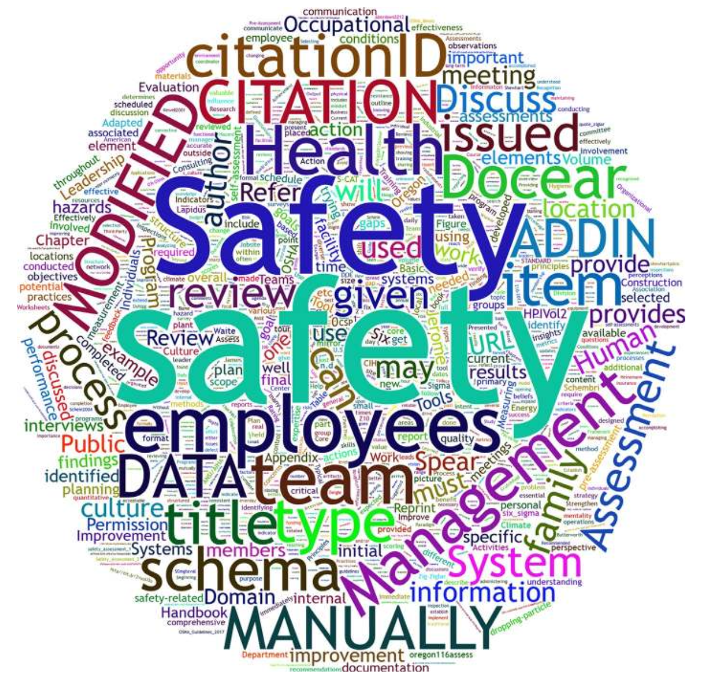
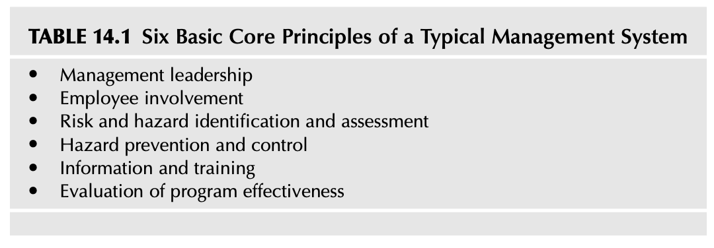
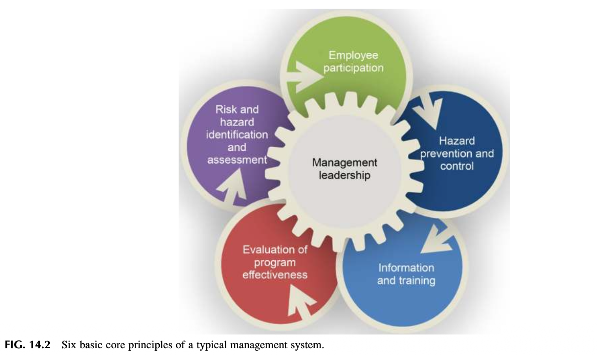
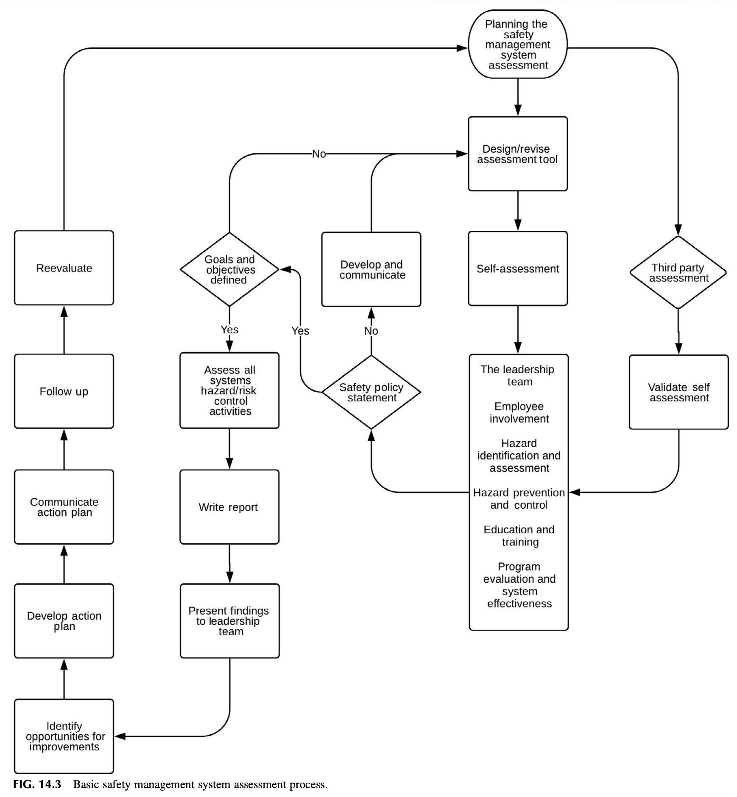
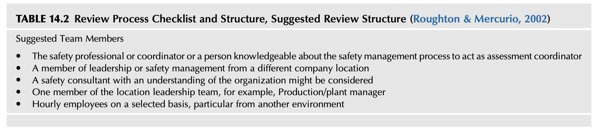
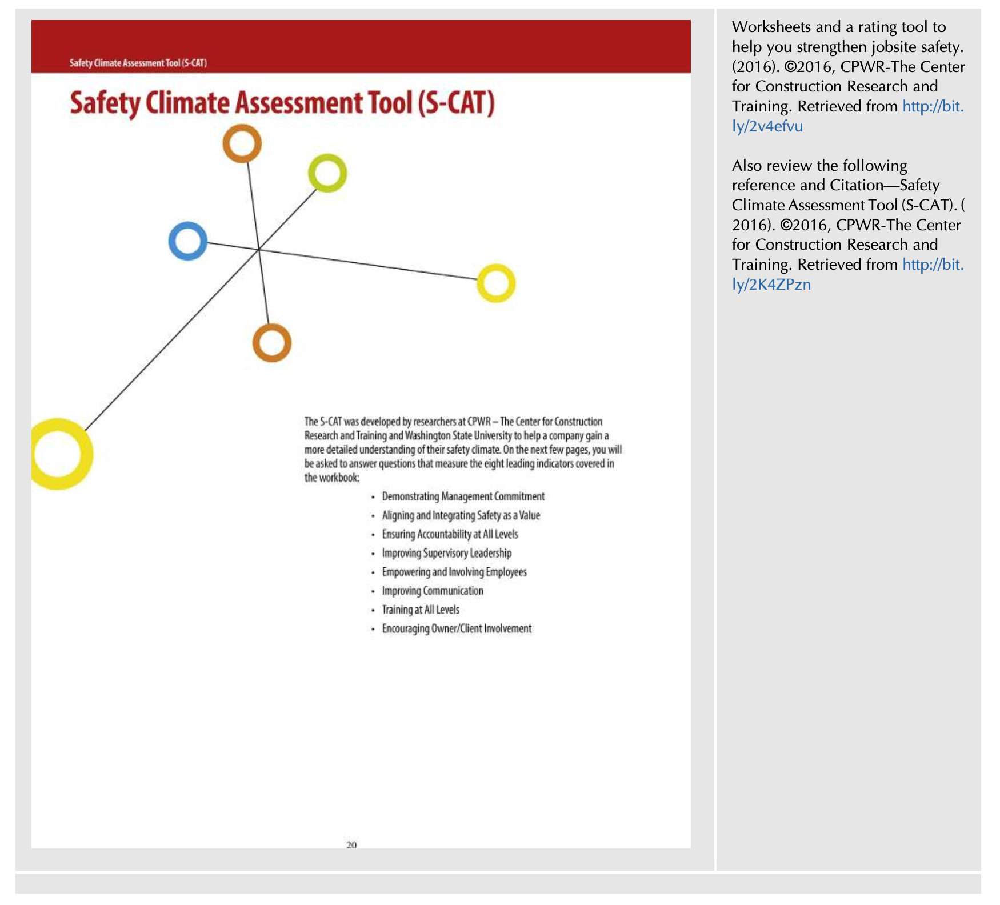
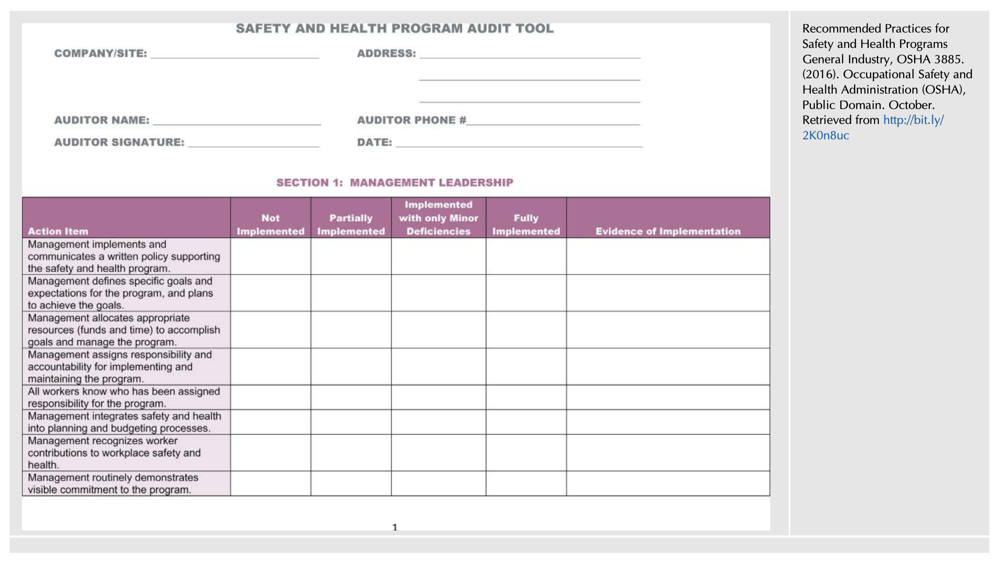

<!-- Block B01 -->
# 제14장: 안전보건경영시스템의 평가 (Assessing Your Safety Management System)

*Safety Culture. https://doi.org/10.1016/B978-0-12-814663-7.00014-5*  
*©2019 Elsevier Inc. All rights reserved. pp. 345–374*

<!-- Block B02 -->
<!-- [그림 삽입 위치: Chapter 14 Overview] -->

<!--  -->

> "목표에 도달하기를 원한다면, 그 목표에 실제로 도달하기 전에 당신의 마음속에서 이미 그 '도달의 순간'을 생생하게 볼 수 있어야 한다."  
> — 지그 지글러 (Zig Ziglar)

<!-- Block B03 -->
## 서론 (INTRODUCTION)

안전보건경영시스템(SMS)에 대한 포괄적이고 종합적인 평가는 안전관리 활동의 현재 상태, 행정적 운영 실태, 그리고 전반적인 유효성에 대한 깊이 있는 통찰과 객관적인 검증을 제공합니다. 안전 프로세스에 대한 정기적인 진단 평가는 해당 조직이 보유한 실제 안전문화의 진정한 가치와 신념을 투영합니다. 구조화되고 정밀한 평가는 단순히 안전경영시스템 내부뿐만 아니라 조직 전반에 걸친 잠재적 결함(격차)과 미래 개선을 위한 구체적인 기회를 밝혀줍니다 (그림 14.1 참조).

<!-- Block B04 -->
<!-- [그림 14.1 스크린샷 삽입 위치: Standing in front of a mirror] -->

<!--  -->

### 그림 14.1 거울 앞에 서기 (FIG. 14.1 Standing in front of a mirror)

<!-- Block B05 -->
진지한 자세로 수행되는 심층적인 시스템 평가는 현장의 진정한 민낯을 완벽하고 정확하게 보여주는 최고급 고해상도 거울을 들여다보는 것과 같습니다. 좋은 거울은 결코 거짓말을 하지 않으며, 현재 우리 조직이 무엇을 잘하고 있고 무엇이 미흡한지를 있는 그대로 투명하게 비추어 줍니다!

<!-- Block B06 -->
안전보건경영시스템에 대한 전면적인 평가는 안전문화의 장기적인 성공에 결정적인 의사결정과 개선 활동을 이끌어주는 확고한 체계를 제공합니다 (Geigle, 2011). 예를 들어 ANSI Z10-2012 표준은 "직업안전보건경영시스템(OHSMS)의 당면 과제를 식별하기 위해 정보를 수집하고 검토하는 전사적 총괄 프로세스를 구축해야 한다. 여기에는 자체적으로 맞춤 개발되었든 국내외 표준에서 도입되었든 간에, 시스템을 수립하거나 개선하는 데 필요한 프로세스가 포함되어야 한다"고 규정하고 있으며, 이는 본질적으로 사후 추적(Check) 과정을 활동에 통합하는 'Plan-Do-Check-Act (PDCA)' 사이클 개념을 따릅니다 (Shewhart, 1980).

<!-- Block B07 -->
안전 프로세스와 개별 프로그램 및 기준을 구성하는 일반적인 콘텐츠를 확보하기 위한 자원은 오늘날 경제적으로 매우 손쉽게 구할 수 있습니다. 그러나 진정한 문제는 구축된 안전 프로세스가 현장에서 완전히 활용되고 의도한 목표와 세부 목적을 실제로 달성하도록 보장하는 데 필요한 지속적인 의사소통과 피드백에 있습니다. 진단 평가는 안전보건경영시스템의 핵심 개념, 교재 및 기준들이 조직의 일상 업무 활동 속에 실질적으로 내재화되어 작동하고 있는지를 최종 판별합니다.

<!-- Block B08 -->
본 장을 학습한 후 독자는 다음 사항을 논의하고 수행할 수 있어야 합니다:
* 안전보건경영시스템 평가에 요구되는 부서 간 조정 및 조율 체계의 구축을 논의한다.
* 성과 미흡 시 '시스템 자체를 탓하는(Blaming the system)' 패배주의적 사고방식을 방지하는 방안을 논의한다.
* 안전보건경영시스템 진단 평가의 다양한 유형을 비교 논의한다.
* 전문 평가팀의 선발, 구성 및 역량 개발 방안을 논의한다.
* 현장 평가 착수 전 사전 평가(Preassessment) 준비 활동을 논의한다.
* 안전보건경영시스템 평가의 핵심 구성 요소들을 상세히 논의한다.
* 최종 평가 보고서 및 구체적 실행 계획(Action Plan) 수립의 중요성을 논의한다.
* 평가 결과를 전사적으로 투명하게 소통하고 공유해야 하는 이유를 논의한다.

<!-- Block B09 -->
## 안전보건경영시스템 평가를 위한 사전 계획 (PLANNING FOR YOUR SAFETY MANAGEMENT SYSTEM ASSESSMENT)

제5장(기본 안전보건경영시스템 개요)에서 논의했듯이, 안전보건경영시스템은 6대 기본 핵심 원칙을 기반으로 작동합니다. 안전문화를 개선하고, 구축하며, 지속적으로 유지하고자 할 때, 진단 평가의 초점을 이 6대 핵심 원칙에 집중한다면 성과 개선의 성공 확률을 즉각적으로 높일 수 있습니다. 평가는 사전에 설정된 안전 목표와 세부 목적을 달성하는 데 있어 실질적인 성과 향상으로 이어질 때에만 비로소 진정한 가치를 입증하게 됩니다 (표 14.1 및 그림 14.2 참조).

<!-- Block B10 -->
이 6개 핵심 요소로 구성된 프레임워크 내에서, 각 요소는 선택된 안전보건경영시스템의 현장 실행을 안내하는 세부 하위 항목들을 요구할 수 있습니다. 시스템의 각 요소는 조직의 고유한 현장 관점과, 6대 기본 핵심 원칙과 같은 체계적인 프로세스가 실제 안전문화를 어떻게 향상시킬 수 있는가의 관점에서 면밀히 검토되어야 합니다. 안전보건경영시스템을 처음 도입하는 단계라면, 리더와 근로자가 즉각 주도하거나 관리할 수 없는 방대한 시스템 요소들로 인해 압도당하지 않도록 단계적(Phased) 접근법을 반드시 고려해야 합니다.

<!-- Block B11 -->
단지 조직에 유익할 것이라는 막연한 추측만으로 성급하게 여러 프로세스 요소들을 무리하게 도입하려 드는 것은 오히려 안전보건경영시스템의 성공에 치명적인 독이 될 수 있습니다. 당신은 단순히 서류상의 프로그램을 도입하려는 것이 아닙니다. 당신은 조직의 전반적인 안전문화를 바꾸고, 그동안 개선을 가로막아 왔던 현장의 고질적인 습관을 근본적으로 변화시키는 '살아있는 프로세스'를 실행하려는 것입니다 (Duhigg, 2012). 앞선 여러 장에서 강조했듯이, 당신은 안전에 대한 조직의 인식을 바꾸고, 사내에서 당신의 영향력을 확장하며, 조직 전체의 이익을 위해 내부 소통 네트워크를 넓혀가고자 하는 것입니다. 개인적 자기 진단(Personal assessment)을 통해 당신이 안전보건경영시스템의 구축뿐만 아니라 이러한 문화적 목표들을 얼마나 효과적으로 달성하고 있는지를 스스로 검증해야 합니다.

<!-- Block B12 -->
<!-- [표 14.1 스크린샷 삽입 위치: Six Basic Core Principles of a Typical Management System] -->

<!--  -->

### 표 14.1 전형적인 경영시스템의 6대 기본 핵심 원칙 (TABLE 14.1 Six Basic Core Principles of a Typical Management System)

<!-- Block B13 -->
* 경영진의 리더십 (Management leadership)
* 근로자의 참여 (Employee involvement)
* 위험 및 유해위험요인의 식별과 평가 (Risk and hazard identification and assessment)
* 유해위험요인의 예방 및 통제 (Hazard prevention and control)
* 교육훈련 및 정보 제공 (Information and training)
* 프로그램의 유효성 평가 및 지속적 개선 (Evaluation of program effectiveness)

<!-- Block B14 -->
<!-- [그림 14.2 스크린샷 삽입 위치: Six basic core principles of a typical management system] -->

<!--  -->

### 그림 14.2 경영시스템의 6대 핵심 원칙 상호연계도 (FIG. 14.2 Six basic core principles of a typical management system)

<!-- Block B15 -->
### 교훈 1 (LESSON LEARNED 1)

안전보건경영시스템 자체를 평가하는 것에 더하여, 안전 리더로서의 '개인적 자기 진단(Personal Assessment)'을 완수하십시오. 스스로 거울을 정면으로 들여다보고 냉정하게 자문해 보십시오:
* 우리 조직 구성원들이 현재 안전 관련 제반 활동에 대해 갖고 있는 지각과 인식은 어떠한가?
* 조직 내에서 당신의 실질적인 영향력 수준은 어느 정도인가? 당신은 조직 내에서 어떻게 인식되고 있는가?
* 당신이 사내에서 구축한 인적 소통 네트워크의 폭과 깊이는 과연 얼마나 넓고 탄탄한가?

<!-- Block B16 -->
시스템 진단 평가가 완료되면 일회성 즉각 조치 사항부터 중점 추진 방향의 전면적인 전환이나 혁신적 안전 활동의 도입에 이르기까지 대단히 광범위한 개선 권고사항들이 도출될 수 있습니다. 이때 평가 결과를 현장에 실현하기 위해서는 조직의 전반적인 예산 편성 프로세스와 회계 주기를 완벽히 꿰뚫고 있어야 합니다. 안전보건경영시스템의 특정 요소를 개선하기 위해서는 필수 교재와 참조 자료를 구매하기 위한 예산 확보가 필요하며, 리더와 근로자가 안전 활동에 전념할 수 있는 공식적인 시간 배정이 수반되어야 합니다. 사내 예산 시스템의 메커니즘을 정확히 파악하고 있는 것은 개선에 필요한 투자 자금을 요청할 때 가장 강력하고 효과적인 무기가 됩니다 (Managing Worker Safety and Health, 2016).

<!-- Block B17 -->
## 평가팀의 핵심 초점 (THE FOCUS OF THE ASSESSMENT TEAM)

안전보건경영시스템을 최선의 방식으로 검토하기 위한 평가 기획은 대단히 치밀하고 심도 있게 수립되어야 합니다. 계획을 세울 때는 안전경영시스템과 그 세부 프로그램 및 프로세스의 복잡성, 현장 경영진과 일선 작업자들의 시간적 제약, 그리고 해당 사업장 직원들과 파견될 평가팀 상호 간의 현재 역량 수준을 종합적으로 고려해야 합니다.

<!-- Block B18 -->
평가 계획은 일상 업무 배정과 현장 본연의 작업 요건을 깊이 배려하는 '단계적 접근법(Phased-in approach)'을 채택해야 합니다. 기업 조직의 일차적 사명은 고객에게 특정한 제품이나 서비스를 원활히 공급하는 데 있으며, 평가팀은 이 점을 언제나 명심해야 합니다. 다시 말해, 평가팀은 자신들의 편의가 아니라 평가 대상 사업장의 생산 일정과 현장 니즈에 맞추어 평가 일정을 탄력적으로 조정하고 조율해야 합니다. 경영진과 현장 근로자들은 본연의 생산 업무 시간을 침해하지 않으려는 평가팀의 세심한 배려에 진심으로 감사할 것입니다.

<!-- Block B19 -->
진단 평가 프로세스의 중심은 오직 조직의 지속적 발전에 있어야 하며, 결코 평가자 개인의 이익이나 과시를 위한 것이 되어서는 안 됩니다. 안전보건경영시스템에 대한 지속적인 평가 노력은 서류상의 프로그램들이 형식적으로 운영되고 있는지를 감시하는 것이 아니라, 전사적 안전문화를 실질적으로 개선하기 위한 프로세스를 갖춘 '살아 숨 쉬는 작동 시스템'으로 정착되었는지를 보장하는 데 그 본질이 있습니다.

<!-- Block B20 -->
모든 형태의 시스템 평가가 추구하는 궁극적인 사명은 안전에 대한 긍정적 지각을 고양하고, 조직 내에서 안전 리더십의 영향력을 확장하며, 강력한 안전문화를 정착시키기 위해 사내 내부 소통 네트워크를 비약적으로 확장하는 데 있습니다.

<!-- Block B21 -->
### 관찰 및 사전 점검 (OBSERVATION)

진단 평가를 본격적으로 설계하기에 앞서, 조직의 현재 문화적 위상과 현주소를 다음과 같이 명확히 파악해야 합니다:
* 조직의 과거 이력과 역사가 현재의 안전경영 활동을 지지하는 최고경영진 리더십의 성격과 깊이에 대해 어떠한 단서를 제공하고 있는가?
* 안전 관련 활동에 대해 조직 구성원들이 현재 품고 있는 인식은 어떠한가? 안전 활동이 일반 생산 운영과 동떨어진 별개의 번거로운 덧붙임(Add-on)으로 간주되는가, 아니면 일상적인 생산 활동의 씨줄과 날줄로 조직 전반에 자연스럽게 녹아들어 있는가?
* 조직 내에서 안전 리더의 실질적인 영향력 수준은 어느 정도인가?
* 조직 내에서 안전 전문가와 안전 리더십에 대한 동료와 상사들의 평판은 어떠한가?
* 사내 전 부서에 걸쳐 안전 전문가가 구축한 인적 커뮤니케이션 네트워크의 폭과 깊이는 얼마나 견고한가?

<!-- Block B22 -->
## “시스템 탓하기” 사고방식의 지양 (AVOIDING A “BLAME THE SYSTEM” MENTALITY)

많은 경우, 우리는 얻은 결과가 당초 의도했던 바에 미치지 못하거나 시스템이 기대했던 만큼 성과를 내지 못할 때 안전보건경영시스템 자체를 문제의 주범으로 손쉽게 비난하곤 합니다. 이는 결과가 나쁘다고 '전령을 쏴 죽이는(Shoot the messenger)' 격의 왜곡된 태도로, 대부분의 안전경영시스템이 실상 동일한 기본 핵심 원칙을 공유하고 있다는 사실을 잘 알면서도 또 다른 새롭고 완벽한 시스템을 찾아 끝없이 헤매는 악순환으로 이어집니다.

<!-- Block B23 -->
이러한 덫에 걸리면 애초에 진정으로 달성하고자 했던 목표를 망각하게 되고, 새로운 구조와 양식을 만들고 시스템 도입을 처음부터 다시 시작하느라 막대한 시간과 자원을 낭비하게 됩니다. 경영진과 직원들은 자신들이 그토록 공들여 추진했던 시스템이 조만간 또 바뀔 것임을 알기에 현재의 시스템에 대한 신뢰와 흥미를 완전히 잃어버리게 됩니다. 기초적인 시스템에서 출발하여 보다 공식적인 인증 표준으로 발전하기를 원할 수 있지만, 이는 제1장(안전 지각의 정의)에서 논의했듯이 기존 시스템을 갈아엎는 것이 아니라 점진적인 성숙 프로세스를 통해 이루어져야 합니다.

<!-- Block B24 -->
### 교훈 2 (LESSON LEARNED 2)

지역 총괄 안전 관리자였던 제임스(James)는 각 사업장별로 매월 안전보건경영시스템의 단 하나의 요소만을 집중 검토하는 매우 실용적인 진단 방식을 도입했습니다. 이 월간 검토 일정은 각 사업장의 연간 일반 업무 캘린더에 미리 공식 등재되어, 지정된 리더와 직원들이 사전에 공식적인 검토 시간을 확보할 수 있도록 배려되었습니다.

<!-- Block B25 -->
사내 자체 평가를 원활히 안내하기 위해 사전 질문 체크리스트가 배포되어, 경영진과 근로자들은 해당 월에 무엇이 다루어질지를 정확히 인지할 수 있었습니다. 이를 통해 구성원들은 사전 준비와 심층 토론에 필요한 시간을 미리 탄력적으로 배분할 수 있었습니다. 안전보건경영시스템 요소를 매월 나누어 검토하는 방식은 연말에 몰아치는 과중한 일회성 정기 감사의 부담을 덜어주는 동시에, 1년 365일 내내 안전 시스템이 전사적으로 가시성을 유지하도록 만드는 탁월한 효과를 발휘했습니다.

<!-- Block B26 -->
'시스템을 탓하는' 패배주의적 악순환을 타파하기 위해서는, 6시그마(Six Sigma) 기법이 강조하듯이 시스템 자체를 갈아엎는 것이 아니라 시스템 내에 숨어 있는 오류와 결함을 지속적이고 능동적으로 찾아내는 노력이 결정적으로 중요합니다. 진단의 목표는 시스템을 교체하는 데 있는 것이 아니라, 시스템 내부의 구체적인 '결함(Defects)'과 취약점을 찾아내어 정밀하게 수리하고 고치는 데 있습니다 (How to effectively assess and improve your safety and health program, 2018; Schembri, 2012).

<!-- Block B27 -->
### 시스템의 결함에 관한 6시그마의 가르침 (Six Sigma Learning about defects in the System)
* **결함(Defect)**이란 고객(현장 작업자 및 조직)의 요구 규격과 표준을 벗어난 모든 것을 의미한다.
* **기회(Opportunity)**란 결함이 발생할 수 있는 잠재적 기회나 요소의 총수량을 의미한다.  
*(Schembri, 2012)*

<!-- Block B28 -->
안전보건경영시스템에 대한 진단 평가는 전형적인 공장 현장 순회 점검과 같은 단순한 물리적 시설 점검의 차원을 훨씬 뛰어넘는다는 사실을 조직적으로 깊이 이해해야 합니다. 유해위험요인을 찾아내어 제거하거나 통제하기 위한 시설 순찰 점검도 물론 대단히 중요하고 가치 있는 활동입니다. 그러나 현장에서의 시설 점검 양식의 활용이나 오용 실태는 제2장(조직문화 분석)에서 논의된 바와 같이, 조직이 안전보건경영시스템에 부여하는 실질적 가치를 암시해 주는 문화적 '인공물(Artifacts)'에 불과합니다 (Schein, 2004). 점검 활동은 전체 프로세스의 일부를 이루는 개별 프로그램 요소일 뿐, 지금 우리가 진단하고자 하는 총체적인 안전보건경영시스템 그 자체는 아닙니다.

<!-- Block B29 -->
## 안전보건경영시스템 평가의 유형 (TYPES OF SAFETY MANAGEMENT ASSESSMENTS)

다른 모든 경영 관리 프로세스와 마찬가지로, 진단 평가 또한 평가자가 조직을 전방위적으로 관찰하고 실질적인 개선을 추진할 수 있는 최적의 프레임워크를 제공합니다. 시스템 평가는 안전 프로세스가 제 기능을 발휘하도록 돕고, 조직이 안전 성과를 획기적으로 개선할 수 있는 가장 효과적인 방안을 결정하도록 지원합니다.

<!-- Block B30 -->
평가가 실질적인 유효성을 발휘하고 시의적절하게 이루어지기 위해서는, 조직의 전체적인 운영 전략 및 목표와 긴밀히 연계된 종합적 안전보건경영시스템 체계의 핵심 부분으로 자리매김해야 합니다.

<!-- Block B31 -->
진단 평가는 경영진 리더십 팀과 일선 작업 현장 직원 중에서 선발된 다양한 계층의 구성원들로 평가팀을 구성해야 합니다. 다양한 시각을 가진 현장 인력이 참여할 때에만 편향되지 않은 객관적인 진단이 가능해집니다.

<!-- Block B32 -->
> "다양한 측정 및 평가 시스템을 고안하기에 앞서, 그 평가의 궁극적 목적과 가치를 조직 전체가 사전에 명확히 이해하고 합의해야 한다."  
> — (Petersen, 1998)

<!-- Block B33 -->
기본적인 안전보건경영시스템 진단 평가 프로세스의 표준 흐름도는 그림 14.3을 참조하십시오.

<!-- Block B34 -->
주로 활용되는 평가 방식에는 다음의 두 가지 유형이 있습니다:
* 내부 자체 평가 (Internal self-assessment)
* 외부 전문가 평가 (External assessment)

<!-- Block B35 -->
<!-- [그림 14.3 스크린샷 삽입 위치: Basic safety management system assessment process] -->

<!--  -->

### 그림 14.3 기본 안전보건경영시스템 평가 프로세스 (FIG. 14.3 Basic safety management system assessment process)

<!-- Block B36 -->
## 내부 자체 평가 (INTERNAL SELF-ASSESSMENTS)

내부 자체 평가는 해당 사업장 내부의 경영진 리더와 일선 근로자들로 구성된 자체 평가팀을 활용하여 안전보건경영시스템의 이행 실태를 자율적으로 진단하는 방식입니다. 내부 인력은 공정과 작업 환경의 미묘한 현실을 누구보다 잘 알고 있다는 강력한 장점을 지닙니다.

<!-- Block B37 -->
> "자체 평가(Self-assessment)란 조직이 사전에 정의된 표준에 대비하여 자신의 활동과 성과 수준을 스스로 식별하고 종합적으로 평가하는 공식적 또는 비공식적인 프로세스이다."  
> — (Department of Energy, 1999)

<!-- Block B38 -->
### 교훈 3 (LESSON LEARNED 3)

지역 안전 총괄 관리자였던 제임스는 동료 간 교차 평가(Peer-to-peer assessment) 방식을 성공적으로 도입했습니다. A 사업장의 안전 관리자와 현장 근로자가 B 사업장으로 가서 평가를 수행하고, 반대로 B 사업장 팀이 A 사업장을 평가하도록 한 것입니다. 이러한 동료 교차 평가는 외부 감사에 대한 거부감을 불식시키는 동시에, 타 사업장의 우수한 안전 모범 실무(Best practices)를 상호 벤치마킹하고 학습할 수 있는 대단히 강력한 학습 플랫폼으로 작동했습니다.

<!-- Block B39 -->
평가의 일관성과 객관성을 유지하기 위해, 사전에 표준화된 맞춤형 자체 평가 도구(Customized self-assessment instrument)를 체계적으로 개발하여 활용해야 합니다. 표준 점검표가 없다면 평가자의 주관적 성향에 따라 결과가 들쑥날쑥해지며, 장기적인 추세 분석이 불가능해집니다.

<!-- Block B40 -->
> "조직은 안전 성과를 측정하기 위해 정성적(Qualitative) 접근법이나 정량적(Quantitative) 점수화 방식 중 하나를 선택하거나, 혹은 두 가지를 결합한 혼합 방식을 채택할 수 있다. 중요한 것은 측정 지표가 조직의 현실을 얼마나 정확하게 반영하는가이다."  
> — (Roughton & Mercurio, 2002)

<!-- Block B41 -->
## 제3자 외부 평가 (THIRD-PARTY ASSESSMENTS)

제3자 평가는 조직 외부의 독립적인 전문 기관, 컨설팅 자문단, 본사 감사팀 또는 정부 공인 기관에 의해 수행되는 평가를 의미합니다. 내부 평가자가 일상적인 작업 환경에 너무 익숙해져 미처 발견하지 못하는 이른바 '친숙함의 맹점(Blind spots)'을 객관적인 시선으로 포착해 낼 수 있다는 결정적인 장점을 제공합니다.

<!-- Block B42 -->
> "외부 조직이나 전문 기관에 의해 실시되는 사업장 활동 검토는 객관적이고 독립적인 제3자의 관점을 제공하며, 이는 내부 인력들이 일상성에 매몰되어 간과하기 쉬운 시스템적 취약점을 규명하는 데 대단히 유용하다."  
> — (System safety training, 2000)

<!-- Block B43 -->
## 평가팀의 선발 및 구성 (SELECTING THE ASSESSMENT TEAM)

진단 평가에 대한 실질적인 근로자 참여(Employee involvement)를 보장하고 신뢰성을 확보하기 위해, 평가팀은 특정 부서에 편중되지 않고 다양한 직무와 계층을 아우르는 다기능 팀(Cross-functional team)으로 구성되어야 합니다.

<!-- Block B44 -->
평가 프로세스 체크리스트, 조직 구조 및 권장 평가팀 구성에 대한 세부사항은 표 14.2를 참조하십시오.

<!-- Block B45 -->
<!-- [표 14.2 스크린샷 삽입 위치: Review Process Checklist and Structure, Suggested Review Structure] -->

<!--  -->

### 표 14.2 평가 프로세스 체크리스트 및 권장 평가팀 구조 (TABLE 14.2 Review Process Checklist and Structure - Roughton & Mercurio, 2002)

<!-- Block B46 -->
**권장되는 평가팀 구성원:**
* 안전보건 전문가, 총괄 코디네이터, 또는 안전경영 프로세스를 깊이 이해하고 있어 전체 평가를 원활히 조율할 수 있는 '평가 코디네이터(간사)' 1명
* 타 사업장이나 본사의 경영진 리더 또는 타 공장의 안전 관리자
* 해당 조직의 산업적 특성과 생산 공정을 잘 이해하고 있는 외부 안전 전문 컨설턴트 (선택 사항)
* 평가 대상 현장 사업장의 리더십 팀 일원 (예: 공장장, 생산부서장 등)
* 엄선된 현장 시급제 일선 작업자, 특히 타 공정이나 다른 작업 환경 출신의 근로자 대표

<!-- Block B47 -->
선발된 모든 평가팀 구성원은 사전에 안전보건경영시스템의 핵심 개념과 구성 요소에 대해 철저한 교육훈련을 이수해야 하며, 시스템 프로세스와 이를 지원하는 하위 프로그램들을 전문적으로 검토할 수 있는 기술적 전문성을 갖추어야 합니다.

<!-- Block B48 -->
> "다기능 협업(Cross-functional collaboration)을 통해 생산 현장 바닥에서부터 진정한 공감과 수용(Buy-in)을 이끌어내라. 최고경영진의 안전 비전을 현장에 실현하기 위해서는 환경안전보건(EH&S), 품질, 안전, 제조, 공학 엔지니어링, 생산 운영, 그리고 심지어 공급망 관리 부서 간의 긴밀한 협업이 절대적으로 필수적이다. 비전과 노력의 정기적인 공유가 없다면, 안전 선도 기업들이 누리는 탁월한 성과 혜택을 달성하기란 불가능에 가깝다."  
> — (Ismail, 2012)

<!-- Block B49 -->
## 사전 평가 준비 활동 (PREASSESSMENT ACTIVITIES)

현장 방문에 앞서 대상 사업장과의 긴밀한 사전 조율이 이루어져야 합니다. 평가의 구체적인 목적, 일정표, 필요한 서류 목록, 그리고 인터뷰 대상자 명단을 미리 공유함으로써 현장의 혼선을 방지하고 평가의 효율성을 극대화할 수 있습니다.

<!-- Block B50 -->
안전문화 인식도 설문조사(Safety perception surveys)는 경영진과 근로자 모두에게 구조화된 질문을 던져 현장의 실제 안전문화 상태에 대한 솔직한 인식을 파악할 수 있는 대단히 가치 있는 핵심 사전 도구입니다.

<!-- Block B51 -->
사내 안전문화 진단에 즉시 활용할 수 있는 포괄적인 설문 문항 양식은 부록 14.3의 “안전경영 인식도 설문지(Safety Management Perception Questionnaire)”를 참조하십시오.

<!-- Block B52 -->
미국 에너지부(DOE)의 인적 수행도 향상 핸드북(Human Performance Improvement Handbook, 2009)은 설문조사를 통해 조직 내 잠재된 에러 유발 요인(Error precursors)과 인적 취약점을 사전 식별하는 고도화된 방법론을 상세히 제시합니다.

<!-- Block B53 -->
## 킥오프 시작 회의 (THE OPENING MEETING)

시작 회의(Opening meeting)는 현장 사업장의 경영진 리더십 팀 및 주요 부서장들과 공식적으로 마주 앉아 이번 진단 평가의 취지, 범위, 세부 일정, 그리고 전반적인 평가 방법론을 상호 명확히 공유하고 합의하기 위해 개최됩니다.

<!-- Block B54 -->
사전 평가 준비 작업이 철저히 이루어졌다면 시작 회의는 불필요하게 길어질 필요 없이 30분 내외로 간결하고 핵심 위주로 진행되어야 합니다. 시작 회의의 주된 목적은 현장의 긴장을 완화하고, 이번 평가가 '단속이나 적발'이 아니라 '현장의 지속적 개선을 돕기 위한 협력적 동행'임을 분명히 천명하는 데 있습니다.

<!-- Block B55 -->
## 안전보건경영시스템 평가의 핵심 활동 (SAFETY MANAGEMENT SYSTEM ASSESSMENT ACTIVITIES)

본격적인 현장 진단 평가 활동은 다음의 4대 핵심 축을 중심으로 유기적으로 진행됩니다:
1. 사업장 전체에 대한 초기 현장 라운딩 (Initial Location Tour)
2. 사내 규정, 기록 및 지표에 대한 서류 심사 (Document Reviews)
3. 리더십 및 현장 근로자와의 심층 인터뷰 (Leadership and Employee Interviews)
4. 작업 환경 및 현장 안전 조건에 대한 정밀 관찰 (Review of Site Conditions)

<!-- Block B56 -->
우리가 이 책 전체를 통해 끊임없이 강조해 왔듯이, 안전 전문가나 평가팀이 수행하는 모든 활동은 궁극적으로 안전에 대한 긍정적 지각을 고양하고, 조직 내에서 영향력을 확대하며, 강력한 의사소통 네트워크를 확장하는 데 기여해야 합니다.

<!-- Block B57 -->
## 초기 사업장 현장 라운딩 (INITIAL LOCATION TOUR)

시작 회의가 끝나면 평가팀은 사업장 전체를 가볍게 둘러보는 초기 현장 라운딩을 실시합니다. 이 순찰은 구체적인 결함을 즉시 지적하기 위한 것이 아니라, 공장의 전반적인 레이아웃, 공정의 흐름, 전반적인 하우스키핑(정리정돈) 상태, 그리고 작업자들의 전반적인 근무 분위기와 기류를 파악하기 위한 '오리엔테이션 워크스루'입니다.

<!-- Block B58 -->
## 서류 및 문서 검토 (DOCUMENT REVIEWS)

사업장의 공식 문서 및 기록 검토는 현재 가동 중인 안전보건경영시스템이 요구하는 개별 세부 활동들의 구체적인 범위와 품질 수준을 판정하는 핵심 작업입니다. 문서는 사업장이 시스템을 과거부터 현재까지 실제로 어떻게 관리하고 운영해 왔는지를 명확하고 종합적인 그림으로 증명해 보여주어야 합니다.

<!-- Block B59 -->
> "안전 성과 측정 지표를 분류하는 방법에는 여러 가지가 있다. 이들은 종종 후행/지연 지표(Trailing indicators) 또는 선행 지표(Leading indicators), 결과 지향적 또는 프로세스 지향적, 결과 기반 또는 활동 기반(Activity-based) 측정치, 하류 요인(Downstream) 또는 상류 요인(Upstream), 그리고 정성적 또는 정량적 지표로 분류된다."  
> — (Spear, 2010)

<!-- Block B60 -->
> "측정(Measurement)이 결여되어 있다면, 책무성(Accountability)은 완전히 무의미한 공염불에 불과하다."  
> — (Spear, 2010)

<!-- Block B61 -->
### 기존 성과 지표가 안고 있는 고질적 문제점 (Problems with current measure(s))
* 어느 단 하나의 단일 지표에만 맹목적으로 의존하는 것은 대단히 위험하고 치명적인 문제를 야기한다.
* 전통적인 OSHA 재해율(기록 가능한 재해율) 통계는 결코 탁월한 안전보건 성과를 이끌어내지 못한다.
* 지나치게 포괄적이며 사건의 본질을 왜곡한다.
* 신뢰성이 낮고 정확하지 않다.
* 재해율 숫자를 낮추라고 현장에 압박을 가하면 가할수록, 지표의 정확성은 급격히 떨어지며 보고 누락과 은폐를 낳는다.
* 기존 안전보건 측정 사고방식은 기업 비즈니스에 대한 긍정적 기여가 아니라, 오직 '실패를 추적'하거나 '손실 회피'만을 보여주는 부정적 프레임에 갇혀 있다.
* 왜곡된 안전보건 지표는 현장에서 경영진 리더십의 신뢰성을 심각하게 갉아먹는다.  
*(Newell, 2001)*

<!-- Block B62 -->
## 리더십 및 근로자 심층 인터뷰 (LEADERSHIP AND EMPLOYEE INTERVIEWS)

인터뷰의 일차적 목표는 다각적인 대화 기법을 활용하여 안전보건경영시스템에 대한 구성원의 실질적인 참여 수준과 진솔한 인식을 수집하는 데 있습니다:
* 최고경영진 및 중간관리자 리더십 팀과의 1:1 공식 인터뷰
* 일선 근로자들로 구성된 소집단 포커스 그룹 공식 인터뷰
* 실제 작업 환경 현장에서 작업 중인 근로자들과의 비공식 1:1 대화 인터뷰

<!-- Block B63 -->
인터뷰 프로세스는 해당 사업장의 최고 책임자(공장장, 사업본부장) 및 고위 경영진 리더들과의 공식 인터뷰로부터 출발합니다. 이를 통해 경영진이 안전에 부여하는 진정한 우선순위와 안전 비전, 그리고 안전 활동에 지원하는 자원의 수준을 파악합니다.

<!-- Block B64 -->
일선 근로자들과의 소집단 인터뷰는 자유롭고 편안한 토론 분위기를 조성하기 위해 6명 내외의 인원으로 구성하는 것이 가장 이상적입니다. 관리자의 입회 없이 오직 작업자들만 참석하게 하여, 현장의 위험 요인과 안전 절차 준수의 현실적인 애로사항에 대해 솔직한 이야기를 털어놓을 수 있도록 심리적 안전감을 보장해야 합니다.

<!-- Block B65 -->
현장 작업 환경에서 근로자들과 나누는 비공식 일대일 인터뷰는 작업자가 평소 일하는 바로 그 자리에서 진행됩니다. 이는 공식 인터뷰실에서는 차마 말하지 못했던 생생한 현장의 목소리를 포착하는 결정적인 기회를 제공합니다.

<!-- Block B66 -->
작업 구역 워크스루 순찰 중에 평가팀은 현장 작업자들과 자연스럽게 대화를 나누며, 안전 장비 사용의 편의성, 작업 전 위험성 평가의 실효성, 그리고 관리감독자의 안전 코칭 태도에 대한 생생한 피드백을 수집합니다.

<!-- Block B67 -->
예를 들어, 위험을 보고하거나 개선을 제안하는 사내 절차가 얼마나 쉽고 접근하기 편리한지에 대한 작업자들의 지각과 솔직한 의견은 안전보건경영시스템의 실질적 건강성을 판별하는 매우 강력한 시금석이 됩니다.

<!-- Block B68 -->
## 의사소통 및 일일 피드백 (COMMUNICATION AND FEEDBACK)

평가팀 리더는 현장 사업장 경영진과의 단일 공식 소통 창구 역할을 수행합니다. 평가 기간 동안 매일 일정이 종료될 때마다, 평가팀은 당일 관찰된 주요 사실과 긍정적인 모범 사례, 그리고 시급한 개선 필요 사항을 사업장 리더십에게 간략히 브리핑하는 '일일 디브리핑(Daily Debrief)'을 진행해야 합니다.

<!-- Block B69 -->
마지막 최종 종료 회의(Closing meeting)를 갖기 전에, 평가팀은 발견된 핵심 사항들을 사전 정리하여 현장 공장장에게 사전 검토할 수 있는 기회를 제공함으로써 최종 발표 시 불필요한 마찰이나 오해를 사전에 완벽히 방지해야 합니다.

<!-- Block B70 -->
## 현장 안전 조건의 검토 (REVIEW OF SITE CONDITIONS)

물리적 현장 작업 조건에 대한 정밀 검토는 안전보건경영시스템이 서류상으로만 존재하는 것이 아니라 실제 현장에서 얼마나 충실하게 이행되고 있는지를 검증하는 가시적 척도를 제공합니다.

<!-- Block B71 -->
물리적 현장 조건은 에드거 샤인(Edgar Schein)의 문화 이론에서 정의하는 명백한 '인공물(Artifacts)'에 해당합니다. 기계 방호 덮개의 체결 상태, 바닥 통로의 구획선, 비상구의 확보, 화학물질 용기의 경고 표지 등 눈에 보이는 가시적인 징표들은 조직이 평소 안전에 대해 부여하는 진정한 가치와 신념을 한눈에 폭로합니다.

<!-- Block B72 -->
## 평가 결과의 발표 및 최종 보고 (PRESENTING RESULTS OF THE SAFETY MANAGEMENT SYSTEM ASSESSMENT)

진단 평가 결과를 공식 발표할 때는 비판이나 지적 위주가 아닌, 현장의 노력에 대한 격려와 미래의 실질적 개선 방향을 제시하는 '건설적이고 긍정적인 톤'을 유지해야 합니다.

<!-- Block B73 -->
### 교훈 4 (LESSON LEARNED 4)

제임스는 과거 자신이 참여했던 한 평가를 생생히 회고합니다: 평가팀이 100여 개가 넘는 사소한 지적 사항들을 장황하게 나열하며 현장 관리자들을 매섭게 질타하자, 공장장과 부서장들은 방어적인 태도로 돌아서며 평가 결과를 전면 거부했습니다. 이와 반대로, 탁월했던 우수 모범 사례를 먼저 높이 칭찬하고 시스템 차원의 3~4가지 핵심 개선 기회에 집중하여 발표했을 때, 현장은 즉각적인 수용과 전폭적인 개선 실행 의지를 보여주었습니다.

<!-- Block B74 -->
대화형 인터랙티브 스프레드시트나 맞춤형 소프트웨어 대시보드의 활용은 복잡한 진단 평가 데이터를 시각화하고 경영진과 현장이 직관적으로 이해할 수 있도록 전달하는 데 대단히 효과적입니다.

<!-- Block B75 -->
> "안전을 측정하기란 대단히 어렵다. 왜냐하면 아직 일어나지 않은 사고를 예측하기란 지극히 어렵고, 무재해 상태가 안전 시스템이 완벽해서인지 단지 운이 좋아서인지를 구분하기란 불가능에 가깝기 때문이다."  
> — (Manuele, 2008)

<!-- Block B76 -->
## 시정 조치 실행 계획(액션 플랜)의 수립 (DEVELOPING THE ACTION PLAN)

현장 리더십 팀이 최종 평가 결과를 검토하고 합의한 직후, 식별된 개선 기회들을 실행에 옮기기 위한 구체적인 '시정 조치 실행 계획(Action Plan)'을 신속히 수립해야 합니다. 우선순위가 명시된 액션 플랜이 없다면 진단 평가는 서랍 속에 처박히는 한낱 종이 뭉치로 전락하고 맙니다.

<!-- Block B77 -->
제4장(안전문화의 방향 설정)에서 다루었던 SMART 목표 기법을 액션 플랜 수립에 그대로 적용해야 합니다: 구체적인 담당자(Who), 완료 목표 시한(When), 요구되는 예산 및 자원(Resources), 그리고 완료 여부를 객관적으로 판정할 측정 기준(Measurement)이 각 개선 과제마다 명확히 규정되어야 합니다.

<!-- Block B78 -->
## 평가 결과 및 실행 계획의 전사적 소통 (COMMUNICATING THE ASSESSMENT AND THE ACTION PLANS)

이 책 전체를 통틀어 누차 역설해 왔듯이, 투명한 의사소통은 신뢰 구축의 절대적인 초석입니다. 경영진은 인터뷰와 설문에 참여했던 모든 직원들에게 평가를 통해 무엇이 발견되었고, 회사가 앞으로 어떤 구체적인 조치를 취할 것인지를 숨김없이 공유해야 합니다.

<!-- Block B79 -->
평가 결과를 직원들에게 신속히 피드백하는 것은 "여러분의 소중한 의견을 경영에 적극 반영하겠다"고 약속했던 경영진의 공약을 실천하는 행위입니다. 결과 공유가 지연되거나 은폐되면, 직원들은 "역시나 보여주기식 쇼였다"고 냉소하며 향후 모든 안전 활동에서 마음을 닫아버리게 됩니다.

<!-- Block B80 -->
## 진단 평가 및 실행 계획의 실제 사례 (EXAMPLE ASSESSMENT AND ACTION PLAN)

실제 산업 현장에 즉시 적용할 수 있는 구체적인 안전보건경영시스템 진단 평가 및 액션 플랜의 표준 예시는 부록 14.4를 참조하십시오.

<!-- Block B81 -->
이 사례는 ANSI Z10-2012 표준 규격의 핵심 콘텐츠에 기초하여 설계되었습니다 (Occupational Health and Safety Systems, 2012). 각 요소별 요구 기준과 현장 관찰 단서들이 실무적으로 어떻게 연계되는지를 명확히 보여줍니다.

<!-- Block B82 -->
이 예시를 살펴보면, 단순한 규격 조항 검토에서 벗어나 실제 현장의 일상적 실천 수준과 시스템의 지속가능성을 평가하는 활동 중심으로 평가의 패러다임이 근본적으로 전환되었음을 알 수 있습니다.

<!-- Block B83 -->
## 유용한 진단 평가 도구 예시 (ASSESSMENT EXAMPLES)

시중에는 OSHA의 SHARP(Safety and Health Achievement Recognition Program) 워크시트, VPP(자율안전프로그램) 자체 평가 도구 등 안전보건 전문가들이 벤치마킹하여 자사에 맞게 커스터마이징할 수 있는 수많은 탁월한 공개 평가 프레임워크들이 존재합니다.

<!-- Block B84 -->
## 요약 (SUMMARY)

* 안전보건경영시스템 평가는 안전경영 활동의 실태, 행정적 통제 수준 및 실질적 유효성에 대한 포괄적이고 객관적인 검증을 제공합니다.
* 조직의 문화는 일상 과업을 수행하는 직원들의 규범, 습관, 행동에 지대한 영향을 미칩니다.
* 강력한 안전문화를 구현하기 위해 조직은 안전보건경영시스템의 긍정적 가치를 전사적으로 강조해야 하며, 지속적 학습과 평가의 중요성에 대한 확고한 신념을 내재화해야 합니다.
* 안전문화는 학습 조직의 산물입니다. 유해위험요인과 관련 위험성이 식별됨에 따라, 이를 선제적으로 통제하는 역량이 안전 성공의 핵심 열쇠가 됩니다.
* 평가 기획 시 일방적인 시스템 교체보다는 현 시스템 내부의 오류와 결함을 찾아 정밀하게 수선하는 6시그마적 접근법을 견지해야 합니다 ("시스템 탓하기" 지양).
* 진단 평가는 시작 회의, 현장 라운딩, 서류 검토, 심층 인터뷰, 작업 조건 관찰, 그리고 건설적인 최종 보고의 체계적 절차를 거쳐야 합니다.
* Newell(2001)이 지적했듯이, 전통적인 OSHA 재해율과 같은 단일 지표에 의존하는 것은 실패를 부추기며, 다양한 선행 지표와 프로세스 지표를 균형 있게 활용해야 합니다.
* 평가의 진정한 완성은 구체적이고 측정 가능한 SMART 액션 플랜을 수립하고, 이를 현장 직원들과 신속하고 투명하게 공유하여 신뢰를 공고히 하는 데 있습니다.

<!-- Block B85 -->
## 장 검토 복습 질문 (CHAPTER REVIEW QUESTIONS)

1. 안전보건경영시스템 평가를 추진할 때 사업장 내 타 부서 및 경영진과의 조율과 협력을 구축하는 구체적 방안을 설명하시오.
2. 성과가 미흡할 때 흔히 발생하는 "시스템 자체를 탓하는(Blaming the system)" 오류를 방지하고 시스템 내부 결함을 수선하는 방안을 논하시오.
3. 내부 자체 평가(Internal self-assessment)와 제3자 외부 평가(Third-party assessment)의 장단점을 비교 설명하시오.
4. 다기능 협업을 고려하여 바람직한 전문 평가팀을 선발하고 구성하는 기준을 기술하시오.
5. 현장 방문 전에 수행해야 할 사전 평가(Preassessment) 활동과 안전인식도 설문조사의 역할을 논하시오.
6. 평가 완료 후 신속한 결과 피드백과 SMART 액션 플랜의 전사적 공유가 안전문화에 미치는 영향을 설명하시오.

<!-- Block B86 -->
## 부록 14.1 안전보건경영시스템 평가 워크시트 사용 지침 (APPENDIX 14.1 INSTRUCTIONS FOR USING THE SAFETY MANAGEMENT SYSTEM ASSESSMENT WORKSHEET)

미국 직업안전보건청(OSHA)은 안전보건경영시스템을 객관적으로 측정하기 위한 출발점으로 활용할 수 있는 여러 평가 워크시트를 제공하고 있으며, 이는 귀사의 고유한 필요에 맞추어 얼마든지 확장 적용될 수 있습니다.

<!-- Block B87 -->
다음은 OSHA의 모범 사업장 인증 프로그램인 SHARP(Safety and Health Achievement Recognition Program) 워크시트에서 발췌한 요약본으로, 시스템의 6대 핵심 요소를 기준으로 구성되어 있습니다:
* 경영진의 리더십 (Management leadership)
* 근로자의 참여 (Employee involvement)
* 위험 및 유해위험요인 식별과 평가 (Risk and hazard identification and assessment)
* 유해위험요인 예방 및 통제 (Hazard prevention and control)
* 교육 및 훈련 (Education and training)
* 성과 측정 및 평가 (Performance and measurement)

<!-- Block B88 -->
### 각 범주의 세부 속성 및 하위 요소 (Attributes or Subelements in Each Category)
* **속성(Attributes)**: 각 속성이나 하위 요소는 설문 문항 형태로 제시됩니다. 모든 속성은 평가자가 다양한 연속선상에서 동의 여부를 판정할 수 있도록 긍정문으로 서술되어 있습니다. 이 속성들은 효과적인 안전경영시스템을 구축하는 핵심 빌딩 블록입니다.
* **평정 등급 지침(Rating instructions)**: 각 속성은 0, 1, 2, 3, 또는 NA의 5단계 척도로 평정됩니다. 각 등급의 구체적인 의미는 아래 표와 같습니다.

<!-- Block B89 -->
<!-- [부록 14.1 표 스크린샷 삽입 위치: Rating Description & Descriptors] -->

<!-- Block B90 -->
| 평정 등급 (Rating) | 세부 설명 (Description) | 표준 판정 기술어 (Descriptor) |
| :---: | :--- | :--- |
| **0** | 해당 항목이 부분적으로라도 현장에 존재한다는 식별 가능한 의미 있는 징후가 전혀 없음 | 없음 / 전혀 아님 (No / None) |
| **1** | 일부 측면이 도입되어 있으나, 전반적으로 대대적인 전면 개선이 절실히 요구됨 | 일부 있음 (Some) |
| **2** | 해당 항목이 현장에 대부분 확고히 자리 잡고 있으며, 오직 경미한 미세 개선만 필요함 | 대부분 정착 / 대체로 그러함 (Most / Mostly yes) |
| **3** | 해당 항목이 현장 일상 업무 속에 완벽하게 내재화되어 100% 가동 중임 | 완벽 정착 / 전체 (All) |
| **NA** | 해당 없음: 반드시 비고란에 해당 항목을 평가에 적용할 수 없는 타당한 사유를 기재해야 함 | 해당 없음 (Not applicable) |

<!-- Block B91 -->
핵심은 진단 평가 중에 수집된 객관적인 사실 정보에 기초하여 당신의 최선의 전문적 판단(Best professional judgment)을 발휘해 각 속성을 공정하게 평가하는 데 있습니다. 특정 등급을 부여하려면 해당 점수 열의 박스에 'X' 표시를 기재합니다.

<!-- Block B92 -->
### 평정 단서의 활용 (Rating Cues)
평가 과정에서 획득한 하나하나의 정보 조각들을 '평정 단서(Rating Cue)'라고 부릅니다. 평정 단서는 관련 주제에 대한 평정을 유도하고 정당화해 주는 객관적 사실(Fact) 또는 일관된 지각(Perception)입니다. 모든 속성은 긍정문으로 기술되어 있으므로, 수집된 모든 단서는 그 진술을 긍정적으로 확인(Confirm/Support)하거나 부정적으로 부인(Negate/Deny)하는 역할을 합니다. 이러한 단서들이 개별 속성의 최종 평점에 결정적인 가중치를 부여합니다.

<!-- Block B93 -->
단서는 속성의 존재 유무, 적용 범위, 본질적 성격, 그리고 미치는 효과를 확인하거나 부인합니다. 단서는 현장 관찰 및 측정, 인터뷰, 그리고 문서 검토의 3각 검증을 통해 발견됩니다. 단서에는 초기 단서, 이를 뒷받침하는 보강 단서, 그리고 상호 모순되는 상충 단서가 존재할 수 있습니다. 수집된 단서에 따라 평정 등급을 부여하는 수학적·논리적 기준은 다음과 같습니다:

<!-- Block B94 -->
| 평정 등급 (Rating) | 단서 기반 판정 기준 (Value) |
| :---: | :--- |
| **0점** | 단 하나의 확고한 **'긍정 확인 단서(Confirming cue)'**만 발견되어도 0점 부여는 즉시 배제됨 (0점은 확인 단서가 전무해야 함) |
| **1점** | 소수의 **긍정 확인 단서**와 함께, 하나 이상의 결정적인 **부정 단서(Negating cue)**가 공존할 때 부여 |
| **2점** | 다수의 압도적인 **긍정 확인 단서**가 존재하고, 오직 소수의 경미한 **부정 단서**만이 확인될 때 부여 |
| **3점** | 단 하나의 **'부정 부인 단서(Negating cue)'**만 발견되어도 3점 부여는 즉시 배제됨 (3점은 부정 단서가 전혀 없어야 함) |

<!-- Block B95 -->
**실무적 조언 (Suggestions)**: 실무 현실에서 0점과 1점 사이, 그리고 2점과 3점 사이의 실질적 간극은 상대적으로 작습니다. 그러나 **1점과 2점 사이에는 대단히 거대한 질적 격차(Large gap)**가 존재합니다. 그 격차는 바로 '대체로 미흡하다(Mostly No)'와 '대체로 정착되었다(Mostly Yes)'를 가르는 본질적인 시스템 성숙도의 분수령입니다.

<!-- Block B96 -->
현장에서 잘 수행되고 있는 긍정적인 요소들을 반드시 찾아내십시오. 현장 경영진과 근로자들이 보여준 훌륭한 노력에 대해 아낌없이 칭찬하고 그 성과를 강화해 주십시오. 당신이 현장의 작은 긍정적 발걸음을 더 많이 격려할수록, 향후 더 거대하고 의미 있는 긍정적 변화가 뒤따를 가능성이 높아지며, 사업장이 당신의 전문적 조력을 기꺼이 다시 요청하게 될 것입니다.

<!-- Block B97 -->
### 안전보건경영시스템 평가 워크시트 (Safety Management System Assessment Worksheet)

*(OSHA SHARP 프로그램 평가 양식 기반)*

<!-- Block B98 -->
#### 1. 경영진 리더십 팀 (The Leadership Team)
* 최고경영진의 안전보건 방침이 명확한 비전과 우선순위를 확립하고 있는가?
* 안전보건 관련 목표 및 구체적 세부 추진 목표가 명확히 설정되어 있는가?
* 안전보건경영시스템을 운영하기 위한 충분한 인력, 예산, 시설 자원이 배정되어 있는가?
* 경영진이 일상 업무에서 솔선수범하여 안전 행동을 실천하고 모범을 보이는가?
* 모든 계층의 관리감독자에게 안전 책무(Accountability)가 명확히 부여되고 평가되는가?

<!-- Block B99 -->
#### 2. 근로자 참여 (Employee Involvement)
* 근로자가 안전보건 의사결정 및 개선 활동에 적극 참여할 수 있는 실효성 있는 프로세스가 존재하는가?
* 현장 위험 요인 및 아차사고를 두려움 없이 즉시 보고할 수 있는 무비난 열린 채널이 운영되는가?
* 안전보건위원회 또는 현장 안전 협의체가 정기적으로 활발하게 가동되는가?
* 작업자가 급박한 위험 직면 시 작업을 자율적으로 중지할 수 있는 '작업중지권(Stop Work Authority)'이 보장되는가?
* 근로자들이 사내 안전 활동에 개인적인 책임감을 갖고 주인의식을 발휘하는가?

<!-- Block B100 -->
#### 3. 위험 및 유해위험요인 식별과 평가 (Risk and Hazard Identification and Assessment)
* 전 공정 및 작업에 대한 종합적인 초기 위험성 평가가 체계적으로 완료되었는가?
* 직무 위험 분석(JHA/JSA)이 모든 고위험 작업에 대해 수립되고 표준작업절차(SOP)에 반영되었는가?
* 신규 설비 도입, 공정 변경, 원자재 변경 시 변경관리(MOC) 절차가 철저히 가동되는가?
* 주기적인 현장 안전 순찰 및 점검이 누락 없이 실행되고 있는가?
* 사고 및 아차사고에 대한 근본 원인 분석(Root Cause Analysis)이 신속하고 엄밀하게 이루어지는가?

<!-- Block B101 -->
#### 4. 유해위험요인의 예방 및 통제 (Hazard Prevention and Control)
* 위험 통제 시 위험 통제 계층구조(제거-대체-공학적 대책-관리적 대책-PPE)를 엄격히 준수하는가?
* 기계 방호 장치, 국소배기장치 등 실행 가능한 공학적 제어 설비가 완벽히 설치 및 유지관리되는가?
* 안전한 작업 방법과 표준작업절차가 현장 언어로 명문화되어 교육되는가?
* 정기적인 설비 예방 보전(Preventive maintenance) 프로그램이 철저히 실행되는가?
* 비상 대응 계획(Emergency Action Plan)이 수립되고 정기 실전 대피 훈련이 실시되는가?
* 적합한 개인보호구(PPE)가 무상 지급되고 올바른 착용 실태가 상시 감독되는가?

<!-- Block B102 -->
#### 5. 교육 및 훈련 (Education and Training)
* 모든 신규 입사자, 보직 변경자 및 하도급 협력업체 근로자가 작업 투입 전 필수 안전 교육을 이수하는가?
* 관리감독자와 현장 리더들이 유해위험요인 식별 및 안전 코칭 기법에 대한 전문 교육을 받는가?
* 교육 내용이 성인 학습 원리에 부합하며 현장 실무와 밀착되도록 설계되었는가?
* 근로자가 교육 내용을 완벽히 이해했는지를 검증하는 실효성 있는 평가가 실시되는가?
* 모든 교육훈련 이수 기록이 법정 서식에 맞추어 체계적으로 보존 및 관리되는가?

<!-- Block B103 -->
#### 6. 성과 측정 및 지속적 평가 (Performance and Measurement)
* 사업장의 재해 데이터뿐만 아니라 선행 활동 지표가 균형 있게 추적 및 모니터링되는가?
* 안전보건경영시스템에 대한 전면적인 정기 진단 평가가 매년 1회 이상 체계적으로 실시되는가?
* 평가 결과 도출된 시정 조치들이 정해진 기한 내에 100% 완료되도록 사후 추적되는가?
* 안전 성과 결과가 최고경영진 회의에 정기적으로 공식 보고되고 피드백되는가?
* 과거의 재해 교훈과 평가 결과가 미래의 안전 계획 및 경영 방침에 능동적으로 환류되는가?

<!-- Block B104 -->
*(안전·보건 및 인간공학 프로그램의 58가지 우수 속성 지침서 기반, 2011)*

<!-- Block B105 -->
## 부록 14.2 안전보건경영시스템의 핵심 속성 (APPENDIX 14.2 ATTRIBUTES OF A SAFETY MANAGEMENT SYSTEM)

성공적인 안전보건경영시스템이 현장에서 구체적으로 발현되는 핵심 속성(Attributes)들의 세부 실천 지침은 다음과 같습니다:

<!-- Block B106 -->
### 1. 리더십의 확고한 헌신 (Leadership Commitment)
* 최고경영진과 일선 관리자의 솔선수범하는 긍정적 영향력이 전사적 안전문화 형성의 가장 강력한 원동력이 된다. 리더십 팀은 안전이 타협할 수 없는 절대적 핵심 가치임을 언행일치로 매일 입증해야 한다.

<!-- Block B107 -->
### 2. 명확한 권한과 자원 배분 (Authority and Resources)
* **권한(Authority)**: 안전 관리자와 일선 작업자가 현장의 급박한 위험 상황에서 즉각 안전 조치를 명하고 작업을 중단시킬 수 있는 실질적인 법적·제도적 권한이 명문화되어 보장되어야 한다.
* **자원(Resources)**: 안전 개선 활동, 설비 방호 대책, 교육훈련 및 보호구 지급에 필요한 충분한 재정적 예산과 인력, 그리고 작업 시간이 차질 없이 배정되어야 한다.

<!-- Block B108 -->
### 3. 상호 책임과 책무성 (Accountability)
* 조직 내 모든 임직원은 직급과 직무에 관계없이 자신과 동료의 안전에 대해 개인적인 책무성을 부여받아야 한다. 안전 성과는 형식적 벌칙이 아니라 공정한 신상필벌과 인사고과 평가의 핵심 기준으로 연동되어야 한다.

<!-- Block B109 -->
### 4. 솔선수범하는 리더십의 모범 (Leadership Examples)
* 리더십 팀은 사내 안전 규정을 누구보다 깊이 이해하고 숙지해야 하며, 현장 방문 시 가장 먼저 보호구를 완벽히 착용하는 등 말보다 행동으로 모범을 보여야 한다. 리더가 규칙을 어기는 순간 전사 안전 규율은 즉시 붕괴된다.

<!-- Block B110 -->
### 5. 근로자의 자발적 참여 (Employee Involvement)
* 근로자는 단순한 감시의 대상이 아니라 안전의 공동 창조자이다. 작업자 스스로가 현장의 유해위험요인을 찾아내고 대책을 제안하는 자발적 위험 관리자로 육성되어야 한다.

<!-- Block B111 -->
### 6. 근로자 참여를 촉진하는 제도적 안전 포럼 (Structured Safety Forum That Encourages Employee Involvement)
* 현장 근로자들이 일상 업무 속에서 안전에 관한 의견을 자유롭게 개진하고 관리자와 대등하게 토론할 수 있는 공식적인 장(소집단 안전 미팅, 툴박스 미팅, 아이디어 제안 제도 등)이 제도적으로 활성화되어야 한다.

<!-- Block B112 -->
### 7. 위험 보고 시스템 (Hazard Reporting System)
* 근로자들이 일상 작업 중 발견한 유해위험요인과 불안전한 조건을 불이익이나 보복에 대한 두려움 없이 즉시 공식 보고할 수 있는 신뢰성 있는 무비난 보고 시스템이 정착되어 있어야 한다. 접수된 위험 보고는 지체 없이 현장 관리자에게 전달되고 조치 결과가 보고자에게 피드백되어야 한다.

<!-- Block B113 -->
### 8. 전문적 위험 식별: 제3자 외부 평가 (Hazard Identification: Third-Party Assessment)
* 내부 인력의 타성과 익숙함으로 인한 사각지대를 해소하기 위해, 고도의 전문성을 갖춘 외부 안전 전문가나 제3자 공인 기관에 의한 객관적인 위험 진단 평가가 정기적으로 실시되어야 한다.

<!-- Block B114 -->
### 9. 실효성 있는 위험 통제 대책 (Hazard Controls)
* 식별된 모든 위험 요인에 대해 실효성 있는 통제 대책이 현장에 확고히 설치 및 적용되어 있어야 한다.
* 통제 대책을 수립할 때는 위험 통제 계층구조(제거 > 대체 > 공학적 제어 > 관리적 제어 > 개인보호구)를 원칙에 따라 철저히 우선 적용해야 한다.

<!-- Block B115 -->
### 10. 공정 변경 시 위험 식별: 변경관리 (Hazard Identification: Change Analysis / MOC)
* 생산 설비의 증설, 화학물질 변경, 공정 레이아웃 재배치, 또는 주요 작업 절차의 변경 등 사내 모든 운영상의 변화가 발생하기 전에 잠재된 새로운 위험을 선제적으로 평가하고 통제하는 체계적인 변경관리(Management of Change) 프로세스가 가동되어야 한다.

<!-- Block B116 -->
### 11. 직무 단위 위험 식별: 직무 위험 분석 (Hazard Identification: Job Hazard Analysis)
* 해당 직무를 매일 직접 수행하는 현장 작업자와 일선 관리감독자가 주도적으로 참여하여 모든 단위 작업에 대한 직무 위험 분석(JHA)을 체계적으로 수립하고 지속적으로 갱신해야 한다.

<!-- Block B117 -->
### 12. 일상적 위험 식별: 정기 순회 점검 (Hazard Identification: Routine Inspection)
* 작업 현장에 대한 정기적인 안전 점검이 계획된 주기(일일, 주간, 월간)에 따라 누락 없이 엄격히 수행되어야 하며, 점검 결과 발견된 결함은 추적 관리 시스템을 통해 즉시 시정 조치되어야 한다.

<!-- Block B118 -->
### 13. 안전 프로그램의 정기 재검토 (Safety Program Review)
* 안전보건경영시스템과 각 세부 운영 프로그램은 최소 연 1회 이상 정기적으로 공식 검토되어야 하며, 변화된 법적 규제와 작업장 환경을 반영하여 지속적으로 개정 및 최적화되어야 한다.

<!-- Block B119 -->
### 14. 기타 핵심 프로그램 검토 요소 (Other Program Review Elements)
* **명문화된 안전보건 방침(Written safety policy)**: 최고경영진의 서명이 담긴 공식 안전보건 방침이 사내에 널리 게시되고 전 임직원에게 명확히 전달되어야 한다.
* **비상 대응 계획(Emergency preparedness)**: 화재, 폭발, 화학물질 누출, 자연재해 등 발생 가능한 모든 비상사태에 대비한 시나리오별 비상 대응 절차와 실전 대피 훈련이 주기적으로 실시되어야 한다.
* **사고 및 아차사고 조사(Incident investigation)**: 인명 피해가 발생한 사고뿐만 아니라 잠재적 위험을 내포한 모든 아차사고에 대해 근본 원인 분석(RCA)을 실시하고 재발 방지 대책을 전사적으로 수평 전개해야 한다.

<!-- Block B120 -->
*(안전·보건 및 인간공학 프로그램의 58가지 우수 속성 지침서 기반, 2016)*

<!-- Block B121 -->
## 부록 14.3 안전경영 인식도 설문지 (APPENDIX 14.3 SAFETY MANAGEMENT PERCEPTION QUESTIONNAIRE - SMPQ)

**목적**: 본 설문지는 귀사의 현재 안전보건경영 활동, 리더십의 의지, 그리고 안전문화의 건강성에 대해 귀하가 평소 어떻게 인식하고 있는지를 객관적으로 파악하기 위해 설계되었습니다. 솔직한 응답은 향후 우리 작업장의 안전 수준을 비약적으로 개선하는 데 결정적인 기초자료가 됩니다.

<!-- Block B122 -->
<!-- [부록 14.3 설문지 양식 스크린샷 삽입 위치: Safety Management Perception Questionnaire pp. 365-367] -->
<!--  -->

<!-- Block B123 -->
### 점수 백분율 환산표 (Percentage Scoring Table)

| 원점수 합계 (Score) | 백분율 성숙도 (Percentage) | 원점수 합계 (Score) | 백분율 성숙도 (Percentage) |
| :---: | :---: | :---: | :---: |
| **36점** | 100% | **18점** | 50% |
| **34점** | 94% | **16점** | 44% |
| **32점** | 89% | **14점** | 39% |
| **30점** | 83% | **12점** | 33% |
| **28점** | 78% | **10점** | 28% |
| **26점** | 72% | **8점** | 22% |
| **24점** | 67% | **6점** | 17% |
| **22점** | 61% | **4점** | 11% |
| **20점** | 56% | **2점** | 6% |

<!-- Block B124 -->
*안전경영 인식도 설문지(SMPQ), 원본 복제 및 배포 승인 완료.*  
*설문지 저자들의 주석: 본 설문지는 사업장 내 안전 리더와 작업자 간의 솔직한 대화를 촉진하고, 정량적 점수 뒤에 숨은 문화적 기류와 인식의 편차를 발견하는 대화 촉진 도구로 최적화되어 있습니다 (Lapidus & Waite, 2013).*

<!-- Block B125 -->
## 부록 14.4 안전보건경영시스템 평가 및 액션 플랜 수립 실무 전략 사례 (APPENDIX 14.4 EXAMPLE SAFETY MANAGEMENT SYSTEM ASSESSMENT AND ACTION PLAN STRATEGY)

<!-- Block B126 -->
### 1. 조직 정보 및 안전 이력 분석 (Organizational Information and History)
* 당면한 안전보건 문제의 본질과 범위를 규정하는 명확한 문제 정의서(Problem statement)를 작성한다.
* 사업장의 과거 재해 통계 이력, 주요 아차사고 패턴, 생산 공정의 흐름, 인력 구성 및 작업 환경의 물리적 조건을 철저히 이해한다.

<!-- Block B127 -->
### 2. 총괄 액션 플랜 수립 (Develop Overall Action Plan)
* 비전(Vision) 정립: 우리가 도달하고자 하는 바람직한 미래의 안전 모습과 사명을 정의한다.
* 전담 추진팀 구성: 경영진 리더와 일선 근로자 대표가 함께 참여하는 추진팀을 선발하고 필요한 역량 교육을 실시한다.
* SMART 원칙에 기초하여 목표, 완료 시한, 소요 자원, 담당자를 배정한다.

<!-- Block B128 -->
### 3. 안전보건경영시스템 심층 진단 (ANSI Z10-2012 기준 기반 프레임워크)
*(Occupational Health and Safety Systems, 2012)*

<!-- Block B129 -->
#### 3.1 경영진 리더십 및 근로자 참여 (Management Leadership Team and Employee Involvement)
* **OHSMS 거버넌스**: OHSMS를 수립하고 유지하기 위한 최고경영진의 지침과 방침을 검토한다.
* **OHSMS 방침**: 경영 방침이 타협할 수 없는 안전의 가치를 명시하고 전사에 공표되었는지 검증한다.
* **책임과 권한(RAA)**: 관리자와 근로자의 안전 책임, 실질적 권한, 상호 책무성이 직무기술서에 공식 명시되어 있는지 확인한다.
* **근로자 참여**: 안전 의사결정에 근로자가 실질적으로 발언하고 참여하는 창구가 작동하는지 검토한다.

<!-- Block B130 -->
#### 3.2 안전보건 기획 (Planning)
* **OHSMS 초기 및 지속적 검토**: 법령 개정 사항, 사내 직무 위험 분석(JHA), 작업 표준, 규제 기관 요구사항 등을 상시 반영하여 안전 기획을 최신 상태로 유지하는지 점검한다.

<!-- Block B131 -->
#### 3.3 실행 및 운영 체계 (Implementation and Operation)
* **초기 실태 검토**: 사업장의 핵심 보직자들과 공식 면담을 갖고 현재 가동 중인 안전 관리 프로세스, 설비 보전 주기, 외주 도급업체 관리 실태를 면밀히 실사한다.

<!-- Block B132 -->
#### 3.4 OHSMS 세부 운영 요소 (OHSMS Operational Elements)
* **위험성 평가(Risk assessment)**: 현장에서 활용 중인 위험성 평가 개념과 방법론을 검토하고, 평가 결과가 실질적인 위험 통제 조치(위험 통제 계층구조 준수)로 이어지는지 추적한다.

<!-- Block B133 -->
#### 3.5 평가 및 시정 조치 (Evaluation and Corrective Action)
* **산업위생 및 작업환경 측정 모니터링**: 분진, 소음, 유기용제 등 작업장 유해인자에 대한 정기 측정 결과와 근로자 건강진단 사후 관리 실태를 엄밀히 심사한다.

<!-- Block B134 -->
#### 3.6 경영진 정기 검토 프로세스 (Management Review Process)
* **최고경영진 검토(Management Review)**: 최고경영자가 OHSMS 운영 성과와 개선 조치 진행 경과를 최소 반기 또는 연 1회 이상 직접 검토하고, 그 결과를 전사 조직에 투명하게 공표하는지 검증한다.

<!-- Block B135 -->
### 4. 성과 측정 지표 체계 (Measurement)
* 위험성 평가 및 심층 분석: 노출의 심각도(Severity), 발생 빈도(Frequency), 노출 특성을 정량적·정성적으로 종합 측정한다.
* 잠재적 대형 재해 위험(High-hazard activities)에 대한 선행적 집중 모니터링을 전개한다.

<!-- Block B136 -->
### 5. 고위험 통제 대책의 실행 (Treatment)
* **고위험 작업 및 보건안전 집중 관리**:
  * 화재/폭발, 전기 위험, 차량 및 중장비, 밀폐공간 질식 재해, 에너지 격리(LOTO), 추락 방지, 고압 기계, 화기 및 용접 작업, 지게차 등 동력 산업 운반차량, 5S 하우스키핑, 물질안전보건자료(GHS/MSDS), 호흡용 보호구 프로그램, 근골격계 인간공학, 청력 보존, 생물학적 유해인자 등 현장의 고위험 활동을 집중 통제한다.
  * 사업장이 자체적으로 맞춤형 통제 프로그램을 설계하거나 지속 보완할 수 있도록 전문적으로 조력한다.
* **업종별 특화 대책**: 제조, 건설, 화학, 물류 등 산업별 고유 특성에 맞춤화된 추가 통제 기준을 정립한다.

<!-- Block B137 -->
### 6. 안전보건경영시스템에 활용 가능한 인적 수행도 도구 (Potential Tools for Use in Safety Management System)
*(미국 에너지부(DOE) 인적 수행도 도구 핸드북 기반, 2009)*

<!-- Block B138 -->
* **개인 작업자 차원의 안전 도구 (Individuals)**:
  * 작업 전 사전 검토 (Task preview)
  * 작업장 현장 실태 점검 (Job-site review)
  * 일상 작업 레벨에서의 의문 품는 태도 (Questioning attitude at activity level)
  * 작업 기획 및 준비 단계에서의 의문 품는 태도 (Questioning attitude in planning)
  * 확신이 서지 않을 때 작업 일시 중지 (“Pause when unsure”)
  * 표준작업절차서 준수 및 엄격한 실행 (Procedure adherence)
  * 업무 가정에 대한 재확인 및 타당성 검증 (Validate assumptions)
  * 단계별 승인 서명 (Sign-off)
  * 3단계 복창 확인 의사소통 (Effective three-way communication)
  * 절차서 위치 확인 및 이행 표시 (Place keeping)
* **작업 팀 및 분임조 차원의 안전 도구 (Work-teams)**:
  * 작업 전 안전 브리핑 (Prejob briefing / TBM)
  * 고난도 기술 작업 전 특별 브리핑 (Technical task prejob briefing)
  * 상호 확인 및 교차 검증 (Checking and verification practices)
  * 동료 간 교차 점검 (Peer-checking)
  * 동시 입회 검증 (Concurrent verification)
  * 독립적 2중 검증 (Independent verification)
  * 동료 검토 (Peer review)
  * 위험 요소 시각적 태그 부착 (Flagging / Marking)
  * 교대 근무 인수인계 철저 (Turnover / Shift change info)
  * 작업 후 현장 강평 (Postjob field review)
  * 기술적 작업 후 심층 리뷰 (Technical task postjob review)
  * 팀 단위 안전 프로젝트 기획 및 문제 해결 (Problem-solving)
* **경영진 및 관리자 차원의 관리 도구 (Management tools)**:
  * 선진 기업 벤치마킹 (Benchmarking)
  * 관리감독자 현장 안전 관찰 (Observations)
  * 정기 자체 평가 (Self-assessments)
  * 균형 잡힌 선행 성과 지표 (Performance indicators)
  * 독립적 안전 감사 (Independent oversight)
  * 인적 오류 유발 사건에 대한 공정 조사 (Investigating human error events)
  * 운영 경험 및 재해 교훈의 전사 환류 (Operating experience)
  * 철저한 변경관리 (Change management)
  * 아차사고 및 오류 보고 제도 (Reporting errors and near misses)
  * 공정 문화 귀책 판단 의사결정나무 (Just Culture Culpability Decision Tree)
  * 전사 안전문화 및 안전분위기 진단 설문조사 (Safety climate surveys)
  * 인적 수행도 격차 분석 (Human performance gap analysis)

<!-- Block B139 -->
## 부록 14.5 작업장 안전 분위기 강화를 위한 워크시트 및 평가 도구 (APPENDIX 14.5 WORKSHEETS AND A RATING TOOL TO HELP STRENGTHEN JOBSITE SAFETY CLIMATE)

부록 14.5는 미국 건설연구훈련센터(CPWR)가 개발한 “작업장 안전 분위기 강화를 위한 워크시트 및 평가 도구(Worksheets and a Rating Tool to Help You Strengthen Jobsite Safety)”에 대한 공식 웹 링크를 제공합니다 (CPWR, 2016).

<!-- Block B140 -->
이 워크북은 건설업 관리자 및 안전 전문가들이 8대 선행 지표(Leading indicators)에 집중함으로써 현장의 안전 분위기와 안전 성과를 비약적으로 개선할 수 있도록 돕기 위해 설계되었습니다. 여기에는 온라인으로 무료 제공되는 안전 분위기 평가 도구인 S-CAT(Safety Climate Assessment Tool)이 포함되어 있습니다 (CPWR S-CAT, 2016).

<!-- Block B141 -->
안전보건경영시스템 평가 워크시트 활용 지침에 대한 상세한 내용은 인용된 공식 출처들을 검토하시기 바랍니다 (Safety and Health Program Assessment Worksheet Instructions, 2016; CPWR, 2016).

<!-- Block B142 -->
또한 8대 선행 지표 및 S-CAT 온라인 시스템에 대한 방대한 정보가 수록된 CPWR의 안전 분위기/문화 공식 웹페이지를 방문하여 귀사의 안전문화 측정에 적극 활용하시기 바랍니다 (Safety Climate Assessment Tool, 2016).

<!-- Block B143 -->
<!-- [부록 14.5 스크린샷 삽입 위치: CPWR S-CAT Tool] -->

<!--  -->

<!-- Block B144 -->
* 작업장 안전 강화를 위한 워크시트 및 평가 도구 (Worksheets and a rating tool to help you strengthen jobsite safety, 2016). CPWR-The Center for Construction Research and Training. (자료 출처: http://bit.ly/2v4efvu)
* 안전 분위기 평가 도구 (Safety Climate Assessment Tool, S-CAT, 2016). CPWR-The Center for Construction Research and Training. (자료 출처: http://bit.ly/2K4ZPzn)

<!-- Block B145 -->
## 부록 14.6 안전보건 프로그램 감사 도구 (APPENDIX 14.6 SAFETY AND HEALTH PROGRAM AUDIT TOOL)

부록 14.6은 사내 안전 라이브러리에 내려받아 즉시 활용할 수 있는 퍼블릭 도메인 공식 문서인 OSHA 안전보건 프로그램 감사 도구(OSHA 3885)의 링크를 제공합니다 (Recommended Practices for Safety and Health Programs General Industry, OSHA 3885, 2016; Recommended Practices in Construction, 2015).

<!-- Block B146 -->
<!-- [부록 14.6 스크린샷 삽입 위치: OSHA 3885 Audit Tool] -->

<!--  -->

<!-- Block B147 -->
* 일반 산업용 안전보건 프로그램을 위한 권장 실무 지침서 (Recommended Practices for Safety and Health Programs General Industry, OSHA 3885, 2016). 미국 직업안전보건청(OSHA), Public Domain. (자료 출처: http://bit.ly/2ke6ZZM)

<!-- Block B148 -->
## 참고 문헌 (BIBLIOGRAPHY)

* 58 Attributes of Excellence of a Safety, Health and Ergonomic Program. (2016). Oregon OSHA, Public Domain.
* Duhigg, C. (2012). The power of habit: Why we do what we do in life and business. Doubleday.
* French, W., & Bell, C. (1984). Organizational development: Behavioral science interventions for organizational movement. Prentice-Hall.
* Geigle, S. J. (2011). Safety management system evaluation, course 716 study guide. OSHAcademy (TM).
* How to effectively assess and improve your safety and health program through safety and health evaluation. (2018). Oregon OSHA, OR-OSHA 116, Public Domain.
* Human performance tools for individuals, work teams, and management. (2009). Vol. 2. Human performance improvement handbook: US Department of Energy. Public Domain.
* Ismail, N. (2012). Environmental, health and safety, going beyond compliance. Aberdeen Group.
* Lapidus, R. A., & Waite, M. J. (2013). Safety management perception questionnaire. Lapidus & Waite.
* Managing Worker Safety and Health. (2016). Illinois OSHA Onsite Safety & Health Consultation Program, Public Domain.
* Managing Worker Safety and Health, Sample Assignment of Safety and Health Responsibilities. (2018). Missouri OSHA, Public Domain.
* Newell, S. A. (2001). A new paradigm for safety and health metrics: framework, tools, applications, and opportunities. ORC.
* Occupational Health and Safety Systems. (2012). The American Industrial Hygiene Association. ANSI/AIHA Z10.
* Recommended Practices for Safety and Health Programs General Industry, OSHA 3885. (2016). OSHA, Public Domain.
* Recommended Practices for Safety and Health Programs in Construction. (2015). elcosh, public domain.
* Roughton, J. E., & Mercurio, J. J. (2002). Developing an effective safety culture: A leadership approach. Butterworth-Heinemann.
* Safety and Health Achievement Recognition Program. (2016). Oregon OSHA, SHARP Program, Public Domain.
* Safety and Health Program Assessment Worksheet. (2007). Oregon OSHA, Public Domain.
* Safety and Health Program Assessment Worksheet Instructions. (2016). OSHA, Public Domain.
* Safety and Health Program Assessment Worksheet—33A. (2016). WISHA OSHA, Public Domain.
* Safety Climate Assessment Tool (S-CAT). (2016). CPWR-The Center for Construction Research and Training.
* Schein, E. H. (2004). Organizational culture and leadership. John Wiley & Sons.
* Schembri, J. (2012). Input output model. Bisk, Six Sigma Daily.
* Shewhart, W. A. (1980). Economic control of quality of manufactured product. BookCrafters.
* Spear, J. E. (2010). Measuring safety and health performance, a review of commonly-used performance indicators. Spear Consulting, LP.
* Worksheets and a rating tool to help you strengthen jobsite safety. (2016). CPWR-The Center for Construction Research and Training.

