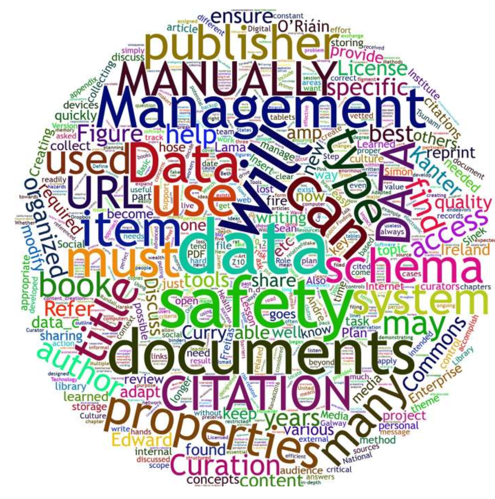
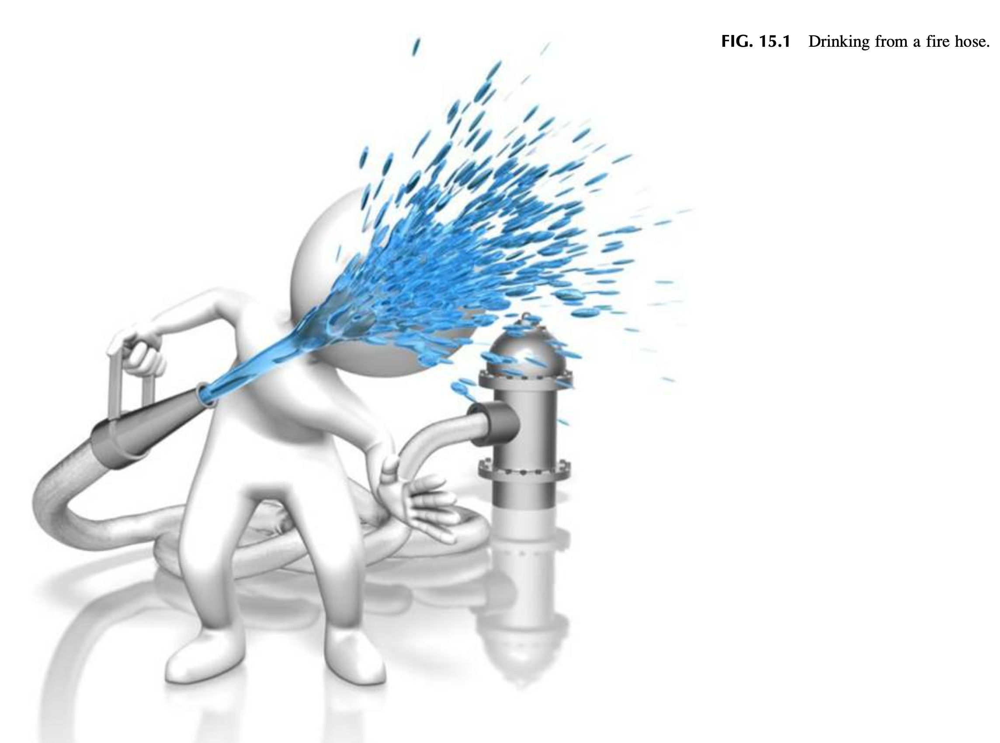
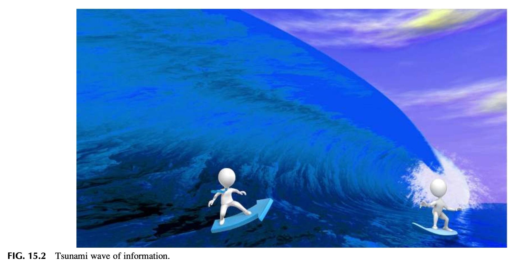
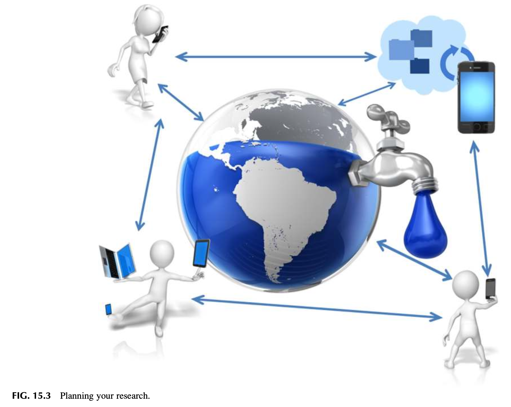
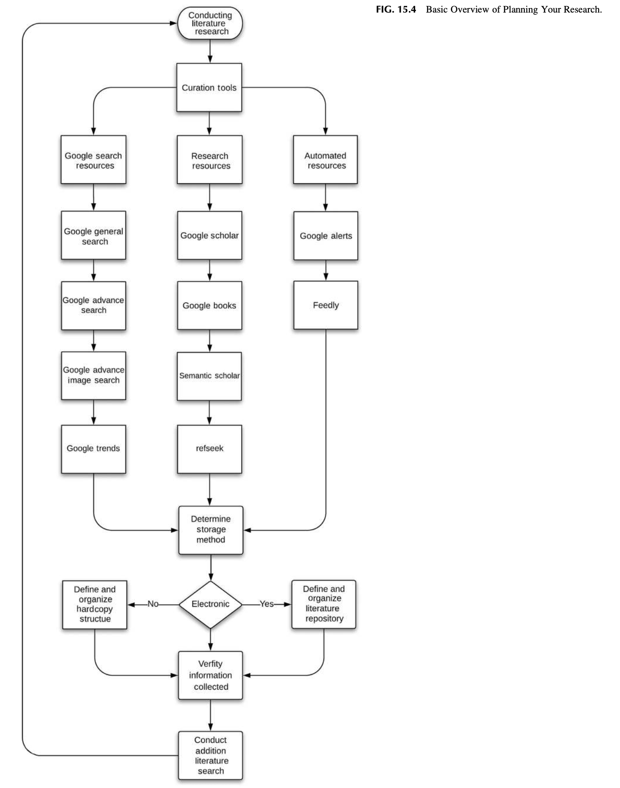
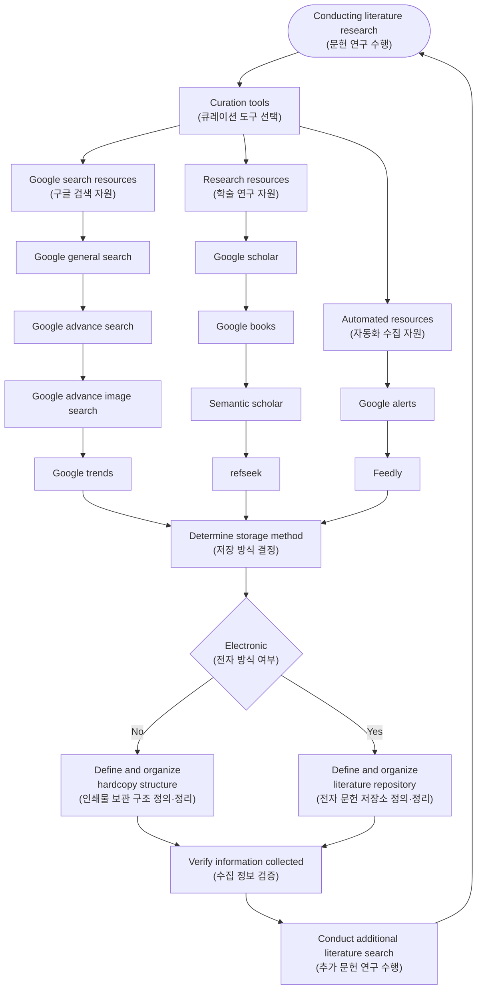
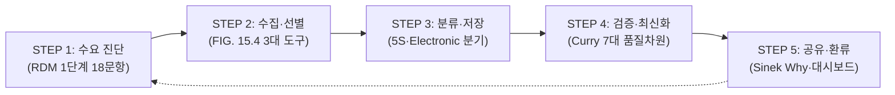

# Chapter 15 Curating for the Safety Management System (안전경영시스템을 위한 정보 큐레이션) 서브노트

> *"우리는 모든 데이터와 정보를 빠짐없이 활용해야 하며, 그것이 우리의 선수 평가를 정확하게 하는 데 도움이 되기를 바랍니다. 우리에게 그것이 바로 생명선(Lifeblood)입니다."*  
> — **빌리 빈 (Billy Beane, 2018)**, 오클랜드 애슬레틱스 단장, 《머니볼》의 실제 모델 (p. 377)
>
> *"데이터는 소중한 자산이며, 시스템 그 자체보다 더 오래 지속됩니다."*  
> — **팀 버너스리 (Tim Berners-Lee, 2018)**, 월드와이드웹(WWW)의 창시자 (p. 377)
>
> *출처: Safety Culture (Elsevier, 2019, pp. 377–387), PART V Curation Resources, Chapter 15*  
> *DOI: https://doi.org/10.1016/B978-0-12-814663-7.00015-7*

> **[개요 그림 보충설명 — Chapter 15 Overview (p. 377)]**  
> 제15장 서두의 워드클라우드(`image-185.png`)는 본 장을 관통하는 핵심 개념어인 **Data, Management, documents, safety, system, Curation, Citation, properties, URL, access, Curry, O'Riáin, Kanter, Sinek** 등을 시각적으로 집약합니다. 이는 안전경영시스템(SMS)에서 정보 큐레이션이 단순한 파일 정리가 아니라 **데이터 품질·출처 검증·인용·지식 보존**의 총체적 관리 체계임을 시사합니다.

---

## 1. INTRODUCTION (도입: 정보 과잉과 '조직의 기억'으로서의 큐레이션, pp. 378–379)

정보를 긴급하고 즉각적으로(Urgency and immediacy) 얻고자 하는 요구는 이제 특수한 상황이 아니라 일상적 규범(Expected norm)이 되었습니다. 인터넷, 클라우드 기반 저장소, 다양한 기기의 확산은 연구자와 실무자를 압도하는 **'소방 호스(Fire hose)' 수준의 정보 흐름**을 만들어 냈으며, 이에 따라 데이터를 수집·관리·저장하는 방식의 근본적 재고가 요구됩니다 (p. 378).

### 1.1 도서관·큐레이션 방법론의 필요성과 기원
* **단순 파일 정리를 넘어선 범위**: 인쇄물과 전자 사본, 웹사이트 링크, 문서, 보고서, 손실 데이터(Loss data), 위험성평가(Risk assessments), 도서 등 모든 매체를 체계화하여 요청 시 신속히 접근·검색할 수 있는 시스템을 구축해야 합니다 (p. 378).
* **의사소통과 안전문화**: 본서 전반의 공통 주제와 마찬가지로, 안전 프로세스와 안전문화는 리더십 팀과 근로자가 열린 의사소통 경로를 유지하고 공정하며 사실에 기반한(Impartial and factual) 메시지를 전달하는 데 달려 있습니다 (p. 378).
* **큐레이션(Curation)의 기원과 진화**: 원래 *"예술품이나 유물의 수집품을 정리하고 유지·관리하는 행위"*에서 시작되었으며(*Curation*, 2017, p. 378), 오늘날에는 모든 매체에 담긴 모든 유형의 정보를 수집·분류·보존·목록화·저장하여 검색 가능하게 만드는 활동으로 확장되었습니다 (p. 378).

### 1.2 '조직의 기억(Organization's Memory)'으로서의 안전 전문가
* **핵심 정보원 역할**: 안전 전문가는 직무 특성상 안전경영시스템(SMS)의 전문 정보를 제공하는 주된 정보원이며, 큐레이션 과정을 통해 유해위험요인, 관련 위험, SMS 성과, 법규 준수(Regulatory compliance) 등을 문서화하는 **'조직의 기억(An organization's memory)'** 역할을 수행합니다 (p. 378).
* **의사결정 지원 및 전문성 활용**: 요청되거나 필요한 정보를 최대한 신속히 찾아 검증하고 적절한 의사결정자에게 전달해야 하며, 큐레이션 및 연구 기법은 보고서, 뉴스레터, 안전 매뉴얼, 교육 세션 작성뿐만 아니라 전문 자격증이나 학위 취득 과정에도 직접 활용됩니다 (p. 378).

### 1.3 제15장 4대 학습 목표 (p. 378)
1. 정보 큐레이터(Information curator)가 되는 것의 중요성 설명하기.
2. 큐레이션(Curation)을 정의하고 논의하기.
3. 정보를 체계화하기 위한 다양한 개념 설명하기.
4. 정보를 체계화하는 데 사용되는 여러 도구 식별하기.

---

## 2. THE IMPORTANCE OF BECOMING AN INFORMATION CURATOR (정보 큐레이터의 중요성과 데이터 품질 차원, pp. 378–380)

콘텐츠 큐레이션은 단순히 웹 링크를 북마크하거나 무분별하게 자료를 쌓아두는 정보 수집광(Information pack rat)이 되는 것이 아닙니다. 이는 필요할 때 검색할 수 있도록 설계된 체계적 구조 속으로 적절한 정보를 **수집(Gathering) ➔ 선별(Sorting) ➔ 분류(Categorizing) ➔ 주석 달기(Annotating)**하는 프로세스를 수립하여, 리더십 의사결정과 SMS 운영을 안내할 검증된 자원(Vetted selection)을 적시에 제공하는 활동입니다 (p. 378).

---

### FIG. 15.1 Drinking from a fire hose (p. 379)

> **[그림 15.1 보충설명]**  
> 소화전에 연결된 소방 호스에서 뿜어져 나오는 강력한 물줄기를 얼굴로 정면으로 맞는 인물의 삽화(`image-186.png`)는, 인터넷·소셜 미디어·무한한 앱·클라우드 콘텐츠로 인해 개인용 기기만으로도 감당할 수 없을 만큼 쏟아지는 정보의 홍수(정보 과부하)를 은유합니다. 원문은 이러한 정보의 바다 속에는 부정확하거나 오래되었거나 신뢰할 수 없는 출처가 섞여 있으므로, 큐레이션 프로세스는 반드시 **정보를 사용 승인하기 전에 평가하는 방법**을 포함해야 함을 강조합니다 (p. 378).

---

### 2.1 신뢰 기반의 영향력 증대와 안전문화 강화
안전 전문가가 문의에 대해 신뢰할 수 있는 답변을 찾아 제공하는 박식한 자원이 될수록 리더십과 근로자에 대한 영향력이 커집니다. 구성원들이 안전 전문가를 신뢰하게 되면 **안전 전문가와 SMS에 대한 긍정적 지각(Positive perception)**이 높아지고, 이는 곧 안전문화를 강화합니다 (p. 379).

### 2.2 데이터 큐레이션과 Curry & O'Riáin(2010)의 7대 데이터 품질 차원
> *"불완전하거나 부정확하거나 잘못된 정보에 근거한 의사결정은 재앙적인 결과를 초래할 수 있다. 의사결정을 내리는 지식 근로자(Knowledge workers)는 올바른 정보에 접근할 수 있어야 하며 그 정보에 대한 확신을 가질 필요가 있다. 데이터 큐레이션은 출처까지 확실히 역추적(Track back to the source)하여 신뢰성을 검증할 수 있는 정확하고 고품질이며 신뢰할 수 있는 정보에 접근하도록 보장하는 핵심 도구가 될 수 있다."*  
> — **(Curry & O’Riáin, 2010, p. 379)**

| 번호 | 데이터 품질 차원 (Data Quality Dimension) | 핵심 검증 질문 (Curry & O’Riáin, 2010, p. 379) |
| :---: | :--- | :--- |
| 1 | **발견 가능성 및 접근성 (Discoverability & accessibility)** | 사용자가 데이터를 찾아내고 접근할 수 있는가? |
| 2 | **완전성 (Completeness)** | 필요한 모든 정보가 빠짐없이 이용 가능한가? |
| 3 | **해석 가능성 (Interpretation)** | 데이터의 의미가 모호하지 않고 명확한가? |
| 4 | **정확성 (Accuracy)** | 데이터가 사실에 부합하고 올바른가? |
| 5 | **일관성 (Consistency)** | 데이터가 스스로 모순되거나 충돌하지 않는가? |
| 6 | **출처 및 평판 (Provenance & Reputation)** | 데이터가 적법하고 신뢰할 수 있는 출처에서 왔는가? |
| 7 | **적시성 (Timeliness)** | 정보가 최신 상태인가? |

---

### FIG. 15.2 Tsunami wave of information (p. 380)

> **[그림 15.2 보충설명]**  
> 거대한 쓰나미 파도 앞에서 서핑보드를 타고 나아가는 두 인물의 삽화(`image-187.png`)는 스마트폰·태블릿·컴퓨터로 열린 무제한 검색 환경 속에서 밀려오는 막대한 정보의 파도를 상징합니다. 원문은 단순한 자료 제공에서 벗어나 **가짜 정보로부터 '진짜(Real)' 데이터와 정보를 분별해 내는 것**(Pink, 2012)이 핵심 과제임을 시각적으로 강조합니다 (p. 380).

---

### 2.3 ANSI Z10-2012 문서 및 기록 통제 요구사항 (p. 380)
* **ANSI/AIHA/ASSE Z10-2012 기준**: 문서와 기록을 작성하고 유지·관리하기 위한 프로세스 수립을 의무화합니다. 문서 및 기록 통제 프로세스는 *"효과적인 직업안전보건경영시스템(OHSMS)을 실행하고 이 표준의 요구사항에 대한 적합성을 입증하거나 평가하기 위해"* 무엇이 작성되고 유지·관리되었는지를 기록합니다 (*Occupational Health & Safety Management Systems*, 2012, p. 380).

---

## 3. CURATING INFORMATION (정보 큐레이션과 부서 간 사일로 문제, pp. 380–381)

무제한 검색이 가능해진 환경에서 강조점은 '단순 정보 제공'에서 **'정확하고 신뢰할 수 있는 출처 보장'**으로 이동했습니다(Pink, 2012, p. 380). 랜달(Randall, 2016)은 *"자신의 전문 분야를 위해 콘텐츠를 큐레이션하는 것은 자신이 무엇을 알고 무엇에 관심을 기울이는지 보여 주는 완벽한 방법"*이라고 강조합니다 (p. 380).

### 3.1 OBSERVATION 1: 부서 간 안전 정보의 분산과 충돌 사례 (pp. 380–381)
저자들은 조직 내에서 안전 관련 정보가 여러 부서에 흩어져 충돌을 일으키는 현실적 문제를 지적합니다:
* **인사부서(HR)**: 신규 채용자 오리엔테이션 및 온보딩 양식과 기초 교육을 자체 보유.
* **운영부서(Operations)**: 체계적인 작업 지침서를 보유하고 있으나 세부적인 안전 기준이 누락됨.
* **품질관리부서(Quality Control)**: 산업 및 규제 기관 표준 충족을 위한 자체 기준을 적용.
* **결과적 문제**: 각 부서가 서로 다르거나 구식인 명명법(Nomenclature), 표현, 기준을 사용하여 리더십과 근로자에게 혼란을 초래하며, 심지어 **안전 부서가 전혀 알지 못하는 상태에서 현행 안전 정책을 준수하지 않는 별도의 안전 매뉴얼이 제작된 사례**도 관찰되었습니다 (pp. 380–381).
* **핵심 명제**: *"찾을 수 없다면 존재하지 않는 것이다!(If you cannot find it, it does not exist!)"* — 아무리 우수한 안전·보건·위험 정보가 어딘가에 있더라도, 찾아내어 제시할 수 없다면 상상의 산물에 불과합니다. 큐레이션의 과제는 분산된 문서를 하나로 모아 **정렬(Aligned)·최신화(Current)·포괄성(Comprehensive)**을 확보하여 손실 발생 사건(Loss-producing events)의 잠재력을 줄이는 것입니다 (p. 381).

---

## 4. THE CURATION ROLE OF A SAFETY MANAGEMENT SYSTEM (SMS의 큐레이션 역할과 조직 기억 보존, p. 381)

### 4.1 복잡적응계와 창발적 특성(Emerging Property)으로서의 안전
안전은 복잡적응계(Complex adaptive system)인 조직의 수많은 구성 요소가 상호작용하며 발현되는 무형의 **'창발적 특성(Emerging property)'**으로 제시되어 왔습니다. 따라서 안전 전문가는 조직과 관련된 거의 모든 사안에 대한 실무 지식이나 정보 제공 자원을 갖추어야 합니다 (p. 381).

### 4.2 대시보드 가시성과 조직 변동에 따른 지식 유실 방지
* **가시성 확보**: 이스마일(Ismail, 2012)은 주요 의사결정자들에게 **대시보드(Dashboards)와 분석 도구(Analytics)**를 통한 가시성을 제공해야 파국적 실패로 이어질 수 있는 불리한 사건을 적시에 예방할 수 있다고 강조합니다 (p. 381).
* **조직 기억의 보존**: 인력과 리더십이 교체되고 조직 개편이나 합병(Reorganizations and mergers)이 이루어질 때, 포괄적인 문서·기록 보유 및 유지·관리 방법이 없으면 지식은 빠르게 소실됩니다. 큐레이션은 잘못 분류되어 분실된 자료를 다시 제작·탐색하는 자원 낭비를 막고, 시대에 뒤떨어지거나 중복된 구식 정보(Obsolete information)를 정리합니다 (p. 381).

---

## 5. COLLECTING AND STORING INFORMATION (정보 수집·저장과 5S 원칙, pp. 381–382)

### 5.1 디지털 환경의 '숨겨진 혼잡'과 정보 보안
인간은 본래 다양한 출처에서 "잡동사니(STUFF)"를 모으고 쌓아두는(Hoard) 성향이 있으며, 데스크톱·하드 드라이브·클라우드 서버의 간편함이 이를 심화시켰습니다. 전자 파일링 시스템에는 실물 없이 눈에 보이지 않는 **숨겨진 혼잡(Hidden clutter)**이 존재하며, 클라우드 저장소 역시 컴퓨터 충돌·해킹·서버 손실 등으로 종이 문서만큼 쉽게 유실·파괴될 수 있으므로 **파일 보안(Security)**이 큐레이션의 필수 요소가 되었습니다 (p. 381).

### 5.2 품질 개선 기법 '5S'의 큐레이션 적용
정보 수집 및 저장 프로세스는 혼잡과 공간 낭비를 줄이고 정돈과 표준화를 높이는 **5S 원칙**을 직접 적용할 수 있습니다 (pp. 381–382):
* **사기(Morale)와 리더십 태도의 반영**: 사무실을 포함한 작업 공간의 5S 상태는 직원 사기에 결정적이며 고객 첫인상의 기초가 됩니다. 원문은 *"직원에 대한 리더십의 태도는 작업 공간의 5S 상태에 반영된다"*고 강조합니다 (p. 381).
* **원칙과 규율**: *"모든 것에는 제자리가 있고, 모든 것은 제자리에 있다(A place for everything and everything has its place)"*는 격언처럼, 모든 형태의 정보를 체계화하려면 지속적인 노력과 규율(Discipline)이 필요합니다 (p. 381).

### 5.3 OBSERVATION 2: 제임스(James)의 2년 정리 사례와 코비(Covey)의 시간 관리 (p. 382)
* **사례 내용**: 공장 안전 전문가로 부임한 제임스는 전임자들이 수년간 쌓아둔 인쇄물 파일 캐비닛 여러 개를 인수했으나, 분류 체계가 붕괴되고 중복 사본이 뒤섞여 있어 분류·최신화·신규 자료 확보·구식 자료 폐기에만 **약 2년**이 소요되었습니다 (p. 382).
* **구조적 원인**: 많은 조직에서 큐레이션이 더 시급한 업무에 밀려 후순위가 됩니다. 이는 스티븐 코비(Covey, 1990)의 시간 관리 매트릭스 중 **'중요하지만 긴급하지 않은(Important but not Urgent)' 제2사분면 영역**에 해당하기 때문에 충분한 관심을 받지 못합니다 (p. 382).

---

## 6. CREATING CONTENT (콘텐츠 제작과 'Why' 중심 접근, p. 382)

고품질 콘텐츠를 제작하고 공유·협업하는 것은 아이디어를 설득하고, 해당 분야의 전문가로 자리매김하며, **고유한 브랜드(Unique brand)**를 구축하여 리더십·근로자·동료에게 개인적 가치를 입증하는 핵심 경로입니다 (p. 382).

### 6.1 큐레이션 착수 전 6대 사전 점검 질문 (p. 382)
1. 조직에 이미 큐레이션 프로세스가 마련되어 있는가?
2. 도움을 요청할 수 있는 큐레이션 담당 관리자나 유능한 인력이 있는가?
3. 유용한 정보를 수집·저장하기에 가장 적합한 방법은 무엇인가?
4. 조직이 정보 수집·저장을 위한 적절한 수단을 이미 제공하고 있는가?
5. 타인과 공유할 양질의 콘텐츠 제작에 이 자원을 어떻게 최선으로 활용할 수 있는가?
6. 정보는 누구의 이익을 위해 공유되고 있는가—발신자인가, 아니면 수신자인가?

### 6.2 사이먼 사이넥(Sinek, 2009)의 "Start with Why" 적용 (p. 382)
> *"사람들은 당신이 무엇을 하는지를 사지 않는다; 그들은 당신이 왜 그것을 하는지를 산다. 그리고 당신이 하는 일은 단지 당신이 믿는 바를 증명할 뿐이다."*  
> — **(Sinek, 2009, p. 382)**

사이넥의 *"당신의 왜(Why)를 알고 있는가?"*에 착안하여, 큐레이터는 공유 전 다음 3가지 질문으로 전략을 수립해야 합니다:
* 나는 왜 내가 배운 것을 공유하고자 하는가?
* 나는 왜 다른 사람들과 정보를 공유하는 데 관심이 있는가?
* 이것이 어떻게 나의 고유한 브랜드를 구축하는 데 도움이 되는가?

---

## 7. CURATING AND USING INFORMATION (정보 큐레이션과 활용 3대 영역, pp. 382–383)

정보 큐레이션 및 활용 프로세스는 다음 **3대 영역**을 중심으로 구축되어야 청중이 신뢰할 수 있는 정보를 수령할 뿐만 아니라 실제 업무에 활용할 수 있습니다 (p. 382):
1. **수집 (Gather)**: 적절하고 검증 가능한(Pertinent and verifiable) 정보 수집.
2. **체계화 (Organize)**: 맥락을 부여해 파일링·분류·주석 달기(Annotated) 수행.
3. **검색·선별·제시 (Retrieve, select and present)**: 보고서·메모·표준 검토·발표용으로 명확하고 간결하게 제시.

> *"콘텐츠 큐레이터는 온라인상에서 특정 주제에 관한 가장 우수하고 관련성 높은 콘텐츠를 지속적으로 탐색하고, **의미구성(Makes sense of)**을 하며, 공유한다. 콘텐츠 큐레이터는 이러한 역량을 자신의 일상적 루틴에 통합해 놓았다."*  
> — **Bhargava, cited in Kanter (2017, p. 383)**

---

## 8. RESEARCHING AND CURATING INFORMATION—QUALITY CONCERNS (정보 연구와 품질 우려, p. 383)

저자들은 **책 집필과 안전경영시스템(SMS) 관리 사이의 직접적 평행성(Direct parallel)**을 제시합니다. 본서 집필 과정에서도 수천 건의 문서를 읽고 분류·선별해야 했으며, 자료를 찾는 것보다 이를 검색·체계화하고 논평·결론·권고사항을 뒷받침할 정확한 참고문헌과 인용(Citations)을 제시하는 것이 핵심 과제였습니다 (p. 383).

* **양(Quantity) ≠ 질(Quality)**: 인터넷 접근의 보편화로 리더십과 근로자가 직접 조사한 기사를 들고 와 평가를 요청하는 일이 잦아졌으며, 부정확한 정보가 검증(Review) 전에 조직 내로 확산되면 심각한 문제를 유발합니다 (p. 383).
* **회의적 검증 태도(Skeptical approach)**: 전문 출처의 동향이라 하더라도 무조건 수용하지 말고, 사용 전 반드시 경험·전문성·추가 근거를 통해 먼저 검증해야 합니다 (p. 383).

---

## 9. CURATING SAFETY MANAGEMENT SYSTEM DATA (에든버러 대학 RDM 기반 SMS 데이터 큐레이션 2단계, pp. 383–384)

본 절은 **에든버러 대학교 연구 데이터 관리 지침(University of Edinburgh Research Data Management Guidance, 2011)**의 데이터 관리 계획 체크리스트를 SMS 맥락에 맞게 적용한 2단계 큐레이션 프레임워크를 제시합니다 (pp. 383–384).

### 9.1 Step 1. Evaluate Data Needs (데이터 요구사항 평가 — 18대 점검 질문, pp. 383–384)
데이터 관리 프로세스 수립에 앞서 다음 18개 질문에 답해야 합니다:
1. 어떤 유형의 문서·자료·정보가 생산될 것인가?
2. 복제·재현이 가능한가? (사본 관리는 어떻게 할 것인가?)
3. 향후 분실되거나 사용할 수 없게 되면 어떤 일이 발생하는가?
4. 대상 청중은 누구이며 현재와 장기적으로 어떻게 활용할 것인가?
5. 누가 문서·자료·정보를 통제하는가?
6. 공유 요구사항이 존재하는가?
7. 수집 및 유지·관리에 예산이 필요한가?
8. 얼마나 많은 문서·자료·정보가 생성되며 변경 주기는 어떠한가?
9. **보존 기간은 얼마인가? (예: 5년, 최대 10년, 또는 영구 보존)**
10. 생성·처리·시각화에 필요한 도구나 소프트웨어가 있는가?
11. 디렉터리 및 파일 명명 규칙(Naming convention)은 무엇인가?
12. 사용되는 파일 형식(File formats)은 무엇이며 장기적으로 지속 가능한가?
13. 어떤 프로젝트 및 식별자(Identifiers)가 부여될 것인가?
14. 프로젝트 및 데이터 문서화(재고 조사·목록화 방식)가 잘 되어 있는가?
15. 개인정보 보호 또는 보안 요구사항(개인 데이터, 고보안 데이터, 독점 자료 등)이 있는가?
16. 저장 및 백업 전략은 무엇인가?
17. 언제, 어디에 문서·자료·데이터를 공개할 것인가?
18. 공유 및 통합에 관한 조직의 지침이나 표준이 있는가?

---

### FIG. 15.3 Planning your research (p. 384)

> **[그림 15.3 보충설명]**  
> 수도꼭지가 달린 지구본을 중심으로 스마트폰·노트북·태블릿·클라우드 폴더를 사용하는 구성원들이 양방향 화살표로 연결된 삽화(`image-188.png`)는, 제16장(소셜 미디어 도구)과 연계하여 현대 조직의 연구 및 정보 공유가 시간·공간·기기의 경계를 넘어 실시간 네트워크로 순환함을 보여줍니다 (pp. 383–384).

---

### 9.2 Step 2—Establish a Plan (데이터 관리 계획 수립 — 7대 핵심 질문, p. 384)
데이터 관리 계획(Data management plan)은 데이터의 생성·체계화·문서화·저장·공유뿐 아니라 보호·기밀 유지·보존·큐레이션을 포괄하여 SMS 문서를 지원하는 프레임워크를 제공합니다 (p. 384):
1. SMS에 의해 어떤 문서·자료·정보가 생성되거나 수집될 것인가?
2. 어떤 조직 정책과 절차가 적용될 것인가?
3. 어떤 관리 관행(백업, 저장, 접근 통제, 아카이빙)이 사용될 것인가?
4. 어떤 시설과 장비(하드 디스크 공간, 백업 서버, 저장소)가 필요한가?
5. 누가 소유권을 갖고 접근 권한을 가질 것인가?
6. 안전경영 데이터의 각 측면에 대해 누가 책임을 질 것인가? (*Data Management: Creating the Plan*, 2017, p. 384)
7. SMS의 이력을 유지하기 위해 문서·자료·정보의 활용 가능성과 장기 보존을 어떻게 보장할 것인가?

---

## 10. TECHNOLOGY AND THE SAFETY MANAGEMENT SYSTEM (기술과 SMS: 방화벽 역할 및 문헌 연구 순서도, pp. 384–386)

기술의 발전으로 정보는 조직의 전통적 경계를 넘어 손쉽고 빠르게 이동합니다. 이 환경에서 **SMS는 근로자들에게 의사소통 경로가 열려 있고 유용함을 보장하는 '방화벽(Firewall)'** 역할을 수행하며, 근로자의 우려사항은 타당한 정보와 신뢰할 수 있는 데이터 관리를 통해 신속·포괄적으로 처리되어야 합니다 (p. 384).

조직에 "유능한 관리자(Knowledgeable manager)"와 기존 저장·검색 절차가 있다면 이를 활용하고, 그렇지 않다면 SMS 목적에 가장 효율적인 시스템을 구축해야 합니다 (p. 386).

---

### FIG. 15.4 Basic Overview of Planning Your Research (p. 385)

> **[그림 15.4 상세 보충설명 — 원문 순서도(Flowchart) 구조 분석]**  
> `FIG. 15.4`(`image-189.png`)는 안전 관련 문헌 연구와 큐레이션 도구의 활용·저장·검증·재탐색 과정을 보여주는 제15장의 **유일한 핵심 순서도(Flowchart)**입니다.  
> 1. **출발점 및 3대 도구 트랙**: `Conducting literature research`(문헌 연구 수행)에서 시작하여 `Curation tools`(큐레이션 도구)를 거쳐 **① 일반·고급 검색(Google search resources)**, **② 학술·전문 검색(Research resources)**, **③ 자동화 수집(Automated resources)**의 3개 병렬 경로로 분기됩니다.  
> 2. **저장 방식 결정 및 전자/인쇄 분기**: 3개 경로에서 모인 자료는 `Determine storage method`(저장 방식 결정)를 거쳐 `Electronic`(전자 문서 여부) 마름모 분기점에서 **No**(인쇄물 구조 정의·정리, 원문 그림 표기 `structue`) 또는 **Yes**(전자 문헌 저장소 정의·정리)로 나뉩니다.  
> 3. **검증 및 순환 루프**: 두 경로가 합류해 `Verify information collected`(수집 정보 검증, 원문 그림 표기 `Verfity`)를 수행한 뒤 `Conduct additional literature search`(추가 문헌 연구 수행, 원문 표기 `addition`)를 거쳐 다시 최초 단계로 되돌아가는 **폐쇄형 순환 피드백 루프**를 형성합니다.

---

## 11. HOW CAN CURATED DATA BE PROFICIENTLY COLLECTED AND MANAGED? (큐레이션 데이터의 효율적 수집·관리, p. 386)

모든 데이터 수집 시스템의 목적은 수집된 모든 문헌을 체계화하기 위해 **도서관 파일링 방법론과 구조(Library filing methodology and structure)**를 채택하는 것입니다 (p. 386).  
이를 위한 소프트웨어 기반 **"콘텐츠 제작 전략(Content Creation Strategy)"**은 제16장(*Social Media Tools for the Professional*)과 부록 16.1(소셜 미디어 도구 개관), 그리고 Feedly 활용 사례 연구인 부록 16.2(원문 본문 표기 `Appendix 6.2`)로 이어집니다 (p. 386).

---

## 12. SUMMARY & CHAPTER REVIEW QUESTIONS (요약 및 장 복습 질문, p. 386)

### 12.1 핵심 요약 (p. 386)
* 안전문화는 리더십과 근로자가 유해위험요인 및 위험 통제 정보를 수신·이해하는 데 달려 있으며, 열린 의사소통 경로가 변화 저항을 줄이는 핵심입니다.
* 정보와 메시지는 조직 구성원이 접근 가능한 무익한 배경 잡음(Background clutter)을 뚫고 이해 가능하게 전달되어야 합니다.
* 인력 교체, 조직 개편, 신규 사업 착수 시 포괄적 기록 관리 체계가 없으면 조직의 핵심 안전 지식이 유실됩니다.
* 인터넷 덕분에 문서를 찾는 것은 쉬워졌으나, 이를 검색·체계화하고 신뢰할 수 있는 참고문헌과 인용을 제시하는 능력이 진정한 과제입니다.
* 제16장에서는 트위터·유튜브·링크드인 등 소셜 미디어 기반 콘텐츠 제작 전략을 다룹니다.

### 12.2 장 복습 질문 (Chapter Review Questions) & 원문 기반 해설 (p. 386)
1. **정보 큐레이터가 되는 것의 중요성을 설명하시오.**
   * *해설*: 정보 과부하 환경('소방 호스', '쓰나미') 속에서 신뢰할 수 없는 잡음을 걸러내고 검증된 안전 정보를 적시에 제공함으로써 '조직의 기억'을 보존하고, 구성원의 신뢰와 SMS에 대한 긍정적 지각을 높여 안전문화를 강화합니다 (pp. 378–381).
2. **큐레이션(Curation)을 정의하고 논의하시오.**
   * *해설*: 미술품 전시·보존 관리에서 유래하여, 단순 링크 수집이나 정보 쌓아두기(Pack rat)가 아니라 특정 주제에 맞는 최적의 정보를 수집·선별·분류·주석 달기·검증·의미구성(Sensemaking)하여 검색 및 활용 가능하게 제공하는 체계적 프로세스입니다 (pp. 378, 383).
3. **정보를 체계화하기 위한 다양한 개념을 설명하시오.**
   * *해설*: Curry & O'Riáin(2010)의 **7대 데이터 품질 차원**, 품질 개선 **5S 원칙**(정돈·표준화·규율), 코비(Covey, 1990)의 제2사분면 시간 관리 인식, 사이넥(Sinek, 2009)의 **'Why' 중심 공유 전략**, 에든버러 대학(2011)의 **2단계 연구 데이터 관리(RDM) 체크리스트**, 도서관 파일링 방법론이 핵심 개념입니다 (pp. 379, 381–384, 386).
4. **정보를 체계화하는 데 사용되는 여러 도구의 이름을 대시오.**
   * *해설*: 원문 및 `FIG. 15.4`에 따르면 **Google search resources**(Google general/advance/advance image search, Google trends), **Research resources**(Google scholar, Google books, Semantic scholar, refseek), **Automated resources**(Google alerts, Feedly), 그리고 의사결정 지원용 **대시보드 및 분석 도구(Dashboards and analytics)**(Ismail, 2012) 및 저장소(Hardcopy structure / Literature repository)가 제시됩니다 (pp. 381, 385–386). *(기타 상용 도구의 구체적 목록은 원문에서 확인되지 않음)*

---

## 13. [연구자 해석 및 후속 연구 시사점] 학술적 메타 분석 및 KPI 도출 프레임워크

> [!NOTE]
> **원문과 연구자 해석의 엄격한 분리 (`GEMINI.md` 1·2·3·4원칙 준수)**  
> 제1절~제12절 및 제14절은 저자의 원문 내용(pp. 377–387)만을 충실히 정리한 부분이며, 본 **제13절**은 원문의 이론과 순서도(`FIG. 15.4`), 데이터 품질 차원, RDM 체크리스트를 연구자의 학술 개념(**지각, 의미구성, 평가, 다중 관점, 다원주의, 다차원적 성과, 네트워크 성과**) 및 **현장 적용 KPI·법령**과 연결한 **연구자(AI) 해석 및 후속 연구 설계 영역**입니다.

### 13.1 [후속 연구 시사점] 원문 핵심 이론의 주관성·네트워크 연구 연계
* **지각(Perception) 및 신뢰 형성**: 제15장(p. 379)은 안전 전문가가 신뢰할 수 있는 정보를 제공할 때 구성원의 **지각(Perception)**이 긍정적으로 변하고 안전문화가 강화된다고 서술합니다. 후속 연구에서는 현장 대원·관리자·행정 부서가 동일한 안전 매뉴얼이나 지침을 어떻게 서로 다르게 **지각**하고 **평가(Evaluation)**하는지(`OBSERVATION 1`의 부서 간 명명법 충돌 문제) 다중 관점·Q방법론 연구로 확장할 수 있습니다.
* **의미구성(Sensemaking)으로서의 큐레이션**: Bhargava(Kanter, 2017, p. 383)가 콘텐츠 큐레이터를 *"정보를 탐색하고 **의미구성(Makes sense of)**하여 공유하는 사람"*으로 규정한 점은, 정보 과잉 환경에서 조직 구성원이 위험 신호를 어떻게 해석하고 행동으로 전이시키는지 분석하는 의미구성 이론과 직접 맞닿아 있습니다.
* **네트워크 성과(Network Performance) 및 다차원적 성과**: 안전을 복잡적응계의 창발적 특성으로 보고(p. 381), 부서 간 사일로를 연결해 정보 탐색 비용과 중복 노동을 줄이는 큐레이션 체계는 단일 사고 건수를 넘어 **조직 기억 보존·정보 접근 속도·부서 간 정렬도**라는 다차원적 성과 지표 설계의 근거가 됩니다.

### 13.2 안전정보 큐레이션 생애주기 5단계 기반 KPI 도출 (119구조대·현장 안전부서 적용)

> [!IMPORTANT]
> **트랙 A·B 연계 KPI 설계 원칙 (`GEMINI.md` 2·3·4항 적용)**  
> 1. **업무 단계화**: `[STEP 1] 수요 진단` ➔ `[STEP 2] 수집·선별` ➔ `[STEP 3] 분류·저장` ➔ `[STEP 4] 검증·최신화` ➔ `[STEP 5] 공유·환류`  
> 2. **현장 구체화**: 의령소방서 119구조대(3교대 출동·장비점검·현장대응 환경) 및 사업장 안전관리팀의 과·팀·조 단위 업무에 밀착 설계.  
> 3. **법적 근거 조문 매핑**: 「산업안전보건법」 제14조·제15조·제16조·제24조·제36조·제164조(서류의 보존), 「중대재해 처벌 등에 관한 법률 시행령」 제4조·제13조(서면의 5년 보관), 「소방공무원 보건안전 및 복지 기본법」 제10조.  
> 4. **고유/협업 분리**: 통제 가능한 고유 지표(70%)와 타 부서·유관기관 연계 협업 지표(30% 또는 50%) 구분.

| 생애주기 단계 | 적용 조직/담당 (Break-down) | 핵심 성과지표 (KPI) 명칭 (연구자 설계) | 지표 성격 & 가중치 | 산출 방식 및 관리 목표 (연구자 제안) | 법적 근거 (조문 단위 매핑) | 서브노트 판단 근거 (절·표·그림 강제 매핑) |
| :---: | :--- | :--- | :---: | :--- | :--- | :--- |
| **STEP 1 (수요 진단)** | **안전기획·기록 담당자** (119구조대 행정·장비담당) | 법정·현장 안전문서 보존연한 및 데이터 관리계획 수립률 | **고유 (70%)** | $\frac{\text{보존연한·소유권·백업 지정 문서군 수}}{\text{관리 대상 필수 문서군 총수}} \times 100$ (목표: 법정 기록 누락 0건) | 산안법 제164조 (서류의 보존: 원칙 3년, 회의록 2년) 중처법 시행령 제13조 (이행 서면 5년 보관) | 본문 9.1절 & 9.2절 (에든버러 RDM Step 1 18문항·Step 2 7문항) |
| **STEP 2 (수집·선별)** | **현장대응·예방 전담자** (안전관리자·구조팀 교관) | 다중 출처(일반·학술·자동화) 위험·신기술 정보 수집 적시율 | **고유 (70%)** | `FIG. 15.4` 3대 트랙(검색·학술·Feedly/Alerts) 기반 월간 신규 위험·장비 동향 브리핑 건수 | 산안법 제14조 (이사회 보고·계획) 소방공무원 보건안전법 제10조 (교육·훈련 정보) | 본문 10절 & `FIG. 15.4` (`Curation tools` 3대 병렬 경로) |
| **STEP 3 (분류·저장)** | **부서 간 문서 협의체** (인사·운영·품질·안전/구조팀) | 부서 간 안전 매뉴얼·표준작업절차(SOP) 명명법 정합률 및 5S 정돈율 | **협업 (50%)** | $\frac{\text{안전부서와 용어·기준 정렬된 타부서 SOP 수}}{\text{부서별 안전 관련 SOP 총수}} \times 100$ (교대조 공용 폴더 5S 점검 병행) | 산안법 제15조·제16조 (관리책임자·감독자) ANSI/AIHA Z10-2012 문서 통제 | 본문 3.1절 (`OBSERVATION 1`), 5.2절 (`5S`), 5.3절 (`OBSERVATION 2`), `FIG. 15.4` (`Electronic` 분기) |
| **STEP 4 (검증·최신화)** | **안전·위험성평가 팀** (119구조대 위험관리 담당) | 현장 전파 전 안전정보 7대 품질차원 사전 검증 이행률 | **고유 (70%)** | $\frac{\text{7대 품질차원(출처·정확·적시성 등) 검증 완료 배포건}}{\text{전사/전대원 공지 안전정보 총건수}} \times 100$ | 산안법 제36조 (위험성평가 및 기록) 중처법 시행령 제4조제3호 | 본문 2.2절 (Curry & O'Riáin 7대 차원), 8절 (품질 우려 및 회의적 검증), `FIG. 15.1`·`15.2` |
| **STEP 5 (공유·환류)** | **현장 지휘관·산안위** (구조대장·현장대응단장) | 대시보드 기반 위험정보 접근성 및 현장 활용 피드백 반영률 | **협업 (30%)** | 교대근무 대원의 필요 SOP 검색 소요 시간 및 "Why(목적)" 기반 현장 브리핑 반영 건수 | 산안법 제24조 (산안위 심의·공유) 중처법 시행령 제4조제8호 (종사자 의견청취) | 본문 4.2절 (Ismail 대시보드), 6.2절 (Sinek Why), 7절 (수집·체계화·제시), `FIG. 15.3` |

> [!TIP]
> **가중치 타당성 (7:3 및 5:5 분리 근거)**:  
> 문서 보존연한 지정, 수집 도구 운영, 품질 검증(STEP 1·2·4)은 안전 담당자·구조대 내 자체 통제가 가능하므로 **고유 지표(70%)**로 설정하였습니다. 반면 `OBSERVATION 1`에서 확인된 타 부서(인사·운영·품질) 간 매뉴얼 충돌 해소(STEP 3)는 다부서 합의가 필수이므로 **협업(50%)**으로, 현장 지휘·의사소통 환류(STEP 5)는 대원 참여와 지휘부 연계가 필요하므로 **협업(30%)**으로 차등 배분하였습니다.

### 13.3 비판적 검토 및 역질문 검증 프로토콜
1. **출처 역질문**: *"제시된 KPI의 각 단계가 제15장의 `FIG. 15.4`(문헌 연구 순서도), Curry & O'Riáin(2010) 7대 차원, 5S 원칙, 에든버러 대학 RDM 2단계, `OBSERVATION 1·2`에 직접 근거하고 있는가?"*
2. **법령 정합성 역질문**: *"문서 보존 주기(Step 1 질문 9번: 5년, 10년, 영구)가 「산업안전보건법」 제164조(3년/2년) 및 「중대재해처벌법 시행령」 제13조(5년)의 최소 법정 보존 연한을 모두 충족하도록 설계되었는가?"*
3. **타 이론(레질리언스) 적용 시 우선순위 변화 검토**: *"정규 문서 보관(STEP 1·3)에 치중할 경우, 비정형·긴급 재난 상황에서 현장 대원이 즉시 정보를 찾고 검증하여 대응하는(STEP 4·5, `FIG. 15.4` 검증·재탐색 루프 및 대시보드 가시성) 실시간 레질리언스 역량이 저하되지 않는가?"*

---

## 14. BIBLIOGRAPHY & FURTHER READING (참고문헌 및 추가 읽을거리, pp. 386–387)

### 14.1 Bibliography (p. 386–387)
* Beane, B. (2018). We’ve got to use every piece of data and piece of information, and hopefully, that will help us be accurate with our player evaluation. For us, that’s our lifeblood. In *Brainy quote*. Retrieved from http://bit.ly/2snmkss.
* Berners-Lee, T. (2018). Data is a precious thing and will last longer than the systems themselves. In *Brainy quote*. Retrieved from http://bit.ly/2smvvcO.
* Covey, S. R. (1990). *The 7 habits of highly effective people: powerful lessons in personal change*. In A fireside book (p. 151): Simon and Schuster. Retrieved from http://amzn.to/WsCA5g.
* Curation. (2017). *Cambridge Dictionary*. Retrieved from http://bit.ly/2xUnGig.
* Data Management: Creating the Plan, Basic Questions for your Plan (2017). Rutgers, The State University of New Jersey. Retrieved from http://bit.ly/2BJ4u5O.
* Curry, E., & O’Riáin, S. (2010). In October) (Ed.), *The role of community-driven data curation for enterprises*. Digital Enterprise Research Institute, National University of Ireland, Galway, Ireland. PDF Version. Retrieved from http://bit.ly/2fM7JA5, http://bit.ly/2y2paq5.
* Ismail, N. (2012). *Environmental, health and safety, going beyond compliance*. White Paper. Aberdeen Group, A Harte-Hanks Company. April. Retrieved from http://bit.ly/2xSRj3v.
* Kanter, B. (2017). *Content curation primer*. Licensed under a Creative Commons Attribution 3.0 United States License. Retrieved from http://bit.ly/XFtmWz.
* Occupational Health & Safety Management Systems (2012). The American Society of Safety Engineers, ANSI/AIHA/ASSE Z10. Retrieved from http://bit.ly/1MsT6MG.
* Pink, D. H. (2012). *To sell is human: The surprising truth about moving others*. Riverhead Books. Retrieved from http://bit.ly/2wA6V89.
* Randall, A. (2016). 10 ways social media can boost your career. In *MakeUseOf*. Retrieved from http://bit.ly/22nqIoN.
* Research Data Management Guidance (2011). Edinburgh University Data Library. August. Retrieved from http://bit.ly/2Kpw53F.
* Sinek, S. (2009). *Start with why: How great leaders inspire everyone to take action*. In Portfolio. October. Retrieved from http://bit.ly/2ugVro5.

### 14.2 Further Reading (p. 387)
* Clear, J. (2018). *Stop overdosing on celebrity gossip, the news, and low quality information*. An Elite CafeMedia Lifestyle Publisher. Retrieved from http://bit.ly/2rjg3NO.
* Covey, S. R. (1989). *The 7 habits of highly effective people, powerful lessons in personal change*. New York City: Simon & Schuster.
