# Chapter 16 Developing a Content Creation Strategy (콘텐츠 제작 전략 개발) 서브노트

> *"데이터가 없다면, 당신은 그저 의견을 가진 또 한 사람일 뿐이다."*  
> — **W. 에드워즈 데밍 (W. Edwards Deming)** (p. 389)
>
> *출처: Safety Culture (Elsevier, 2019, pp. 389–417), PART V Curation Resources, Chapter 16*  
> *DOI: https://doi.org/10.1016/B978-0-12-814663-7.00016-9*

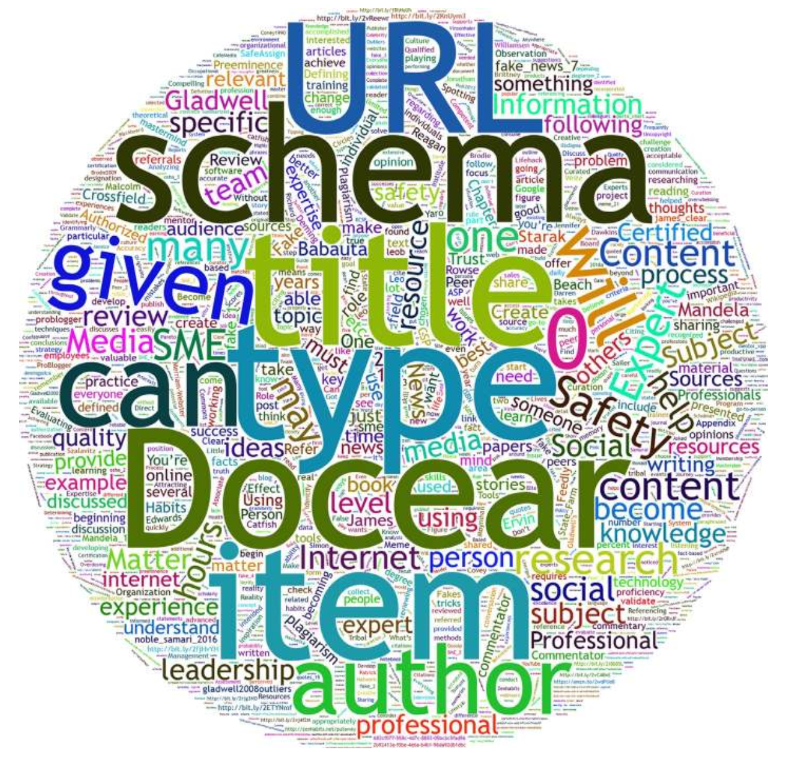

> **[개요 그림 보충설명 — Chapter 16 Overview (p. 389)]**  
> 제16장 서두의 워드클라우드(`image-190.png`)는 **Docear, URL, title, item, author, SME, Subject, Expert, Content, Social Media, Gladwell, Mandela, Starak, Rowse** 등 본 장의 핵심 주제인 **디지털 콘텐츠 제작, 소셜 미디어 활용, 인용·참고문헌 관리, 특정 분야 전문가(SME) 역량 구축, 허위 정보(Fake News) 검증** 키워드를 한눈에 보여줍니다.

---

## 1. INTRODUCTION (도입: 소셜 미디어 시대의 콘텐츠 제작 전략과 위험, pp. 389–390)

제16장의 목적은 안전경영시스템(SMS)과 안전문화를 지원하기 위한 **콘텐츠 제작 전략(Content Creation Strategy)** 수립 지침을 제공하는 것입니다. 이는 안전 전문가 또는 지정 담당자가 인터넷에서 관련성 있고 정확한 정보를 효율적으로 연구하고, 전문적 연락망과 네트워킹 역량을 확장하기 위한 로드맵입니다 (p. 389).

### 1.1 소셜 미디어의 정의와 양날의 검
* **소셜 미디어(Social Media)의 정의**: *"사용자들이 정보, 아이디어, 개인 메시지 및 기타 콘텐츠(예: 동영상)를 공유하기 위해 온라인 커뮤니티를 만드는 전자적 의사소통 형태(예: 소셜 네트워킹 및 마이크로블로깅 웹사이트)"* (*Social Media*, 2018, p. 390).
* **기회와 극단적 위험(Extreme Risk)**: 웹과 소셜 미디어(Skype, Twitter, Snapchat, Instagram, Facebook, YouTube, Reddit, Pinterest, LinkedIn, Google+ 등)는 대면 대화의 한계를 넘어 경제적인 전문 네트워크 확장을 가능하게 했습니다. 그러나 **부정확한 정보 게시, 직업적 평판 훼손, 사직·해고, 기업 브랜드 손상** 같은 극단적 위험도 동반하며, 안전 전문가가 소셜 미디어에서 미성숙·비전문적 태도를 보이면 SMS가 훼손되고 안전문화가 저하됩니다 (pp. 389–390).
* **개인적 실천(Personal Practice)**: 개인의 적성·능력과 무관하게 지속적 연습이 필수적이며(Gladwell, 2008), 신뢰할 수 있는 웹 출처를 객관적으로 연구하여 인터넷 활용 역량을 길러야 합니다 (p. 390).

### 1.2 제16장 6대 학습 목표 (p. 390)
1. 안전 전문가의 전문성 수준 판단하기.
2. 조직 내 안전 전문가의 역할 정의하기.
3. 소셜 미디어에서 안전 전문가의 역할 정의하기.
4. 데이터를 검증하는 방법 논의하기.
5. 자원을 참고문헌으로 제시하고 인용하는 것의 중요성 논의하기.
6. 특정 분야 전문가(Subject Matter Expert, SME)가 되는 방법 논의하기.

---

## 2. ADAPTING TO SOCIAL MEDIA & LEARNING THE CURATION PROCESS (소셜 미디어 적응과 문헌 수집·인용 협업 프로세스, pp. 390–391)

제15장에서 다룬 '소방 호스'(`FIG. 15.1`)와 '정보의 쓰나미'(`FIG. 15.2`)를 넘어, 소셜 미디어상의 방대한 정보 속에서 적절한 문서를 검색·체계화하고 **정확한 인용(Citations)과 참고문헌(References)**을 제공하는 것이 핵심 과제입니다 (p. 390).

> *"성공적인 전문가들은 자신에게 건설적인 피드백을 주는 모든 사람을 무시하면서 사다리를 오르지 않는다."*  
> — **아자 프로스트 (Aja Frost, HubSpot)** (p. 390)

---

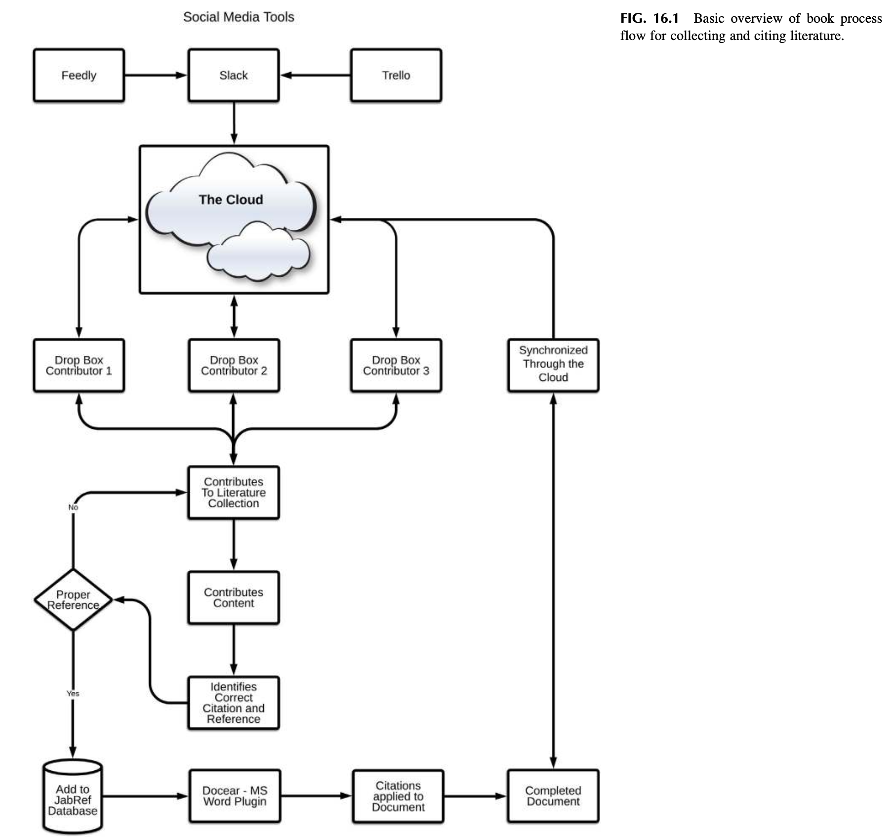

### FIG. 16.1 Basic overview of book process flow for collecting and citing literature (p. 391)

> **[그림 16.1 상세 보충설명 — 원문 순서도(Flowchart) 구조 분석]**  
> `FIG. 16.1`(`image-191.png`)은 저자들이 본서 집필 과정에서 수천 건의 문헌을 수집·공유·인용하기 위해 실제로 가동한 **협업형 문헌 큐레이션 워크플로우(순서도)**입니다.  
> 1. **소셜 미디어 도구 수집 (`Feedly` · `Slack` · `Trello`)**: RSS 피드 수집(`Feedly`), 팀 실시간 소통(`Slack`), 과업 관리(`Trello`) 도구에서 출발해 `The Cloud`(클라우드)로 집결됩니다.  
> 2. **공동 기고자 동기화 (`Drop Box Contributor 1~3`)**: 클라우드는 3인의 공동 저자(Contributor 1~3)의 Dropbox 폴더와 양방향 동기화되어 `Contributes To Literature Collection`(문헌 컬렉션 기여)으로 통합됩니다.  
> 3. **콘텐츠 작성 및 인용 검증 게이트 (`Proper Reference`)**: `Contributes Content`(콘텐츠 기고) ➔ `Identifies Correct Citation and Reference`(정확한 인용·참고문헌 식별)를 거쳐 `Proper Reference`(적절한 참고문헌 여부) 마름모 분기점에서 **No**이면 문헌 컬렉션 단계로 반려되고, **Yes**이면 `Add to JabRef Database`(JabRef 데이터베이스 추가)로 진행합니다.  
> 4. **문서 적용 및 클라우드 재동기화**: `Docear - MS Word Plugin` ➔ `Citations applied to Document`(문서 내 인용 적용) ➔ `Completed Document`(문서 완성) ➔ `Synchronized Through the Cloud`(클라우드 동기화)를 거쳐 다시 클라우드로 순환합니다.

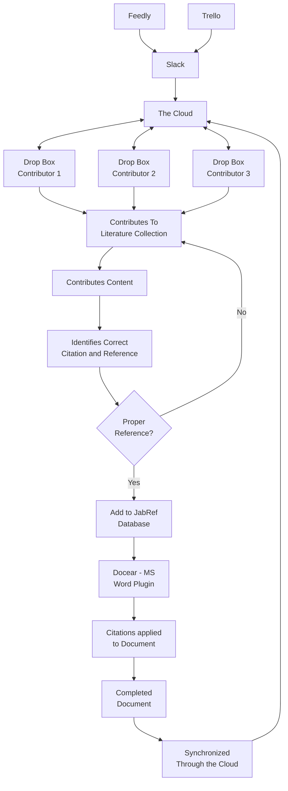

---

## 3. DEFINING THE SAFETY PROFESSIONAL’S ROLE, MENTORSHIP & 4 CURATION ROLES (안전 전문가의 역할·멘토십 및 4대 큐레이션 역할, pp. 391–393)

### 3.1 조직 규모별 역할과 콘텐츠 재포장 (pp. 391–392)
* 대기업은 안전·산업위생·교육·환경으로 세분화되어 있고 인사(교육), 유지보수(점검), 구매(장비) 간 경계가 설정되어 있으나, 많은 조직에는 단 1명의 지정 안전 전문가만 존재합니다 (p. 391).
* 인력 규모와 관계없이 안전 전문가는 표적 청중에 맞는 콘텐츠 제작 전략을 수립해, 안전 문제 해결에 즉시 쓸 수 있도록 정보를 **간결하고 설득력 있게 재포장(Re-package)**해야 합니다 (p. 392).

### 3.2 멘토(Mentor) 역할과 개인·조직 SNS 경계 위험 (p. 392)
* 안전 전문가는 리더십과 근로자의 멘토로서 이정표·승리·좌절과 차질의 과정을 안내하고, 소셜 미디어와 전문가 네트워크에서 수집한 문제 해결 기법을 공유합니다 (p. 392).
* **경계 침범(Crossover) 주의**: 개인 시간에 개인 SNS 활동을 하더라도 조직 관련 발언으로 의도치 않게 넘나들 위험이 크며(Walk a fine line), 온라인 발언으로 경력과 삶이 파괴된 사례들이 다수 존재함을 경고합니다 (p. 392).

### 3.3 4대 큐레이션 역할 (Types of Curation Roles, pp. 392–393)

| 역할 유형 | 핵심 기능 및 공유 방식 | 핵심 주의사항 및 근거 (pp. 392–393) |
| :--- | :--- | :--- |
| **1. 콘텐츠 공유 (Sharing content)** | 가치 있는 데이터·정보의 **링크만 단순 전달** (내부는 공식 채널, 외부는 개인 SNS 활용) | 조직 내에서 본인에게 허용된 역할 경계를 명확히 이해해야 함 (p. 392) |
| **2. 직접 추천 (Direct referrals)** | 특정 청중에게 출처 링크와 짧은 안내 메시지를 전달해 수신자가 직접 열어 읽고 해석하도록 함 | **검증된 신뢰 사이트·동료만 사용**(Lua, 2018); 위키피디아는 원출처가 아니므로 각 링크 존재·평판을 직접 확인하고 **"아무도 믿지 말라(Trust no one)"** 원칙 준수(Crossfield, 2018, pp. 392–393) |
| **3. 큐레이션된 추천 (Curated referrals)** | 기존 연구·자료를 검토하여 **요약·논평·새로운 통찰을 덧붙여 공유** (원문 링크 필수 첨부) | 독자의 경험·지식 수준을 먼저 파악해 어조 결정; **페르소나(Persona)**를 잘 알수록 아이디어 표현 통로가 열림(Ervin, 2013, p. 393) |
| **4. 해설자/평론가 (Commentator)** | 깊이 있는 지식을 토대로 해당 분야의 활동·동향·패턴을 주시하며 핵심 자료를 **요약·비평해 평판 구축** | 단순 전달을 넘어 전문 분야의 흐름을 해석하는 권위 있는 의견 제시 (*What Does a Commentator Do?*, 2018, p. 393) |

---

## 4. OTHER TYPES OF EXPERTISE & CONTENT CREATION GOALS (전문성·자격 구분 및 콘텐츠 제작 목표, pp. 393–394)

### 4.1 동료 심사 및 OSHA 3대 자격 구분 (pp. 393–394)
* **동료 심사(Peer Review)**: 출판 전 연구 품질과 편집 기준 준수를 보장하기 위해 해당 분야 전문가 집단이 평가하는 과정 (*Peer Review*, 2018, p. 393).
* **승인된 자(Authorized Person)**: 사업주가 현장의 특정 직무·장소 수행을 승인·지정한 자 (예: 일반산업·건설 공인 강사는 건설 안전 경력 5년 필요, 관련 학위·CSP·CIH는 2년 대체 가능) (p. 393).
* **유능한 자/권한 보유 점검자(Competent Person)**: 작업 조건에서 기존 및 예측 가능한 유해위험요인을 식별할 능력이 있고, 이를 제거할 **즉각적인 시정 조치 권한(Authorization)**을 가진 자 (OSHA, p. 393).
* **적격자(Qualified Person)**: 인정된 학위·자격증·전문적 지위 또는 광범위한 지식·훈련·경험을 통해 해당 주제·작업·프로젝트 문제를 해결할 능력을 입증한 자 (p. 394).

### 4.2 콘텐츠 제작 착수 전 7대 질문 (p. 394)
1. 콘텐츠 제작 프로세스의 목표는 무엇인가?
2. 개인적 용도인가 조직적 용도인가? (개인용이라면 선정 방식과 사용처는?)
3. 연구된 콘텐츠는 어떻게 사용될 것인가? (조언, 권고, 질의 응답 등)
4. 콘텐츠에 대한 어떤 도전·이의가 존재할 수 있는가? (조직 내 또는 인터넷·토론 그룹)
5. 해석·분석·평가에 누가 이의를 제기할 수 있는가? (동료, 타 부서, 리더십, 근로자)
6. 출판·활용 전 누가 최종 산출물을 검토할 것인가?
7. 연구 결과는 어떻게 큐레이션되며 예상 유효 수명(Life expectancy)은 얼마인가?

---

## 5. THE SAFETY PROFESSIONAL AS SUBJECT MATTER EXPERT (특정 분야 전문가(SME)와 10,000시간 법칙, pp. 394–396)

> *"자신이 무슨 말을 하고 있는지 아는 것은 성공에 필수적이다."*  
> — **벤 세일러 (Ben Sailer)** (p. 394)

### 5.1 부족 지식(Tribal Knowledge)과 탁월성(Preeminence)
* **부족 지식(Tribal Knowledge)**: *"공식 매뉴얼에는 인정·수록되어 있지 않지만 널리 받아들여지는 내부 절차나 정보 조각"* (*Tribal knowledge*, 2018, p. 394). SME는 이러한 경험과 지식을 체계적 연구로 연결하여 조직 내에서 **"찾아가는 핵심 인물(Go-to person)"**이 되어야 합니다 (p. 394).
* **탁월성(Preeminence)**: 스타락(Starak, 2009)은 사람들이 당신을 해당 분야 최고 중 한 명으로 믿게 만드는 '탁월성'을 확립하려면 **"당신이 아는 것을 공유함으로써 가치를 제공하는 것"**에서 시작해야 한다고 강조합니다 (pp. 394–395).
* **블로거 윤리 3원칙 (Rowse, 2018, p. 394)**: ① 윤리적이고 투명할 것(경험 수준을 솔직히 밝힘), ② 아는 범위를 넘어 가르치거나 조언하지 말 것, ③ 적극적으로 학습을 추구할 것.
* **위키피디아 학술 인용 금지 (Note, p. 395)**: 위키피디아는 누구나 편집 가능한 미검증·비검열 공간이므로 가설·결론 입증이나 학술 인용·참고문헌으로 **절대 사용해서는 안 됩니다**.

### 5.2 10,000시간 법칙과 공인안전전문가(CSP) 자격 매핑 (pp. 395–396)
* **말콤 글래드웰(Gladwell, 2008, 2013)의 10,000시간 법칙**: 의식적 연습 10,000시간을 "위대함의 마법의 숫자"로 제시했으나, 살라비츠(Szalavitz, 2013)는 10,000시간의 연습만으로는 충분하지 않을 수 있다고 비판적으로 논쟁했습니다. 그럼에도 노력·집중·학습 열망이 SME의 핵심 요건입니다 (p. 395).
* **찰스 코크(Koch, 2007)의 10,000% 규정 준수**: 모든 직원의 100%가 시간의 100% 동안 완전히 준수하는 탁월성을 의미합니다 (p. 395).
* **OBSERVATION — ASP+CSP 경력 환산 (pp. 395–396)**: 주 40시간 × 연 50주 = 연 2,000시간 기준, **ASP 응시 요건(1년 = 2,000시간) + CSP 응시 요건(4년 = 8,000시간) = 총 5년(약 10,000시간)**으로 글래드웰의 10,000시간 이론과 정확히 일치합니다. (2018년 신규 CSP 요건: 임의 분야 학사 또는 안전·보건·환경 분야 전문학사(관련 과목 최소 4개, 12학기/18분기 학점) 필수).

---

## 6. RESEARCHING, DOWNSIDE, CITING & AVOIDING PLAGIARISM (콘텐츠 제작의 위험·인용·표절 방지, pp. 396–398)

* **다중 출처 및 반대 관점 탐색**: 인터넷에는 신뢰할 수 없는 출처가 넘치므로 사실과 허구를 가려야 하며, 비치(Beach, 2017)는 *"단 하나의 출처에 의존하지 말고 균형 감각을 위해 반대 관점(Opposing viewpoints)을 찾으라"*고 권고합니다 (p. 396).
* **증거 기반 설득**: 전문가는 뒷받침 증거 없이 의견을 제시하지 않습니다. 신념과 경험을 넘어 **학술적 출처에 기반한 사실 기반 진술(Fact-based statements)**을 제시하고, 퍼블릭 도메인·크리에이티브 커먼즈 문서도 반드시 인용해야 합니다 (p. 396).
* **표절 방지(Avoiding Plagiarism)**: 표절은 원저자의 허락과 출처 표시 없이 타인의 언어와 사상을 자신의 것처럼 제시하는 행위(*Plagiarism*, 2018)이며, **Grammarly** 같은 표절 검사 도구와 조직 내부 검토 절차를 통해 예방해야 합니다 (p. 398).

---

## 7. INPUT, PROCESS, OUTPUT MODEL (FEEDLY & RSS) (투입·처리·산출 모델, pp. 396–398)

셈브리(Schembri, 2012)의 **투입-산출 모델(Input-Output Model)**을 콘텐츠 제작 전략에 적용한 3채널 구조입니다 (pp. 396–397):
1. **투입 채널(Input Channel)**: 주요 전문 협회, 검증된 블로그, 유튜브 채널, 정부·규제 기관 등 **비상업적·신뢰 출처**에서 동료 심사·공인 정보를 식별.
2. **처리 채널(Process Channel)**: **RSS(Really Simple Syndication)** 리더(예: **Feedly**)를 통해 웹사이트를 일일이 재방문하지 않고도 최신 헤드라인과 업데이트를 한곳에 자동 수집·검토 (RSS 링크 미제공 시 **Google Feedburner** 활용).
3. **산출 채널(Output Channel)**: 검토·정제된 정보를 조직 내 대상자, 타 기관 동료, 개인 소셜 미디어 등 지정된 청중에게 전달.

---

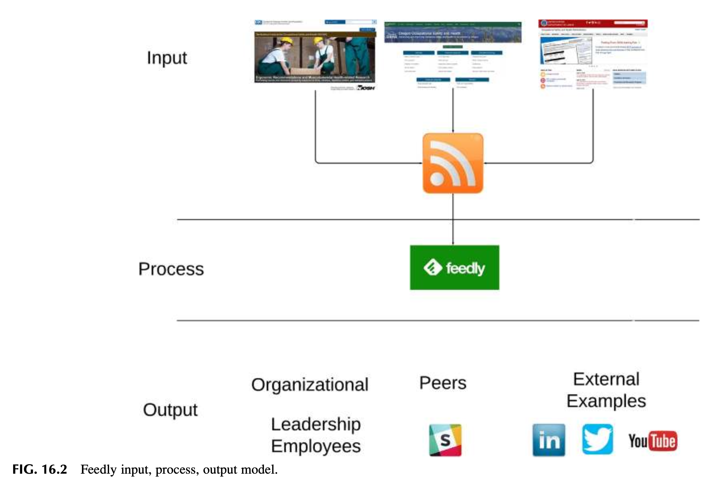

### FIG. 16.2 Feedly input, process, output model (p. 398)

> **[그림 16.2 보충설명]**  
> `FIG. 16.2`(`image-192.png`)는 **Input(NIOSH, Oregon OSHA 등 신뢰 웹 자원) ➔ RSS 피드 아이콘 ➔ Process(Feedly 통합 처리) ➔ Output(내부 조직의 리더십·근로자 / 동료 네트워크인 Slack / 외부 채널인 LinkedIn·Twitter·YouTube)**으로 이어지는 정보 흐름 파이프라인을 시각화합니다.

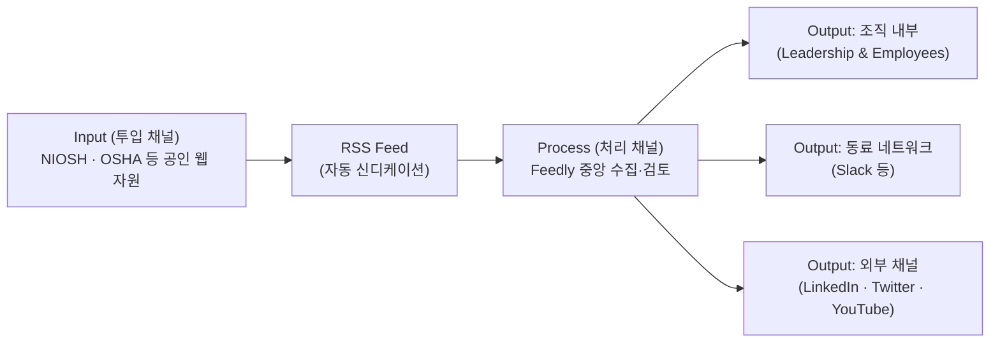

---

## 8. SUMMARY & CHAPTER REVIEW QUESTIONS (요약 및 장 복습 질문, pp. 398–399)

### 8.1 핵심 요약 (p. 398)
* 조직의 정보와 메시지는 무익한 배경 잡음을 뚫고 명확·체계적으로 전달되어야 하며, 포괄적 기록 관리가 없으면 인력 교체·조직 개편 시 지식이 유실됩니다.
* 인터넷 검색 자체는 쉬워졌으나, 이를 검색·체계화하고 정확한 참고문헌과 인용을 제시하는 것이 핵심 과제입니다.

### 8.2 장 복습 질문 (Chapter Review Questions) & 원문 기반 해설 (pp. 398–399)
1. **소셜 미디어를 정의하시오**: 사용자들이 정보·아이디어·개인 메시지·동영상 등을 공유하기 위해 온라인 커뮤니티를 만드는 전자적 의사소통 형태(*Social Media*, 2018, p. 390).
2. **소셜 미디어에 적응해야 할 필요성을 설명하시오**: 정보량이 소방 호스·쓰나미 수준을 넘어 급증하는 환경에서 조직 내 적합성을 유지하고, 비전문적 SNS 활용에 따른 평판·SMS·안전문화 훼손 위험을 통제하기 위함입니다 (pp. 389–390).
3. **콘텐츠 제작에서 안전 전문가의 역할을 정의하시오**: 조직 규모와 무관하게 핵심 정보를 탐색·평가·재포장하고, 리더십과 근로자의 멘토로서 4가지 역할(공유·직접 추천·큐레이션된 추천·해설자)을 수행합니다 (pp. 391–393).
4. **콘텐츠 제작의 목표를 설명하시오**: 안전 문제 해결과 안전문화 유지를 위해 검증된 사실 기반 정보와 인용을 적시 제공하고, '찾아가는 핵심 인물(Go-to person)'이자 SME로 자리매김하는 것입니다 (pp. 390–392, 394).
5. **전문가를 위한 다양한 소셜 미디어 도구를 나열하시오**: 부록 16.1의 6대 도구군(구글 키워드 검색, 연구 자원, 자동 큐레이션 연구 도구, 클라우드 협업 도구, 집필 효율 도구, 그래픽 소프트웨어) 및 기타 생산성 도구입니다 (pp. 399–411).
6. **Feedly가 콘텐츠를 찾는 데 어떻게 도움이 될 수 있는지 설명하시오**: 신뢰하는 사이트의 RSS 피드를 한곳에 모아 웹사이트 반복 방문 없이 모든 헤드라인과 업데이트를 자동 수집·정리(Boards 등)할 수 있습니다 (pp. 397, 412–414).

---

## 9. APPENDIX 16.1 SOCIAL MEDIA TOOLS FOR THE PROFESSIONAL (부록 16.1: 전문가를 위한 소셜 미디어 도구 6대 범주, pp. 399–411)

> *"간단히 설명할 수 없다면, 당신은 그것을 충분히 잘 이해하지 못한 것이다."* — 알베르트 아인슈타인 (p. 399)

### 9.1 구글 키워드 검색 (Google Keyword Search) & SEO (pp. 399–402)
* 단순 `Safety Culture` 검색은 약 **110,000,000건**이지만, 따옴표 검색(`"Safety Culture"`)만으로도 약 **453,000건**으로 축소됩니다 (p. 399).
* **Teachable Moments (SEO)**: 많은 웹사이트가 검색엔진 최적화(SEO)가 되어 있지 않아 상단에 노출되지 않으므로 정밀 검색어와 고급 검색 활용이 필수적입니다 (pp. 399–400).

---

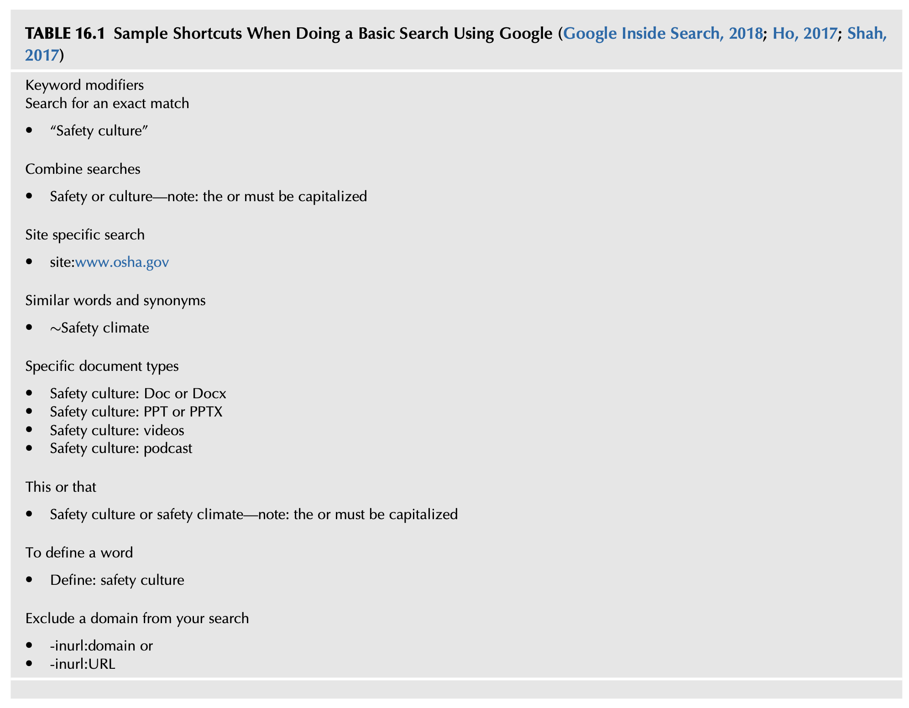

### TABLE 16.1 Sample Shortcuts When Doing a Basic Search Using Google (p. 400)

| 키워드 수식어 (Keyword modifiers) | 예시 / 사용법 (원문 표 및 `image-193.png` 기준) |
| :--- | :--- |
| **정확한 일치 (Search for an exact match)** | `“Safety culture”` |
| **검색 결합 (Combine searches)** | `Safety OR culture` (참고: `OR` 대문자 필수) |
| **특정 사이트 내 검색 (Site specific search)** | `site:www.osha.gov` |
| **유사어 및 동의어 (Similar words and synonyms)** | `~Safety climate` *(원문 표 이미지 `image-193.png`에는 `~` 표기 수록)* |
| **특정 문서 유형 (Specific document types)** | `Safety culture: Doc or Docx` / `PPT or PPTX` / `videos` / `podcast` |
| **이것 또는 저것 (This or that)** | `Safety culture OR safety climate` (`OR` 대문자 필수) |
| **단어 정의 (To define a word)** | `Define: safety culture` |
| **특정 도메인 제외 (Exclude a domain)** | `-inurl:domain` 또는 `-inurl:URL` |

---

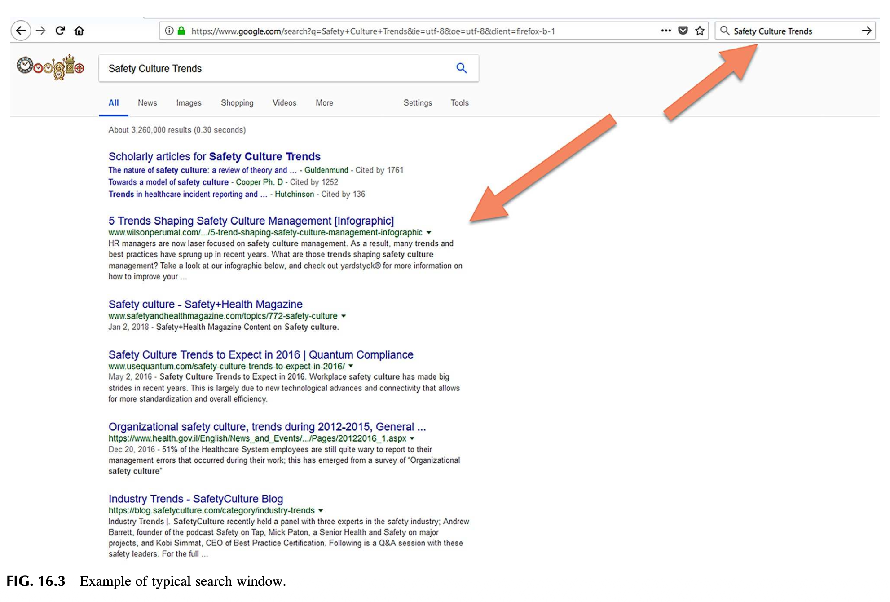
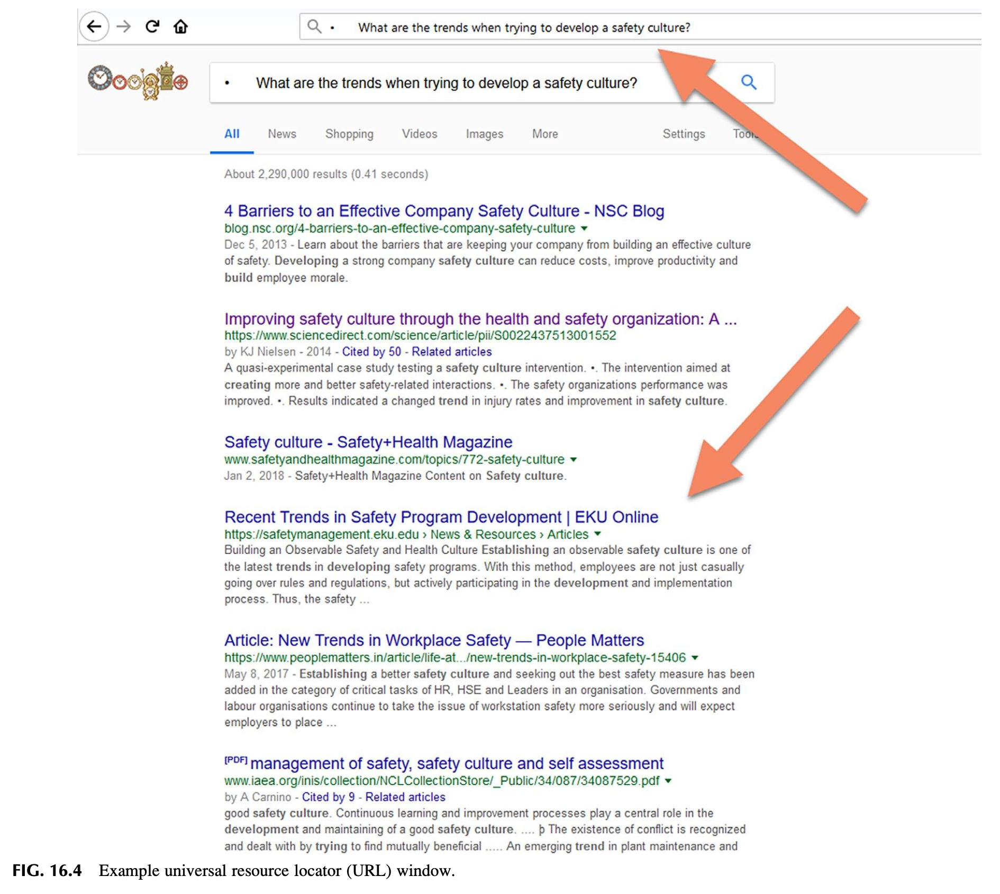
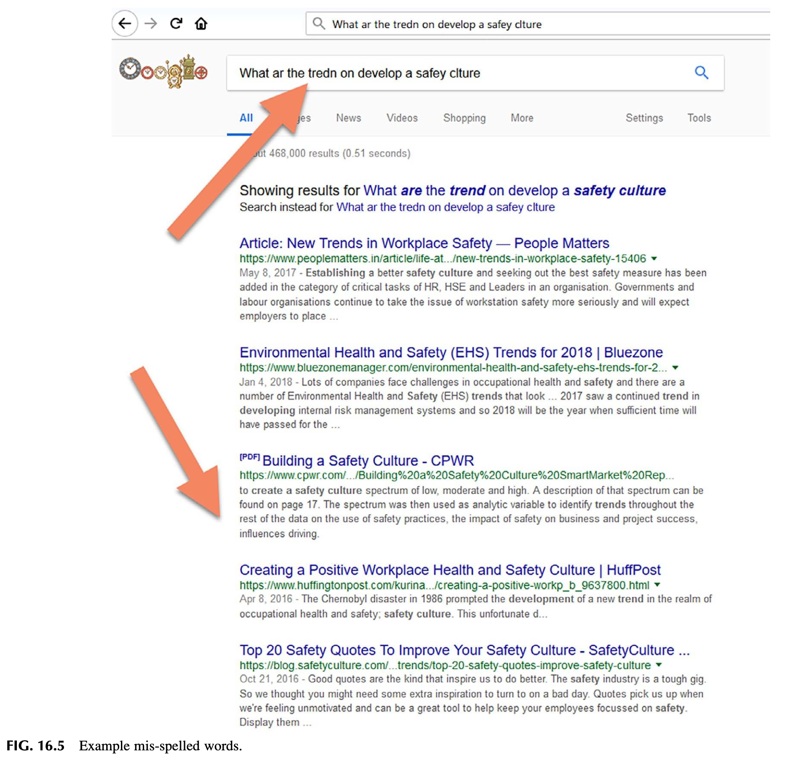

> **[그림 16.3~16.5 보충설명 (pp. 401–403)]**  
> * `FIG. 16.3`(`image-194.png`): 일반 검색창에 핵심 키워드(`Safety Culture Trends`)를 입력했을 때 약 3,260,000건이 검색되는 화면입니다.
> * `FIG. 16.4`(`image-195.png`): 브라우저 상단 URL 주소창 전체에 문장형 질의(`What are the trends when trying to develop a safety culture?`)를 입력하여 학술 논문(Nielsen, 2014 등)이 상위 노출되는 차이를 보여줍니다.
> * `FIG. 16.5`(`image-196.png`): 의도적 오탈자(`What ar the tredn on develop a safey clture`)를 입력해도 구글이 자동으로 올바른 철자로 보정하여 약 468,000건의 유효 결과를 제시함을 시연합니다.
> * 이 밖에도 **Google Advanced Image Search**(무료 사용권 `usage rights` 확인 필수)와 **Google Trends**가 제시됩니다 (pp. 401–402).

### 9.2 연구 자원 (Research Resources, pp. 402–405)
> *"천재는 1%의 영감과 99%의 땀으로 이루어진다."* — 토마스 에디슨 (p. 402)

* **Google Scholar**: 학술 문헌 색인 및 **MLA·APA·Chicago·Vancouver** 인용 양식과 **BibTeX·EndNote·RefMan·RefWorks** 내보내기 지원 (`FIG. 16.6`).
* **Google Books**: 검색 기준에 맞는 도서 색인 및 향후 연구용 라이브러리 구축.
* **Google Keep**: 이동 중 텍스트·목록·이미지·오디오 메모 실시간 포착 및 Gmail 알림 연동.
* **Pocket**: 웹·SNS 기사와 동영상을 저장해 오프라인 상태에서도 스마트폰·태블릿·PC로 나중에 읽기.
* **Semantic Scholar**: 머신러닝 기반으로 텍스트 외 이미지·표·캡션까지 추출하고 인용 기여도를 지능적으로 평가(단, 저자들은 **Google Scholar**를 선호 방식으로 명시, p. 405).
* **refseek**: 웹페이지·도서·백과사전·학술지·신문 등 10억 건 이상 문서를 검색하는 학술·문서 검색 엔진.

---

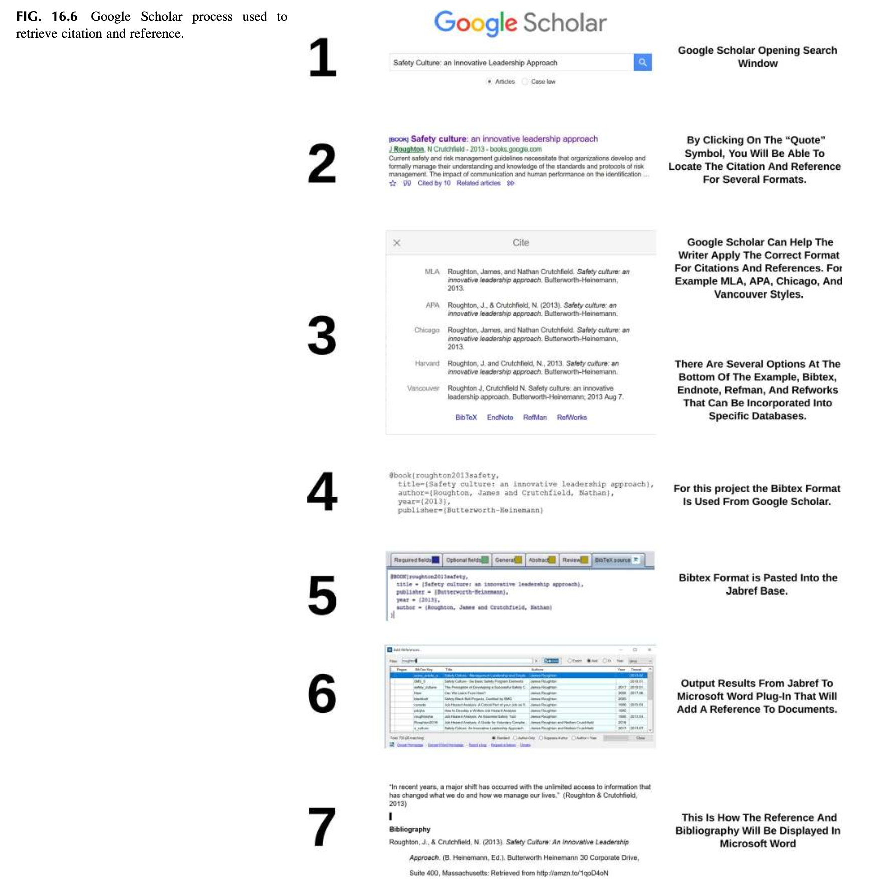

### FIG. 16.6 Google Scholar process used to retrieve citation and reference (p. 404)

> **[그림 16.6 보충설명 — Google Scholar → JabRef → MS Word 7단계 워크플로우]**  
> `image-197.png`는 ① Google Scholar 검색 ➔ ② 인용(`“`) 아이콘 클릭 ➔ ③ 인용 양식(MLA/APA 등) 및 하단 BibTeX 선택 ➔ ④ BibTeX 코드 복사 ➔ ⑤ JabRef 데이터베이스에 BibTeX 붙여넣기 ➔ ⑥ Docear4Word MS Word 플러그인 출력 선택 ➔ ⑦ 본문 내 인용과 말미 Bibliography 자동 삽입 완료의 전 과정을 7단계로 시각화합니다.

### 9.3 자동 큐레이션·클라우드 협업·집필·그래픽·기타 도구 요약 (pp. 405–411)

| 범주 | 수록 도구 및 핵심 기능 (pp. 405–411) |
| :--- | :--- |
| **자동 큐레이션 도구** | • **Google Alerts**: 키워드 기반 신규 웹 정보 이메일 자동 알림 (장점: 수동 검색 시간 절감 / 단점: 과다 이메일 주의) • **Google Feedburner**: 웹 미디어 소비 추적 및 Feedly 연동 |
| **클라우드 협업 도구** | • **The Cloud / Dropbox**: 저자 3인 기기 간 실시간 동기화, 외출 시 계약서 즉시 다운로드 사례(*Lesson Learned*) • **Google Drive (Docs/Spreadsheet)**: 자동 온라인 저장 및 실시간 공유 • **Slack**: 이메일 함정(잡동사니)을 극복하는 목적별 공개/비공개 채널, 파일 드래그앤드롭 및 Dropbox 연동 • **Trello**: 도요타 칸반(Kanban) 기반 보드 협업(제6장 부록 6.5 연계) • **JotForm**: LinkedIn 설문 공유 및 Google Spread Sheet 자동 수집 • **Buffer**: 소셜 미디어 게시물 시간차 예약 배포(Drip) |
| **집필 효율 도구** | • **Docear & JabRef**: 무료 오픈소스 마인드맵(`FreePlane`) 기반 문헌 저장소·PDF 주석 시각화·`Docear4Word` 플러그인(`FIG. 16.7`, 단 Docear는 현재 지원 중단 상태) • **Microsoft Word / Office 365**: 변경 내용 추적·메모 및 내장 참고문헌 DB 기능(`FIG. 16.8`) • **Scrivener**: 구상부터 최종 초고까지 통합 관리하는 집필 프로젝트 도구 • **Microsoft OneNote**: 자동 저장·동기화 디지털 노트북 • **Grammarly**: 문법·철자 교정, 문장 다듬기 및 **표절 검사** |
| **그래픽·기타 도구** | • **Presenter Media** / **HandBrake**(영상 변환) / **Inkscape**(벡터 그래픽) / **GIMP**(무료 이미지 편집) / **Lucidchart**(흐름도) / **Snagit**(화면 캡처·주석) • **bit.ly**(긴 OSHA URL 단축) / **Dragon Professional Individual**(음성 받아쓰기·서식 편집, 제임스 실제 집필 사용) / **NaturalReader**(TTS 낭독) / **Word Cloud Generator**(각 장 워드클라우드 제작) / **Brainy Quotes**(명언 수집) |

---

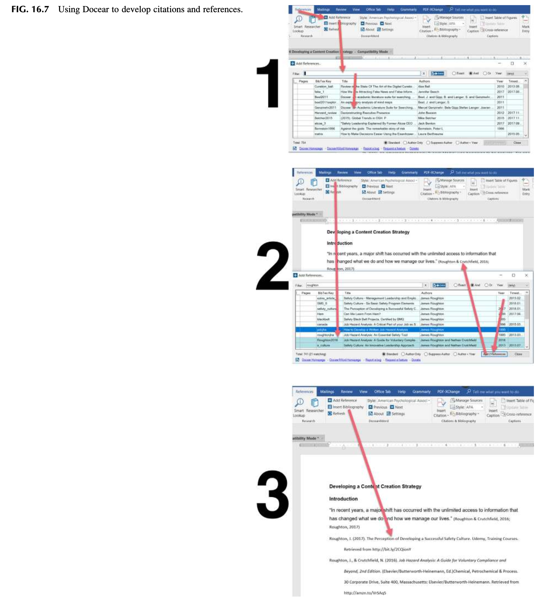
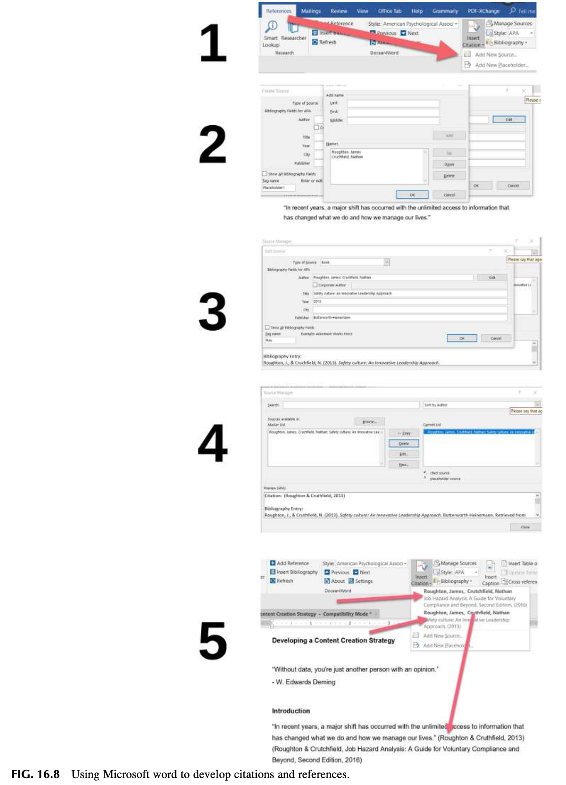

> **[그림 16.7·16.8 보충설명 (pp. 408–409)]**  
> * `FIG. 16.7`(`image-198.png`): MS Word 상단 `Docear4Word` 메뉴에서 **① Add Reference 클릭 ➔ ② 키워드(roughton) 필터링 및 다중 문헌 선택(`Add 2 References`) ➔ ③ 본문 인용구 및 말미 참고문헌 자동 생성**의 3단계를 보여줍니다.
> * `FIG. 16.8`(`image-199.png`): 별도 외부 플러그인 없이도 MS Word `References` 탭에서 **① Insert Citation → Add New Source ➔ ② 저자명·서지 입력 ➔ ③ Source Manager 등록 ➔ ④ Master List에서 Current List로 복사 ➔ ⑤ 본문 인용 삽입**까지 5단계로 구현하는 방법을 안내합니다.

---

## 10. APPENDIX 16.2 USING FEEDLY TO FIND CONTENT FOR CURATION, A CASE STUDY (부록 16.2: Feedly 활용 사례 연구, pp. 412–414)

제임스가 식스 시그마 블랙 벨트(Six Sigma Black Belt) 경험에 기반한 **IPO(Input–Process–Output) 모델**을 Feedly에 적용한 사례 연구입니다 (p. 412):
* **Input**: 신뢰할 수 있는 웹사이트·블로그·유튜브 채널의 **RSS 피드** 확보.
* **Process**: Feedly(RSS 리더)에 피드를 등록해 바이럴 뉴스뿐 아니라 **게시되는 모든 헤드라인**을 누락 없이 실시간 추적 (*Lesson Learned*, p. 412; Pot, 2018).
* **Output**: 수동 복사·붙여넣기의 시간 낭비를 없애고 조직·동료·SNS 네트워크로 적시 배포.

---

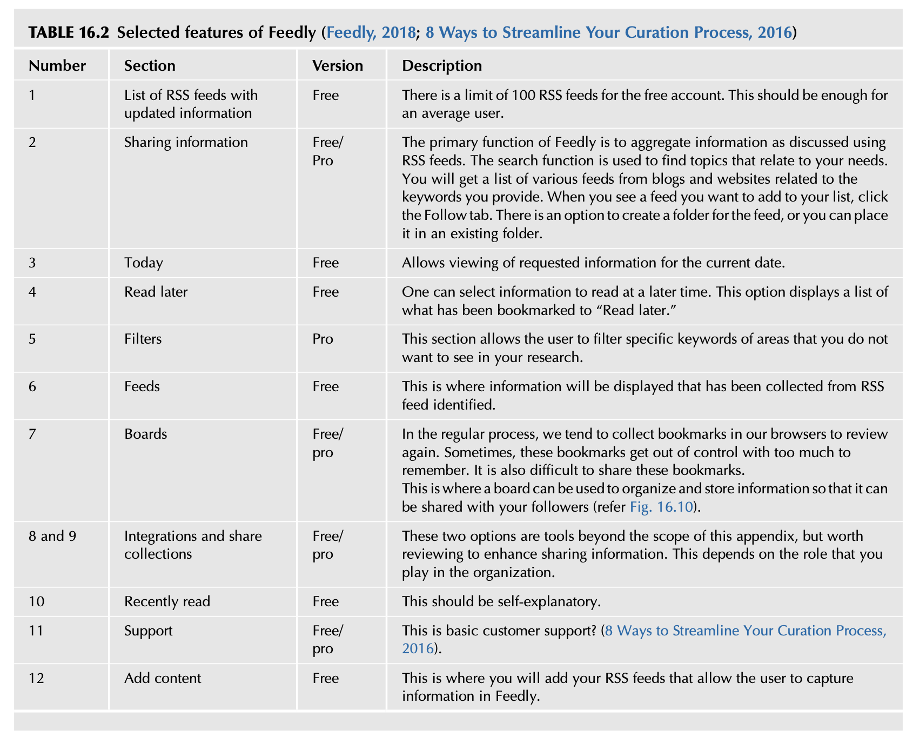

### TABLE 16.2 Selected features of Feedly (p. 413)

| 번호 | 섹션 (Section) | 버전 | 핵심 기능 설명 (pp. 413) |
| :---: | :--- | :---: | :--- |
| **1** | List of RSS feeds with updated information | Free | 무료 계정은 최대 **100개 RSS 피드**까지 등록 가능(일반 사용자에게 충분) |
| **2** | Sharing information | Free/Pro | 키워드 검색으로 관련 피드를 찾고 `Follow` 탭으로 폴더별 분류·구독 |
| **3** | Today | Free | 당일(오늘) 날짜에 올라온 최신 정보 열람 |
| **4** | Read later | Free | 나중에 읽을 기사를 북마크해 별도 목록으로 관리 |
| **5** | Filters | Pro | 원치 않는 특정 키워드·영역을 연구 결과에서 자동 제외 |
| **6** | Feeds | Free | 등록된 RSS 피드로부터 수집된 전체 정보 표시 |
| **7** | Boards | Free/Pro | 브라우저 북마크 폭증 문제를 해결하고 팔로워와 공유할 보드 저장(`FIG. 16.10`) |
| **8–9** | Integrations and share collections | Free/Pro | 외부 앱 통합 및 컬렉션 공유 기능 |
| **10** | Recently read | Free | 최근 읽은 항목 이력 |
| **11** | Support | Free/Pro | 기본 고객 지원 |
| **12** | Add content | Free | 정보 포착을 위한 새로운 RSS 피드 추가 |

---

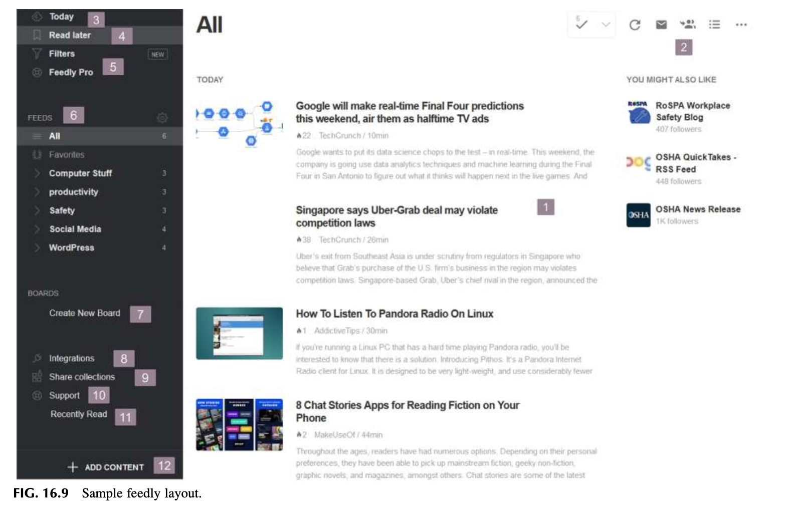
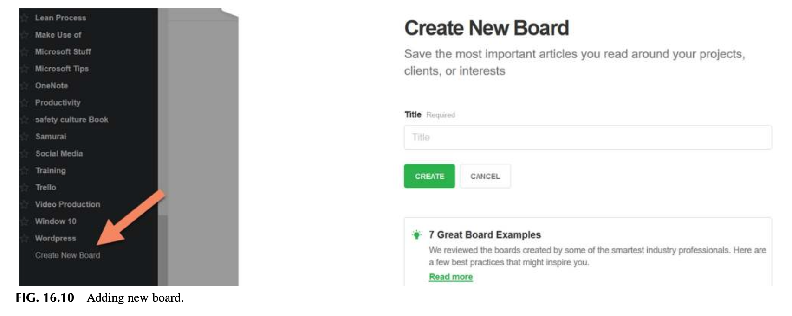

> **[그림 16.9·16.10 보충설명 (pp. 413–414)]**  
> * `FIG. 16.9`(`image-201.png`): `TABLE 16.2`의 1~12번 기능 번호가 실제 Feedly 화면(좌측 사이드바 `Today`, `Read later`, `FEEDS`, `BOARDS`, `+ ADD CONTENT` 및 중앙 피드·우측 추천 피드 `OSHA QuickTakes`, `OSHA News Release`) 어디에 위치하는지 번호표로 매핑해 줍니다.
> * `FIG. 16.10`(`image-202.png`): 좌측 하단 `Create New Board`를 클릭해 프로젝트·주제별(`safety culture Book`, `Trello`, `Lean Process` 등) 큐레이션 보드를 생성하는 화면입니다.

---

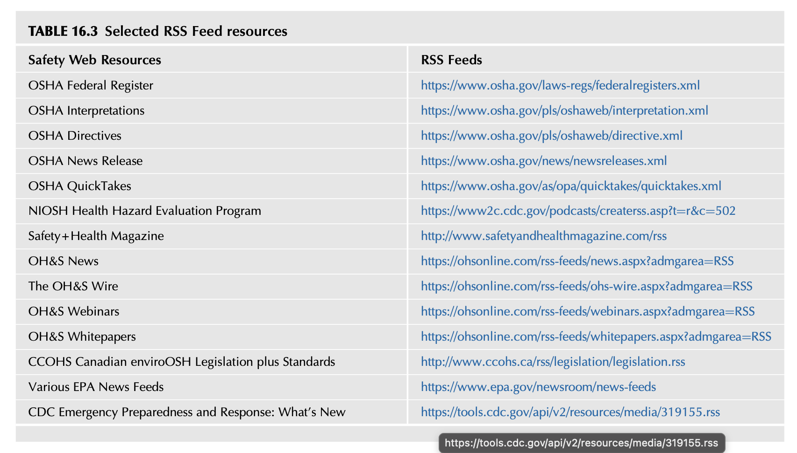

### TABLE 16.3 Selected RSS Feed resources (p. 414)

| 안전 웹 자원 (Safety Web Resources) | RSS 피드 주소 (RSS Feeds) |
| :--- | :--- |
| OSHA Federal Register | `https://www.osha.gov/laws-regs/federalregisters.xml` |
| OSHA Interpretations | `https://www.osha.gov/pls/oshaweb/interpretation.xml` |
| OSHA Directives | `https://www.osha.gov/pls/oshaweb/directive.xml` |
| OSHA News Release | `https://www.osha.gov/news/newsreleases.xml` |
| OSHA QuickTakes | `https://www.osha.gov/as/opa/quicktakes/quicktakes.xml` |
| NIOSH Health Hazard Evaluation Program | `https://www2c.cdc.gov/podcasts/createrss.asp?t r&c 502` |
| Safety+Health Magazine | `http://www.safetyandhealthmagazine.com/rss` |
| OH&S News / Wire / Webinars / Whitepapers | `https://ohsonline.com/rss-feeds/...` (4종 피드) |
| CCOHS Canadian enviroOSH Legislation plus Standards | `http://www.ccohs.ca/rss/legislation/legislation.rss` |
| Various EPA News Feeds | `https://www.epa.gov/newsroom/news-feeds` |
| CDC Emergency Preparedness and Response: What’s New | `https://tools.cdc.gov/api/v2/resources/media/319155.rss` |

---

## 11. [연구자 해석 및 후속 연구 시사점] 학술적 메타 분석 및 KPI 도출 프레임워크

> [!NOTE]
> **원문과 연구자 해석의 엄격한 분리 (`GEMINI.md` 1·2·3·4원칙 준수)**  
> 제1절~제10절 및 제12절은 저자의 원문 내용(pp. 389–417)만을 충실히 정리한 부분이며, 본 **제11절**은 원문의 모델(`FIG. 16.1`·`16.2`, IPO 모델, 4대 큐레이션 역할, SME·Tribal knowledge)을 연구자의 학술 개념(**지각, 의미구성, 평가, 다중 관점, 다원주의, 다차원적 성과, 네트워크 성과**) 및 **현장 적용 KPI·법령**과 연결한 **연구자(AI) 해석 및 후속 연구 설계 영역**입니다.

### 11.1 [후속 연구 시사점] 주관성·지각·네트워크 성과 연구 연계
* **부족 지식(Tribal Knowledge)과 공식 매뉴얼 간 지각(Perception) 격차**: 제16장(p. 394)은 공식 매뉴얼에 없는 비공식 내부 절차인 '부족 지식'을 SME가 연구·문서화해야 함을 시사합니다. 후속 주관성 연구에서는 119구조대나 고위험 현장에서 베테랑 대원의 부족 지식과 공식 SOP 사이에서 대원들이 안전 규범을 어떻게 **의미구성(Sensemaking)**하고 **지각**하는지 다중 관점을 비교할 수 있습니다.
* **탁월성(Preeminence)과 전문성 평가(Evaluation)**: 현장 구성원이 안전 관리자를 신뢰하는 'Go-to person(SME)'으로 **평가**하는 조건(출처 검증 투명성, 10,000시간의 현장 숙련도 vs 형식적 자격증)에 대한 구성원 유형별 인식 연구로 확장할 수 있습니다.
* **네트워크 성과(Network Performance)**: `FIG. 16.1`의 클라우드·Dropbox·Slack·JabRef 협업 루프와 `FIG. 16.2`의 Feedly IPO 파이프라인은 개인의 지식 축적을 넘어 조직 네트워크 전체로 검증된 안전 정보가 확산되는 **네트워크 성과** 측정의 이론적 기반을 제공합니다.

### 11.2 콘텐츠 제작·전파 생애주기 5단계 기반 KPI 도출 (119구조대·현장 안전부서 적용)

> [!IMPORTANT]
> **트랙 A·B 연계 KPI 설계 원칙 (`GEMINI.md` 2·3·4항 적용)**  
> 1. **업무 단계화**: `[STEP 1] 입력 채널 구축` ➔ `[STEP 2] 수집·필터링` ➔ `[STEP 3] 검증·인용` ➔ `[STEP 4] 맞춤형 가공` ➔ `[STEP 5] 출력·환류`  
> 2. **현장 구체화**: 의령소방서 119구조대(3교대 출동, 장비·유해물질 대응 매뉴얼 최신화, TBM 교육) 및 사업장 안전관리부서의 팀·분과 업무에 밀착 설계.  
> 3. **법적 근거 조문 매핑**: 「산업안전보건법」 제14조·제29조·제36조·제164조, 「중대재해 처벌 등에 관한 법률 시행령」 제4조·제13조, 「소방공무원 보건안전 및 복지 기본법」 제10조.  
> 4. **고유/협업 분리**: 통제 가능한 고유 지표(70%)와 다부서·현장 연계 협업 지표(30% 또는 50%) 구분.

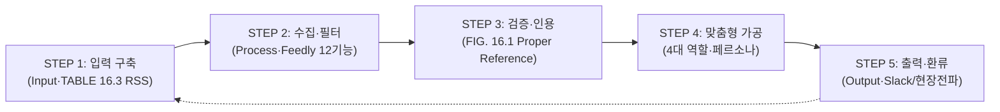

| 생애주기 단계 | 적용 조직/담당 (Break-down) | 핵심 성과지표 (KPI) 명칭 (연구자 설계) | 지표 성격 & 가중치 | 산출 방식 및 관리 목표 (연구자 제안) | 법적 근거 (조문 단위 매핑) | 서브노트 판단 근거 (절·표·그림 강제 매핑) |
| :---: | :--- | :--- | :---: | :--- | :--- | :--- |
| **STEP 1 (입력 구축)** | **안전정보·교육 담당자** (119구조대 교관·안전관리자) | 공인 안전·재난 규제 RSS 피드 및 비상업적 출처 등록률 | **고유 (70%)** | $\frac{\text{구독·연동된 공인 기관 피드 수}}{\text{관할 위험분야 필수 공인 출처 수}}$ (목표: 법령·신규 유해위험 피드 누락 0건) | 산안법 제14조 (안전보건 계획) 중처법 시행령 제4조제1호·제3호 | 본문 7절 (`INPUT CHANNEL`), 부록 16.2 (`TABLE 16.3` 14종 RSS 피드) |
| **STEP 2 (수집·필터)** | **안전기획·대응 전담팀** (구조대 장비·작전 담당) | Feedly/Alerts 기반 신규 위험·사고 사례 필터링 및 보드 분류율 | **고유 (70%)** | 주간 수집 헤드라인 중 현장 직무 관련 키워드 필터링 및 주제별 보드(`Boards`) 아카이빙 건수 | 산안법 제36조 (위험성평가 정보 수집) 소방공무원 보건안전법 제10조 | 본문 7절 (`PROCESS CHANNEL`), 부록 16.2 (`TABLE 16.2`, `FIG. 16.9`·`16.10`) |
| **STEP 3 (검증·인용)** | **문헌검증·품질 담당자** (안전부서·교차검토자) | 출처 역추적·교차확인(Proper Reference) 및 표절·오정보 차단율 | **고유 (70%)** | $\frac{\text{원출처 확인·반대관점 교차검증·인용 완료 콘텐츠}}{\text{제작·배포 안전 콘텐츠 총수}} \times 100$ (위키피디아 무검증 인용 0건) | 산안법 제164조 (서류의 보존) 중처법 시행령 제13조 (증빙 보관) | 본문 2절 (`FIG. 16.1` `Proper Reference` 분기), 3.3절 (`Crossfield`), 5.1절 (`Note`), 6절 (`Beach`, `Grammarly`), 부록 16.1 (`FIG. 16.6`~`16.8`) |
| **STEP 4 (맞춤형 가공)** | **현장 멘토·교관 (팀장·구조대 반장)** | 대상 페르소나별 부족 지식(Tribal knowledge) 공식화 및 재포장 건수 | **협업 (50%)** | 교대조·신규자·베테랑 페르소나 맞춤 `큐레이션된 추천` 카드뉴스·TBM 요약본 제작 건수 | 산안법 제29조 (근로자 안전보건교육) 중처법 시행령 제4조제5호 | 본문 3.1절 (재포장), 3.3절 (4대 역할·`Ervin` 페르소나), 5.1절 (`Tribal knowledge`) |
| **STEP 5 (출력·환류)** | **현장 작업조·협업 채널** (119구조대 전 교대조) | 협업 채널(Slack 등) 통한 안전 콘텐츠 전파 적시율 및 피드백 반영률 | **협업 (30%)** | `Output Channel` 전파 후 교대조원 확인률 및 건설적 피드백(`Aja Frost`) 반영 개선 건수 | 산안법 제24조 (산안위 공유) 중처법 시행령 제4조제8호 (의견청취) | 본문 2절 (`Aja Frost`, `FIG. 16.1` 클라우드 동기화), 7절 (`FIG. 16.2` `Output Channel`), 부록 16.1 (`Slack`·`Trello`) |

### 11.3 비판적 검토 및 역질문 검증 프로토콜
1. **출처 역질문**: *"각 KPI 지표가 `FIG. 16.1`(문헌 인용 협업 순서도), `FIG. 16.2`(Feedly IPO 모델), `FIG. 16.6`~`16.8`(인용 관리), `TABLE 16.1`~`16.3`, 4대 큐레이션 역할에 직접 매핑되었는가?"*
2. **위험 통제 역질문**: *"소셜 미디어 활용 과정에서 발생할 수 있는 개인/조직 경계 침범(Crossover, p. 392)과 검증되지 않은 허위 정보의 조직 내 유포 위험(p. 390, 396)이 STEP 3의 인용·출처 검증 게이트에서 실질적으로 차단되는가?"*
3. **현장 실행성 역질문**: *"3교대 현장 인력이 방대한 온라인 도구를 모두 익히지 않더라도, `Feedly` 보드와 `Slack` 단일 채널 등 최소 진입 장벽으로 즉시 필요한 안전 콘텐츠에 접근할 수 있는가?"*

---

## 12. BIBLIOGRAPHY & FURTHER READING (참고문헌 및 추가 읽을거리, pp. 414–417)

* 제16장의 전체 **Bibliography(총 96편)** 및 **Further Reading(총 32편)** 원문 목록은 [chapter16-원문.md](file:///Users/sg/Project/safety-culture/subnote/chapter16-%EC%9B%90%EB%AC%B8.md) 및 1:1 대조 리더(`B225`, `B226`)에 100% 원형 보존되어 있습니다.
* **주요 핵심 문헌 범주**:
  * **인적 역량·전문성**: Gladwell (2008, 2013), Szalavitz (2013), Williamsen (2012), Koch (2007), BCSP ASP/CSP Guide (2017, 2018), Starak (2009), Rowse (2018)
  * **신뢰성·허위정보·네트워크(Further Reading 포함)**: Beach (2017), Crossfield (2018), Brodie (2009, *Virus of the mind*), Dawkins (2006, *The selfish gene*), Cross & Parker (2004, *The hidden power of social networks*), Covey (1990), DODI 855001 & US Army Social Media handbook (2011, 2018)
  * **큐레이션·도구(IPO·RSS·집필)**: Schembri (2012), Feedly (2016, 2018), Fitzpatrick (2016), Pot (2018), Docear (2015, 2016), JabRef (2018), Grammarly (2018), Scrivener (2015), Betters (2016, Slack), Agarwal (2015, Trello)
