<!-- Block B001 -->
# 제16장 콘텐츠 제작 전략 개발 (Developing a Content Creation Strategy)

*Safety Culture. https://doi.org/10.1016/B978-0-12-814663-7.00016-9*  
*©2019 Elsevier Inc. All rights reserved. pp. 389–417*

<!-- Block B002 -->
<!-- [그림 삽입 위치: Chapter 16 Overview] -->
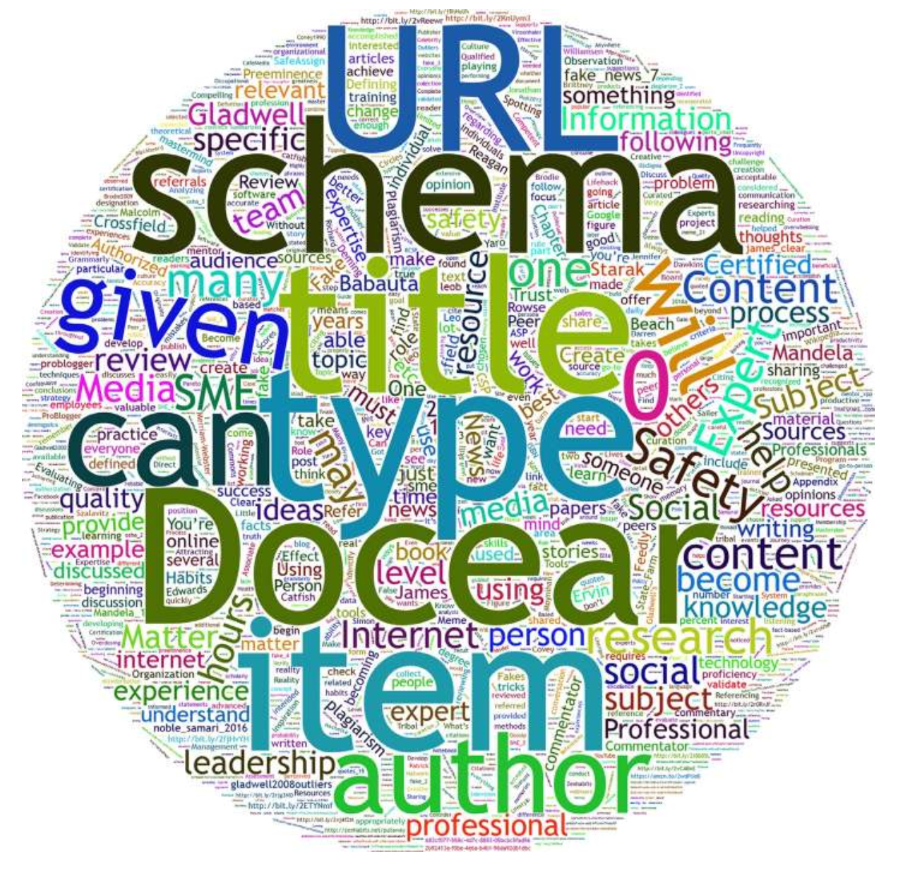
<!--  -->

<!-- Block B003 -->
> 데이터가 없다면, 당신은 그저 의견을 가진 또 한 사람일 뿐이다.  
> — W. 에드워즈 데밍 (W. Edwards Deming)

<!-- Block B004 -->
## 서론 (INTRODUCTION)

제16장의 목적은 안전경영시스템(Safety Management System, SMS)과 안전 문화(Safety Culture)를 지원하기 위한 콘텐츠 제작 전략(Content Creation Strategy)을 개발하는 데 필요한 엄선된 방법과 지침을 제공하는 것이다. 이 전략은 안전 전문가 또는 지정된 담당자에게 관련성 있고 정확한 정보를 얻기 위해 인터넷을 효율적으로 연구하고, 전문적 연락망과 네트워킹 역량을 확장할 수 있는 로드맵을 제공하도록 설계되었다.

<!-- Block B005 -->
지난 수십 년 동안 새롭게 등장한 인터넷 기반 기술과 “소셜 미디어(Social Media)”로 알려진 일련의 새로운 의사소통 역량이 이용 가능해지고 폭발적인 인기를 얻었다. 스카이프(Skype), 트위터(Twitter), 스냅챗(Snapchat), 인스타그램(Instagram), 페이스북(Facebook), 유튜브(YouTube), 레딧(Reddit), 핀터레스트(Pinterest), 링크드인(LinkedIn), 구글 플러스(Google+) 및 셀 수 없이 많은 서비스들이 뒷받침하는 전 세계적으로 연결된 온라인 대화를 소셜 미디어가 제공하여 사회를 변모시킬 것이라고는 아무도 짐작하지 못했을 것이다.

<!-- Block B006 -->
> 소셜 미디어의 정의: “사용자들이 정보, 아이디어, 개인 메시지 및 기타 콘텐츠(예: 동영상)를 공유하기 위해 온라인 커뮤니티를 만드는 전자적 의사소통 형태(예: 소셜 네트워킹 및 마이크로블로깅 웹사이트).”  
> — *(Social Media, 2018)*

<!-- Block B007 -->
끊임없이 변화하는 이러한 기술적 환경 속에서, 동료나 친구 등과 나누던 대면 대화의 인간적 연결은 이제 소셜 미디어, 웨비나(Webinars), 온라인 토론을 통해 손쉽고 경제적으로 정보가 소통됨에 따라 확장되었다. 이러한 신기술의 증가와 함께, 인터넷상에서 존재감을 구축하거나 조직과 공유할 정보를 수집하고자 하는 전문가들은 자신의 전문성을 뒷받침할 특정 정보를 연구하기 위한 인터넷 활용 역량을 필요로 한다. 페이스타임(Facetime), 스카이프(Skype) 및 기타 모바일 방식을 포함하여 이에 국한되지 않고 활용 범위가 확장되었다.

<!-- Block B008 -->
기술은 소셜 미디어 사용자와 큐레이터에게 커다란 혜택을 제공해 왔지만, 부정확한 정보의 게시, 직업적 평판의 훼손, 사직 및 해고, 그리고 기업 브랜드 손상을 포함한 결과들의 역사가 입증하듯 극단적인 위험(Extreme risk)도 동반한다. 안전 전문가가 소셜 미디어를 사용할 때 미성숙하거나 비전문적인 수준을 드러낸다면, 이러한 부정적 결과는 SMS를 손상시키고 안전 문화를 저하시킬 수도 있다.

<!-- Block B009 -->
개인의 기술, 학습 능력, 직업, 적성 등과 관계없이 개인적인 연습과 실천(Personal practice)이 필수적인 요소가 된다(Gladwell, 2008). 인터넷 활용 역량을 향상시키는 최선의 방안 중 하나는 찾고자 하는 해답이나 해결책에 부합하는 콘텐츠를 생성하는 신뢰할 만한 웹 기반 출처를 객관적으로 연구하는 것이다.

<!-- Block B010 -->
이 장을 학습하고 나면, 다음을 수행할 수 있게 된다:
* 안전 전문가의 전문성 수준 판단하기.
* 조직 내 안전 전문가의 역할 정의하기.
* 소셜 미디어에서 안전 전문가의 역할 정의하기.
* 데이터를 검증하는 방법 논의하기.
* 자원(출처)을 참고문헌으로 제시하고 인용하는 것의 중요성 논의하기.
* 특정 분야 전문가(Subject Matter Expert, SME)가 되는 방법 논의하기.

<!-- Block B011 -->
## 소셜 미디어에 대한 적응 (ADAPTING TO SOCIAL MEDIA)

기술 변화의 빠른 속도가 SMS에 미치는 영향과, 안전 전문가가 조직과 전문 분야 모두에서 적합성을 유지하기 위해 기울여야 하는 추가적인 노력의 크기는 쉽게 가늠하기 어렵다. 저자들은 경력 전반에 걸쳐 기술 활용에 깊이 관여해 왔다. 마이크(Mike)는 심층 사고 조사 및 통계 분석 소프트웨어를 공동 개발했다. 네이선(Nathan)은 프로젝트 관리 및 손실 분석 기법을 다루었다. 제임스(James)는 경력 초기에 웹사이트 디자인, 온라인 교육, 블로깅, 그리고 광범위한 소셜 미디어 도구와 응용 프로그램에 대한 전문성을 개발하였다.

<!-- Block B012 -->
이제 웹 기반 출처와 소셜 미디어를 통해 방대한 양의 정보를 이용할 수 있으며, 이는 정보의 쓰나미 파도(Tsunami Wave)를 넘어선 수준이 되었다.

<!-- Block B013 -->
제15장 ‘안전경영시스템을 위한 큐레이터’에서 논의했듯이, 우리는 이제 단순한 소방 호스와 정보의 쓰나미를 넘어 감당하기 어려울 수 있는 소셜 미디어상의 방대한 정보량으로 전환하고 있다. 그림 15.1(소방 호스로 물 마시기)과 그림 15.2(정보의 쓰나미 파도)를 참조하라. 이는 끊임없는 변화에 기반하여 해부하고 이해해야 할 정보가 매우 많다는 것을 의미한다. 검색하고, 체계화하며, 적절한 참고문헌과 올바른 인용을 제공할 수 있는 능력은 여전히 과제로 남는다.

<!-- Block B014 -->
예를 들어, 제15장 ‘안전경영시스템을 위한 큐레이터’에서 언급했듯이, 이 책을 집필하면서 저자들은 안전 문화 관련 정보를 찾기 위해 검토, 분류 및 선별해야 하는 수천 건의 문서와 참고 자료를 수집하였다. 문서를 찾는 것은 비교적 쉬웠다. 핵심은 우리의 논평, 결론 및 권고사항을 문서화하는 데 있어 올바른 인용과 참고문헌을 제공할 수 있도록, 수집된 자원을 뒷받침 증거와 함께 각 기고자와 공유하는 것이다(그림 16.1 참조).

<!-- Block B015 -->
> 성공적인 전문가들은 자신에게 건설적인 피드백을 주는 모든 사람을 무시하면서 사다리를 오르지 않는다.  
> — 아자 프로스트 (Aja Frost), 허브스팟(HubSpot)

<!-- Block B016 -->
## 큐레이션 프로세스 학습하기 (LEARNING THE CURATION PROCESS)

어떠한 큐레이션 프로세스든 시작하기 전에, 무엇을 달성하고자 하는지 결정하는 데 도움이 될 콘텐츠 제작 전략(Content creation strategy)을 개발해야 한다. 안전 전문가의 입지가 사람들이 찾는 핵심 인물(Go-to person)이자 특정 분야 전문가(Subject Matter Expert)가 되는 것이라면, 리더십 팀에 제시되는 정보는 안전 문화를 궤도에 유지하기 위한 가치와 지침을 제공해야 한다.

<!-- Block B017 -->
<!-- [그림 16.1 스크린샷 삽입 위치: Basic overview of book process flow for collecting and citing literature] -->
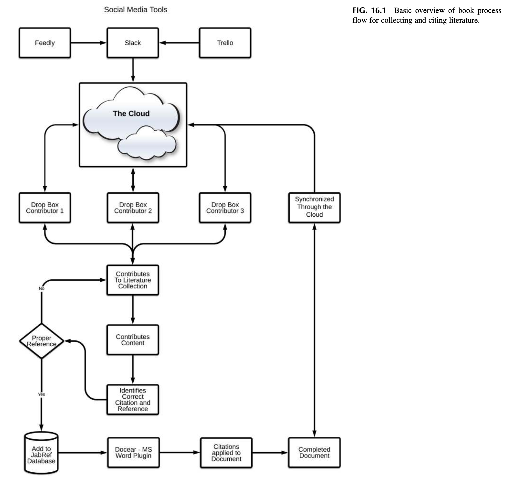
<!--  -->

### 그림 16.1 문헌 수집 및 인용을 위한 도서 집필 프로세스 흐름의 기본 개요.

<!-- Block B018 -->
이는 리더십 팀, 동료, 근로자 등에게 흥미롭거나 관련성이 있을 것이라고 판단되는 내용을 검토하기 위해 엄선된 소셜 미디어 도구와 기법을 활용함으로써 달성할 수 있다. 부록 16.1 ‘전문가를 위한 소셜 미디어 도구’를 참조하라. 이 부록에는 전문가가 생산성을 높이기 위해 사용할 수 있는 수많은 도구가 제공되어 있다.

<!-- Block B019 -->
## 콘텐츠 제작에서 안전 전문가의 역할 정의 (DEFINING THE SAFETY PROFESSIONAL’S ROLE IN CONTENT CREATION)

안전 전문가의 역할은 조직의 규모, 복잡성 및 구조에 따라 크게 달라진다. 대기업에는 안전, 산업위생, 교육, 환경 등 제한된 역할을 수행하는 지정 전문가들로 구성된 안전 전담 부서가 있으며, 필요에 따라 추가적인 전문 세분화가 이루어진다. 부서 간에 경계가 설정되어 있을 수 있으므로 조직 내에서 허용된 지정 역할을 이해하는 것이 첫 단계이다. 인적자원부서(HR)가 지정 교육 부서일 수 있고, 유지보수 부서가 점검을 담당하며, 구매 부서가 안전 관련 장비를 조달하는 식이다.

<!-- Block B020 -->
저자들은 많은 조직에 지원 인력이 제한적이거나 전무한 단 한 명의 지정 안전 전문가만 존재하는 경우를 확인하였다. 지원 인력의 규모와 깊이와 무관하게, 핵심 정보는 반드시 탐색되고, 평가되며, 큐레이션되어야 한다. 여기에는 조직 내 각 표적 청중(Targeted audience)에게 적합한 정보를 찾도록 설계된 잘 숙고된 콘텐츠 제작 전략(Content Creation Strategy)의 개발이 포함된다. 게다가 안전 리더는 자신이 선택된 분야의 전문가가 아닌 영역에서도 전문가적 직무를 떠맡아야 할 수 있다.

<!-- Block B021 -->
지식을 개발하거나 증진할 의도로 주제를 연구할 때, 출발점은 안전 관련 문제를 해결하는 데 즉시 활용될 수 있도록 정보를 간결하고 설득력 있는 방식으로 재포장(Re-package)하는 방법을 만드는 것이다.

<!-- Block B022 -->
## 멘토로서의 안전 전문가 (THE SAFETY PROFESSIONAL AS MENTOR)

안전 전문가는 리더십과 근로자에게 멘토(Mentor)의 역할을 수행한다. 훌륭한 멘토는 안전경영시스템과 안전 문화를 발전시키는 데 있어 성공을 더 잘 달성하는 방법에 대한 지침을 제공한다. 멘토는 이정표, 승리, 현실, 그리고 성공이 어디에서 나타날지 알고 있다. 멘토는 좌절과 차질뿐만 아니라 그 과정 전반을 헤쳐 나가도록 리더들을 안내한다. 지원은 모범 사례와 경험을 공유하거나 다른 전문가들의 네트워크를 활용하고 공유할 수 있는 소셜 미디어 콘텐츠를 검토하는 형태가 될 수 있다. 소셜 미디어와 전문가 네트워크의 실용적 활용은 멘토가 문제 해결 기법을 수집하고 리더십 팀과 공유할 기회를 식별할 수 있게 해 준다.

<!-- Block B023 -->
개인은 어떠한 조직과도 분리된 채 개인 시간을 활용하여 인터넷 기고자로 활동하기로 선택할 수 있다. 소셜 미디어를 사용하면서 의도치 않게 조직 관련 논평이나 콘텐츠로 넘나듦(Crossover) 없이 사용할 수 있다고 가정하는 것은 아슬아슬한 줄타기를 하는 것과 같다. 최신 뉴스 보도를 빠르게 살펴보면 온라인상에 무엇이든 게시하거나 말할 수 있다고 믿다가 경력과 삶을 망친 정치인, 유명인, 관리자, 근로자들의 수많은 사례를 확인할 수 있다.

<!-- Block B024 -->
## 큐레이션 역할의 유형 (TYPES OF CURATION ROLES)

훌륭한 멘토는 소셜 미디어 큐레이션 전략을 개발하는 데 성공을 거둘 수 있도록 지침을 제공한다. 이는 모범 사례와 경험을 공유하고 다른 전문가들과 네트워킹하거나 공유할 수 있는 소셜 미디어 콘텐츠를 검토하는 형태일 수 있다.

<!-- Block B025 -->
콘텐츠를 제작하기 위한 큐레이션 프로세스에서는 여러 가지 역할이 수행될 수 있다. 이는 당신이 무엇을 기여하고자 하는지에 따라 달라진다. 다음 목록은 콘텐츠 제작 전략의 초점에 따라 축소되거나 확장될 수 있다. 콘텐츠 제작은 네 가지 기본 유형으로 나눌 수 있다:
* 콘텐츠 공유 (Sharing content)
* 직접 추천 (Direct referrals)
* 큐레이션된 추천 (Curated referrals)
* 해설자/평론가 (Commentator)

<!-- Block B026 -->
## 콘텐츠 공유 (SHARING CONTENT)

콘텐츠 공유는 단순히 가치 있는 데이터나 정보로 연결되는 링크를 제공하는 것이다. 조직의 리더십을 지원하는 경우에는 공식 채널을 통해 링크를 발송하고, 조직 외부의 청중에게 전달하는 경우에는 개인 소셜 미디어를 별도로 사용한다.

<!-- Block B027 -->
핵심은 당신의 조직 내에서 수행하도록 허용된 역할을 이해하는 것이다.

<!-- Block B028 -->
## 직접 추천 (DIRECT REFERRALS)

직접 추천은 멘토가 특정 청중에게 정보나 데이터를 전달하는 메시지이다. 그 방법은 트위터나 페이스북 게시물에 “[게시물 제목 삽입]에 관한 훌륭한 자료를 방금 찾았습니다. 여기에서 확인해 보실 수 있습니다. [자료 링크 포함]”라고 적는 것처럼 간단할 수 있다. 콘텐츠를 직접 보내는 것이 아니라 정보 출처로 가는 직접 링크만 전달하여, 수신자가 편리한 시간에 링크를 열어 읽고 해석하도록 맡긴다.

<!-- Block B029 -->
직접 추천은 검증된 전문 영역을 대표하는 신뢰할 수 있는 웹사이트나 전문가 동료만을 사용한다. 추천 자료는 산업계, 정부, 기업 및 교육 웹사이트, 블로그 등에서 찾을 수 있다. 정보는 검증 가능하게 양질의 정보를 보유한 사이트들을 추적하고, 해당 사이트 정보의 장단점을 이해한 후에만 청중과 공유한다(Lua, 2018).

<!-- Block B030 -->
양질의 자원을 제공하는 것으로 여겨지는 사이트조차도 검증(Validate)이 필요하다. 예를 들어 위키피디아(Wikipedia)는 많은 경우 정보의 출처로 광범위하게 인용된다. 위키피디아는 정보를 읽거나 수집하기에는 좋은 곳이지만, 정확할 수도 있는 콘텐츠를 제공할 뿐 실제 원출처(Actual source)는 아니다. 정보는 다수의 개인에 의해 변경될 수 있으므로 위키피디아는 동료 심사(Peer-reviewed)를 거친 참고문헌이 아니다. “참고문헌과 인용이 제공되어 있으며, 각 링크가 실제로 존재하는지 그리고 평판이 좋은 출처에서 온 것인지 확인해야 한다”(Crossfield, 2018).

<!-- Block B031 -->
핵심은 “아무도 믿지 말라. 설령 그 통계가 비난의 여지가 없을 것이라 생각되는 선도적 브랜드에 의해 발표되었더라도 그 출처를 확인하라”(Crossfield, 2018)는 것이다. 어떤 자원이든 정확하다고 확신할 때까지 항상 검증하라.

<!-- Block B032 -->
## 큐레이션된 추천 (CURATED REFERRALS)

큐레이션된 추천은 다른 사람들과 공유하기 위해 정보를 요약하는 더 긴 소견과 논평을 포함한다. 큐레이션된 추천은 기존 자원이나 연구를 검토한 뒤, 그 정보의 아이디어에 기반한 통찰(Insights)을 도출한다. 새로운 통찰과 아이디어는 다른 사람들이 검토하고 의견을 제시할 수 있도록 인터넷에 게시될 수 있다. 논평을 읽은 후 그 참고문헌을 검토할 수 있도록 원본 자료로 연결되는 링크를 항상 포함한다.

<!-- Block B033 -->
훌륭한 큐레이션된 추천을 작성할 수 있는 능력의 상당 부분은 먼저 누가 그것을 읽을 것인지 정의하는 데 달려 있다. 어떤 주제에 대한 독자의 경험과 지식 수준을 파악하는 것이 정보가 취해야 할 어조(Tone)를 결정하는 첫 단계이다.

<!-- Block B034 -->
> “당신이 콘텐츠의 표적으로 삼고 있는 페르소나(Persona)를 알고 또 잘 알고 있다면, 당신의 주제에 대해(그것이 아무리 제한적이라 할지라도) 당신의 아이디어를 표현할 완전히 새로운 통로를 연 것이다”  
> — *(Ervin, 2013)*

<!-- Block B035 -->
## 해설자/평론가 (COMMENTATOR)

해설자(Commentator)는 깊은 지식을 개발하여 리더십 팀, 동료, 근로자 등과 생각과 아이디어를 공유할 수 있는 사람이다. 해설자는 선택된 관심 분야에서 가장 관련성 높은 정보를 검토하고, 요약하며, 논평함으로써 평판을 구축한다. 해설자는 특정 주제에서 어떠한 활동, 동향 및 패턴이 일어나고 있는지 세심하게 주시한 뒤, 생산되고 있는 엄선된 자료들을 식별하고 공유한다(What Does a Commentator Do?, 2018; How to Create Content When You’re Not An Expert, 2016).

<!-- Block B036 -->
## 고려해야 할 기타 전문성 유형 (OTHER TYPES OF EXPERTISE FOR CONSIDERATION)

<!-- Block B037 -->
### 동료 심사 (Peer Review)

동료 심사는 “(연구나 출판 등을 위해) 제안된 무언가가 해당 분야의 전문가 집단에 의해 평가되는 과정”으로 정의된다(Peer Review, 2018). “동료 심사는 연구가 출판 승인을 받기 전에 일정 수준의 연구 품질과 편집 기준 준수를 보장하기 위해 출판 전 자료를 검토하는 데 사용된다”(What Does Peer Review Mean?, 2018). 미국 연방 산업안전보건청(OSHA)은 다양한 업무에 대한 감독을 제공할 수 있는 유자격자(Competent) 또는 적격자(Qualified)로 간주될 수 있는 기준을 정의하였다:

<!-- Block B038 -->
### 승인된 자 (Authorized Person)

예를 들어, 일반 산업 또는 건설 분야의 공인 강사(Authorized trainer)가 되기 위한 사전 요건을 충족하려면 건설 안전 경력 5년과 같은 경험과 교육을 갖추어야 한다. 산업안전보건 분야의 대학 학위, 공인안전전문가(CSP) 또는 공인산업위생사(CIH) 자격은 2년의 경력으로 대체될 수 있다(How to Become an Authorized Trainer, 2018). “사업주가 작업 현장의 특정 장소 또는 장소들에서 특정 유형의 직무나 의무들을 수행하도록 승인하거나 지정한 사람”(Authorized Person, 2018).

<!-- Block B039 -->
### 유능한 자 / 권한 보유 점검자 (Competent Person)

OSHA가 정의한 유능한 자(Competent person)는 “주변 환경이나 작업 조건에서 비위생적이거나 유해하거나 근로자에게 위험한 기존 및 예측 가능한 유해위험요인을 식별할 능력이 있으며, 이를 제거하기 위한 즉각적인 시정 조치를 취할 권한(Authorization)을 가진 개인”이다(Competent Person, 2018).

<!-- Block B040 -->
### 적격자 / 자격을 갖춘 자 (Qualified)

적격자(Qualified person)는 “인정된 학위, 자격증 또는 전문적 지위를 보유하거나, 광범위한 지식, 훈련 및 경험을 통해 해당 주제, 작업 또는 프로젝트와 관련된 문제를 해결하거나 해소할 능력을 성공적으로 입증한 개인”이다(Qualified, 2018).

<!-- Block B041 -->
## 콘텐츠 제작에서 달성하고자 하는 목표 이해하기 (UNDERSTANDING WHAT IS TO BE ACHIEVED IN CONTENT CREATION)

어떠한 연구든 시작하기 전에 자신이 흥미를 느끼는 주제를 선택하라. 무엇을 달성하고자 하는지 확실히 이해해야 한다. 당신에게 요구되는 것은 무엇인가? 어떤 주제에 대한 당신의 해석으로 누군가를 설득하려는 것인가, 아니면 주제를 분석하고 평가하려는 것인가? 정보를 연구하는 것은 벅차게 느껴질 수 있으며 전문가들도 자신의 연구 역량에 대해 부담감을 느끼고 확신을 갖지 못할 수 있다. 연구를 조직에 가치 있는 양질의 정보를 식별하는 일련의 작은 단계들로 구성된 프로세스로 바라볼 때 그 어려움은 줄어든다. 그 프로세스는 일련의 질문으로 시작된다:
1. 콘텐츠 제작 프로세스의 목표는 무엇인가?
2. 콘텐츠는 개인적 용도인가, 아니면 조직적 용도인가? 개인적 용도라면 주제는 어떻게 선정되었고 어디에서 사용될 것인가?
3. 연구된 콘텐츠는 어떻게 사용될 것인가? 조언, 권고사항, 문의에 대한 답변 등인가?
4. 콘텐츠에 대해 어떠한 도전이나 이의가 존재할 수 있는가? 조직 내부에서인가? 인터넷 출처, 토론 그룹 등에서인가?
5. 주제에 대한 해석, 분석 및 주제나 발견사항의 평가에 대해 누가 이의를 제기할 수 있는가? 동료, 다른 조직 부서, 리더십, 또는 근로자인가?
6. 출판하거나 사용하기 전에 누가 최종 산출물을 검토할 것인가?
7. 연구 결과는 어떻게 큐레이션될 것이며 예상 유효 수명(Life expectancy)은 얼마인가?

<!-- Block B042 -->
## 특정 분야 전문가(SME)로서의 안전 전문가 (THE SAFETY PROFESSIONAL AS SUBJECT MATTER EXPERT)

> 자신이 무슨 말을 하고 있는지 아는 것은 성공에 필수적이다.  
> — 벤 세일러 (Ben Sailer)

<!-- Block B043 -->
이론적인 특정 분야 전문가(Subject Matter Expert, SME)는 고급 학위 취득 및 유지, 전문 자격증, 수년간의 일반 지식 또는 부족 지식(Tribal knowledge) 등 일정 수준의 교육을 갖추었음을 내포한다. 부족 지식은 “공식 매뉴얼에는 인정·수록되어 있지 않지만 널리 받아들여지는 내부 절차나 정보 조각”으로 정의된다(Tribal knowledge, 2018). 이는 우리가 자신의 지식과 경험을 취합하고 그 위에 축적하여, 거의 문서화되지 않은 우리의 생각과 아이디어를 제시할 때 결론에 도달하는 지점이다. 다음은 특정 분야 전문가에 관한 지침을 제공하는 몇 가지 정의이다. 특정 분야 전문가(SME)는 특정 주제나 기술 영역 또는 특정 직무에 대해 깊은 전문성, 경험 및 지식을 갖춘 사람이다. 안전 전문가는 “찾아가는 핵심 인물(Go-to person)”로 인정받기 위해 일관되고 정확하며 양질의 정보를 제공할 책무를 지닌다. 유능한 안전 전문가의 책임과 요구사항의 핵심 부분은 세부적으로 작성되어 즉시 사용할 수 있는 답변과 해결책을 얻기 위해 다른 사람들이 찾는, 가장 관련성 높은 정보를 보유한 인물이 되는 것이다.

<!-- Block B044 -->
* …자신의 특정 전문 영역의 대가(Master)인 사람(Subject Matter Expert, 2018). 이러한 지식은 일상적인 업무 루틴을 넘어 추가적인 노력을 기울이는 개인을 요구한다.
* …조직 내에서 전문화된 직무, 과업 또는 기술을 수행하는 데 있어 최고 수준의 전문성을 발휘하는 개인(Subject Matter Expert—SME, 2018).
* “특정 직무를 수행하는 데 필요한 진정한(Bona fide) 전문 지식을 갖춘 사람”(Frequently Asked Questions, Assessment Policy, 2018).

<!-- Block B045 -->
탁월성(Preeminence)을 지닌 특정 분야 전문가로 인식된다는 것은 ‘사람들이 당신을 당신이 하는 일에서 최고이거나 최고 중 한 명, 또는 적어도 다른 대부분의 사람들보다 낫다고 믿는다’는 것을 의미한다(Starak, 2009). 스타락(Starak)은 나아가 특정 분야 전문가가 되기 위해서는 ‘…탁월성을 확립하기 시작하는 방법은 당신이 아는 것을 공유함으로써 가치를 제공하는 것’이라고 제안한다(Starak, 2009).

<!-- Block B046 -->
프로블로거(ProBlogger)의 대런 라우스(Darren Rowse)는 특정 지식을 확장하려는 안전 전문가에게도 적용할 수 있는 다음과 같은 블로거용 팁을 제시한다:
* 윤리적이고 투명하라. 자신이 누구이며 얼마나 많은 경험을 가지고 있는지 솔직하게 밝혀라…..
* 게시하는 콘텐츠에 신중하라. 자신이 아는 범위를 넘어서 가르치거나 조언하는 것을 피하라.
* 학습을 적극적으로 추구하라. 아직 전문가가 아닐지라도 당신의 성장이 사람들이 당신과 당신의 블로그에 연결되도록 돕는다(Rowse, 2018).

<!-- Block B047 -->
특정 학문·실무 분야에서 특정 분야 전문가(SME) 또는 선도적 전문가가 되려면 핵심 주제를 연구하고 그 기초를 학습한 다음, 배운 것을 실제 상황에 적용하는 데 시간이 걸린다. 추가적인 요구사항은 수용 가능한 수준의 전문성에 도달했음을 다른 특정 분야 전문가들로부터 인정받는 것이다. 전문 자격 명칭(Professional designations)은 이러한 인정의 한 형태이며 거의 모든 전문직에서 찾아볼 수 있다.

<!-- Block B048 -->
정보 큐레이터는 특정 분야 전문가가 되기 위해 필요한 수준에 도달할 수 있도록 연구와 지식을 양질의 아이디어 모음으로 결합할 수 있어야 한다. SME는 “탁월성(Preeminence)”, 즉 “탁월한 자질이나 상태: 우월성”을 성취한 사람으로 정의되어 왔다(Definition of Preeminence, 2018). 탁월성을 지닌 SME로 인식된다는 것은 “사람들이 당신을 당신이 하는 일에서 최고이거나 최고 중 한 명, 또는 적어도 다른 대부분의 사람들보다 낫다고 믿는다”는 것을 의미한다(Starak, 2009). 스타락은 나아가 SME가 되려면 “…탁월성을 확립하기 시작하는 방법은 당신이 아는 것을 공유함으로써 가치를 제공하는 것”이라고 제안한다(Starak, 2009).

<!-- Block B049 -->
> **참고(Note):** 위키피디아는 협업 방식으로 변경되는 콘텐츠를 담은 사이트이다. 이러한 협업 편집은 자신이 논평하는 주제에 능숙하거나 학식이 있을 수도, 없을 수도 있는 모든 개인(들)에 의해 수행될 수 있다. 위키피디아 사이트 내부와 상단에 포함된 검열되지 않고 검증되지 않은 의견은 가설이나 결론을 입증하는 데 사용될 수 없다. 위키피디아는 어떠한 참고문헌 인용, 인용구 또는 학술 저작에서도 자료로 사용되어서는 절대 안 된다.

<!-- Block B050 -->
## 특정 분야 전문가의 정의 (DEFINING SUBJECT MATTER EXPERT)

10,000시간이라는 아이디어는 어디에서 왔는가? 대표적인 예로, 당신은 “내가 이걸 10,000번도 더 해봤다”라고 말하거나 누군가 그렇게 말하는 것을 몇 번이나 들어보았는가? 이는 수없이 언급되는 흔한 표현이다.

<!-- Block B051 -->
다른 전문가들과의 지속적인 연구와 의사소통은 초보자가 특정 분야 전문가(SME)가 되도록 도울 것이다. 말콤 글래드웰(Malcolm Gladwell)은 “…충분한 연습이 뒷받침되면 누구나 전문가에 필적하는 수준의 숙련도에 도달할 수 있다. 그것은 단지 시간을 투입하는 문제일 뿐이었다”고 제안했다(Gladwell, 2013).

<!-- Block B052 -->
말콤 글래드웰은 구체적인 지도를 받는 연습 10,000시간이라는 아이디어를 “위대함의 마법의 숫자(The magic number of greatness)”로 제시했다(Gladwell, 2008). 글래드웰의 의식적 연습(Deliberate practice) 10,000시간 법칙은 숙련도 수준에 도달하는 데 필요한 시간 수에 대해 도전과 논쟁의 대상이 되어 왔다. 살라비츠(Szalavitz)는 “위대함으로 가는 길은 많지만, 기술을 완벽하게 다듬기 위해 10,000시간의 연습을 기록하는 것만으로는 충분하지 않을 수 있다”고 지적했다(Szalavitz, 2013). 어찌 되었든, 누군가 10,000시간 만에 숙련되든 그렇지 않든, 특정 분야 전문가가 되기 위해서는 특정 주제나 노력의 분야를 배우려는 노력, 집중, 그리고 열망이 필요하다.

<!-- Block B053 -->
글래드웰의 아이디어는 윌리엄슨(Williamsen)과 같은 다른 전문가들에 의해서도 강조되었다. “특정 과업 집합을 수행하는 데 10,000시간을 보낸다는 개념은 탁월성을 달성하기 위한 인기 있는 패러다임이다”(Williamsen, 2012).

<!-- Block B054 -->
찰스 코크(Charles Koch)는 규정 준수와 관련하여 다음과 같은 진술을 사용한다. “…모든 직원의 100%가 시간의 100% 동안 완전히 준수하는 10,000% 규정 준수를 위해 노력하라. 환경, 안전 및 모든 규정 준수 영역에서 탁월성을 보장하라. 멈추고, 생각하고, 질문하라”(Koch, 2007).

<!-- Block B055 -->
### 관찰 (OBSERVATION)

연간 50주, 주당 40시간 근무를 기준으로 하면, 개인이 선택한 기술을 익히고 특정 분야 전문가(SME)가 되기 위한 이론적 숙련도 수준에 도달하는 데 5년이 걸릴 것이다. 예를 들어 공인안전전문가(Certified Safety Professional, CSP) 자격 지정 기준은 글래드웰의 10,000시간 숙련도 연구 결과를 면밀히 따르고 있다(Program overview, Certified Safety Professionals (CSP), 2018):

<!-- Block B056 -->
공인안전전문가(CSP) 자격 시험에 응시하려면, 지원자는 준안전전문가(Associate Safety Professional, ASP) 또는 기타 인정되는 지정 자격과 같은 안전전문가인증원(BCSP) 승인 자격을 보유해야 한다. ASP의 기준(Complete guide to the ASP, 2017)은 1년의 전문 안전 경력이며, 이는 연간 50주, 주당 40시간 근무 연도를 적용하면 2,000시간으로 환산된다.

<!-- Block B057 -->
공인안전전문가(CSP)가 될 자격을 갖추려면, 지원자는 시험에 응시하기 위해 4년의 전문 안전 경력을 보유해야 한다. 연간 2,000시간씩 4년이면 8,000시간이다. 두 기준을 합산하면 총 약 10,000시간의 경력이 도출된다.

<!-- Block B058 -->
또한 안전 자격을 유지하기 위해서는 지속적인 전문성 개발(Ongoing professional development)을 위한 교육 요건이 존재한다. 이러한 지속적 전문성 개발은 인정되는 세미나, 교육, 자가 학습, 동료 심사 전문 학술지·업계지에 안전 관련 논문 게재, 저서 집필 등에 기반하여 자격 갱신 포인트(Recertification points)를 취득함으로써 달성할 수 있다.

<!-- Block B059 -->
2018년 기준 새로운 요건에 유의하라: “CSP 지원자: 모든 분야의 최소 학사 학위 또는 안전·보건·환경 분야의 전문학사(Associate) 학위를 보유해야 한다. 전문학사 학위는 CSP 시험 청사진(Blueprint)에서 다루는 안전, 보건 또는 환경 영역에서 최소 12학기 학점/18분기 학점에 해당하는 최소 4개 과목을 포함해야 한다”(Program overview, Certified Safety Professionals (CSP), 2018).

<!-- Block B060 -->
## 정보 연구 및 큐레이션 (RESEARCHING AND CURATING INFORMATION)

주제나 정보를 한 번에 하나씩 개별적으로 검색하는 방식으로 수행한다면, 정기적인 정보 연구와 큐레이션은 좌절감을 줄 수 있다. 양질의 정보를 찾는 효율성과 생산성을 높이는 것으로 확인된 여러 가지 유용한 방법들이 있다.

<!-- Block B061 -->
## 콘텐츠 제작의 부정적 측면 (THE DOWNSIDE OF CONTENT CREATION)

소셜 미디어는 정보를 즉각적으로 공유하기 위해 콘텐츠를 제작하고 게시하고자 하는 누구나 그렇게 할 수 있는 메커니즘을 제공하였다. 콘텐츠 제작 수집의 문제는 언제든지 어떤 것이든 인터넷에 게시될 수 있으며, 평판이 좋은 출처 하나당 그만큼 많은 신뢰할 수 없는 출처가 존재할 수 있다는 점이다. 허구(Fiction)로부터 사실(Facts)을 가려내는 것이 장기적인 과제이다.

<!-- Block B062 -->
리더십 팀이나 독자에게 정보를 공유하기 전에 검토 중인 정보의 품질은 어떠한지, 그 정보가 얼마나 신뢰할 수 있는지, 심지어 그 정보가 진짜인지에 대한 중요한 질문들을 고려해야 한다. 인터넷상의 정보를 검토할 때는 출처의 신뢰성(Credibility)을 반드시 판단해야 한다.

<!-- Block B063 -->
전자 시대는 다른 사람의 저작물을 쉽게 복사할 수 있게 만들었다. 이러한 잠재적 문제를 해결하는 데 도움이 되도록, 양질의 콘텐츠를 작성하는 과정의 일부는 논점을 제시할 때 항상 출처(들)를 명시하는 것이다. 우리가 삶에서 얻는 지식, 경험 또는 의견은 멘토, 특정 자원, 또는 우리 자신의 경험에서 유래할 수 있음을 기억해야 한다.

<!-- Block B064 -->
> 모든 정보를 단 하나의 출처에만 의존하지 말라. 상황의 균형 감각(Even keel)을 유지하기 위해 당신이 조사하고 있는 주제에 대한 반대 관점(Opposing viewpoints)을 찾아보라. 이전에는 알아차리지 못했던 무언가를 깨닫고 그 사안에 대한 입장을 바꿀 수도 있다.  
> — *(Beach, 2017)*

<!-- Block B065 -->
## 자원의 인용 및 참고문헌 제시 (CITING AND REFERENCING RESOURCES)

기사, 책, 안전 프로그램, 교육 세션 등을 집필하고 제작하려면 프로젝트 수행을 위해 실시한 연구 결과를 요약해야 한다. 양질의 보고서를 작성하는 과정의 일부는 논점을 제시한 후 자원(출처)을 명시하는 것이다.

<!-- Block B066 -->
대부분의 독자들은 저자가 말한 것을 그대로 흉내 내는 사람에게는 관심이 없다. 그들은 당신이 읽은 내용에 대한 당신의 생각, 평가, 분석 그리고 문제를 해결할 잠재적 방법들에 더 관심이 있다.

<!-- Block B067 -->
정보 자원을 인용하고 참고문헌을 제시하는 것은 콘텐츠 제작의 핵심 부분이다. 논의를 위해 수집되고 사용된 모든 문서는 유효한 자원 참고문헌을 동반해야 한다. 리더십 팀에 전달되는 정보가 적절히 인용되고 참고문헌이 제시되도록 보장하는 것은 변화의 명분(Case for change)을 구축할 때 결정적이다. 자원은 서면 논평 말미에 인용되어, 통합된 아이디어와 해당 자원의 정확한 원문 사이의 차이를 보여 주기 위해 사용된 정보를 직접 인용할 수 있다.

<!-- Block B068 -->
전문가는 뒷받침하는 증거 없이 의견을 제시하지 않는다. 독자에게 설득력을 갖추려면, 논평은 신념, 경험(들), 의견(들), 그리고 제안(들)을 넘어 오직 사실 기반 진술(Fact-based statements)만을 사용하도록 확장되어야 한다. 이러한 사실 기반 진술은 특정 주장과 결론을 뒷받침하기 위해 학술적 출처(Scholarly sources)를 필요로 한다.

<!-- Block B069 -->
연구를 수행할 때는 가능한 다양한 형식, 의견, 충돌, 고려사항 및 통찰을 교차 확인(Cross check)하기 위해 서로 다른 자원을 사용하여 동일한 정보 요청을 수행해야 한다. 논평과 권고사항을 인용하고 참고문헌을 제시하는 지침을 따름으로써, 의도된 청중은 스스로 결론을 도출할 수 있고 쟁점에 대한 더 나은 이해를 바탕으로 안내받을 수 있다. 일단 연구가 수행되면, 적절한 인용 및 참고문헌과 결합된 신념, 경험, 의견 및 제안을 정보와 혼합하고 통합함으로써 자원이 제시한 바를 바탕으로 발전시켜 나갈 수 있다. 어떠한 퍼블릭 도메인(Public domain)이나 크리에이티브 커먼즈(Creative commons) 문서를 사용할 때에도 자원을 식별할 수 있도록 적절히 인용하고 참고문헌을 제시할 것을 강력히 권고한다.

<!-- Block B070 -->
## 투입·처리·산출 모델 (INPUT, PROCESS, OUTPUT MODEL)

투입(Input), 처리(Process), 산출(Output)의 3단계 채널 전략은 콘텐츠 제작 전략을 위한 효과적인 접근법임이 입증되었다.

<!-- Block B071 -->
### 투입 채널 (INPUT CHANNEL)

> “투입-산출 모델은 … 투입을 산출로 변환하기 위한 투입물, 산출물 및 필수 처리 과업을 식별한다” … “투입물은 프로세스로 들어가는 데이터의 흐름을 나타낸다. 이 프로세스는 투입물의 변환을 실행하는 데 필요한 모든 과업을 포함한다.”  
> — *(Schembri, 2012)*

<!-- Block B072 -->
투입 채널은 주요 전문 협회 웹사이트, 검증된 사상적 리더(Thought leader) 블로그, 특정 유튜브 채널, 정부 및 규제 기관 웹사이트 등을 포함하여 널리 알려지고 신뢰할 수 있는 출처로부터 동료 심사를 거친 정보를 찾아내고 식별한다. 선정되는 사이트는 교묘히 위장된 광고나 판매 홍보일 수 있는 상업적 사이트보다는 주로 비상업적(Non-commercial) 사이트여야 한다.

<!-- Block B073 -->
### 처리 채널 (PROCESS CHANNEL)

처리 채널은 가장 관련성 높고 중요한 정보가 포착되고 검토되는 곳이다. 수집 방법 중 하나는 “RSS(Really Simple Syndication)” 리더라는 도구를 활용하는 것이다(Fitzpatrick, 2016). RSS는 게시되는 모든 헤드라인을 제공함으로써 출처 검토로부터 정보를 직접 피드(Feed)해 준다.

<!-- Block B074 -->
#### RSS의 정의 (RSS DEFINED)

RSS는 “Really Simple Syndication”의 약자로, 뉴스 기사와 같은 웹사이트의 콘텐츠를 다른 보기 형태로 이용할 수 있도록 요약하는 방식이다(RSS, 2018; Digital_Trends_Staff, 2016). RSS 피드는 웹사이트가 정보를 한 번 게시하면 그 데이터를 구독자에게 자동으로 배포(Syndicate)하는 방법을 제공한다.

<!-- Block B075 -->
#### 올바른 RSS 피드 찾기 (LOCATING A CORRECT RSS FEED)

RSS 피드를 얻기 위해서는 각 자료 사이트를 방문해야 한다. 만약 자료 사이트가 RSS 피드를 표시하지 않는다면, 구글 피드버너(Google Feedburner, 2018)를 사용하여 RSS 링크를 찾을 수 있다. Google Feedburner 사용법에 관한 상세한 논의는 부록 16.1 ‘전문가를 위한 소셜 미디어 도구’를 참조하라.

<!-- Block B076 -->
#### 정보 통합 도구로서의 피들리 (FEEDLY AN INFORMATION CONSOLIDATING TOOL)

피들리(Feedly)는 다양한 출처로부터 정보를 수집하는 중앙 자원이다. 선택된 출처의 모든 정보가 한곳에 축적되므로, Feedly를 사용하면 선택된 각 출처를 자주 방문할 필요가 없어진다. Feedly는 정보를 검색하기 위해 RSS 피드를 사용하는 전제 위에서 작동한다. RSS 피드가 식별되어 Feedly에 추가되면, 업데이트된 모든 뉴스가 Feedly에 표시된다.

<!-- Block B077 -->
Feedly는 정보를 수집, 큐레이션 및 공유하는 데 있어 개인의 생산성을 높이는 데 유용한 웹 기반 도구이다. Feedly는 큐레이션 프로세스를 위해 선택된 정보의 수집과 체계화를 자동으로 간소화하고자 하는 사용자를 위한 무료 서비스를 현재 제공하고 있다. 웹 기반 서비스가 그러하듯, 큐레이션 프로세스를 강화하고 확장하고자 하는 이들을 위해 고급 프리미엄 기능도 제공된다(8 Ways to Streamline Your Curation Process, 2016).

<!-- Block B078 -->
Feedly를 효과적으로 사용하는 이점은 어떤 새로운 정보가 게시되고 있는지 확인하기 위해 동일한 웹사이트들을 계속해서 반복 방문할 필요가 더 이상 없다는 점이다. Feedly는 정보를 큐레이션하는 데 사용하는 모든 선택된 자원을 축적하는 데 탁월한 역할을 수행한다(그림 16.2 및 부록 16.2 ‘큐레이션을 위한 콘텐츠를 찾기 위한 Feedly 활용: 사례 연구’ 참조).

<!-- Block B079 -->
### 산출 채널 (OUTPUT CHANNEL)

산출 채널은 처리되고 검토된 특정 정보가 선택된 청중에게 전달되는 영역이다. 조직을 위해 정보를 큐레이션하거나 네트워크에 정보를 계속 제공하는 역할에서, 선택된 정보는 특정 콘텐츠를 필요로 하는 적절한 집단이나 개인에게 전송될 수 있다. 산출 대상은 조직 내 개인 목록, 타 조직의 전문가 동료, 개인 소셜 미디어 사이트 등 콘텐츠가 가장 적절하게 공유되는 곳이 될 수 있다.

<!-- Block B080 -->
<!-- [그림 16.2 스크린샷 삽입 위치: Feedly input, process, output model] -->
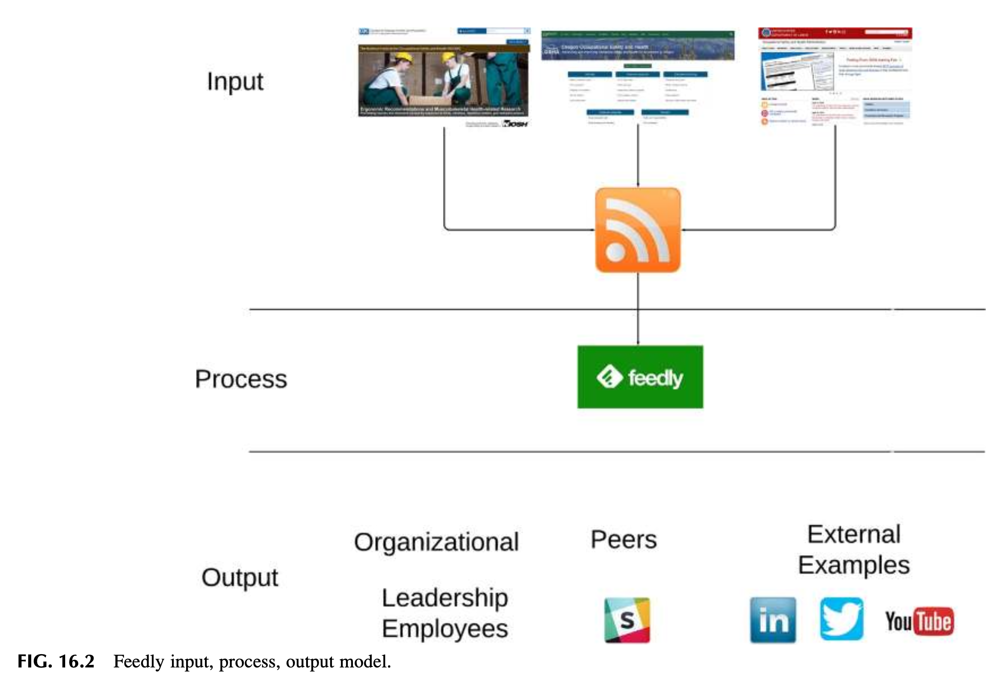
<!--  -->

### 그림 16.2 피들리(Feedly) 투입, 처리, 산출 모델.

<!-- Block B081 -->
## 표절 방지 (AVOIDING PLAGIARISM)

표절(Plagiarism)은 “원저자의 허락 없이 다른 저자의 언어와 사상을 사용하거나 밀접하게 모방하는 행위 또는 사례로서, 원저자를 밝히지 않음으로써 그 저자의 저작물을 자신의 것처럼 내세우는 것”이다(Plagiarism, 2018).

<!-- Block B082 -->
다른 사람들이 개발한 여러 정보와 데이터를 활용하면 새로운 아이디어와 개념을 창출할 영감을 얻을 수 있다. 연구된 자료를 기사에 통합할 때 적절한 인용과 참고문헌을 사용하고 포함한다면 이를 공유하는 것이 허용된다. 안전 전문가가 광범위한 개인 집필이나 출판을 계획하고 있다면 표절 검사 소프트웨어의 사용이 권장된다. 조직에는 연구된 자료를 내부적으로 사용하기 전에 사전에 조율해야 하는 정확성과 출처 검토용 전담 프로그램 및 절차가 마련되어 있을 수 있다.

<!-- Block B083 -->
잠재적인 표절 문제에 대처하기 위해, 새로 작성된 자료를 인쇄물이나 인터넷 사이트에 게시된 자료와 비교하는 특정 소프트웨어 프로그램을 사용할 수 있다. 가치 있는 도구 중 하나는 표절 검사를 완료하는 데 도움이 되는 자원을 제공하는 전용 글쓰기 도구인 “그래머리(Grammarly)”이다(Grammarly, 2018). 자세한 내용은 부록 16.1 ‘전문가를 위한 소셜 미디어 도구’를 참조하라.

<!-- Block B084 -->
## 요약 (SUMMARY)

* 조직은 많은 내부 및 외부 출처로부터 수신되는 정보와 데이터에 의존해 살아간다. 결과적으로 정보와 메시지는 명확하고, 잘 설계되며, 작성되어야 하고, 조직을 관통하는 유용하거나 쓸모없는 정보들의 끊임없는 배경 잡음을 뚫고 전달되는 표현으로 이루어져야 한다.
* 안전 문화가 존속하려면 위험과 유해위험요인이 식별된 상태를 유지하는 데 필요한 지식 수준을 보존할 수 있는 최선의 정보를 갖추어야 한다. 사람들이 오가고, 조직 개편이 일어나며, 새로운 사업이 시작됨에 따라 문서나 기록을 유지·관리하기 위한 포괄적인 방법이 없다면 정보는 유실될 수 있다.
* 인터넷의 범위와 깊이를 고려할 때 적절한 문서를 찾는 것은 비교적 쉽다. 검색하고, 체계화하며, 참고문헌과 적절한 인용을 제공할 수 있는 능력이 과제이다.
* 인터넷은 풍부한 정보에 대한 쉬운 접근을 만들어 냈으며, 모바일 기기, 스마트폰, 태블릿 및 기타 기기의 사용이 보편적 사용으로 확대됨에 따라 그 정보는 더 이상 지정된 개인에게만 국한되거나 제한되지 않는다.

<!-- Block B085 -->
## 장 복습 질문 (CHAPTER REVIEW QUESTIONS)

1. 소셜 미디어를 정의하시오.
2. 소셜 미디어에 적응해야 할 필요성을 설명하시오.
3. 콘텐츠 제작에서 안전 전문가의 역할을 정의하시오.
4. 콘텐츠 제작의 목표를 설명하시오.
5. 전문가를 위한 다양한 소셜 미디어 도구를 나열하시오.
6. Feedly가 콘텐츠를 찾는 데 어떻게 도움이 될 수 있는지 설명하시오.

<!-- Block B086 -->
## 부록 16.1 전문가를 위한 소셜 미디어 도구 (APPENDIX 16.1 SOCIAL MEDIA TOOLS FOR THE PROFESSIONAL)

<!-- Block B087 -->
### 정보 체계화를 위한 접근법 (An Approach to Organizing Information)

큐레이션 프로세스를 단순화하는 데 사용할 수 있는 온라인 및 오프라인 소프트웨어 자원은 매우 많다. 애플리케이션, 소프트웨어 및 온라인 도구의 광범위한 종류는 계속해서 변화하고 있으며, 모든 자원을 식별하는 것은 이 부록의 범위를 벗어난다. 우리는 이 책을 개발하는 동안 사용되었던 자원의 표본을 제공하였다.

<!-- Block B088 -->
### 소셜 미디어 도구 (Social Media Tools)

* 구글 키워드 검색 (Google Keyword Search)
* 연구 자원 (Research Resources)
* 자동 큐레이션 연구 도구 (Automatic Curation Research Tools)
* 클라우드 기술을 활용한 협업 도구 (Collaboration tools Using Cloud Technology)
* 글쓰기 효율성을 높이는 집필 도구 (Writing Tools to Increase Writing Efficiencies)
* 그래픽 소프트웨어—이미지 (Graphical Software—Images)

<!-- Block B089 -->
### 큐레이션 도구 (Curation Tools)

> 간단히 설명할 수 없다면, 당신은 그것을 충분히 잘 이해하지 못한 것이다.  
> — 알베르트 아인슈타인 (Albert Einstein)

<!-- Block B090 -->
이용 가능한 많은 큐레이션 도구가 있지만, 다음 도구들이 사용하기에 가장 생산적인 것으로 확인되었다.

<!-- Block B091 -->
### 구글 키워드 검색 (Google Keyword Search)

큐레이션 프로세스를 돕기 위해 많은 검색 엔진을 이용할 수 있다. 문제는 대부분의 개인이 단 하나의 검색 엔진인 구글(Google)만 사용한다는 점이다.

<!-- Block B092 -->
구글 기본 검색(Google Basic Search)이 인터넷에서 무언가를 찾는 가장 흔한 방법일 수 있지만, 생산성을 높이기 위해 사용할 수 있는 다른 구글 도구들도 있다:
* 구글 기본 키워드 검색 (Google Basic Keyword Search).
* 구글 고급 키워드 검색 (Google Advanced Keyword Search).
* 구글 고급 이미지 검색 (Google Advanced Image Search).
* 구글 트렌드 (Google Trends).

<!-- Block B093 -->
#### 구글의 기본 키워드 검색 (Google’s Basic Keyword Search)

인터넷 검색을 시작할 때, 대부분의 연구자는 구글의 기본 검색 기능을 사용할 것이다. 구글은 검색문을 좁히고 재정의하기 위한 특정 검색어(연산자)를 제공한다. 그렇게 하지 않으면 수많은 페이지의 검색 결과가 나올 것이다. 기본 검색어에 약간의 조정을 가함으로써 연구 결과를 줄일 수 있다. 예를 들어, `Safety Culture`라는 구문으로 단순 검색을 수행하면 약 110,000,000개의 결과가 표시된다. 단어 주위에 따옴표를 붙여 `“Safety Culture”`로 동일한 기본 검색을 수행하면 표시되는 항목 수가 약 453,000개로 줄어든다. 남아 있는 분량은 정확하고 상세한 검색문의 필요성을 강조한다! (Google Basic Search, 2018)는 결정적이다. 검색을 좁히는 데 도움이 되는 기본 검색 단축어(Shortcuts) 표본 목록은 표 16.1을 참조하라.

<!-- Block B094 -->
#### 배움의 순간 (Teachable Moments)

많은 웹사이트가 검색 엔진 프로토콜에 기반하여 최적화되어 있지 않다. 보통 웹페이지에 적절한 검색 결과가 구글의 첫 번째 페이지나 두 번째 페이지에 나타나도록 허용하는 특정 키워드 및 검색 엔진 최적화(SEO)와 관련된 다른 기법들이 제공되어 있지 않다.

<!-- Block B095 -->
SEO는 특정 키워드를 추가함으로써 웹사이트의 일부를 작게 수정하는 작업이다. 많은 경우 단순한 키워드 변경이 점진적인 개선을 제공할 수 있지만, 다른 최적화 노력과 결합될 때 사이트의 성과에 영향을 미칠 수 있다(Google’s search engine optimization starter guide, 2010).

<!-- Block B096 -->
검색 엔진 최적화(SEO)에 대한 상세한 설명을 다루는 것은 이 부록의 범위를 벗어난다.

<!-- Block B097 -->
#### 구글 고급 키워드 검색 (Google Advanced Keyword Search)

일반 구글 검색을 사용하면 선별해야 할 정보가 매우 많은 수많은 검색 결과가 나열될 수 있다. 때때로 이로 인해 찾고자 하는 것을 발견하기가 어려워진다. 구글은 필요한 것을 더 쉽고 빠르게 찾는 데 도움이 될 수 있는 일부 향상된 검색 기능을 제공한다.

<!-- Block B098 -->
기본 검색 기능에서 한 걸음 더 나아가, 구글은 단축어를 기억할 필요 없이 표 16.1에서 논의된 특정 검색어에 대한 고급 검색을 수행하는 데 사용할 수 있는 고급 검색(Advanced Search) 기능을 제공한다.

<!-- Block B099 -->
<!-- [표 16.1 스크린샷 삽입 위치: Sample Shortcuts When Doing a Basic Search Using Google] -->
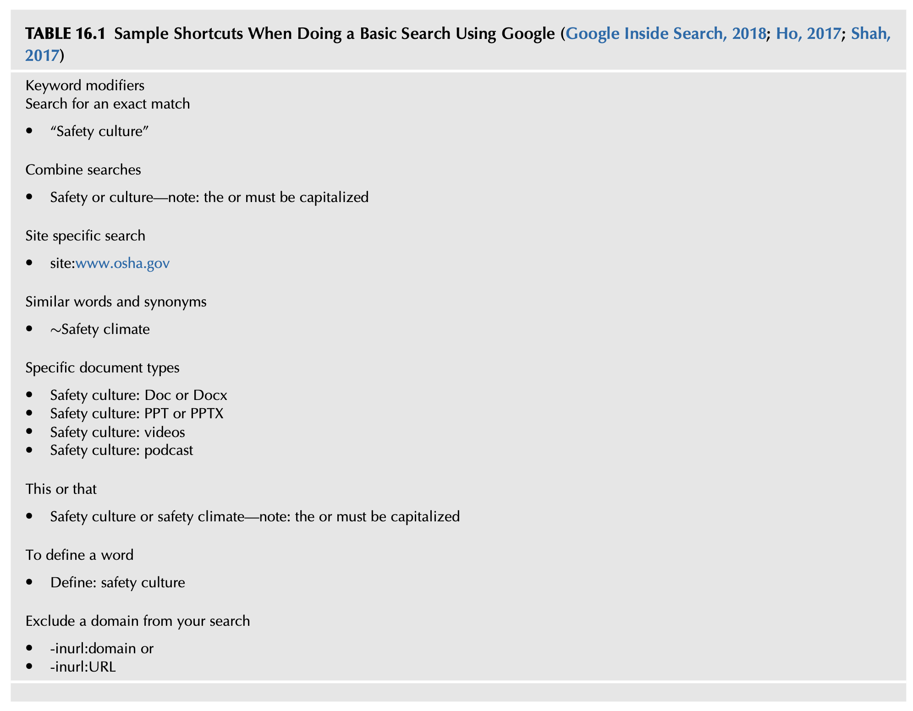
<!--  -->

### 표 16.1 구글을 이용한 기본 검색 시 단축어 예시 (Google Inside Search, 2018; Ho, 2017; Shah, 2017)

<!-- Block B100 -->
| 키워드 수식어 (Keyword modifiers) | 예시 / 사용법 (Example / Usage) |
| :--- | :--- |
| **정확히 일치하는 검색 (Search for an exact match)** | “Safety culture” |
| **검색 결합 (Combine searches)** | Safety or culture—참고: `OR`은 반드시 대문자여야 함 |
| **특정 사이트 내 검색 (Site specific search)** | site:www.osha.gov |
| **유사어 및 동의어 (Similar words and synonyms)** | Safety climate |
| **특정 문서 유형 (Specific document types)** | Safety culture: Doc or Docx Safety culture: PPT or PPTX Safety culture: videos Safety culture: podcast |
| **이것 또는 저것 (This or that)** | Safety culture or safety climate—참고: `OR`은 반드시 대문자여야 함 |
| **단어 정의 찾기 (To define a word)** | Define: safety culture |
| **검색에서 특정 도메인 제외 (Exclude a domain from your search)** | -inurl:domain 또는 -inurl:URL |

<!-- Block B101 -->
구글 검색 결과 페이지에서 검색 상자 아래의 설정(Settings)을 클릭하고 고급 검색(Advanced Search)을 선택하라. 고급 검색은 특정 단어나 구문을 포함하거나 제외하여 항목을 찾을 수 있는 많은 옵션을 제공하며, 언어, 지역 또는 최근 업데이트 날짜 등의 항목으로 결과를 좁힐 수도 있게 해 준다(Google Advanced Search, 2018; Google Inside Search, 2018; Refine web searches, 2018).

<!-- Block B102 -->
우리는 인터넷에서 정보를 찾으려고 할 때 작은 검색창을 사용하도록 배워 왔다(그림 16.3 참조). 만약 전체 통합 자원 위치 지정자(URL) 창을 사용한다면, 사용자는 특정 키워드가 포함된 구문을 입력할 수 있다(그림 16.4 참조).

<!-- Block B103 -->
두 연구 방법을 비교할 때 결과의 차이를 확인할 수 있다.

<!-- Block B104 -->
인터넷 검색 기능을 사용할 때 반드시 올바른 철자를 사용할 필요는 없다. 찾고자 하는 단어와 가까운 단어를 입력할 수 있다면, 몇 가지 관련 정보를 볼 수 있을 것이다.

<!-- Block B105 -->
예를 들어, 앞서 논의한 각 사례의 결과를 시연하기 위해 다음 링크들이 제공된다:
* Safety Culture Trends—http://bit.ly/2q2yd4T (그림 16.3 참조).
* What are the trends when trying to develop a safety culture?—http://bit.ly/2q6rabN (그림 16.4 참조).
* 철자가 서툴러도 문제없다!—오탈자 단어(예, 이 단어들은 의도적으로 틀리게 입력됨)—What ar the tredn on developing a safey culture—http://bit.ly/2q1OQxG (그림 16.5 참조).

<!-- Block B106 -->
<!-- [그림 16.3 스크린샷 삽입 위치: Example of typical search window] -->
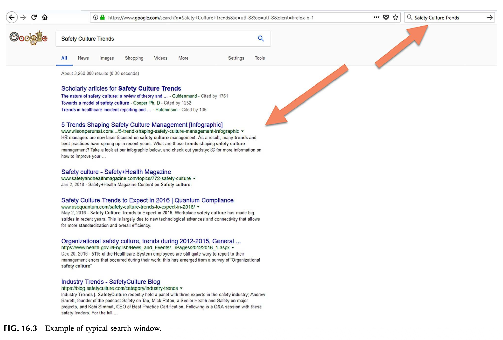
<!--  -->

### 그림 16.3 일반적인 검색창 예시.

<!-- Block B107 -->
<!-- [그림 16.4 스크린샷 삽입 위치: Example universal resource locator (URL) window] -->
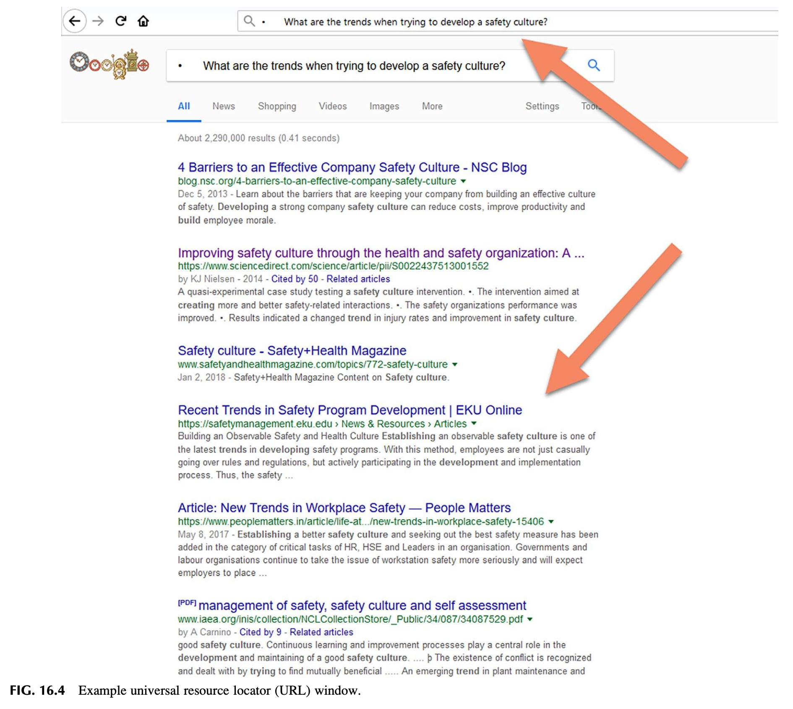
<!--  -->

### 그림 16.4 통합 자원 위치 지정자(URL) 창 예시.

<!-- Block B108 -->
<!-- [그림 16.5 스크린샷 삽입 위치: Example mis-spelled words] -->
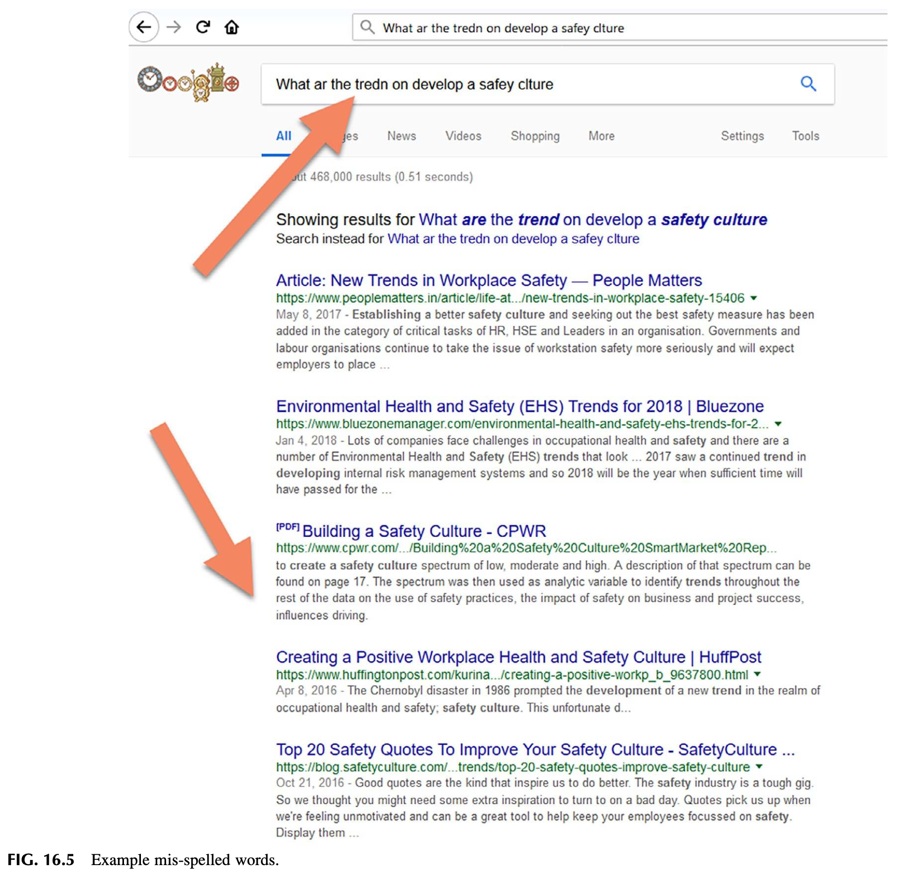
<!--  -->

### 그림 16.5 오탈자 단어 검색 예시.

<!-- Block B109 -->
#### 구글 고급 이미지 검색 (Google Advanced Image Search)

프로젝트를 위한 이미지를 찾고 있다면, 구글 고급 이미지 검색(Google Advanced Image Search)을 사용하여 프로젝트에 맞는 특정 이미지를 검색할 수 있다(Advanced Image Search, 2018). 이 검색 기능을 사용하면 무료로 사용할 수 있는(Free to use) 이미지를 검색할 수 있다. 핵심은 “온라인에서 찾은 것을 언제 사용, 공유 또는 수정할 수 있는지 알려 주는” “사용 권한(Usage rights)” 섹션을 반드시 검토하는 것이다(Find free-to-use images, 2018).

<!-- Block B110 -->
#### 구글 트렌드 (Google Trends)

구글 트렌드(Google Trends)는 특정 시점에 전 세계가 무엇을 검색하는지 볼 수 있는 구글 검색의 파생 도구이다(Google Trends, 2018; Jaksch, 2018).

<!-- Block B111 -->
### 연구 자원 (Research Resources)

> 천재는 1퍼센트의 영감과 99퍼센트의 땀(노력)으로 이루어진다.  
> — *(Edison, 2018)*

<!-- Block B112 -->
#### 구글 스칼라 (Google Scholar)

구글 스칼라(Google Scholar)는 관심 있는 많은 분야에 걸쳐 학술 문헌을 검색할 수 있는 방법을 제공하는 학술 출판물 색인이다(Google Scholar, 2018; McGuire, 2018).

<!-- Block B113 -->
구글 스칼라의 훌륭한 기능 중 하나는 저자가 예를 들어 MLA, APA, Chicago 및 Vancouver 양식 등 여러 형식을 사용하여 올바른 인용 및 참고문헌 서식을 적용하도록 도울 수 있다는 점이다(Google Scholar, 2018).

<!-- Block B114 -->
예를 들어, 구글 스칼라를 사용할 때 “인용(Quote, 따옴표)” 기호에 주목하라. “인용” 기호를 클릭하면 앞서 논의한 여러 형식의 인용과 참고문헌을 찾을 수 있다. 예시 하단에는 참고문헌 데이터베이스에 통합할 수 있는 BibTex, EndNote, RefMan 및 RefWorks 등 여러 옵션이 있다는 점에 유의해야 한다. 이는 집필 작업에서 인용할 올바른 인용과 참고문헌을 식별하는 최선의 방법이다.

<!-- Block B115 -->
제시된 정보는 나중에 논의할 도구인 Docear와 Microsoft Word 플러그인 “Docear4word”, 그리고 JabRef를 사용하여 문서 내 모든 인용과 참고문헌을 채워 넣는 데 사용될 수 있다(그림 16.6 참조).

<!-- Block B116 -->
<!-- [그림 16.6 스크린샷 삽입 위치: Google Scholar process used to retrieve citation and reference] -->
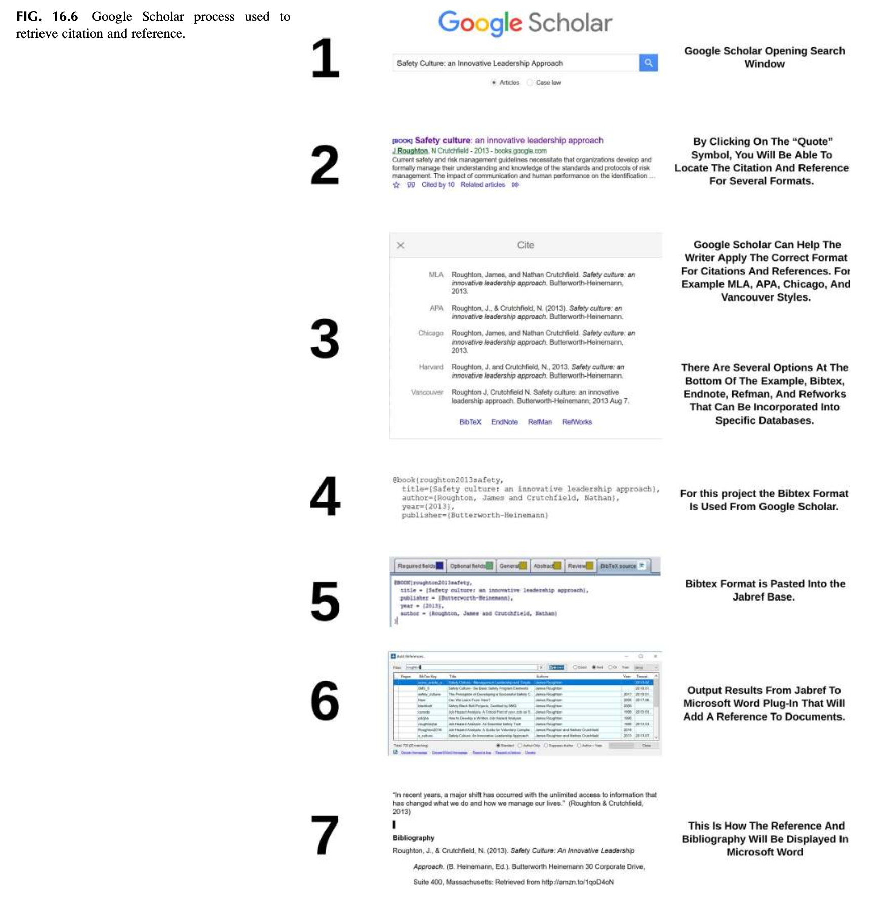
<!--  -->

### 그림 16.6 인용 및 참고문헌을 검색하는 데 사용되는 구글 스칼라 프로세스.

<!-- Block B117 -->
#### 구글 북스 (Google Books)

구글 북스(Google Books)는 검색 기준에 따라 특정 도서의 색인을 제공하는 평판 좋은 자원이다. 구글 북스는 향후 연구를 위해 도서관에 책을 추가하는 하나의 방법이다(Google Books, 2018).

<!-- Block B118 -->
#### 구글 킵 (Google Keep)

구글 킵(Google Keep)은 사용자가 실시간으로 영감을 포착할 수 있게 해 준다. 이 애플리케이션은 집중력을 잃지 않으면서 이동 중에도 아이디어, 생각 및 할 일(To-dos)을 얻는 가장 빠른 방법이다.

<!-- Block B119 -->
Google Keep은 텍스트, 목록, 이미지 및 오디오를 포함하여 메모를 작성하기 위한 다양한 도구를 제공한다. 사용자는 Gmail 계정과 통합된 미리 알림(Reminders)을 설정할 수 있다(Welcome to the Google Keep Help Center, 2018).

<!-- Block B120 -->
#### 포켓 (Pocket)

포켓(Pocket)은 사용자가 나중에 보고 싶은 것을 보관할 수 있게 해 주는 도구이다. 여기에는 웹을 검색하는 동안 발견한 기사, 동영상 등이 모두 포함될 수 있다.

<!-- Block B121 -->
브라우저나 트위터, 플립보드(Flipboard), 페이스북 등과 같은 앱에서 직접 정보를 저장할 수 있을 것이다.

<!-- Block B122 -->
Pocket의 장점 중 하나는 인터넷 연결 여부와 관계없이 준비가 되었을 때 휴대폰, 태블릿 또는 컴퓨터에서 저장된 정보를 볼 수 있다는 점이다(Pocket, 2018).

<!-- Block B123 -->
#### 시맨틱 스칼라 (Semantic Scholar)

시맨틱 스칼라(Semantic Scholar)는 구글 스칼라와 유사하다. 주된 차이점은 Semantic Scholar가 검색어에 대한 “이해”를 향상시키기 위해 키워드 검색 대신 기계 학습(Machine learning)을 사용한다는 점이다. Semantic Scholar 검색은 텍스트를 넘어 이미지, 표 및 캡션에서 정보를 추출한다(Semantic Scholar, 2018).

<!-- Block B124 -->
> Semantic Scholar는 지능적 판단을 내려 어느 인용된 논문이 더 관련성이 높은지 또는 그 논문이 후속 연구에 어떻게 기여했는지 확인한다.  
> — *(Semantic Scholar, 2018)*

<!-- Block B125 -->
선호되는 방법은 구글 스칼라(Google Scholar)를 사용하는 것이다.

<!-- Block B126 -->
#### 레프시크 (refseek)

refseek는 “웹 관련 정보나 문서를 찾기 위해 인터넷을 검색”하는 데 도움을 주는 검색 엔진이다(refseek, 2018).

<!-- Block B127 -->
“refseek는 웹페이지, 도서, 백과사전, 학술지 및 신문과 같은 10억 건 이상의 문서를 검색한다고 자랑한다”(refseek, 2018).

<!-- Block B128 -->
### 자동 큐레이션 연구 도구 (Automatic Curation Research Tools)

다음 큐레이션 연구 도구들은 큐레이션을 돕기 위해 요청된 정보를 자동으로 찾는 데 사용될 수 있다.

<!-- Block B129 -->
#### 구글 알리미 (Google Alerts)

동일한 정보를 반복적으로 검색하는가? 한 가지 해결책은 구글 알리미(Google Alerts)를 사용하여 검색을 자동화하는 것이다. 일단 설정해 두면, 정의된 기준에 따라 새로운 정보가 있을 때마다 Google Alert가 당신의 받은편지함으로 이메일을 발송할 것이다. 이 이메일은 동일한 단어로 검색을 수행하지 않고도 업데이트해 준다(Google Alerts, 2018).

<!-- Block B130 -->
그런 다음 몇 가지 기본적인 질문을 던지면서 시작할 수 있다. 예를 들어, 인터넷에 게시물이 올라올 때 알림을 받고 싶은 관심 주제가 있는가? 사건이 발생할 때마다 따라가고 싶은 뉴스가 있는가? 흥미가 있는 취미가 있고 다른 사람들이 무엇을 게시하는지 읽고 싶은가? (Create an Alert, 2018)

<!-- Block B131 -->
핵심은 정보가 탐색되어 표시되는 빈도를 정의하기 위해 Google Alert의 설정을 조정하는 것이다.

<!-- Block B132 -->
* **장점(Pro)**—일단 매개변수가 정의되면 수동 연구를 수행하는 시간을 줄여 준다.
* **단점(Con)**—검토해야 할 이메일을 매우 많이 받을 수 있으므로 대비하라!

<!-- Block B133 -->
#### 구글 피드버너 (Google Feedburner)

Feedburner는 “웹상에 미디어를 배포하고 자신의 콘텐츠가 어떻게 소비되고 있는지 이해하고자 하는” 사람들을 위해 설계되었다(Google Feedburner, 2018). Feedburner는 나중에 그리고 부록 16.2 ‘큐레이션을 위한 콘텐츠를 찾기 위한 Feedly 활용: 사례 연구’에서 더 자세히 논의할 Feedly에 통합되어 있다.

<!-- Block B134 -->
### 클라우드 기술을 활용한 협업 도구 (Collaboration Tools Using Cloud Technology)

<!-- Block B135 -->
#### 클라우드 (The Cloud)

클라우드(Cloud)는 “…문서와 데이터의 온라인 처리 및 저장뿐만 아니라 소프트웨어 및 기타 자원에 대한 전자적 접근을 허용하는 인터넷의 일부”로 정의될 수 있다(20 Words that mean more than they did 20 years ago, 2018).

<!-- Block B136 -->
인터넷을 사용하고 컴퓨터에 파일을 생성·저장하거나 다른 사람들과 자동으로 정보를 공유하고 싶다면, 클라우드에 대해 알아야 할 것은 이것이 전부이다. 클라우드는 당신이 선택한 다른 사람들과 정보를 공유할 수 있는 현장 외 컴퓨터에 정보를 백업하고 저장하는 편의를 누리기 위해 구독하고 요금을 지불하는 서비스이다. 사용할 수 있는 무료(FREE) 계정도 많지만 저장 용량과 기능 면에서 제한적이다(Moreau, 2018).

<!-- Block B137 -->
예를 들어, 이 프로젝트의 문서들은 클라우드에 저장되어 세 명의 저자 각각의 전자 기기에서 공유되고 동기화되었다. 이러한 기기는 데스크톱, 스마트폰, 아이패드(iPad) 등 무엇이든 될 수 있다. 어떠한 문서든 변경 사항이 만들어져 저장되면, 선택된 각 저자의 전자 기기에 해당 문서가 자동으로 나타난다. 이는 윈도우(Windows) 또는 맥(Mac) 개인용 컴퓨터에 적용된다(그림 16.1 참조).

<!-- Block B138 -->
#### 드롭박스 (Dropbox)

드롭박스(Dropbox)는 파일과 문서를 빠르고 쉽게 공유할 수 있게 해 주는 “클라우드” 파일 저장 및 검색 애플리케이션이다. 이는 본질적으로 컴퓨터 간에 정보를 동기화하는 “공용 드라이브(Public drive)”이다(Dropbox, 2018). 파일을 보호할 수 있는 보안 기능도 있다.

<!-- Block B139 -->
##### 교훈 (Lesson Learned)

<!-- Block B140 -->
제임스(James)는 몇 년 전에 이사를 했다. 이 이사 과정 중에 집에서 3시간 거리에 있는 지역 부동산 중개인과 일하면서, 그는 집 매매 서면 계약서 사본이 필요했다. 제임스는 이 문서를 가져오는 것을 잊어버렸다. 제임스는 부동산 중개인의 컴퓨터에 로그인하여 자신의 Dropbox에 접속해 필요한 문서를 다운로드할 수 있었다.

<!-- Block B141 -->
#### 구글 드라이브(문서)—스프레드시트 (Google Drive (Doc)—Spreadsheet)

구글 드라이브(Google Drive)는 Dropbox와 유사하지만 Google Docs, Gmail 및 기타 모든 구글 도구와 통합된다.

<!-- Block B142 -->
Google Docs 또는 스프레드시트는 Microsoft Word나 Excel과 같다. 가장 훌륭한 기능 중 하나는 Google Docs가 정보를 Google Drive 클라우드에 온라인으로 자동 저장한다는 점이다. 이를 통해 인터넷 접속이 가능한 곳이라면 어디서든 정보에 접근하고 다른 사람들과 공유할 수 있다(Cantrell, 2014; What Is Google Docs?, 2018).

<!-- Block B143 -->
#### 슬랙 (Slack)

단순한 검색만으로도 많은 자원을 발견할 수 있기 때문에 연구는 끝이 없는 과정이다. 일단 슬랙(Slack)이 발견되자, 그것은 팀원들과 빠르게 소통할 수 있게 해 주는 유용한 도구가 되었다.

<!-- Block B144 -->
그 이유는 “Slack이 이메일을 사용하지 않고도 실시간 의사소통을 가능하게 하는 인스턴트 메시징 및 협업 시스템…”이기 때문이다(Betters, 2016). 인스턴트 메시징의 긍정적인 측면은 모든 의사소통이 한곳에 보관되어 검색하고 사용하기 쉽다는 점이다.

<!-- Block B145 -->
이메일 전송은 때때로 타인과 소통하는 가장 효율적인 방법이다. 문제는 많은 이메일이 사람의 받은편지함을 채우는 다른 모든 잡동사니 속에 묻혀 분실된다는 점이다.

<!-- Block B146 -->
문제 해결: 프로젝트 작업을 할 때 Slack 대화는 더 빠르고 생산적이며, 대화 이력이 Slack에 남는다. Slack은 모든 사람이 파일을 찾고 이전 토론을 검색하는 등을 가능하게 한다. 모든 의사소통이 한곳에 있다.

<!-- Block B147 -->
몇 가지 장점이 있다:
* 특정 영역에 집중할 수 있도록 돕는 채널(Channels): “…목적, 부서 또는 주제별로 메시지, 토론 및 알림을 분리할 수 있게 해 준다”(Betters, 2016).
* 채널은 “공개(Public) 또는 비공개(Private)로 만들 수 있는” 대화방과 유사하다(Betters, 2016). 채널이 공개라면 팀의 모든 사람이 참여할 수 있지만, 비공개라면 선택된 사람만 참여할 수 있다(Betters, 2016).

<!-- Block B148 -->
Slack은 팀 전체와 모든 유형의 파일을 공유할 수 있게 한다. 이 과정의 좋은 점은 사용자가 어디서든 파일을 끌어다 놓을(Drag and drop) 수 있다는 것이다. 책 자료와 자원을 저장하고 검색하는 과정의 일부는 Dropbox이다. Slack은 파일 공유가 매끄럽게 이루어지도록 Dropbox를 훌륭하게 통합한다(Betters, 2016).

<!-- Block B149 -->
#### 트렐로 (Trello)

Trello는 과업, 정보 및 아이디어를 우선순위화하고, 체계화하며, 관리하는 데 사용될 수 있다(Agarwal, 2015).

<!-- Block B150 -->
> Trello는 프로젝트를 보드(Boards)로 체계화하는 협업 도구이다. 한눈에 Trello는 무엇이 작업 중인지, 누가 무엇을 작업하고 있는지, 그리고 프로세스 내에서 어떤 것이 어디에 있는지 알려 준다.  
> — *(Trello, 2017)*

<!-- Block B151 -->
트렐로(Trello)는 도요타(Toyota)가 창안한 간단한 칸반(Kanban) 기법이다. 제6장 ‘안전 프로세스 구축’의 부록 6.5 ‘안전 시스템 강화를 돕는 엄선된 프로세스 도구’를 참조하라.

<!-- Block B152 -->
####  jotform (JotForm)

이 책을 개발하는 과정의 일환으로 “안전 문화(Safety Culture)”에 관한 여러 논의 지점을 수집하기 위한 짧은 설문조사가 개발되었다(Roughton, 2017). 정보는 링크드인(LinkedIn) 게시물에 삽입되어(Roughton, 2017) 여러 그룹에 공유되었으며 데이터를 포착하기 위해 구글 스프레드시트(Google Spread Sheet)에 연결되었다. 이는 요청된 응답을 자동화하고 수집하는 빠르고 쉬운 방법이었다.

<!-- Block B153 -->
JotForm은 필요에 맞게 맞춤형 온라인 양식을 구축할 수 있게 해 주는 훌륭하고 사용하기 쉬운 양식 제작 도구이다(JotForm, 2018).

<!-- Block B154 -->
#### 버퍼 (Buffer)

버퍼(Buffer)는 트위터, 페이스북, 링크드인 등에 게시물을 예약할 수 있게 해 주는 도구이다. 전통적인 예약 도구와 다른 점은 Buffer 앱에 게시물을 채워두면 당신이 설정한 일정에 따라 시간에 걸쳐 소셜 미디어 계정(들)에 게시물을 “조금씩 흘려보낸다(Drips)”는 것이다. 따라서 정보를 읽을 때 여러 개의 정보를 한꺼번에 공유하는 대신, Buffer를 사용하여 일정을 지원할 수 있다(Social media management platform, 2018).

<!-- Block B155 -->
### 글쓰기 효율성을 높이는 집필 도구 (Writing Tools to Increase Writing Efficiencies)

<!-- Block B156 -->
#### 도세아 (Docear)

도세아(Docear)는 콘텐츠를 관리하는 데 있어 정보를 구조화하고 공유할 수 있게 해 주는 “학술 문헌 모음(Academic literature suite)”이다(Docear, 2015).

<!-- Block B157 -->
Docear에는 수집된 문헌을 체계화하기 위한 학술 검색 엔진, 파일 관리자, 마인드 매핑 기술, 필기 도구 및 참고문헌 관리자가 포함되어 있다. Docear의 일부로 “Docear4word”라고 불리는 Microsoft Word용 추가 기능 플러그인이 있다. 이 플러그인은 Microsoft Word와 통합되어 사용자가 서식이 지정된 인용, 참고문헌 및 서식이 지정된 참고문헌 목록(Bibliography)을 자동으로 삽입할 수 있게 해 준다. Docear는 오픈 소스 참고문헌 관리자인 JabRef 데이터베이스를 사용하며 참고문헌 파일을 수집하고 관리하는 방법을 제공한다(Docear4word, 2016; Docear, Details & Features, 2015).

<!-- Block B158 -->
문서는 하위 디렉터리인 “literature repository(문헌 저장소)”에 저장된다. 문서는 마인드맵으로 가져올 수 있으며, 마인드맵에서는 정리가 용이하도록 문헌 저장소에 있는 모든 논문을 그래픽 그림으로 표시한다(Mind map, 2017).

<!-- Block B159 -->
문서가 .pdf 형식인 경우, 주석(하이라이트, 코멘트)을 작성하여 마인드맵에 표시할 수 있다(Docear, Details & Features, 2015; Mind map, 2017).

<!-- Block B160 -->
Docear는 마인드 매핑 플랫폼(FreePlane, 2018)에 기반한 무료 오픈 소스 소프트웨어이며, 또 다른 오픈 소스 소프트웨어인 “JabRef”는 자원의 인용 및 참고문헌을 기반으로 참고문헌 파일을 수집·관리하는 방법인 참고문헌 관리자이다(Docear, 2015; JabRef Reference Manager, 2018; Roughton & Crutchfield, 2013).

<!-- Block B161 -->
Docear는 이 책의 인용과 참고문헌을 작성하는 데 사용되었으며 시간을 절약해 주었다. Docear 소프트웨어의 주된 문제는 더 이상 지원이 중단되었다는 점이지만, 숙련된 사용자는 여전히 사용할 수 있다(그림 16.7 참조).

<!-- Block B162 -->
<!-- [그림 16.7 스크린샷 삽입 위치: Using Docear to develop citations and references] -->
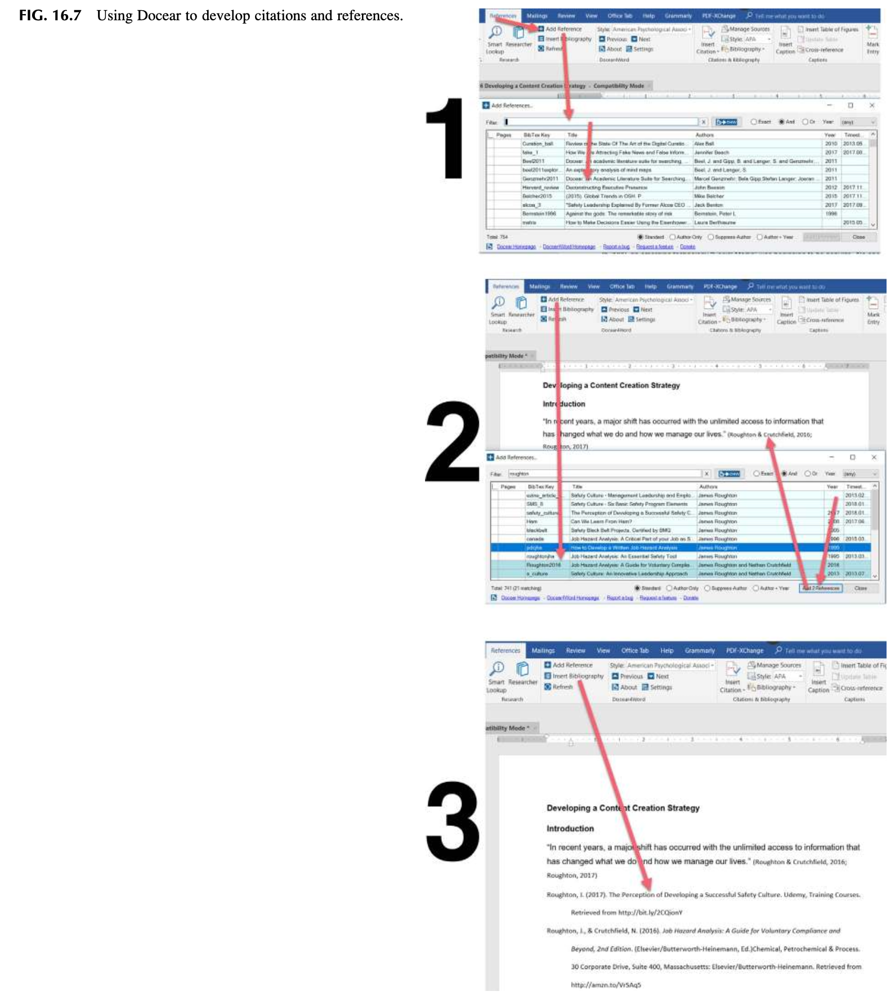
<!--  -->

### 그림 16.7 인용과 참고문헌을 개발하기 위한 Docear 활용.

<!-- Block B163 -->
#### 잽레프 (JabRef)

논의한 바와 같이 Docear는 인용과 참고문헌의 참고문헌 파일을 수집하고 관리하는 방법을 제공하는 참고문헌 관리자인 “JabRef”를 사용한다(JabRef Reference Manager, 2018).

<!-- Block B164 -->
Docear 논의에서 개괄된 바와 같이 JabRef 데이터는 Docear와 함께 사용되며 플러그인을 보유하고 있다. “Docear4Word” Microsoft Word 플러그인은 사용자가 JabRef 데이터베이스에서 인용과 참고문헌을 가져와 서식이 지정된 참고문헌 문서를 작성할 수 있게 해 준다(JabRef Reference Manager, 2018).

<!-- Block B165 -->
#### 마이크로소프트 워드 (Microsoft Word)

Microsoft Word의 장점은 변경 사항을 추적하고 공유할 수 있다는 점이다. 또한 논의 중인 텍스트 옆에 메모(Comment)를 달아 생각을 공유할 수 있다.

<!-- Block B166 -->
Office 365에 가입하면 팀이 서로 실시간으로 협업할 수 있는 온라인 버전도 제공된다(Office 365, 2018).

<!-- Block B167 -->
작가에게 중요하지만 잘 알려지지 않은 기능 중 하나는 Microsoft Word를 사용하여 인용과 참고문헌 데이터베이스를 생성하고 구축할 수 있는 기능이다. 참고문헌 인용 방법에 대한 설명은 그림 16.8을 참조하라(Crider, 2018).

<!-- Block B168 -->
<!-- [그림 16.8 스크린샷 삽입 위치: Using Microsoft word to develop citations and references] -->
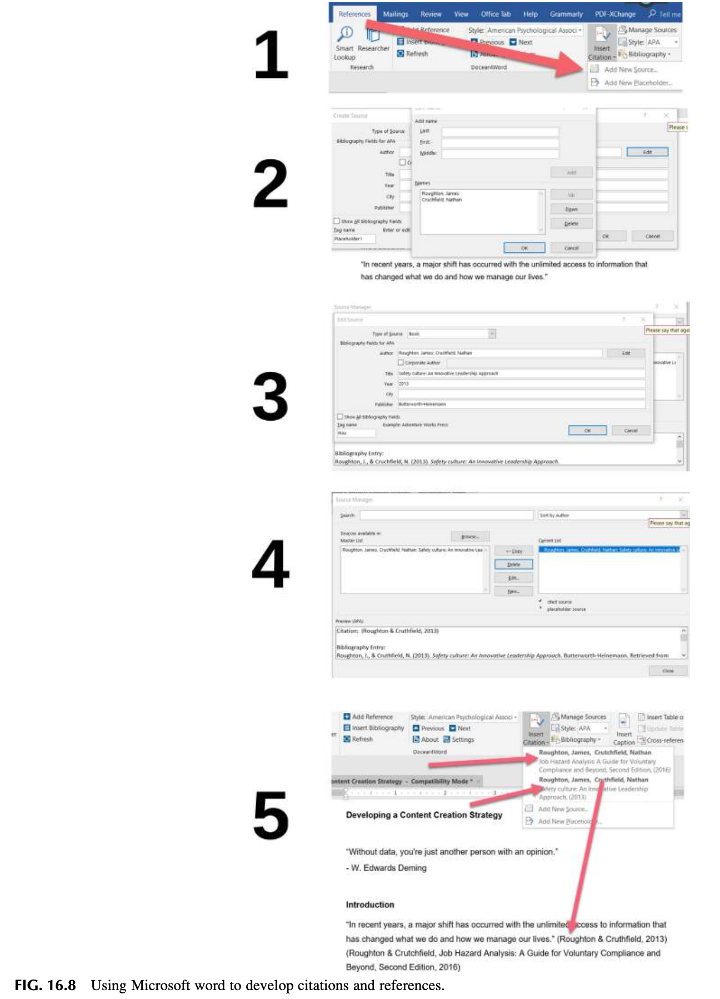
<!--  -->

### 그림 16.8 인용과 참고문헌을 개발하기 위한 Microsoft Word 활용.

<!-- Block B169 -->
#### 스크리브너 (Scrivener)

스크리브너(Scrivener)는 연구의 시작부터 최종 초고까지 함께하는 워드 프로세서이자 프로젝트 관리 도구이다(Jaksch, 2018).

<!-- Block B170 -->
Scrivener를 사용하면 아이디어를 개괄 및 구조화하고, 메모를 작성하며, 집필과 나란히 연구 자료를 보고, 텍스트의 구성 부분들을 독립적으로 또는 맥락 속에서 작성할 수 있다(Scrivener, 2015).

<!-- Block B171 -->
Scrivener는 아이디어에서 출판물에 이르는 집필 과정을 간소화하기 위해 MS(워드) 대신 사용될 수 있다(Irish, 2017).

<!-- Block B172 -->
당신이 전문 작가가 아니라면, “Scrivener는 당신에게 글 쓰는 법을 가르쳐 주지는 않지만… 책상 주위에 흩어져 있던 모든 도구를 하나의 애플리케이션 안에서 이용할 수 있게 해 준다”(Scrivener, 2015; The biggest software advance for writers since the word processor, 2018).

<!-- Block B173 -->
#### 마이크로소프트 원노트 (Microsoft OneNote)

Microsoft OneNote는 Microsoft 패키지 설치 시 함께 제공된다(What Is OneNote?, 2018).

<!-- Block B174 -->
OneNote는 모든 사람이 동일한 페이지(같은 정보)를 공유할 수 있도록 메모를 공유하는 디지털 노트북이다. 훌륭한 점은 OneNote가 메모를 자동으로 저장하고 동기화하므로 당신이 자신의 생각과 아이디어에 집중할 수 있다는 것이다(What Is OneNote?, 2018).

<!-- Block B175 -->
#### 그래머리 (Grammarly)

Grammarly는 철자 및 문법 검사, 어휘 강화, 적절한 단어 선택, 구두점 검사 및 표절 검사를 지원하는 자원을 제공하는 전용 글쓰기 도구이다.

<!-- Block B176 -->
Grammarly는 문법 및 철자 오류를 식별하는 것 이상의 역할을 수행하며, 문법 규칙에 대한 심층 설명과 수정 제안을 제공한다(Allen, 2018).

<!-- Block B177 -->
Grammarly는 웹 서비스로 이용 가능하며 다양한 웹 브라우저용 확장 프로그램을 사용하고, Microsoft Word, Outlook 및 Windows에서 사용할 수 있는 추가 기능도 제공한다(Brinkmann, 2018; Grammarly, 2018).

<!-- Block B178 -->
### 그래픽 소프트웨어—이미지 (Graphical Software—Images)

프레젠터 미디어(Presenter Media)는 이 책 전반에 걸쳐 개념과 생각을 강조하기 위해 사용된 온라인 소프트웨어 그래픽 이미지 프로그램이었다.

<!-- Block B179 -->
#### 핸드브레이크 (HandBreak / HandBrake)

HandBrake는 거의 모든 형식의 동영상을 널리 지원되는 최신 형식의 선택지로 변환하는 도구이다(HandBrake, The open source video transcoder, 2018).

<!-- Block B180 -->
#### 잉크스케이프 (Inkscape)

Inkscape는 전문가 수준의 벡터 그래픽 소프트웨어이다(Inkscape 0.92, 2016). 여러 이미지를 개발하는 데 사용된 훌륭한 사이트 중 하나는 Logos by Nick LLC였다. 이 책을 위해 제작된 많은 이미지들이 이 개인의 튜토리얼을 사용하여 개발되었다(Inkscape tutorials by Nick, 2011).

<!-- Block B181 -->
#### 김프 (Gimp)

GIMP는 고품질 이미지 조작에 필요한 도구를 제공한다. 리터칭에서 복원, 창의적인 합성에 이르기까지 유일한 한계는 당신의 상상력이다(GIMP, 2018). GIMP는 Adobe Photoshop과 유사하지만 무료(FREE)이다.

<!-- Block B182 -->
#### 루시드차트 (Lucid Chart)

이는 이 책을 위한 일부 이미지와 흐름도(Flow diagrams)를 개발하는 데 사용된 구독 기반 자원이다(Lucidchart—Resource for developing flow diagrams, 2017).

<!-- Block B183 -->
#### 스내그잇 (Snagit)

Snagit은 사용자가 컴퓨터 화면에 있는 무엇이든 캡처할 수 있게 해 준다. 캡처 후, 특정 관심 영역을 강조하기 위해 정보를 수정하고 주석을 달 수 있다. 일단 정보가 수정되고 주석이 달리면, 프레젠테이션, 소셜 미디어 플랫폼 등과 이 정보를 공유할 수 있다(TechSmith Snagit, 2018).

<!-- Block B184 -->
### 기타 유용한 도구 (Other Useful Tools)

<!-- Block B185 -->
#### bit.ly

bit.ly는 검토하기 쉽고 다른 개인에게 제공하기 쉬운 단축 링크를 제공하기 위해 이 책 전반에서 사용되었다.

<!-- Block B186 -->
예를 들어 OSHA 표준을 검색하면 일반적인 링크는 매우 길다. 출입허가 필요 밀폐공간(Permit-required confined spaces) 표준 링크는 다음과 같다:  
`https://www.osha.gov/pls/oshaweb/owadisp.show_document?p_table STANDARDS&p_id 9797`

<!-- Block B187 -->
bit.ly를 사용하면 이 링크를 다음과 같이 단축할 수 있다: `http://bit.ly/2DTx5aD`

<!-- Block B188 -->
사용을 간편하게 하기 위해 브라우저에서 직접 링크를 단축할 수 있는 Firefox 플러그인을 사용할 수 있다(Bitly, Unleash the power of the link, 2018).

<!-- Block B189 -->
#### 문서 생산성을 위한 드래곤 프로페셔널 인디비주얼 (Dragon Professional Individual for Documentation Productivity)

드래곤(Dragon)은 사용자가 음성 명령을 사용하여 컴퓨터와 상호작용하게 함으로써 생산성과 창의성을 높여 준다. 일단 음성 프로필이 설정되면, 키보드를 사용하지 않고도 Dragon을 사용해 정보를 받아쓰기(Dictate)할 수 있다. Dragon은 말로 표현된 생각을 텍스트로 변환하고 음성 명령을 작업으로 전환하여 타이핑과 철자에 대해 걱정할 필요를 없애 준다.

<!-- Block B190 -->
주어진 어떤 과업에 대해서든 선호하는 방식에 따라 키보드, 마우스 및 음성 사이를 전환할 수 있다.

<!-- Block B191 -->
Dragon은 또한 오직 음성만을 사용하여 편집하고 서식을 적용할 수 있게 해 준다. 예를 들어, 텍스트를 선택해 굵게, 밑줄, 대문자 등의 서식을 적용하거나 말만 해서 필요한 변경을 수행할 수 있다. 사용자가 약어, 날짜, 전화번호 등을 표시하고자 하는 방식에 자동으로 적응하는 스마트 서식 규칙(Smart Format Rules)이 포함되어 있다.

<!-- Block B192 -->
제임스(James)는 이 책의 일부 절을 집필할 때 특정 텍스트를 받아쓰기 위해 Dragon을 사용하였다.

<!-- Block B193 -->
다음은 생산성을 높이는 데 도움이 되는 몇 가지 기능이다:
* 오디오 파일에서 녹음 내용 전사(Transcribe)
* 맞춤형 단어 및 어휘 생성
* 자연스러운 텍스트 음성 변환(TTS) 또는 오디오 재생으로 교정 간소화
* 자유도와 유연성을 위한 마이크 옵션 선택
* 접근성 확장 및 반복성 긴장 장애(Repetitive stress injuries) 예방  
*(Dragon Professional Individual for documentation productivity, 2018)*

<!-- Block B194 -->
#### 내추럴 리더 (Natural Reader)

NaturalReader Online은 MS Word, PDF 파일 및 웹페이지와 같은 모든 작성된 텍스트를 자연스럽게 들리는 구어 음성으로 변환하는 텍스트 음성 변환 웹 애플리케이션이다(Natural Reader, 2018).

<!-- Block B195 -->
#### 워드 클라우드 생성기 (Word Cloud Generator)

Word Cloud는 그래픽 형식으로 키워드를 생성해 주는 무료 프로그램이다(Free online Wordcloud Generator, 2018).

<!-- Block B196 -->
각 장에 표시된 클라우드 형식은 이 온라인 소프트웨어를 사용하여 개발되었다.

<!-- Block B197 -->
#### 브레이니 쿼츠 (Brainy Quotes)

이 웹사이트는 많은 저자들이 남긴 영감을 주는 명언과 유명한 명언들을 공유할 수 있게 해 준다(Smith & Anderson, 2018).

<!-- Block B198 -->
### 요약 (Summary)

조직은 많은 내부 및 외부 출처로부터 수신되는 정보와 데이터에 의존해 살아간다. 결과적으로 정보와 메시지는 명확하고, 잘 설계되며, 작성되어야 하고, 조직을 관통하는 유용하거나 쓸모없는 정보들의 끊임없는 배경 잡음을 뚫고 전달되는 표현으로 이루어져야 한다. 이 부록에 제시된 도구들은 조직이 이를 달성하도록 도울 것이다.

<!-- Block B199 -->
안전 문화가 존속하려면 위험과 유해위험요인이 식별된 상태를 유지하는 데 필요한 지식 수준을 보존할 수 있는 최선의 정보를 갖추어야 한다. 사람들이 오가고, 조직 개편이 일어나며, 새로운 사업이 시작됨에 따라 문서나 기록을 유지·관리하기 위한 포괄적인 방법이 없다면 정보는 유실될 수 있다.

<!-- Block B200 -->
인터넷의 범위와 깊이를 고려할 때 적절한 문서를 찾는 것은 비교적 쉽다. 검색하고, 체계화하며, 참고문헌과 적절한 인용을 제공할 수 있는 능력이 과제이다.

<!-- Block B201 -->
인터넷은 풍부한 정보에 대한 쉬운 접근을 만들어 냈으며, 스마트폰, 태블릿 및 기타 기기의 사용이 확대됨에 따라 이러한 정보 접근은 더 이상 지정된 개인에게만 국한되지 않는다.

<!-- Block B202 -->
## 부록 16.2 큐레이션을 위한 콘텐츠를 찾기 위한 피들리(Feedly) 활용: 사례 연구 (APPENDIX 16.2 USING FEEDLY TO FIND CONTENT FOR CURATION, A CASE STUDY)

Feedly는 큐레이션 프로세스를 위해 선택된 정보를 체계화하고 간소화하고자 하는 사용자에게 무료 서비스를 제공한다. 큐레이션 프로세스를 강화하고 확장하고자 하는 이들을 위해 Feedly에서 이용 가능한 더 고급 프리미엄 기능도 있다(8 Ways to Streamline Your Curation Process, 2016).

<!-- Block B203 -->
Feedly를 사용하는 데는 결과 페이지에서 보고자 하는 내용에 맞게 조정하기 위해 약간의 시행착오가 필요하다. Feedly 사용에 관한 완전한 교육 패키지를 제공하는 것은 이 부록의 범위를 벗어난다.

<!-- Block B204 -->
이용 가능한 많은 기능을 활용하는 방법을 보여 주기 위해 Feedly 사용 기술이 시연될 것이다.

<!-- Block B205 -->
### 투입·처리·산출 모델 (Input, Process, Output Model)

제임스는 식스 시그마 블랙 벨트(Six Sigma Black Belt)로서의 경험에 기반하여 다음과 같은 3단계 전략을 사용해 연구를 수행하고 다양한 자원을 공유하는 법을 배웠다:
* 투입 채널 (Input Channel)
* 처리 채널 (Process Channel)
* 산출 채널 (Output Channel)

<!-- Block B206 -->
> 투입-산출 모델은 … 투입을 산출로 변환하기 위한 투입물, 산출물 및 필수 처리 과업을 식별한다.  
> — *(Schembri, 2012)*

<!-- Block B207 -->
Feedly 프로세스인 투입·처리·산출 모델의 예시는 그림 16.2를 참조하라.

<!-- Block B208 -->
### 투입 채널 (Input Channel)

투입 채널의 일부는 신뢰할 수 있는 잘 알려진 자원으로부터 동료 심사를 거친 정보를 찾아내고 식별하는 것이다. 이 정보에는 양질의 정보를 제공하는 엄선된 자원을 제공할 수 있는 주요 웹사이트, 블로그, 유튜브 채널 등이 포함될 수 있다.

<!-- Block B209 -->
> 투입물은 프로세스로 들어가는 데이터의 흐름을 나타낸다. 이 프로세스는 투입물의 변환을 실행하는 데 필요한 모든 과업을 포함한다.  
> — *(Schembri, 2012)*

<!-- Block B210 -->
### 처리 채널 (Process Channel)

콘텐츠 제작 전략의 처리 구성 요소는 가장 관련성 높고 중요한 정보를 포착하기 시작하는 곳이다. 이는 “RSS(Really Simple Syndication)” 리더라는 도구를 활용함으로써 달성할 수 있다(Fitzpatrick, 2016). 기술 용어에 대해 걱정하지 말라. 설정하고 실행하기 쉽다. RSS 피드 사용 방법에 관한 상세한 논의는 앞서 논의된 “올바른 RSS 피드 찾기(LOCATING A CORRECT RSS FEED)” 절을 검토하라.

<!-- Block B211 -->
어떠한 틈새 분야(Niche)에서든 콘텐츠를 제작하는 가장 빠른 방법은 박식한 해설자(Commentator)가 되는 것이다. 우리는 당신의 틈새 분야에서 즉각적인 권위자가 되고 항상 일어나는 일의 맥박을 짚기 위해 전략을 수립하고 Feedly 같은 RSS 리더를 사용하여 끊임없는 콘텐츠를 수집하는 방법을 논의하였다.

<!-- Block B212 -->
신뢰하는 즐겨찾기 자원의 피드를 추가하고, 바이럴(Viral)로 퍼진 소수의 이야기만 보는 대신 게시되는 모든 헤드라인을 검토할 수 있다. 당신이 얼마나 많은 것을 놓치고 있었는지 놀라게 될 것이다(Pot, 2018).

<!-- Block B213 -->
### 교훈 (Lesson Learned)

Feedly는 정보를 검색하기 위해 RSS 피드를 사용하는 전제 위에서 작동한다. 필요한 정보를 찾고 특정 RSS 피드를 Feedly에 추가하고 나면, 뉴스가 게시되기를 기다리기만 하면 되며 그러면 그것이 당신의 Feedly 페이지에 나타날 것이다.

<!-- Block B214 -->
### 산출 채널 (Output Channel)

산출 프로세스에서는 구체적인 산출 대상(Outputs)을 식별할 필요가 있다. 산출 대상에는 조직 내 개인 목록, 타 조직의 동료, 소셜 미디어 사이트 등 콘텐츠를 공유하고자 하는 곳이 포함될 수 있다.

<!-- Block B215 -->
산출은 선택된 네트워크 앞에 이야기를 내놓기 위해 프로세스를 사용하는 영역이다. 조직을 위해 정보를 큐레이션하거나 네트워크에 계속 정보를 제공하는 역할을 수행하고 있다면, 부록 16.1 ‘전문가를 위한 소셜 미디어 도구’에서 논의된 바와 같이 여러 선택지가 있으며, 정보를 잘라내어 붙여넣는 방식으로 수동 연구 후 독자와 컬렉션을 공유할 수도 있으나 이는 장기적이고 시간이 많이 소요되는 과정이 될 수 있다.

<!-- Block B216 -->
Feedly의 엄선된 일부 기능은 표 16.2를 참조하라(그림 16.9 참조).

<!-- Block B217 -->
<!-- [표 16.2 스크린샷 삽입 위치: Selected features of Feedly] -->
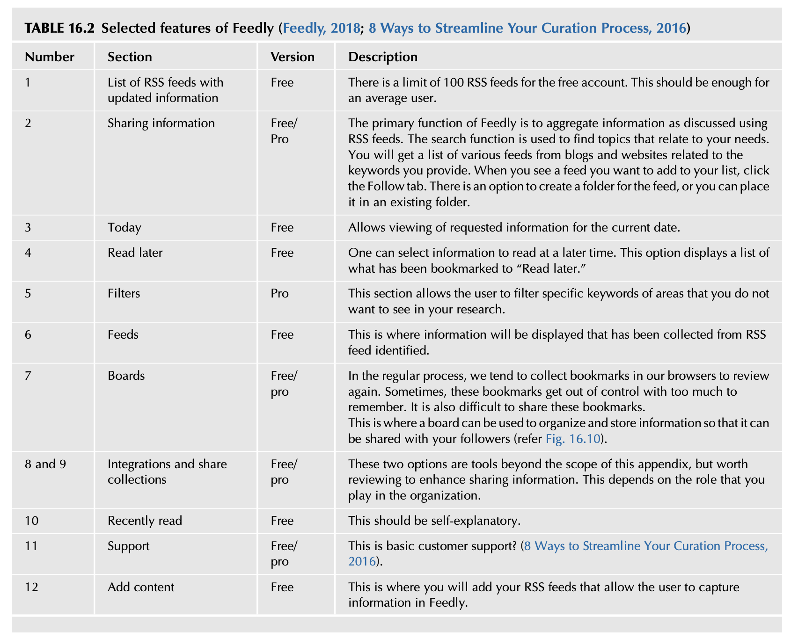
<!--  -->

### 표 16.2 Feedly의 엄선된 기능 (Feedly, 2018; 8 Ways to Streamline Your Curation Process, 2016)

<!-- Block B218 -->
| 번호 | 섹션 (Section) | 버전 (Version) | 설명 (Description) |
| :--- | :--- | :--- | :--- |
| **1** | 업데이트된 정보가 포함된 RSS 피드 목록 | 무료 (Free) | 무료 계정의 경우 RSS 피드 100개 제한이 있다. 일반 사용자에게는 충분한 수준이다. |
| **2** | 정보 공유 (Sharing information) | 무료/프로 (Free/Pro) | Feedly의 주요 기능은 RSS 피드를 사용하여 논의한 대로 정보를 집계(Aggregate)하는 것이다. 검색 기능은 필요와 관련된 주제를 찾는 데 사용된다. 제공한 키워드와 관련된 블로그 및 웹사이트의 다양한 피드 목록을 얻게 된다. 목록에 추가하고 싶은 피드를 발견하면 Follow 탭을 클릭하라. 피드용 폴더를 새로 만들거나 기존 폴더에 배치할 수 있는 옵션이 있다. |
| **3** | 오늘 (Today) | 무료 (Free) | 현재 날짜에 요청된 정보를 볼 수 있게 한다. |
| **4** | 나중에 읽기 (Read later) | 무료 (Free) | 나중에 읽을 정보를 선택할 수 있다. 이 옵션은 “나중에 읽기”에 북마크된 목록을 표시한다. |
| **5** | 필터 (Filters) | 프로 (Pro) | 이 섹션은 연구에서 보고 싶지 않은 영역의 특정 키워드를 사용자가 필터링할 수 있게 한다. |
| **6** | 피드 (Feeds) | 무료 (Free) | 식별된 RSS 피드로부터 수집된 정보가 표시되는 곳이다. |
| **7** | 보드 (Boards) | 무료/프로 (Free/pro) | 일반 과정에서 우리는 다시 검토하기 위해 브라우저에 북마크를 수집하는 경향이 있다. 때때로 이 북마크들은 기억하기 너무 많을 정도로 통제 불능이 된다. 또한 이 북마크들을 공유하기도 어렵다. 이때 팔로워들과 공유할 수 있도록 정보를 체계화하고 저장하는 데 보드(Board)를 사용할 수 있다(그림 16.10 참조). |
| **8 및 9** | 통합 및 컬렉션 공유 (Integrations and share collections) | 무료/프로 (Free/pro) | 이 두 옵션은 이 부록의 범위를 벗어나는 도구이지만, 정보 공유를 강화하기 위해 검토할 가치가 있다. 이는 조직에서 당신이 수행하는 역할에 달려 있다. |
| **10** | 최근 읽은 항목 (Recently read) | 무료 (Free) | 이는 자명하다(별도 설명 불필요). |
| **11** | 지원 (Support) | 무료/프로 (Free/pro) | 이는 기본 고객 지원이다(8 Ways to Streamline Your Curation Process, 2016). |
| **12** | 콘텐츠 추가 (Add content) | 무료 (Free) | 사용자가 Feedly에서 정보를 포착할 수 있게 해 주는 RSS 피드를 추가하는 곳이다. |

<!-- Block B219 -->
<!-- [그림 16.9 스크린샷 삽입 위치: Sample feedly layout] -->
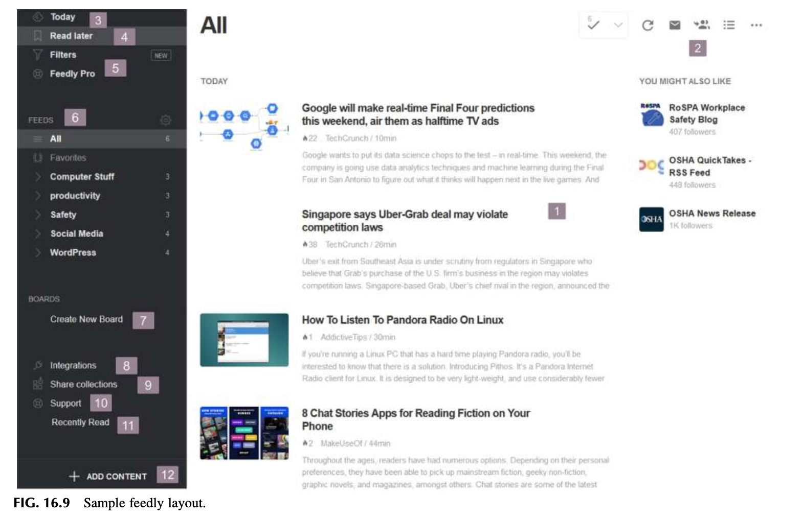
<!--  -->

### 그림 16.9 Feedly 레이아웃 예시.

<!-- Block B220 -->
<!-- [그림 16.10 스크린샷 삽입 위치: Adding new board] -->
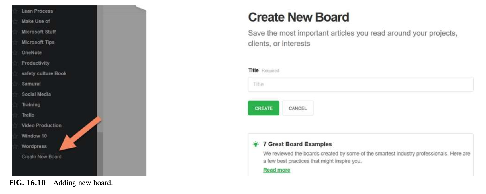
<!--  -->

### 그림 16.10 새 보드(Board) 추가하기.

<!-- Block B221 -->
### 엄선된 RSS 피드 자원 (Selected RSS Feed Resources)

RSS는 수많은 뉴스 출처를 위한 중앙 원천이다. 언급한 바와 같이, 선택한 각 자원을 자주 방문하는 대신 모든 정보를 한곳인 Feedly에 축적할 수 있다.

<!-- Block B222 -->
RSS 피드의 개념을 이해하는 데 첫발을 내딛을 수 있도록, Feedly와 함께 사용할 수 있는 엄선된 안전 웹 자원 및 RSS 피드 목록은 표 16.3을 참조하라.

<!-- Block B223 -->
<!-- [표 16.3 스크린샷 삽입 위치: Selected RSS Feed resources] -->
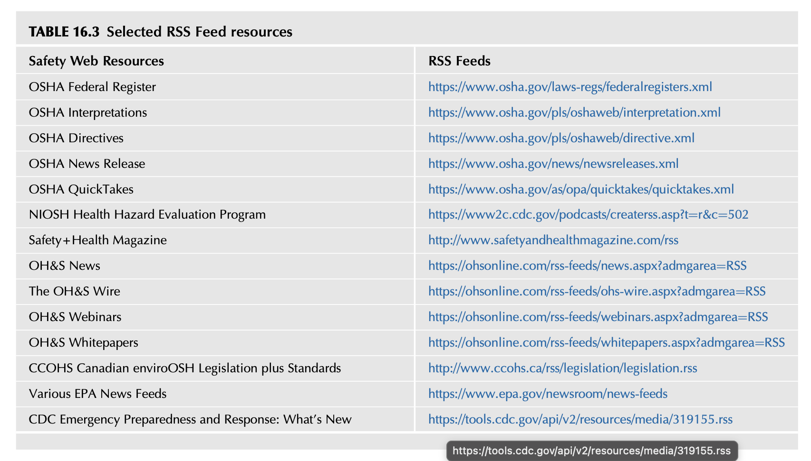
<!--  -->

### 표 16.3 엄선된 RSS 피드 자원

<!-- Block B224 -->
| 안전 웹 자원 (Safety Web Resources) | RSS 피드 (RSS Feeds) |
| :--- | :--- |
| OSHA 연방 관보 (OSHA Federal Register) | https://www.osha.gov/laws-regs/federalregisters.xml |
| OSHA 유권해석 (OSHA Interpretations) | https://www.osha.gov/pls/oshaweb/interpretation.xml |
| OSHA 지침 (OSHA Directives) | https://www.osha.gov/pls/oshaweb/directive.xml |
| OSHA 보도자료 (OSHA News Release) | https://www.osha.gov/news/newsreleases.xml |
| OSHA 퀵테이크 (OSHA QuickTakes) | https://www.osha.gov/as/opa/quicktakes/quicktakes.xml |
| NIOSH 건강유해성평가 프로그램 (NIOSH Health Hazard Evaluation Program) | https://www2c.cdc.gov/podcasts/createrss.asp?t r&c 502 |
| Safety+Health Magazine | http://www.safetyandhealthmagazine.com/rss |
| OH&S News | https://ohsonline.com/rss-feeds/news.aspx?admgarea RSS |
| The OH&S Wire | https://ohsonline.com/rss-feeds/ohs-wire.aspx?admgarea RSS |
| OH&S Webinars | https://ohsonline.com/rss-feeds/webinars.aspx?admgarea RSS |
| OH&S Whitepapers | https://ohsonline.com/rss-feeds/whitepapers.aspx?admgarea RSS |
| CCOHS 캐나다 산업안전보건 법령 및 표준 | http://www.ccohs.ca/rss/legislation/legislation.rss |
| 미국 환경보호청(EPA) 각종 뉴스 피드 | https://www.epa.gov/newsroom/news-feeds |
| CDC 비상 대비 및 대응: 새 소식 | https://tools.cdc.gov/api/v2/resources/media/319155.rss |

<!-- Block B225 -->
## 참고문헌 (BIBLIOGRAPHY)

* 20 Words that mean more than they did 20 years ago. (2018). Retrieved from Dictionary.com: http://bit.ly/2qqywI7.
* 8 Ways to streamline your curation process, 2016. Feedly. December. Retrieved from http://bit.ly/2DtrQgK.
* Advanced Image Search (2018). Google Image Search. Retrieved from http://bit.ly/2gx95PN.
* Agarwal, A. (2015). How to get things done with Trello. Digital Inspiration, October. Retrieved from http://bit.ly/2Duk6ea.
* Allen, S. (2018). 8 Writing tools every writer should know about. Retrieved from http://bit.ly/2uOtnu0.
* Authorized Person (2018). Retrieved from http://bit.ly/2vReewr.
* Beach, J. (2017). How we are attracting fake news and false information to our lives. Lifehack, June. Retrieved from http://bit.ly/2fjHvYH.
* Betters, E. (2016). What is Slack and how does it work? Pocker-Lint January. Retrieved from http://bit.ly/2ieeVcO.
* Bitly, Unleash the power of the link. (2018). Firefox Add-ons. Retrieved from https://mzl.la/2DyLtr7.
* Brinkmann, M. (2018). Grammarly premium review. gHacks Technology News. January. Retrieved from http://bit.ly/2CEPZkQ.
* Cantrell, J. (2014). Scrivener, microsoft word, and google docs. May. Retrieved from http://bit.ly/1dOqNLo.
* Competent Person. (2018). Retrieved from http://bit.ly/2vReewr.
* Complete guide to the ASP, Associate Safety Professional. (2017). Board of Certified Safety Professionals. March, Retrieved from http://bit.ly/2BQXAe8.
* Create an Alert. Google. Retrieved from http://bit.ly/2yFhCeq.
* Crider, M. (2018). how to automatically add citations and bibliographies to microsoft word. April. Retrieved from http://bit.ly/2HnSs8H.
* Crossfield, J. (2018). What’s accuracy got to do with social media? Content Marketing Institute. May. Retrieved from http://bit.ly/2KnUym3.
* Dana Lynn Driscoll, K. S. (2013). Research: Where do I begin? 2OWL Purdue University, Online Writing Lab. February. Retrieved from http://bit.ly/1CkFZ7Z.
* Definition of preeminence. (2018). Merriam-Webster, Incorporated. Retrieved from http://bit.ly/2DttEqK.
* Digital_Trends_Staff (2016). A really simple guide to really simple syndication (RSS). Digital Trends. December. Retrieved from http://bit.ly/1Ts1OKh.
* Docear. (2015). Retrieved from http://bit.ly/Ypx4Pv.
* Docear, Details & Features. Retrieved from http://bit.ly/WcROh2.
* Docear4word (2016). Docear. Retrieved from http://bit.ly/13gar5F.
* Dragon Professional Individual for documentation productivity. (2018). Dragon. Retrieved from http://bit.ly/2odE1HU.
* Dropbox (2018). Dropbox.com. Retrieved from http://bit.ly/YpvKwe.
* Edison, T. A. (2018). Genius is one percent inspiration and ninety-nine percent perspiration. In Brainy quote. Retrieved from http://bit.ly/2whO29x.
* Ervin, B. (2013). How to write compelling content without being an expert. April. Retrieved from http://bit.ly/2ETYNmf.
* Feedly (2018). Feedly.com. Retrieved from http://cloud.feedly.com/#my.
* Find free-to-use images. (2018). Google. Retrieved from http://bit.ly/2z4kXTH.
* Fitzpatrick, J. (2016). What is RSS, and how can i benefit from using it? How-To Geek LLC, September. Retrieved from http://bit.ly/2kri7zE.
* Free online Wordcloud Generator. (2018). Zygomatic. Retrieved from http://bit.ly/2xHCY9E.
* FreePlane. (2018). Retrieved from http://bit.ly/Ztdz9G.
* Frequently Asked Questions, Assessment Policy. (2018). US Office of Personnel Management, Public Domain. Retrieved from http://bit.ly/2AmZU0r.
* GIMP (2018). The GIMP website by The GIMP Team, Creative Commons Attribution-ShareAlike 4.0 International License. Retrieved from http://bit.ly/2DGJGgs.
* Gladwell, M. (2008). Outliers: The story of success. Little, Brown.
* Gladwell, M. (2013). Complexity and the ten-thousand-hour rule. The New Yorker, August. Retrieved from http://bit.ly/2ABKlPn.
* Google Feedburner. (2018). Google. Retrieved from http://bit.ly/2uVGDiK.
* Google Advanced Search. (2018). Google. Retrieved from http://bit.ly/15lPe8Y.
* Google Alerts. (2018). Retrieved from http://www.google.com/alerts.
* Google Basic Search. (2018). Retrieved from http://bit.ly/2G8yRYO.
* Google Books. (2018). Retrieved from http://bit.ly/2wS2SEu.
* Google Inside Search. (2018). Google. Retrieved from http://bit.ly/VQNT7j.
* Google Scholar. (2018). Google. Retrieved from http://bit.ly/W4iu3S.
* Google Trends. (2018). Google. Retrieved from http://bit.ly/2DTM04o.
* Google’s search engine optimization starter guide. (2010). Retrieved from http://bit.ly/2Dn3tkE.
* Grammarly. (2018). Grammarly. Retrieved from http://bit.ly/2CGzZ1F.
* HandBrake, The open source video transcoder. (2018). The HandBrake Team. Retrieved from http://bit.ly/2HPZLCg.
* Ho, L. (2017). Google search tricks to make your searches 10x faster and better. LifeHack, October. Retrieved from http://bit.ly/2g0WrYW.
* How to create content when you’re not an expert. (2016). Noble Samurai. Retrieved from http://bit.ly/1RhHoUh.
* Inkscape 0.92. (2016). Inkscape is free and open source software licensed under the GPL. Retrieved from http://bit.ly/2xCEdGE.
* Inkscape tutorials by Nick. (2011). Logos By Nick LLC. Retrieved from http://bit.ly/2gGVxB1.
* Irish, E. (2017). Jumpstart your next writing project with scrivener: The writing app for organized, efficient writers. Zapier. April. Retrieved from http://bit.ly/2uhQUTp.
* JabRef Reference Manager (2018). Retrieved from http://bit.ly/13g6D4w.
* Jaksch, M. (2018). 67 top tools for writers and bloggers in 2018. WritetoDone. Retrieved from http://bit.ly/2DTqkpg.
* JotForm. (2018). JotForm Inc. Retrieved from http://bit.ly/2DVBzNJ.
* Koch, C. G. (2007). The science of success: how market-based management built the world’s largest private company. John Wiley & Sons, Hoboken, New Jersey Retrieved from https://amzn.to/2xeuvMs.
* Lua A., (2018). How to Discover and Create Content That Your Audience Craves (and Grow Your Following). Bubber.com. Retrieved from http://bit.ly/2Sh9fMy
* Lucidchart—Resource for developing flow diagrams. (2017). Lucidchart. Retrieved from http://bit.ly/2fpkLmQ.
* McGuire, S. (2018). 12 student hacks to become a better online researcher. LifeHack, Retrieved from http://bit.ly/2xCKLXp.
* Mindmap. (2017). Business Dictionary. Retrieved from http://bit.ly/2IiT5w1.
* Moreau, E. (2018). What is ‘the cloud’ in cloud computing? Lifewire,(January) Retrieved from http://bit.ly/2o1PZ8o.
* Natural Reader. (2018). Retrieved from http://bit.ly/2oiYhIf.
* Office 365. (2018). Microsoft Inc. Retrieved from http://bit.ly/2z3YbeG.
* Peer review. Merriam-Webster.com. Retrieved from http://bit.ly/2HSVAc4.
* Pink, D. H. (2012). To sell is human: The surprising truth about moving others. New York City, New York: Riverhead Books. Retrieved from http://bit.ly/2wA6V89.
* Pocket. (2018). Retrieved from http://bit.ly/2I9CkIk.
* Pot, J. (2018). Social networks are great, but they’re a terrible place to get news. How-To Geek LLC, May. Retrieved from http://bit.ly/2J8dE2N.
* Program overview, Certified Safety Professionals (CSP). (2018). Board of Certified Safety Professionals. Retrieved from http://bit.ly/1S5aNU9.
* Qualified. Retrieved from http://bit.ly/2vReewr.
* Refine web searches. (2018). Google. Retrieved from http://bit.ly/2ygZQfV.
* refseek. (2018). RefSeek.com. Retrieved from http://bit.ly/2sNCKbP.
* Roughton, J. (2017). Safety culture survey. Linkedin, October. Retrieved from http://bit.ly/2Dn1dtG.
* Roughton, J., & Crutchfield, N. (2013). You must be a curator to access & sell your knowledge & expertise. Industrial Safety and Hygiene News (ISHN), (June). Retrieved from http://bit.ly/2xBxhuX.
* Rowse, D. (2018). Starting a blog on a topic where you’re not an expert. ProBlogger, Retrieved from http://bit.ly/2IBb0SL.
* RSS (2018). Urban dictionary. Retrieved from http://bit.ly/2uqREtT.
* Schembri, J. (2012). Input output model. Bisk. Six Sigma Daily, Your everyday fix, August. Retrieved from http://bit.ly/2vuoU2o.
* Scrivener. (2015). Literature & Latte. Retrieved from http://bit.ly/1ALXenZ.
* Semantic Scholar (2018). The Allen Institute for Artificial Intelligence. Retrieved from http://bit.ly/2KbDO1X.
* Shah, D. (2017). How to search on google: 31 google advanced search tips. HubSpot. Retrieved from http://bit.ly/2wer0Fz.
* Smith, A., & Anderson, M. (2018). Social media use in 2018. Pew Research Center. March. Retrieved from https://pewrsr.ch/2wYJZ74.
* Social media management platform. (2018). Buffer.com. Retrieved from http://bit.ly/2fmaye2.
* Starak, Y. (2009). The Membership Site Masterplan. Yaro Starak.
* Social Media. (2018). Merriam-Webster. Retrieved from https://www.merriam-webster.com/dictionary/social media
* Subject Matter Expert, 2018, Growth Engineering!, Retrieved from http://bit.ly/2Aoabtb
* Subject Matter Expert—SME. (2018). Inside iSixSigma. Retrieved from http://bit.ly/2AFlF8K.
* Szalavitz, M. (2013). 10,000 hours may not make a master after all. May. Retrieved from http://ti.me/1uWyiXU.
* TechSmith Snagit. (2018). TechSmith. Retrieved from http://bit.ly/2Heo5gE.
* Retrieved from http://bit.ly/2vj4f2M.
* The biggest software advance for writers since the word processor. (2018). mcsimonwrites. January. Retrieved from http://bit.ly/2CBhHPf.
* Trello (2017). Retrieved from http://bit.ly/2yHo7gJ.
* Tribal Knowledge. Retrieved from http://bit.ly/2I3qpec.
* Welcome to the Google Keep Help Center (2018). Retrieved from http://bit.ly/2KmvNev.
* What Does a Commentator Do? (2018). wiseGEEK. Retrieved from http://bit.ly/2Ag7biw.
* What Does Peer Review Mean? (2018). Retrieved from http://bit.ly/2HYBEoe.
* What Is Google Docs? (2018). Make Use Of, March. Retrieved from http://bit.ly/2Ge2Tua.
* What Is OneNote? Microsoft, Retrieved from http://bit.ly/2uFSwXy.
* Williamsen, D. M. (2012). 10,000 hours—Achieving excellence in what we do. Safety Culture World, November. Retrieved from http://bit.ly/Q8T3uV.

<!-- Block B226 -->
## 추가 읽을거리 (FURTHER READING)

* ARMY Social Media. (2018). Department of Defense Instruction (DODI) 855001, Retrieved from http://bit.ly/2IgSmvs.
* Associated Press. (2018). Charles Krauthammer, prominent conservative voice, has died. The New York Times. Retrieved from https://nyti.ms/2JZcvvr.
* Babauta, L. (2013). The key habits of organization. Zenhabits. Retrieved from http://zenhabits.net/putaway/.
* Babauta, L. (2015). Your internet habits create your reality. Breathe Zen Habits. Retrieved from http://bit.ly/2vrnUNP.
* Brodie, R. (2009). Virus of the mind: The new science of the meme. Carlsbad, California: Hay House.
* Catfish (2018). Merriam-Webster, incorporated. Massachusetts: Springfield. Retrieved from http://bit.ly/2fHzycN.
* Catfish: The TV Show. (2012). MTV, Program creators: Nev Schulman, Max Joseph, Ariel Schulman. Retrieved from http://on.mtv.com/2fk0xya
* Clear, J. (2018). Stop overdosing on celebrity gossip, the news, and low quality information. James Clear. Retrieved from http://bit.ly/2rjg3NO.
* Confabulate (2018). Merriam-Webster. Retrieved from http://bit.ly/2BD8KCZ.
* Covey, S. R. (1990). The 7 habits of highly effective people: Powerful lessons in personal change. In A fireside book (p. 151). Simon and Schuster, Inc. Retrieved from http://amzn.to/WsCA5g.
* Cross, R., & Parker, A. (2004). The hidden power of social networks (1st ed.). Brighton, MA: Harvard Business School Press.
* Dawkins, R. (2006). The selfish gene Retrieved from(4th ed.). https://amzn.to/2vPCRtt.
* Evaluating Information Sources: Should I Trust Internet Sources? (2018). http://bit.ly/2r0RvJf Retrieved from.
* Fact Check for Yoast SEO (2018). Retrieved from http://bit.ly/2J9glOF.
* Fake News Stories—Spotting the Fakes. (2017). THATSFAKE.com. Retrieved from http://bit.ly/2vCABnE
* Generational Breakdown: Info About All of the Generations (2018). The Center for Generational Kinetics. Retrieved from http://bit.ly/2DFx35j.
* Gladwell, M. (2000). The tipping point: How little things can make a big difference. Current Affairs/Business, Little, Brown.
* If It’s Worth Doing, It’s Worth Stealing. (2018). Kissmetrics Blog. Retrieved from http://bit.ly/2ug0f1T.
* Know Your Meme (2018). ComPlex Movies. Retrieved from http://bit.ly/2BBHWCY.
* Martin, D. (2018). Here’s how MTV’s catfish actually works. Vulture, 2018, Retrieved from http://bit.ly/2vblO12.
* Moynihan, D. P. (2018). Everyone is entitled to his own opinion, but not his own facts. Retrieved from http://bit.ly/2BOV8oz.
* Murphy, D. (2014). How to write format publish and promote your book without spending any money. Retrieved from www.creativindie.com.
* Presenter Media, Presenter (2018). Retrieved from http://bit.ly/XLpgGC.
* Research and Citation Resources (2018). Purdue University. Retrieved from http://bit.ly/2Kixbik.
* SafeAssign Originality Reports (2018). Blackboard. Retrieved from http://bit.ly/2wfcRrB.
* Shah, H. (2018). If it’s worth doing, it’s worth stealing. In KISSmetrics Retrieved from http://bit.ly/2ug0f1T.
* State_Farm® (2012). State of disbelief french model. State Farm® Insurance. Retrieved from http://bit.ly/2fjspSV.
* Storyboard (2018). Collins English Dictionary. In Retrieved from http://bit.ly/2CwSBk0.
* The “Mandela Effect” and How Your Mind Is Playing Tricks On You (2018). Retrieved from http://bit.ly/2vj4f2M.
* US Army Social Media handbook (2011). Online and Social Media Division Office of the Chief of Public Affairs. Washington, DC. Retrieved from http://bit.ly/2Kb9N5z.
* Vinsonhaler, M. (2017). How to use third party content with little to no effort, dlvr.it. Retrieved from http://bit.ly/2hyUsP0.
* Workopolis. (2017). 6 people who were fired for social media posts. Workopolis. Retrieved from http://bit.ly/2IeCUQd.

