# Chapter 16 Developing a Content Creation Strategy

*Safety Culture. https://doi.org/10.1016/B978-0-12-814663-7.00016-9*  
*©2019 Elsevier Inc. All rights reserved. pp. 389–417*

---

<!-- [그림 삽입 위치: Chapter 16 Overview] -->
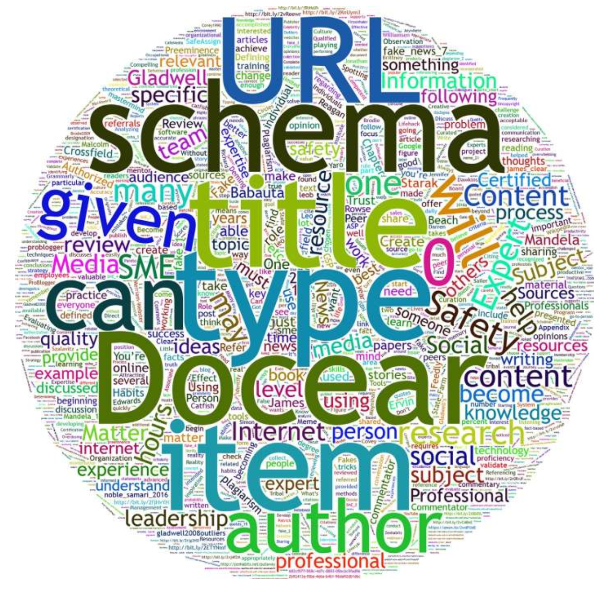
<!--  -->

> Without data, you’re just another person with an opinion.  
> — W. Edwards Deming

---

## INTRODUCTION

Chapter 16’s objective is to provide selected methods and guidelines for developing a content creation strategy to support the Safety Management System (SMS) and the Safety Culture. The strategy is designed to provide the safety professional or designated person a road map to efficiently research the internet for relevant and accurate information as well as expand professional contacts and networking ability.

Over the past several decades, emerging internet-based technology and an array of new communications capacities, known as “Social Media,” became available and outrageously popular. No one would have guessed these communication services would transform society where Social Media would provide a worldwide connected online conversation, supported by services such as Skype, Twitter, Snapchat, Instagram, Facebook, YouTube, Reddit, Pinterest, LinkedIn, Google+, and countless others.

> Definition of Social Media: "Forms of electronic communication (such as websites for social networking and microblogging) through which users create online communities to share information, ideas, personal messages, and other content (such as videos)."  
> — *(Social Media, 2018)*

Within this ever-changing technological environment, the human connection of face-to-face conversations with colleagues, friends, etc. have now expanded as information is communicated via Social Media, webinars, and online discussions easily and economically. With the increase of this new technology, professionals desiring to develop an internet presence or collect information to share with their organization need internet skills for researching specific information to support their expertise. Not limited but expanded as with Facetime, Skype, and other mobile methods are available.

Technology has provided a great benefit to social media users and curators, it also comes with extreme risk as evidenced by a history of outcomes including the posting of inaccurate information, harm to one’s professional reputation, resignations and firings, and damage to corporate brands. These negative outcomes can also damage the SMS and degrade the safety culture if the safety professional displays a level of immaturity or unprofessionalism when using Social Media.

The personal practice becomes the essential ingredient regardless of an individual’s skills, learning ability, the profession, aptitude, etc. (Gladwell, 2008). One of the best options to improve one’s internet skills is to objectively research credibly web-based sources which generate content specific to answers or the solutions being sought.

When this chapter is completed, you should be able to:
* Determine the Safety Professional’s Level of Expertise.
* Defining the Safety Professional’s Role in the Organization.
* Defining the Safety Professional’s Role in Social Media.
* Discuss Ways to Validate Data.
* Discuss the importance of Referencing and Citing Resources.
* Discuss ways to Become a Subject Matter Expert.

---

## ADAPTING TO SOCIAL MEDIA

The rapid pace of technological change cannot be easily assessed as to its impact on the SMS and the additional effort a safety professional must expend to remain relevant to both an organization and within the profession. The authors have been heavily involved in use of technology in their careers. Mike co-authored in-depth incident investigation and statistical analysis software. Nathan worked with project management and loss analysis methods. James early in his career developed expertise in website design, online training, blogging, and a full array of social media tools and applications.

Massive amounts of information are now available through web-based sources and through social media and has gone beyond a Tsunami Wave of information.

As discussed in Chapter 15, Curator for the Safety Management System, we are now transitioning from just a fire hose and Tsunami of information to massive amounts of information available through social media which can be overwhelming. Refer Fig. 15.1: Drinking from a Fire Hose, and Fig. 15.2: Tsunami Wave of Information, which means, that there is much information that is needed to be dissected and understood based on constant change. To retrieve, organize, and be able to provide the appropriate references and proper citations remain the challenge.

For example, as stated in Chapter 15, Curator for the Safety Management System, writing this book the authors collected several thousand documents and reference materials that needed to be reviewed, categorized, and sorted to find safety culture-related information. Locating documents was relatively easy. The key is to ensure that resources collected are shared with each contributor with supporting evidence to help provide the correct citations and reference to document our comments, conclusions, and recommendations (refer Fig. 16.1).

> Successful professionals don’t climb the ladder by ignoring everyone who gives them constructive feedback.  
> — Aja Frost, HubSpot

---

## LEARNING THE CURATION PROCESS

Before starting any curation process, one needs to develop a content creation strategy to help decide on what is to be accomplished. If the Safety Professional’s position is to become a go-to person and a Subject Matter Expert, the information presented to the leadership team must provide value and guidance for keeping the safety culture on track.

---

<!-- [그림 16.1 스크린샷 삽입 위치: Basic overview of book process flow for collecting and citing literature] -->
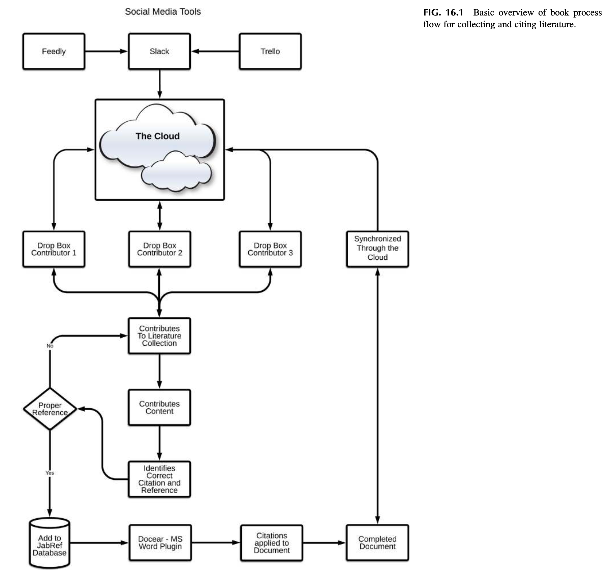
<!--  -->

### FIG. 16.1 Basic overview of book process flow for collecting and citing literature.

---

This can be accomplished by using selected social media tools and techniques to review what you believe will be interesting or relevant to the leadership team, peers, employees, and so on. Refer Appendix 16.1, Social Media Tools for the Professional. There are many tools provided in this appendix that can be used by the professional to increase productivity.

---

## DEFINING THE SAFETY PROFESSIONAL’S ROLE IN CONTENT CREATION

The role of the safety professional varies widely depending on the size, complexity and structure of an organization. Large organizations have safety staffs with assigned specialists proving limited roles, i.e. safety, industrial hygiene, training, environmental, and so on, with further specialty subdivisions as warranted. Understanding the designated role allowed in the organization is the first step as boundaries may have been established between departments. Human resources may be the designated training department, maintenance responsible for inspections, purchasing provides the safety related equipment, and so on.

The authors have noted that many organizations have only one designated safety professional with limited or no staff. Regardless of the size and depth of a staff, crucial information should be located, assessed and curated. This involves developing a well thought out Content Creation Strategy designed to find the appropriate information for each targeted audience within the organization. In addition, the safety leader may have to take on specialist duties where they are not an expert in a chosen field.

When researching topics intending to develop or increase knowledge, the point of beginning involves creating a succinct and compelling way to re-package information so it readily used to solve a safety-related problem.

---

## THE SAFETY PROFESSIONAL AS MENTOR

The safety professional plays the role of mentor to leadership and employees. A good mentor provides guidance on how to better achieve success in developing a safety management system and safety culture. A mentor knows where to expect the milestones, triumphs, realities, and successes. The mentor helps guide leaders through the process as well as the frustrations and setbacks. Assistance could be in the form of sharing best practices and experiences or using a network of other professionals and reviewing social media content that can be shared. The practical use of social media and a professional network allows mentors to gather problem-solving techniques and identify opportunities for sharing with the leadership team.

Individuals may choose to act as internet contributors on their own time keeping separate from any organization. Making the assumption using social media can be used without inadvertent crossover into comments or content is to walk a fine line. A quick review of current news reports can reveal numerous accounts of politicians, celebrities, managers, employees who destroyed careers, and lives believing they could post or say anything online.

---

## TYPES OF CURATION ROLES

A good mentor provides guidance on achieving success in developing a social media curation strategy. This could be in the form of sharing best practices, experiences, and networking with other professionals or reviewing social media content that can be shared.

Several roles can be played in a curation process to create content. This depends on what you wish to contribute. The following list can be reduced or expanded depending on the focus of the content creation strategy. Content creation can be divided into four basic types of types:
* Sharing content
* Direct referrals
* Curated referrals
* Commentator

---

## SHARING CONTENT

Sharing content is simply providing a link to valuable data or information. The link is sent through formal channels if assisting organizational leadership or separately using personal social media if transmitting to an audience outside the organization.

The key is to understand the role that you will be allowed to play in your organization.

---

## DIRECT REFERRALS

Direct referrals are messages communicating information or data by a mentor to a specific audience. The method may be as simple as a Twitter or Facebook post stating: “I just found this great resource on [Insert your post title], you can check it out here, [include a link to the resource].” Content is not directly sent only a direct link to the information source leaving it up to the recipient to open the link at their convenience to a read and interpret.

Direct referrals only use trusted websites or professional peers who represent a vetted area of expertise. Referrals can be found in industry, governmental, business and educational websites, blogs. The information is shared with your audience only after tracking sites having verifiably good information, an understanding of the pros and cons of a sites information (Lua, 2018).

Even sites providing what is considered a quality resource needs to be validated. For example, Wikipedia is, many cases, extensively cite as a resource for information. While Wikipedia is a good place to read or gather information, it is not the actual source, giving only content which may be accurate. Wikipedia is not a peer-reviewed reference, as information can be change by a number of individuals. “References and citations are provided and each link should be checked see if it exists and from a reputable source” (Crossfield, 2018).

The key is to “Trust no one. Even if the stat is published by a leading brand you think would be above reproach, check its sources” (Crossfield, 2018). Always validate any resource until you are satisfied that it is accurate.

---

## CURATED REFERRALS

Curated referrals involve longer remarks and commentary summarizing the information for sharing with others. Curated referrals review existing resources or research then creating insights based on ideas from the information. New insights and ideas can be posted on the internet for others to review and provide opinion. A link to the original resources is always included after reading the commentary, so that its references can be reviewed.

A large part of being able to writing good curated referrals is first defining who is going to be reading it. Identifying a reader’s experience with any topic and their level of knowledge about it is the first step to determining the tone the information should take.

> “If you know the persona that you are targeting your content towards and know it well, you’ve opened an entire additional avenue to express your ideas (however limited they be) on your topic”  
> — *(Ervin, 2013)*

---

## COMMENTATOR

A commentator is a person who has developed a depth of knowledge and can share thoughts and ideas with the leadership team, peers, employees, etc. A commentator establishes a reputation by reviewing, summarizing, and commenting on the most relevant information in a selected field of interest. The commentator takes careful note of what activities, trends, and patterns are going on with a particular subject then identifies and shares selected materials being produced (What Does a Commentator Do?, 2018; How to Create Content When You’re Not An Expert, 2016).

---

## OTHER TYPES OF EXPERTISE FOR CONSIDERATION

### Peer Review

Peer review is defined as “a process by which something proposed (as for research or publication) is evaluated by a group of experts in the appropriate field” (Peer Review, 2018). “Peer review are used to review materials before publishing to ensure a level of quality research and adherence to editorial standards before research is accepted for publication” (What Does Peer Review Mean?, 2018). The Federal Occupational Safety and Health Administration has defined the criteria for who can be considered competent or qualified to provide oversight on various:

### Authorized Person

For example, to meet prerequisites for becoming an authorized trainer for General Industry or Construction, one should have the experience and training, such as 5 years of construction safety experience. A college degree in occupational safety and health, a Certified Safety Professional (CSP), or Certified Industrial Hygienist (CIH) designation may be substituted for 2 years of experience (How to Become an Authorized Trainer, 2018). “A person approved or assigned by the employer to perform a specific type of duty or duties or to be at a specific location or locations at the jobsite” (Authorized Person, 2018).

### Competent Person

A competent person as defined by OSHA is an individual “who is capable of identifying existing and predictable hazards in the surroundings or working conditions which are unsanitary, hazardous, or dangerous to employees, and who has authorization to take prompt corrective measures to eliminate them” (Competent Person, 2018).

### Qualified

A qualified person is an individual “who, by possession of a recognized degree, certificate, or professional standing, or who by extensive knowledge, training, and experience, has successfully demonstrated his ability to solve or resolve problems relating to the subject matter, the work, or the project” (Qualified, 2018).

---

## UNDERSTANDING WHAT IS TO BE ACHIEVED IN CONTENT CREATION

Before beginning any research, choose a topic that interests you. You must ensure that you understand what you want to achieve. What are you being asked to do? Are you going to convince someone of your interpretation of a subject or analyze and evaluate a subject? Researching for information can be intimidating and professionals can feel challenged and unsure of their research skills. The challenge is lessened when researching is viewed as a process with a series of small steps leading to identifying quality information valuable to the organization. The process begins with a series of questions:
1. What is the goal of the content creation process?
2. Is the content for personal or organizational use? If for personal use, how was the topic selected and where will it be used?
3. How is the researched content to be used? Advice, recommendations, response to inquiry, etc.?
4. What possible challenges to the content may exist? Within an organization? From internet sources, discussion groups, and so on?
5. Who may challenge the interpretation of the subject, analysis, and evaluation of a subject or finding? Peers, other organizational departments, leadership, or employees?
6. Who will review the final product before publishing or using?
7. How will the research be curated and what is its expected life expectancy?

---

## THE SAFETY PROFESSIONAL AS SUBJECT MATTER EXPERT

> Knowing what you’re talking about is imperative to your success.  
> — Ben Sailer

A theoretical Subject Matter Expert implies that there is some level of education, such as earning and maintaining an advanced degree, a professional certification, many years of general or tribal knowledge. Tribal knowledge is defined as, “A widely accepted internal procedure or piece of information that isn’t recognized in an official manual” (Tribal knowledge, 2018). This is where we take our knowledge and experiences and build on them to come to our conclusions when we present our thoughts and ideas, which is rarely documented. The following are some definitions that will provide some guidance regarding a Subject Matter Expert. A Subject Matter Expert (SME) is a person with in depth expertise, experience and knowledge about a topic or technical area or a particular job. The safety professional is tasked with providing consistent, accurate, and quality information, if they are to be recognized as the “go-to person." An essential part of the responsibilities and requirements for an effective safety professional is to become the person with the most relevant information who is turned others for answers and well drafted solutions provided in detail and ready for use.

* …someone who is the master of their …specific area of expertise (Subject Matter Expert, 2018). This knowledge requires an individual who takes an extra effort beyond a daily work routine.
* …individual who exhibits the highest level of expertise in performing a specialized job, task, or skill within the organization (Subject Matter Expert—SME, 2018).
* “a person with bona fide expert knowledge about what it takes to do a particular job” (Frequently Asked Questions, Assessment Policy, 2018).

By being perceived as a Subject Matter Expert having preeminence means ‘people believe you are the best or one of the best or at least better than most others, at what you do’ (Starak, 2009). Starak further suggests that to become a Subject Matter Expert, one has to ‘…start establishing preeminence is to offer value by sharing what you know’ (Starak, 2009).

Darren Rowse of ProBlogger offers the following tips for bloggers which can be applied to a safety professional who is trying to expand specific knowledge:
* Be ethical and transparent. Be upfront about who you are, how much experience you have…..
* Be careful about the content you post. Avoid teaching or giving advice beyond what you know.
* Actively pursue learning. You may not be an expert yet, but your growth helps people connect with you and your blog (Rowse, 2018).

To become a Subject Matter Expert or a leading expert in a particular discipline takes time to research the core topic, learning its fundamentals, and then applying what has been learned to a real-life situation. An additional requirement is to be acknowledged by other subject matter experts as having reached a level of expertise determined to be acceptable. Professional designations are one form of this acknowledgment and found in almost all professions.

A curator of information must be able to combine research and knowledge into a collection of quality ideas to reach the required level to become a Subject Matter Expert. A SME has been defined as someone who has achieved “Preeminence," “the quality or state of being preeminent: superiority” (Definition of Preeminence, 2018). By being perceived as an SME having preeminence means “people believe you are the best or one of the best or at least better than most others, at what you do” (Starak, 2009). Starak further suggests that to become an SME, one has to “…start establishing preeminence is to offer value by sharing what you know” (Starak, 2009).

> **Note:** Wikipedia is a site containing content that is collaboratively changed. This collaborative editing may be performed by any individual(s) who may or may not be proficient or learned in the subject on which they are making commentary. The uncensored and unverified opinions contained in and on the Wikipedia site cannot be used for substantiating hypotheses or conclusions. Wikipedia should never be used as a resource in any bibliographic citations, quotes, or scholarly work.

---

## DEFINING SUBJECT MATTER EXPERT

Where did the idea of 10,000 hours come from? Case in point, How many times have you stated or heard some say I have done this 10,000 times? This is a common phrase that is stated many times.

The continual research and communication with other professionals will help the novice to become a Subject Matter Expert. Malcolm Gladwell suggested “…with enough practice; anyone could achieve a level of proficiency that would rival that of a professional. It was just a matter of putting in the time” (Gladwell, 2013).

Malcolm Gladwell presented the idea of 10,000 hours of specific guided practice as, “the magic number of greatness” (Gladwell, 2008). Gladwell’s 10,000 hours rule of deliberate practice has been challenged and debated as to the number of hours needed to reach a level of proficiency. Szalavitz noted, “There are many roads to greatness, but logging 10,000 hours of practice to help you perfect a skill may not be sufficient” (Szalavitz, 2013). Regardless, whether someone becomes proficient in 10,000 hours or not, becoming a Subject Matter Experts requires effort, focus, and a desire to learn a specific topic or field of endeavor.

Gladwell’s idea has been highlighted by other professionals such as Williamsen. “The concept of spending 10,000 hours performing a particular set of tasks is a popular paradigm to achieving excellence” (Williamsen, 2012).

Charles Koch, who uses this statement regarding compliance “…strive for 10,000% compliance, with 100% of employees fully complying 100% of the time. Ensure excellence in environmental, safety, and all areas of compliance. Stop, think, and ask” (Koch, 2007).

### OBSERVATION

Using a 40-hour work week at 50 weeks per year, it will take an individual five years to achieve the theoretical level of proficiency to learn a chosen craft and become a Subject Matter Expert. For example, the Certified Safety Professional (CSP) Certification designation criteria can closely follow Gladwell’s 10,000 hours of proficiency findings (Program overview, Certified Safety Professionals (CSP), 2018):

To sit for the Certified Safety Professional Certification, a candidate must have a Board of Certified Safety Professionals (BCSP)—Approved Credentials such as the Associate Safety Professional (ASP) or other acceptable specified designation. The criteria for the ASP (Complete guide to the ASP, Associate Safety Professional, 2017) is one year of professional safety experience which translates to 2,000 hours, using a work year of 40 hours per week for 50 weeks.

To be eligible to become a Certified Safety Professional (CSP), candidates must have four years of professional safety experience to sit for the exam. Four years at 2000 per year 8000 hours. Combining the two criteria yields a total of approximately 10,000 hours of experience.

Also, to maintain the safety certification, there are educational requirements for ongoing professional development. This ongoing professional development can be accomplished through earning recertification points based on acceptable seminars, training, self-study, publishing safety-related articles in professional peer-reviewed trade publications, writing books, and so on.

Please note new requirements as of 2018: “CSP Candidates: Will have a minimum of a bachelor’s degree in any field or an associate in safety, health, or the environment. The associate degree must include at least four courses with at least 12 semester hours/18 quarter hours of study in the safety, health, or environmental domains covered in the CSP examination blueprint” (Program overview, Certified Safety Professionals (CSP), 2018).

---

## RESEARCHING AND CURATING INFORMATION

Researching and curating information, on a regular basis can be frustrating if the search for a topic or information is completed one individual topic at a time. A number of methods found useful which have increased the efficiency and productivity of locating quality information.

---

## THE DOWNSIDE OF CONTENT CREATION

Social media has provided a mechanism to enable anyone who wants to create and publish content for instantaneous sharing of information. The problem for creation content gathering is anything and everything can be published on the internet at any time and for every reputable resource as many unreliable sources can exist. Sorting out facts versus fiction is the challenge for the long term.

Important questions should be considered before sharing information with a leadership team or readers as to the quality of the information being reviewed, how reliable is the information, and is the information even real. When reviewing information on the internet, the credibility of a source has to be determined.

The electronic age has made it easy to copy other people’s work. To help with this potential issue, part of crafting quality content is to always identify a resource(s) to make a point. One must remember that the knowledge, experience, or opinions that we obtain in life may be derived from a mentor, some resource, or our own experiences.

> Don’t rely on one source for all of your information. Look for opposing viewpoints on the subject that you’re looking into the get an even keel of the situation. You may realize something that you hadn’t noticed before and change your position on the matter.  
> — *(Beach, 2017)*

---

## CITING AND REFERENCING RESOURCES

Writing and producing an article, a book, a safety program, training session, and so on, requires summarizing findings of research is conducted for a project. Part of crafting a quality report is to identify a resource(s) after making a point.

Most readers are not interested in someone mimicking what an author states. They are more interested in your thoughts, assessment, and analysis of what you have read and potential methods to solve a problem.

Citing and referencing informational resources is a critical part of content creation. All documents collected and used for discussion should be accompanied by a valid resource reference. Ensuring information sent to the leadership team is cited and referenced appropriately is critical when building a case for change. Resources can be cited at the end of a written commentary directly quoting information used to show the difference(s) between incorporated ideas and the exact words of the resource.

Professionals do not offer opinions without supporting evidence. To be persuasive to the reader, commentary needs to extend beyond beliefs, experience(s), opinion(s), and suggestion(s) using only fact-based statements. These fact-based statements require scholarly sources to support specific claims and conclusions.

When completing research, the same request for information should be made using different resources to cross check for possible different formats, opinions, conflicts, considerations, and insights. By following the guidelines for citing and referencing commentary and recommendations, the intended audience can draw their own conclusions and be guided by a better understanding of the issues. Once research has been conducted then one can build on what the resources have presented by blending and integrating the information with beliefs, experiences, opinions, and suggestions coupled with the proper citations and references. It is strongly suggested when using any public domain or creative commons documents that these also be cite and reference appropriately to identify the resource.

---

## INPUT, PROCESS, OUTPUT MODEL

A three-part channel strategy of Input, Process and Output, proved to be an effective approach for a Content Creation Strategy.

### INPUT CHANNEL

> “The Input-Output Model…identifies the inputs, outputs, and required processing tasks ...to transform inputs into outputs” …“The inputs represent the flow of data into the process. This process includes all tasks required to effect a transformation of the inputs.”  
> — *(Schembri, 2012)*

The Input Channel locates and identifies peer-reviewed information from well-known trusted resources including leading professional association websites, proven thought leader blogs, specific YouTube Channels, government and regulatory websites, and so on. Sites selected would be from primarily non-commercial sites whose information may be thinly veiled advertisements or sales pitch.

### PROCESS CHANNEL

The Process Channel is where the most relevant and important information is captured and reviewed. One method for gathering is by utilizing a resource entitled “Really Simple Syndication” (RSS) Reader (Fitzpatrick, 2016). RSS directly feeds information from resource review providing every headline as posted.

#### RSS DEFINED

RSS is an acronym for "Really Simple Syndication" is a way for web sites to summarize their content, such as news articles, to make it available in a different view (RSS, 2018; Digital_Trends_Staff, 2016). An RSS feed provides a method for websites to publish information once and then syndicate the data automatically to subscribers.

#### LOCATING A CORRECT RSS FEED

Each resource site must be visited to obtain an RSS feed. If a resource site does not display the RSS feed, the RSS link may be located by using the Google Feedburner (2018). Refer Appendix 16.1, “Social Media Tools for the Professional” for a detail discussion on how to use the Google Feedburner.

#### FEEDLY AN INFORMATION CONSOLIDATING TOOL

Feedly is a central resource for collecting information from various sources. Using Feedly eliminate the need to visit each of the chosen sources frequently, as all information from the chosen source is accumulated in one place. Feedly works on the premise of a using RSS feeds to retrieve information. Once the RSS feeds is identified and added to Feedly, any updated news or will be displayed in Feedly.

Feedly is a web-based tool useful for increasing an individual’s productivity for gathering, curating and sharing information. Freely is currently a free service for users who want to automatically streamline the gathering and organizing selected information for a curation process. As with web-based services, advanced premium features are available for those who want to enhance and expand their curation process (8 Ways to Streamline Your Curation Process, 2016).

The advantage of using Feedly effectively is that you will no longer have to continually revisit the same websites over and over trying to determine new information that is being published. Feedly does an excellent job of accumulating all selected resources that you use to curate information (refer Fig. 16.2 and Appendix 16.2 on how to use Feedly to Find Content for Curation, a Case Study).

### OUTPUT CHANNEL

The Output Channel is the area where processed, reviewed specific information is transmitted to a selected audience. In the role of curating information for an organization or keeping a network informed, selected information could be sent to the appropriate group or individual needing specific content. Outputs can be a list of individuals in an organization, professional peers in other organizations, personal social media sites, etc. where content is most appropriately shared.

---

<!-- [그림 16.2 스크린샷 삽입 위치: Feedly input, process, output model] -->
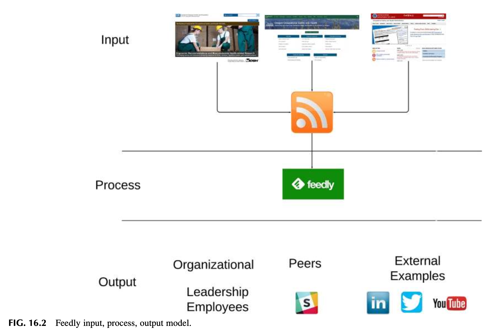
<!--  -->

### FIG. 16.2 Feedly input, process, output model.

---

## AVOIDING PLAGIARISM

Plagiarism “an act or instance of using or closely imitating the language and thoughts of another author without authorization and the representation of that author’s work as one’s own, as by not crediting the original author” (Plagiarism, 2018).

Using several information and data developed by others allows for inspiration to create new ideas and concepts. Sharing researched materials is allowed by using and including proper citations and references when incorporating them into an article. If the safety professional plans to do extensive personal writing or publishing, use of a plagiarism software is recommended. Organizations may have dedicated programs and procedures for reviewing internal documents for accuracy and sources which should be coordinated prior to internal use of researched materials.

To address the problem of potential plagiarism issue, specific software programs can be used to compare new written materials against published materials in print or on Internet sites. One valuable tool is “Grammarly,” a dedicated writing tool providing resources to aid in completing a plagiarism check (Grammarly, 2018). Refer Appendix 16.1, Social Media for the Professional for more details.

---

## SUMMARY

* Organizations live on information and data received from many internal and external sources. As a result, information and the message should be clear, well designed, and written and in terms which break through the constant background clutter of useful and useless information that goes through an organization.
* A safety culture’s existence should have the best possible information to preserve the level of knowledge required to keep risk and hazards identified. As people come and go, reorganizations occur, and new endeavors began, the information can be lost without a comprehensive method for maintaining documents or records.
* Finding the appropriate documents is relatively easy given the scope and depth of the internet. To retrieve, organize, and be able to provide references and proper citations is the challenge.
* The Internet has created easy access to a wealth of information, and the information is no longer restricted or limited to designated individuals as the use of mobile devices, smartphones, tablets, and other devices expand to universal use.

---

## CHAPTER REVIEW QUESTIONS

1. Define Social Media.
2. Explain the need to adapt to Social Media.
3. Define the Safety Professional role in content creation.
4. Explain the goal of content creation.
5. Various Social Media Tools for the Professional
6. Explain how Feedly can help find content.

---

## APPENDIX 16.1 SOCIAL MEDIA TOOLS FOR THE PROFESSIONAL

### An Approach to Organizing Information

Many online and off-line software resources can be used to help simplify the curation process. The wide variety of applications, software, and online tools are continually changing, and it is beyond the scope of this appendix to identify all resources. We have provided a sample of the resources that were used during the development of this book.

### Social Media Tools

* Google Keyword Search
* Research Resources
* Automatic Curation Research Tools
* Collaboration tools Using Cloud Technology
* Writing Tools to Increase Writing Efficiencies
* Graphical Software—Images

### Curation Tools

> If you can’t explain it simply, you don’t understand it well enough.  
> — Albert Einstein

There are many curation tools available, but the following have been found to be the most productive to use.

### Google Keyword Search

Many search engines are available to help with the curation process. The problem is that most individuals only use one search engine, Google.

While Google Basic Search may be the most common way to find something on the internet, other Google tools that can be used to increase productivity:
* Google Basic Keyword Search.
* Google Advanced Keyword Search.
* Google Advanced Image Search.
* Google Trends.

#### Google’s Basic Keyword Search

When an internet search is begun, most researchers will use Google’s basic search features. Google provides specific search terms to narrow down and redefine a search statement. Doing so, there will be many pages of search results. With some adjustment to a basic search term, the research result can be reduced. For example, if a simple search is conducted for the phrase, Safety Culture, it will display around 110,000,000 results. By placing quotes around the words, “Safety Culture” and conducting the same basic search, the number of items displayed now display around 453,000 results. The volume remaining emphasizes the need for precise and detailed search statements! (Google Basic Search, 2018) is critical. Refer Table 16.1 for a list of sample basic search shortcuts that can help to narrow a search.

#### Teachable Moments

Many websites are not optimized based on search engine protocols. Usually, specific keywords and other techniques regarding Search Engine Optimization (SEO) are not provided on a web page to allow the appropriate search results to show up on the first page or second page of Google.

SEO is making small modifications to parts of a website by adding specific keywords. Many times, a simple keyword change may provide incremental improvements, but when combined with other optimization efforts, there could have an impact on a site’s performance (Google’s search engine optimization starter guide, 2010).

This discussion is beyond the scope of this appendix to have a detailed explanation of Search Engine Optimization (SEO).

#### Google Advanced Keyword Search

Using a regular Google search, many search results may be listed with much information to sort through. Sometimes this makes it difficult to find what you are looking for. Google offers some enhanced search features that can be helpful in finding what you need easier and faster.

Taking the basic search feature one step further, Google offers an Advanced Search feature that can be used to conduct advanced searches for specific search terms as discussed in Table 16.1, without having to remember the shortcuts.

---

<!-- [표 16.1 스크린샷 삽입 위치: Sample Shortcuts When Doing a Basic Search Using Google] -->
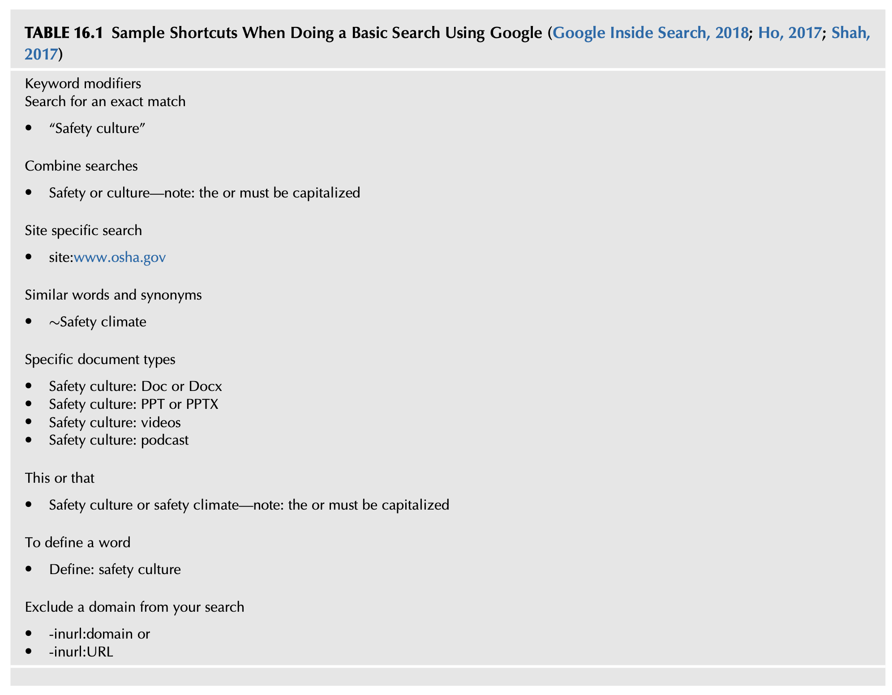
<!--  -->

### TABLE 16.1 Sample Shortcuts When Doing a Basic Search Using Google (Google Inside Search, 2018; Ho, 2017; Shah, 2017)

| Keyword modifiers | Example / Usage |
| :--- | :--- |
| **Search for an exact match** | “Safety culture” |
| **Combine searches** | Safety or culture—note: the or must be capitalized |
| **Site specific search** | site:www.osha.gov |
| **Similar words and synonyms** | Safety climate |
| **Specific document types** | Safety culture: Doc or Docx Safety culture: PPT or PPTX Safety culture: videos Safety culture: podcast |
| **This or that** | Safety culture or safety climate—note: the or must be capitalized |
| **To define a word** | Define: safety culture |
| **Exclude a domain from your search** | -inurl:domain or -inurl:URL |

---

From the Google search results page, click on Settings below the search box and select Advanced Search. Advanced Search gives you many options to find items with or without specific words or phrases and allows one to also narrow results by items such as language, region, or last updated (Google Advanced Search, 2018; Google Inside Search, 2018; Refine web searches, 2018).

We have been taught to use the small search window when trying to locate information on the internet (refer Fig. 16.3). If one uses the entire Universal Resource Locator (URL) window, the user can type a phrase with specific keywords (refer Fig. 16.4).

When comparing the two research methods, one can see a difference in the results.

When using the internet search features, one does not have to use the correct spelling. If you can get a word that is close to what you are trying to find, you will be able to see some related information.

For example, the following links are provided to demonstrate the results of each case as discussed before.
* Safety Culture Trends—http://bit.ly/2q2yd4T (refer Fig. 16.3).
* What are the trends when trying to develop a safety culture?—http://bit.ly/2q6rabN (refer Fig. 16.4).
* Not a good speller, no problem!—Mis-Spelled Words (Yes, these words are misspelled on purpose)—What ar the tredn on developing a safey culture—http://bit.ly/2q1OQxG (refer Fig. 16.5).

---

<!-- [그림 16.3 스크린샷 삽입 위치: Example of typical search window] -->
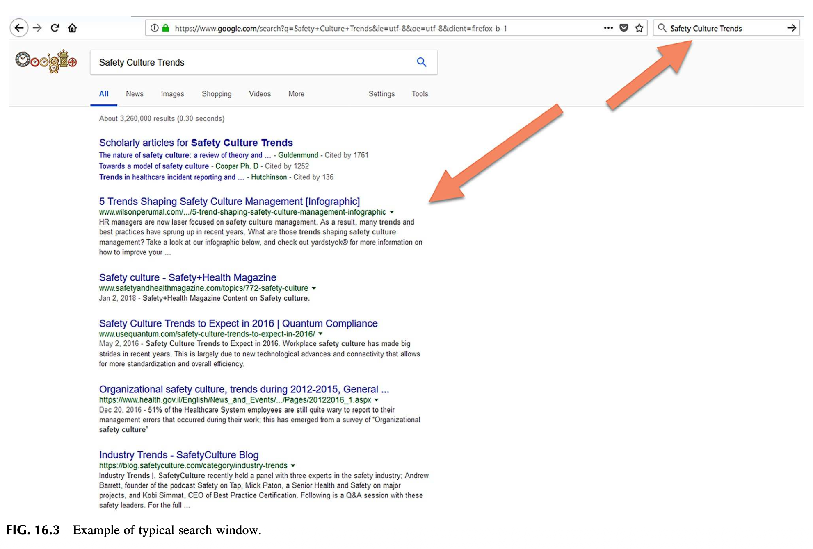
<!--  -->

### FIG. 16.3 Example of typical search window.

---

<!-- [그림 16.4 스크린샷 삽입 위치: Example universal resource locator (URL) window] -->
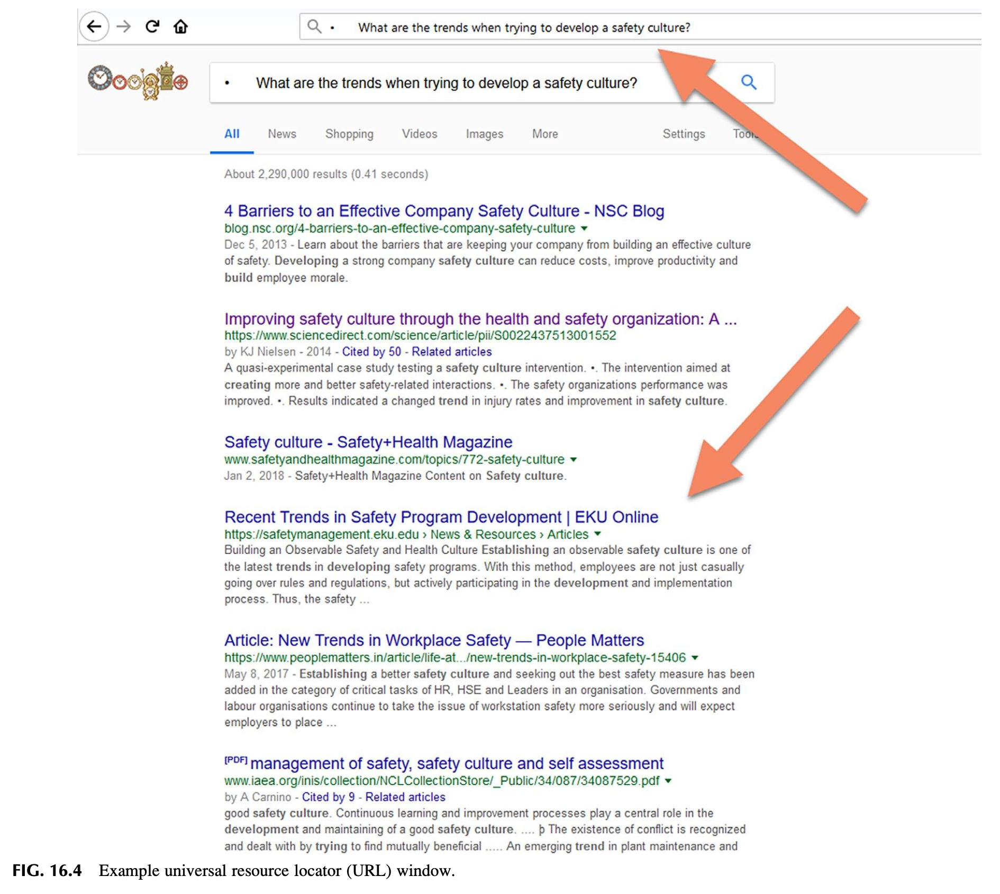
<!--  -->

### FIG. 16.4 Example universal resource locator (URL) window.

---

<!-- [그림 16.5 스크린샷 삽입 위치: Example mis-spelled words] -->
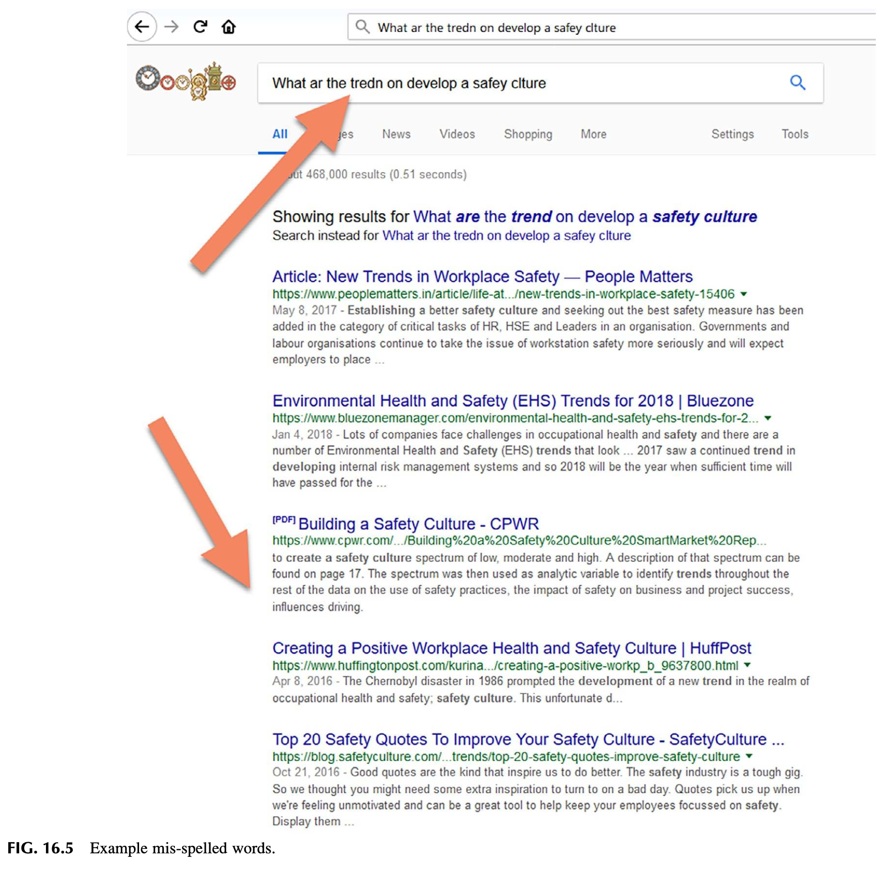
<!--  -->

### FIG. 16.5 Example mis-spelled words.

---

#### Google Advanced Image Search

If you are looking for some images for a project, you can use the Google Advanced Image Search to search for specific Images that may fit your project (Advanced Image Search, 2018). Using this search feature one can search for images that are Free to use. The key is to ensure that you review the “usage rights” section “that lets you know when you can use, share, or modify something you find online” (Find free-to-use images, 2018).

#### Google Trends

Google Trends is an offshoot of Google Search where you can see what the world searches for at a particular point in time (Google Trends, 2018; Jaksch, 2018)

### Research Resources

> Genius is one percent inspiration and ninety-nine percent perspiration.  
> — *(Edison, 2018)*

#### Google Scholar

Google Scholar is an index of scholarly publications that provides a way to search for scholarly literature across many areas of interest (Google Scholar, 2018; McGuire, 2018).

One nice feature about Google Scholar is that it can help the writer to apply the correct format citations and references using several formats, for example, MLA, APA, Chicago, and Vancouver styles (Google Scholar, 2018).

For example, when using Google Scholar, note the “quote” symbol. By clicking on the “quote” symbol, you will be able to locate the citation and reference for several formats as discussed before. One should note that there will be several options at the bottom of the example, BibTex, EndNote, RefMan, and RefWorks that can be incorporated in the reference database. This is the best way to identify the correct citation and reference to cite your written work.

The information as presented can be used to populate all citations and references in documents using the tools, Docear and a Microsoft Word plug-in “Docear4word,” and JabRef that will be discussed later (refer Fig. 16.6).

---

<!-- [그림 16.6 스크린샷 삽입 위치: Google Scholar process used to retrieve citation and reference] -->
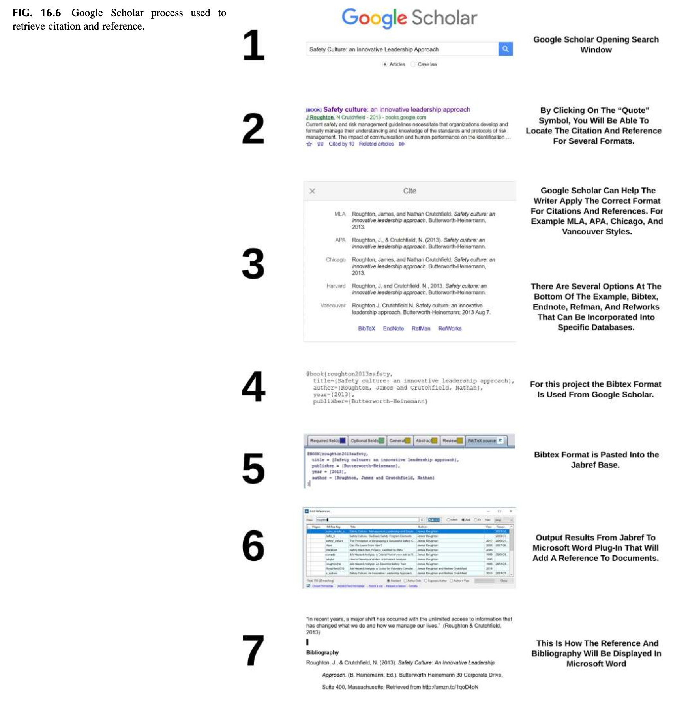
<!--  -->

### FIG. 16.6 Google Scholar process used to retrieve citation and reference.

---

#### Google Books

Google Books is a reputable resource that provides an index of specific books based on your search criteria. Google Books is a way of adding a book to a library for future research (Google Books, 2018).

#### Google Keep

Google Keeps the user to capture inspiration in real time. This application is the quickest way to obtain ideas, thoughts, and to-dos on the go without losing focus.

Google Keep offers a variety of tools for taking notes, including text, lists, images, and audio. Users can set reminders, which are integrated with a Gmail account (Welcome to the Google Keep Help Center, 2018).

#### Pocket

Pocket is a tool that allows the user to keep something you want to view later. This can include any articles, videos, and so on, that you observe during your search of the web.

You will be able to save information directly from your browser or apps, such as Twitter, Flipboard, Facebook, and so on.

The nice thing about pocket is that you can view your saved information when you are ready on your phone, tablet, or computer, no matter if you are connected to the internet (Pocket, 2018).

#### Semantic Scholar

Semantic Scholar is like Google Scholar. The main difference is that Semantic Scholar uses machine learning rather than keywords searches to improve the “understanding” of search terms. Semantic Scholar search goes beyond text by extracting information from images, tables, and captions (Semantic Scholar, 2018).

> Semantic Scholar makes an intelligent judgment and checks which cited paper is more relevant or how has the paper contributed to further research.  
> — *(Semantic Scholar, 2018)*

The preferred method is to use Google Scholar.

#### refseek

refseek is a search engine that helps to “search the internet for web-related information or documents” (refseek, 2018).

“refseek boasts that it will search for more than one billion documents, such as web pages, books, encyclopedias, journals, and newspapers” (refseek, 2018).

### Automatic Curation Research Tools

The following Curation Research Tools can be used to automatically find requested information to help with curation.

#### Google Alerts

Do you search for the same information repeatedly? One solution is to automate your search using Google Alerts. Once set up, Google Alert will send an e-mail to your inbox when there is any new information, based on the criteria defined. The e-mails update without conducting searches for the same words (Google Alerts, 2018).

You can begin then by asking some basic questions. For example, is there a topic that I am interested in receiving notification when there a post on the internet? Is there something in the news that I would like to follow as it happens? Do I have a hobby that interests me and do I want to read what others are posting? (Create an Alert, 2018)

The key is to adjust the settings in Google Alert to define the frequency that information is located and displayed.

* **Pro**—This tool will reduce the time to conduct manual research once parameters are defined.
* **Con**—You may get many e-mails that you have to review, so be prepared!

#### Google Feedburner

A Feedburner is designed for those who “distribute media on the web and want to understand how their content is being consumed” (Google Feedburner, 2018). The Feedburner is incorporated in Feedly as we will discuss later and in more detail in Appendix 16.2, Using Feedly to Find Content for Curation, a Case Study.

### Collaboration Tools Using Cloud Technology

#### The Cloud

Cloud can be defined as “…parts of the Internet that allow online processing and storage of documents and data as well as electronic access to software and other resources” (20 Words that mean more than they did 20 years ago, 2018).

If you use the internet and create and save files to your computer or if you want to automatically share information with others, then this is all you need to understand about the cloud. The cloud is a service that you will subscribe and pay a fee to have the convenience of information backed up and stored to a site computer where you can now share information with others that you choose. There are many FREE accounts that you can use, but they are limited in the amount of storage and functionality (Moreau, 2018).

For example, the documents for this project were stored in the cloud, shared, and synchronized on each of the three authors’ electronic devices. These devices can be any of the following, desktop, smartphone, iPad, and so on. When changes are made to any document and saved, the document will automatically show up on each of the author’s electronic devices that have been chosen. This applies to a Window or Mac personal computer (refer Fig. 16.1)

#### Dropbox

Dropbox is a “cloud” file storage and retrieval application that allows quick and easy sharing of files and documents. It is essentially a “public drive” to sync information between computers (Dropbox, 2018). There is also a security feature that will protect your files.

##### Lesson Learned

James moved several years ago. During this move and working with the local real estate agent, 3 hours from his home, he needed a copy of the written contract from the sale of his home. James forgot to bring this document with him. James was able to log into the real estate agent’s computer to access his Dropbox and download the documents that were needed.

#### Google Drive (Doc)—Spreadsheet

Google Drive is like Dropbox, but it integrates with all of your Google tools like Google Docs, Gmail, and other Google tools.

Google Docs or spreadsheet is like Microsoft Word or Excel. One of the best features is that Google Docs will save information automatically online to Google Drive Cloud. This allows access to information from anywhere with internet access and allows sharing it with others (Cantrell, 2014; What Is Google Docs?, 2018).

#### Slack

Research is a never-ending process, as many resources can be discovered on a simple search. Once Slack was discovered, it became a useful tool that allowed quick communication with team members.

The reason is that “Slack is an instant messaging and collaboration system…” (Betters, 2016) which allows real-time communication without the use of e-mail. The positive part of the instant messaging is that all communication is kept in one place and easy to retrieve and use.

E-mailing is sometimes the most efficient method of communicating with others. The problem is that many e-mails get lost with all the other clutter that fills a person in the box.

Problem solved: When working on projects, Slack conversations are quicker, more productive, you keep the history in Slack. Slack allows everyone to find files, search previous discussions, and so on. All communications are in one place.

There are some advantages:
* Channels that help keep the focus on specific areas, “…enabling the separation of messages, discussions, and notifications by purpose, department or topic” (Betters, 2016).
* Channels are similar to chat rooms which “you can make them public or private” (Betters, 2016). If a channel is public, everyone in your team can join, but if it is private, only select people can join (Betters, 2016).

Slack enables file sharing for all types of files with the entire team. The nice part of this process allows the user to drag and drop files from anywhere. Part of the process, for storing and retrieving the book material and resources is Dropbox. Slack does a great way to integrate Dropbox so that sharing files is seamless (Betters, 2016).

#### Trello

Trello can be used to prioritize, organize, and manage tasks, information, and ideas. (Agarwal, 2015)

> Trello is a collaboration tool that organizes your projects into boards. In one glance, Trello tells you what’s being worked on, who’s working on what, and where something is in a process.  
> — *(Trello, 2017)*

Trello is a simple Kanban method created by Toyota. Refer Chapter 6 “Creating the Safety Process,” Appendix 6.5 “Selected Process Tools to help Enhance the Safety System.”

#### JotForm

As part of the process of developing this book, a short survey was developed to collect several discussion points regarding a “Safety Culture” (Roughton, 2017). Information was embedded in a LinkedIn post (Roughton, 2017), shared with several groups and linked to a Google Spread Sheet to capture the data. This was a quick and easy way to automate and collect requested response.

JotForm is an excellent and easy-to-use form builder that lets you build a customized online form to fit your needs (JotForm, 2018).

#### Buffer

Buffer is a tool that allows you to schedule post to Twitter, Facebook, LinkedIn, and so on. What makes it different than a traditional scheduling tool is that you fill up your Buffer app with posts, and it “drips” them to your social media account(s) throughout the time based on a schedule you setup. So rather than sharing several bits of information all at once when reading the information, you can use Buffer to support your schedule (Social media management platform, 2018).

### Writing Tools to Increase Writing Efficiencies

#### Docear

Docear is an “academic literature suite” which allows structuring and sharing of information in managing content (Docear, 2015).

Docear includes an academic search engine, file manager, mind mapping technology, note-taking tool, and reference manager to organize collected literature. Part of Docear is an add-on plug-in for Microsoft Word called “Docear4word.” This plug-in integrates with Microsoft Word and allows the user to automatically insert formatted citations, references, and a formatted bibliography. Docear uses a database, JabRef, an open source bibliography reference manager and provides a way to collect and manage a bibliography file (Docear4word, 2016; Docear, Details & Features, 2015).

Documents are saved in a subdirectory, “literature repository.” Documents can be imported into a mind map which a graphical picture displays all the papers in the literature repository for ease of organization (Mind map, 2017).

If the document is in a .pdf format, annotations (highlights, comments) can be created and displayed on a mind map (Docear, Details & Features, 2015; Mind map, 2017).

Docear is a free and open source software, based on a mind mapping platform (FreePlane, 2018), and the “JabRef” another open source software, which is a bibliography reference manager, a way to collect and manage a bibliography file based on citations and references of resources (Docear, 2015; JabRef Reference Manager, 2018; Roughton & Crutchfield, 2013).

Docear was used to create the citation and reference for this book with was a time saver. The primary issue with the Docear software is that it is no longer being supported, but can still be used for the advanced user (refer Fig. 16.7).

---

<!-- [그림 16.7 스크린샷 삽입 위치: Using Docear to develop citations and references] -->
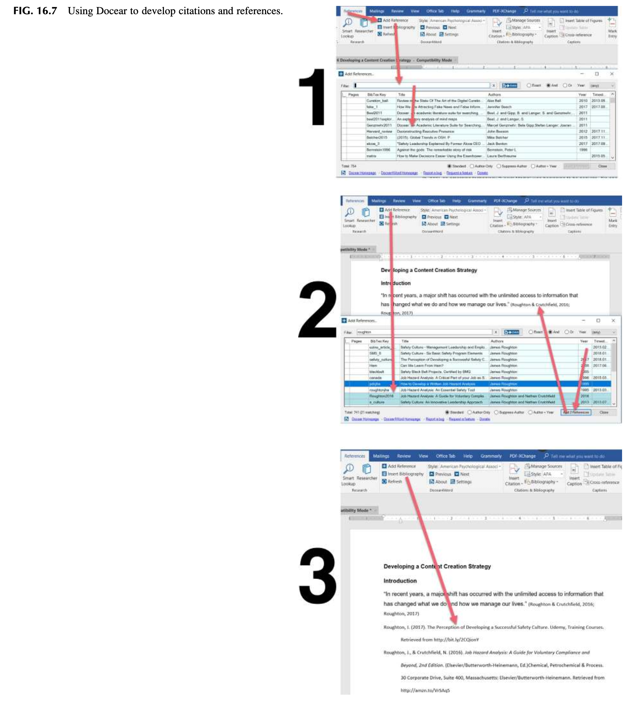
<!--  -->

### FIG. 16.7 Using Docear to develop citations and references.

---

#### JabRef

As discussed, Docear uses, “JabRef,” a bibliography reference manager which provides a way to collect and manage a bibliography file of citations and references (JabRef Reference Manager, 2018).

As outlined in the discussion in Docear, the JabRef data is used in conjunction with Docear and has a plug-in; The “Docear4Word” Microsoft Word plug-in allows the user to import citations and references from the JabRef database to create a formatted bibliography documents (JabRef Reference Manager, 2018).

#### Microsoft Word

The advantage of Microsoft Word is that changes can be tracked and shared. Also, thoughts can be shared by commenting next to the text that is being discussed.

There is also an online version when signing up for the Office 365 which allows a team to collaborate with each other in real time (Office 365, 2018).

One of the little-known features that are important if you are a writer is the ability to be able to create and build a database of citations and references using Microsoft word. Refer Fig. 16.8 for a description on how to cite references (Crider, 2018).

---

<!-- [그림 16.8 스크린샷 삽입 위치: Using Microsoft word to develop citations and references] -->
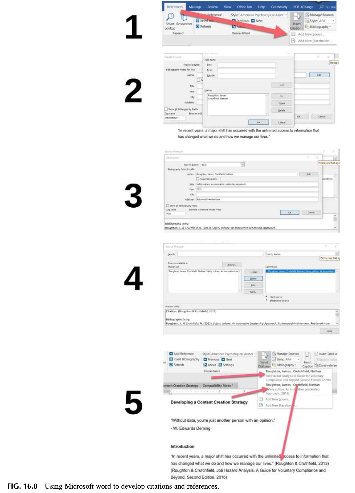
<!--  -->

### FIG. 16.8 Using Microsoft word to develop citations and references.

---

#### Scrivener

Scrivener is a word processor and project management tool that stays with you from the beginning of your research to your final draft (Jaksch, 2018).

With Scrivener, one can outline and structure ideas, take notes, view research alongside your writing, and compose the constituent pieces of your text in isolation or context (Scrivener, 2015).

Scrivener can be used instead of MS to streamline the writing process starting from an idea to published work (Irish, 2017).

If you are not a writer, “Scrivener won’t tell you how to write—it…makes all the tools you have scattered around your desk available in one application” (Scrivener, 2015; The biggest software advance for writers since the word processor, 2018).

#### Microsoft OneNote

Microsoft OneNote comes with the installation of the Microsoft package (What Is OneNote?, 2018).

OneNote is a digital notebook where one can share notes with everyone, so everyone is on the same page. The great thing is that OneNote automatically saves and synchronizes your notes so you can focus on your thoughts and ideas (What Is OneNote?, 2018).

#### Grammarly

Grammarly is a dedicated writing tool that provides some resources to help with spelling and grammar check, vocabulary enhancement, proper wording, punctuation check, and plagiarism check.

Grammarly does more than identify grammar and spelling mistakes; it provides deep explanations of grammar rules and suggested corrections (Allen, 2018).

Grammarly is available as a web service and uses an extension for various web browsers and also provides add-ins that can be used with Microsoft Word, Outlook, and Windows (Brinkmann, 2018; Grammarly, 2018).

### Graphical Software—Images

Presenter Media was the online software graphics imaging program that was used to emphasize concepts and thoughts throughout the book.

#### HandBreak

HandBrake is a tool for converting video from nearly any format to a selection of modern, widely supported formats (HandBrake, The open source video transcoder, 2018).

#### Inkscape

Inkscape is professional quality vector graphics software (Inkscape 0.92, 2016). One great site that was used to develop several of the images was Logos by Nick LLC. Many of the images created for this book were developed using the tutorial my this individual (Inkscape tutorials by Nick, 2011).

#### Gimp

GIMP provides the tools needed for high-quality image manipulation. From retouching to restoring to creative composites, the only limit is your imagination (GIMP, 2018). GIMP is similar to Adobe Photoshop but FREE.

#### Lucid Chart

This is a subscription resource that was used to develop some images and flow diagrams for this book (Lucidchart—Resource for developing flow diagrams, 2017).

#### Snagit

Snagit allows the user to capture anything on the computer screen. After the capture, the information can be modified and annotated to highlight specific areas of interest. Once the information is modified and annotated, one can share this information with presentations, social media platforms, and so on (TechSmith Snagit, 2018).

### Other Useful Tools

#### bit.ly

bit.ly is used throughout this book to provide a short link that is easy to review and provide to another individual.

For example, searching for an OSHA standard, the typical link is long. The link for the standard permit-required confined spaces, you will get the following link:  
`https://www.osha.gov/pls/oshaweb/owadisp.show_document?p_table STANDARDS&p_id 9797`

Using bit.ly, the link can be shortened as follows: `http://bit.ly/2DTx5aD`

To make it easily to use, a Firefox plug-in can be used directly from the Brower to shorten links (Bitly, Unleash the power of the link, 2018).

#### Dragon Professional Individual for Documentation Productivity

Dragon increases productivity and creativity by letting the user interact with their computer using voice command. Once a voice profile is set up, one can use Dragon to dictate information without the use of the keyboard. Dragon returns spoken thoughts into text and voice commands into actions eliminating the need to worry about typing and spelling.

One can switch between keyboard, mouse, and voice based on the preferred method for any given task.

Dragon also allows one to make edits and apply to format using only the voice. For example, selecting text and apply formatting such as bold, underline, capitals and more, or just speak to make needed changes. Smart Format Rules are included to automatically adapt to how the user wants to use abbreviations, dates, phone numbers, and more to appear.

James used Dragon to dictate specific text when writing sections of this book.

The following are some of the features that help with productivity:
* Transcribe your recordings from audio files
* Create custom words and vocabulary
* Simplify proofreading with natural-sounding text to speech or audio playback
* Choose your microphone option for freedom and flexibility
* Extend accessibility and prevent repetitive stress injuries  
*(Dragon Professional Individual for documentation productivity, 2018)*

#### Natural Reader

NaturalReader Online is a text to speech web application that converts any written text such as MS Word, PDF files, and webpages into spoken natural sounding speech (Natural Reader, 2018).

#### Word Cloud Generator

Word Cloud is a free program that will generate keywords in a graphical format (Free online Wordcloud Generator, 2018).

The cloud format that is displayed in each chapter was developed using this online software.

#### Brainy Quotes

This website allows one to share great quotes of inspirational and famous quotes by many authors (Smith & Anderson, 2018).

### Summary

Organizations live on information and data received from many internal and external sources. As a result, information and the message must be clear, well designed, and written and in terms which break through the constant background clutter of useful and useless information that goes through an organization. The tools presented in this appendix will have the organization to achieve this.

A safety culture’s existence must have the best possible information to preserve the level of knowledge required to keep risk and hazards identified. As people come and go, reorganizations occur, and new endeavors began, information can be lost without a comprehensive method for maintaining documents or records.

Finding the appropriate documents is relatively easy given the scope and depth of the internet. To retrieve, organize, and be able to provide references and proper citations is the challenge.

The internet has created easy access to a wealth of information, and this access to information no longer is restricted to designated individuals as the use of smartphones, tablets, and other devices expand.

---

## APPENDIX 16.2 USING FEEDLY TO FIND CONTENT FOR CURATION, A CASE STUDY

Feedly offers a free service to the user who wants to be able to organize and streamline selected information for the curation process. There are more advanced premium features in Feedly that are available for those who want to enhance and expand the curation process (8 Ways to Streamline Your Curation Process, 2016).

Using Feedly takes some trial and error to adjust to what you want to see on your results page. It is beyond the scope of this appendix to provide a complete training package on using Feedly.

The art of using Feedly will be demonstrated to show how to take advantage of the many features available.

### Input, Process, Output Model

James learned to conduct research and share various resources using a three-part strategy based on his experience as a Six Sigma Black Belt as:
* Input Channel
* Process Channel
* Output Channel

> The Input-Output Model…identifies the inputs, outputs, and required processing tasks ... to transform inputs into outputs.  
> — *(Schembri, 2012)*

Refer Fig. 16.2, for a sample of the feedly process, input, process, output model.

### Input Channel

Part of the input channel is to locate and identify peer-reviewed information from well-known resources that can be trusted. This information can include leading websites, blogs, YouTube Channels, and so on, that may provide selected resources who offer quality information.

> The inputs represent the flow of data into the process. This process includes all tasks required to effect a transformation of the inputs.  
> — *(Schembri, 2012)*

### Process Channel

The process component of the content creation strategy is where you start to capture the most relevant and important information. This can be accomplished by utilizing a resource entitled “Really Simple Syndication” (RSS) Reader (Fitzpatrick, 2016). Do not worry about the technical terms. It is easy to set up and run. Review the section “LOCATING A CORRECT RSS FEED” for a detail discussion regarding how to use RSS feeds, as discussed previously.

The quickest way to create content in any niche is to become a well-informed commentator. We have discussed how to set up your strategy and collect the never-ending, content using an RSS reader like Feedly, to become an instant authority in your niche and always stay on the pulse of what’s happening.

You can add the feeds for your favorite resource that you trust and review every headline as posted, instead of just a few stories that happen to go viral. You will be surprised how much you are missing out on (Pot, 2018).

### Lesson Learned

Feedly works on the premise of using RSS feeds to retrieve information. Once the required information is located and specific RSS feeds are added to Feedly, all you have to do is to wait for the news to be published and it will show up on your Feedly page.

### Output Channel

In the Output process, it is necessary to identify specific Outputs. The outputs can include a list if individuals in your organization, your peers in other organizations, social media sites, and so on, where you want to share your content.

The output is the area where you use your process to get a story in front of your selected network. If you are playing the role of curating information for an organization or keeping your network informed, you have several choices as discussed in Appendix 16.1, Social Media Tools for the Professional, you could manually research and then share your collection with your readers by cutting and pasting the information, but this could be a long-term, time-consuming process.

Refer Table 16.2 from some selected features of Feedly (refer Fig. 16.9).

---

<!-- [표 16.2 스크린샷 삽입 위치: Selected features of Feedly] -->
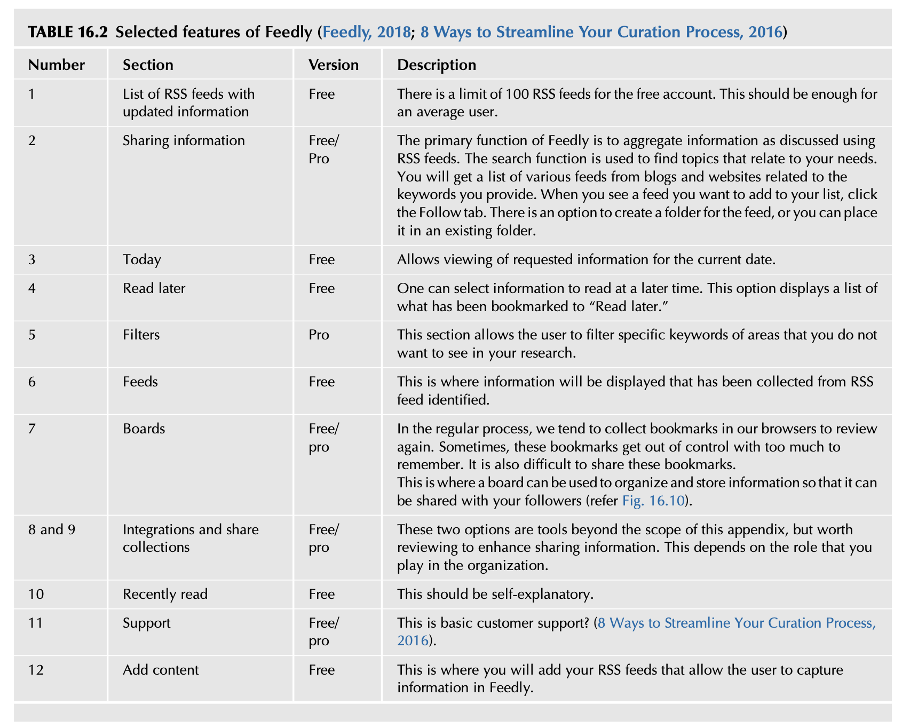
<!--  -->

### TABLE 16.2 Selected features of Feedly (Feedly, 2018; 8 Ways to Streamline Your Curation Process, 2016)

| Number | Section | Version | Description |
| :--- | :--- | :--- | :--- |
| **1** | List of RSS feeds with updated information | Free | There is a limit of 100 RSS feeds for the free account. This should be enough for an average user. |
| **2** | Sharing information | Free/Pro | The primary function of Feedly is to aggregate information as discussed using RSS feeds. The search function is used to find topics that relate to your needs. You will get a list of various feeds from blogs and websites related to the keywords you provide. When you see a feed you want to add to your list, click the Follow tab. There is an option to create a folder for the feed, or you can place it in an existing folder. |
| **3** | Today | Free | Allows viewing of requested information for the current date. |
| **4** | Read later | Free | One can select information to read at a later time. This option displays a list of what has been bookmarked to “Read later.” |
| **5** | Filters | Pro | This section allows the user to filter specific keywords of areas that you do not want to see in your research. |
| **6** | Feeds | Free | This is where information will be displayed that has been collected from RSS feed identified. |
| **7** | Boards | Free/pro | In the regular process, we tend to collect bookmarks in our browsers to review again. Sometimes, these bookmarks get out of control with too much to remember. It is also difficult to share these bookmarks. This is where a board can be used to organize and store information so that it can be shared with your followers (refer Fig. 16.10). |
| **8 and 9** | Integrations and share collections | Free/pro | These two options are tools beyond the scope of this appendix, but worth reviewing to enhance sharing information. This depends on the role that you play in the organization. |
| **10** | Recently read | Free | This should be self-explanatory. |
| **11** | Support | Free/pro | This is basic customer support? (8 Ways to Streamline Your Curation Process, 2016). |
| **12** | Add content | Free | This is where you will add your RSS feeds that allow the user to capture information in Feedly. |

---

<!-- [그림 16.9 스크린샷 삽입 위치: Sample feedly layout] -->
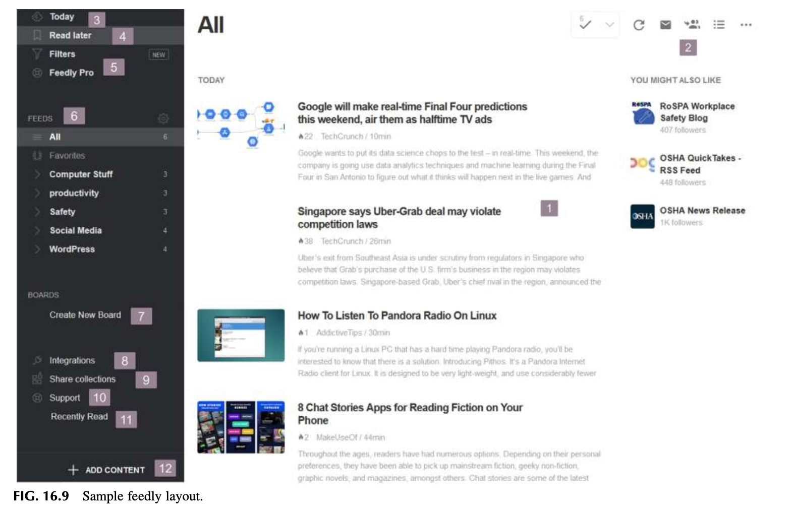
<!--  -->

### FIG. 16.9 Sample feedly layout.

---

<!-- [그림 16.10 스크린샷 삽입 위치: Adding new board] -->
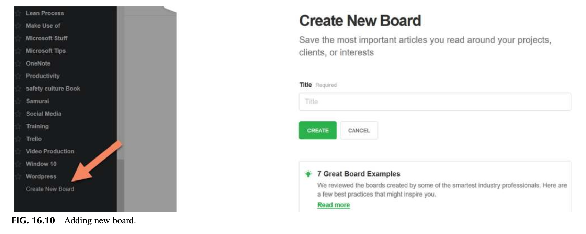
<!--  -->

### FIG. 16.10 Adding new board.

---

### Selected RSS Feed Resources

RSS is a central source for all many news sources. As stated, instead of visiting each of your chosen resources frequently, all your information can be accumulated in one place, Feedly.

To help you get started in understanding the concepts of RSS feed, refer Table 16.3 for a set of selected Safety Web Resources and the selected RSS feeds that can be used with Feedly.

---

<!-- [표 16.3 스크린샷 삽입 위치: Selected RSS Feed resources] -->
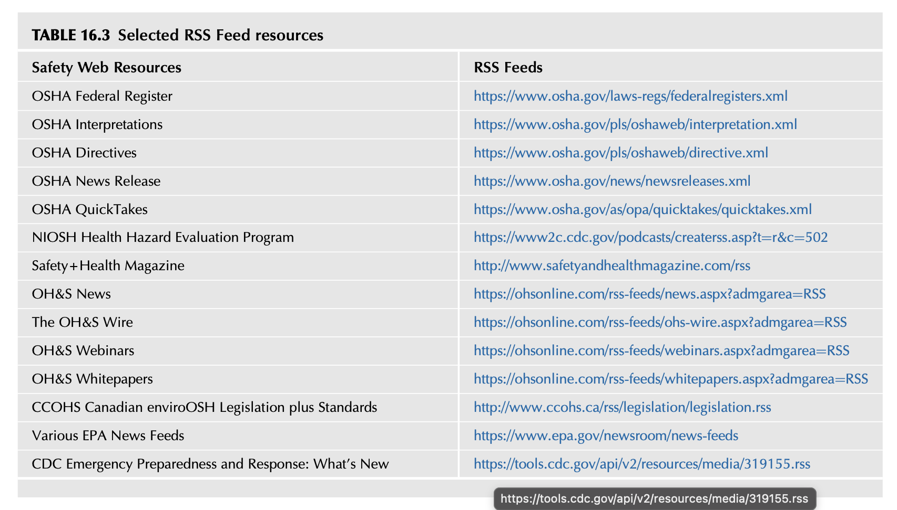
<!--  -->

### TABLE 16.3 Selected RSS Feed resources

| Safety Web Resources | RSS Feeds |
| :--- | :--- |
| OSHA Federal Register | https://www.osha.gov/laws-regs/federalregisters.xml |
| OSHA Interpretations | https://www.osha.gov/pls/oshaweb/interpretation.xml |
| OSHA Directives | https://www.osha.gov/pls/oshaweb/directive.xml |
| OSHA News Release | https://www.osha.gov/news/newsreleases.xml |
| OSHA QuickTakes | https://www.osha.gov/as/opa/quicktakes/quicktakes.xml |
| NIOSH Health Hazard Evaluation Program | https://www2c.cdc.gov/podcasts/createrss.asp?t r&c 502 |
| Safety+Health Magazine | http://www.safetyandhealthmagazine.com/rss |
| OH&S News | https://ohsonline.com/rss-feeds/news.aspx?admgarea RSS |
| The OH&S Wire | https://ohsonline.com/rss-feeds/ohs-wire.aspx?admgarea RSS |
| OH&S Webinars | https://ohsonline.com/rss-feeds/webinars.aspx?admgarea RSS |
| OH&S Whitepapers | https://ohsonline.com/rss-feeds/whitepapers.aspx?admgarea RSS |
| CCOHS Canadian enviroOSH Legislation plus Standards | http://www.ccohs.ca/rss/legislation/legislation.rss |
| Various EPA News Feeds | https://www.epa.gov/newsroom/news-feeds |
| CDC Emergency Preparedness and Response: What’s New | https://tools.cdc.gov/api/v2/resources/media/319155.rss |

---

## BIBLIOGRAPHY

* 20 Words that mean more than they did 20 years ago. (2018). Retrieved from Dictionary.com: http://bit.ly/2qqywI7.
* 8 Ways to streamline your curation process, 2016. Feedly. December. Retrieved from http://bit.ly/2DtrQgK.
* Advanced Image Search (2018). Google Image Search. Retrieved from http://bit.ly/2gx95PN.
* Agarwal, A. (2015). How to get things done with Trello. Digital Inspiration, October. Retrieved from http://bit.ly/2Duk6ea.
* Allen, S. (2018). 8 Writing tools every writer should know about. Retrieved from http://bit.ly/2uOtnu0.
* Authorized Person (2018). Retrieved from http://bit.ly/2vReewr.
* Beach, J. (2017). How we are attracting fake news and false information to our lives. Lifehack, June. Retrieved from http://bit.ly/2fjHvYH.
* Betters, E. (2016). What is Slack and how does it work? Pocker-Lint January. Retrieved from http://bit.ly/2ieeVcO.
* Bitly, Unleash the power of the link. (2018). Firefox Add-ons. Retrieved from https://mzl.la/2DyLtr7.
* Brinkmann, M. (2018). Grammarly premium review. gHacks Technology News. January. Retrieved from http://bit.ly/2CEPZkQ.
* Cantrell, J. (2014). Scrivener, microsoft word, and google docs. May. Retrieved from http://bit.ly/1dOqNLo.
* Competent Person. (2018). Retrieved from http://bit.ly/2vReewr.
* Complete guide to the ASP, Associate Safety Professional. (2017). Board of Certified Safety Professionals. March, Retrieved from http://bit.ly/2BQXAe8.
* Create an Alert. Google. Retrieved from http://bit.ly/2yFhCeq.
* Crider, M. (2018). how to automatically add citations and bibliographies to microsoft word. April. Retrieved from http://bit.ly/2HnSs8H.
* Crossfield, J. (2018). What’s accuracy got to do with social media? Content Marketing Institute. May. Retrieved from http://bit.ly/2KnUym3.
* Dana Lynn Driscoll, K. S. (2013). Research: Where do I begin? 2OWL Purdue University, Online Writing Lab. February. Retrieved from http://bit.ly/1CkFZ7Z.
* Definition of preeminence. (2018). Merriam-Webster, Incorporated. Retrieved from http://bit.ly/2DttEqK.
* Digital_Trends_Staff (2016). A really simple guide to really simple syndication (RSS). Digital Trends. December. Retrieved from http://bit.ly/1Ts1OKh.
* Docear. (2015). Retrieved from http://bit.ly/Ypx4Pv.
* Docear, Details & Features. Retrieved from http://bit.ly/WcROh2.
* Docear4word (2016). Docear. Retrieved from http://bit.ly/13gar5F.
* Dragon Professional Individual for documentation productivity. (2018). Dragon. Retrieved from http://bit.ly/2odE1HU.
* Dropbox (2018). Dropbox.com. Retrieved from http://bit.ly/YpvKwe.
* Edison, T. A. (2018). Genius is one percent inspiration and ninety-nine percent perspiration. In Brainy quote. Retrieved from http://bit.ly/2whO29x.
* Ervin, B. (2013). How to write compelling content without being an expert. April. Retrieved from http://bit.ly/2ETYNmf.
* Feedly (2018). Feedly.com. Retrieved from http://cloud.feedly.com/#my.
* Find free-to-use images. (2018). Google. Retrieved from http://bit.ly/2z4kXTH.
* Fitzpatrick, J. (2016). What is RSS, and how can i benefit from using it? How-To Geek LLC, September. Retrieved from http://bit.ly/2kri7zE.
* Free online Wordcloud Generator. (2018). Zygomatic. Retrieved from http://bit.ly/2xHCY9E.
* FreePlane. (2018). Retrieved from http://bit.ly/Ztdz9G.
* Frequently Asked Questions, Assessment Policy. (2018). US Office of Personnel Management, Public Domain. Retrieved from http://bit.ly/2AmZU0r.
* GIMP (2018). The GIMP website by The GIMP Team, Creative Commons Attribution-ShareAlike 4.0 International License. Retrieved from http://bit.ly/2DGJGgs.
* Gladwell, M. (2008). Outliers: The story of success. Little, Brown.
* Gladwell, M. (2013). Complexity and the ten-thousand-hour rule. The New Yorker, August. Retrieved from http://bit.ly/2ABKlPn.
* Google Feedburner. (2018). Google. Retrieved from http://bit.ly/2uVGDiK.
* Google Advanced Search. (2018). Google. Retrieved from http://bit.ly/15lPe8Y.
* Google Alerts. (2018). Retrieved from http://www.google.com/alerts.
* Google Basic Search. (2018). Retrieved from http://bit.ly/2G8yRYO.
* Google Books. (2018). Retrieved from http://bit.ly/2wS2SEu.
* Google Inside Search. (2018). Google. Retrieved from http://bit.ly/VQNT7j.
* Google Scholar. (2018). Google. Retrieved from http://bit.ly/W4iu3S.
* Google Trends. (2018). Google. Retrieved from http://bit.ly/2DTM04o.
* Google’s search engine optimization starter guide. (2010). Retrieved from http://bit.ly/2Dn3tkE.
* Grammarly. (2018). Grammarly. Retrieved from http://bit.ly/2CGzZ1F.
* HandBrake, The open source video transcoder. (2018). The HandBrake Team. Retrieved from http://bit.ly/2HPZLCg.
* Ho, L. (2017). Google search tricks to make your searches 10x faster and better. LifeHack, October. Retrieved from http://bit.ly/2g0WrYW.
* How to create content when you’re not an expert. (2016). Noble Samurai. Retrieved from http://bit.ly/1RhHoUh.
* Inkscape 0.92. (2016). Inkscape is free and open source software licensed under the GPL. Retrieved from http://bit.ly/2xCEdGE.
* Inkscape tutorials by Nick. (2011). Logos By Nick LLC. Retrieved from http://bit.ly/2gGVxB1.
* Irish, E. (2017). Jumpstart your next writing project with scrivener: The writing app for organized, efficient writers. Zapier. April. Retrieved from http://bit.ly/2uhQUTp.
* JabRef Reference Manager (2018). Retrieved from http://bit.ly/13g6D4w.
* Jaksch, M. (2018). 67 top tools for writers and bloggers in 2018. WritetoDone. Retrieved from http://bit.ly/2DTqkpg.
* JotForm. (2018). JotForm Inc. Retrieved from http://bit.ly/2DVBzNJ.
* Koch, C. G. (2007). The science of success: how market-based management built the world’s largest private company. John Wiley & Sons, Hoboken, New Jersey Retrieved from https://amzn.to/2xeuvMs.
* Lua A., (2018). How to Discover and Create Content That Your Audience Craves (and Grow Your Following). Bubber.com. Retrieved from http://bit.ly/2Sh9fMy
* Lucidchart—Resource for developing flow diagrams. (2017). Lucidchart. Retrieved from http://bit.ly/2fpkLmQ.
* McGuire, S. (2018). 12 student hacks to become a better online researcher. LifeHack, Retrieved from http://bit.ly/2xCKLXp.
* Mindmap. (2017). Business Dictionary. Retrieved from http://bit.ly/2IiT5w1.
* Moreau, E. (2018). What is ‘the cloud’ in cloud computing? Lifewire,(January) Retrieved from http://bit.ly/2o1PZ8o.
* Natural Reader. (2018). Retrieved from http://bit.ly/2oiYhIf.
* Office 365. (2018). Microsoft Inc. Retrieved from http://bit.ly/2z3YbeG.
* Peer review. Merriam-Webster.com. Retrieved from http://bit.ly/2HSVAc4.
* Pink, D. H. (2012). To sell is human: The surprising truth about moving others. New York City, New York: Riverhead Books. Retrieved from http://bit.ly/2wA6V89.
* Pocket. (2018). Retrieved from http://bit.ly/2I9CkIk.
* Pot, J. (2018). Social networks are great, but they’re a terrible place to get news. How-To Geek LLC, May. Retrieved from http://bit.ly/2J8dE2N.
* Program overview, Certified Safety Professionals (CSP). (2018). Board of Certified Safety Professionals. Retrieved from http://bit.ly/1S5aNU9.
* Qualified. Retrieved from http://bit.ly/2vReewr.
* Refine web searches. (2018). Google. Retrieved from http://bit.ly/2ygZQfV.
* refseek. (2018). RefSeek.com. Retrieved from http://bit.ly/2sNCKbP.
* Roughton, J. (2017). Safety culture survey. Linkedin, October. Retrieved from http://bit.ly/2Dn1dtG.
* Roughton, J., & Crutchfield, N. (2013). You must be a curator to access & sell your knowledge & expertise. Industrial Safety and Hygiene News (ISHN), (June). Retrieved from http://bit.ly/2xBxhuX.
* Rowse, D. (2018). Starting a blog on a topic where you’re not an expert. ProBlogger, Retrieved from http://bit.ly/2IBb0SL.
* RSS (2018). Urban dictionary. Retrieved from http://bit.ly/2uqREtT.
* Schembri, J. (2012). Input output model. Bisk. Six Sigma Daily, Your everyday fix, August. Retrieved from http://bit.ly/2vuoU2o.
* Scrivener. (2015). Literature & Latte. Retrieved from http://bit.ly/1ALXenZ.
* Semantic Scholar (2018). The Allen Institute for Artificial Intelligence. Retrieved from http://bit.ly/2KbDO1X.
* Shah, D. (2017). How to search on google: 31 google advanced search tips. HubSpot. Retrieved from http://bit.ly/2wer0Fz.
* Smith, A., & Anderson, M. (2018). Social media use in 2018. Pew Research Center. March. Retrieved from https://pewrsr.ch/2wYJZ74.
* Social media management platform. (2018). Buffer.com. Retrieved from http://bit.ly/2fmaye2.
* Starak, Y. (2009). The Membership Site Masterplan. Yaro Starak.
* Social Media. (2018). Merriam-Webster. Retrieved from https://www.merriam-webster.com/dictionary/social media
* Subject Matter Expert, 2018, Growth Engineering!, Retrieved from http://bit.ly/2Aoabtb
* Subject Matter Expert—SME. (2018). Inside iSixSigma. Retrieved from http://bit.ly/2AFlF8K.
* Szalavitz, M. (2013). 10,000 hours may not make a master after all. May. Retrieved from http://ti.me/1uWyiXU.
* TechSmith Snagit. (2018). TechSmith. Retrieved from http://bit.ly/2Heo5gE.
* Retrieved from http://bit.ly/2vj4f2M.
* The biggest software advance for writers since the word processor. (2018). mcsimonwrites. January. Retrieved from http://bit.ly/2CBhHPf.
* Trello (2017). Retrieved from http://bit.ly/2yHo7gJ.
* Tribal Knowledge. Retrieved from http://bit.ly/2I3qpec.
* Welcome to the Google Keep Help Center (2018). Retrieved from http://bit.ly/2KmvNev.
* What Does a Commentator Do? (2018). wiseGEEK. Retrieved from http://bit.ly/2Ag7biw.
* What Does Peer Review Mean? (2018). Retrieved from http://bit.ly/2HYBEoe.
* What Is Google Docs? (2018). Make Use Of, March. Retrieved from http://bit.ly/2Ge2Tua.
* What Is OneNote? Microsoft, Retrieved from http://bit.ly/2uFSwXy.
* Williamsen, D. M. (2012). 10,000 hours—Achieving excellence in what we do. Safety Culture World, November. Retrieved from http://bit.ly/Q8T3uV.

---

## FURTHER READING

* ARMY Social Media. (2018). Department of Defense Instruction (DODI) 855001, Retrieved from http://bit.ly/2IgSmvs.
* Associated Press. (2018). Charles Krauthammer, prominent conservative voice, has died. The New York Times. Retrieved from https://nyti.ms/2JZcvvr.
* Babauta, L. (2013). The key habits of organization. Zenhabits. Retrieved from http://zenhabits.net/putaway/.
* Babauta, L. (2015). Your internet habits create your reality. Breathe Zen Habits. Retrieved from http://bit.ly/2vrnUNP.
* Brodie, R. (2009). Virus of the mind: The new science of the meme. Carlsbad, California: Hay House.
* Catfish (2018). Merriam-Webster, incorporated. Massachusetts: Springfield. Retrieved from http://bit.ly/2fHzycN.
* Catfish: The TV Show. (2012). MTV, Program creators: Nev Schulman, Max Joseph, Ariel Schulman. Retrieved from http://on.mtv.com/2fk0xya
* Clear, J. (2018). Stop overdosing on celebrity gossip, the news, and low quality information. James Clear. Retrieved from http://bit.ly/2rjg3NO.
* Confabulate (2018). Merriam-Webster. Retrieved from http://bit.ly/2BD8KCZ.
* Covey, S. R. (1990). The 7 habits of highly effective people: Powerful lessons in personal change. In A fireside book (p. 151). Simon and Schuster, Inc. Retrieved from http://amzn.to/WsCA5g.
* Cross, R., & Parker, A. (2004). The hidden power of social networks (1st ed.). Brighton, MA: Harvard Business School Press.
* Dawkins, R. (2006). The selfish gene Retrieved from(4th ed.). https://amzn.to/2vPCRtt.
* Evaluating Information Sources: Should I Trust Internet Sources? (2018). http://bit.ly/2r0RvJf Retrieved from.
* Fact Check for Yoast SEO (2018). Retrieved from http://bit.ly/2J9glOF.
* Fake News Stories—Spotting the Fakes. (2017). THATSFAKE.com. Retrieved from http://bit.ly/2vCABnE
* Generational Breakdown: Info About All of the Generations (2018). The Center for Generational Kinetics. Retrieved from http://bit.ly/2DFx35j.
* Gladwell, M. (2000). The tipping point: How little things can make a big difference. Current Affairs/Business, Little, Brown.
* If It’s Worth Doing, It’s Worth Stealing. (2018). Kissmetrics Blog. Retrieved from http://bit.ly/2ug0f1T.
* Know Your Meme (2018). ComPlex Movies. Retrieved from http://bit.ly/2BBHWCY.
* Martin, D. (2018). Here’s how MTV’s catfish actually works. Vulture, 2018, Retrieved from http://bit.ly/2vblO12.
* Moynihan, D. P. (2018). Everyone is entitled to his own opinion, but not his own facts. Retrieved from http://bit.ly/2BOV8oz.
* Murphy, D. (2014). How to write format publish and promote your book without spending any money. Retrieved from www.creativindie.com.
* Presenter Media, Presenter (2018). Retrieved from http://bit.ly/XLpgGC.
* Research and Citation Resources (2018). Purdue University. Retrieved from http://bit.ly/2Kixbik.
* SafeAssign Originality Reports (2018). Blackboard. Retrieved from http://bit.ly/2wfcRrB.
* Shah, H. (2018). If it’s worth doing, it’s worth stealing. In KISSmetrics Retrieved from http://bit.ly/2ug0f1T.
* State_Farm® (2012). State of disbelief french model. State Farm® Insurance. Retrieved from http://bit.ly/2fjspSV.
* Storyboard (2018). Collins English Dictionary. In Retrieved from http://bit.ly/2CwSBk0.
* The “Mandela Effect” and How Your Mind Is Playing Tricks On You (2018). Retrieved from http://bit.ly/2vj4f2M.
* US Army Social Media handbook (2011). Online and Social Media Division Office of the Chief of Public Affairs. Washington, DC. Retrieved from http://bit.ly/2Kb9N5z.
* Vinsonhaler, M. (2017). How to use third party content with little to no effort, dlvr.it. Retrieved from http://bit.ly/2hyUsP0.
* Workopolis. (2017). 6 people who were fired for social media posts. Workopolis. Retrieved from http://bit.ly/2IeCUQd.
