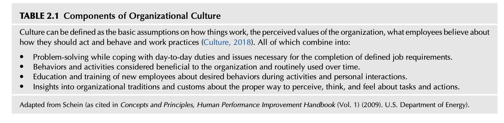
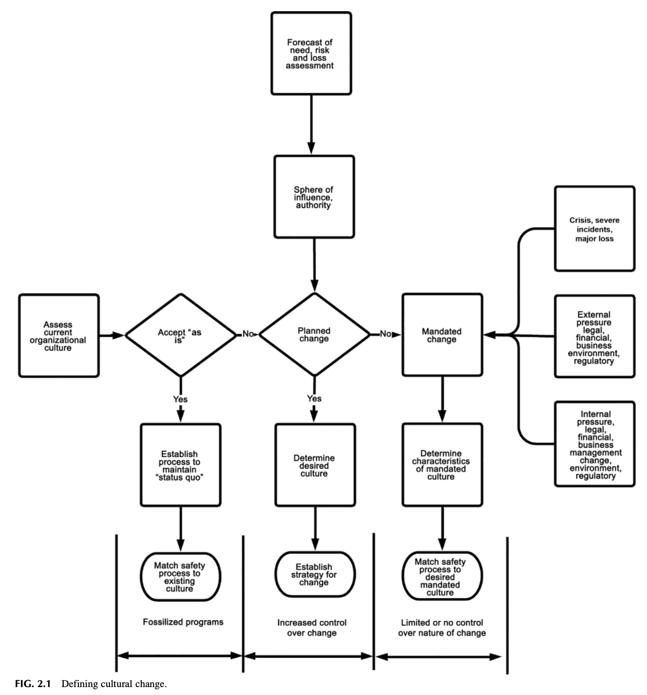
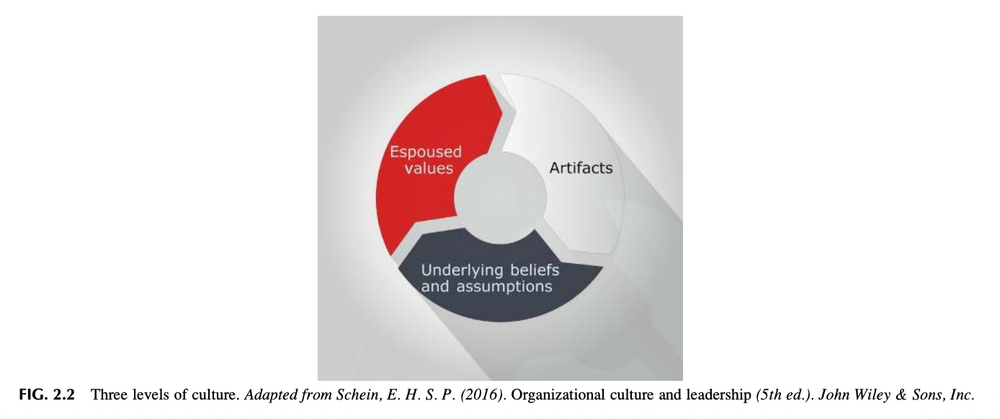
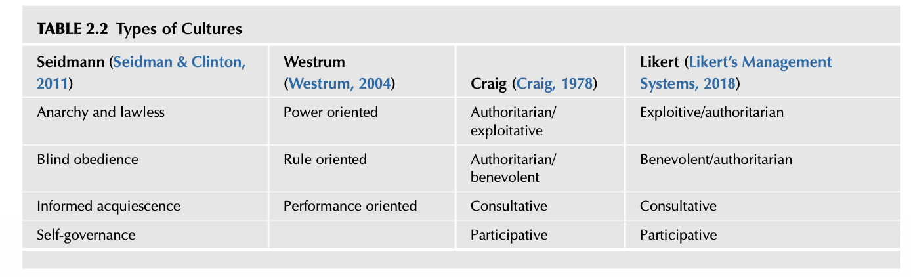
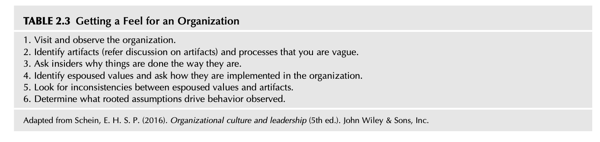
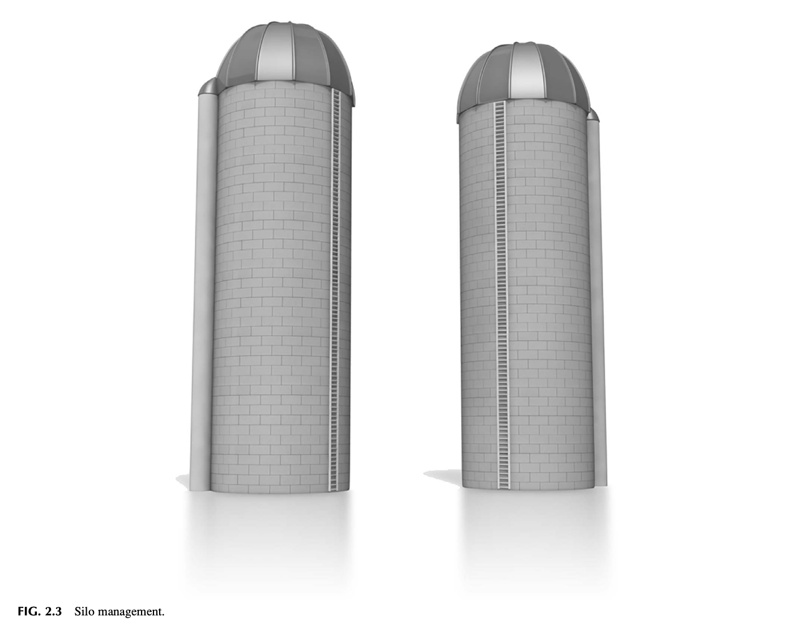
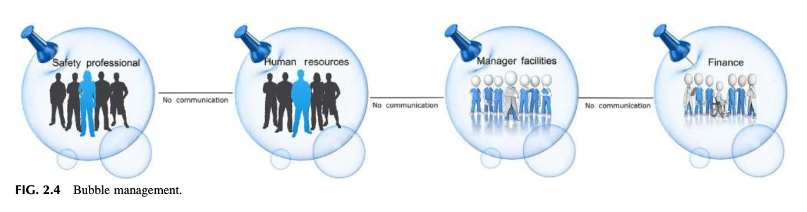
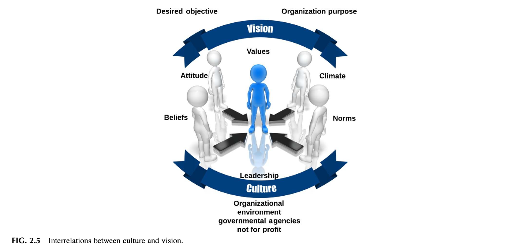
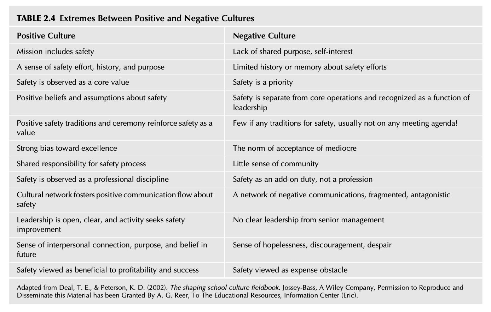

# 제2장 조직문화 분석 (Analyzing the Organizational Culture)

"문화적 유산은 강력한 힘을 발휘한다. 그것은 깊은 뿌리를 내리고 오랜 생명력을 지닌다. 그것을 탄생시켰던 경제적, 사회적, 인구통계학적 조건들이 사라진 후에도 세대를 거듭하며 사실상 온전하게 지속되며, 우리의 태도와 행동을 지시하는 데 너무나 막대한 역할을 수행하기 때문에 우리는 문화적 유산 없이는 우리 세계를 온전히 이해(의미구성)할 수 없다." — 말콤 글래드웰 (Gladwell, 2008)

## 도입 (INTRODUCTION)

조직의 문화를 깊이 이해하는 것은 효과적인 안전경영시스템의 구축 잠재력을 극대화한다. 

조직문화는 각기 다른 역사적 조건 속에서 형성되며, 이러한 역사는 조직 고유의 스타일과 개성을 창출한다. 이러한 고유한 특성들은 안전경영시스템을 배포하고 지속적으로 유지할 때 서로 다른 맞춤형 접근법이 적용될 것을 요구한다. 

조직은 공공이든 민간이든, 대기업이든 중소기업이든 간에 내·외부의 압력과 요구에 부응하기 위해 끊임없이 환경에 적응해 나간다. 조직의 안전문화를 온전히 이해하기 위해서는 끊임없이 변화하는 이 환경 속에서 안전경영시스템이 어떻게 작동해야 하는지를 명확히 정의하는 것이 그 첫 번째 단계이다. 

회복탄력성(Resilience)을 유지하기 위해, 안전 프로그램과 조치들은 조직이 문제를 해결하고, 의사결정을 내리며, 내·외부 관계를 지원하는 방식과 유기적으로 완벽히 정렬되어야 한다. 

Safety Culture (안전문화). https://doi.org/10.1016/B978-0-12-814663-7.00002-9 

"문화란 우리 주변을 언제나 둘러싸고 있는 역동적인 현상으로서, 타인과의 상호작용에 의해 끊임없이 실행되고 창조되며 리더십 행동에 의해 형성되는 동시에, 인간의 행동을 안내하고 제약하는 일련의 구조, 루틴, 규칙, 규범의 총체이다." — 에드거 샤인 (Schein, 2016). 

조직문화의 정의에 관하여 수많은 학술 연구가 발전해 왔다. 

"물고기가 가장 마지막에 알아차리는 것은 바로 물이다." — 랄프 린튼 (Linton, 2018). 

랄프 린튼의 이 격언은 지극히 진실하며 문화에 직접적으로 적용될 수 있다. 조직의 문화에 대한 깊은 이해가 결여된다면, 안전문화를 형성하려는 노력은 보이지 않는 제약과 숨겨진 경계에 부딪혀 좌초될 수 있다. 문화에 대한 명확한 이해로부터 출발하는 것은 특정한 제약 조건 속에서도 안전 프로세스를 어떻게 혁신하고 정밀하게 미세조정(Fine-tune)할 것인가를 알 수 있는 강력한 우위를 제공한다. 

이 장을 완료하면 독자는 다음을 수행할 수 있어야 한다:
* 조직문화의 구성 요소들을 식별한다.
* 조직문화의 3수준을 식별하고 토론한다.
* 안전문화의 구성 요소들을 정의하고 토론한다.
* 조직문화의 가능한 다양한 유형들을 식별한다.
* 문화를 변화시키는 실천적 방법들을 식별한다.
* 9가지 '경고 깃발(Red flags)'을 식별한다.

## 조직문화란 무엇인가? (WHAT IS ORGANIZATIONAL CULTURE?)

조직문화란 무엇인가? 문화를 이해하는 것이 왜 효과적인 안전경영시스템을 개발하는 데 절대적으로 필수적인가? 

조직문화 연구의 세계적 최고 권위자인 에드거 샤인(Edgar Schein) 박사는 다음과 같은 정의를 제시한다: "...한 집단이 외부 적응과 내부 통합의 문제를 해결해 나가는 과정에서 학습하여 창출한 '공유된 기본 가정들의 패턴(A pattern of shared basic assumptions)'. 오랜 세월에 걸쳐 이 공유된 가정들의 패턴은 충분히 유효한 것으로 입증될 만큼 훌륭하게 작동해 왔으며, 따라서 새로운 구성원들에게 그러한 문제들을 지각하고(Perceive), 생각하며(Think), 느끼는(Feel) 올바른 방식으로서 전수되고 학습된다" (DOE 인간수행역량개선 핸드북, 2009에서 재인용). 

기본적인 구성 요소, 가치관, 규범, 신념, 그리고 관행들은 안전문화를 지속시키는 강력한 원동력으로 작용할 수도 있고, 반대로 그 문화를 개선하는 치명적인 장벽이 될 수도 있다. 리더십이 제공하는 일상적인 피드백은 안전에 대한 긍정적인 가정을 강화하고 그것을 조직의 본질적 결(Fabric) 속으로 깊이 각인시킨다. 

피드백을 강화하는 방법에 관한 통찰은 제8장과 제11장을 참조하라. 조직문화의 구성 요소에 대한 심층적 논의는 표 2.1을 참조하라. 

"성격에 관해서라면 단 하나의 획일적인 잣대로 모든 것을 맞출 수는 없다(One size does not fit all). 완전히 동일한 상황에 처해 있을 때조차도, 어떤 개인은 다른 사람보다 훨씬 더 사교적이거나, 더 긴장하거나, 말을 더 많이 하거나, 더 활동적이다. 그리고 상황이 바뀐다 해도 그러한 성격적 차이는 여전히 고스란히 남아 있다." — 펀더 (Funder, 2016). 

안전경영시스템을 실행하기 위한 조직의 수용 준비도(Readiness)에 대한 일반적 평가는 전반적인 조직 환경을 진단하는 것을 수반한다. 

첫째, 조직이 진정으로 변화를 원하는가? 만약 '현상 유지(Status quo)'가 초기 상태에서 건강하고 조건이 변할 수 있을 때까지라면, 시스템은 현재의 조직문화에 조화롭게 맞춰져야 한다. 

둘째, 조직이 변화에 열려 있으며 작업 환경을 적극적으로 개선하고자 하는가? 그렇다면 시스템은 이제 새로운 문화에 발맞추어 능동적으로 진화하고 순응해 나갈 수 있다 (그림 2.1 참조).

표 2.1 조직문화의 구성 요소 (TABLE 2.1 Components of Organizational Culture)

문화는 사물이 어떻게 작동하는가에 대한 기본 가정, 조직의 지각된 가치, 직원들이 어떻게 행동하고 처신해야 하는지에 대해 품고 있는 신념, 그리고 실제 작업 관행으로 정의될 수 있다 (Culture, 2018). 이 모든 요소들은 다음과 같이 종합적으로 결합된다:
* 규정된 직무 요구조건의 완수에 필수적인 일상적 책무 및 현안 이슈들에 대처하면서 발휘되는 문제 해결 방식 (Problem-solving).
* 조직에 유익한 것으로 간주되어 오랜 시간에 걸쳐 일상적으로 반복 사용되어 온 행동 양식 및 활동들.
* 업무 활동과 대인 상호작용 과정에서 요구되는 바람직한 행동에 대해 신규 구성원을 교육하고 훈련시키는 방식.
* 과업과 조치들에 대해 올바르게 지각하고, 생각하며, 느끼는 적절한 방식에 관한 조직의 오랜 전통과 관습에 대한 통찰.
*(출처: Schein의 모델을 미국 에너지부(DOE) Human Performance Improvement Handbook (Vol. 1), 2009에서 재인용 및 각색).*

미국 항공우주국(NASA)이 직면했던 것과 같은 치명적인 참사(Severe loss)는 변화의 절박한 필요성을 만천하에 드러낸다. 참사 이후 변화와 새로운 시스템의 본질은 강제적으로 의무화되며, 일들이 실행되는 방식에 있어 허용되는 유연성은 극도로 제한된다. 

가정(Assumption)이란, "어떤 대상이 참이라고 당연하게 전제하는 것"이다 (Assumption, 2018). 

과연 구성원들은 '시스템'이 자신들에게 말하고 있는 경고음에 귀를 기울이고 있는가? 챌린저호와 컬럼비아호 두 우주왕복선 참사 모두에서 다음과 같은 통탄할 증언이 나왔다: 
**"기계는 우리에게 끊임없이 말을 걸어오고 있었지만, 그 누구도 그 소리를 들으려 하지 않았다."** 

안전 요구조건으로부터의 이탈과 일탈은 NASA 내부에서 지극히 정상적인 일상 업무로 고착화되어 있었다. 컬럼비아호 사고조사위원회(CAIB) 공식 보고서는 이를 일컬어 **'일탈의 정상화(Normalization of deviance/deviations)'**라고 명명했다 (컬럼비아 우주왕복선 사고 및 데이비스-베세 원자로 압력용기 헤드 부식 사건의 교훈, 2005). 

이러한 맹점은 비단 일선 직원들에게만 국한되지 않는다. 무언가 잘못되고 있다는 경고 신호가 명백히 발송되고 있음에도 불구하고, 최고 리더십마저 집단적인 안도감에 빠져 아무런 조치도 취하지 않는 마비 상태에 빠질 수 있다. 

조직은 거대한 위기와 극단적인 외부 압력에 직면하여 비로소 자신의 문화를 강제적으로 변화당할 수도 있다. 

고전적인 대표적 사례로서, 미국 에너지부(DOE)가 챌린저호 참사와 데이비스-베세 원자로 헤드 부식 사건을 정밀 분석하여 발표한 조사 결과는 다음과 같은 본질을 갈파하고 있다: 
"조직문화란 특정 기관의 실질적인 기능 작동을 특징짓는 기본 가치, 규범, 신념, 그리고 관행들을 의미한다. 가장 근본적인 차원에서, 조직문화는 직원들이 일상 업무를 수행할 때 품는 암묵적 가정들을 규정한다. 조직문화는 수차례의 조직 개편과 핵심 경영 인력의 이직 속에서도 끈질기게 살아남아 영속하는 대단히 강력한 힘이다." (2005).

## 최근의 역사적 배경 (RECENT HISTORY)

현대 항공사에서 1977년 3월 27일에 발생한 테네리페(Tenerife) 참사는 민간 여객기 역사상 단일 사고로 가장 많은 승객 사망자를 낸 최악의 치명적 참사로 기록되어 있다. 

이 재앙에서 로스 로데오 공항 활주로에서 KLM 보잉 747기가 이륙을 무리하게 시도하다가 활주로를 주행 중이던 팬암 747기와 정면충돌하여 무려 583명이 목숨을 잃었다. 기장의 권위주의적 조종 오류(Pilot error), 부기장 및 관제탑과의 심각한 커뮤니케이션 장애, 짙은 안개, 그리고 다른 공항의 폭탄 테러 및 2차 폭파 위협으로 인한 비행장 혼잡이 이 끔찍한 대참사를 복합적으로 초래했다 (Safety Culture and Safety Management Systems in Ireland, 2011). 

전반적인 조직문화 속에서 안전 속성들을 체계적으로 배양하는 것은 **재해(Hazard)**와 연계된 **위험(Risk)**을 지속적으로 가시화하는 데 있어 절대적으로 필수적이다. 

한 예로, 회복탄력적인 안전문화는 리더십의 올바른 의사결정을 안내하기 위해 재해(Hazard)와 연계된 위험(Risk)의 본질과 전체 범위에 대한 역사적 기록을 생생하게 보존한다. 위험의 범위를 정확하게 소통하는 것은 안전경영시스템의 핵심 기능이다. 

문화적 특성 및 잠재적 영향에 대한 깊이 있는 통찰을 얻기 위해 부록 2.1 '안전문화 특성 및 지표', 부록 2.2 '당신은 안전문화를 얼마나 알고 있는가: 기본 체크리스트', 부록 2.3 'NASA 컬럼비아호에 관한 미국 에너지부(DOE) 분석'을 참조하라. 

알려진 재해(Hazard)와 연계된 위험(Risk)을 무비판적으로 수용하는 태도는 조직의 신념 체계의 일부로 굳어져 하나의 '정상적인 규범'으로 둔갑할 수 있다! 사실상 과업만 완수된다면 부상의 위험(Risk) 속에 자신을 내던지는 행동이 묵인되고, 심지어 어떤 형태로든 칭찬이나 보상을 받기까지 한다. 

"안전의 탁월성이 오직 '사고 결함 제로(Zero failures)'라는 통계만으로 측정될 때, 조직에는 스스로를 옥죄는 편협한 시각과 근로자의 대단히 위험한 맹신이 잉태된다: 
**'만약 안전이 무사고를 의미한다면, 사고로 이어지지 않거나 내가 다치지 않고 끝난 모든 행동은 틀림없이 안전한 것임에 분명하다.'** 

이러한 치명적인 착각이 발생할 때 위험(Risk)은 철저히 간과되고, 집단적 안일함(Complacency)이 뿌리를 내리며, 위험에 대한 건강하고 소중한 취약성 인식(Vulnerability of risk)은 완전히 상실된다. 그리고 마침내 조직은 난데없이 터져 나온 불시의 참사에 경악하게 된다. 

그때 리더십이 내뱉는 뒤늦은 탄식은 언제나 똑같다: 
*'숙련되고 교육도 철저히 받은 베테랑 직원이 도대체 어떻게 저런 행동을 할 수 있었는지 믿을 수가 없다'*, 혹은 *'우리가 도대체 어떻게 저 위험을 놓칠 수 있었단 말인가?'*" — 갤러웨이 (Galloway, 2012).

## 문화의 3수준 정의 (THREE LEVELS OF CULTURE DEFINED)

조직문화를 구성하는 요소가 무엇인지 깊이 이해하는 것은 문화를 객관적으로 진단하고 검토하는 데 있어 근본적인 기초 토대를 제공한다. 

에드거 샤인은 그의 저서 『조직문화와 리더십(Organizational Culture and Leadership)』에서 문화를 3가지 주요 수준, 즉 **인공물(Artifacts), 표방된 가치(Espoused Values), 그리고 기저의 기본 가정(Underlying Assumptions)**으로 설명한다 (Schein, 2016). 

이어지는 논의는 이러한 3수준 모델이 안전문화의 깊이와 범위를 정밀하게 진단하고 평가하는 데 어떻게 강력하게 활용될 수 있는지에 대한 핵심 통찰을 제공한다.

### 인공물 (ARTIFACTS)

제1수준은 눈에 보이는 가시적인 조직 구조와 프로세스들인 **'인공물(Artifacts)'**로 구성된다. 이는 사업장 시설에서 직접 육안으로 목격되거나 조직의 외적 환경을 검토할 때 파악할 수 있는 유형의 물리적 실체들이다. 예를 들어 일반적인 정리정돈 및 청결 상태(Housekeeping), 즉 작업 구역의 전반적인

그림 2.1 문화적 변화의 정의 (Defining cultural change).

질서정연함, 기계 장비의 외관 상태 및 유지보수 수준, 시설의 유형과 배치를 포함한 가시적인 작업 환경, 위험 경고 표지판, 서면화된 안전 자료, 경영 방침, 교육 훈련장 시설, 복장 규정 등은 조직 내에 어떤 기저의 기본 가정과 신념이 자리잡고 있는지를 명확히 보여준다. 

인공물은 조직문화의 본질과 스타일을 웅변한다. 

한 예로, 네이선(Nathan)은 한 고객사의 본사 사무실을 둘러보던 중 각 사무실 큐비클(칸막이 공간)마다 한 명이 아니라 두 명의 직원이 전화기 한 대와 서류함 하나를 공유하며 빽빽하게 근무하고 있는 광경을 목격했다. 여러분이라면 이 경영 리더십의 본질에 대해 과연 무엇을 추론하겠는가? 권위주의적이고 착취적인 유형인가? 

리더십은 효율적이고 쾌적한 작업 환경을 설계할 필요성을 전혀 느끼지 못하고 있었으며, 자사 구성원들에 대해 대단히 낮은 존중을 품고 있었다. 제대로 된 본사 사무실을 꾸릴 자본 예산조차 배정하지 않는 이 리더십 팀에게서 과연 안전 관련 교재와 프로그램을 위한 적정 예산을 기대할 수 있겠는가?

### 관찰 1 (Observation 1)

네이선은 위험(Risk) 통제의 기본 원칙을 정립하는 교육 프로젝트를 위해 한 고객사를 방문했다. 교육 세션을 마치고 회사를 나서는 길에, 그는 직원들에게 "위험을 감수하라(Take the risk)!"고 독려하는 거대한 게시판 문구를 목격했다. 

'위험(Risk)'이라는 단어는 서로 정반대되는 상충된 신호를 보낼 수 있는 다중적 정의를 지니고 있다.

### 표방된 가치 (ESPOUSED VALUES)

문화의 제2수준은 **'표방된 가치(Espoused Values)'**를 수반하며, 이는 리더십이 조직을 이끌기 위해 천명하는 다양한 경영 전략, 공식 목표, 핵심 철학의 내용들로 구성된다. 

조직은 자기 자신에 대해 대외적으로 무엇이라고 말하고 있는가? 이러한 표방된 가치는 안전 표어, 사명 선언문, 그리고 안전과 직원의 소중한 가치에 관하여 공식적으로 발표되는 다양한 대외 커뮤니케이션의 형태로 표출된다. 

활동 기반 안전 프로세스(Activity-based safety process)는 제11장에서 심도 있게 논의될 것이다. 제11장에서는 매 작업일의 안전 기조를 확립하는 작업 시작 전 TBM 미팅(Preshift meetings)의 결정적 중요성을 상세히 다룬다. 또한 일선 근로자 계층에서 안전에 대한 지각을 전환하도록 고안된 다양한 기법들이 상세하게 논의된다.

### 기저의 기본 가정과 불문율 (UNDERLYING ASSUMPTIONS AND UNSPOKEN RULES)

문화의 제3수준은 눈에 보이지 않는 비가시적 영역이지만, 조직이 진정한 안전문화를 발전시키고자 한다면 반드시 정면으로 마주하고 다루어야만 하는 가장 깊은 심층부이다. 

이는 조직의 리더십과 구성원들이 무의식적으로 따르고 있는 **'기저의 규범(Underlying norms)'과 '암묵적 불문율(Unspoken rules)'**이다. 

눈에 보이지 않는 이 심층 수준은 공식적으로 선언된 표방된 가치와 격렬하게 모순되거나 충돌할 수 있다. 

눈에 보이는 인공물(Artifacts)을 세심히 관찰하고, 대외적으로 천명된 표방된 가치가 실제 현장에서 얼마나 충실하게 지켜지고 있는지를 정밀 검토함으로써, 조직을 실질적으로 움직이는 기저의 신념과 가치관을 비로소 규명해 낼 수 있다. 

진단과 평가(Evaluation)는 결코 쉬운 과업이 아니다. 조직은 겉으로는 "안전이 우리의 최우선 가치"라고 소리 높여 표방하면서도, 내부의 기저에 깔린 실제 신념은 안전을 결코 높은 우선순위로조차 취급하지 않는 경우가 허다하다 (DOE HPI Handbook, 2009; Schein, 2016).

### 관찰 2 (Observation 2)

저자들은 기업들이 공식적으로 표방하는 가치와, 실제 관찰(인공물)을 통해 드러나는 현장의 진짜 규범과 불문율 사이의 거대한 간극(Gap)을 한결같이 뼈아프게 경험해 왔다. 문화의 3수준에 대한 요약은 그림 2.2를 참조하라.

그림 2.2 문화의 3수준 (Three levels of culture. Adapted from Schein, E. H. (2016). Organizational culture and leadership (5th ed.). John Wiley & Sons, Inc.).

## 안전문화의 정의 (SAFETY CULTURE DEFINED)

안전문화는 단순히 법적 규제 준수를 위해 요구되는 형식적인 프로그램 수단을 제공하는 차원을 훨씬 뛰어넘는다. 저자들의 풍부한 실무 경험에 비추어 볼 때, 한 조직의 안전경영시스템에 대한 진정한 시험대는 **'끊임없는 변화의 소용돌이 속에서 시스템이 어떻게 흔들림 없이 유지되는가'**에 달려 있다. 

최고 리더십의 교체, 신규 인력의 유입, 예산 삭감 위기, 기업 인수합병(M&A), 그리고 기타 격변의 상황들은 조직의 모든 측면에 긍정적이거나 부정적인 막대한 영향을 미칠 수 있다. 조직이 운영상에 내재된 **재해(Hazard)**와 연계된 **위험(Risk)**을 수용 가능한 통제 상태 내로 유지하는 데 필요한 핵심 개념들을 완벽하게 내재화하지 못한다면, 안전 프로그램이나 활동들은 순식간에 흔적도 없이 사라져 버릴 수 있다. 

'안전문화(Safety Culture)'라는 용어가 문헌에 최초로 공식 등장한 것은 1986년 체르노빌 원자력 발전소 대참사 이후 작성된 공식 사고 조사 보고서에서였다. 

이 '안전문화'라는 용어는 국제원자력기구(IAEA)의 국제원자력안전자문단(INSAG)이 발간한 『체르노빌 사고 사후 검토 회의 요약 보고서』(Safety Culture Series, 1986)에서 처음 도입되었다. 그리고 1988년에 발행된 『원자력 발전소의 기본 안전 원칙 (Safety Series No. 75-INSAG-3)』(Safety Culture Series, 1988)에서 더욱 확장되고 정교화되었다. 

이 두 보고서가 발간된 이래로, '안전문화'라는 용어는 원자력 발전소의 안전과 관련하여 학술 문헌에서 기하급수적으로 사용되기 시작했다. 이 용어의 의미는 다양한 해석에 열려 있었으며, 성공적인 안전문화를 과연 어떻게 객관적으로 진단하고 평가할 수 있을 것인가에 대한 논의로 확장되었다. 

상기 보고서들은 원자력 활동에 종사하는 조직 및 개인과 연관된 안전문화의 개념을 다루며, 잠재적 개선점을 식별하기 위해 구체적인 사례에서 안전문화의 유효성을 판정하는 객관적 기준을 제공한다 (Safety Culture Series, 1991). 

국제원자력기구(IAEA)는 안전경영시스템이 지속적으로 발전함에 따라 더욱 정교하게 정의되어 온 '안전문화의 보편적 속성(Universal features of a safety culture)'을 다음과 같이 규정했다 (Safety Culture Series, 1991):

**안전문화의 보편적 속성 (Universal Features of Safety Culture)**
모든 유형의 활동에서, 모든 계층의 조직과 개인에게 안전에 대한 주의는 다음의 필수 요소들을 망라한다:
* **개인의 안전 중요성에 대한 인식 (Awareness)**: 안전의 절대적 중요성에 대한 개별 구성원의 확고한 자각.
* **지식과 역량 (Knowledge and competence)**: 구성원에 대한 전문 교육 및 지침 전달, 그리고 자발적인 자기 학습을 통해 부여되는 고도의 역량.
* **헌신과 몰입 (Commitment)**: 최고 경영진 수준에서 안전이 최우선 순위임을 솔선수범하여 입증하고, 개인들이 안전이라는 공통의 목표를 자신의 것으로 내면화할 것을 요구함.
* **동기부여 (Motivation)**: 모범적 리더십, 명확한 목표 설정, 보상과 제재 시스템의 공정한 운영, 그리고 개인의 자발적이고 긍정적인 태도 형성을 통해 고취됨.
* **감독과 코칭 (Supervision)**: 구성원들의 건전한 '의구심을 품는 태도(Questioning attitudes)'에 기꺼이 응답할 준비 태세를 갖춘 정밀 감사 및 검토 실무를 포함함.
* **책임성 (Responsibility)**: 직무 책무의 공식적인 할당 및 명확한 기술, 그리고 개인들의 깊이 있는 이해를 통해 확립됨.

안전문화는 크게 두 가지 핵심 구성 요소로 이루어진다. 첫째는 조직 내부의 필수적인 제도적 프레임워크이며 이는 경영진 위계 구조의 절대적 책임이다. 둘째는 이러한 프레임워크에 능동적으로 반응하고 혜택을 누리는 모든 계층 직원의 태도와 마인드셋이다 (Safety Culture Series, 1991).

### 관찰 3 (Observation 3)

저자들은 조직 개편이나 경영진 교체 등의 변화가 발생했을 때 연기처럼 흔적도 없이 증발해 버린 안전 추진 노력을 다시 시동(Jump-start)하도록 돕기 위해 수많은 기업들을 현장 진단해 왔다. 

수많은 사례에서, 기존의 안전 관리자가 회사를 떠났거나, 새로운 안전 관리자가 영입되었거나, 혹은 안전 프로그램이 단 한 사람의 리더에게만 전적으로 의존하고 있어서 그 핵심 인물이 떠나자마자 프로그램 전체가 허망하게 무너져 내리는 비극을 목격했다. 

진정한 안전문화는 결코 단 한 명의 특정 개인에게만 의존해서는 안 된다. 안전 프로세스는 조직의 DNA와 뼈대 속에 너무나 깊이 뿌리내려 있어서, 리더십이나 담당자가 교체되더라도 마치 물 흐르듯 중단 없이 지속될 수 있도록 제도화되어야만 한다.

### 관찰 4 (Observation 4)

마이크(Mike)는 안전문화에 대해 대단히 흥미진진한 비유를 제시한다. 그는 안전문화를 와인의 **'테루아(Terroir)'**에 빗댄다. 테루아란 포도가 재배되는 토양, 기후, 일조량 등의 총체적인 환경 조건을 의미하며, 이는 포도의 고유한 품질과 숙성된 와인의 독보적인 풍미를 결정짓는다. 

동일한 포도 품종이라 할지라도 어떤 토양과 기후에서 자라느냐에 따라 완전히 다른 와인이 탄생하듯, 동일한 규정과 시스템이라 할지라도 조직이 처한 문화적 토양(Terroir)에 따라 안전의 열매는 완전히 판이하게 맺힌다.

## 현재의 안전문화 평가하기 (ASSESSING THE CURRENT SAFETY CULTURE)

안전문화는 또한 공유된 가치관, 기준, 도덕성, 그리고 수용 가능한 행동 규범들의 총체적인 결합체이다. 

이러한 요소들은 안전경영시스템의 고도화와 지속적인 안전문화 혁신을 향한 '자기 규율적 접근법(Self-disciplined approach)'을 전폭적으로 지원하는 데 그 궁극적 목적이 있다. 

현재의 안전문화를 객관적으로 진단하고 평가하기 위해서는, 조직의 겉모습뿐만 아니라 일상적인 작업 현장에서 실제로 벌어지고 있는 적나라한 현실을 직시해야 한다.

### 관찰 5 (Observation 5)

기업 보험 인수를 위한 언더라이팅 실사 조사의 일환으로, 네이선은 기업들의 전반적인 위험(Risk) 상태를 객관적으로 평가하기 위해 안전 프로세스를 점검하러 여러 유망 기업들을 현장 방문했다. 

돌이켜보면, 대부분의 경영진은 자신들의 안전 프로그램이 얼마나 훌륭한지 번지르르하게 자랑하곤 했다. 그러나 현장 라운딩을 단 10분만 돌아보아도 경영진의 말과 현장의 실체 사이에는 하늘과 땅 차이의 거대한 간극이 존재함을 즉시 간파할 수 있었다. 

비상구는 물건들로 꽉 막혀 있었고, 근로자들은 보호안경을 턱에 걸치고 있었으며, 기계의 인터록 방호장치는 작업 속도를 올린다는 핑계로 테이프로 묶여 해제되어 있었다. 

경영진이 믿고 있는 안전과 현장 작업자들이 매일매일 체감하고 실행하는 안전 사이의 이 치명적인 단절이야말로 조직문화가 병들어 있다는 가장 강력한 증거였다.

### 관찰 6 (Observation 6)

제임스는 안전문화의 숨겨진 공백(Gap)을 가장 정확하게 식별하고 타격하기 위해, 사업장 시설을 직접 발로 걸으며 눈으로 관찰하는 현장 시각 점검과 함께 일선 현장 근로자 및 관리감독자들과의 1:1 심층 인터뷰를 유기적으로 결합할 것을 강력히 주창한다. 

경영진이 작성한 서류만을 들여다보는 것으로는 결코 현장의 살아있는 문화를 파악할 수 없다. 답은 언제나 현장의 사람들에게 있다.

## 문화의 일부로서의 습관 (HABITS AS PART OF THE CULTURE)

습관(Habits)이란 "거의 무의식적이고 반사적인 행동이 될 때까지 규칙적으로 반복 실행됨으로써 후천적으로 획득된 행동 패턴, 예컨대 길을 건너기 전에 좌우를 살피는 습관"으로 정의된다 (Habits, 2018). 

조직문화는 본질적으로 **'조직 구성원들의 습관들의 거대한 총합'**이다. 

안전한 작업 습관이든 불안전한 지름길(Shortcut) 습관이든, 습관은 오랜 세월에 걸쳐 형성되며 한 번 굳어지면 쉽게 바뀌지 않는다. 

찰스 두히그(Charles Duhigg)가 그의 명저 『습관의 힘(The Power of Habit)』에서 갈파했듯이, 모든 습관은 **'신호(Cue) - 루틴(Routine) - 보상(Reward)'**이라는 습관의 고리(Habit loop)를 따라 작동한다. 

작업자가 공정을 진행할 때 시간 압박이라는 '신호'가 주어지면, 안전 절차를 건너뛰고 방호장치를 해제하는 '루틴'을 밟고, 그 결과 작업을 빨리 끝내고 관리자에게 지적받지 않는다는 '보상'을 얻게 된다면, 이 위험한 불법적 일탈은 즉시 강력한 조직적 습관으로 고착화된다. 

안전문화를 바꾼다는 것은 바로 이러한 일상적 작업 습관의 고리를 정밀하게 해체하고, 안전한 행동이 즉각적인 인정과 보상으로 연결되는 새로운 선순환 루틴을 구축하는 것을 의미한다.

## 조직문화의 가능한 다양한 특성들 (POSSIBLE CHARACTERISTICS OF A CULTURE)

조직문화의 본질적 성격을 규명할 때, 조직을 실질적으로 움직이는 핵심 추진 특성들이 무엇이며 그러한 특성들이 조직 내의 다양한 부서 및 계층 간에 어떻게 상호 연결되어 있는지를 파악하기 위해 문화의 모든 측면들이 다각도로 평가되어야 한다. 

조직은 단일한 성격만을 띠지 않는다. 어떤 조직은 권위주의적이고 처벌 위주인 반면, 어떤 조직은 자율적이고 협력적이다. 

이러한 문화적 성격은 안전을 대하는 구성원들의 태도를 결정짓는 가장 핵심적인 렌즈가 된다.

### 교훈 1 (LESSON LEARNED 1)

네이선은 직속 상사가 최근 교체된 한 안전 관리자와 협력하여 업무를 수행한 적이 있다. 이전의 상사는 전형적인 '성과 중심/협의형(Performance/consultative)' 스타일이었다. 그는 추진할 과업에 대한 완전한 세부사항을 제공하고 아이디어를 경청하며 열린 토론을 장려했다. 

그러나 새롭게 부임한 상사는 정반대의 극단적인 '권위주의적/착취적(Authoritarian/exploitative)' 스타일이었다. 그는 오직 일방적인 복종만을 강요했고, 일체의 이견이나 의문을 용납하지 않았다. 

단 한 명의 핵심 리더가 바뀌었을 뿐인데, 부서의 일상적인 커뮤니케이션과 안전 추진 동력은 순식간에 얼어붙고 말았다. 리더의 스타일이 문화와 프로세스에 미치는 영향력은 이토록 막대하다.

### 관찰 7 (Observation 7)

또 다른 조직에는 모든 관리자들이 공식 출근 시간보다 훨씬 이른 새벽에 출근하고 매일 밤늦게까지 야근해야 한다는 강력한 암묵적 불문율이 지배하고 있었다. 

각 관리자는 또한 주말 중 하루를 회사에 나와 근무할 것을 암묵적으로 강요받고 있었다. 

이러한 조직에서 '피로(Fatigue)'와 '번아웃(Burnout)'은 일상화되어 있었으며, 극심한 만성 피로는 인적 오류와 중대사고의 치명적인 잠재 원인으로 곪아가고 있었다.

표 2.2 조직문화의 다양한 유형 분류 비교 (TABLE 2.2 Types of Cultures)

| 자이드만 (Seidman, 2011) | 웨스트럼 (Westrum, 2004) | 크레이그 (Craig, 1978) | 리커트 (Likert, 2018) |
| :--- | :--- | :--- | :--- |
| **무정부 및 무법 (Anarchy and lawless)** | **권력 지향형 (Power oriented)** | **권위주의적 / 착취적 (Authoritarian / exploitative)** | **착취적-권위주의 (Exploitive / authoritarian)** |
| **맹목적 복종 (Blind obedience)** | **규칙 지향형 (Rule oriented)** | **권위주의적 / 온정적 (Authoritarian / benevolent)** | **온정적-권위주의 (Benevolent / authoritarian)** |
| **정보에 입각한 묵종 (Informed acquiescence)** | **성과 지향형 (Performance oriented)** | **협의형 (Consultative)** | **협의형 (Consultative)** |
| **자기 통치 (Self-governance)** | *(생성적/Generative 문화에 해당)* | **참여형 (Participative)** | **참여 집단형 (Participative)** |

*(웨스트럼의 병리적(Pathological) - 관료적(Bureaucratic) - 생성적(Generative) 3단계 안전문화 모델 및 리커트의 4대 경영시스템 분류와 완벽히 궤를 같이함).*

### 교훈 2 (LESSON LEARNED 2)

제임스는 전사적인 일반 안전 관련 이슈들을 해결하는 과업을 부여받은 여러 부서 출신의 다양한 직원들로 구성된 다기능 TF 팀에 참여한 적이 있다. 

이 팀에는 현장의 안전 개선 아이디어를 실제로 실행할 수 있는 독립적인 예산이 부여되었다. 

이러한 '참여형(Participative)' 자율 권한 부여는 직원들의 주인의식을 극적으로 고취시켰으며, 수많은 고질적인 현장 위험요인들이 단기간에 자발적으로 해결되는 눈부신 성과를 낳았다.

## 커뮤니케이션 (COMMUNICATION)

**재해(Hazard)**와 연계된 **위험(Risk)**의 관점에서 볼 때, 궁극적인 목표는 안전 관련 이슈와 우려 사항들이 어떠한 장벽도 없이 최종 의사결정권자에게 가능한 한 신속하게 전달되도록 보장하는 것이다. 

위험 커뮤니케이션(Risk communication)의 설계 방식은 조직문화의 유형과 스타일에 따라 크게 달라진다. 

참여형(Participative) 문화 유형에서는 직원들이 신뢰받는 전문가로 대우받고 자발적인 소통이 기대되므로 정보의 공유가 훨씬 더 수월하게 관리될 수 있다. 향후 조치에 관한 의사결정에 반드시 최고위층의 승인이 요구되는 것은 아니며, 현장의 문제를 먼저 신속히 시정 조치하고 차후에 적절한 후속 조치를 위해 합의에 도달하는 방식으로 충분하다. 

문제는 경직된 권위주의적 문화 유형과 스타일이 심각한 소통 장벽과 의도적인 '정보 검열 및 걸러내기(Screening of information)'를 낳는다는 점이다. 중간 관리자와 일선 직원들은 자신들이 책임을 추궁당하거나 처벌받을 것을 두려워한 나머지 경영진에게 '나쁜 소식(Bad news)'이나 골치 아픈 문제를 보고하지 않고 은폐하려 든다. 

안전 전문가가 조직의 행동 특성을 체감하고 파악하는 데 유용한 영역 목록은 표 2.3을 참조하라.

### 관찰 8 (Observation 8)

제임스는 기업 합병(M&A) 기간 동안 각 사업장의 공장장들에게 전화를 걸어 그들의 안전 프로세스에 대해 논의하곤 했다. 이를 통해 공장장들이 자사의 안전 시스템에 대해 얼마나 깊이 이해하고 있는지를 객관적으로 평가할 수 있었다. 

그는 자신이 전화를 건 날짜와 시간을 꼼꼼히 기록하고, 통화 중에 상대방의 목소리 톤, 주저함, 질문에 대한 구체적 답변 내용 등을 면밀히 관찰하여 해당 공장의 살아있는 안전문화 수준을 날카롭게 진단해 냈다. 

공장장이 안전을 생산의 거추장스러운 방해물로 여기는지, 아니면 핵심 경쟁력으로 자부하는지는 단 10분의 통화만으로도 적나라하게 드러났다.

## 사일로 관리 (SILO MANAGEMENT)

수많은 조직의 안전문화에서 발견되는 대단히 심각한 고질적 병폐는, 안전관리 기준이 사업부, 부서, 리더십 팀, 그리고 일반 직원들에게 효과적으로 소통되지 못한다는 점이다. 

수많은 사례에서 안전 전문가들은 "효과적인 안전경영시스템을 실행해야 하는 막중한 도전에 직면해 있으면서도, 조직 내에 팽배한 **'사일로 멘탈리티(Silo mentality)'**를 먼저 극복해야만 하는 이중고"를 겪고 있다 (Howell, 2015). 

"사일로(Silos)는 부서의 비효율성을 초래하고 부서 간 교차 기능적 솔루션을 원천 차단하는 파괴적인 조직적 장벽이다" (Dorn, 2015). 

사일로란 무엇인가? 동일한 회사 내의 특정 부서나 섹터가 다른 부서와 정보를 일체 공유하려 하지 않는 폐쇄적인 사고방식을 의미한다. 이러한 편협한 멘탈리티는 조직 전체의 전반적인 운영 효율성을 떨어뜨리고, 사기를 저하시키며, 생산적인 기업문화를 파멸로 이끄는 주범이 된다 (Silo Mentality, 2018). 

조직의 사일로는 "하나의 시스템, 프로세스, 부서 등을 다른 것들로부터 철저히 고립"시킨다 (Silo, 2018). 사일로가 존재하는 곳은 서로 다른 부서와 개인 간의 건강한 관계와 소통을 질식시키기 때문에 조직에 대단히 유해하다. 

"사일로 멘탈리티에 갇히면 각 본부나 부서는 거시적인 전사적 조직 목표보다는 오직 자신들만의 협소한 당면 목표에만 매몰되는 경향을 보인다" (Health, Safety, and Silo working, 2012). 사일로 관리의 구조적 병폐를 나타낸 그림 2.3을 참조하라.

표 2.3 조직의 실제 문화를 체감하기 위한 6단계 진단법 (TABLE 2.3 Getting a Feel for an Organization)

1. 조직 현장을 직접 방문하여 일상적 행동을 주의 깊게 관찰하라.
2. 눈에 보이는 인공물(Artifacts)과 모호하게 느껴지는 업무 프로세스를 식별하라.
3. 현장 내부자들에게 왜 일들이 현재의 방식대로 수행되고 있는지 솔직한 이유를 질문하라.
4. 회사의 표방된 가치를 식별하고 그것이 실제 조직 내에서 어떻게 실행되고 있는지 구체적으로 물어보라.
5. 표방된 가치(Espoused values)와 실제 관찰된 인공물(Artifacts) 사이에 존재하는 모순과 불일치를 철저히 찾아내라.
6. 관찰된 실제 행동들을 은밀히 추동하는 깊이 뿌리박힌 기저의 기본 가정이 무엇인지 명확히 규명하라.
*(출처: Schein, E. H. (2016). Organizational culture and leadership (5th ed.). John Wiley & Sons, Inc.에서 각색).*

그림 2.3 사일로 관리 (Silo management).

사일로 멘탈리티가 미치는 악영향은 전반적인 안전 운영을 달성하는 효율성을 저하시키며 안전문화를 부식시키고 퇴행시키는 데 결정적인 역할을 한다. 

안전 전문가는 조직의 모든 경계를 넘나들며 협력해야 하기 때문에, 부서 간의 장벽은 치명적인 안전 위험요인 정보를 가로막는 재앙의 온상이 된다. 

이를 극복하지 못하면 안전은 각자도생의 고립된 섬으로 전락하고 만다 (그림 2.4 참조).

그림 2.4 버블 관리 (Bubble management).

### 관찰 9 (Observation 9)

제임스는 기업 합병 후 새로 인수한 여러 공장들을 총괄 관리하게 되었을 때 극심한 사일로 멘탈리티와 맞닥뜨렸다. 

공장들 사이에 존재하는 엄청난 격차와 단절을 다루면서 그는 **'버블 관리(Bubble management)'**라는 표현을 사용했다. 

각 공장은 자신들만의 거대한 투명한 '비눗방울(Bubble)' 속에 갇혀 외부의 그 어떤 간섭이나 모범 사례도 받아들이려 하지 않았고, 심지어 동일한 회사 내의 다른 공장에서 일어난 중대재해 정보조차 "그건 저 공장의 일일 뿐 우리와는 무관하다"며 철저히 외면하고 있었다. 

이러한 고립된 버블을 과감히 터뜨리고 투명한 소통망을 여는 것이 안전문화 혁신의 최우선 과제였다.

## 국가 및 직업 문화 (NATIONAL AND OCCUPATIONAL CULTURES)

문화의 또 다른 두 가지 중요한 측면이 반드시 고려되어야 한다. 

첫째, 서로 다른 문화적 배경을 가진 사람들이 동일한 방식으로 생각하고 행동할 것이라고 기대하는 보편주의적 편향이다. 특정 지역, 국가, 비즈니스 문화권에서 사람들이 말하는 바와 세상을 바라보는 시각이 전 세계 어디서나 똑같을 것이라는 순진한 가정이 내려지곤 한다. 

각 지역과 국가에는 오랜 역사로 다져진 고유의 지배적인 문화가 존재한다. 권력이 어떻게 분배되고 행사되는지(권력 거리), 사회적 계층과 위계질서, 허용되는 인간관계의 방식 등은 국가마다 천차만별이다. 한 국가(또는 특정 산업이나 기업)에서 훌륭하게 작동했던 제도가 다른 국가에서는 전혀 수용되지 않을 수 있다 (The Hofstede Centre, 2018; 홉스테데 문화 차원 이론). 

조직문화가 회사마다, 부서마다 다를 수 있지만, 오늘날 다국적 글로벌 기업이 보편화된 현실은 이러한 복잡성을 한층 더 심화시킨다. 전통, 언어, 몸짓과 매너의 차이가 리더십과 조직 구성원이 품는 지각에 지대한 영향을 미치므로 이질적인 다문화에 대한 깊은 국제적 이해는 절대적으로 필수적이다. 

둘째, 조직 내의 다양한 전문 직무 분야들마다 제각기 독자적인 **'직업 문화(Occupational cultures)'**를 형성하고 있다는 점이다. 

앞서 논의했듯이, 시각적 이미지, 고유한 성격 유형, 자존심(Ego), 지각된 신념, 커뮤니케이션 스타일, 요구되는 신뢰의 수준, 바라는 사회적 지위 등은 특정 직업군의 사람들을 바라보는 시각에 짙은 색채를 덧입힌다. 

흥미로운 점으로, 여러분은 다음의 직업들을 들었을 때 머릿속에 즉각 어떤 이미지가 떠오르는가? 은행원, 자동차 영업사원, 정치인, 엔지니어, 카우보이, 광부, '블루칼라' 생산직 근로자, 유전 석유 노동자, 항공기 조종사, 직업 군인. 

이러한 고정관념(Stereotype)은 대중 매체, 구전되는 이야기, 기대되는 규범에 의해 지속적으로 강화되며, 새로운 안전 프로그램이 도입되고 현장에 배포될 때 구성원들이 어떤 행동을 보일지 예측하는 데 중요한 통찰을 제공한다 (Schein, 2016). 

고정관념(Stereotype)이란 "변화 없이 획일적으로 반복하는 것", "대상의 특성을 머릿속에 정형화하여 고정시키는 것"을 의미한다 (Stereotype, 2018). 나아가 고정관념은 좋든 나쁘든 논의된 각 집단의 기대되는 직업 문화에 관한 일종의 '단축 정보(Shorthand information)'를 제공한다. 

인간은 직업 문화의 고정관념 렌즈를 통해 타인을 바라본다. 안전 전문가 역시 특정한 행동 양식을 지니고 있을 것이라는 사회적 기대를 받으며, 안전 프로세스가 어떻게 작동해야 하는지에 대한 고정된 가정을 마주하게 된다. 이러한 고정관념적 가정들은 무엇을 완수해야 하며 안전 프로세스를 어떻게 관리해야 하는가에 관한 조직의 견해와 지각을 심각하게 왜곡시킬 수 있다. 

조직문화 전체가 안전 전문가에게 특정한 방식으로 행동할 것을 기대하기 때문에 이러한 고정관념을 반드시 고려해야 한다. 

예컨대 조직을 구태의연한 '무손실 = 무위험(No Loss No Risk)' 멘탈 모델에서 벗어나게 하려 할 때, 이는 안전 전문가에게 기대되는 전통적인 고정관념의 틀을 깨는 것이므로 조직 내부의 극심한 저항에 직면할 수 있다. 그들의 뇌리에는 "어쨌든 지금까지 아무런 사고도 안 났는데, 왜 골치 아프게 위험성평가를 새로 해야 한단 말인가?"라는 안일한 생각이 뿌리박혀 있기 때문이다.

## 핵심 경영 우선순위로서의 안전문화 (SAFETY CULTURE AS MISSION-ESSENTIAL BUSINESS PRIORITY)

경영 리더십은 조직의 최우선 사명인 시장에서의 독보적 생존을 완수하는 데 필요한 수많은 비즈니스 활동들의 전략적 우선순위를 결정한다. 리더십은 가능한 한 가장 높은 수준에서 오직 **'사명 필수(Mission-essential)'**적인 핵심 과업들에만 자신의 주의와 자원을 집중해야 한다.

그림 2.5 문화와 비전 간의 상호 유기적 관계 (Interrelations between culture and vision).

가능한 최대한도로 말이다. 안전에 대해 형성되어 있는 편협한 고정관념 때문에, 안전이 회사의 가장 핵심적인 '사명 필수(Mission-essential)' 과업으로 인정받기 위해서는 끊임없는 전략적 노력이 경주되어야 한다. 

목표와 목적은 제4장에서 상세히 논의될 바와 같이 반드시 사명 필수적이어야 한다. 

사명 필수 활동(Mission-essential activities)이란 조직의 궁극적인 비전이나 의도가 성공적으로 달성될 수 있는 확률을 가장 극대화하도록 보장하는 지정된 핵심 조치와 기준들을 의미한다. 

자신이 추진하는 안전 프로세스가 진정으로 '사명 필수'의 요건을 충족하고 있는지 판별하려면, 매일 스스로에게 다음의 두 가지 본질적 질문을 던져보라:
* 당신은 오늘 하루 동안 자신의 노력을 조직의 비전, 거시 목표, 그리고 전략적 목적과 일치시키고 전진시키기 위해 구체적으로 무엇을 실행했는가?
* 다른 전사적 경영 프로젝트들을 제치고 강력하게 추진되고 있는 안전경영시스템의 진정한 사명 필수 우선순위는 무엇인가? 그리고 왜 그 프로젝트들이 다른 것보다 우선권을 부여받고 있는가?
문화와 비전 사이의 유기적인 상호 관계에 대한 전체적인 개요는 그림 2.5를 참조하라.

## 조직문화는 변화될 수 있는가? (CAN A CULTURE BE CHANGED?)

현재 안전경영시스템의 진정한 사명 필수 과업이 아님에도 불구하고 불필요하게 강조되고 낭비되고 있는 활동들은 무엇인가? 

긍정적인 안전문화와 부정적인 안전문화 사이에 존재하는 극단적인 차이점들에 대해서는 표 2.4를 참조하라.

## 기본 격차 분석 수행하기 (CONDUCTING A BASIC GAP ANALYSIS)

안전경영시스템을 개선하기 위한 현장 진단 결과와 발견점들을 리더십 팀에 어떻게 설득력 있게 제시할 것인가에 대한 정교한 전략이 요구된다. 

사내의 전반적인 '정치적(Political)' 기후에 대한 깊은 이해가 필수적이며, 이는 리더십이 안전 권고사항을 어떻게 받아들일 것인가를 좌우한다. 

격차 분석(Gap Analysis)을 성공적으로 수행하기 위해 다음과 같은 세 가지 핵심 질문을 반드시 던져야 한다:

표 2.4 긍정적 문화와 부정적 문화 간의 극단적 대조 비교 (TABLE 2.4 Extremes Between Positive and Negative Cultures)

| 긍정적 문화 (Positive Culture) | 부정적 문화 (Negative Culture) |
| :--- | :--- |
| **공식 사명(Mission)에 안전이 핵심으로 포함되어 있다.** | **공유된 사명 의식이 결여되어 있으며, 각자도생의 이기주의만 팽배하다.** |
| **안전 추진 노력에 대한 자부심, 역사, 그리고 뚜렷한 목적의식을 공유한다.** | **과거의 안전 노력에 대한 역사적 기억이나 교훈의 축적이 거의 없다.** |
| **안전은 타협할 수 없는 핵심 가치(Core value)로 관찰되고 실행된다.** | **안전은 우선순위 중 하나에 불과하여 상황에 따라 언제든 밀려난다.** |
| **안전에 대한 긍정적 신념과 건설적인 기본 가정이 지배한다.** | **안전은 핵심 본원적 운영과 분리된 별개의 거추장스러운 잡무로 여겨진다.** |
| **긍정적인 안전 전통과 의식이 안전을 핵심 가치로 끊임없이 강화한다.** | **안전을 기리는 전통이나 행사가 전무하며, 회의 안건에조차 오르지 않는다!** |
| **탁월함(Excellence)을 향한 강력한 집념과 지향성을 품는다.** | **그저 그런 어중간하고 평범한 수준(Mediocre)을 당연시하는 규범이 지배한다.** |
| **안전 프로세스에 대한 전사적 공동 책임 의식을 공유한다.** | **공동체 의식이 극도로 희박하며 네 탓 공방만 벌어진다.** |
| **안전은 고도의 전문성을 요하는 독립된 학문적·실무적 전문직으로 존중받는다.** | **안전은 전문직이 아니라 다른 본업에 곁다리로 얹혀진 부수적 잡무 취급을 받는다.** |
| **문화적 네트워크가 안전에 관한 긍정적인 커뮤니케이션 흐름을 촉진한다.** | **부정적이고 파편화되며 적대적인 뒷말과 소문 네트워크만 무성하다.** |
| **리더십은 개방적이고 명확하며 솔선수범하여 안전 개선을 능동적으로 추구한다.** | **최고 경영진으로부터의 어떠한 명확한 리더십이나 비전 제시도 부재하다.** |
| **구성원 간의 인간적 유대감, 사명감, 그리고 미래에 대한 확고한 믿음이 존재한다.** | **집단적인 무력감, 낙담, 냉소주의와 절망감이 팽배해 있다.** |
| **안전은 조직의 수익성과 장기적 성공에 절대적으로 유익한 투자로 간주된다.** | **안전은 이윤을 갉아먹는 순수한 비용 지출이자 방해물로 취급된다.** |

*(출처: Deal, T. E., & Peterson, K. D. (2002). The shaping school culture fieldbook. Jossey-Bass에서 인용 및 안전 맥락으로 각색).*

* 조직이 진정으로 소중히 여기는 가치는 무엇인가?
* 조직 내에서 일상적인 업무 우선순위는 실제로 어떻게 결정되고 있는가?
* 현재 우리 조직의 안전문화 상태는 과연 어떠한가? 다음 장에서 논의될 핵심 인맥과 공식·비공식 네트워크를 통해 현재의 문화에 관한 정보를 가능한 한 폭넓고 깊이 있게 수집하라.

## 통제를 무력화하는 9가지 경고 깃발 (NINE WARNING FLAGS FACTORS THAT DEFEAT CONTROL)

미국 에너지부(DOE) 인적수행역량개선 핸드북에 인용된 미국 원자력발전운전협회(INPO)의 정밀 연구에 따르면, 안전문화를 급격히 부식시키고 퇴행시킬 수 있는 9가지 치명적인 공통적 취약점이 규명되었다. 

INPO는 **"이러한 잠재적 취약 조건(Latent conditions)들이 결함 있는 통제(Flawed controls)의 누적을 촉진하고, 인적 오류 및 참사와 직결되는 사건들의 온상이 된다"**고 강력히 경고했다 (Concepts and Principles, Human Performance Improvement Handbook, 2009). 

이 9가지 경고 깃발(Red flags)을 조직을 진단하고 평가하는 또 하나의 강력한 나침반으로 활용하라. 조직 내에 다음의 징후들이 나타나고 있는지 냉정하게 감시하라:

1. **자만심과 과신 (Overconfidence)**: 
   최근에 아무런 사고나 손실이 발생하지 않았다는 이유만으로 위험(Risk)이 낮다고 맹신하기 시작한다. 동종 업계와 비교할 때 회사의 부상 및 손실 통계가 양호하고 대형 사고가 없었다는 과거 실적에 도취된다. 안전 회의, 현장 순회 점검, 안전 방침과 절차 준수가 과거처럼 엄격하게 실행되지 않고 느슨해진다. 잠재적인 안전 이상 징후나 결함들이 제대로 검토되거나 원인 분석되지 않는다.

2. **고립주의 (Isolationism)**: 
   외부의 다른 선진 기관, 전문 학술 단체, 규제 기관, 산업 협회와의 교류와 벤치마킹이 거의 없거나 전무하다. 타 조직에서 발생한 사고 조사 보고서, 직원의 피드백, 외부에서 새롭게 식별된 **재해(Hazard)** 및 연계된 **위험(Risk)** 이슈들을 반영하여 자사의 모범 경영 관행(Best practices)을 업데이트하려 하지 않는다. 조직은 성과의 수많은 영역에서 업계 표준에 뒤처져 있으며, 자신이 직면한 재해(Hazard)와 위험(Risk)의 실제적인 전체 규모조차 전혀 파악하지 못하고 있다. 손실을 유발하는 사건의 높은 발생 확률을 사전에 탐지해 낼 수 있는 위험성평가 체계가 완전히 실종되어 있다.

3. **방어적 태도와 적대적 관계 (Defensive and Adversarial Relationships)**: 
   정부 규제 기관이나 외부 전문가 그룹에 대한 사고방식이 극도로 방어적이고 폐쇄적이다. 안전 개선 권고사항을 제시하면 "이것이 노동부(OSHA)나 법령에서 의무화한 법적 강제 사항입니까?"라며 날 선 반문부터 튀어나온다. 안전 활동의 주된 기조는 오직 '법적 최소한만 때우는(Do the minimum)' 복지부동이다. 근로자들은 안전 프로세스에 전혀 참여하지 못하며, 잠재적으로 위험한 작업 조건에 대해 우려를 표명해도 경영진은 귀를 닫는다. 열악한 인간관계가 열린 소통을 가로막아 안전 기능은 생산성과 수익성을 방해하는 적대적 장애물로 취급받는다.

4. **비공식적 주먹구구 운영과 취약한 엔지니어링 (Informal Operations and Weak Engineering)**: 
   표준작업절차(SOP), 체계적인 예방정비 유지보수, 정리정돈, 품질 관리가 지극히 비공식적이고 취약하다. 현장의 안전 규율이 완전히 실종되어 있으며 안전에 대해 극도로 나태하고 안이한 분위기가 팽배하다. 경영진의 잦은 교체, 새로운 경영 혁신 구호, 특별 프로젝트와 같은 외생적 요인들이 조직 본연의 비전, 사명, 전략적 안전 목표를 완전히 집어삼킨다. 엔지니어링 역량이 형편없으며 설계 기준에서 안전을 최우선 경영 과제로 고려하지 않는다. 정비 보수 요청 시스템에서 불안전한 상태에 대한 개선 작업이 높은 우선순위로 배정되지 못하고 방치된다.

5. **생산 최우선주의 (Production Priorities)**: 
   기계 방호장치의 결함, 전기 배선 시스템의 위험, 기타 긴급 정비와 같은 중대한 설비 문제가 단지 생산 라인을 멈추지 않고 계속 가동해야 한다는 이유만으로 무기한 연기된다. 일상적인 작업 지시나 사내 소통에서 안전은 전혀 강조되지 않는다.

6. **부실한 변경관리 (Inadequate Change Management)**: 
   조직 개편, 인력 감축(구조조정), 명예퇴직, 사업장 이전 등이 그러한 조치가 초래할 잠재적 위험이나 의도치 않은 파장(Unintended consequences)에 대한 철저한 사전 평가도 없이 졸속으로 단행된다. 신규 채용 절차에 오리엔테이션과 교육이 형식적으로 포함되어 있지만, 운영상의 급격한 변화를 보완하는 데는 턱없이 부족하다. 경영진이 바뀌고 공정이 변경된 후에도 표준 프로세스와 안전 절차는 과거 그대로 방치되어 있다.

7. **공장 운영 사고의 은폐 및 과소평가 (Plant Operational Events)**: 
   손실을 유발한 사고나 아차사고들이 제대로 인식되지 않거나 사소한 것으로 축소·은폐된다. 불안전한 상태나 사건에 대한 회사의 대응 조치는 대단히 미온적이고 협소하여 최고 리더십의 관심에 도달조차 하지 못한다. 손실 사건의 심층적인 근본 원인(Root cause)을 체계적이고 과학적으로 규명하려는 노력이 전혀 이루어지지 않는다.

8. **무능하고 방어적인 리더들 (Ineffective Leaders)**: 
   리더십의 역량이 형편없고, 현장의 문제가 지적되면 극도로 방어적으로 변하며, 팀 빌딩 역량이 결여되어 있거나 모든 영역에서 소통 능력이 심각하게 떨어진다. 리더십 팀이 실제 운영 현장에 전혀 관여하지 않으며, 안전 관련 이슈에 대해 그 어떤 책무성(Accountability)도 행사하지 않고 후속 조치도 챙기지 않는다. 리더들이 운영에 대한 실무 지식이나 경험이 일천하며 스스로 능동적으로 학습하려 하지도 않는다.

9. **자기비판의 결여 (Lack of Self-Criticism)**: 
   조직에 대한 진단과 감사가 편향되지 않은 외부의 객관적인 독립적 시각의 부재로 인해 심각하게 제한된다. 자체 평가 시스템이 형식적이지 못하며, 그 어떤 평가 결과도 최고 리더십 팀의 내부 전략 검토 안건으로 다루어지지 않는다. 이러한 맹점은 실제 운영 현장의 가혹한 현실과 장밋빛 자체 평가 보고서 사이의 치명적인 단절을 초래한다. 위험 문제는 식별되지도 않고, 보고되지도 않으며, 따라서 결코 해결되지 않은 채 곪아 터지기만을 기다린다 (Roughton & Crutchfield, 2010; Concepts and Principles, Human Performance Improvement Handbook, 2009).

효과적인 안전문화를 발전시키는 데 있어 조직적 네트워크 형성(Networking)이 갖는 막대한 중요성은 제3장에서 본격적으로 논의될 것이다. 제3장의 논의는 조직 네트워크의 중요성이 아무리 강조해도 지나치지 않다는 점을 중심으로 전개될 것이다. 조직은 개인적·전문적 네트워크들의 거대하고 복잡한 그물망으로 간주될 수 있다는 개념이 제시될 것이다.

## 요약 (SUMMARY)

안전문화의 성공적인 실행, 흔들림 없는 유지, 그리고 지속적인 개선을 달성하기 위해서는 셜록 홈즈(Sherlock Holmes)와도 같은 날카로운 관찰력과 치밀한 논리력이 요구된다. 

즉 눈에 보이는 피상적인 현상 너머에서 기저의 기본 가정들이 도대체 **무엇이며, 어디에 숨어 있고, 어떻게 작동하는지**를 식별해 내는 탐정의 직관이 필요하다. 

문화를 깊이 이해한다는 것은 조직의 고유한 개성을 파악하고, 그 속에서 안전경영시스템이 어떻게 조화롭게 작동할 수 있는지를 알아내는 것이다. 

문화는 고정불변의 화석이 아니다. 에드거 샤인의 3수준 모델(인공물, 표방된 가치, 기저의 기본 가정)을 체계적인 진단 도구로 활용하고, INPO의 9가지 경고 깃발을 엄격한 조기 경보 지표로 삼아 현장의 맹점을 끊임없이 교정해 나갈 때 비로소 진정한 고신뢰 안전문화가 뿌리내릴 수 있다.

## 복습 질문 (CHAPTER REVIEW QUESTIONS)

1. 안전 프로세스의 효과적인 개발 및 구현 잠재력을 극대화하기 위해 조직문화를 깊이 이해하는 것이 왜 절대적으로 필수적인지 설명하라.
2. 조직문화란 무엇인가?
3. 문화의 3수준을 식별하고 각 수준을 구체적인 예시와 함께 논하라.
4. 테네리페 참사에서 문화가 미친 영향에 대해 토론하라.
5. 안전문화란 무엇인가?
6. 안전문화의 6대 보편적 속성을 식별하고 토론하라.
7. 조직의 살아있는 문화를 체감하고 파악하기 위한 6단계를 식별하라.
8. 사일로 멘탈리티(Silo Mentality)와 버블 관리(Bubble Management)의 위험성을 논하라.
9. 국가 문화와 직업 문화가 안전에 미치는 영향에 대해 토론하라.
10. 안전문화가 왜 '사명 필수(Mission-essential)' 우선순위가 되어야 하는지 설명하라.
11. 표 2.4에 제시된 긍정적 문화와 부정적 문화의 극단적 차이점에 대해 토론하라.
12. 통제를 무력화하는 9가지 경고 깃발(Nine Warning Flags)을 식별하고 상세히 설명하라.

## 부록 2.1 안전문화 특성 및 지표 (APPENDIX 2.1 SAFETY CULTURE TRAITS AND INDICATORS)

미국 원자력규제위원회(NRC)가 2012년 1월에 공식 발표한 최종 안전문화 정책 성명서(Safety Culture Policy Statement)는 긍정적인 안전문화를 구성하는 9대 핵심 특성을 다음과 같이 제시한다:

1. **리더십의 안전 가치 및 솔선 조치 (Leadership Safety Values and Actions)**: 
   리더들은 자신의 모든 경영 의사결정과 실제 행동을 통해 안전에 대한 확고한 헌신과 몰입을 몸소 입증한다.
2. **문제 식별 및 해결 (Problem Identification and Resolution)**: 
   안전에 잠재적 영향을 미칠 수 있는 모든 이슈들을 지체 없이 신속히 식별하고, 철저히 평가하며, 그 위험의 심각도에 상응하여 즉각적으로 해결하고 시정 조치한다.
3. **개인적 책무성 (Personal Accountability)**: 
   조직 내의 모든 개별 구성원이 안전에 대해 확고한 개인적 책임을 진다.
4. **작업 프로세스 (Work Processes)**: 
   안전이 상시적으로 유지될 수 있도록 모든 작업 활동을 계획하고 통제하는 프로세스를 철저히 실행한다.
5. **지속적 학습 (Continuous Learning)**: 
   안전을 보장하고 고도화할 수 있는 방안을 학습할 수 있는 모든 기회를 능동적으로 모색하고 현장에 실천한다.
6. **자유로운 우려 제기 환경 (Environment for Raising Concerns)**: 
   그 어떠한 보복, 협박, 괴롭힘, 또는 차별에 대한 두려움 없이 모든 직원이 안전상의 우려를 자유롭게 제기할 수 있는 '안전의식 작업 환경(Safety Conscious Work Environment, SCWE)'을 확고히 유지한다.
7. **효과적인 안전 커뮤니케이션 (Effective Safety Communication)**: 
   모든 사내 커뮤니케이션이 안전에 대한 지속적인 초점을 확고히 유지한다.
8. **상호 존중의 작업 환경 (Respectful Work Environment)**: 
   신뢰와 존중이 조직의 모든 모세혈관에 깊숙이 스며들어 있다.
9. **의구심을 품는 태도 (Questioning Attitude)**: 
   개인들은 현실 안주(자만심)를 철저히 경계하고, 오류나 부적절한 조치를 초래할 수 있는 미세한 불일치와 결함을 찾아내기 위해 기존의 작업 조건과 일상적 활동에 대해 끊임없이 비판적 의문을 제기하고 도전한다.

NRC는 '특성(Trait)'을 생산, 공정 일정, 비용 절감 대 안전이라는 '목표 갈등(Goal conflict)' 상황에 직면했을 때 특히 안전을 최우선으로 강조하는 일관된 사고, 감정, 그리고 행동의 패턴으로 엄밀히 정의한다 (The Safety Culture Policy Statement, 2012).

## 부록 2.2 당신은 안전문화를 얼마나 알고 있는가: 기본 체크리스트 (APPENDIX 2.2 DO YOU KNOW YOUR SAFETY CULTURE: A BASIC CHECKLIST)

안전문화를 정량적으로 측정하는 것은 대단히 어렵다. "조직문화란 특정 기관의 실질적인 기능 작동을 특징짓는 기본 가치, 규범, 신념, 그리고 관행들을 의미한다" (미국 에너지부, 2005; Promoting a positive culture, 2015). 

다음은 여러분의 안전경영시스템과 안전문화 수준을 객관적으로 진단할 수 있도록 돕는 실무 체크리스트이다. 만약 다음 질문들의 대부분에 '예(Yes)'라고 자신 있게 답할 수 있다면, 여러분의 조직은 안전문화 성공의 궤도에 올라서 있는 것이다 (Middlesworth, 2018).

| 안전문화 진단 점검 항목 (Safety Culture Question) | 예 (Yes) | 아니오 (No) |
| :--- | :---: | :---: |
| 1. 조직의 모든 계층에서 눈에 보이는 가시적인 리더십의 헌신이 관찰되는가? | [ ] | [ ] |
| 2. 조직 전반의 모든 직원이 안전 주제에 관한 실질적인 실무 지식을 갖추고 있는가? | [ ] | [ ] |
| 3. 조직이 궁극적으로 달성하고자 바라는 바람직한 안전문화에 대한 명확한 정의가 존재하는가? | [ ] | [ ] |
| 4. 안전 활동을 방해하거나 경합하는 상충된 경영 우선순위가 존재하는가? *(부정 질문)* | [ ] | [ ] |
| 5. 안전이 단순한 우선순위가 아니라 타협 불가능한 '절대 가치'로 여겨지는가? | [ ] | [ ] |
| 6. 안전에 대한 실질적인 재정적 자본 투자의 가시적인 증거가 존재하는가? | [ ] | [ ] |
| 7. 문제가 실제로 터지기 전에 개선 기회가 선제적으로 식별되고 해결되는가? | [ ] | [ ] |
| 8. 안전 주제에 관하여 전사적인 정기 커뮤니케이션이 상시 이루어지는가? | [ ] | [ ] |
| 9. 모든 직원에 대해 공정하고 투명한 공정 문화(Just culture) 징계 시스템이 확립되어 있는가? | [ ] | [ ] |
| 10. 조직 내의 모든 구성원으로부터 의미 있는 실질적인 안전 참여가 이루어지고 있는가? | [ ] | [ ] |
| 11. 리더십 팀이 생산 현장 바닥(Shop floor)에서 충분한 시간을 보내며 직원들과 안전 이슈를 직접 대화하는가? | [ ] | [ ] |
| 12. 안전 활동에 대한 직원들의 참여율이 역대 최고 수준을 기록하고 있으며, 안전 마케팅이 효과적인가? | [ ] | [ ] |
| 13. 직원들이 안전 활동에 능동적으로 몰입하여 손에 잡히는 구체적인 개선 성과를 창출하고 있는가? | [ ] | [ ] |
| 14. 직원의 안녕과 보건에 대한 회사의 헌신으로 인해 구성원들이 높은 직무 만족도를 표명하는가? | [ ] | [ ] |
| 15. 사내의 모든 정례 회의 안건에서 안전이 언제나 '제1호 최우선 안건'으로 다루어지는가? | [ ] | [ ] |
| 16. 직원들이 리더십 팀 구성원들에게 현장의 안전 문제를 거리낌 없이 편안하게 보고하는가? | [ ] | [ ] |
| 17. 외부 전문 감사관에 의한 회사의 안전 프로그램 정밀 감사가 정기적으로 실시되는가? | [ ] | [ ] |
| 18. 안전 준수가 채용과 고용 유지의 절대적인 필수 전제 조건인가? | [ ] | [ ] |
| 19. 리더십 팀이 제기된 안전 문제에 대해 긍정적이고 적극적인 개선 태도로 화답하는가? | [ ] | [ ] |
| 20. 안전 추진 노력이 낭비되는 비용이 아니라 미래를 위한 '투자'로 인식되는가? | [ ] | [ ] |
| 21. 부상과 사고의 정확하고 상세한 보고에 대한 높은 도덕적 기준이 확립되어 결코 은폐되지 않는가? | [ ] | [ ] |
| 22. 안전 프로그램의 궁극적인 '성공의 모습'이 무엇인지에 대한 구체적 정의가 확립되어 있는가? | [ ] | [ ] |
| 23. 안전 문제들이 시의적절하고 효율적인 방식으로 신속하게 처리되는가? | [ ] | [ ] |
| 24. 조직 전반의 모든 구성원이 문제를 발견했을 때 스스로 즉각 해결할 수 있는 권한과 자원을 부여받았는가? | [ ] | [ ] |

만약 모든 질문에 긍정적인 답변을 하지 못했다 하더라도 결코 낙담하지 마라. 문화의 변화는 오랜 시간과 부단한 인내를 필요로 하는 위대한 여정이다.

## 부록 2.3 조직적 결함으로서의 NASA 문화 (APPENDIX 2.3 NASA CULTURE AS AN ORGANIZATIONAL FLAW)

컬럼비아호 사고조사위원회(CAIB)는 컬럼비아호 참사의 원인에 대해 기술적 기계 결함 못지않게 **'조직적 실패(Organizational failures)'**의 책임이 막대하다고 공식 판정했다. 

CAIB는 NASA의 조직문화를 의도치 않은 **조직적 맹점(Blind spots), 집단사고(Groupthink), 그리고 '침묵하는 안전(Silent safety)'**을 초래한 치명적인 조직적 결함으로 지목했다. 

우주왕복선 프로그램(SSP)을 운영하는 NASA의 조직 구조는 매트릭스 인력 구조와 지리적으로 분산된 복잡한 사업장 운영 체계를 채택하고 있었으며, 이는 효과적인 정보 소통을 극심하게 저해했다. 

SSP의 경직된 피라미드식 리더십 구조는 자격 미달의 프로그램 관리자들에게 모든 기술적 안전 요구조건을 마음대로 면제(Waive)할 수 있는 무소불위의 권한을 부여했다. 

특히 조직의 위계 구조는 기술적 문제에 대한 효과적인 소통을 가로막았으며, 발사 시 발생한 외부 단열재 파편 충돌에 관한 엔지니어들의 정당한 우려가 상부로 보고되는 경로를 원천 차단했다. 

경고 신호는 무시되었고, 이의를 제기하는 사람들의 입은 틀어막혔으며, 기술적 현안에 대한 유용한 정보와 반대 의견은 최고위층으로 결코 보고되지 못했다. 

조직의 여러 부서에 전파된 거짓된 메시지는 "단열재 파편 충돌은 아무런 문제가 되지 않는다"는 안일한 결론뿐이었다. 핵심적인 중대 의사결정들은 철저하고 데이터로 뒷받침된 과학적 연구가 아니라, 겉만 번지르르하게 요약된 축약형 파워포인트(PowerPoint) 브리핑에 의존하여 졸속으로 내려졌다. 

이러한 조직 구조적 병폐는 데이비스-베세(Davis-Besse) 원자력 발전소 사건에서도 소름 끼치도록 유사한 파국을 초래했다. 데이비스-베세 원전에서 경영진은 원자로 압력용기(RPV) 헤드의 건전성에 대해 규제기관(NRC)이 의무화한 필수 검사가 제대로 수행되는지 전혀 챙기지 않았다. 

원전 최고 경영진은 운영 데이터, 작업 지시서, 정비 일지를 스스로 심층 추적하기보다는 NRC 상주 검사관들의 지적에만 지나치게 안이하게 의존했다. 설상가상으로 NRC 검사관들조차 현장 감시 불일치 사항을 자신들의 상부에 제대로 보고하지 않았다. 

데이비스-베세의 독립적인 안전 감독 기구는 수년에 걸쳐 붕산 침전물이 두껍게 쌓여가는 물리적 증거가 명백했음에도 불구하고 RPV 헤드의 부식 상태를 전혀 발견하지 못했다. 

계통 엔지니어들은 1차 냉각재 누설이라는 심각한 문제를 나타내는 2차 징후들을 분석하고 통합하는 데 완전히 실패했다. 데이비스-베세 품질보증(QA) 조직도, 독립적인 원자력안전검토위원회도 상황이 파국으로 치닫고 있음을 가리키는 부정적 징후들을 감지해 내지 못했다. 

*(출처: 미국 에너지부 컬럼비아 참사 및 데이비스-베세 교훈 보고서(2005), Rogers(2005), CAIB 컬럼비아 사고조사보고서(2003)).*

## 참고문헌 (BIBLIOGRAPHY)

Assumption. (2018). Merriam-Webster.
Benton, J. (2017). Safety leadership explained by former Alcoa CEO Paul O’Neill. LinkedIn.
Craig, R. (1978). Leadership and culture.
Culture. (2018). Dictionary.com.
Deal, T. E., & Peterson, K. D. (2002). The shaping school culture fieldbook. Jossey-Bass.
Department of Energy. (2005). Lessons learned from the Columbia Space Shuttle accident and Davis-Besse reactor pressure-vessel head corrosion event.
Department of Energy. (2009). Concepts and principles, human performance improvement handbook (Vol. 1).
Dorn, C. (2015). Breaking down silos.
Duhigg, C. (2012). The power of habit: Why we do what we do in life and business. Random House.
Funder, D. C. (2016). The personality puzzle (7th ed.). W. W. Norton & Company.
Galloway, S. (2012). The zero-incident trap. EHS Today.
Gladwell, M. (2008). Outliers: The story of success. Little, Brown and Company.
Habits. (2018). Merriam-Webster.
Health, Safety, and Silo Working. (2012). Safety and Health Practitioner.
Howell, J. (2015). Overcoming the silo mentality in safety.
Likert’s Management Systems. (2018). MindTools.
Linton, R. (2018). The study of man.
Middlesworth, M. (2018). A safety culture checklist. Ergonomics Plus.
Promoting a Positive Culture: A Guide to Health and Safety Culture. (2015). Institution of Occupational Safety and Health (IOSH).
Report of Columbia Accident Investigation Board (CAIB). (2003). NASA.
Rogers, K. (2005). The Davis-Besse incident.
Roughton, J., & Crutchfield, N. (2010). Safety culture: A guide to leadership and cultural change.
Safety Culture and Safety Management Systems in Ireland. (2011). Irish Aviation Authority.
Safety Culture Series. (1986). Summary report on the post-accident review meeting on the Chernobyl accident (Safety Series No. 75-INSAG-1). IAEA.
Safety Culture Series. (1988). Basic safety principles for nuclear power plants (Safety Series No. 75-INSAG-3). IAEA.
Safety Culture Series. (1991). Safety culture (Safety Series No. 75-INSAG-4). IAEA.
Schein, E. H. (2016). Organizational culture and leadership (5th ed.). John Wiley & Sons, Inc.
Seidman, D., & Clinton, B. (2011). How: Why how we do anything means everything. John Wiley & Sons, Inc.
Silo. (2018). Oxford Living Dictionaries.
Silo Mentality. (2018). Investopedia.
Stereotype. (2018). Merriam-Webster.
The Hofstede Centre. (2018). National cultural dimensions.
The Safety Culture Policy Statement. (2012). U.S. Nuclear Regulatory Commission.
Westrum, R. (2004). A typology of organisational cultures. Quality and Safety in Health Care, 13(suppl 2), ii22-ii27.
