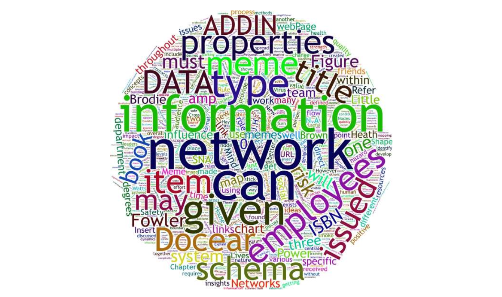
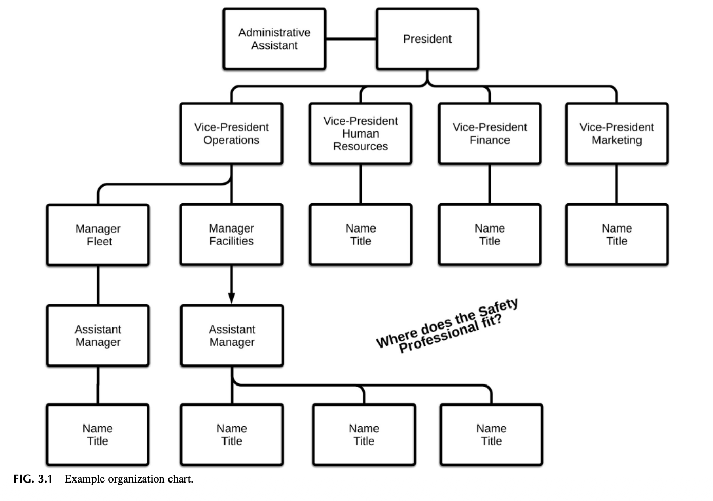
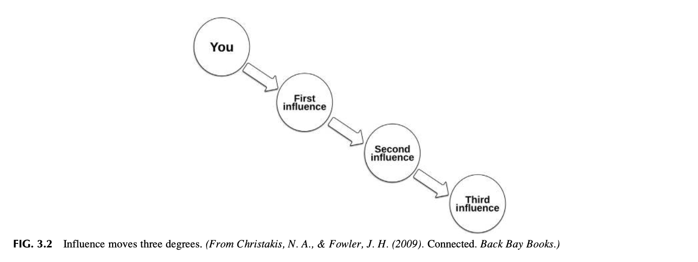
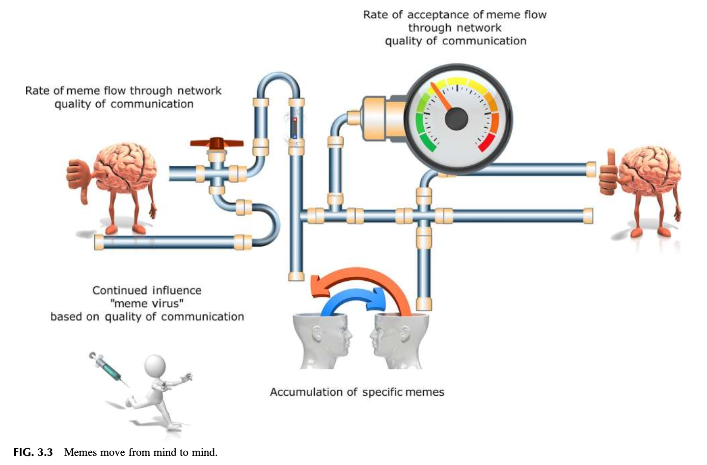
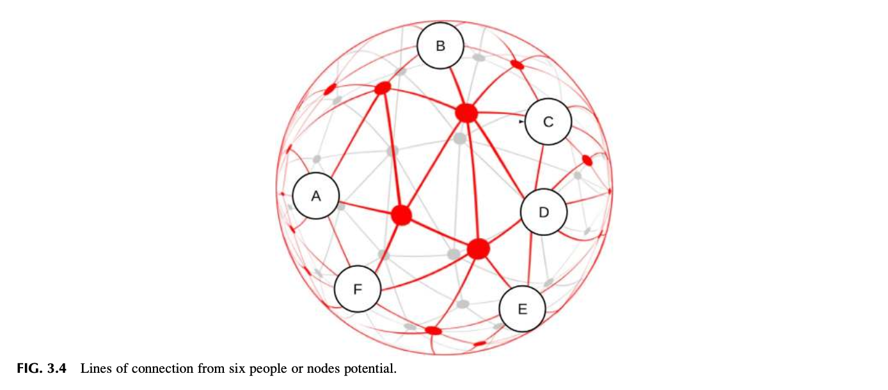
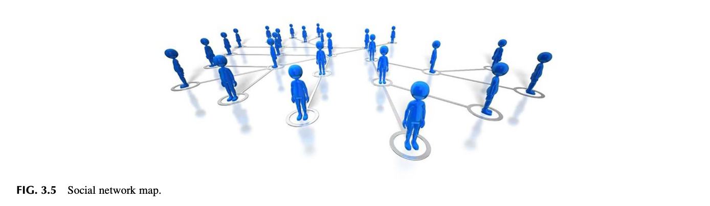
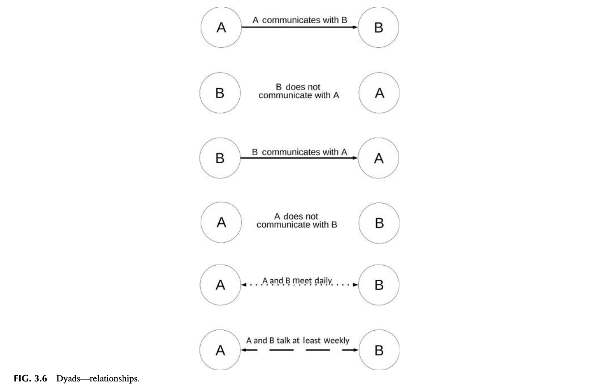
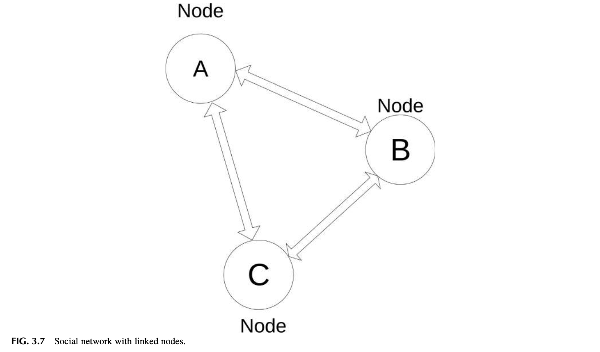
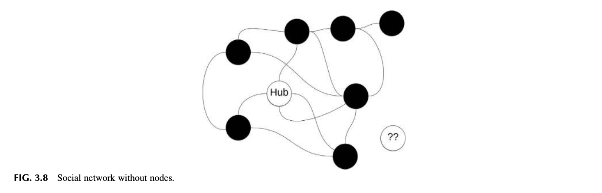
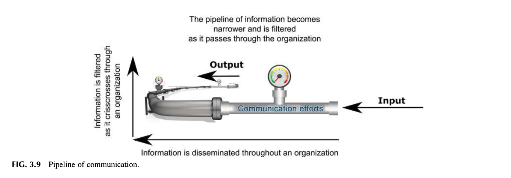

# 제3장 네트워크 분석 및 활용 (Analyzing and Using Your Network)

"마지막으로 직업 문화와 조직 문화를 모두 고려하는 것이 대단히 중요하다. 문화는 공식적인 조직 설계가 장려하는 협력적 행동을 완전히 무력화하고 덮어쓸 수 있기 때문이다. 어떤 의미에서, 문화는 사회적 네트워크를 통해 생성되고 전파된다." — 크로스와 파커 (Cross & Parker, 2004)

"나는 리더를 다음과 같이 정의한다: 팀이나 조직과 같은 사회적 환경 속에서 다른 누군가에게 실질적인 영향력을 미치는 모든 사람." — 메직 (Mezick, 2012)

## 도입 (INTRODUCTION)

조직 내 네트워크 형성(Networking)과 긍정적인 안전문화를 발전시키는 일의 중요성은 아무리 강조해도 지나치지 않다. 

조직은 개인적·전문적 네트워크들의 거대하고 복잡한 그물망(Web)이다. 네트워크는 안전문화와 조직 환경으로부터 정보가 어떻게 송신되고 수신되는지를 결정짓는다. 

안전 전문가는 조직의 실질적 요구에 가장 잘 부합하도록 안전경영시스템을 이끌기 위해 정밀하게 연구된 정보를 전략적으로 활용한다. 안전문화를 발전시킬 때 개인적 네트워크와 전문적 네트워크 모두를 명확히 정의하는 것이 필수적이다. 

네트워크 매핑(Network mapping)을 통한 커뮤니케이션 진단 개념은 정보가 최고 리더십 팀과 조직 전반으로 어떻게 흘러가는지를 명확히 식별해 줄 것이다. 

Safety Culture (안전문화). https://doi.org/10.1016/B978-0-12-814663-7.00003-0 

본 장에서는 안전문화 발전을 위해 개인적 네트워크와 전문적 네트워크를 정의하는 것의 막대한 중요성을 논의한다. 네트워크 매핑을 통해 소통을 진단하는 개념들은 정보가 리더십 팀과 조직 전반에 어떻게 유통되는지를 명확히 규명할 것이다. 

본 장을 완료하면 독자는 다음을 수행할 수 있어야 한다:
* 네트워킹의 중요성을 정의한다.
* 네트워킹 관점에서 조직도를 분석한다.
* 안전 정보를 전파하는 효과적인 방법들을 정의한다.
* 네트워크 맵의 다양한 구성 요소들을 정의한다.

## 네트워킹의 중요성 (THE IMPORTANCE OF NETWORKING)

네트워킹(Networking)은 수세기 동안 비공식적으로 활용되어 온 지극히 유서 깊은 개념이며 결코 새로운 개념이 아니다. 

인간 사회가 존재하는 한 네트워킹은 관료주의의 장벽을 우회하고, 영향력이나 호의를 얻고, 일자리를 찾으며, 귀중한 전문 지식과 자원을 식별하는 데 끊임없이 사용되어 왔다. 노련한 정치인과 영업 임원들은 인맥과 자원의 방대한 네트워크를 구축하고 유지한다. 

성공적인 네트워킹은 상호 유익한 신뢰 관계를 구축하며, 이는 가치 있는 전문 지식이나 식견을 가진 추가적인 유용한 인맥들과의 연결고리로 이어진다. 

안전경영시스템의 가장 근본적인 토대는 안전 비전과 사명이다. 네트워크가 어떻게 형성되고 사람들을 어떻게 연결하는지 깊이 이해하면 커뮤니케이션의 품질을 비약적으로 향상시킬 수 있다. 네트워크의 복잡성과 설계 구조는 리더십 팀과 일선 근로자에게 제공되는 정보의 전파 속도와 품질을 결정한다. 

비전과 사명은 조직 전반에 걸쳐 강력하게 소통되어야 하며, 그 효과성은 개인적·전문적 네트워크를 어떻게 능숙히 관리하느냐에 달려 있다. 아무리 훌륭하게 설계된 안전 프로세스라 할지라도, 안전 정보가 조직의 다양한 공식·비공식 네트워크를 통과하면서 걸러지고(Filtered), 희석되며(Diluted), 무시되거나(Ignored), 차단될(Blocked) 경우 허망하게 실패하고 만다. 

와츠(Watts)는 다음과 같이 갈파한다: "네트워크는 네트워크 시스템 내부에서 사건들이 발생하기 때문만이 아니라, 바로 그 구성 요소들의 활동과 결정에 의해 네트워크 자체가 시간의 흐름 속에서 끊임없이 진화하고 변화하기 때문에 대단히 역동적인 실체이다" (Watts, 2004). 

"네트워킹은... 사람들에게 여러분의 존재를 각인시키고, 여러분의 목소리를 전달하며, 여러분을 기억하게 만들어 주며, 여러분 자신뿐만 아니라 회사의 이미지를 드높일 수 있는 결정적인 기회를 제공한다." (Networking, 2018).

## 비공식 네트워크 (INFORMAL NETWORKS)

대부분의 조직에는 '소문이나 가십을 유통시키는 개인 대 개인 간의 비공식 수단'인 **포도넝쿨 통신(Grapevine)**(Grapevine, 2018), 즉 입소문(Word-of-mouth)이 존재하며, 이는 조직 내의 '숨겨진 네트워크'를 통해 비공식 정보를 광속으로 유통시킨다. 

정보를 퍼뜨리는 이러한 숨겨진 네트워크는 조직의 풍토에 따라 긍정적일 수도 있고 치명적으로 부정적일 수도 있다. 

과거 범선 항해 시절 선원들은 식수통(Scuttlebutt) 주변에 모여 가십거리를 주고받았는데, 여기서 가십을 뜻하는 **'스커틀버트(Scuttlebutt)'**(Scuttlebutt, 2018)라는 속어가 유래했다. 현대의 스커틀버트에 해당하는 공간은 직원들이 모여 사내 소문을 교환하는 사무실 탕비실과 휴게실이다. 

오늘날 페이스북, 트위터, 링크드인과 같은 다양한 웹사이트들은 디지털 형태로 동일한 목적을 수행하며 개인적·전문적 네트워킹의 강력한 도구로 활용되고 있다. 

비공식 네트워크는 조직의 공식적인 커뮤니케이션 시스템보다 훨씬 더 빠르다. 그러나 전파되는 정보는 진실일 수도 있고, 왜곡되었거나 전혀 터무니없는 낭설일 수도 있다. 조직은 사기 저하, 대외 평판 실추, 브랜드 이미지 훼손을 초래할 수 있는 사내 정보 유출을 막기 위해 엄청난 노력을 기울여야 한다. 

위기관리(Crisis management)라는 학문 자체가 사건의 본질에 대해 가능한 한 가장 정확한 사실을 신속히 제공하는 동시에 근거 없는 루머, 왜곡된 진실, 오해, 그리고 가짜 뉴스를 통제한다는 전제 위에 구축되어 있다. 

숨겨진 네트워크는 철저히 **"누가 누구를 아는가(Who knows who)"**라는 인맥의 원리로 작동한다. 핵심 인물 한 명이 무언가를 들으면 그 정보는 네트워크를 타고 순식간에 번져 나간다. 

한 사례로, 어느 사업장에서 "주차장 지하에 방사성 폐기물이 비밀리에 매립되어 있으며 경영진은 진실을 숨기고 있다"는 황당한 괴담이 퍼져나갔다. 리스크 관리자가 보건 전문가, 산업위생사, 공인 방사선 전문가들을 총동원하여 직원들에게 방사선이 전혀 존재하지 않음을 과학적으로 입증해 보였음에도 불구하고, 노사 관계는 오랫동안 극심하게 경색된 상태로 남아 있었다. 

스마트폰과 태블릿 등 동영상과 사진을 소셜 미디어로 즉시 전송할 수 있는 모바일 기기의 폭발적 보급은 조직의 공식 검증을 거치지 않은 부정확하거나 민감한 정보의 무차별 유출 **위험(Risk)**을 극적으로 증가시켰다.

## 네트워크 평가를 위한 조직도 분석 (ANALYZING THE ORGANIZATIONAL CHART TO ASSESS A NETWORK)

조직 구조를 깊이 이해하는 것은 안전문화를 향상시키는 데 있어 그 위치가 결정적인 핵심 인물들을 식별해 내는 첫 번째 단계이다. 

조직은 공식적인 권한과 책임의 네트워크를 정의하기 위해 공식적인 조직 체계를 구축한다. 이 네트워크는 통상적으로 다양한 부서, 경영진, 스태프 인력, 그리고 보고 체계를 보여주는 **'조직도(Organizational chart)'**의 형태로 시각화된다. 

조직도는 조직의 위계 구조를 정의하며, 누가 누구에게 보고하는지, 각자의 직함은 무엇인지, 최고 리더십이 어디에 위치해 있는지를 그래픽으로 명쾌하게 보여준다. 조직도는 직무기술서와 긴밀하게 연동되어 있다 (그림 3.1 참조).

그림 3.1 전형적인 조직도의 예시 (Example organization chart).

조직도 상에서 안전 전문가가 차지하고 있는 위치는 조직 내부에서 안전 활동이 어떤 대우와 시각으로 취급받고 있는지를 웅변한다. 최고 경영진으로부터 얼마나 떨어져 있는지(보고 라인의 거리), 그리고 조직 위계 구조의 얼마나 깊은 밑바닥에 안전 전문가가 배치되어 있는가는 안전 직무의 전반적인 사내 영향력을 가늠하는 결정적인 지표가 된다. 

조직도 검토는 보고 관계 분석의 필수적 일부이며 소통의 흐름을 확립하는 데 대단히 유용하다. 다음은 반드시 고려해야 할 핵심 질문 영역들이다:

* **안전 책임이 현장 운영(라인) 부서에 속해 있는가, 아니면 단순 지원(스태프) 부서에 머물러 있는가?** 
  수많은 조직에서 안전의 역할은 인사(HR), 교육, 또는 리스크 관리 부서와 같이 현장 운영을 보조하는 지원 부서에 배치되어 있으며, 핵심 라인 기능으로 간주되지 않는다. 네트워킹 관점에서 볼 때, 이는 현장 생산 부서로부터 안전 전문가가 "우리 식구가 아닌 외부인"으로 취급받고 생산과 갈등 관계에 놓이게 될 잠재적 위험을 내포한다. 만약 지원 역할에 머물러 있다면, 신뢰를 쌓고 소통을 개선하여 안전경영시스템이 현장 운영 부서로부터 전폭적인 수용을 이끌어내는 것이 최우선 과제가 된다.

* **안전경영시스템의 총괄 행정을 책임지는 담당자는 누구에게 직접 보고하는가?** 
  이상적으로 안전관리는 안전과 최고 리더십 간의 직접적인 직통 소통 라인의 가치를 깊이 이해하는 최고위 경영진에게 직접 보고되어야 한다. 조직도는 위계 구조 내의 이름과 직함을 제공하여 조직도 속의 다양한 인물들에 대한 깊은 통찰을 수집할 수 있게 해준다. 이 인물들은 안전 프로세스의 개선을 돕는 강력한 우군이 될 수도 있고, 지지자, 방해꾼, 또는 일을 추진하기에 너무나 경직된 걸림돌이 될 수도 있다. 누가 통제에 집착하는 사람인가? 누가 교조적인 '원칙주의자'인가? 누가 사사건건 장애물이 될 것인가? 누가 가장 큰 조력자가 될 것인가? 핵심은 다양한 개성을 가진 개별 인물들이 존재하며, 그들을 하나의 유기적 네트워크로 엮어내야 한다는 점이다.

* **조직 구조가 안전 커뮤니케이션과 목표 달성을 돕는 조력자인가, 아니면 거대한 장애물인가?** 
  조직 구조는 표준화되어 있지 않으며 공식적으로 정교하게 설계되지 않은 경우가 허다하다. 수많은 기업들이 다방향 매트릭스(Matrix) 조직을 채택하여, 한 리더에게는 '실선(Solid line)'으로 정식 보고하고 다른 여러 계층의 리더들에게는 '점선(Dotted line)'으로 분산 보고하는 방식을 사용한다. 예컨대 총괄 공장장, 인사 부서, 엔지니어링, 유지보수 부서 등으로 보고 라인이 복잡하게 얽혀 있을 수 있다. 이러한 보고 관계의 그물망을 꿰뚫어 보는 것은 조직 네트워크 내의 상호작용과 소통의 역학을 파악하는 핵심 열쇠이다.

* **다양한 부서들 간의 관계는 어떠하며 안전의 책임은 어디에 위치해 있는가?** 
  제2장에서 논의했듯이 이는 부서 간 소통 장벽이 존재하는 **'사일로 관리(Silo management)'** 또는 **'버블 관리(Bubble management)'**의 전형적인 온상이 될 수 있다. 이러한 장벽은 개인 간의 성격 갈등, 사내 서열, 안전에 대한 편협한 지각, 역량 차이, 에고(Ego) 등으로 인해 형성된다. 조직은 기계가 아니라 인간의 온갖 특성, 나약함, 그리고 결점들의 총합체이다.

* **안전 역할이 중복되어 낭비되고 있지는 않은가?** 
  조직의 팽창 과정에서 안전에 대한 책임과 보고 체계가 사내의 서로 다른 부서들로 제각각 쪼개져 진화했을 수 있다. 조직도는 중복된 권한이 어디에서 심각한 소통 혼선을 낳고 있는지를 명확히 보여준다.

### 관찰 1 (Observation 1)

풍부한 실무 경험은 부서 간에 안전관리 책임이 기형적으로 분할되었을 때 초래되는 참담한 충격을 생생하게 보여준다. 

한 조직에서는 전사적 리스크 관리는 재무 부서에 속해 있었고, 안전관리는 인사 부서에 배속되어 있었다. 각 부서는 동일한 안전 책임을 평행선처럼 부여받았으며, 서로 자신들의 업무가 최우선 순위라고 고집했다. 부서 간의 소통은 최악이었다. 두 부서의 관리자들은 서로에 대해 극도의 불신을 품고 있었고, 급기야 서로 말조차 섞지 않아 사사건건 격렬한 갈등이 터져 나왔다. 

한 번은 자회사의 인사 관리자가 리스크 관리자로부터는 '최우수 안전 실적 달성 표창'을 수여받았는데, 바로 그 동일한 날 안전 부서로부터는 '안전 실적이 기준 미달이며 도저히 수용할 수 없다'는 경고장을 공식 서한으로 전달받는 코미디 같은 사태가 벌어졌다. 

결국 두 부서 모두 현장 생산 라인으로부터 아무런 존중도 받지 못했고, 사내의 유치한 갈등 때문에 현장으로부터 완전히 외면당하고 투명인간 취급을 받았다. 

조직도는 오직 조직의 '공식적인 구조'만을 보여줄 뿐이다. 최고 경영진의 리더가 강한 성격을 가진 실세에게 휘둘려 허수아비 얼굴마담에 불과할 수도 있다. 반면 평범해 보이는 비서나 행정 스태프가 특정 최고 리더에게 직접 메시지를 전달할 수 있는 진짜 '핵심 실세(Go-to person)'일 수 있다. 

오랜 속담인 **'왕좌 뒤의 실세(The power behind the throne)'**, 즉 "공식적인 고위 직함을 갖지는 않았지만 은밀하게 조직을 실질적으로 지배하는 인물"(The Power Behind the Throne, 2018)을 간파해야 한다. 네트워크 매핑을 시작할 때 과연 누가 조직을 실제로 움직이고 있는지를 반드시 꿰뚫어 보아야 한다.

## 네트워킹 시 고려해야 할 핵심 요소 (NETWORKING CONSIDERATIONS)

네트워크를 진단할 때 무엇을 살펴보아야 하는가에 대한 심도 있는 통찰은 말콤 글래드웰(Malcolm Gladwell)의 고전적 명저 『티핑 포인트(The Tipping Point)』(Gladwell, 2000)에서 발견할 수 있다. 

글래드웰은 티핑 포인트에 도달하기 위한 **'3대 법칙'**을 제시하며, 이는 조직 내 커뮤니케이션과 정보의 흐름을 진단하는 데 완벽하게 적용될 수 있다. 그가 정의한 3대 법칙은 **'소수의 법칙(The Law of the Few)', '고착성 요인(The Stickiness Factor)', 그리고 '상황의 힘(The Power of Context)'**이다. 

티핑 포인트(Tipping point)란 "그 지점을 넘어서면 중대하고 때로는 멈출 수 없는 거대한 변화나 효과가 폭발적으로 일어나는 상황, 프로세스 또는 시스템의 임계점"을 의미한다 (Tipping Point, 2018). 이는 초기에는 완만하게 퍼져나가던 전염병이 임계점을 지나며 기하급수적으로 폭발하는 바로 그 지점이다. 

안전문화를 혁신하는 궁극적 목표는 올바른 안전 커뮤니케이션이 조직 전체를 관통하여 마치 바이러스처럼 **'폭발적 확산(Going viral)'**을 일으키도록 만드는 데 있다. 

글래드웰이 명명한 **'소수의 법칙'**은 세 가지 핵심 주체로 구성된다: **연결자(Connectors), 메이븐/전문가(Mavens), 그리고 세일즈맨(Salespeople)** (Gladwell, 2000). 
* **메이븐(Mavens)**은 해당 분야의 독보적인 지식을 갖춘 스페셜리스트 전문가이다. 안전 전문가는 자신의 전문 영역에서 메이븐으로 인정받아야 하며 이는 조직에 막대한 가치를 제공한다. 
* **연결자(Connectors)**는 말 그대로 수많은 사람들을 서로 하나로 묶어주는 인맥의 허브이다. 안전관리의 거시적 목표는 조직 전체에 걸쳐 촘촘하고 폭넓게 연결되는 것이다. **재해(Hazard)** 및 **위험(Risk)** 통제 정보를 사내의 모든 구역에 신속히 전파하기 위해서는 수많은 접점들과의 다각적인 연결이 절대적으로 필수적이다. 
* 그러나 아무리 뛰어난 전문 지식(Maven)과 폭넓은 인맥(Connector)을 갖추고 있다 할지라도, 안전의 핵심 메시지가 조직에 매력적인 가치로서 설득력 있게 **'판매(Sales)'**되지 못한다면 아무런 소용이 없다. 즉 아이디어를 세일즈하는 설득 역량이 결합되어야 한다. 네트워크 분석은 조직 내에서 안전 개선 노력을 증폭시킬 수 있는 필수 인맥, 전문성, 소통 역량을 갖춘 핵심 인물이 누구인지를 정확히 식별해 낸다. 

**'고착성 요인(The Stickiness Factor)'**은 메시지가 전달 대상(청중)의 뇌리에 얼마나 끈끈하게 달라붙어 잊혀지지 않는가를 의미한다. 이 요인은 메시지가 리더십과 현장 직원들에게 기억되고 실천되기 위해 어떤 미디어 스타일과 콘텐츠 형식을 갖추어야 하는지를 깊이 이해하는 것을 요구한다. 메시지는 수신자가 쉽게 이해하고 자신의 지식을 행동으로 입증할 수 있도록 직관적으로 설계되고 제시되어야 한다 (Gladwell, 2000). 

**'상황의 힘(The Power of Context)'**은 대상 청중이 처해 있는 구체적인 환경과 문화적 맥락의 본질을 다룬다. 상황의 힘은 청중이 그 메시지를 얼마나 열린 마음으로 수용할 것인가를 결정짓는다. 메시지는 사람들이 일하고 있는 현실적 여건을 세심하게 고려하여 가장 올바른 시간과 최적의 장소에서 전달되어야 한다. 아무리 위대한 안전 자료라 할지라도 부적절한 타이밍에 던져진다면 뇌리에 결코 달라붙지 못한다 (Gladwell, 2000). 

예컨대 생산 일정이 극심하게 지연되어 공장 전체가 비상인 상황에서 안전 교육 시간을 달라고 요청한다면, 경영 리더십은 우선순위에 대해 깊은 회의와 분노를 느낄 것이다. 특히 그 교육 주제가 당장 눈앞에 닥친 문제와 무관하거나 생산성 개선에 아무런 도움을 주지 못한다면 더욱 그러하다. 생산 라인을 멈추고 교육을 받겠다는 요청은 즉시 거절당할 것이며, 안전 노력은 생산을 방해하는 귀찮은 걸림돌로 낙인찍히게 된다. 

그렇다고 해서 안전이 뒷전으로 밀려나거나 무시되어도 좋다는 뜻이 결코 아니다. 조직이 현재 어떤 고통스러운 문제와 고민을 안고 있는지를 기민하게 헤아리고, 필요한 안전 정보를 전달할 수 있는 훨씬 더 우수하고 세련된 기법을 찾아내야 한다는 의미이다. 이는 오직 리더십과 현장 직원들의 생생한 고충 정보를 실시간으로 감지해 내는 강력한 네트워크를 통해서만 달성될 수 있다. 

네트워킹의 중요성은 결코 간과될 수 없다: "비즈니스를 가장 밑바닥까지 발가벗겨 본다면, 그것은 결국 사람이 다른 사람에게 무언가를 설득하고 판매하는 일이다. 궁극적으로 진정한 연결자로서 자신의 입지를 굳힌다는 것은... 자신이 가진 인맥과 재능을 최대한으로 활용하여 조직에 진정으로 기여하는 것을 의미한다" (Ferrazzi & Raz, 2014). 본질적으로 네트워킹은 신뢰할 수 있는 정보, 기술적 조력, 전문적 지식을 획득하는 절대적 생명선이다.

### 관찰 2 (Observation 2)

살아있는 네트워크를 구축하기 위해서는 사람들이 일상에서 어떻게 상호작용하는지에 대한 깊은 관심과 지식이 요구된다. 

예를 들어 여러분은 조직 내에서 몇 명의 사람들을 직접 알고 있는가? 여러분은 얼마나 많은 직원들의 이름을 알고 있으며, 그들에 관한 개인적·전문적 세부사항을 얼마나 기억하고 있는가? 여러분은 그들이 회사와 관련하여 품고 있는 고충이나 애로사항을 깊이 알고 있는가? 

이러한 인간적 이해는 작업 환경의 심리적 상태에 깊이를 더해준다. 누구를 찾아가야 할지를 아는 것은 네트워킹의 핵심이다. 

동료들 사이에서 이런 말을 들어본 적이 있는가? 
*"도움이 필요하면 반드시 미스터 X를 찾아가 봐. 필요한 정보를 구하는 데는 X가 최고야."* 
혹은 정반대로: 
*"조언이나 도움을 받으려고 특정 직원 Y를 찾아가지는 마. 그는 말만 앞서고, 새로운 아이디어에 완전히 닫혀 있으며 온통 부정적이야."* 

이러한 평판은 그 개인이 사내에서 유익한 네트워크를 형성하고 있는지, 아니면 소통의 장벽을 쌓아 올린 사람인지를 명확히 보여준다. 여러분은 동료들에게 어떤 유형의 사람으로 각인되기를 원하는가? 어떤 지각(Perception)이 안전 목표를 달성하는 데 가장 큰 도움이 되겠는가? 네트워크를 구축하거나 분석할 때 이 질문들을 반드시 가슴속에 새겨야 한다.

### 관찰 3 (Observation 3)

한 모범적인 사례로, 어느 탁월한 안전/리스크 관리자는 현장의 부서 관리감독자나 핵심 직원들과 정기적으로 점심 식사를 함께하곤 했다. 

이 관리자의 의도는 두 가지였다. 첫째, 딱딱한 일상 업무 환경에서 벗어나 중립적인 식사 자리에서 편안하게 대화함으로써 끈끈한 팀 라포(Rapport, 신뢰 관계)를 구축할 수 있는 최상의 기회를 마련하는 것이었다. 둘째, 안전/리스크 관리자는 편안한 식사 환경 속에서 소통 채널이 열려 있는지, 제기된 현안 이슈들을 팀원들이 올바르게 이해하고 공감하고 있는지를 자연스럽게 가늠해 볼 수 있었다. 

스스로에게 반문해 보라. 여러분은 매일매일 똑같은 동료나 부서 직원들하고만 어울리고 있는가, 아니면 자신의 부서나 일상적인 사교 범위를 벗어나 다른 다양한 직급, 타 부서 구성원들과 적극적으로 교류하려 노력하고 있는가? 만약 조직이 교대근무로 운영된다면, 여러분은 야간 조나 주말 교대 조를 얼마나 자주 직접 찾아가 만나고 있는가?

## 현실 점검 지표 (REALITY CHECK INDICATOR)

강력한 네트워크를 구축하는 데 유용한 정보는 직원 및 리더십과의 일상적인 모든 대면 상호작용 속에 깃들어 있다. 

여러분이 직원 휴게실에 들어서거나 삼삼오오 모여 있는 직원들에게 다가갈 때, 과연 어떤 반응이 나타나는가? 직원들이 반가운 동료애(Camaraderie)를 표현하며 여러분을 환영하는가? 아니면 여러분이 문을 열고 들어서는 순간 왁자지껄하던 방 전체가 찬물을 끼얹은 듯 침묵에 휩싸이는가? 

이 극명한 반응의 유형이야말로 여러분이 일선 근로자들의 비공식 네트워크 속으로 흔쾌히 수용된 진정한 동료인지, 아니면 경계하고 조심해야 할 차가운 '외부 감시자'로 취급받고 있는지를 보여주는 냉혹한 현실 점검 지표이다.

### 교훈 1 (LESSON LEARNED 1)

한 산업위생사가 대규모 가금류(닭고기) 가공 공장에서 소음 노출 실태 조사를 수행하고 있었다. 그는 자신이 구내식당에 들어설 때마다 식사하던 모든 직원들이 일제히 대화를 뚝 멈추고 자신을 경계하는 기이한 현상을 목격했다. 

그가 한 직원에게 조심스럽게 "왜 그러느냐"고 묻자, 그 직원은 이렇게 귀띔했다: 
*"다들 당신이 우리 대화를 비밀리에 도청하고 녹음하고 있다고 생각해요."* 

사연을 조사해 보니, 그 회사의 안전 부서가 사내 보안 책임까지 함께 맡고 있었는데, 최근 제품 도난 사건을 수사한다며 직원들에게 거짓말 탐지기 검사를 강제로 실시했던 전력이 있었던 것이다. 

현장 직원들은 산업위생사가 어깨에 차고 있던 소음측정기(Dosimeter)의 마이크를 자신들의 사적인 대화를 감청하는 첨단 도청 장치로 오인했던 것이다! 

이 극단적인 실화는 현장 직원들이 경영 리더십과 안전 부서 스태프에 대해 어떤 왜곡된 지각과 불신을 품고 있었는지를 적나라하게 보여준다. 그 공장은 소통과 신뢰의 치명적인 붕괴를 겪고 있었다.

## 네트워크 이론의 기본 원리 정의 (DEFINING THE BASICS OF NETWORKING THEORY)

크리스타키스(Christakis)와 파울러(Fowler)는 네트워크 커뮤니티를 "네트워크의 다른 영역에서 발견되는 다른 사람들의 집단보다 자기들끼리 훨씬 더 밀접하게 상호 연결되어 있는 사람들의 집단"으로 정의한다 (Christakis & Fowler, 2009). 

그들의 정의는 사회적 네트워크의 분석을 체계화하고 이해하는 데 유용한 통찰을 제공한다. 그들은 **'3단계 영향력 법칙(Three degrees of influence)'** 이론을 제안하며, 모든 행동이나 커뮤니케이션은 네트워크를 통해 잔물결처럼 퍼져나가 **3단계의 분리(3촌/3단계 거리: 친구의 친구의 친구)**까지 실질적인 영향을 미치는 경향이 있다고 설명했다. 발신원의 직접적인 영향력은 '3단계'를 넘어서면 소멸한다. 

크리스타키스와 파울러는 네트워크의 본질과 범위를 규정하는 다음과 같은 핵심 규칙들을 발전시켰다:
* **제1규칙: 우리는 우리의 네트워크를 스스로 형성한다 (We shape our network).** 
  개인은 자신이 얼마나 많은 사람들과 연결되기를 원하는지, 누구에게 영향력을 행사하고자 하는지, 그리고 전체 네트워크 속에서 자신이 얼마나 중심적인 위치를 차지할 것인지를 스스로 결정한다.
* **제2규칙: 우리의 네트워크가 우리를 형성한다 (Our network shapes us).** 
  네트워크의 어디에 위치하며 네트워크 내부에서 얼마나 중심에 자리잡고 있는가가 개인의 일상적 행동 양식을 강력하게 형성하고 지배한다.
* **제3규칙: 우리의 친구들이 우리에게 영향을 미친다 (Our friends affect us).** 
  직접 연결된 사람들의 태도, 신념, 행동은 개인의 의사결정에 막대한 파급효과를 미친다.
* **제4규칙: 우리 친구들의 친구의 친구들이 우리에게 영향을 미친다 (Our friends’ friends’ friends affect us).** 
  영향력은 3단계를 건너뛰어 퍼져나간다. 우리가 알지도 못하는 3단계 건너편 인물의 안전 태도가 네트워크를 타고 우리 자신의 안전 행동에 은밀히 영향을 미친다.
* **제5규칙: 네트워크는 그 자체로서 고유한 생명력을 지닌다 (The network has a life of its own).** 
  개별 구성원들의 단순한 합을 뛰어넘는 거시적인 창발적 특성(Emergent properties)이 네트워크 자체에서 스스로 솟아난다 (Christakis & Fowler, 2009; 그림 3.2 참조).

그림 3.2 영향력은 3단계로 이동한다 (Influence moves three degrees. From Christakis, N. A., & Fowler, J. H. (2009). Connected. Back Bay Books).

안전 전문가의 직무와 위치는 반드시 전문적이고 깊이 신뢰할 수 있는 것으로 지각되어야 한다. 

수년에 걸쳐 힘들게 쌓아 올린 신뢰의 네트워크라 할지라도, 단 한 번의 방심한 분노의 폭발이나 약속을 지키지 않는 무책임한 모습이 드러나는 순간 단 일초 만에 산산조각 날 수 있다. 

전문적 평판과 진정성을 흔들림 없이 유지하는 것은 네트워크의 생명력을 지탱하는 절대적 산소이다.

## 안전 정보 패킷 — 전염병, 바이러스, 그리고 밈 (THE SAFETY INFORMATION PACKET—EPIDEMICS, VIRUSES, AND MEMES)

네트워크의 궁극적 목표는 검증되고 입증되었으며 신뢰할 수 있는 안전 개념과 기법들을 안전문화를 고도화하는 방식으로 조직 전체에 강력하게 전파하는 데 있다. 

생생한 비유를 들자면, 커뮤니케이션을 조직이라는 거대한 신체 전반으로 퍼져나가는 일종의 **'바이러스(Virus)'**의 형태로 바라보는 것이다. 

또한 안전 커뮤니케이션은 그 정보가 일선 직원과 리더십 팀 모두를 능동적으로 몰입시키기 위해 조직이 평소 사용하는 고유한 스타일 및 형식과 완벽히 부합해야 한다. 

리처드 브로디(Richard Brodie)는 그의 명저 『마음의 바이러스(Virus of the Mind)』에서 인간의 생각과 메시지가 마음과 마음을 감염시키는 바이러스로 간주될 수 있다는 혁신적인 개념을 개괄했다 (Brodie, 2009). 

리처드 도킨스(Dawkins, 2006)에 따르면, **'밈(Meme)'**이란 대상 청중에게 직관적으로 명쾌하게 이해되는 짧고 강력한 정보의 패킷(A packet of information providing a short burst of information)을 의미한다 (Solon, 2013). 

모든 안전 커뮤니케이션은 강력한 안전 밈(Safety Meme)을 창출하려는 전략적 시도로 간주되어야 한다. 

특정한 정보 패킷인 밈은 한 번 상대방에게 수용되면 타인들에게 폭발적으로 재전파될 수 있으며, 반대로 거부당할 경우 수신자에 의해 더 이상 어디로도 퍼져나가지 못하고 그 자리에서 쓸쓸히 소멸하고 만다. 

"밈이란 한 사람의 뇌에서 다른 사람의 뇌로 모방을 통해 복제되고 전달되는 문화 전달의 기본 단위이다." — 리처드 도킨스 (Dawkins, 2006). 

안전 분야에서 오랜 세월 동안 전수되어 온 수많은 슬로건들은 본질적으로 일종의 안전 밈이다. 그러나 그 밈이 긍정적이고 실천적인 행동을 낳는 건강한 밈인지, 아니면 오히려 복지부동과 형식주의를 조장하는 악성 밈인지를 날카롭게 분별해야 한다.

## 현실 대 지각 (REALITY VERSUS PERCEPTION)

현재 안전에 대해 만연해 있는 왜곡된 지각을 담은 구태의연한 안전 밈을 혁신하기 위해서는, 해결해야 할 구체적인 이슈나 당면 문제에 맞추어 적재적소에 꺼내 쓸 수 있는 풍부한 개념의 '도구 상자(Toolbox of concepts)'가 완비되어 있어야 한다. 

현실(Reality)과 지각(Perception) 사이의 간극을 좁히지 못한다면, 안전 메시지는 공허한 외침으로 전락한다 (그림 3.3 참조).

그림 3.3 밈은 마음에서 마음으로 전파된다 (Memes move from mind to mind).

'장비는 괜찮으니 안전하다'는 식의 안이한 밈. 이 사례에서 위험 지각(Risk perception) 밈은 불필요하게 무리한 위험을 감수하려는 맹목적인 태도를 완전히 대체한다. 

이 개념은 제9장에서 훨씬 더 심도 있게 다루어질 것이다. 직원과 리더십의 머릿속에 끈끈하게 달라붙는 강력한 밈은 작업 현장의 안전 행동을 근본적으로 변화시키는 기폭제가 된다.

## 흔히 사용되는 안전 밈 (COMMON SAFETY MEMES)

제1장에서 논의했듯이, 오늘날에도 수많은 조직들이 바라는 직원의 안전 행동과 의사결정을 유도한다는 명분으로 다음과 같은 진부한 안전 밈들을 일상적으로 사용하고 있다:
* **"안전 제일 (Safety First)"**
* **"안전은 우리의 제1호 최우선 순위 (Safety is #1)"**
* **"무재해 달성이 우리의 궁극적 목표 (Zero Accidents is our Goal)"**
* **"1건의 중대재해가 발생할 때마다 10건의 경상해, 30건의 물적 피해, 300~600건의 아차사고가 존재한다 (하인리히의 법칙 밈)"**
* **"사고가 없으면 재해(Hazard)도 위험(Risk)도 없다 (무손실=무위험 밈)"**
* **"모든 사고는 예방 가능하다 (All accidents are preventable)"**
* **"안전의 열쇠는 바로 당신이다 (You are the key to safety)"**

현수막, 표어, 동기부여 슬로건, 심지어 작업복에 자수로 새겨져 흔히 소비되는 이러한 대중적 안전 밈들은, 사고 예방이나 실제 안전 성과에 과연 어떠한 실질적인 효과가 있는지 과학적으로 검증된 적이 거의 전무하다! 

구태의연한 밈을 혁신하기 위해서는 안전 커뮤니케이션과 그 콘텐츠가 대상 청중의 뇌리에 확고하게 **'달라붙을(Sticking)'** 확률을 비약적으로 높여야 한다. 

칩 히스(Chip Heath)와 댄 히스(Dan Heath) 형제는 그들의 명저 『스틱!(Made to Stick)』에서 메시지가 사람들의 마음속에 끈끈하게 달라붙도록 만들기 위해 다음의 **'SUCCES 6대 핵심 요소'**를 융합하여 소통할 것을 제안한다 (Heath & Heath, 2008):

* **단순성 (Simple)**: 
  가능한 한 메시지를 지극히 단순하고 명쾌하게 유지하라. 일선 직원들이 회사의 안전 비전과 사명 선언문을 막힘없이 읊을 수 있는가? 대부분의 조직은 최고 경영진이 서명한 수 페이지에 달하는 장황한 공식 방침서를 걸어두지만, 대다수 직원들은 그 내용을 단 한 줄도 기억하지 못한다. 훨씬 더 우수한 접근법은 '연상(Association)' 밈을 활성화할 수 있는 간결하고 직관적인 단 한 줄의 핵심 문장으로 방침의 전반적인 의도를 압축하여 전달하는 것이다. 단순성의 원칙은 정책을 뒷받침하고 기대 행동을 규정하는 안전 규칙과 지침에도 똑같이 적용된다.
* **의외성 (Unexpected)**: 
  목표는 청중의 주의를 단숨에 사로잡고 지속시키는 것이다. 의외의 신선한 충격이나 예측을 깨뜨리는 전환은 구성원들의 지식의 공백을 활짝 열어젖히거나, 그 공백을 메울 수 있는 독창적인 길을 열어준다.
* **구체성 (Concrete)**: 
  안전경영시스템과 안전문화에서 요구되는 모든 개념과 아이디어는 반드시 손에 잡힐 듯 가시화되어야 하며, 구체적으로 현장에서 취해야 할 명확한 행동 지침을 제시해야 한다.
* **신뢰성 (Credible)**: 
  메시지는 확고한 객관적 신뢰성을 확보해야 한다. "노동청(OSHA) 불시 감독이 나올 수 있다"는 처벌 위협을 전가의 보도처럼 남발하는 것은 안전을 오직 법적 최소 기준만 때우는 옹졸한 규제 준수로 격하시킬 뿐이다. 이는 준수에만 매몰되어 **재해(Hazard)** 및 연계된 **위험(Risk)** 중심의 선진적 접근법을 개발하는 길을 가로막는다. 핵심은 신뢰할 수 있는 데이터와 엄밀한 과학적 연구에 기반하여 안전 메시지의 수용성을 극대화하는 데 있다. 안전 전문가 자신의 전문적 위상과 역량이 안전문화 발전에 지대한 역할을 한다.
* **감성 (Emotional)**: 
  히스 형제는 메시지가 진정한 힘을 발휘하려면 사람을 향한 따뜻한 온기와 인간적 연민을 품어야 한다고 역설한다 (Heath & Heath, 2008). 이는 단순한 공학적 기계 설계를 넘어, 조직이 구성원의 생명에 대해 진심을 다하고 있다는 확신을 심어주는 것이다. "소중한 가족과 자녀를 위해 안전하게 퇴근하자"는 감성 메시지는 안전경영시스템의 과학적 접근과 유기적으로 결합될 때 엄청난 위력을 발휘한다. 단, 감성을 지나치게 남발하면 역효과를 낳아 본래의 목표를 훼손할 수 있으므로 주의해야 한다.
* **스토리 (Story)**: 
  원리와 경험을 공유할 때 살아있는 생생한 '스토리(이야기)'를 활용하라. 장황하거나 과장된 미사여구가 아니라, 무엇을 달성해야 하는지에 대한 선명한 그림을 마음속에 그려주는 솔직하고 개인적인 이야기를 들려주어라.
*(출처: Heath, C., & Heath, D. (2008). Made to Stick에서 각색).*

개인적인 진솔한 메시지를 소통 노력 속에 융합하는 능력을 고도화하면, 안전문화 밈이 리더십 팀과 근로자들의 뇌리에 강력하게 '달라붙도록' 만들 수 있다. 

안전문화를 향상시키기 위한 강력한 메시지를 고안하고 정립했다면, 그 다음 단계는 그것을 조직 내부로 올바르게 **'론칭(Launch)'**하는 일이다 (Harrell, 2010). 

론칭이란 단순히 전사 이메일을 뿌리거나 사보에 글을 싣는 일방적 통보가 아니다. 그 위대한 여정은 커뮤니케이션이 조직 내부의 보이지 않는 실핏줄을 타고 어떻게 흘러가는지를 깊이 이해하는 것에서부터 비로소 시작된다.

## 사회연결망 분석 (SOCIAL NETWORK ANALYSIS)

사회연결망 분석(SNA, Social Network Analysis)은 시스템 전체에 정보가 원활하게 소통되도록 보장하는 데 필요한 수준만큼 효과적으로 활용되지 못해 왔다. 네트워킹 분석에 대한 보다 공식적인 접근법은 정보의 흐름과 소통의 병목·장애물을 가시화함으로써 훨씬 더 효과적인 안전문화 발전을 견인할 수 있다. 

사회연결망 분석은 조직의 역동성을 깊이 이해하는 데 사용되는 과학적 방법론이다. 모든 조직이 개인, 부서, 단위 조직, 또는 소집단들의 복잡한 네트워크로 구성되어 있는 만큼, 사회연결망 분석은 개인들이 어떻게 상호 연결되어 있으며 그것이 조직의 전반적인 행동에 어떤 잠재적 영향을 미치는지에 대한 강력한 통찰을 제공한다. 

조직이 정보를 어떻게 송신하고 수신하는가에 대한 통찰을 바탕으로 광범위한 조직 계층 전반의 연결성을 진단하는 데 훌륭하게 활용될 수 있다. 

"사회연결망 분석은... 분석가로 하여금 네트워크 구조의 세부사항을 식별하고 가시화할 수 있게 해준다. 네트워크화된 조직이 어떻게 행동하며 그러한 연결성이 조직의 행동에 어떻게 영향을 미치는지를 여실히 보여준다. SNA를 통해 분석가는 네트워크의 설계를 진단하고, 구성원들이 자율적으로 행동하는지 여부, 리더십이 어디에 존재하며 구성원들 사이에 어떻게 분산되어 있는지, 그리고 위계적 역학과 네트워크 역학이 어떻게 융합되거나 갈등하는지를 정밀하게 평가할 수 있다." — 페트레이어스와 에이모스 (Petraeus & Amos, 2006; 미 육군 야전교범). 

안전문화를 확립하기 위해서는 유용한 안전 밈(Safety Memes)이 생성되고 유통될 수 있도록 개인적 네트워크를 구축하고 활용하는 방법을 깊이 이해해야 한다. 이러한 이해는 개선된 소통이 조직 전체에 지속적이고 신속하게 전파될 수 있는 강력한 잠재력을 촉진한다. 적절하게 전달되고 적시에 수신된다면 메시지가 구성원들에게 수용될 확률은 비약적으로 높아진다. 

네트워크 연결선의 수를 결정하는 수학 공식은 **$(N^2 - N) / 2$**, 즉 **$N(N-1) / 2$**이다. 

만약 6명의 인원(노드)이 서로 소통하고자 한다면, 그들 사이의 연결선의 수는 $(6 	imes 6 - 6) / 2 = 15$개의 연결 쌍(Pairs of connections)이 된다. 그리고 이 연결선들이 양방향 소통일 경우 총 30가지 방향의 커뮤니케이션 경로가 존재하게 된다. 

6명의 사람 또는 노드에서 발생하는 잠재적 연결선의 예시는 그림 3.4를 참조하라 (메트칼프의 법칙; Metcalfe’s law, 2018). 

사회연결망 분석은 개인적·전문적 상호작용의 품질과 범위를 규명하는 데 결정적인 도움을 준다. 상호작용은 그래픽으로 시각화될 수 있으며, 다양한 소통 요소들을 진단하고 다음과 같은 핵심 항목들을 매핑하는 데 사용된다:

그림 3.4 6명의 사람 또는 노드로부터 발생하는 잠재적 연결선들 (Lines of connection from six people or nodes potential).

* 누가 누구와 대화하는가? (Who talks to whom)
* 커뮤니케이션의 방향성 (일방통행인가, 쌍방향인가?)
* 커뮤니케이션의 질적 수준 및 신뢰도
* 소통의 성격이 긍정적인가, 부정적인가?
* 메시지가 내·외부적으로 어떻게 송신되고 수신되는가? (대면 대화, 이메일, 공식 메모, 사보 등)
* 상이한 청중 계층에 도달하기 위한 메시지의 구조와 스타일

안전문화를 고도화하기 위한 자원과 정보를 검색하는 데 유용한 엄선된 소셜 네트워크 도구들의 활용법은 제15장과 제16장에서 본격적으로 다룰 것이다. 

사회연결망 분석은 고도로 정밀하게 수행될 수도 있지만, 아주 기초적인 초보적 분석만으로도 단순히 메시지가 누구에게 전달되는가뿐만 아니라 메시지가 어떤 품질과 성격으로 전달되고 있는지에 관한 치명적인 소통 공백(Gaps)을 낱낱이 밝혀낼 수 있다. 

"사회적 정보의 네트워크는... 우리가 더 나은 개인적 결정을 내리도록 도울 뿐만 아니라, 한 집단에서 불붙은 혁신이 다른 집단으로 전염되듯 넘쳐흐르게(Spill over) 만들어 주기 때문에 대단히 중요하다." — 던컨 와츠 (Watts, 2004).

## 사회연결망 매핑 (SOCIAL NETWORK MAPPING)

**사회연결망 맵(Social Network Map)**은 주제, 개인, 아이디어, 그리고 인간관계를 유기적으로 연결한다. 맵은 세 가지 핵심 구성 요소를 기본 벽돌 삼아 구축된다. 사회연결망 분석은 개인이나 집단, 그리고 그들 사이의 연결 관계를 시각적으로 보여준다 (그림 3.5 참조). 

다음은 매핑을 위한 기본 개념들의 명확한 개요이다:
* **노드 (Node / Actor)**: 하나의 개체 또는 개인을 나타낸다. 노드는 매핑하고자 하는 특정 그룹이나 부서일 수도 있다. 노드는 타인들과 연결되는 개별 개인들일 수 있으며, 각자는 하나의 노드로 간주된다. 부서 간의 상호 관계를 분석하고자 한다면, 개인들이 어떻게 연결되어 있고, 누가 누구와 소통하며, 그들 사이의 소통 유형과 방향이 어떠한지를 보여주는 맵을 작성하게 된다.
* **링크 (Link / Edge)**: 노드와 노드 사이의 연결선을 '링크(Link)'라고 부른다. 타인과의 연결이 곧 링크이다. 예를 들어 다른 사람과 대화를 나눌 때 그들을 향한 하나의 '링크'가 형성된다. 직접적인 대면 토론을 진행하거나, 매일 작업 전 안전미팅(TBM)을 실시하거나, 주간·월간 회의를 주재하거나, 현장 순회 점검을 하거나, 근로자들과 함께 특정 안전 체크리스트를 점검할 때 '직접적인 링크(Direct link)'가 견고하게 생성된다. 제11장의 상세한 논의를 참조하라. 이러한 링크들을 통해 모든 활동 속에서 안전 메시지가 일선 근로자들에게 직접적으로 소통된다. 직접적인 연결선이 표시되지 않는 곳은 정보가 전혀 흐르지 않고 차단되어 있는 단절 지대이다.

그림 3.5 사회연결망 맵의 기본 구조 (Social network map).

그림 3.6 이원 관계(Dyads) — 인간관계 (Dyads—relationships).

사회연결망 분석은 특정 직원과의 직접적인 링크가 어떻게 존재하는가뿐만 아니라, 그 직원이 다른 직원들과 어떻게 줄줄이 연결되어 있는가를 그래픽으로 명쾌하게 보여준다. 

영향력은 약화되기 전까지 **'3단계의 분리(Three degrees of separation)'**를 가로질러 전파될 수 있다. 즉 소통 링크에 직접 연결된 직원은 다른 동료 직원들에게 그 이야기를 전하고, 그 동료들은 다시 또 다른 직원들에게 그 이야기를 전달한다. 

이는 앞서 논의했듯이 대부분의 조직에서 비공식 정보를 광속으로 유통시키는 '포도넝쿨(Grapevine)' 입소문처럼 메시지가 조직 전반으로 순식간에 이동한다는 사실을 입증한다. 다른 노드들로부터 3단계를 벗어나면 메시지는 희미하게 소멸하고 만다 (Christakis & Fowler, 2009). 사람들이 메시지의 최초 발신원으로부터 얼마나 멀리 떨어져 있는가, 그리고 발신자의 영향력의 강도가 어떠한가는 메시지의 잠재적 파급력을 가늠하는 결정적 척도가 된다.

* 두 노드 사이의 연결 관계를 **'이원 관계(Dyad, 2자 관계)'**라고 부르며, 이는 두 노드 간의 관계를 나타내는 단일 링크로 연결된 서로 다른 두 개의 노드로 구성된다 (그림 3.6 참조).
* 그림 3.6에 표시된 바와 같이 이원 관계의 노드 사이를 잇는 선에는 두 노드 간의 정보 흐름 방향을 나타내는 화살표가 붙어 있다. 이 예시에서는 단방향 및 쌍방향 커뮤니케이션이 명확히 표시된다. 링크는

그림 3.7 링크된 노드들을 갖는 사회연결망 (Social network with linked nodes).

노드 간 링크의 다른 질적 특성들을 구체적으로 명시하는 데 활용될 수 있다. 소통의 빈도가 매일인지 주간 단위인지, 긍정적인 관계인지 부정적인 갈등 관계인지, 또는 평가하고자 하는 그 어떤 질적 특성도 표현할 수 있다. 

네트워크 내의 개별 행위자들을 **'행위자(Actor)'** 또는 **'노드(Node)'**라고 부른다 (행위자와 노드는 흔히 혼용된다). 노드 간의 접점을 **'링크(Link)'**라고 부른다. 사회연결망 그래프의 가장 기초적인 기본 단위는 **'이원 관계(Dyad)'**이다. 이원 관계는 두 개의 노드와 단 하나의 링크로 구성된다. 가장 단순한 형태의 네트워크에서 두 노드는 사람을 나타내고 링크는 그들 사이의 관계를 나타낸다 (Petraeus & Amos, 2006; Knoke, 2006). 

네트워크 맵을 구축하는 것은 노드들을 서로 연결함으로써 완성된다. 네트워크 맵은 내부적·외부적 연결의 범위와 복잡성을 모두 표현하는 데 사용될 수 있다. 직접적인 개인 네트워크 외에도 그 다음 단계의 2차, 3차 링크들을 식별하는 프로세스가 전개될 수 있다. 

만약 부사장과 직접적인 소통 링크가 존재한다면, 그 부사장이 리더십 팀의 다른 임원들 및 직원들과 어떻게 연결되어 있는지를 규명할 수 있다. 조직 네트워크 전체에서 추가적인 노드와 링크들이 식별됨에 따라 사회연결망 분석 맵은 지속적으로 정밀하게 구축된다 (그림 3.7 참조). 

사회연결망 분석을 독자적으로 수행하기 전에, 조직이 이미 전용 SNA 소프트웨어나 동일한 목적의 사내 분석 프로그램을 사용하고 있는지 확인하라. 저자들은 다양한 소프트웨어 프로그램이 이미 사내에서 사용되고 있음에도 그 존재가 거의 기밀에 부쳐질 정도로 특정 부서 내에만 국한되어 있던 경험을 수차례 겪었다. 

**'허브(Hub)'**란 수많은 다중 노드들 사이를 한몸에 연결해 주는 중심 노드를 의미한다. 이는 자전거 바퀴의 중심 허브가 수많은 바큇살(Spokes)을 통해 바깥쪽 림과 단단히 연결되어 있는 원리와 똑같다. 노드들이 성공적으로 연결되지 않는다면, 네트워크는 살이 빠진 자전거 바퀴처럼 제 기능을 상실하고 만다 (그림 3.8 참조). 

노드들이 서로 촘촘히 링크되지 않는다면 정보는 네트워크를 통해 결코 성공적으로 흐르지 못한다. 

네트워크 분석은 마치 도로 지도(Road map)와 같아서 정보의 이동 방향과 최종 목적지를 한눈에 보여준다. 도로(링크)가 얼마나 튼튼하게 설계되어 있는지, 교차로(허브)가 어디에 위치해 있는지에 대한 정밀 진단을 내릴 수 있으며, 도로가 막혔을 때(안전문화를 개선하려는 변화에 완강히 저항하는 리더나 직원이라는 장애물) 이를 우회할 수 있는 영리한 대체 우회로를 찾아낼 수 있게 해준다. 

네트워크 맵은 안전 메시지가 조직 전체로 신속히 전파되도록 크게 기여할 수 있는 긍정적이고 영향력 있는 핵심 리더와 직원들을 정확히 식별해 낸다. 

앞서 논의했듯이 크리스타키스와 파울러의 제4규칙(Christakis & Fowler, 2009)은, 최고 리더십 팀의 3단계 거리 이내로 메시지가 침투할 수 있고 그 메시지가 리더십이 일상적으로 사용하는 언어와 비즈니스 스타일로 구조화되어 있다면, 그 커뮤니케이션이 경영진에게 채택되고 수용될 확률이 비약적으로

그림 3.8 노드가 결여된 단절된 사회연결망 (Social network without nodes).

높아진다는 사실을 시사한다. 다양한 유형의 기업문화에 접근하는 실무적 방법들을 상세히 다룬 제2장 '조직문화 분석'의 논의를 참조하라.

## 네트워크 맵이 식별하는 핵심 역할 정의 (DEFINING THE ROLES IDENTIFIED BY THE NETWORK MAP)

개인적 네트워크와 공식 조직 구조를 개발하고 분석할 때, 안전 책임을 맡은 사람의 역할은 사실상 조직의 거의 모든 주요 경계를 넘나들 것을 필연적으로 요구한다. 

네트워크 맵은 조직 내에서 개인이 수행하는 핵심적인 네 가지 전략적 역할을 명확하게 드러내 준다: 
**중심 연결자(Central Connectors), 경계 연결자(Boundary Spanners), 정보 브로커(Information Broker), 그리고 주변부 사람들(Peripheral People)**이다.

### 중심 연결자 (Central Connectors)

**'중심 연결자(Central Connectors)'**는 다른 수많은 노드들과 다중 링크를 맺으며 네트워크의 강력한 중심 허브(Hubs) 역할을 수행하는 리더들과 핵심 직원들이다 (Christakis & Fowler, 2009). 

안전경영시스템은 안전 전문가가 중심 연결자의 역할을 능숙하게 수행할 것을 강력히 요구한다. 

중심 연결자는 조직의 수많은 부서와 직급 계층으로부터 정보를 흡수하고, 중요한 안전 지침과 피드백을 막힘없이 재전파하는 핵심 신경망의 구심점이 된다. 만약 안전 전문가가 중심 연결자가 되지 못한다면, 안전 기능은 사내의 외딴 변방으로 밀려나 고립되고 만다.

### 경계 연결자 (Boundary Spanners)

**'경계 연결자(Boundary Spanners)'**는 어떠한 부서 간 장벽이나 제약도 없이 조직의 모든 영역을 자유자재로 넘나들며 종횡무진 활동하는 인물이다 (Christakis & Fowler, 2009). 

제1장에서 논의했듯이 보고 체계 상에서 안전 직무가 현장 운영(생산) 라인과 분리된 스태프 부서에 배치되어 있을지라도, 진정한 경계 연결자로서의 안전 전문가는 사무직과 생산직, 본사와 현장, 기술 엔지니어링과 환경보건 등 상이한 조직 경계의 틈새를 매끄럽게 연결하고 이어주는 가교(Bridge) 역할을 수행한다.

### 교훈 2 (LESSON LEARNED 2)

저자들은 안전 담당자가 조직의 가장 모범적인 경계 연결자(Boundary spanner)로서 눈부시게 활약하는 광경을 직·간접적으로 수없이 경험해 왔다. 

질문과 현안 이슈는 공장의 구석구석 모든 틈새에서 끊임없이 터져 나온다. 

경계 연결자로서 활약하는 안전 전문가는 부서 간의 이기적인 사일로를 허물고, 한 부서에서 성공한 안전 솔루션을 다른 부서로 즉각 전파하며, 경영진과 현장 근로자 사이의 심리적 단절을 메우는 가장 독보적인 중재자가 된다.

### 정보 브로커 (Information Broker)

안전 기능은 조직 전체에 중대한 혜택을 제공하는 방대하고 깊이 있는 지식과 전문 정보를 보유한 고도의 전문 학문 분야이다. 

경계 연결자이자 중심 연결자로서의 안전 전문가는 자연스럽게 조직의 핵심적인 **'정보 브로커(Information Broker)'** 역할을 수행하게 된다. 

정보 브로커는 사내외의 최신 법규 동향, 기술적 안전 기준, 모범 사례, 그리고 위험성평가 데이터를 수집·가공하여 각 부서가 가장 필요로 하는 맞춤형 형태로 적시에 제공해 주는 신뢰할 수 있는 정보 허브이다.

### 관찰 4 (Observation 4)

조직의 현장 운영에 잠재적으로 막대한 파급효과를 미칠 수 있는 중대한 안전 관련 현안에 대해 심도 있는 정보가 수집되었다. 

완벽한 해결책이 도출되었으며, 이는 해당 부서의 좁은 울타리를 넘어 전사적 차원으로 신속하게 전파되어야만 한다. 

이때 정보 브로커로서의 역량이 부족하다면, 아무리 훌륭한 해결책이라 할지라도 다른 부서로 공유되지 못한 채 캐비닛 속에서 잠자게 된다. 정보 브로커는 안전 혁신이 전사적으로 확산되도록 촉진하는 결정적인 메신저이다.

### 주변부 사람들 (Peripheral People)

사회연결망 맵을 완성하는 과정에서 반드시 찾아내야 할 또 하나의 결정적인 그룹은 바로 **'주변부 사람들(Peripheral People)'**이다. 

이들은 직접적인 네트워크의 외곽에 머물러 있거나, 비록 조직의 구성원이기는 하지만 주류 집단에 동화되지 않는 **'이단아(Mavericks)'**나 **'아웃사이더(Outsiders)'**로 취급받는 인물들이다 (Christakis & Fowler, 2009). 

주변부 사람들은 흔히 비사교적이거나, 까다롭거나, 불만이 많거나, 엉뚱한 괴짜로 낙인찍혀 소외되곤 한다. 

그러나 네트워크 이론의 거대한 반전은, 진정으로 독창적이고 파괴적인 혁신과 조직의 치명적인 맹점(Blind spots)에 대한 경고 신호가 주류 집단 내부가 아니라 바로 이 '주변부 사람들'로부터 터져 나온다는 사실이다! 

그들은 조직의 집단사고(Groupthink)에 물들지 않았기 때문에 현장의 불안전한 관행과 시스템적 모순을 가장 날카롭고 솔직하게 꿰뚫어 볼 수 있다. 현명한 안전 전문가는 이 주변부 사람들을 소외시키지 않고 적극적으로 접촉하여 그들의 고유한 시각을 안전 진단의 귀중한 자산으로 포용한다.

### 관찰 5 (Observation 5)

뛰어난 대인관계 능력과 탄탄한 기술적 역량을 겸비하고 침체된 안전 프로그램을 새롭게 부흥시키려던 한 신임 안전 전문가에게 사회연결망 분석이 실제로 적용되었다. 

네트워크 맵을 정밀하게 작성한 결과, 그동안 현장에서 가장 다루기 힘들고 불평불만이 많다고 낙인찍혀 모두가 기피하던 고참 용접공 한 명이 현장 근로자들 사이에서 막대한 비공식적 영향력을 행사하고 있는 '숨겨진 주변부 핵심 인물'임이 밝혀졌다. 

안전 전문가는 그 용접공을 직접 찾아가 그의 오랜 현장 노하우를 경청하고 신규 장비의 안전성 검증 TF에 정중히 자문위원으로 위촉했다. 

자신의 목소리가 존중받고 있음을 깨달은 이 고참 직원은 가장 열렬한 안전 전도사로 180도 변신했으며, 그 결과 현장 전체의 안전 분위기가 순식간에 급반전되는 기적 같은 성과를 거두었다.

## 커뮤니케이션의 파이프라인 (PIPELINE OF COMMUNICATION)

**위험(Risk)**과 **재해(Hazard)** 정보는 조직을 통과하면서 점진적으로 좁아지는 일종의 '파이프라인(도관)'을 통해 흐르는 것으로 시각화될 수 있다. 

각 영역에 위치한 개인들은 정보를 왜곡하거나 필터링하여,

그림 3.9 커뮤니케이션의 파이프라인 (Pipeline of communication).

사건을 축소하거나 그 상대적 중요성을 온전히 이해하지 못할 수 있다. 

만약 위험성평가 정보가 조직을 통과하여 상부로 이동하는 과정에서 자의적으로 변경되거나 왜곡되고 필터링된다면 극도로 위태로운 치명적인 상황이 조성될 수 있다. 

파이프라인의 입구(현장 작업장)에서는 수많은 미세한 징후와 결함들이 쏟아져 들어오지만, 각 관리 계층을 거치며 경영진의 심기를 거스르지 않기 위해 정보가 걸러지고 축소되어 파이프라인 출구(최고 리더십)에 도달할 때쯤에는 "모든 것이 완벽하게 통제되고 있다"는 장밋빛 왜곡 보고서만 남게 된다. 

이러한 파이프라인의 병목과 왜곡을 타파하고, 현장의 적나라한 재해(Hazard)와 위험(Risk) 정보가 필터링 없이 실시간으로 최고 의사결정권자에게 직통으로 도달할 수 있는 투명한 바이패스 소통망을 구축하는 것이야말로 안전 전문가의 핵심 사명이다.

## 요약 (SUMMARY)

안전문화의 성패는 안전 정보가 사내에서 얼마나 투명하고 신속하게 소통되는가에 전적으로 의존한다. 

개인적 네트워크와 공식 조직 구조는 안전경영시스템 정보의 질적 수준을 결정짓는 절대적 요소이다. 

우리는 모두 개인적·전문적 네트워크의 복잡한 그물망의 일부이며, 이 네트워크는 우리가 미처 알지 못하는 3단계의 거리까지 파동처럼 영향력을 미친다. 

공식 조직도의 한계를 직시하고 보이지 않는 비공식 네트워크와 밈(Memes)의 역학을 꿰뚫어 보아야 한다. 단순하고(Simple), 의외성이 있으며(Unexpected), 구체적이고(Concrete), 신뢰할 수 있으며(Credible), 감성을 울리고(Emotional), 생생한 스토리(Story)를 담은 강력한 안전 밈을 조직의 파이프라인에 주입하라. 

중심 연결자, 경계 연결자, 정보 브로커의 역할을 자임하고 소외된 주변부 사람들의 솔직한 경고음에 귀를 기울일 때, 안전은 비로소 조직 전체를 움직이는 살아있는 문화로 승화될 것이다.

## 복습 질문 (CHAPTER REVIEW QUESTIONS)

1. 우리가 왜 모두 개인적·전문적 네트워크의 거대하고 복잡한 그물망의 일부인지 설명하라.
2. 강력한 네트워크를 구축하는 것이 왜 중요한가? 이것이 조직의 제반 상호작용에 어떤 구체적 영향을 미치는지 상세히 설명하라.
3. 비공식 네트워크란 무엇인가?
4. 공식 조직도가 보여주는 것과 보여주지 못하는 것의 한계를 논하라.
5. 글래드웰이 제시한 티핑 포인트의 3대 법칙(소수의 법칙, 고착성 요인, 상황의 힘)을 안전문화에 적용하여 설명하라.
6. 크리스타키스와 파울러의 '3단계 영향력 법칙'이란 무엇인가?
7. 안전 밈(Safety Meme)이란 무엇이며, 칩과 댄 히스의 'SUCCES 6대 핵심 요소'를 활용하여 메시지를 달라붙게 만드는 방법을 논하라.
8. 사회연결망 분석(SNA)이란 무엇이며, 네트워크 연결선의 수를 계산하는 공식을 제시하라.
9. 노드(Node), 링크(Link), 이원 관계(Dyad), 허브(Hub)의 개념을 각각 정의하라.
10. 네트워크 맵이 식별하는 4가지 핵심 역할(중심 연결자, 경계 연결자, 정보 브로커, 주변부 사람들)을 상세히 설명하라.
11. 커뮤니케이션의 파이프라인에서 정보 왜곡이 발생하는 원인과 그 위험성을 논하라.

## 참고문헌 (BIBLIOGRAPHY)

Brodie, R. (2009). Virus of the mind: The new science of the meme. Hay House.
Christakis, N. A., & Fowler, J. H. (2009). Connected: The surprising power of our social networks and how they shape our lives. Back Bay Books.
Cross, R. L., & Parker, A. (2004). The hidden power of social networks: Understanding how work really gets done in organizations. Harvard Business School Press.
Dawkins, R. (2006). The selfish gene (30th anniversary ed.). Oxford University Press.
Ferrazzi, K., & Raz, T. (2014). Never eat alone: And other secrets to success, one relationship at a time. Doubleday.
Gladwell, M. (2000). The tipping point: How little things can make a big difference. Little, Brown and Company.
Grapevine. (2018). Merriam-Webster.
Harrell, G. (2010). Launching organizational change.
Heath, C., & Heath, D. (2008). Made to stick: Why some ideas survive and others die. Random House.
Knoke, D. (2006). Social network analysis (2nd ed.). SAGE Publications.
Metcalfe’s Law. (2018). TechTarget.
Mezick, D. (2012). The culture game: Tools for the agile manager. Free Agent Press.
Networking. (2018). BusinessDictionary.com.
Petraeus, D. H., & Amos, J. F. (2006). Counterinsurgency (Field Manual No. 3-24). Headquarters, Department of the Army.
Scuttlebutt. (2018). Merriam-Webster.
Solon, O. (2013). Richard Dawkins on the internet's hijacking of the word 'meme'. Wired UK.
The Power Behind the Throne. (2018). Cambridge Dictionary.
Tipping Point. (2018). Merriam-Webster.
Watts, D. J. (2004). Six degrees: The science of a connected age. W. W. Norton & Company.
