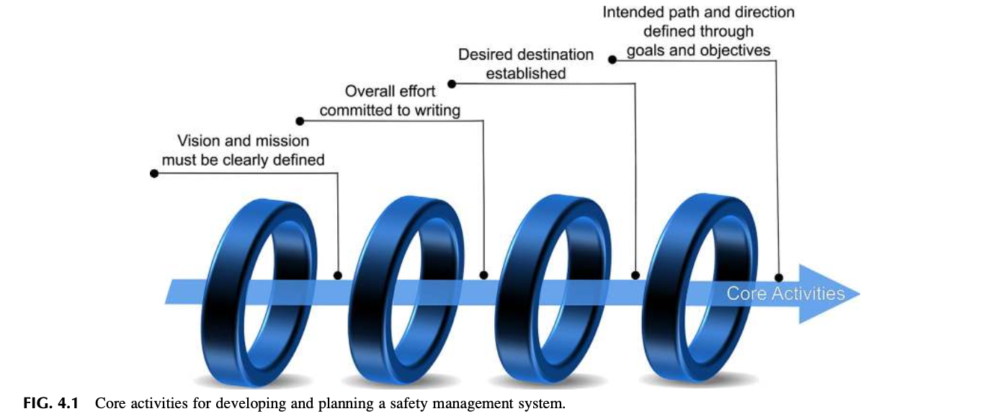
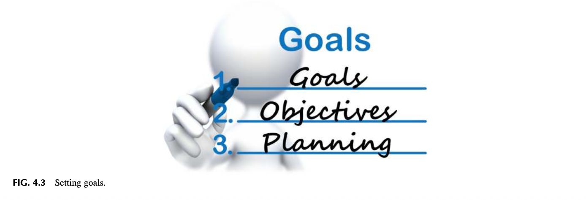
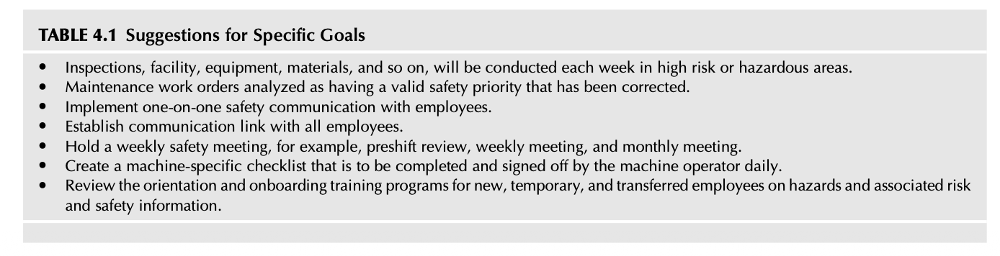
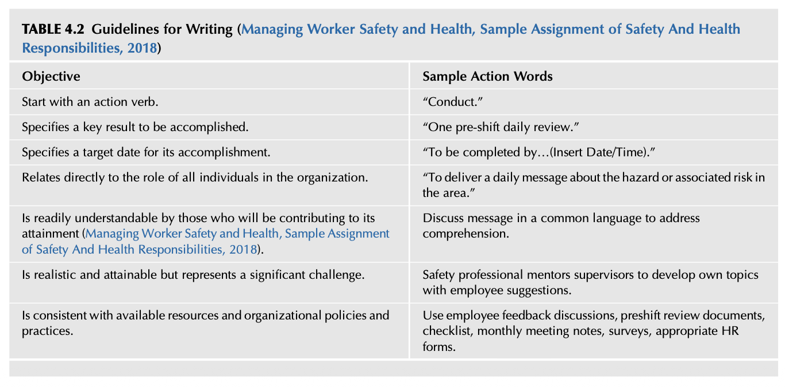

# 제4장 안전문화를 위한 방향 설정 (Establishing the Direction for the Safety Culture)

> 계획 없는 목표는 단지 바람에 불과하다.  
> — 앙투안 드 생텍쥐페리 (Antoine de Saint-Exupéry)  
> 
> 꿈이나 목표를 명확하게 표현할 수 있다면, 시작하라.  
> — 사이먼 시넥 (Simon Sinek)  
> 
> Safety Culture. https://doi.org/10.1016/B978-0-12-814663-7.00004-2

## 서론 (INTRODUCTION)

리더십의 핵심 기능 중 하나는 지정된 안전보건관리체계(Safety Management System, SMS)를 지속적으로 개선하기 위한 기획 프로세스(Planning Process)를 수립하는 것이다. 이러한 기획 프로세스는 조직의 전반적인 문화와 가장 잘 부합하도록 설계되거나 선택되어야 한다. 기획 프로세스는 안전관리체계의 목표(Goals)와 세부목표(Objectives)를 명확히 정의하고, 일별·주별·월별, 그리고 경우에 따라 수개년에 걸친 다년도 계획을 중심으로 구체적인 활동 일정을 수립해야 한다. 단기 및 장기 기획은 안전관리체계가 의도된 설계대로 정상 작동하고 있는지를 확인하는 데 필수적인 전략적 기준점(벤치마크)을 제공한다.

새로운 운영상의 재해(Operational Hazards)와 이와 관련된 위험(Associated Risk)이 발생함에 따라 작업 환경은 언제든 변화할 수 있다는 사실을 인지하고, 안전관리체계 프로세스는 반드시 유연성을 확보하고 지속적으로 모니터링되어야 한다. 작업 환경은 시간에 지남에 따라 변동될 수 있으며, 이는 기존의 안전관리체계 기획, 목표 및 세부목표를 수정할 것을 요구한다.

본 장의 목적은 안전관리체계가 올바른 궤도를 유지하도록 고안된 핵심 개념들을 제시하는 것이다. 안전 기획 프로세스는 안전 프로세스의 '이유(Why)'를 다루며, 전반적인 안전 사명(Mission)을 향한 비전(Vision)의 윤곽을 설정한다. 중점적인 프로그램 핵심 요소와 지향하는 안전문화를 지원하는 데 필요한 목표와 세부목표가 정의된다. 이 과정은 누가 참여해야 하는지, 요구되는 핵심 활동 및 전문 분야, 필요한 자원과 자재, 그리고 프로세스가 조직의 다른 계획, 목표 및 세부목표와 철저히 일치(정렬)되도록 보장하는 커뮤니케이션 방법을 명확히 규정한다.

본 장을 학습한 후 독자는 다음을 수행할 수 있어야 한다:
* 비전 및 사명 선언문(Vision and Mission Statements)을 개발할 수 있다.
* 조직적 범위 이탈(Organizational Scope Drift)의 개념을 정의할 수 있다.
* 안전방침 선언문(Safety Policy Statement)을 전달하고 소통하는 방법을 설명할 수 있다.
* 'SMART' 원칙을 활용하여 목표와 세부목표를 수립할 수 있다.
* 목표(Goal)와 세부목표(Objective) 간의 차이점을 정의할 수 있다.
* 활동을 위한 실행 계획(Plan of Action)을 수립하는 것이 왜 중요한지 이해할 수 있다.

## 진로 설정—기획 프로세스 (CHARTING THE COURSE—THE PLANNING PROCESS)

안전보건관리체계 기획의 궁극적인 목표는 안전방침과 세부목표를 통하여 조직 내 모든 구성원에게 전반적인 비전(Vision)과 사명(Mission)을 일관성 있고 명확하게 소통하는 것이다. 비전과 사명이 심사숙고하여 정교하게 구축될 때, 경영진 리더십 팀과 근로자들로부터의 수용성, 지지, 그리고 헌신적 몰입(Commitment)을 이끌어낼 가능성이 한층 강화된다.

안전관리체계를 개발하고 기획할 때에는 다음과 같은 다양한 핵심 활동들이 반드시 완수되어야 한다:
* 어떠한 성과 결과가 기대되는지에 대한 전반적인 비전(Vision) 정의
* 무엇을 달성해야 하는지에 대한 사명(Mission) 정의
* 왜 이러한 노력이 필요한지에 대한 세부 사항을 명시하며, 비전과 사명에 헌신하고 이를 명확히 규정

  
**그림 4.1 안전보건관리체계의 개발 및 기획을 위한 핵심 활동.**

* 기획 프로세스 기간 동안 다양한 안전 활동에 대해 기대되는 결과의 깊이와 범위를 설정하고, 안전관리체계를 완전하게 실행하는 데 필요한 조치들을 명시하는 목표(Goals)와 세부목표(Objectives) 수립.

안전관리체계의 노력이 "왜(WHY)" 필요한가에 대한 해답은 안전관리체계의 비전, 사명의 의도, 그리고 실행될 안전관리체계를 결정하는 안전방침 선언문의 절대적인 핵심이 된다 (그림 4.1 참조).

> 우리 대부분에게 있어 더 큰 위험은 목표를 너무 높게 세워 달성하지 못하는 것이 아니라, 목표를 너무 낮게 세워 그것을 달성해 버리는 것이다.  
> — 미켈란젤로 (Michelangelo, 2018)

### 교훈 1 (LESSON LEARNED 1)

조직에서 일상적으로 사용하는 다양한 단어나 문구가 사람들에게 새로운 프로젝트나 새로운 도전에 대한 거부감을 불러일으키고 있지는 않은가?

제임스(James)는 조직 내에서 통상적으로 사용되던 특정 용어나 문구들이 직원들 사이에서 본의 아니게 매우 부정적인 의미로 굳어져 버렸다는 사실을 포착하였다. 직원들은 "다음 달에 새로운 XXX를 전면 도입(rolling out)할 예정이며..."라는 말을 듣는 순간, 눈을 뒤룩뒤룩 굴리며 방 안을 이상한 표정으로 두리번거리기 일쑤였다. 직원들의 전반적인 반응은 다음과 같았다:

*"또 '이달의 유행(Flavor of the month)'이 시작되는군. 너무 신나할 것 없어. 그냥 버티고 있으면 6개월 뒤에는 흐지부지 사라질 테니까. 그들이 기분 좋을 정도로만 시늉만 하자."*

'롤아웃(Roll out, 전면 도입)'이라는 단어 자체가 하나의 독성(Toxic) 용어가 되어버린 것이다. 제임스는 직원들에게 긍정적인 지각(Perception)을 심어줄 수 있도록 이니셔티브를 도입하는 더 나은 방법을 찾아야 할 필요성을 절감했다. 그리하여 추구하고자 하는 변화나 노력의 가치를 훨씬 더 효과적으로 전달할 수 있는 새로운 접근 방식이 개발되었다. 단순히 '롤아웃(전면 도입)'이라는 어구를 '소개(Introduce)'라는 단어로 대체하는 것만으로도, 새로운 이니셔티브에 대한 직원들의 수용 가능성은 비약적으로 높아졌다.

## 비전과 사명, 리더십의 주요 덕목 (VISION AND MISSION, MAJOR TRAITS OF LEADERSHIP)

비전(Vision)과 사명(Mission)은 동일한 개념이 아니다. 비전 선언문은 안전관리체계가 지향하는 미래의 바람직한 위상과 방향을 정의한다. 비전은 코비(Stephen Covey)가 그의 명저 『성공하는 사람들의 7가지 습관(The Seven Habits of Highly Effective People)』에서 제시한 조건을 마련해 준다:

> "끝을 생각하며 시작하라(To begin with the end in mind)는 것은 목적지에 대한 명확한 이해를 가지고 출발하는 것을 의미한다... 그럼으로써 당신이 지금 어디에 서 있는지 더 잘 이해할 수 있고, 당신이 내딛는 걸음이 언제나 올바른 방향을 향하도록 할 수 있다." (Covey, 1990)

안전관리체계의 개발은 이 체계가 궁극적으로 무엇을 성취해야 하는가에 대한 비전에서부터 반드시 출발해야 한다. 명확하게 정의된 미래의 상태나 조건은 일상적인 의사결정뿐만 아니라 그 비전을 현실로 만들기 위해 필요한 목표와 세부목표의 수립을 견인한다. 비전 선언문은 일상 업무의 압박이 목적지로부터 조직을 이탈시키려 할 때마다 올바른 방향을 유지하도록 안내하는 나침반(Compass) 역할을 한다.

명확한 비전을 가짐으로써 안전관리체계의 '이유(Why)'를 훨씬 더 효과적으로 표현할 수 있다 (Sinek, 2009). 이는 경영진 리더십과 근로자들이 안전관리체계의 필요성과 왜 특정 활동 및 프로세스가 필수적인지에 대해 제기하는 질문에 설득력 있게 답하는 데 큰 도움을 준다.

새로운 비전 선언문을 개발하는 것은 양날의 검이 될 수 있다. 조직 진단 결과 새로운 비전의 필요성이 드러날 수 있지만, 경영진은 현재의 안전 활동으로도 충분하며 어떠한 변화도 필요하지 않다고 믿을 수 있다. 이러한 그릇된 신념을 극복하기 위해서는 기존 안전 프로세스의 격차(Gap)나 결함과 관련하여 현재 안전문화의 정확한 상태를 경영진에게 직시시켜 주어야 한다. 만약 경영진이 변화의 필요성에 동의한다면, 새로운 비전이 안전관리체계에 실질적인 개선을 가져올 것이라는 기대 하에 필수적인 자원, 시간, 예산이 비로소 배정될 수 있다.

## 사명 선언문 대 비전 선언문 (MISSION VS. VISION STATEMENT)

사명 선언문(Mission statement)과 비전 선언문(Vision statement)의 차이점은 무엇인가?

> "사명 선언문은 회사(또는 부서)의 목적과 핵심 초점을 설명한다. 이는 회사(또는 부서)가 무엇을 하는 조직이며, 그 전반적인 의도가 무엇인지를 명시한다. 사명 선언문은 비전을 뒷받침하며, 직원, 고객, 협력업체 및 기타 이해관계자들에게 목적과 방향성을 전달하는 역할을 한다. 사명은 회사의 비전을 달성하기 위한 회사의 우선순위와 방법론을 반영하여 변화할 수 있다."  
> (Mission Statements: Human Resources Mission Statement Examples, 2011; Mission & Vision Statements: What is the difference between mission, vision and values statements?, 2012)

## 비전 선언문 예시 (EXAMPLE VISION STATEMENTS)

다음은 여러 비전 선언문의 예시와 그 기준이다 (30 Example Vision Statements—Definition, 2018):

> "조직이나 프로그램의 활동을 통해 나타나는, 명확하고 영감을 주는 장기적인 바람직한 변화를 서술하는 단 한 문장의 진술."

**30개 비전 선언문 분석의 핵심 발견사항**:
최고의 비전은 영감을 주고(Inspirational), 명확하며(Clear), 기억하기 쉽고(Memorable), 간결하다(Concise).
* 여기에 수록된 30개 전체 조직 비전의 평균 길이는 단 14.56개 단어에 불과하다 (브랜드 명칭 제외).
* 상위 15개 조직의 평균 길이는 단 10.5개 단어이다 (브랜드 명칭 제외).
* 가장 짧은 것은 단 세 단어로 구성되어 있다 (Human Rights Campaign).
* 가장 긴 것은 32개 단어를 포함하고 있다 (Amnesty International).

**대표 예시**:
* **해외참전용사회 (Veterans of Foreign Wars)**: "참전용사들이 그들의 헌신에 대해 존중받고, 자신이 마땅히 누려야 할 권익을 온전히 보장받으며, 그들과 그 가족들이 이 위대한 조국을 위해 바친 희생에 대해 합당한 인정을 받도록 보장한다." (No One Does More for Veterans, 2018)
* **스미스소니언 협회 (Smithsonian)**: "우리의 유산을 보존하고, 새로운 지식을 발견하며, 우리의 자원을 전 세계와 공유함으로써 미래를 형성한다." (2018)
* **해비타트 운동 (Habitat for Humanity)**: "모든 사람이 안락한 주거 공간을 누리는 세상." (2018)

## 사명 선언문 (MISSION STATEMENT)

사명 선언문(Mission Statement)은 안전관리체계가 무엇을 수행하도록 지시받았는지에 대한 포괄적인 개요를 제공한다. 이는 안전관리체계의 행정적 운영 및 조직 구조를 위한 기본 틀을 제공하며, 완수해야 할 과업이나 리더십에 의해 공식 위임된 권한이 무엇인지를 명확히 이해하도록 돕는다. 사명 선언문은 안전 프로세스가 조직 전체에 실질적인 이익을 가져다줄 수 있는 방향성과 의사결정에 대한 공유된 약속(Shared Promise)을 확립한다.

### 사명 선언문 예시 (Example Mission Statement)

미 육군 군악대 "퍼싱스 오운(Pershing's Own)"은 행정부의 모든 부처를 포함한 미국 국가지도부를 위한 음악적 의전을 지원하며, 장병과 그 가족을 지원하고, 공공 외교, 지역사회 및 국제 친선 관계 증진, 신병 모집 이니셔티브, 그리고 음악 교육 프로그램을 지원하기 위해 광범위한 국내외 행사에 참여한다. 이를 통해 우리 군에게는 싸워 이기겠다는 필승의 의지를 고취하고, 국민의 전폭적인 지지를 이끌어내며, 국내외에서 우리의 국익을 드높인다.  
— 사명 선언문 (Mission Statement, 2018)

### 비전 및 사명 선언문 개발을 위한 필수 조치사항 (Action Needed for Developing a Vision and Mission Statements)

어떠한 안전관리체계와 실행 조치들이 필요한지 결정하기 위해 조직 진단(Organizational Assessment)을 수행하는 것부터 착수해야 한다:
* 안전문화의 현재 상태는 어떠한가?
* 궁극적으로 달성하고자 하는 바람직한 성과 결과는 무엇인가?
* 경영진 리더십은 무엇이 성취되기를 기대하는가? 리더십 팀은 운영상의 재해(Operational Hazards), 이와 관련된 위험(Associated Risks), 그리고 통제 요구사항의 진정한 본질을 완전히 이해하지 못하고 있을 수 있다. 경영진의 안전 지식수준에 대한 진단이 반드시 고려되어야 한다.
* 현재 지속적으로 수행되고 지원받는 법적 규제 준수 활동은 무엇인가?
* 법적 규제 준수 대상에 포함되지 않는 영역의 위험관리(Risk Management) 및 통제 노력을 다루기 위해 필요한 활동은 무엇인가?
* 진단 평가에 참여하도록 지정된 인력들에게 부과된 시간적 제약은 어떠한가? 프로젝트 수행을 위해 일상 업무에서 벗어나 필요한 전담 시간을 보장받고 있는가?
* 포괄적인 실행 계획(Plan of Action)을 실행하기 위해 필요한 예산이나 자원의 유형은 무엇인가?
* 주어진 예산, 시간 제약, 숙련도 수준 등을 고려할 때, 기대하는 목표와 세부목표를 달성하기 위해 필수적인 핵심 항목이나 실행 조치는 무엇인가?
* 실행 계획은 전사적으로 어떻게 전달되고 소통될 것인가?  
(Safety and Health Management Basics, Module Eight: Evaluating The Safety Management Systems, 2018)

  
**그림 4.2 나는 어느 길로 가기를 원하는가.**

비전과 사명이 수립됨에 따라, 전반적인 기획 프로세스를 안내하고 결정짓기 위한 의사결정이 내려져야 한다:
* 사명이 단순히 법적 규제 요구사항의 준수에만 초점을 맞추는 것인가? 아니면,
* 조직의 비전이 스스로 지속 가능하며 법적 준수를 넘어 장기적인 파급 효과를 지닌 안전문화를 구축하고자 하는가?

저자들은 많은 경우 경영진 리더십의 안전 사명에 대한 일반적인 지각(Perception)이 '최소 수용 기준으로서의 법적 규제 준수'를 주된 초점으로 삼고 있음을 관찰하였다. 규제 준수 주도형 비전과 이에 수반되는 사명은 정부가 의무화한 법규를 충족하는 선에 머물게 된다. 이 경우 조직의 안전 프로세스는 포괄적인 통합 시스템의 일부가 아니라, 개별적으로 분리된 독립형 프로그램들을 통해 연방 또는 주 산업안전보건청(OSHA)의 최소 법적 요구사항을 충족하는 데 국한되어 축소된다.

명확하게 정의된 비전과 사명은 기준점을 제공하며 지향하는 안전문화 목적지를 향해 항로를 이탈하지 않고 유지할 수 있도록 지원한다. 포괄적이고 성숙한 안전문화를 정착시키고자 한다면, 단순 규제 준수만을 바라보는 이러한 경영진의 사고방식은 반드시 극복해야 할 잠재적 장애물이다. "나는 어느 길로 가기를 원하는가?"를 이해하기 위한 개념도는 그림 4.2를 참조하라.

### 관찰 1 (Observation 1)

스마트폰, 태블릿 등 모바일 기기는 이제 고속도로, 도심 등 모든 곳에서 길을 찾는 핵심 내비게이션 수단이 되었다. 지도 애플리케이션은 경로를 안내하고, 교통 정체나 장애물을 피할 수 있도록 돕거나, 새로운 경로를 실시간으로 생성하여 지름길을 제공한다. 이동 시간과 거리도 대개 함께 표기된다. 올바른 방향을 잡고 목적지로 향하는 능력은 도로 상황에 맞춰 실시간으로 우회 경로를 제시하거나 수정해 주는 음성 안내의 도움을 받는다. 이러한 내비게이션 애플리케이션은 새로운 고속도로와 도로가 신설되거나 수정될 때마다 수시로 업데이트된다.

어떤 의미에서 안전보건관리체계는 안전 프로세스의 항해를 돕는 조직 차원의 '구글 맵'이나 GPS와 같은 애플리케이션 내비게이션 서비스와 매우 흡사하다. 비전(Vision)과 사명(Mission)은 시스템을 바르게 인도하는 보정 음성 안내 역할을 수행한다.

그러나 도로가 변경됨에 따라 구식 지도가 쓸모없어지는 것처럼, 조직이 변화함에도 비전과 사명이 업데이트되지 않으면 낡은 것이 되어버린다. 그 결과 안전문화는 더 이상 신뢰할 수 없는 안내 음성과 지도에 의존한 채 위험한 '자동조종(Autopilot)' 상태로 방치되고 만다.

*"나는 어느 길로 가기를 원하는가?"*라는 질문을 던져보라.

명확한 비전과 사명이 확립되고 상호 간에 합의가 이루어지면, 이를 어떻게 충족하고 달성할 것인지에 대한 소통 과정에서 강력한 '목적의식(Sense of Purpose)'을 발휘할 수 있다. 안전 활동에 대해 누군가 의문을 제기할 때 일말의 주저함이나 지체 없이 명쾌한 해답을 제시할 수 있게 된다. 그 활동이 갖는 '이유(Why)'를 조직 전체에 확신 있게 전달할 수 있는 것이다.

'이유(Why = 비전)'와 '무엇(What = 사명)'이 명확히 정의되면, 목표(Goals)와 세부목표(Objectives)를 훨씬 더 효율적으로 수립할 수 있게 되므로 '어떻게 일들을 실행할 것인가(How)'는 자연스럽게 명백해진다 (Sinek, 2009).

### 조직적 범위 이탈 (Organizational Scope Drift)

목표와 세부목표의 기획을 통해 안전관리체계를 구축해 나갈 때 반드시 통제하고 관리해야 할 잠재적 우려 사항 중 하나는 바로 '범위 이탈(Scope Drift)'이다.

범위 이탈은 원래 총기 조준경에서 유래된 용어로, 망원 조준경이 소총 총열과 일직선으로 정렬되지 않은 상태를 의미한다. 정렬되지 않은 조준경으로 표적을 겨냥하면 매 사격마다 표적을 빗나가게 된다.

조직적 범위 이탈은 안전 목표와 세부목표가 수립된 비전 및 사명과 제대로 정렬(Align)되지 못할 때, 안전문화로부터 점진적으로 멀어지는 현상을 초래한다. 서로 다른 책임이 배정되거나, 비즈니스 여건이 급변하거나, 새로운 경영진이 부임하여 전혀 다른 우선순위를 부여하거나, 이질적인 조직 간의 합병이 발생할 때마다 전반적인 문화에는 극심한 혼란이 발생하고 점진적인 이탈 변화가 누적된다. 일단 조준선이 표적을 벗어나고 나면, 지향했던 본래의 안전 목표와 세부목표를 다시 정렬시키는 것은 대단히 어렵다.

시어도어 루스벨트(Theodore Roosevelt)는 미국-스페인 전쟁 당시 '러프 라이더스(Rough Riders)' 기병대를 조직하면서 바로 이러한 현상을 직접 목격하였다:

> "마지막 순간에 내가 마침내 필요한 공식 명령서를 손에 쥐고 승리감에 차서 찾아갔을 때, 나에게 악감정은 없었지만 운명이 자신에게 너무나 가혹하다고 느끼고 있던 근심 가득한 국장급 관료는 의자에 털썩 주저앉으며 깊은 한숨과 함께 탄식했다: '오, 맙소사! 내가 이 사무실을 정말 완벽하게 질서정연하게 운영해 오고 있었는데—전쟁이라는 놈이 터져서 모든 것을 엉망진창으로 뒤엎어 버렸군요!' 그의 의식 속에서 전쟁이란 육군성 본연의 정상적인 행정 업무를 부당하게 방해하는 불청객에 불과했던 것이다." (Roosevelt, Lodge, & Bishop, 2017)

프로젝트의 실질적인 필요성과 복잡성을 온전히 이해하지 못한 채, 무작정 어떤 행동이라도 취하는 것이 최선이라고 생각하며 프로젝트에 섣불리 뛰어들기는 너무나 쉽다. 아무런 사전 계획 없이 프로젝트를 착수하는 것에 대한 경고는 이미 수천 년 전부터 존재해 왔다:

> "너희 중의 누가 망대를 세우고자 할진대 자기의 가진 것이 준공하기까지에 족할는지 먼저 앉아 그 비용을 계산하지 아니하겠느냐?"  
> — 누가복음 14장 28~30절 (킹제임스 성경, 2018)

범위 이탈(Scope Drift)은 주로 다음과 같은 원인들로 인해 발생한다:
* **안전문화를 개선하기 위한 명확한 목표와 세부목표가 담긴 성문화된 서면 계획 없이 시작하는 것**: 아무리 단순하더라도 서면으로 작성된 계획은 여건이 변화하더라도 일관성을 유지하고 변화의 견고한 기반을 제공한다. 목표와 세부목표가 문서화되어 있지 않으면 환경 변화가 닥쳤을 때 무엇을 완수해야 하는지 그 방향을 완전히 잃어버리게 된다.
* **전반적인 비전 및 사명과 아무런 관련이 없는 그럴듯하고 멋져 보이는(Cool) 프로젝트에 매료되는 것**: 코비(Covey)는 이러한 유형의 업무를 '중요하지도 않고 긴급하지도 않은(Unimportant and Not Urgent)' 4사분면 업무로 규정했다 (Covey, 1990). 이 사분면에 속한 프로젝트는 안전관리체계에 실질적인 기여를 전혀 하지 못함에도 불구하고, 겉보기에 무언가를 성취했다는 허황된 만족감과 가치 지각만을 안겨준다. 항상 *"이 프로젝트가 안전문화와 안전관리체계에 진정한 가치를 더해주는가?"*라는 본질적인 질문을 던져야 한다. 이는 제1장에서 상세히 논의된 바 있다 (경영 의사결정 매트릭스는 그림 1.10 참조).
* **위임된 공식 과업들이 의도된 계획 및 목표와 일치하지 않는 것**: 일부 조직은 보고 계통이 서로 중복되어 얽혀 있는 다면적 관리 구조를 사용한다. 한 명의 직원이 서로 조율하지 않는 둘 이상의 상사나 관리자에게 동시에 보고해야 하는 상황이 발생할 수 있다. 책임과 권한의 경계선이 어떻게 설정되어 있느냐에 따라 극심한 우선순위 충돌이 발생한다. 이러한 문제를 해결하기 위해서는 끈기 있는 인내심과 고도의 사내 정치적 감각(Political Savvy)이 결합되어야 한다.

### 관찰 2 (Observation 2)

저자들이 직접 목격한 이러한 사례들에는 다음과 같은 것들이 포함된다:
* 전사 안전 부서와 보안 부서가 자신들에게 직접 보고하지 않는 현장 직원들에게 상당한 시간과 노력을 요구하는 데이터 수집 중심의 최우선 프로젝트를 동시에 전면 도입(rolling out)하는 경우이다. 두 부서 모두 프로젝트를 착수하기 전에 필요한 인력과 시간 요구량을 사전에 평가하지도 않았으며, 서로 간에는 물론 영향을 받는 현장 부서들과도 사전에 조율하지 않았다.
* 전사 안전 부서가 직원들을 대상으로 특별 교육을 의무화하면서도, 이것이 하부 조직의 인력 배치와 현재 승인된 실행 계획 및 예산에 미치는 영향을 전혀 파악하지 못하는 경우이다. 이처럼 상충되는 과업 일정이 발생할 경우, 경영진의 의도와 추구하는 구체적 목표를 온전히 파악하기 위해서는 경영진의 판단 근거뿐만 아니라 내부 및 잠재적 외부 정치 역학을 이해하기 위한 '비판적 질문 태도(Questioning Attitude)'를 견지하는 것이 필수적이다 (Concepts and principles, human performance improvement handbook, 2009).

### 교훈 2 (LESSON LEARNED 2)

저자들의 경험에 비추어 볼 때, 가장 최우선적인 것은 고용 계약 시 합의된 공식 직무 기술서(Job Description)의 핵심 요구사항을 완수함으로써 경영진 리더십의 기본 지시 사항을 충실히 이행하는 것이다.

무엇을 성취해야 하는가에 대해 개인이 갖는 지각(Perception)과 경영진 리더십이 갖는 지각은 서로 다를 수 있다. 기존의 안전 프로세스에 중대한 변화를 가할 수 있는 완전한 권한을 부여받지 못한 상태라면, 첫 번째 단계는 현재의 운영이 실제로 어떻게 기능하고 있는지를 깊이 있게 학습하고 파악하는 것이다.

이 초기 단계에서는 조직의 커뮤니케이션 네트워크와 문제에 대응하기 위해 활용되는 방법들을 철저히 이해하는 것이 대단히 중요하다. 생명과 건강에 급박한 위험을 초래하는 조건이 존재하는 상황이 아니라면, 조직 진단을 완전히 마친 후에야 비로소 변경 사항을 제안하거나 실행해야 한다. 이러한 개선 제안은 반드시 안전관리체계의 구체적인 결함과 격차, 실재하는 재해(Hazards), 그리고 이와 관련된 위험의 심각도(Associated Risk Severity)에 근거하여 이루어져야 한다.

## 경계 스패닝과 사명 (BOUNDARY SPANNING AND THE MISSION)

안전 전문가의 역할은 조직의 모든 부서와 영역을 넘나들며 활동하는 '경계 확장자(Boundary Spanner)'가 될 것을 요구한다. 이는 제3장에서 심도 있게 논의되었다. 또한 이 역할은 제2장에서 논의된 바와 같이 조직 내 핵심적인 '정보 허브(Information Hub)'로 기능하는 것을 수반한다.

그러나 이러한 다중 역할은 경영진과 근로자들의 당면한 즉각적인 안전 우려, 긴급한 문제 또는 사안들에 대응해야 하기 때문에 지향하는 본래의 사명(Mission) 추진을 방해하고 방향을 틀어버릴 수 있다. 철저한 일정이 계획되어 있음에도 불구하고, 어느 관리자가 안전 부서에 불쑥 들러 *"아, 그나저나 방금 회의를 마치고 왔는데, 'X' 업무를 즉시 처리해 주십시오"*라고 말할 수 있다. 이러한 돌발 요청은 당일의 모든 일정을 뒤바꿔 놓고 새로운 활동을 의무적으로 완수하도록 강제한다.

## 안전방침 선언문: 비전이 수립되었다는 증거 (THE SAFETY POLICY STATEMENT, EVIDENCE A VISION HAS BEEN ESTABLISHED)

수많은 안전방침 선언문이 수 페이지에 달하는 방대한 분량으로 작성되어 있으며, 결과적으로 기억하기에 너무 복잡하고 장황해진다. 경영진 메시지의 본래 의도는 모든 직원이 오해의 소지를 최소화하면서 동일한 눈높이와 방향(On the same page)을 공유하도록 그 목적을 전달하는 데 있다. 장황한 안전방침/비전 선언문은 조직 내에서 방치되어 잊혀진 '인공물(Artifact)'로 전락하기 십상이다. 방침에 법률 문서처럼 길고 지루한 설명과 해석이 나열되어 있다면, 구성원들에게 이해될 가능성은 현저히 떨어진다.

안전방침 선언문은 조직의 규모와 관계없이 간결하고(Concise), 읽기 쉬우며(Readable), 구두 대화나 어떠한 미디어 형식을 통해서도 즉시 이해될 수 있어야 한다.

안전방침 선언문은 전반적인 공식 안전 절차서나 지침서와는 엄연히 구별된다. 안전 절차서는 안전 행정의 주체, 대상, 장소, 시기 및 방법(Who, What, Where, When, How)에 대한 심층적인 세부 사항을 제공한다. 절차서는 책임을 규정하고 안전한 작업 환경을 유지하기 위해 취해야 할 구체적인 접근 방식을 서술한다.

안전방침은 조직의 표방된 가치(Espoused Values)를 반영하는 문화적 '인공물(Artifact)'로 간주될 수 있다. 이 방침이 현장에서 얼마나 잘 실행되고 준수되는가는 조직이 실제로 품고 있는 진정한 가치가 무엇인지를 여실히 보여준다.

앞서 논의한 바와 같이, 안전방침 선언문은 직원의 실행과 장기적인 행동을 견인하는 데 도움을 주는 바람직한 방침의 핵심 정수를 전달하는 짧고 간결한 문장이어야 한다. 효과적인 안전방침 선언문은 다음의 핵심 요소들을 반드시 포함해야 한다:
* 안전을 위한 노력에 대한 경영진 리더십 팀의 확고한 헌신(Commitment)을 담은 서면 선언
* 안전보건관리체계의 목표와 세부목표 (Building an Effective Health and Safety Management System, 2015)

잘 작성된 안전방침 선언문은 리더십의 의도를 확립하고, 안전 문제와 운영상의 생산 우선순위 간에 충돌이 발생했을 때 어떻게 행동해야 하는지를 조직 내 모든 이에게 명확히 밝혀준다 (샘플 안전방침은 부록 4.1 참조).

안전방침 선언문을 도입하기 위한 모든 조치는 현재 및 과거의 방침과 활동들을 면밀히 검토한 후에 실행되어야 한다. 또한 다른 일반 운영 방침들이 제대로 집행되지 않고 무시되어 왔다면, 안전방침 선언문 역시 똑같은 운명을 맞이하게 될 것이다. 방침 준수에 대한 저항은 직원들의 냉소적이거나 부정적인 반응으로 표출될 수 있다. 이러한 반응은 안전 관련 노력에 대한 수용성의 결여나 심지어 거부를 나타내는 신호이다.

안전방침 선언문은 확신과 신뢰를 바탕으로 구축된다. 무엇보다도 근로자의 참여(Employee Involvement)를 통해 실행될 때 안전방침이 현장에서 준수될 가능성이 훨씬 높아진다. 정기적인 방침 검토 과정에 근로자들을 참여시키는 것은 선언문이 언제나 현장과 밀착된 유의미성을 유지하도록 보장한다.

> 일단 방침이 수립되면 경영진은 안전보건을 위한 전반적인 목표를 설정한 후, 직원들이 그 목표에 도달할 수 있도록 돕는 세부목표들을 구축해야 한다. 직원들이 목표를 향해 나아가는 과정에서 낙담하지 않도록 목표는 현실적이어야 한다. 모든 직원은 자신의 일상 업무 활동이 목표를 향해 나아가고 있음을 체감할 수 있어야 하며, 이를 통해 세부목표를 완수할 수 있어야 한다.  
> — Safety Pays for Everyone (2018)

안전문화가 조직에 깊이 뿌리내리기 위해서는 경영진 리더십 팀이 안전관리체계에 대한 확고한 헌신을 몸소 보여주고 지속적으로 지원해야 한다. 만약 경영진이 자신이 공언한 안전방침의 약속을 어긴다면, 그 선언문은 기만적인 위선으로 치부되어 완전히 버림받게 될 것이다.

## 안전방침 선언문의 소통 (COMMUNICATING THE SAFETY POLICY STATEMENT)

안전방침 선언문이 작성되고 경영진 리더십 팀의 승인과 공식 서명이 완료되면, 작업 전 안전 미팅(Preshift Safety Review), 주간 및 월간 회의와 같은 일련의 전사적 회의나 커뮤니케이션 채널을 통하여 모든 근로자에게 철저히 전달되어야 한다.

방침 선언문이 항상 구성원들의 시야에 머물도록 하기 위해 사내 게시판이나 전자 사내 게시판 곳곳에 게시되어야 한다. 그 메시지를 널리 전파하기 위해 뉴스레터, 공문, 안전 매뉴얼 등 다양한 정보 미디어가 활용될 수 있다.

안전방침 선언문은 반드시 다음과 같은 조건을 충족해야 한다:
* 근로자들의 일상 언어로 간결하고 투명하게 제시되어야 한다.
* 의도된 메시지의 전달에 있어 일관성을 유지해야 한다. 멀티미디어, 교육 세션, 오리엔테이션 등 전달 방식에 관계없이 모든 구성원이 동일한 내용과 메시지를 전달받아야 한다.
* 안전 관련 이슈나 프로젝트가 운영상의 생산 우선순위와 충돌할 때 절대적인 판단 기준점으로 활용되어야 한다.
* 일상적인 지도와 확립된 재해(Hazards) 및 관련 위험(Associated Risk) 통제, 안전 규칙, 그리고 작업 관행의 엄격한 집행을 통해 안전관리체계에 솔선수범 참여하는 리더십 팀에 의해 확고하게 뒷받침되어야 한다.

예를 들어, 신규 입사자, 부서 이동자, 협력업체 계약자 오리엔테이션 시 반드시 검토되어야 하며, 온보딩(On-boarding) 과정에서도 지속적으로 재강화되어야 한다. 조직에 방문객이나 외부 벤더사를 위한 지침이 마련되어 있다면, 이 방침은 해당 자료에도 필수적으로 포함되어야 한다.

다음의 예시들은 구성원들이 쉽게 기억할 수 있는 경영진의 메시지를 전달하는 단순하고 명료한 방침 또는 비전 선언문들이다:
* "우리의 가장 중요한 책임은 직원의 안전이다."
* "우리 조직의 모든 구성원은 안전한 일터를 누릴 권리가 있다."
* "우리가 행하는 모든 일은 안전하게 수행될 것이다."
* "어떤 작업이 안전하지 않다면, 결코 실행하지 마라."

이러한 선언문들이 다소 진부해 보일 수 있으나, 그 진정한 목적은 조직 내 모든 직원의 기억 속에 안전방침과 비전을 강력하게 각인(Anchoring)시키는 포맷을 고안하는 데 있다.

## 행동을 통한 소통 (COMMUNICATE BY ACTION)

안전방침 선언문이 어떻게 제시되는가는 구성원들의 수용성에 있어 결정적인 중요성을 갖는다. 무엇을 행하는가, 혹은 무엇을 행하지 못하였는가는 메시지를 소통함에 있어 백 마디의 말보다 훨씬 더 강력한 목소리를 낸다. 토론 중 결정적인 순간에 짓는 고개의 끄덕임이나 몸짓, 신체 언어(Body Language) 하나만으로도 지금 오가는 대화가 결코 진지하게 받아들여질 사안이 아니라는 지각(Perception)을 순식간에 전달해 버릴 수 있다.

선언문을 소개할 때 사용되는 어조(Tone)와 접근 방식은 근로자들이 그 메시지를 진정으로 무겁고 진지하게 받아들여야 하는지의 여부를 가늠하는 강력한 신호가 된다.

### 관찰 3 (Observation 3)

네이선(Nathan)은 전 직원을 대상으로 한 전국 단위의 동기부여 및 품질 혁신 프로그램을 전면 도입하던 모 기업과 함께 일한 적이 있었다. 지정된 기념 축제의 날에 슬로건이 새겨진 다채로운 기념품, 커피 머그잔, 티셔츠, 오디오 테이프 등이 배포될 예정이었다. 수많은 태스크포스 팀이 구성되었고, 그 성대한 날을 준비하기 위해 막대한 시간과 노력이 투입되었다. 이 캠페인이 가져올 회사의 기대 효과를 상세히 설명하는 사내 마케팅 공문이 전 직원에게 발송되었다.

드디어 축제의 날이 밝았으나, 직원들을 맞이한 것은 오직 무거운 침묵뿐이었다. 어떠한 유인물도, 티셔츠도, 그 무엇도 지급되지 않았다. 이 대형 프로젝트를 총괄 지휘하도록 임명되었던 담당자의 사무실을 찾아가 "도대체 어떻게 된 일인가? 프로그램은 어디 있는가?"라고 물었다. 그의 사무실 구석에는 개봉되지 않은 박스와 물품 더미가 수북이 쌓여 있었다. 그의 대답은 이러했다:

*"무슨 축제요? 그 물건들을 오늘 나눠주기로 되어 있었던 겁니까?"*

이 시도를 개발하기 위해 막대한 예산, 자원, 시간이 낭비되었음에도 불구하고, 그 프로그램은 그 자리에서 즉사하였으며 직원들로부터 더 이상 일말의 가치도 인정받지 못했다.

## 조직과의 정렬 (ALIGNING WITH THE ORGANIZATION)

단순히 헌신과 관심을 말로써 표명하는 것만으로는 안전문화가 조직에 뿌리를 내리고 진화하기에 역부족이다. 안전문화의 향상이나 퇴행은 작업장의 재해 통제 및 개선을 위해 필수적인 자원을 실제로 투입하느냐에 달려 있다. 그것은 경영진이 얼마나 체계적으로 조직화되어 있으며 단순한 규제 준수를 넘어선 사안들을 얼마나 주도적으로 다루는가에 좌우된다.

안전방침 선언문이 조직 전체로 어떻게 영향력을 확장하고 전파되는지의 관점에서 바라볼 때, 이 방침이 언제나 긍정적이고 구성원들이 명확히 이해할 수 있는 상태로 유지되도록 일상적으로 관리하고 정기적으로 재검토하는 것이 얼마나 필수적인지 알 수 있다.

문서화된 성문 선언문은 리더십 팀의 공식적인 의도이다. 그것은 리더십 팀의 구체적인 행동으로 입증되어 조직 문화 속에 확고히 각인되어야 한다. 진정한 의미의 방침이란 안전 문제를 대하는 리더십 팀과 직원들의 살아있는 '태도(Attitude)' 그 자체이다.

## 목표와 세부목표의 정의 (DEFINING GOALS AND OBJECTIVES)

대부분의 조직에는 품질 향상 및 연간 개인별·직무별 목표와 세부목표 수립을 위한 기획 프로세스가 이미 확립되어 있다. 조직 내에 이러한 기획 도구가 갖추어져 있다면, 바로 그 기획 양식과 지침을 적극 활용해야 한다. 조직의 공식 기획 프로세스를 준용하는 것은 전사 조직의 다른 부문들과의 일관성을 강력하게 보장해 준다.

안전관리의 목표(Goals)와 세부목표(Objectives)는 당면한 문제와 과제들을 해결할 수 있는 구체적인 전략을 제공하도록 설계되어야 한다.
* **목표(Goal)**는 프로세스가 미래의 특정 시점에 도달해야 할 지향점을 정의한다.
* **세부목표(Objectives)**는 특정 일정 기간 동안의 바람직한 목적지를 설정하는 구체적인 벤치마크(이정표)이다.

이는 안전보건관리체계를 실행하고 안전문화를 고도화하기 위해 따라가야 할 경로에 대한 통찰을 제공한다. 또한 안전관리체계 목표와 세부목표의 구체적인 추진 일정과 예산은 안전 비전과 사명 선언문이 수립된 직후에 확정된다 (Safety Pays for Everyone, 2018) (그림 4.3 참조).

## 안전보건관리체계를 개선하는 목표 정의 (DEFINING GOALS THAT IMPROVE THE SAFETY MANAGEMENT SYSTEM)

목표(Goals)는 무엇이 달성되어야 하는지를 설명하는 포괄적 지침이다. 목표는 일반적으로 장기적인 성격을 띠며 전반적인 비전을 대변한다 (Define Goals and Objectives, Step 2, 2003). 목표의 목적은 단순히 개별 프로그램을 관리하는 데 그치는 것이 아니라, 지향하는 안전문화와 일치하도록 리더십 팀에게 의사결정과 실행 조치에 대한 명확한 지침과 적시의 추진 현황을 제공하는 데 있다.

> "여기서 제가 어느 길로 가야 하는지 말씀해 주시겠어요?"  
> "그건 네가 어디로 가고 싶은지에 달려 있지," 체셔 고양이가 답했다.  
> "전 어디든 별로 상관없는데요—" 앨리스가 말했다.  
> "그렇다면 어느 길로 가든 상관없잖아," 고양이가 말했다.  
> "—어디든 어딘가에 도달하기만 한다면요," 앨리스가 설명을 덧붙였다.  
> "아, 넌 반드시 어딘가에 도착하게 되어 있어," 고양이가 말했다. "충분히 오래 걷기만 한다면 말이지."  
> — 『이상한 나라의 앨리스』 (Lewis Carroll, 2018)

  
**그림 4.3 목표 설정.**

오리건주 OSHA의 『안전보건관리 기초』에 따르면, "목표를 글로 적는 것은 쉽다. 그것은 단지 소원에 불과하다." (Safety and Health Management Basics, Module One: Management Commitment, 2017; Safety and the Supervisor, Instructor Guide, 2018).

목표는 실행 계획(Action Plan)이 작성되고 현장에 실행되기 전까지는 한낱 공허한 바람에 지나지 않는다. 문제는 많은 조직이 두 극단 중 하나로 치우치는 경향이 있다는 점이다. 즉, 프로세스를 완벽하게 만들려다 과도한 기획(Overplanning)에 매몰되어 결국 아무것도 완수하지 못하거나, 무엇을 달성해야 하는지에 대한 기본적인 개요나 계획조차 갖추지 않은 채 무작정 일부터 시작하는 것이다.

앞서 논의한 '범위 이탈(Scope Drift)'이 발생하여 집중된 활동에서 초점을 잃은 산만한 활동으로 표류할 수 있다. 목표와 세부목표, 그리고 '행동을 향한 편향(Bias to action)'이 결여되면, 그 결과는 재해(Hazards)와 관련 위험(Associated Risks)의 차가운 실재를 은폐하는 겉치레 '분주한 일(Busy work)', '활동의 덫(Activity trap)'에 걸려들거나 비효율적인 멀티태스킹의 늪에 빠지는 것으로 귀결된다.

다양한 기획 모델이 존재하며 그 범위와 복잡성도 제각각이다. 첫 번째 원칙은 독자적으로 모델을 개발하거나 외부 기법을 도입하기에 앞서 조직이 공식적으로 지정한 서식을 우선 활용하는 것이다. 안전 기획 양식은 조직 내에서 널리 사용되며 경영진과 직원들에게 친숙한 체계와 자연스럽게 조화를 이루어야 한다.

오랜 기간에 걸쳐 그 유효성이 입증된 대표적인 기획 모델 중 하나가 바로 'SMART' 모델이다. 이는 비교적 단순하고 명확하다는 기준을 충족한다. 'SMART'는 **Specific(구체적)**, **Measurable(측정 가능)**, **Attainable(달성 가능)**, **Realistic(현실적)**, **Timely(기한 명시)**의 머리글자이다 (Meyer, 2003). 다음은 'SMART' 정의에 대한 개요이다:

### 구체성 (Specific)

데이터와 측정치는 안전관리체계의 통제 범위를 벗어난 제반 조건과 외부 요인들의 영향을 받기 쉬우며, 겉보기에 성공적인 성과로 보이는 결과를 무효화시킬 수 있다.

총기록재해율(Total Case Incident Rate, TCIR)의 감소가 반드시 안전문화가 정상 작동하고 있다거나 안전보건관리체계가 실질적으로 효과적임을 의미하는 것은 아닐 수 있다. 이러한 수치 감소는 조건들이 아직 결합되지 않아 대형 손실로 표출되지 않았을 뿐인, 잠재된 알려지지 않은 고위험(High risks)의 존재를 가려버리는 눈가림이 될 수 있다.

필수적인 핵심 정보를 확립하기 위해 5W1H 원칙—누가(Who), 무엇을(What), 언제(When), 어디서(Where), 왜(Why), 그리고 어떻게(How)—을 활용할 수 있다. 이 단계에서는 명확하고 구체적인 전담 인력, 장소, 추진 당위성, 그리고 시간 프레임을 식별하고 조율할 것을 요구한다.

목표를 보다 구체적으로 정의하고 확립하기 위해 다음의 5W 1H 질문에 답해 보라:
* **왜(Why)**: 목표를 완수해야 하는 구체적인 이유, 목적 또는 기대 효과는 무엇인가?
* **누가(Who)**: 누가 참여하고 관여하는가?
* **무엇을(What)**: 내가 궁극적으로 성취하고자 하는 것은 무엇인가?
* **언제(When)**: 명확한 시간 프레임(일정)을 설정하라.
* **어디서(Where)**: 구체적인 장소를 식별하라.
* **어떻게(How)**: 필수 요구사항과 제약 조건을 명확히 정의하라.

이 질문들에 대한 구체적인 답변을 마련한 후, 다음 목표 설정 단계는 그 목표가 '측정 가능한가'를 판단하는 것이다.

### 측정 가능성 (Measurable)

측정 가능(Measurable) 단계에서는 수립된 목표를 향한 진척도를 측정하기 위해 명확히 정의된 평가 기준 세트가 개발된다.

어떤 목표가 측정 가능한지 판단하기 위해서는 '어떻게(How)'라는 질문을 던져야 한다: *"목표가 공식적으로 완료되었거나 달성되었음을 내가 어떻게 알 수 있는가?"* (McDonald, 2014; Meyer, 2003). 정확히 무엇을 측정하고 있는가는 조직뿐만 아니라 측정 대상이 되는 구성원들에게도 실질적인 유의미성을 지녀야 한다.

무엇을 측정할 것인가를 선택할 때에는 반드시 조직의 실질적인 개선이나 성공을 정조준해야 한다. 잘못된 목표를 측정하기로 결정하면 성과 측정 자체에 대한 강한 저항을 초래할 수 있다. 또한 엉뚱한 목표를 측정할 경우, 해당 목표가 총기록재해율(TCIR)을 낮추는 데 아무런 실질적인 기여를 하지 못했음에도 불구하고 성공을 자축하는 왜곡된 결과를 낳을 수 있다.

결과적으로 TCIR과 산재보상 부상 수치가 표면상 개선된 것처럼 보였던 이유가, 알고 보면 정규직 직원을 협력업체 도급이나 파견 임시직으로 전환함으로써 위험 노출을 외부로 전가시켰기 때문인 경우가 허다하다. 기술의 변화, 기업 합병, 운영 프로세스의 변경 역시 부상 트렌드와 패턴을 인위적으로 바꿀 수 있다.

졸속으로 수립된 빈약한 목표 설정은 운영상의 재해(Operational Hazards)와 관련 위험(Associated Risk)을 그대로 방치하여 여전히 치명적인 대형 참사의 잠재력을 온존시키게 된다.

### 교훈 3 (LESSON LEARNED 3)

제임스(James)가 6시그마 블랙벨트 인증을 준비하고 있을 때, 인증에 필수적인 프로젝트를 설계하기 위해 목표 설정 방법론을 연구하였다. 그 프로젝트는 당초 OSHA 300 재해 기록부에서 산출된 5개년 치의 총기록재해율(TCIR) 데이터를 핵심 측정 지표로 삼아 설계되었다.

그러나 연구를 진행하며 수집된 데이터를 엄밀히 검증하려 했을 때, 그는 TCIR 데이터가 문제 해결에 필요한 핵심 정보를 전혀 포착해 내지 못한다는 사실을 발견했다. 그는 프로젝트 팀원들에게 왜 이 데이터들이 상호 연관성을 갖지 못하는지 원인을 규명하도록 도전 과제를 던졌다. 전반적인 TCIR 수치 감소라는 전통적인 목표가 설정되어 있었으나, 프로젝트의 초점을 어디에 맞춰야 할지 식별하는 데 필요한 본질적인 정보를 제공하지 못했기 때문에 그 목표는 무효한 것이었다.

TCIR의 단순 활용은 OSHA 기록부에 등재되지 않는 수많은 다양한 유형의 부상들을 전혀 반영하지 못한다. 팀이 훨씬 더 심층적인 정밀 분석을 수행한 후에야 비로소 특정한 부상 감소를 목표로 정밀 타격할 수 있었다.

부상 데이터(결과 지표) 하나에만 의존하는 것은 위험(Risk)이 적절하게 통제되고 있다는 치명적인 착각과 거짓 안도감을 심어준다. 앞서 살펴본 교훈은 목표 설정과 성과 측정에 직접적인 영향을 미치는 문제에 대한 깊은 통찰을 제공한다.

재해(Hazards) 분석, 위험성평가(Risk Assessment) 도구, 그리고 손실 데이터로 구성된 체계적인 데이터 수집 프레임워크가 부재하다면, 현장의 실제 상황을 정확히 이해하는 것은 불가능하다. 부실한 데이터 수집은 잘못된 격차 분석으로 이어져, 안전과 관련된 근본적인 기저 원인을 전혀 해결하지 못하는 겉핥기식 목표를 양산하게 된다. (수치형 목표와 서술형 목표의 개요는 부록 4.2 참조).

목표가 측정 가능하다고 정의된 후, 다음 단계는 그것이 달성 가능한지(Attainable)를 판단하는 것이다.

### 달성 가능한 목표 (Attainable Goals)

흔히 간과되는 요소 중 하나는 의도한 목표가 과연 실질적으로 '달성 가능한가(Attainable)'를 사전에 평가하는 것이다. 달성 불가능한 거창한 목표는 오히려 안전보건관리체계에 치명적인 해악을 끼칠 수 있다.

예를 들어, 당해 연도에 전 직원을 대상으로 응급처치 교육을 완료하는 것이 하나의 목표로 설정될 수 있다. 철저한 사전 평가를 통해 교육 학급 수, 학급당 인원, 필요한 전문 강사 수, 교육 훈련 비용, 교육으로 인한 생산 현장의 운영 차질을 우회할 대책, 요구되는 전반적인 시간, 필요한 전문성, 예산, 교육 자재 등을 꼼꼼히 산정해야 한다. 이러한 완전한 평가가 선행된 후에야 비로소 목표 달성의 실질적인 가능성이 확립될 수 있다. 만약 목표 달성이 불가능한 것으로 판명된다면, 당초의 세부목표를 충족하기 위한 실현 가능한 대안이 마련되어야 한다.

목표가 확립되고 이것이 안전 프로세스에 진정한 가치를 더해주는 것으로 인정될 때에만, 이를 뒷받침할 구체적인 활동과 자원을 선별하는 작업이 비로소 시작될 수 있다.

> **달성 가능성(Attainable)**: 자신에게 가장 중요한 목표가 무엇인지 식별하고 나면, 그것을 현실로 만들 수 있는 구체적인 방법들을 강구하기 시작한다. 당신은 그 목표에 도달하기 위해 필요한 태도, 역량, 기술, 그리고 재정적 능력을 주도적으로 개발해 나간다.  
> — 마이어 (Meyer, 2003)

앞서 교훈에서 언급하였듯이, 수많은 조직이 안전 프로세스의 유일한 성과 측정 도구로서 사후 재해 발생률(Incident Rates) 데이터에만 의존하고 있다. 예를 들어, 당해 연도 동안 부상 건수를 10% 감축하고 총기록재해율(TCIR)을 25% 감축한다는 목표가 설정되어 있다면, 이 수치는 본질적으로 무엇을 대변하는가?

문제는 재해 발생 빈도율(Incident Frequency Rates)이 본질적으로 '후행 지표(Downstream Measurements)'라는 점이다. 사후 손실 결과를 측정하는 것은, 제품이 완전히 조립된 후에 완제품의 품질을 사후 검사하려는 것과 같으며, 이는 품질관리(QC) 이론상 대단히 비효율적인 방식으로 간주된다.

조립 프로세스가 진행되는 도중에 품질을 선제적으로 통제하는 것과 마찬가지로, 재해(Hazards)와 위험(Risk)에 대한 사전 통제를 확립하는 것이 훨씬 더 효율적인 접근법을 제공한다. 잠재적 결과(손실)를 근본적으로 바꾸기 위해서는 재해 및 이와 관련된 위험에 대한 노출(Exposures to hazards and their associated risk)을 선제적으로 통제하고 감축하는 목표가 필수적이다.

손실을 초래하는 사건들은 단순한 기저 원인을 가질 수도 있지만, 반드시 식별되고 분석되어야 할 복잡한 상호작용의 연속체를 나타낼 수도 있다. 선행 활동(Upstream Activities)과 그 손실 잠재력을 식별하지 않은 채 TCIR 수치 하나에만 매달리는 것은, 실제로는 전혀 그렇지 못함에도 불구하고 재해와 관련 위험이 마치 적절히 통제되고 있는 듯한 치명적인 '거짓 안도감(False Sense of Control)'만을 안겨준다.

선행 활동 지표들을 TCIR과 같은 결과 지표에 유기적으로 연계(Piggybacking)시키는 분석적 패러다임 전환이야말로 *"그 목표가 진정으로 측정 가능하며 달성 가능한가?"*라는 근본적인 질문을 해결해 줄 것이다.

### 교훈 4 (LESSON LEARNED 4)

어느 안전 관리자가 전사 연례 안전 감사(Audit)에 대한 깊은 고뇌와 우려를 토로하였다. 본사의 목표는 매년 안전 목표에 대해 한층 더 엄격한 채점 기준과 새로운 심사 기준을 들이대며 '기준선(Bar)'을 계속해서 높임으로써 지속적 개선을 유도하겠다는 것이었다.

공장 리더십과 현장 안전 실무자들은 감사에서 지적된 재해 통제 결함(Hazard Control Deficiencies)과 제반 문제점들을 제거하기 위해 피땀 흘려 노력했다. 문제는 본사가 매년 새로운 감사 기준을 덧붙이며 잣대를 계속 바꾸는 바람에, 현장의 안전 감사 점수가 결코 향상되는 모습을 보일 수 없었다는 점이다. 점수는 제자리걸음을 하거나 오히려 떨어졌고, 현장의 헌신적인 노력은 본사로부터 결코 충분하다고 인정받지도, 치하받지도 못했다. 공장 경영진은 결코 감사를 만족스럽게 통과할 수 없었고, 마침내 개선하려는 의지 자체를 완전히 포기해 버렸다.

감사를 대하는 현장의 태도는 *"어차피 해봤자 안 돼(Whatever)"*라는 극단적인 냉소로 변질되었고, 결과적으로 감사는 아무런 가치도 없는 형식적 낭비로 전락하였다.

목표가 너무 높게 설정되면 달성이 원천적으로 불가능해진다. 반대로 목표가 너무 낮게 설정되면 달성은 쉬울지 몰라도 안전보건관리체계나 안전문화에 어떠한 눈에 띄는 실질적 개선도 가져오지 못한다. 조직은 목표가 너무 쉬우면 흥미를 잃어버리고, 목표가 비현실적으로 너무 높으면 깊은 좌절감에 빠진다.

만약 목표가 현실적으로 달성 불가능함에도 금전적 보너스, 인사 고과 승진, 표창 등 목표 완수를 압박하는 강력한 외적 보상이 걸려 있다면, 인간의 본성은 어떻게든 목표를 달성한 것처럼 보이게 만들 편법을 찾아내기 마련이다. 목표 달성 실적을 날조하려는 유인은 결국 사실상 전혀 수행하지 않은 안전 작업을 서류상으로만 완벽하게 수행한 것처럼 문서를 허위 조작하는 이른바 **'서류 때우기(Pencil whipping)'**라는 치명적인 의도치 않은 부작용을 낳게 된다 (Pencilwhip, 2016).

이러한 부작용—산재 청구의 은폐, 데이터의 과장 왜곡, 그리고 비윤리적인 부정 행위—은 안전문화를 회복 불가능할 정도로 극심하게 황폐화시킨다.

직원들을 본래 규정된 일상 직무와 책임에서 차출하려면 다른 누군가가 그 빈자리를 메워야 하거나 일정표에서 특정 과업이 제외되어야 한다. 시간적 제약과 일정 충돌을 정확히 이해하는 것이야말로 목표가 비현실적으로 전락하는 것을 방지하는 열쇠이다. 적절한 시간 기획은 그 프로세스에 참여하는 모든 구성원들에 의해 목표가 기꺼이 수용되고 강력한 지지를 받을 확률을 비약적으로 높여준다.

### 현실성 (Realistic)

목표는 리더십과 근로자들이 온전히 지지할 수 있고, 그것의 완수를 위해 필요한 시간을 기꺼이 할애하며 노력을 쏟아부을 가치가 있는 무언가를 대변해야 한다. 각 목표는 조직과 안전 프로세스 양자 모두에 실질적인 관련성을 지녀야 하며, 안전문화에 진정한 가치를 가져다주는지를 엄밀히 평가받아야 한다.

> **현실성(Realistic)**: 현실적인 목표란 당신이 기꺼이 노력할 의지가 있고(Willing), 실제로 노력할 수 있는(Able) 대상을 나타내야 한다. 목표는 높은 수준이면서도 동시에 현실적일 수 있다. 당신의 목표가 얼마나 높아야 하는지를 결정할 수 있는 사람은 오직 당신 자신뿐이다. 만약 당신이 그 목표를 진정으로 완수할 수 있다고 굳게 믿는다면, 그 목표는 아마도 현실적인 목표일 것이다.  
> — 마이어 (Meyer, 2003)

목표가 조직에 제공하는 가치는 투입되는 인력, 시간, 예산, 자재 비용, 요구되는 전문 기술, 그리고 커뮤니케이션 요구량을 고려할 때 그 목표가 과연 그만한 노력을 들일 가치가 있는지를 결정한다. 성공을 위한 제반 요구조건들이 명확히 우선순위화되고 투명하게 공개되지 않는다면, 그 목표는 달성 불가능해질 가능성이 훨씬 더 높아진다.

### 교훈 5 (LESSON LEARNED 5)

네이선(Nathan)은 직원들에게 문해력(문자 해독) 교육을 제공하자는 목표가 건의되었던 사례에 직면한 적이 있었다. 해당 사업장의 특성상 직원들의 문해율이 상당히 낮은 편이었다. 이 목표의 본래 의도는 직원들의 읽기 능력을 향상시켜 안전 유인물과 매뉴얼을 올바르게 이해할 수 있도록 돕겠다는 것이었다.

비록 취지는 훌륭하고 가치 있는 목표였으나, 조직의 고유한 특성, 극심한 직원 이직률, 쉴 새 없이 돌아가는 생산 공정, 그리고 기타 조직적 제약 요건들을 고려할 때 이는 현실성이 결여된(Unrealistic) 목표였다.

목표가 현실적인 것으로 판단되고 나면, 이를 달성하는 데 필요한 명확한 시간 프레임이 반드시 확립되어야 한다.

### 시간과 목표 설정 (Time and Goal Setting)

시간(Time)은 목표 설정에 있어 가장 중요하면서도 아마도 가장 과소평가되는 요소 중 하나이다. 목표는 그 완수를 위해 요구되는 구체적인 시간 프레임을 반드시 명시해야 한다. 명확한 시간 프레임에 결속되어 있지 않다면, 그 목표를 최우선 순위로 추진해야 할 어떠한 긴박감도 형성되지 않는다.

목표 추진 일정을 수립할 때에는 목표 달성에 필수적인 모든 이해관계자들, 즉 경영진 리더십 팀, 생산 운영 부서, 교육훈련 부서, 인사 부서 및 기타 관련 부서들과의 긴밀한 사전 조율 하에 진행되어야 한다. 각 참여 주체마다 고유하게 부여된 본연의 목표와 세부목표가 이미 존재하므로, 안전 목표는 그들의 기획 일정과 가용 역량 범위 내에서 현실적으로 검토되어야 한다.

> **기한 명시(Time Bound)**: 목표에는 반드시 목표 달성 기한(Target Date)이 명시되어야 한다. 백만 달러를 벌고 싶다는 소망이 있더라도 구체적인 달성 기한을 설정하지 않는다면 어떠한 동기부여도 되지 않는다. 너무 먼 미래로 설정된 마감 시한은 차일피일 미루어지기 십상이다. 반대로 너무 촉박하게 설정된 목표는 비현실적일 뿐만 아니라 사람들의 의욕을 꺾어버린다.  
> — 마이어 (Meyer, 2003)

### 교훈 6 (LESSON LEARNED 6)

어느 안전/보안 관리자가 제안하여 도입된 훌륭한 아이디어 중 하나는 바로 **'일정 충돌 방지 캘린더(Collision Calendar)'**를 구축하고 운영하는 것이었다. 이 캘린더는 조직 및 개인의 다양한 행사, 사내 교육, 공휴일, 정기 회의, 법적 의무 활동 등 전사적 일정을 종합적으로 추적하여, 타 부서가 이미 확립해 둔 예정된 행사들과의 중복 및 충돌을 사전에 완벽히 방지하는 데 활용되었다.

일단 일정 간의 '충돌(Collision)'이 식별되면, 일정을 변경할 대안 날짜를 선택하거나 일정이 겹치는 부서와 협의하여 원하는 날짜나 시간을 지혜롭게 조율할 수 있는 선택지가 열리게 된다. 이 충돌 캘린더를 통해 경영진 리더십 팀과 함께 직원들이 너무 많은 의무 과업과 현안에 치여 과도하게 일정이 중복되는 잠재적 과부하 문제를 사전에 점검할 수 있었다.

목표 완료 기한을 설정할 때 반드시 추가로 고려해야 할 핵심 질문은 *"이 사안이 심각한 재해 통제 이슈(Severe Hazard Control Issue)나 높은 관련 위험(High Associated Risk)과 결부되어 있는가?"*이다. 잠재적 재해나 위험과 직결된 목표에는 절대적인 최우선 순위가 부여되어야 하며, 시정 조치가 반드시 현장에 확고히 실행되도록 엄격한 시간 요구조건이 설정되어야 한다.

예를 들어, 조직의 안전보건관리체계와 안전문화를 고도화하기 위한 목표 수립 프로세스는 선택된 안전관리체계의 다양한 핵심 요건들을 현장에 실행하기 위해 어떠한 활동들이 필요한지 규명하는 것에서부터 출발한다. 앞서 논의한 'SMART' 형식을 적용하여, 각 안전관리체계 요건별 구체적 기준을 면밀히 검토하고 측정 방법을 확정한다.

미국국가표준협회 ANSI Z10-2012 규격에서는 다음과 같이 명시하고 있다:

> "...조직마다 내재된 위험, 조직 구조, 문화 및 기타 특성이 저마다 고유하기 때문에, 각 조직은 스스로에게 특화된 구체적인 성과 측정 지표를 독자적으로 정의해야 한다."  
> (Occupational Health & Safety Management Systems, 2012)

구체적인 목표 식별에 대한 유용한 제안 사항은 표 4.1을 참조하라. 경영진 리더십 팀이 안전 목표와 세부목표의 진정한 의도를 당연히 알고 이해하고 있을 것이라고 섣불리 단정해서는 안 된다. 경영진 리더십 팀과 마주 앉아 각 목표가 왜 필요한지에 대한 논리적 배경뿐만 아니라, 그것이 어떻게 달성될 수 있으며 전사 조직 전체에 어떠한 유의미한 가치를 창출하는지 명확히 설명하고 소통하는 과정이 절대적으로 필수적이다 (Grodin, 2014).

## 세부목표의 정의 (DEFINING OBJECTIVES)

수립된 각각의 목표(Goal)에 대하여, 선언된 목표를 달성하는 데 필수적인 구체적인 실행 단계나 조치를 제공하는 세부목표(Objectives)가 반드시 수립되어야 한다.

**예시**:
* **목표(Goal)**: X 부서의 모든 관리감독자는 1월 31일까지 지정된 두 가지 직무에 대해 직무재해분석(Job Hazard Analysis, JHA)을 완수한다.
* **세부목표 1(Objective 1)**: 완수 대상 선정을 위해 위험 심각도 및 손실 유발 잠재력 분석, 초기 재해/위험 평가(Initial Hazard/Risk Assessment), 그리고 근로자 면담을 바탕으로 두 가지 지정 직무를 선정한다.
* **세부목표 2(Objective 2)**: 관리감독자들과 선정된 두 직무에 대해 논의하고, JHA가 어떻게 개발될 것인지, 요구되는 시간과 완수에 필요한 자원을 협의한다.

  
**표 4.1 구체적 목표 수립을 위한 제안 사항**
* 고위험 구역 또는 재해 발생 우려 구역(High Risk or Hazardous Areas)에 대하여 매주 시설, 장비, 자재 등의 정기 안전점검을 실시한다.
* 안전 최우선 순위로 분석되어 시정 조치가 완료된 유지보수 작업 의뢰서(Maintenance Work Orders)를 분석한다.
* 근로자와의 1:1 대면 안전 대화 및 커뮤니케이션을 실행한다.
* 전 직원과의 안전 소통 핫라인 채널을 확립한다.
* 작업 전 안전점검 회의(Preshift Review), 주간 회의, 월간 회의 등 주간 정례 안전회의를 개최한다.
* 매일 기계 조작자가 직접 작성하고 서명해야 하는 장비별 맞춤형 일일 체크리스트를 제작한다.
* 신규 입사자, 임시직, 전보 직원을 대상으로 재해(Hazards)와 관련 위험(Associated Risk) 및 안전 정보에 관한 오리엔테이션 및 온보딩 교육 프로그램을 재검토한다.

> "목표는 오직 세부목표를 세움으로써만 달성될 수 있다. 세부목표는 목표를 달성하기 위해 당신이 밟아갈 구체적인 경로이다. 그것은 구체적인 성과나 실행 결과를 서술한 진술이다. 그것은 조직의 거시적 목표를 향해 나아가는 작고 긍정적인 디딤돌이다."  
> — Safety Pays for Everyone (2018)

세부목표를 작성하는 것은 포괄적 목표를 기술하는 것보다 조금 더 깊은 사유를 요한다. 잘 작성된 세부목표는 다음의 요소들을 반드시 갖추어야 한다:
* **행동 동사로 시작할 것**: (감소시키다, 증대시키다, 개선하다 등)
* **달성해야 할 핵심 결과를 구체적으로 명시할 것**.
* **정량화 가능할 것**: 바람직한 변화를 측정하기 위해 구체적인 숫자를 사용할 것 (예: 50% 증가).
* **달성을 위한 목표 기한을 명시할 것**.  
(Safety and Health Management Basics, Module One: Management Commitment, 2017)

세부목표를 수치로 정량화함으로써 무엇이 효과가 있었고 무엇이 실패했는지에 대한 명확한 피드백 정보를 얻을 수 있다.

## 세부목표의 작성 (WRITING OBJECTIVES)

각 목표와 세부목표는 무엇을, 누구에 의해, 어느 정도의 수준으로, 언제까지 달성해야 하는지가 명확하고 간결해야 한다. 목표와 세부목표는 조직 전체에 투명하게 소통되어 모든 근로자가 각 목표가 어떠한 배경에서 도출되었는지를 충분히 이해할 수 있어야 한다. 근로자들은 자신의 참여 수준, 목표의 타당한 이유와 목적, 그리고 이것이 안전관리체계의 전반적인 달성에 어떻게 기여하는지를 명확히 이해해야 한다.

효과적인 목표와 세부목표는 반드시 서면으로 작성되어야 하며, 그 추진 현황을 추적하고 모니터링할 수 있는 구조를 갖추어야 한다. 목표의 복잡성에 따라 프로젝트 관리 소프트웨어, 마인드맵, 스프레드시트 등 다양한 도구를 활용하여 추적을 수행할 수 있다. 핵심은 사소한 작은 목표와 개별 세부목표 하나하나까지 모두 글로 기록함으로써 혼선이나 오해의 소지를 원천 차단하는 것이다. 세부목표 작성에 관한 일반적인 지침은 표 4.2를 참조하라.

목표와 세부목표는 안전방침 선언문과 교차 검증되어야 하며, 그것이 과연 안전문화에 진정한 가치를 가져다주는지를 끊임없이 검토해야 한다.

목표와 세부목표는 투입된 시간과 자원 대비 최대의 효과를 거둘 수 있도록, **가장 높은 재해 심각도 잠재력(Highest Hazard Severity Potential)과 관련 위험(Associated Risk)을 지닌 핵심 영역을 정밀하게 타깃팅**해야 한다. 이 주제는 제7장에서 본격적으로 다루어질 것이다.

각 목표와 세부목표가 차질 없이 진행 중인지를 확인하기 위해 설정된 이정표(Milestones)나 벤치마크를 활용하여 추진 현황을 정기적으로 점검해야 한다. 이러한 평가는 세부목표들이 성공적으로 달성되었으며 현장에 지속적으로 안착되어 유지되고 있는지를 판별한다. 공식적인 현황 검토와 리더십 팀 및 현장 근로자들과의 유기적인 대화를 결합하여, 세부목표가 완수되었는지와 바랐던 궁극적 목표에 도달하였는지를 철저히 검증한다.

  
**표 4.2 세부목표 작성을 위한 실무 가이드라인**  
(Managing Worker Safety and Health, Sample Assignment of Safety And Health Responsibilities, 2018)
* **행동 동사로 시작하라**: 예) "실시한다 (Conduct)."
* **달성해야 할 핵심 결과를 구체적으로 명시하라**: 예) "일일 작업 전 안전점검 회의(Preshift review) 1회 실시."
* **달성을 위한 목표 기한을 명시하라**: 예) "...까지 완료할 것 (구체적 날짜/시간 기입)."
* **조직 내 모든 개인의 역할과 직접적으로 연계되도록 하라**: 예) "해당 구역의 재해(Hazard) 또는 관련 위험(Associated Risk)에 관한 일일 메시지 전달."
* **그 달성에 기여할 구성원들이 즉시 쉽게 이해할 수 있도록 하라**: 상호 이해도를 높이기 위해 현장의 일상적이고 공통된 언어로 메시지를 소통하라.
* **현실적이고 달성 가능하면서도 의미 있는 도전을 대변하도록 하라**: 안전 전문가는 관리감독자가 근로자들의 제안을 반영하여 독자적인 안전 주제를 개발할 수 있도록 멘토링한다.
* **가용 자원 및 조직의 방침과 관행에 일관되게 부합하도록 하라**: 근로자 피드백 토론, 작업 전 점검 문서, 체크리스트, 월간 회의록, 설문조사, 적절한 인사(HR) 양식을 활용한다.

## 목표와 세부목표의 소통 (COMMUNICATING GOALS AND OBJECTIVES)

목표와 세부목표가 서류상으로는 달성되었을지 몰라도, 토론과 안전관리 검토 결과 현장의 실질적인 조건은 조금도 바뀌지 않았음이 드러나는 경우가 있다. 이는 손실 유발 사건이 줄어들지 않거나, 재해 인식과 통제(Hazardous Recognition and Control)에서 오직 미미한 개선만이 나타나는 현상으로 입증된다.

만약 이러한 상황이라면, 목표와 세부목표의 달성 가능성과 유효성에 대한 심층적인 재검토와 재평가가 즉시 수행되어야 한다.

목표와 세부목표가 진정으로 효과를 발휘하려면, 일단 정의된 후 모든 근로자에게 철저히 전달되어 모든 구성원이 기대되는 수준을 명확히 이해하도록 보장해야 한다. 안전방침 선언문과 마찬가지로, 목표의 투명한 소통은 안전에 대한 경영진 리더십 팀의 확고한 헌신을 다시 한번 재확인시켜 준다 (Safety Pays for Everyone, 2018).

안전문화와 작업 환경을 개선하기 위한 목표와 세부목표의 달성에 실패하는 데에는 여러 가지 원인이 존재한다:
* 개선을 위한 환경을 조성하기에 목표가 너무 낮게 설정되었을 수 있다.
* 엉뚱한 잘못된 목표가 설정되어 실질적인 가치를 창출하지 못하는 비생산적 활동에만 노력이 낭비되었을 수 있다.
* 목표의 최초 도입 과정이 비효과적이어서 리더십 팀과 현장 근로자들로부터의 공감대와 지지(Buy-in)를 거의 얻어내지 못했을 수 있다.

목표와 그 기저의 세부목표 달성을 가로막고 좌초시킬 수 있는 또 다른 중대한 요인은, 목표가 수립된 이후에 조직의 경영 환경이 급변하는 것이다. 경영진의 교체, 조직 개편, 소유권 변경, 경영 철학의 변화 등으로 인해 기존 프로세스의 의도했던 지향점이 더 이상 유효하지 않게 되면서 잠재적 성공을 무력화시킬 수 있다.

조직에 중대한 변화가 발생할 때에는, 새로운 시스템이 어떻게 구현될 것인지를 파악하기 위해 과거의 계획, 약속, 위임 사항들을 원점에서 재평가해야 한다. 여건의 변화 속에서 가능하다면, 계획된 목표와 세부목표에 대한 헌신을 바로잡고, 정제하며, 재확립하기 위해 현재의 경영진 리더십 팀과 즉각적인 '대면 면담(Face-to-face, sit-down)'을 요청해야 한다. 새로운 조직 환경은 소요 시간, 자원 배분, 근로자 참여 수준 등에 대한 전면적인 재평가를 요구할 수 있다.

> 만약 목표와 세부목표가 달성되지 못하고 있음을 발견한다면, 제반 조건, 가용 자원, 생산 요구량 등이 변화하여 목표 달성의 잠재력에 부정적인 영향을 미치고 있기 때문일 수 있다.  
> — Safety Pays for Everyone (2018)

목표와 세부목표는 가능한 한 모든 구성원의 눈에 잘 띄고 일관성 있게 유지되어야 한다. 세부목표를 서면으로 작성하는 것은 구체적인 의미와 완수해야 할 전반적인 의도를 명확하게 밝혀준다. 손쉽게 구할 수 있는 기기와 소프트웨어를 활용하여 비디오, 오디오 및 기타 미디어를 신속하고 경제적으로 맞춤 제작할 수 있다. 이는 근로자 검토를 위한 간단한 프레젠테이션이나 특정 메시지를 전달하는 데 매우 유용하게 쓰일 수 있다. 세부목표가 완료되고 목표가 달성됨에 따라, 이러한 비디오나 미디어를 업데이트하여 완료 현황을 시각적으로 보여줄 수 있다. 의문 사항이 발생할 때마다, 적절히 보관되고 검색이 용이하도록 큐레이션된 다양한 미디어 포맷을 통해 목표와 세부목표를 손쉽게 재검토할 수 있다.

## 세부목표의 평가 및 재검토 (REVIEWING OBJECTIVES)

기획이 목표와 지향하는 세부목표를 달성하기 위한 올바른 궤도를 유지하고 있는지 확인하기 위해 세부목표에 대한 정기적인 재검토와 평가가 수행된다.

예를 들어, 어느 부서가 부상을 유발하는 것으로 식별된 특정 재해요인을 감소시키거나 제거(Reduce or Eliminate Specific Hazards)하기 위한 지정 안전 목표와 세부목표를 완수하였다고 하자. 그런데도 해당 부서에서 손실 유발 사건이 지속적으로 발생하고 있다. 이 경우 초기 재해 및 위험 데이터(Initial Hazard and Risk Data)에 대한 전면적인 재평가가 필수적이며, 목표와 세부목표를 원점에서 재설정해야 한다.

직원들에게는 자신에게 부여된 구체적인 책임과 달성해야 할 과업에 대한 보다 명확한 설명이 필요할 수 있다. 부여된 직원의 안전 세부목표 현황은 서면 및 구두로 명확히 소통될 수 있다. 직원들에게 추진 현황을 전달할 때에는 다음 사항들을 반드시 고려해야 한다:
* **평가는 격려를 제공하고, 교육훈련을 업데이트하며, 더 많은 근로자 참여를 이끌어낼 수 있는 절호의 기회이다**: 용납될 수 없는 불안전한 성과는 가능한 한 신속하게 식별되고 시정되어야 한다.
* **목표와 세부목표가 사전에 명확히 소통되고 상호 이해되었는지 확인되어야 하므로, 평가를 받는 직원이 기대 수준에 대해 당황하거나 놀라서는 안 된다**: 직원들은 추가 교육과 함께 기대치에 대한 더욱 상세한 설명을 필요로 할 수 있다. 만약 개인적 또는 조직적 '범위 이탈(Scope Drift)'로 인한 오해가 발생한 것으로 확인되면, 목표와 세부목표가 여전히 구체적이고(Specific), 측정 가능하며(Measurable), 달성 가능하고(Attainable), 현실적이며(Realistic), 기한이 명시된(Timely) SMART 원칙을 유지하도록 지체 없이 수정되어야 한다.
* **세부목표에 대한 평가는 리더십 팀과 근로자들이 안전관리체계를 개선할 새로운 방법을 함께 모색하는 생산적인 기회로 여겨져야 한다**: 결코 트집을 잡는 '꼬투리 잡기(Gotcha)'나 책임을 전가하는 비난의 장으로 변질되어서는 안 된다.
* **평가 세션의 최종 결과는 리더십과 직원의 성숙한 책임감을 고취하는 것이어야 한다**: 평가가 진행되는 동안, 완수된 각 목표와 세부목표에 대한 긍정적인 강화(Positive Reinforcement)와 피드백은 절대적으로 필수적이다.

평가가 완료된 후, 상호 합의된 변경 사항들은 수정된 세부목표에 충실히 반영된다. 리더십이 새롭게 합의되거나 수정된 과업 및 활동들을 통합하고 실행하는 데 실패할 경우 평가 시스템 전체가 붕괴될 수 있다. 과업과 활동들은 평가를 지원하도록 설계된 특정 이벤트를 기반으로 면밀히 모니터링될 수 있다. 예를 들어, 고품질의 사건 조사가 세부목표 중 하나라면, 관리감독자들이 지향하는 전문 조사 기술을 완벽히 습득할 때까지 손실 유발 사건이 발생한 후 관리감독자의 사건 조사 프로세스에 대한 밀착 사후관리가 지속되어야 한다.

## 목표와 세부목표에 대한 저항 (RESISTANCE TO GOALS AND OBJECTIVES)

목표와 세부목표를 수립하는 것은 겉보기에 매우 단순한 과정처럼 보일 수 있다. 그러나 그것들은 현재의 관행적 규범, 신념, 혹은 습관에 영향을 미치기 위해 조직 전반의 변화를 필연적으로 요구한다.

개선안을 권고하거나 어떠한 변화를 제안하는 것은 많은 경우 경영진 리더십과 근로자 양측 모두로부터의 거센 저항에 직면할 수 있다. 변화에 대한 구체적인 필요성이 명확히 정의되어야 하며, 그것이 조직에 가져다줄 결정적인 중요성과 가치가 강력하게 소통되어야 한다. 변화에는 반드시 막대한 자원과 시간이 수반되기 때문에, 왜 변화해야 하는지에 대한 당위성이 확실하게 입증되어야 한다.

안전보건관리체계는 추구하는 안전 관련 목표와 세부목표의 중요성을 온전히 이해하지 못하는 타 부서들과 손쉽게 충돌을 빚을 수 있다. 만약 안전 목표와 세부목표가 특정한 운영상의 가치를 지니지 못한다고 인식된다면, 직원과 리더십은 자신들의 소중한 시간과 자원이 비생산적인 프로젝트나 겉치레 활동으로 유출되고 있다고 느낄 수 있다.

변화에 대한 저항은 어떠한 변화의 실행도 뒤로 미루고 지연시키는 '질질 끌기(Procrastination)'의 행태로 표출될 수 있다. 이러한 저항을 극복하기 위해서는 모든 이해관계자들이 지향하는 세부목표의 진정한 가치를 깊이 인식하고, 이것이 결코 '단지 변화만을 위한 무의미한 변화가 아님'을 확신할 수 있도록 치밀하고 사려 깊은 접근법을 펼쳐야 한다.

### 교훈 7 (LESSON LEARNED 7)

저자들은 전사적인 본사 이니셔티브가 왜 중요한지에 대해 현장 리더십과 직원들에게 충분히 소통되지도 않은 채 일방적으로 각 사업장에 '전면 도입(Rolled out)'되는 참담한 상황을 수없이 목격하였다.

어느 회의 도중, 저자 중 한 명은 회의 진행자에게 던진 한 참석자의 절규를 직접 들었다:

> *"저에게는 본사의 온갖 다양한 부서들이 제각각 던져준 수많은 목표와 세부목표들이 쏟아져 있습니다. 그 부서들은 하나같이 자기들 과업이 가장 중요하고 결정적이라며 다른 모든 것보다 최우선 순위를 두라고 강요합니다. 제발 새로운 이니셔티브 도입을 전면 유예(Moratorium)해 주실 수 없습니까? 저는 당신들의 온갖 요구사항을 맞추려고 아등바등하거나, 아니면 제 진짜 본업을 하거나 둘 중 하나밖에 할 수 없기 때문입니다."*

그 수많은 본사 지시사항 중 어느 하나도 그 직원이 정작 본연의 직무를 더 잘 수행할 수 있도록 도와주지 못했던 것이다!

목표와 세부목표가 수립될 때에는, 현재 추진 중이거나 잠재적으로 진행될 수 있는 다른 모든 전사 목표 및 세부목표들을 총체적으로 고려하는 것이 절대적으로 중요하다.

목표와 세부목표를 설정할 때, 조직 내 소셜 네트워크(Social Network) 내에서의 상호작용을 깊이 이해하면 네트워크 내부에서 영향력이 어디서 어떻게 작동하는지의 본질과 범위를 정확히 식별할 수 있다. 영향력이 어디에 실재하는지 아는 것은 목표와 세부목표를 가장 효과적으로 안착시킬 수 있는 최적의 접근법을 찾는 데 큰 힘이 된다.

제3장에서 우리는 변화에 대한 저항과 장애물을 우회할 돌파구를 찾기 위해 네트워크 매핑(Network Mapping)을 개발하고 활용하는 방안을 심도 있게 논의하였다.

세부목표를 설정하는 과정에 조직의 모든 계층을 주도적으로 참여시키는 것은 훨씬 더 역동적인 안전문화를 창출한다. 진정한 공감대, 자발적 수용, 그리고 헌신적 몰입(Buy-in, Acceptance, and Commitment)의 분위기가 형성된다. 그 결과 더 강력한 상호 신뢰가 구축되어, 무엇이 효과가 있고 무엇이 실패하고 있는지를 냉철히 판별함으로써 세부목표가 성공적으로 달성될 가능성이 비약적으로 높아진다.

자신이 조직으로부터 신뢰받고 있으며 두려움 없이 자유롭게 발언할 수 있고 프로세스에 주체적으로 참여할 수 있다는 사실을 구성원들이 확신할 때, 비로소 진정성 있고 솔직한 논의가 이루어질 수 있음을 수많은 경험이 명백히 증명해 준다.

## 실행 계획 (THE PLAN)

안전보건관리체계와 안전문화에 대한 진단 평가가 이루어지고 격차 분석(Gap Analysis)이 완료되고 나면, 조직의 구체적인 목표와 세부목표를 상세히 기술하는 전사적 공식 실행 계획을 수립할 무대가 비로소 마련된다.

역사적 예시를 들자면, 미국-스페인 전쟁은 매우 짧은 기간 동안 치러졌지만, 적절한 사전 기획과 조직화의 실패로 인해 수많은 병사들이 목숨을 잃었다. 시어도어 루스벨트(Theodore Roosevelt)는 제1자원기병대를 창설할 당시 미 육군의 기획 프로세스에 대해 다음과 같이 통탄하였다 (Photo for Everyone, 2018):

> "육군성의 계획이 무엇이었는지 알아내는 작업은 너무나 간단했다. 그들에게는 아무런 계획도 없었다. 심지어 전쟁이 발발하기 직전 몇 달 동안에도 효율적인 사전 준비라 부를 만한 조치가 사실상 전무했다."  
> (Roosevelt et al., 2017)

출발점으로서 초기 계획은 통상 경영진 리더십 팀에 의해 기초가 마련된다. 초기 계획이 입안되고 나면, 필수적인 공감대와 지지(Buy-in)를 확보하기 위해 가능한 가장 폭넓은 사내 네트워크로부터 피드백을 수렴하는 단계가 시작된다. 네트워크 전반에 걸친 사전 검토는 현장의 우려, 예상되는 장애물, 그리고 다양한 구성원들의 목소리가 계획에 충실히 반영되고 통합되도록 보장한다. 계획을 검토하는 과정에 더 많은 구성원들이 참여할수록, 계획이 최종 완성되어 전사에 공식 도입되었을 때 기꺼이 수용될 가능성은 그만큼 비약적으로 높아진다.

실행 계획은 안전문화를 현재의 상태에서 바람직한 새로운 미래 상태로 도약시키기 위한 명확한 의지를 물리적으로 시각화한 '로드맵(Road Map)' 역할을 한다 (Knowing What to Do Isn’t Enough for Cultural Change, 2016). 잘 설계된 계획은 취해야 할 구체적인 단계들을 정의하고, 각 목표의 우선순위와 세부목표들이 추진되어야 할 최적의 실행 순서를 결정해 준다.

## 기획의 결정적 핵심 (THE CRITICAL PART OF PLANNING)

기획에서 가장 흔히 간과되는 치명적인 측면은 바로 그 체계를 '지속 가능하게 유지(Sustain)'하기 위해 무엇이 필요한가를 결정하는 것이다.

안전 계획은 기존에 확립되어 있는 모든 안전관리체계 요소들을 총체적으로 고려해야 하며, 조직이 변화함에 따라 지속적인 변화와 개선을 요구하는 필수적인 조치들을 정확히 식별해야 한다. 성취된 목표를 현장에 항구적으로 지속시키기 위한 사후 관리 수단을 확립하지 않은 채 목표만을 달성하는 것은 막대한 자원과 시간, 그리고 에너지를 낭비하는 허망한 결과를 낳는다. 부실한 기획은 의도된 목표를 달성하기 위해 헌신적으로 노력하다가도 졸속으로 설계된 계획에 발목이 잡혀 좌절하고 마는 구성원들의 사기를 심각하게 꺾어버린다.

프로세스를 유지하기 위해서는 안전보건관리체계를 끝까지 지탱하는 데 필요한 장기적인 근로자들의 공감과 몰입을 이끌어낼 수 있는 근본적인 규범과 신념이 안전문화 속에 확고히 자리 잡고 있어야 한다.

### 관찰 4 (Observation 4)

안전 전문가들 역시 다른 실무 분야와 마찬가지로 가혹한 '생산 압박(Production Pressure)'에 끊임없이 시달린다. 신속한 해결책을 찾아내야 한다는 이러한 극심한 압박은 당장 눈앞에 인지된 문제에 무작정 자원을 쏟아붓는 단기적 미봉책, 즉 **'다트판 접근법(Dartboard Approach)'**으로 귀결된다. '문제들의 다트판'을 향해 수많은 '해결책' 다트를 마구잡이로 던지다 보면, 그중 몇 개는 요행수로 과녁에 맞아 어떤 문제가 얼떨결에 해결되기를 바라는 식이다.

그러나 치명적인 문제는, 실제로 어떠한 해결책이 그 문제를 해결했는지를 결코 영원히 알 수 없다는 점이다. 다트판 효과를 시각화한 그림 4.4를 참조하라.

구조화되고 과학적으로 검증된 문제 해결 프로세스를 일상적으로 활용하는 것은 문제의 진정한 근본 원인을 바로잡을 확률을 비약적으로 높여준다. 제임스(James)는 6시그마 블랙벨트 교육 훈련을 받는 동안 체계적인 구조화 프로세스의 절대적인 중요성을 체득했다. 즉, 먼저 엄밀한 데이터를 수집하고, 객관적인 기준선(Baseline)을 확립하며, 데이터가 스스로 해결책을 안내하도록 신뢰하고 맡긴 후, 최종적으로 문제 해결을 위한 결론에 도달하는 프로세스이다.

이러한 단순한 4단계 접근법은 식별된 이슈의 근본 원인(Root Cause)을 정확히 규명하고 동일한 문제가 다시는 재발하지 않도록 원천 차단하는 조치를 취할 가능성을 극대화한다.

제5장에서 우리는 잠재적인 운영상의 재해(Operational Hazards)와 이와 관련된 위험(Associated Risk)을 체계적으로 식별하고 통제하는 데 필요한 다양한 핵심 요소들을 관리하고 행정적으로 운영하기 위한 구조화된 접근 방식으로서의 안전보건관리체계(SMS)에 대해 심도 있게 논의할 것이다. 우리는 안전관리체계가 사업장 내 안전 요소들을 총체적으로 관리하도록 설계된 포괄적인 비즈니스 경영 체계로서 작업 환경에 요구되는 적절한 통제 수단을 기획하고, 관리하며, 확립하는 방법을 어떻게 안내하는지 구체적으로 정의할 것이다.

## 요약 (SUMMARY)

안전보건관리체계의 최우선 목표는 전반적인 비전, 사명, 안전방침 선언문, 그리고 명시된 목표와 세부목표를 조직 내 모든 구성원에게 명확하고 일관되게 소통하는 것이다. 효과적인 계획, 목표, 세부목표를 개발하는 방법에 대한 깊은 이해는 경영진 리더십 팀의 전략적 의사결정에 긍정적인 영향을 미침으로써 안전문화를 올바르게 형성해 나갈 잠재력을 극대화한다.

목표는 조직의 전사적 전략 기획에 실질적인 가치를 더할 수 있도록 설계되어야 한다. 리더십 팀은 치밀하게 심사숙고된 안전관리체계의 목표와 세부목표가 제공하는 전략적 지침에 전적으로 의존한다.

  
**그림 4.4 다트판 효과 (Dartboard Effect).**

목표(Goals)는 바람직한 성과 결과를 정의하거나 안전관리체계 내에서 반드시 해결해야 할 핵심 격차(Gaps)를 타깃팅한다. 세부목표(Objectives)는 그 목표에 도달하기 위해 구체적으로 설계된 실행 단계이자 세부 활동들이다. 조직의 현재 안전문화 상태에 대해 가능한 한 많은 정밀 데이터와 정보를 수집하여, 이를 도달하고자 하는 바람직한 미래 상태와 면밀히 비교 대조하는 것이 결정적으로 중요하다.

목표와 세부목표에 대한 정기적 검토는 다음의 핵심 사항들을 반드시 다루어야 한다:
* 목표와 세부목표가 안전보건관리체계, 그리고 나아가 안전문화를 개선하기 위해 구체적으로 엄선되었는가.
* 목표와 세부목표를 엄밀히 평가하기 위해 'SMART' 원칙이 체계적으로 적용되었는가.
* 각 목표와 그에 수반되는 세부목표별로 명확한 담당 책임자가 지정되었는가.
* 시간 및 예산 제약 조건에 대한 정밀 평가를 기반으로 부여된 실행 조치들에 요구되는 소요 시간이 현실적으로 검토되었는가.
* 인력, 예산, 미디어, 자재, 장비에 대한 필요성 측면에서 가용 자원이 온전히 확정되었는가.
* 목표와 세부목표가 전사적으로 투명하게 소통되고, 지속적으로 추적되며, 엄정하게 평가받았는가.
* 실행 계획이 지속적으로 효과를 발휘하도록 적시의 '항로 수정(Course corrections)'이 실행되었는가.
* 달성된 목표들을 영속적으로 유지하고 계승하기 위한 사후 관리 요건들이 엄밀히 평가되고 현장에 구현되었는가.

성숙한 안전문화는 잘 조직화된 안전보건관리체계, 리더십, 교육훈련, 품질 개선, 원활한 커뮤니케이션, 조직 구조, 그리고 기타 다양한 전사적 기능들이 하나의 오케스트라처럼 유기적으로 화합하여 협력할 때 피어나는 결실이다. 안전문화는 조직의 **재해 통제 및 관련 위험 기준(Organizational Hazard Control/Associated Risk Criteria)**이 전사적 의사결정 프로세스에 확고하게 통합될 때 비약적으로 향상된다.

반대로 졸속으로 설계된 계획은 지향하는 목표를 달성하기 위해 헌신적으로 애쓰는 구성원들의 사기를 꺾고, 불완전하고 결함투성이인 전략에 의해 현장의 노력을 허탈하게 좌초시키고 만다.

## 장 복습 문제 (CHAPTER REVIEW QUESTIONS)

1. 조직에서 통용되는 공식 기획 프로세스를 준용하는 것이 안전보건관리체계의 목표와 세부목표에 대한 전사적 수용 가능성을 어떻게 높여줄 수 있는지 토론하라.
2. 비전(Vision)과 사명(Mission)을 정의하라. 이 둘은 어떻게 다른가?
3. 개인적 및 조직적 '범위 이탈(Scope Drift)'은 목표와 세부목표의 달성에 어떠한 치명적인 영향을 미치는가?
4. 안전방침 선언문(Safety Policy Statement)이란 무엇인가? 조직에서 실제로 활용할 수 있는 안전방침 선언문 예시를 작성하라.
5. 안전방침 선언문(Safety Policy Statement)과 안전 절차 규정(Safety Policy) 간의 본질적인 차이점은 무엇인가? 구체적인 예시를 제시하라.
6. 안전방침 선언문을 전사 구성원들에게 효과적으로 전달하고 소통하기 위해 어떠한 방법들을 활용할 수 있는가?
7. 안전방침 선언문이 기존의 조직 일반 경영 방침들과 긴밀히 정렬(일치)되어야 하는 이유는 무엇인가?
8. 목표(Goals)와 세부목표(Objectives)를 명확히 정의하라.
9. 'SMART' 목표 설정 프로세스의 각 단계를 나열하고 설명하라.
10. 목표와 세부목표에 대한 조직 구성원들의 거센 저항이 왜 발생하는지 그 근본 원인을 설명하라.

## 부록 4.1 샘플 안전방침 선언문 (APPENDIX 4.1 SAMPLE SAFETY POLICY)

[회사명 삽입]은 임직원, 협력업체 직원, 그리고 방문객 모두를 안전하게 보호하는 안전보건관리체계를 구축하는 데 전사적인 헌신을 다한다.

조직의 모든 직급에 속한 모든 구성원은 자신의 안전에 대한 확고한 책임과 책무를 다해야 한다. 성공적인 안전 관리 시스템을 구축하기 위해서는 모든 업무에서, 항상, 전 직원의 주도적이고 적극적인 참여가 절대적으로 필수적이다.

경영진 리더십 팀은 안전방침과 절차서를 개발하고, 적절한 수준의 교육훈련과 안전 장비를 제공하며, 작업을 안전하게 수행할 수 있는 충분한 자원을 투입함으로써 솔선수범하여 안전 분야에서 요구되는 리더십을 발휘할 것이다.

모든 직원은 사업장 전반의 안전 규칙, 방침 및 절차를 철저히 준수해야 하며, 조직의 안전 개선을 위해 경영진 리더십 팀과 긴밀히 협력해야 한다.

우리의 궁극적인 목표는 모든 구성원을 위한 '무재해 일터(Injury-free Workplace)'를 실현하는 것이다. 우리가 하나 되어 함께 협력할 때, 우리는 이 위대한 목표를 반드시 달성할 수 있다.  
(DRAFT Sample Written Basic Health And Safety Program For Compliance With Wyoming General Rules and Regulations, 2014)

____________________________________  
성명, 직책 (최고 경영진)  
__________________  
일자

## 부록 4.2 수치형 목표와 서술형 목표 (APPENDIX 4.2 NUMERICAL AND DESCRIPTIVE GOALS)

목표는 수치(숫자) 형태로 측정될 수 있는 수치형 목표(Numerical Goals)이거나, 구체적인 실행 과업 중심의 서술형 목표(Descriptive Goals) 중 하나로 설정될 수 있다.

### 수치형 목표 (Numerical Goals)

수치형 목표는 측정이 명확하고 간편하다는 뚜렷한 장점을 지닌다. 그러나 수치형 목표가 실질적으로 달성 가능하면서도 의미 있는 이정표로 기능하기 위해서는 소요 시간, 자원, 예산에 대한 총체적인 사전 평가가 반드시 선행되어야 한다.

치명적인 어려움은 '운(Luck)'이라는 우연적 요소를 배제하고, 단순히 주사위를 던지는 것과 같은 확률의 장난을 정확히 이해하는 데 있다.

우리는 흔히 부상 건수를 특정 숫자로 줄이겠다는 목표를 일상적으로 접한다. 그러나 특정 부상 및 질병 건수만을 목표치로 고정하는 것은 실현 가능하지 않다. 그것은 아직 가시적인 부상으로 이어지지 않았을 뿐인 잠재적인 인적 오류 관련 재해요인(Latent Human Error-Related Hazards)과, 조금만 상황이 달랐더라면 훨씬 더 심각한 참사로 번졌을 수 있는 '아차사고(Near Miss)', 그리고 우연한 환경 덕분에 인명 피해로 연결되지 않았을 뿐인 여타 손실 유발 사건들을 완전히 무시해 버리기 때문이다.

예를 들어, 부상률이나 총기록재해율(TCIR)을 10%, 20%, 혹은 30% 감축하겠다는 목표를 세운다면 겉보기에는 훌륭한 세부목표처럼 보일 수 있다. 그러나 이러한 유형의 세부목표를 달성하기 위해 고려해야 할 무수히 많은 변수들을 직시해야 한다. 왜냐하면 TCIR 측정치는 총 작업 시간과 부상 건수를 기반으로 산출되므로, 이 두 숫자의 미세한 변동만으로도 목표 수치가 완전히 요동칠 수 있기 때문이다.

만약 "언제나 재해요인 무결점(Zero Hazards at any time)"이라는 극단적인 목표가 설정된다면, 작업 환경에 따라, 그리고 현장의 재해 식별 역량과 운영 공정의 복잡성에 따라 이러한 목표에 도달하는 것은 사실상 불가능에 가까울 수 있다. 만약 도저히 달성 불가능한 비현실적 목표에 기반하여 인센티브나 표창 포상이 운영된다면, 직원들은 목표에 도달하기도 전에 극심한 환멸과 냉소에 빠지게 될 것이다 (Managing Worker Safety and Health, Public Domain, 1994; Safety and Health Management Basics, Module One: Management Commitment, n.d.).

> 목표와 할당량(Quotas)은 너무나 자의적으로 남발된다. "생산성을 10% 개선하라." 도대체 어떻게? 대다수는 그것에 도달할 구체적인 계획도 없이 숫자만 앵무새처럼 외쳐댄다. 수치가 우연히 좋은 방향으로 변동하면 '성공'으로 왜곡 해석된다. 반대로 수치가 나쁜 방향으로 흔들리면 한바탕 요란한 소방 훈련식 비상사태가 벌어져 현장에 더 많은 문제와 극심한 좌절감만을 초래한다.  
> — 데밍의 14가지 원칙 중 제11원칙: 수치 할당량 폐지 (Deming’s Point 11, Eliminate Numerical Quotas, 2010; 1994)

데밍(W. Edwards Deming)은 할당량과 수치 목표가 프로세스(과정)보다는 오직 사후 결과(Outcome)에만 병적으로 집착하게 만들기 때문에 이를 극도로 혐오했다. 그는 당신이 무슨 짓을 하든 간에 근로자의 절반은 필연적으로 평균 이상이 될 것이고, 절반은 평균 이하가 될 것이라고 역설했다.

만약 당신의 시스템이 안정적인 시스템(Stable System)이라면, 굳이 특정 수치 목표를 지정할 필요가 없다. 시스템이 본래 산출하도록 설계된 결과만큼만 그대로 얻게 될 것이기 때문이다. 만약 시스템의 내재적 역량을 초과하는 무리한 목표를 설정한다면, 결코 거기에 도달할 수 없다. 반대로 당신의 시스템이 안정되지 않은 불안정한 상태라면, 목표를 설정하는 것 자체가 아무런 의미가 없다. 그 불안정한 시스템이 도대체 어떠한 결과를 토해낼지 예측할 방법이 전혀 없기 때문이다 (Deming, 2010; 1994).

### 서술형 목표 (Descriptive Goals)

서술형 목표(Descriptive Goals)는 특정한 제도, 프로그램, 시스템이 실제로 구현되거나 현장에 성공적으로 배치되는 것을 수반하는 목표들이다. 이러한 목표들은 직접적인 숫자로 표현되지는 않지만, 충분히 포괄적이면서도 실질적으로 달성 가능하다.

평가 검토 과정에서 서술형 목표의 구현 깊이와 정착 품질을 객관적으로 판정하기 위해 수치 채점 척도(Numerical Score)가 활용된다.

서술형 목표는 전반적인 안전보건관리체계를 견고하게 구축할 때 주로 사용된다. 일례로 ANSI Z10-2005 규격은 21개 범주를 두고 있으며, 이들 각각은 ANSI Z10의 모든 핵심 요소가 현장에 온전히 실행되도록 보장하는 구체적 목표로 정의될 수 있다 (Occupational Health and Safety Systems, ANSI/AIHA Z10, 2012).

이러한 목표들은 직접적으로 정량화할 수는 없다. 따라서 구현의 범위와 깊이를 체계적으로 기술하는 평가 척도(Scoring System)를 도입하여 운영할 수 있다.

예를 들어, "차량 운전자는 12월 31일까지 안전 운전자 교육을 이수한다"라는 목표는 수치형 목표로서 손쉽게 측정이 가능하다. 얼마나 많은 운전자가 교육을 수료했는지, 전체 인원 중 몇 퍼센트가 이수했는지를 파악하여 성공 여부를 명확히 판별할 수 있다.

반면 서술형 목표는 "6월 30일까지 운전자 교육 훈련 프로그램을 엄선하여 공식 도입·시행한다"와 같은 형태가 된다. 이 서술형 목표는 요구되는 세부목표들—다양한 운전자 안전 프로그램의 심층 비교 평가, 최적 프로그램 선정, 세부 교육 일정 수립 등—을 명확히 정의하게 된다. 이 목표에 대비하여 세부목표들과 프로그램 추진 성과를 평가하는 것은 결코 어려운 일이 아니다 (Safety and Health Management Basics, Module Eight: Evaluating The Safety Management Systems, 2018).

서술형 목표는 그 달성 여부를 더욱 명확하고 실질적으로 만들기 위해 정량화된 수치형 세부목표(Numerical Objectives)를 통해 평가된다.

네이선(Nathan)은 기본 핵심 기준(재해 식별, 사고 조사, 안전 점검 등)을 다루는 관리감독자 대상 안전 교육 과정을 진행했던 일화를 들려준다. 해당 사업장에 심각한 중대재해 이력이 있었기 때문에 위험관리자(Risk Manager)의 간곡한 요청으로 개설된 강좌였다. 수강 대상은 수십 년 경력의 베테랑 관리감독자들로 구성되어 있었고, 목표는 모든 관리감독자가 핵심 안전 원칙 교육을 이수하도록 하는 것이었다.

몇 차례의 강의가 진행된 후, 한 관리감독자가 손을 번쩍 들고 거침없이 직언을 쏟아냈다:

> *"이건 완전한 시간 낭비입니다. 우리는 이미 이 내용들을 다 알고 있어요! 우리는 현장의 문제가 무엇인지 훤히 꿰뚫고 있습니다. 우리는 재해요인을 철저히 식별하고, 점검도 꼼꼼히 하며, 사고 조사에도 특별한 시간을 쏟고 있습니다. 하지만 우리가 아무리 애써 피땀 흘려 보고서를 올려도 그에 대해 어떤 후속 조치도 취해지지 않고, 우리는 어떠한 피드백도 받지 못합니다!"*

그의 거침없는 발언은 매우 솔직하고 진지한 전사 토론으로 이어졌다. 알고 보니 핵심 중간 관리자가 이 안전 활동에 전혀 공감하지 않은 채, 관리감독자들이 올린 보고서를 서류철에 처박아 두고 그들의 헌신적인 노력을 철저히 묵살하고 있었던 것이다.

이 교훈은 SMART 모델과 같은 체계적인 목표 수립 포맷의 절실한 필요성을 웅변해 준다 (Meyer, 2003). 네이선 역시 깊은 반성을 하게 되었다. 그는 교육 과정에 대한 사전 조직 진단이 완벽히 끝났으며, 자신이 거시적인 전사 종합 계획의 한 퍼즐 조각을 제공하고 있다고 안일하게 믿고 있었기 때문이다.

절대로 사전 진단과 평가가 이미 완료되어 있을 것이라고 지레짐작해서는 안 된다—언제나 진단 평가서가 실제로 존재하는지 요구하고, 그것이 철저히 완료되었는지를 직접 확인해야 한다.

## 참고문헌 (BIBLIOGRAPHY)

* 30 Example Vision Statements—Definition. (2018). Top Nonprofits, Retrieved from: http://bit.ly/2IUeNL4.
* A world where everyone has a decent place to live?. (2018). Habitat for Humanity. Retrieved from: http://bit.ly/2xWJriL.
* Building an Effective Health and Safety Management System. (2015). Partners in Prevention. Health & Safety Ontario.
* Carroll, L. (2018). Alice's adventures in wonderland (p. 64). Alice-in-Wonderland.net. Retrieved from: http://bit.ly/2kP0h7q.
* Concepts and principles, human performance improvement handbook (Vol. 1). (2009). The Department of Energy.
* Covey, S. R. (1990). The 7 habits of highly effective people: Powerful lessons in personal change (p. 151). A Fireside Book, Simon and Schuster, Inc. Retrieved from: http://amzn.to/WsCA5g.
* Define Goals and Objectives, Step 2. (2003). Michigan State Government. Public Domain. Retrieved from: http://1.usa.gov/WlIGEa.
* Deming’s Point 11, Eliminate Numerical Quotas. (2010). Strategic Inventory Management, Retrieved from: http://bit.ly/2sWmwiU.
* DRAFT Sample Written Basic Health And Safety Program For Compliance With Wyoming General Rules and Regulations, 2014, 4.
* Eliminate numerical quotas for the workforce and numerical goals for management (Deming’s point 11) (1994). Total Quality Management, 5(1 2), 95 98. Retrieved from: http://bit.ly/2ssiP0S.
* Grodin, C. (2014). Ditch the big words during TV news broadcasts. Daily News.
* Knowing What to Do Isn’t Enough for Cultural Change. (2016). Human Synergistics International. Retrieved from: http://bit.ly/2ii7wWw.
* Luke 14:28-30, King James version. (2018). Bible Gateway. Retrieved from: http://bit.ly/2zflBeL.
* Managing Worker Safety and Health, Public Domain. (1994). U.S. Department of Labor, Office of Cooperative Programs Occupational Safety and Administration (OSHA).
* Managing Worker Safety and Health, Sample Assignment of Safety And Health Responsibilities. (2018). Missouri Occupational Safety and Health Administration (OSHA), Office of Cooperative Programs. Public Domain, Based on Information as Presented and Adapted for Use. Retrieved from: http://on.mo.gov/2tdaySb.
* McDonald, N. H. (2014). Setting SMART goals: Finding new ways to implement a popular mnemonic. CompTIA, Inc. Retrieved from: http://bit.ly/2zP7kFv.
* Meyer, P. J. (2003). What would you do if you knew you couldn’t fail? Creating SMART goals. In Attitude Is everything: If you want to succeed above and beyond.
* Meyer’s, P. J. (2003). What would you do if you knew you couldn’t fail? Creating S.M.A.R.T. Goals, “Attitude Is Everything” (p. 1).
* Michelangelo. (2018). The greater danger for most of us lies not in setting our aim too high and falling short; but in setting our aim too low, and achieving our mark. Brainy Quote. Read more at: https://www.brainyquote.com/quotes/michelangelo_108779. Retrieved from: http://bit.ly/2IoLtYP.
* Mission & Vision Statements: What is the difference between mission, vision and values statements? (2012). SHRM—Society for Human Resource Management. Retrieved from: http://bit.ly/2kIJoR6.
* Mission Statement. (2018). The U.S. Army Band “Pershing’s Own”? Retrieved from: http://bit.ly/2ybmRBT.
* Mission Statements: Human Resources Mission Statement Examples. (2011). SHRM, Society for Human Resource Management. Retrieved from: http://bit.ly/2z9qxCd.
* No One Does More for Veterans. (2018). VFW.org. Retrieved from: http://bit.ly/2jPOCqe.
* Occupational Health & Safety Management Systems. (2012). The American Society of Safety Engineers. ANSI/AIHA/ASSE Z10. Retrieved from: http://bit.ly/1MsT6MG.
* Occupational Health and Safety Systems, ANSI/AIHA Z10 (2012). The American Industrial Hygiene Association.
* Pencilwhip. (2016). Urban Dictionary. Retrieved from: http://bit.ly/2yguwOT.
* Photo for Everyone. (2018). Unsplash. Retrieved from: http://bit.ly/2y4GMDS.
* Roosevelt, T., Lodge, H. C., & Bishop, J. B. (2017). Theodore Roosevelt—Ultimate collection: Memoirs, history books, biographies, essays, speeches & executive orders: America and the World War, The Ancient Irish Sagas, The Naval War of 1812, Hero Tales From American History, Winning of the West, Through the Brazilian Wilderness, History as Literature…. Madison & Adams Press. Retrieved from: https://books.google.com/books?id=Q101DwAAQBAJ.
* Safety and Health Management Basics, Module Eight: Evaluating The Safety Management Systems. (2018). Oregon Occupational Safety and Health Division (Oregon OSHA), Online Course 100, Public Domain, Modified and Adapted as Necessary. Retrieved from: http://bit.ly/UVLJj0.
* Safety and Health Management Basics, Module One: Management Commitment. (2017). OSHA’s Voluntary Safety and Health Program Management Guidelines, Modified Adapted as Necessary. Retrieved from: http://bit.ly/2J8xknY.
* Safety and Health Management Basics, Module One: Management Commitment. (n.d.). Oregon OSHA Public Domain, Published With Permission.
* Safety and the Supervisor, Instructor Guide. (2018). Oregon OSHA, Department of Consumer and Business Services, Public Domain. Retrieved from: http://bit.ly/2J8xknY.
* Safety Pays for Everyone. (2018). Oklahoma Department of Labor, Maine Department of Labor, Safety Works, Public Domain. Retrieved from: http://bit.ly/1C6eQd7.
* Shaping the future by preserving our heritage, discovering new knowledge, and sharing our resources with the world. (2018). Smithsonian. Retrieved from: https://s.si.edu/2JuoLzP.
* Sinek, S. (2009). Start with why: How great leaders inspire everyone to take action. Penguin. Retrieved from: http://bit.ly/1Lfs2zr.
