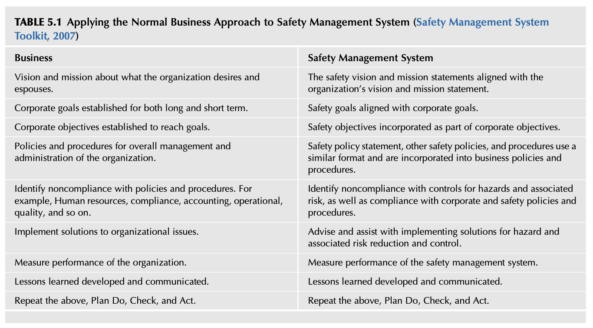
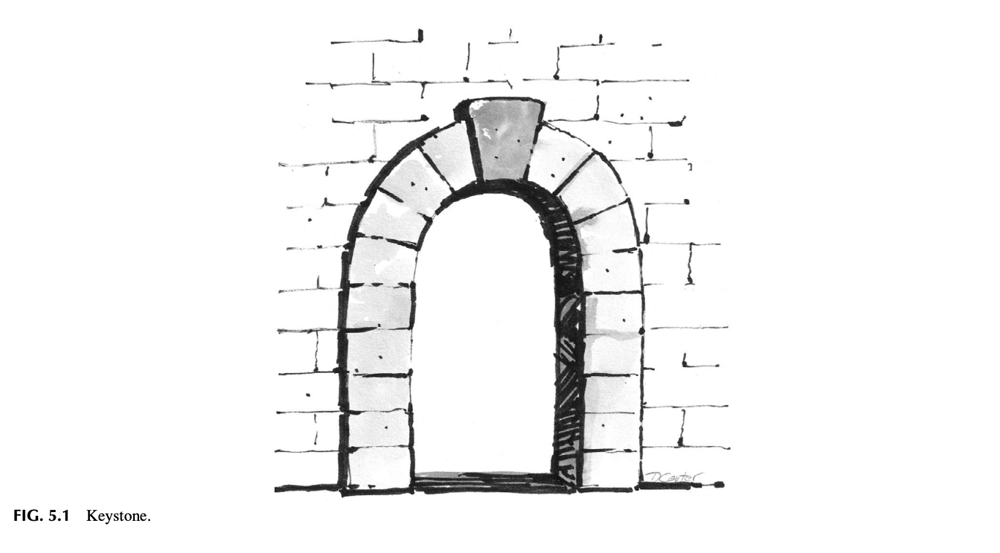
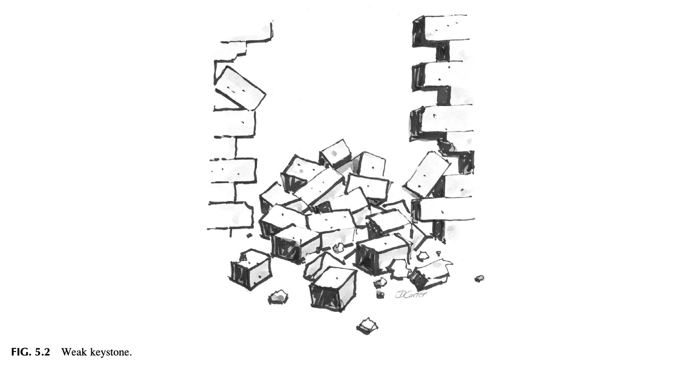
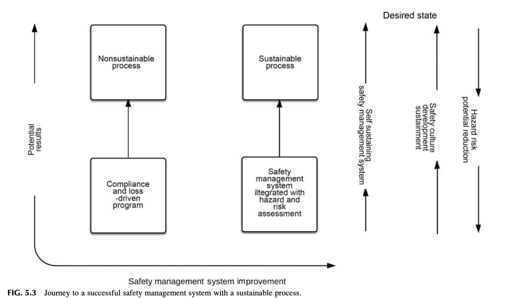
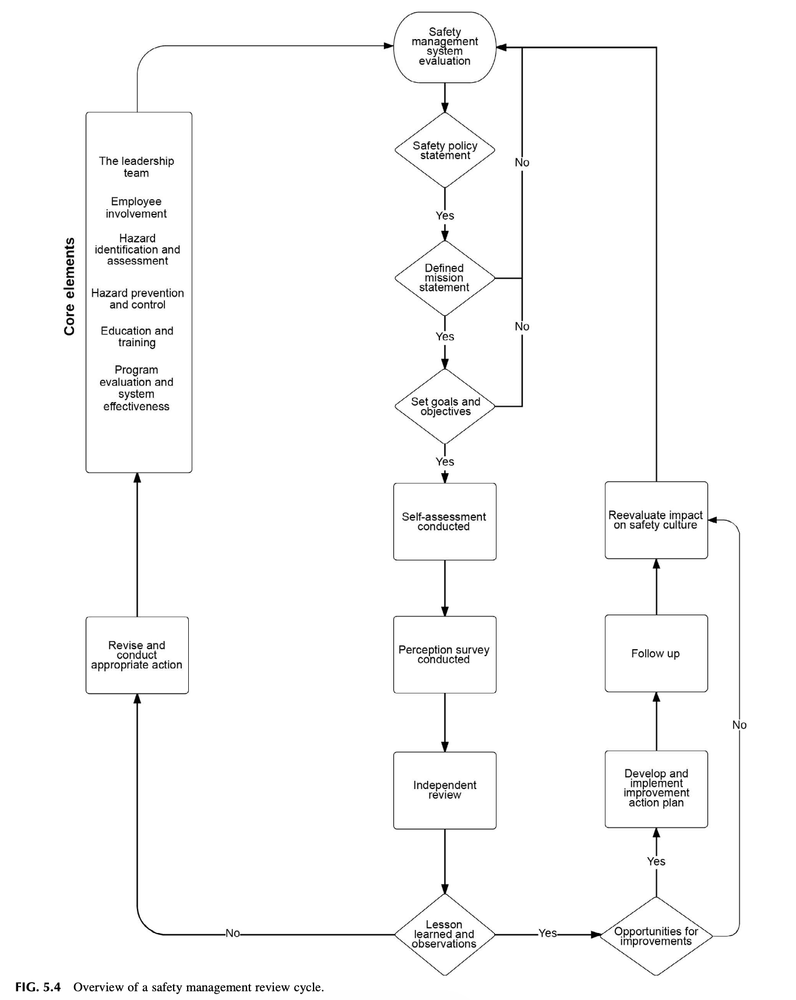
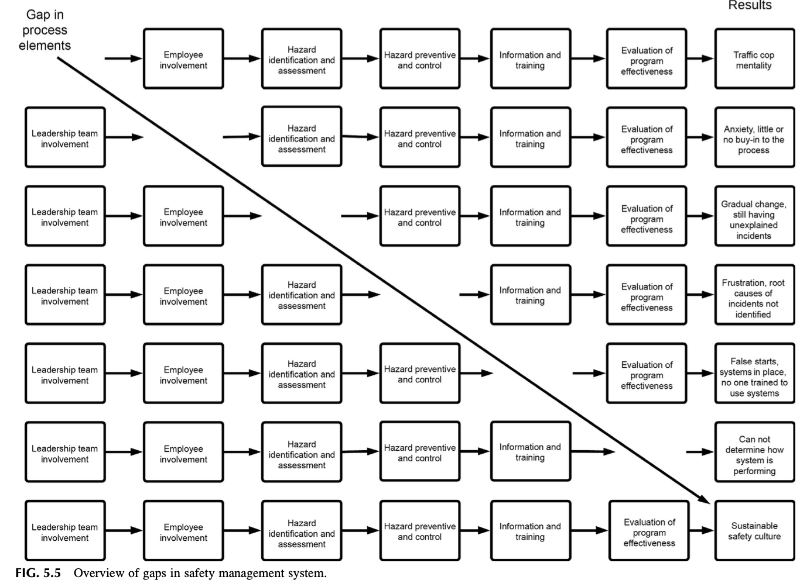
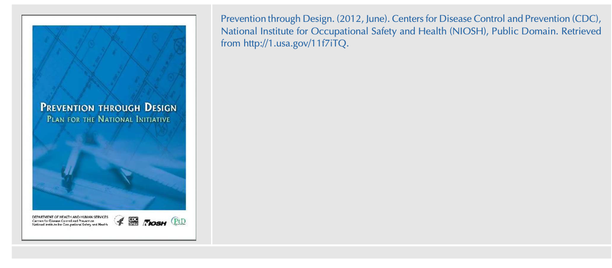

<!-- BLOCK: B01 -->
# 제5장 기본 안전경영시스템(SMS) 개요 (Overview of Basic Safety Management Systems)

<!-- BLOCK: B02 -->
> "경영(Management)이란 일들을 올바르게 하는 것이고, 리더십(Leadership)이란 올바른 일을 하는 것이다."  
> — 피터 드러커 (Peter Drucker)

<!-- BLOCK: B03 -->
## 서론 (INTRODUCTION)

<!-- BLOCK: B04 -->
안전경영시스템(Safety Management System, SMS)이란 잠재적인 운영상의 유해·위험요인(Operational Hazards)과 이와 관련된 위험성(Associated Risk)을 식별하고 통제하는 데 요구되는 다양한 구성요소들을 체계적으로 관리하고 운영하기 위한 구조화된 접근법(Structured Approach)이다. 안전경영시스템은 해당 작업 환경에 필요한 적절한 통제 수단을 기획하고, 관리하며, 확립하기 위한 명확한 지침을 제공하며, 이는 작업장 내의 안전 요소들을 효과적으로 관리하기 위해 고안된 '포괄적인 비즈니스 경영 관리 시스템'을 일컫는 학술적·실무적 용어이다. (Safety Culture. https://doi.org/10.1016/B978-0-12-814663-7.00005-4)

구조화된 안전경영시스템의 틀거리를 활용할 경우, 잠재적 유해·위험요인 및 관련 위험성 평가에 따른 통제 대책 결정 시 조직과 모든 근로자를 철저히 보호하는 데 필요한 최우선적 우선순위가 올바르게 부여될 수 있다. 본 장의 목적은 안전경영시스템의 핵심적 필수 요소들을 제시하는 데 있다. 또한 구조화된 프로세스를 선택하고 현장에 성공적으로 실행·정착시켰을 때 조직의 안전문화가 얻게 되는 다양한 이점들을 심층적으로 논의한다.

본 장을 학습한 후 독자는 다음을 수행할 수 있어야 한다:

<!-- BLOCK: B05 -->
* 다양한 안전경영시스템(SMS)에서 공통적으로 발견되는 핵심 요소들을 비교·논의할 수 있다.
* 안전경영시스템 내에서 리더십의 역할과 근로자 참여(Employee Involvement)의 특성을 대비하고 대조할 수 있다.
* 구체적인 역할(Roles)과 책임(Responsibilities)을 명확히 정의하는 것이 왜 안전경영시스템 성공의 절대적 관건인지 논의할 수 있다.
* 유해·위험요인 및 위험성의 식별, 평가, 예방 및 통제의 중대성을 심층적으로 논의할 수 있다.
* 안전 전문가(Safety Professional)가 조직 내 다른 부서들과 어떻게 유기적으로 상호작용해야 하는지 설명할 수 있다.
* 안전 성과 기준(Safety Performance Criteria)을 가능한 한 단순하고 명료하게 유지해야 하는 당위성을 논의할 수 있다.
* 체계적인 안전경영시스템의 도입과 이행이 조직 안전문화 구축과 발전에 왜 결정적인 도구적 역할을 하는지 논의할 수 있다.

<!-- BLOCK: B06 -->
## 안전경영시스템 간의 공통 연결고리 (THE COMMON LINK BETWEEN SAFETY MANAGEMENT SYSTEMS)

<!-- BLOCK: B07 -->
안전경영시스템은 제4장 '안전문화를 위한 방향 설정'에서 논의된 조직의 안전 목표(Goals)와 세부목표(Objectives)를 성공적으로 달성할 수 있도록 뒷받침하는 정교한 조직적 구조(Organizational Structure)를 제공한다. 안전경영시스템은 안전과 관련된 비전과 사명에 도달하거나 이를 지속적으로 유지하기 위해 실행되는 제반 조치들의 유효성을 객관적으로 측정하는 프로세스를 확립한다.

여러 정부 기관, 자발적 안전 단체, 국제 표준화 기구 및 규제 기관들은 안전경영시스템을 구성하는 핵심 요건들을 다음과 같이 전문적으로 정의하고 있다:

<!-- BLOCK: B08 -->
* **미국 연방항공청(FAA)**: 안전경영시스템(SMS)을 "안전 위험을 선제적으로 관리하고 안전 위험 통제 조치의 효과성을 확실히 보증하기 위한 **공식적이며 하향식(Top-down)의 전사적 조직 차원의 접근법**"으로 정의한다. 이는 안전 위험의 체계적 관리를 위한 체계화된 절차, 실무 관행 및 운영 방침을 포괄한다 (What Is a Safety Management System (SMS)?, 2017).

<!-- BLOCK: B09 -->
* **국제표준화기구 ISO 45001**: "조직의 안전보건(OH&S) 경영시스템은 사고와 재해를 사전에 예방하고자 하는 조직의 확고한 의지를 **적절한 방법론과 도구의 활용을 통해 체계적이고 지속적인 일련의 프로세스로 구현·전환**시킬 수 있으며, 이를 통해 조직의 안전보건 성과를 선제적으로 개선하겠다는 약속을 강력하게 강화할 수 있다"고 명시한다 (ISO 45001 Briefing, 2016).

<!-- BLOCK: B10 -->
* **미국 국립안전위원회(National Safety Council, NSC)**: 안전경영시스템을 "목표 설정, 기획, 그리고 정의된 기준에 입각한 성과 측정을 통해 안전 위험을 다스리는 **체계적이고(Systematic), 명시적이며(Explicit), 포괄적인(Comprehensive) 프로세스**"로 규정한다. 또한 "지속적인 개선(Continuous Improvement)에 중점을 두고 개인 및 조직 차원의 안전 성과를 공식적으로 측정하고 평가하는 정형화된 방법"으로 정의한다 (Elements of an Effective Safety Management System, 2018).

이처럼 모든 안전경영시스템은 몇 가지 필수적인 기준을 중심으로 작동하며, 반드시 다음의 핵심 요소들을 포함해야 한다:

<!-- BLOCK: B11 -->
* "안전에 대한 최고 리더십 팀의 확고한 의지와 헌신(Commitment)을 명시적으로 표명하고, 안전경영시스템의 방침, 목표 및 필수 요구사항을 명확히 선언해야 한다.
* 안전경영시스템의 공식적 조직 구조를 정의하고, 경영진 리더십 팀 내 주요 핵심 직무자들의 책임(Responsibilities)과 합법적 권한(Authority)을 명확히 규정해야 한다.
* 안전경영시스템을 구성하는 각 세부 요소를 빠짐없이 구체적으로 정의해야 한다.
* 안전경영시스템이 지향하는 기대치와 세부목표를 전 직급의 모든 근로자에게 철저히 전파하고 소통해야 한다" (Safety Management System Toolkit, 2007).

안전경영시스템의 권장 요소와 세부 컴포넌트는 속한 산업 분야에 따라 상이할 수 있으나, 근본적인 안전 프로세스는 본질적으로 다음 네 가지 필수적인 과업을 완수하도록 정밀하게 설계된다:

<!-- BLOCK: B12 -->
* 운영상의 유해·위험요인과 그에 따르는 위험성을 효과적으로 관리하고 통제하기 위한 포괄적이고 공식적인 관리 체계(Formal Structure)를 제공한다.
* 유해·위험요인 및 위험성을 철저히 제어하기 위해 요구되는 구체적인 리더십 행동, 관리적 방법론, 그리고 시정조치(Corrective Actions) 체계를 확립한다.
* 근로자 자신과 동료를 안전하게 보호하기 위한 제반 안전 절차의 중요성을 명확히 교육하고 상시 알리는 방법론을 제공한다.
* 조직 내 모든 직급의 리더십과 현장 근로자가 실제적이거나 잠재적인 유해·위험요인과 그 위험성을 스스로 인지하고 명확히 이해할 수 있는 역량을 확보하도록 보장한다 (Safety Management System Toolkit, 2007).

<!-- BLOCK: B13 -->

**표 5.1 일반 비즈니스 경영 방식을 안전경영시스템(SMS)에 적용하기 (Applying the Normal Business Approach to Safety Management System)**  
*(출처: Safety Management System Toolkit, 2007)*

| 일반 비즈니스 경영 접근법 (Business Approach) | 안전경영시스템 접근법 (Safety Management System) |
| :--- | :--- |
| **비전 및 사명**: 조직이 궁극적으로 갈망하고 대외적으로 천명하는 비전과 사명 수립 | **안전 비전 및 사명**: 전사적 조직 비전 및 사명 선언문과 완벽하게 정렬된 안전 비전과 사명 선언문 수립 |
| **기업 전사 목표**: 장기 및 단기 관점에서 수립된 기업의 공식 목표(Goals) | **안전 목표 정렬**: 전사적 기업 목표와 빈틈없이 연계·정렬된 안전 목표(Goals) |
| **기업 세부목표**: 정량적 목표 달성을 위해 구체화된 실행 세부목표(Objectives) | **안전 세부목표 통합**: 기업 전사 세부목표의 핵심 구성 요소로 완전히 통합된 안전 세부목표 |
| **경영 방침 및 절차**: 조직의 전반적인 관리와 운영 통제를 위한 공식 방침과 표준 절차 | **안전 방침 및 절차 통합**: 안전방침 선언문 및 세부 안전 지침이 비즈니스 방침과 유사한 표준 포맷을 갖추어 경영 절차에 통합됨 |
| **미준수 및 위반 식별**: 인사, 컴플라이언스, 회계, 운영, 품질 등 업무 전반의 방침 미준수 식별 | **위험 통제 미준수 식별**: 위험요인 통제 조치 미준수뿐 아니라, 전사 기업 규정 및 안전 절차의 미준수 사항까지 철저히 식별 |
| **조직적 이슈 해결**: 기업 현안 및 비즈니스 경영상의 병목 문제에 대한 해결책 실행 | **위험 저감 솔루션 실행**: 유해·위험요인의 저감 및 통제를 위한 현장 맞춤형 솔루션 수립을 전문적으로 조언하고 실행 지원 |
| **조직 전반의 성과 측정**: 비즈니스 전반의 핵심 성과 지표 측정 및 모니터링 | **안전 시스템 성과 측정**: 안전경영시스템의 이행도와 안전문화 개선 성과를 정밀 측정 |
| **교훈 도출 및 전파**: 운영 과정에서 발생한 실패·성공 경험으로부터 교훈(Lessons Learned) 도출 및 공유 | **안전 교훈 전파**: 아차사고 및 위험 사례로부터 도출된 안전 교훈을 전사적으로 체계화하여 교육·전파 |
| **지속적 개선 사이클**: 기획-실행-점검-환류(Plan-Do-Check-Act, PDCA) 프로세스의 반복적 순환 | **안전 PDCA 사이클**: 안전 분야의 기획-실행-점검-환류(Plan-Do-Check-Act) 프로세스를 무한 순환하여 고도화 |

안전경영시스템은 일반 비즈니스 경영 관리 방식에서 활용되는 개념 및 구조와 정확하게 궤를 같이한다. 그 근본 의도는 전반적인 기업 비즈니스 전략 목표를 그대로 거울처럼 반영하고 있으며, 조직이 채택한 일상적 운영 철학의 핵심적인 일부분이 되도록 설계되었다. 

안전경영시스템의 진정한 목적은 조직의 가장 소중한 인적 자산(Human Assets)과 물리적 자산(Physical Assets)을 빈틈없이 보호함으로써, 경영 리더십이 자사의 제품과 서비스를 통해 비즈니스 본연의 사명을 완수하는 데 전념할 수 있도록 든든한 방패막이가 되어주는 것이다. 표 5.1은 안전 시스템에 적용 가능한 일반 경영 접근법과 안전경영시스템의 구체적인 내용 대비를 보여준다.

<!-- BLOCK: B14 -->
## 안전경영시스템(SMS)의 본질적 정의 (SAFETY MANAGEMENT SYSTEMS DEFINED)

<!-- BLOCK: B15 -->
과거 전통적인 조직에서는 지정된 특정 전담자 한 명이나 단일 안전 부서에 안전 프로세스를 관리하는 1차적인 책임을 모두 떠넘기는 관행이 지배적이었다. 그러나 한 조직의 총체적인 '안전'은 결코 한 개인이나 특정 부서만의 배타적인 책임이 될 수 없다. 안전경영시스템은 조직 내 모든 부서, 프로세스, 구성원 간의 복합적인 상호작용으로 이루어져 있기 때문에, 한 개인이 이를 도맡을 경우 그 막대한 복잡성에 압도되어 무력화될 수밖에 없다.

따라서 안전경영시스템의 핵심 목표는 **경영진 리더십 팀의 일상적인 일반 경영 관리 프로세스의 필수적인 일부분으로 자연스럽게 체화되는 것**이다. 안전 전문가는 조직 내 네트워크 형성, 전문적인 리더십 존재감(Professional Presence), 그리고 비즈니스 운영 전반에 대한 깊은 이해를 바탕으로 이러한 핵심 경영 파트너 위치로 진화해 나가야 한다. 이러한 진화의 결과로, 안전 전문가는 안전에 대한 조직 구성원들의 인식과 지각(Perception)을 긍정적으로 형성하고 변화를 주도할 수 있게 된다.

국내외의 다양한 안전경영시스템을 면밀히 검토하고 그 구성 요소들을 나란히 비교 분석한 결과, 안전경영시스템을 효과적으로 구축하고 지속 가능하게 유지하는 데 요구되는 **6대 핵심 기본 원칙(Six Basic Core Principles)**이 명확히 도출되었다. 이 요소들은 조직의 뼈대를 설계·실행하고, 궁극적인 안전문화를 지탱하는 가장 견고한 주춧돌을 제공한다:

<!-- BLOCK: B16 -->
* **경영 리더십 (Management Leadership)**
* **근로자 참여 (Employee Involvement)**
* **유해·위험요인 식별 및 평가 (Risk and Hazard Identification and Assessment)**
* **유해·위험요인 예방 및 통제 (Hazard Prevention and Control)**
* **교육 및 훈련 (Education and Training)**
* **성과 평가 및 측정 (Performance & Measurement)**

*(출처: Managing Worker Safety and Health, Sample Assignment of Safety and Health Responsibilities, 2018)*

안전경영시스템의 구조는 유해·위험요인 및 위험성에 관한 정보가 물 흐르듯 전달되는 '소통의 프레임워크(Communication Framework)'를 제공한다. 효과적인 커뮤니케이션이야말로 안전 프로세스의 성공적인 개발과 현장 정착 가능성을 높이는 데 가장 필수적인 핵심 요소이다. 조직 내 소통 네트워크의 품질, 깊이, 그리고 소통 범위는 결정적인 의미를 갖는다.

커뮤니케이션이 조직 내에서 어떤 경로와 메커니즘을 통해 흐르는지를 정확히 파악해야만, 의도한 위험 경고와 통제 메시지가 적절한 의사결정권자와 실제 영향을 받는 현장 근로자들에게 왜곡 없이 전달될 수 있다. 경영 리더십 팀과 현장 근로자들은 상호 공유되고 협력적인 프로세스를 통해 핵심 안전 정보를 체득하게 되며, 이처럼 개인적 참여도가 높아짐에 따라 안전경영시스템의 실질적 유효성은 획기적으로 향상된다 (Building an Effective Health and Safety Management System, 2015).

<!-- BLOCK: B17 -->
## 경영 리더십 (MANAGEMENT LEADERSHIP)

<!-- BLOCK: B18 -->
리더십은 안전경영시스템 전체를 지탱하는 **'쐐기돌(Keystone)'**이다. 쐐기돌이란 석조 아치(Arch)의 최정상 중앙에 위치한 특수한 돌을 의미한다. 쐐기돌은 아치가 무거운 하중을 견딜 수 있도록 좌우의 모든 돌들을 맞물리게 고정하여, 아치 구조물 전체가 붕괴되지 않도록 지탱해 주는 절대적인 역할을 수행한다.

쐐기돌로서의 리더십은 조직이 자신의 고유한 사명을 지속적으로 유지하는 데 필요한 모든 구성 요소들을 지탱하는 '중심 지지대(Central Supporting Element)'이다. 리더십이 중심을 잡아줄 때 비로소 조직은 생산, 납기, 비용 등 다양한 경영 압박이 닥쳐오더라도 흔들림 없이 안전의 기본 구조를 온전히 유지할 수 있다. 만약 최정상의 쐐기돌이 취약하거나, 부식되어 삭아버렸거나, 제자리에 놓여 있지 않다면, 아치 전체는 순식간에 재앙적인 파멸(Catastrophic Collapse)을 맞이하게 된다.

따라서 조직의 성공을 위해서는 리더 개개인을 이러한 핵심 '쐐기돌 리더'로 육성하는 것이 필수적이다 (McIntyre, 2014). 쐐기돌은 아치에서 가장 중요한 돌이며, 바로 이러한 이유 때문에 '쐐기돌'이라는 단어는 어떤 체계나 사물의 '가장 중요한 핵심 부분'을 뜻하는 비유적 표현으로 통용된다 (Keystone, 2018).

그림 5.1은 모든 것을 하나로 단단히 결속시키는 아치의 쐐기돌(Keystone)을 시각적으로 나타낸다. 만약 시스템이 본래 의도된 설계대로 작동하지 않는다면 전체 체계는 실패하고 만다. 그림 5.2는 경영 리더십의 실패가 초래하는 비극적 결과를 보여준다. 쐐기돌이 부실할 때 어떤 참담한 붕괴가 일어나는지 그림 5.2를 참조하라.

경영진의 확고한 의지(Management Commitment)는 최고 경영 리더십으로부터 시작하여 조직의 최하위 현장 계층에 이르기까지 일관되게 관통하는 '책임의 사슬(Thread of Responsibility)'을 형성한다. 본 서에서는 경영진과 관리감독자 전 직급을 포괄하여 **'리더십 팀(Leadership Team)'**이라는 통합적 용어로 정의하여 사용한다. 리더십 팀의 진정한 헌신과 몰입이야말로 모든 성공적인 안전경영시스템의 배후에서 작동하는 가장 강력한 추진력(Driving Force)으로 평가받는다.

<!-- BLOCK: B19 -->

**그림 5.1 쐐기돌 (FIG. 5.1 Keystone)**  
*(석조 아치 구조물의 최정상에서 좌우의 하중을 완벽하게 결속하여 아치 전체의 붕괴를 막는 핵심 돌)*

<!-- BLOCK: B20 -->

**그림 5.2 취약한 쐐기돌 (FIG. 5.2 Weak keystone)**  
*(최정상의 리더십 쐐기돌이 약화되거나 부식되었을 때 발생하는 조직 안전 체계의 치명적 붕괴 현상)*

<!-- BLOCK: B21 -->
리더십 팀은 안전경영시스템이 도달해야 할 미래의 이상적인 상태인 **'비전(Vision)'**을 제시하고, 그 비전을 실현하기 위한 구체적인 실행 경로인 **'사명(Mission)'**을 확립한다. 비전과 사명이 명확히 천명된 후에는, 안전경영시스템이 충분한 전담 인력, 작업 시간, 그리고 예산을 안정적으로 확보할 수 있도록 적절한 자원이 배분되어야 한다.

리더십 팀이 구성원들에게 동기를 부여하는 요인들과 필수 자원을 기꺼이 제공하겠다는 확고한 의지를 현장에서 행동으로 직접 증명할 때, 비로소 역동적이고 자생적인 안전경영시스템이 구축되고 지속될 수 있다. 다양한 표준 안전경영시스템과 일관되게, 리더십 팀의 책임 있는 행동은 다음의 핵심 요소들을 반드시 포함해야 하며 이에 국한되지 않는다:

* 안전 관련 목표 및 세부목표에 관하여 관리자, 감독자, 근로자 각 계층의 명확한 책임을 규정하고, 부여된 안전 활동을 끝까지 완수하도록 하는 **엄격한 책무성(Accountability)**을 확립한다.
* 관리자, 감독자, 근로자에게 현장의 유해·위험요인을 즉각 시정할 수 있는 **실질적 권한(Authority)**을 부여하고, 관련 안전·위험 정보에 대한 자유로운 접근권, 안전 교육 및 훈련, 그리고 필요한 물적 자원을 아낌없이 제공한다.
* 위험한 유해 환경이나 고조된 위험성에 관한 현장의 보고를 접수하고 이에 즉시 대응하도록 지정된 자격 있는 적임자를 명확히 임명하며, 적절한 경우 **선제적 시정조치(Corrective Actions)를 즉각적이고 신속하게 발동할 수 있는 전결권**을 보장한다.

안전 작업 절차는 리더십 팀이 안전경영시스템을 일상 업무 속에서 최우선으로 강조하고 모범을 보일 때 현장에서 준수될 가능성이 극대화된다. 조직의 초점은 안전경영시스템에 규정된 관리 지침을 엄격히 준수함과 동시에, 경영진의 직접적인 현장 참여, 전폭적인 예산 및 시간적 자원 지원, 그리고 안전 행동에 대한 긍정적 유인책(Positive Incentives)의 조화로운 결합이어야 한다.

제2장 '조직문화 분석'에서 이미 상술한 바와 같이, 눈에 보이는 물리적 구조와 절차인 **인공물(Artifacts)**, 공식 목표·세부목표·사명선언문 등으로 대표되는 **천명된 가치(Espoused Values)**, 그리고 무의식적인 규범과 불문율로 작동하는 **근원적 기본가정(Underlying Assumptions)**의 세 가지 층위가 긴밀하게 정렬되어 빈틈없는 상호 결속망을 형성할 때, 긍정적인 안전문화가 정착될 확률은 결정적으로 높아진다.

> "리더십이란 단지 사람을 끄는 매력적인 성격이 아니다. 그것은 단순한 말재주나 감언이설에 불과할 수도 있다. 리더십이란 '친구를 만들고 사람들에게 환심을 사는 것'도 아니다. 그것은 아첨에 지나지 않는다.  
> **진정한 리더십이란 한 사람의 시야를 더 높은 경지로 끌어올려 주고, 한 사람의 성과를 더 높은 표준으로 향상시키며, 한 사람의 인격을 그 본래의 일상적 한계를 뛰어넘어 성장하도록 구축해 주는 것이다.**"  
> — 피터 F. 드러커 (Peter F. Drucker)

안전경영시스템이 허울뿐인 '천명된 가치'에 그치지 않고 조직 내에 실제로 살아 숨 쉬고 있는지를 검증하는 가장 결정적인 인공물(지표)은 다름 아닌, **리더십 팀의 구성원들이 사내에 확립된 안전 규칙, 작업 지침 및 안전 작업 관행을 스스로 얼마나 솔선수범하여 준수하는지 그 참여의 수준을 현장에서 직접 관찰하는 것**이다.

<!-- BLOCK: B22 -->
### 관찰 1 (Observation 1)

<!-- BLOCK: B23 -->
저자들의 현장 컨설팅 경험과 안전경영 학술 문헌에 따르면, **리더십이 안전 절차를 능동적으로 준수하는 데서 발을 빼거나 어떤 형태로든 참여를 철회하는 순간, 그것은 리더십의 파멸적 실패(Leadership Failure)를 의미한다.**

결과적으로 리더십이 안전 수칙을 스스로 지키지 않을 때, 조직 내에 형성되는 근원적 기본가정(Underlying Assumption)은 리더십이 **"우리는 이 규칙을 지키는 대상에서 면제되어 있다(We are exempt from adhering to the rules)"**라는 암묵적인 무언의 메시지를 전 직원에게 발신하고 있다는 것이다.

예를 들어, 한 리더가 작업 현장이나 생산 공정을 순회하면서 사내에 공식 명시된 안전 규칙과 작업 지침을 스스로 준수하지 않는다면, 그 리더는 조직이 대외적으로 천명해 온 공식 안전 요구사항(Espoused Safety Requirements)에 대해 매우 강력한 부정적 메시지를 던지고 있는 셈이다. 만약 현장 근로자들이 리더십 팀의 일원이 단 하나의 안전 절차라도 위반하는 장면을 직접 목격한다면, 그들에게 전달되는 최종 메시지는 다름 아닌 **"이 회사의 안전 프로세스는 단지 보여주기식 쇼(Just for show)에 불과하다"**는 냉소주의이다.

<!-- BLOCK: B24 -->
### 교훈 1 (Lesson Learned 1)

<!-- BLOCK: B25 -->
마이크(Mike)는 대형 화재 및 폭발 위험이 매우 높은 구역에서 '금연' 표지판 바로 밑에 서서 버젓이 담배를 피우고 있던 어느 관리자의 실화를 들려준다.

해당 구역에 가연성 증기가 체류할 가능성이 높은 상황에서 왜 흡연을 해도 괜찮다고 생각했는지 묻자, 그 관리자는 태연하게 그 금연 표지판은 비흡연자였던 자신의 전임자가 붙여놓은 것일 뿐이라고 대답했다. 그 관리자는 현장에 상존하는 치명적인 화재 유해·위험요인과 그 인근에서 담배를 피우는 행위가 초래할 참혹한 위험성에 대해 완전히 무감각한 상태였다.

그 관리자는 안전이 조직에서 아무런 가치도 갖지 못하며 자신은 사내 규칙의 적용을 받지 않는 치외법권적 존재라는 최악의 모범(?)을 보인 것이다. 이후 조사 결과 건물 내 다른 구역에서도 근로자들이 흡연한 흔적이 다수 발견되었다. 결국 리더십이 근로자들에게 발신한 실질적인 메시지는 **"이 회사에서는 아무도 금연 표지판을 지킬 필요가 없다"**는 것이었다.

리더십 팀이 안전경영시스템을 진정으로 지지하고 있음을 현장에 증명해 보일 수 있는 구체적인 실천 방법과 행동들은 무수히 많다. 여기에는 다음 활동들이 포함될 수 있다:

* 사업장 안전 점검, 안전경영시스템 정기 검토 및 감사(Audits)에 주기적으로 직접 참여하기
* 현장의 유해·위험한 조건과 불안전한 행동에 대해 그 노출이 최소화, 시정 또는 완전히 통제될 때까지 즉각적인 시정조치와 대체 솔루션을 적극적으로 지원하고 예산 뒷받침하기
* 안전 성과 데이터를 정기적으로 직접 검토하고 현장과 공유하기 등

<!-- BLOCK: B26 -->
*(출처: Managing Worker Safety and Health, Sample Assignment of Safety and Health Responsibilities, 2018)*

> **"리더의 첫 번째 책임은 현실을 명확히 정의하는 것이다. 그리고 리더의 마지막 책임은 구성원들에게 감사하다고 말하는 것이다."**  
> — 맥스 드프리 (Max DePree)

오직 규칙에만 기반한 기계적 법규 준수(Rule-based Compliance)에만 의존하게 되면, 사내 안전 전문가나 지정된 담당자가 조직의 근본적인 '문제 해결자(Problem-solver)'가 아니라 단지 '규정 단속관(Inspector)'에 불과하다는 조직 내 인식이 고착되는 위험한 분위기가 조성될 수 있다.

법적 규제 준수와 물리적 유해·위험요인의 단순 시정은 비록 대단히 중요하지만, 그것 자체가 안전의 궁극적인 최종 목적이 되어버릴 경우, 안전 전문가가 조직의 진정한 비즈니스 니즈를 깊이 이해하는 '신뢰받는 멘토(Trusted Mentor)'로 진화하는 길을 가로막을 수 있다.

진정한 멘토는 근로자들에게 유해·위험요인 및 위험 통제 절차를 준수하는 가치와 중요성을 설득할 때, 무엇이 유해·위험요인을 근원적으로 유발하는지에 대한 전문 지식과 풍부한 현장 경험을 바탕으로 긍정적인 코칭 접근법을 활용한다 (그림 5.3 참조).

다음의 11개 자가진단 질문들은 조직의 안전문화 수준을 객관적으로 가늠해 볼 수 있는 기본적인 안전문화 자가평가 기준을 제공한다:

<!-- BLOCK: B27 -->
* **질문 1**: 조직을 위한 공식적이고 서면화된 안전방침 선언문(Safety Policy Statement)이 명문화되어 있는가?
* **질문 2**: 최고 경영진 리더십 팀이 그 안전방침 선언문에 공식 서명하였는가?
* **질문 3**: 안전방침 선언문이 조직 내 모든 구성원이 언제든 쉽게 열람할 수 있도록 상시 공개되어 있는가?
* **질문 4**: 이 서면 안전방침 선언문이 조직의 모든 직급과 계층에 빠짐없이 교육되고 소통되었는가?
* **질문 5**: 안전 전문가는 최고 경영진 리더십 팀에 얼마나 자유롭고 직접적으로 접근할 수 있는가?
* **질문 6**: 조직 내 모든 구성원이 자신에게 부여된 구체적인 안전 관련 책임을 명확히 인지하고 있는가?
* **질문 7**: 모든 근로자가 자신의 일상 안전 성과에 대해 공식적으로 평가받고 피드백을 받는가?
* **질문 8**: 경영 리더십 팀은 안전에 대한 자신들의 확고한 의지와 헌신에 대해 전 직원과 정기적으로 소통하는가?
* **질문 9**: 리더십 팀은 안전 수칙 및 안전 행동에 대한 실천 의지를 몸소 강화하기 위해 현장 안전 순회(Walk-throughs)에 직접 참여하는가?
* **질문 10**: 사업장 내 상주 협력업체 및 도급사 근로자의 안전을 관리하기 위한 체계적인 프로세스가 확립되어 있는가?
* **질문 11**: 리더십 팀은 안전경영시스템을 효과적으로 실행하고 지속적으로 개선하는 데 요구되는 예산, 시간, 장비, 자재 등 필요한 제반 자원을 아낌없이 제공하는가?

*(출처: Building an Effective Health and Safety Management System, 2015) (그림 5.4 참조)*

<!-- BLOCK: B28 -->

**그림 5.3 지속 가능한 프로세스를 갖춘 성공적인 안전경영시스템으로의 여정 (FIG. 5.3 Journey to a successful safety management system with a sustainable process)**  
*(규정 단속자에서 시작하여 신뢰받는 멘토로 진화함으로써 지속 가능한 안전문화를 창출하는 성숙 단계)*

<!-- BLOCK: B29 -->
### 근로자 참여 (Employee Involvement)

<!-- BLOCK: B30 -->
근로자 참여(Employee Involvement)는 안전경영시스템에 대한 구성원들의 직접적인 **'주인의식(Ownership)'과 '진정성 있는 동의 및 지지(Buy-in)'**를 구축한다.

작업 환경에 대한 현장 근로자들의 실질적인 참여와 생생한 통찰력은 안전경영시스템을 설계할 때 기존 조직문화 내에 존재하는 규범과 불문율들을 보다 정밀하게 반영할 수 있도록 보장한다. 현장의 문화 속에는 반드시 극복해야 할 부정적인 관행뿐만 아니라 발전시켜야 할 긍정적인 요소들이 복합적으로 얽혀 있으며, 이 두 가지 모두를 정면으로 다루어야 한다.

네이선(Nathan)은 어느 우체국을 방문했다가 한 직원이 안전 슬로건이 적힌 배지를 옷에 달고 있는 것을 발견했다. 그는 그 직원에게 사내 안전 캠페인이 얼마나 잘 작동하고 있는지 물었다. 그러자 그 직원은 자신의 가슴에 달린 배지를 멍하니 내려다보더니 이렇게 대답했다. **"글쎄요, 저도 잘 모르겠어요. 그냥 위에서 이걸 달고 다니라고 해서 달았을 뿐입니다."**

이 일화는 그 안전 활동의 근본적인 '이유(Why)'가 일선 근로자 계층에게 전혀 가닿지 못했으며, 경영진이 대외적으로 천명한 가치(Espoused Values)가 조직 현장의 일상적 표준으로 내재화되지 못했음을 극명하게 보여준다.

근로자 참여를 촉진하는 매우 효과적인 한 가지 방법은 유해·위험요인 분석(JHA), 일상 안전 점검, 예방보전(PM), 안전 교육, 비상대응 계획 수립, 그리고 손실 유발 보고서 작성 등에 자발적으로 참여할 자원봉사자(Volunteers)를 직접 모집하는 적극적 접근법을 취하는 것이다. 이러한 접근 방식은 현재의 작업장 환경이 다른 비즈니스나 운영 분야에서 이미 유사한 자발적 참여 기회를 제공하고 있는 경우 특히 탁월한 효과를 발휘할 수 있다.

<!-- BLOCK: B31 -->
### 관찰 2 (Observation 2)

<!-- BLOCK: B32 -->
네이선은 어느 조직의 안전 프로그램을 추가로 고도화하기 위해 안전 관리자를 돕고 있었는데, 안전 관리자가 전 직원을 대상으로 안전 활동에 참여할 자원봉사자를 모집했을 때 일어난 일이다.

안전 관리자는 직원들의 폭발적인 반응에 크게 놀랐다. 군에서 전역한 여러 베테랑 근로자들이 자발적으로 손을 들고 나섰는데, 이들은 과거 군 복무 시절 심도 있는 안전관리 경험을 쌓아 안전 프로세스를 완벽히 꿰뚫고 있는 귀중한 인재들이었던 것이다.

근로자들에게 주도적 참여를 정중하게 요청한 단순한 행동 하나가 조직에 절실히 필요했던 **상류 단계의 선제적 안전 활동(Upstream Safety Activities)**을 활성화하는 위대한 첫걸음이 되었다.

<!-- BLOCK: B33 -->

**그림 5.4 안전경영 검토 주기의 전체 개요 (FIG. 5.4 Overview of a safety management review cycle)**  
*(정책 선언에서 시작하여 기획, 실행, 운영, 시정조치 및 경영 검토로 이어지는 선순환 사이클)*

<!-- BLOCK: B34 -->
근로자 참여는 리더십 팀의 확고한 헌신과 맞물려 긴밀하게 뒤따른다. 그 궁극적인 목표는 근로자들에게 자기 자신과 동료 근로자들을 위한 안전 헌신을 스스로 발전시키고 실천할 수 있는 수단과 판단 기준을 제공하는 것이다.

대부분의 근로자들은 자신에게 부여된 직무와 과업을 올바르게 수행하기를 진심으로 열망한다. 그들은 자신에게 맡겨진 특정 작업을 반드시 안전하게 완수해야 한다는 사실을 알고 있지만, 동시에 스스로 안전하다고 느끼는 수준과 작업을 신속히 끝마치기 위해 감수할 수 있다고 지각되는 위험(Perceived Risk) 사이에서 끊임없이 타협과 균형을 맞추어야만 한다. 이는 경영 리더십 팀으로부터 받는 외부적 압박에서 비롯될 수도 있지만, 오히려 작업을 빨리 끝마치고 다음 업무로 넘어가고자 하는 개인의 직무 완수 욕구에서 비롯되는 경우가 많다.

근로자들이 안전 프로세스에 실질적으로 참여하도록 보장하기 위해 반드시 고려해야 할 핵심 원칙은 **최대한의 다양성(Diversity)을 확보하는 것**이다. 예컨대, 다양한 직무 분야와 직급, 폭넓은 연차의 경험자들, 그리고 서로 다른 여러 부서의 인원들을 폭넓게 참여시켜야 한다.

다음의 네 가지 구체적인 조치들은 조직 내 쌍방향 소통(Two-way Communication)을 열어주고 근로자 참여를 비약적으로 증진시키는 핵심 통로가 될 수 있다:

<!-- BLOCK: B35 -->
* **신속한 피드백을 동반한 쌍방향 소통 체계 구축**: 양방향 커뮤니케이션 경로를 확립하고, 안전 관련 보고 및 개선 건의사항의 처리 결과에 대해 신속한 피드백과 응답을 제공한다. 안전경영시스템은 근로자가 위험 개선을 자유롭게 권고하고 그에 따른 시정조치의 진행 현황을 투명하게 확인할 수 있는 체계를 반드시 포함해야 한다. 만약 근로자의 목소리가 중간에서 검열되거나 차단당한다면 조직의 안전문화는 치명적으로 약화될 수밖에 없다.
* **안전 정보에 대한 신속하고 실용적인 접근권 보장**: 빠르고 신뢰할 수 있는 소통 채널을 통해 모든 안전 관련 정보에 누구나 손쉽게 접근할 수 있도록 보장한다.
* **최고 경영진과의 열린 소통 채널 상시 유지**: 소통 네트워크가 최고위 리더십 팀까지 가감 없이 연결되는 개방형 채널을 유지하도록 보장한다. 발굴된 유해·위험요인과 고조된 위험성에 관한 현장의 우려가 왜곡되거나 축소·필터링·은폐되지 않도록 소통망 상의 장애물을 상시 모니터링해야 한다.
* **현장 위험 평가 및 우선순위 선정 기법의 제공**: 근로자들에게 자신이 체감하는 구체적인 유해·위험요인을 스스로 평가할 수 있는 실용적인 방법론과, 식별된 현안들의 개선 우선순위를 과학적으로 판정할 수 있는 기법을 체계적으로 제공한다.

리더십이 안전에 대한 헌신을 소통하는 방식과 현장 근로자의 실제 참여 사이에는 매우 긴밀한 상관관계가 존재한다. 쌍방향 소통 채널이 강력하고 견고하게 작동할 때, 비로소 안전에 대한 리더십의 인식과 근로자의 현장 지각(Safety Perceptions)이 서로 어긋나지 않고 완벽하게 일치·정렬(Aligned)될 수 있다.

**경영 리더십의 솔선수범 → 투명한 안전 커뮤니케이션 → 근로자의 주도적 참여**로 이어지는 선순환의 연쇄 구조는 조직의 안전문화를 훨씬 더 생동감 넘치고 강력한 결실로 진화시키는 핵심 동력이다.

<!-- BLOCK: B36 -->
## 명확한 역할과 책임의 규정 (DEFINING ROLES AND RESPONSIBILITIES)

<!-- BLOCK: B37 -->
안전경영시스템을 구축하는 모든 단계에서 가장 결정적으로 중요한 것은 **명확히 정의되고 구성원 모두에게 투명하게 소통된 안전 역할(Roles)과 책임(Responsibilities)**이다.

명확한 역할과 책임은 경영 리더십 팀, 현장 근로자, 사내 상주 협력업체 근로자, 그리고 방문객에 이르기까지 조직에 발을 들이는 모든 이들의 안전 성과와 완수해야 할 책무성(Accountability)에 대한 명확한 기대치(Expectations)의 윤곽을 설정한다.

> **"헌신과 책임이 확고히 결단되지 않는 한, 오직 장밋빛 약속과 헛된 희망만 있을 뿐… 진정한 계획은 존재하지 않는다."**  
> — 피터 드러커 (Peter Drucker)

이를 위해서는 사내의 공식 직무기술서(Job Descriptions)를 기획하고 작성하는 인사·조직 부서 및 담당자와의 직접적인 긴밀한 공조가 절대적으로 요구된다. 직무기술서가 새로 작성되거나 개정될 때마다, 이러한 유기적 협업을 통해 안전 관련 소통 책무와 명확한 평가 기준이 사내 모든 공식 직무 체계 속에 확고히 내재화되도록 보장해야 한다.

제3장에서 다룬 **조직 네트워크 분석(ONA)**은 안전 기준과 책임을 사내의 공식 행정 프로세스 속에 자연스럽게 스며들게 만드는 최적의 전략적 액션을 결정하는 데 강력한 도움을 제공한다.

<!-- BLOCK: B38 -->
## 유해·위험요인 및 위험성 평가, 식별과 분석 (HAZARD AND RISK ASSESSMENT IDENTIFICATION AND ANALYSIS)

<!-- BLOCK: B39 -->
유해·위험요인(Hazard)과 위험성(Risk)의 체계적 식별 및 정밀 분석은 안전경영시스템의 가장 핵심적인 고유 기능(Core Function)이다.

이 구성 요소는 조직의 모든 운영 공정 전반에 걸쳐 숨어 있는 유해·위험요인과 그에 따르는 위험성을 빠짐없이 찾아내기 위해 활용되는 다양한 도구와 전문 방법론을 제공한다. 조직의 고유한 현장 환경에 완벽히 부합하도록 맞춤화(Customizing)할 수 있는 폭넓은 도구들이 상시 준비되어 있어야 한다. 안전 점검, 심층 감사, 안전 체크리스트, 위험성평가(Risk Assessments) 등은 일상적으로 일관되게 활용될 때 비로소 그 강력한 가치를 발휘한다.

여기서 가장 중대한 현장 과제는, **생산성 압박이나 서비스 납기 등의 긴급한 비즈니스 우려 속에서도 이러한 안전 도구들의 일상적인 루틴 활용을 타협 없이 끈질기게 유지하는 것**이다.

작업 환경의 모든 다차원적 측면을 철저히 평가하는 것은 필수적이다. **작업위험성평가(Job Hazard Analysis, JHA)**는 특정 직무에 본질적으로 내재된 구체적인 유해·위험요인과 관련 위험성의 가혹도(Severity)를 직무 과업 단위로 정밀하게 검토하는 데 최적의 도구이다.

직무 위험성 평가가 조직의 전 계층이 함께 참여하는 팀 협업(Team Effort)으로 수행될 때, 그것은 리더십 팀과 현장 근로자 모두에게 유해·위험요인에 대한 깊은 경각심과 위험 감수성을 고취시키는 강력한 기폭제가 된다 (Building an Effective Health and Safety Management System, 2015). JHA의 실무적 활용법은 제12장 '작업위험성평가(JHA)의 실무적 활용'에서 보다 심도 있게 다룰 것이다.

저자들이 현장에서 JHA 실습 교육을 진행할 때, 주로 안전 관리자가 과거의 산업재해 및 상해 기록을 검토하여 선정한 직무들을 분석 대상으로 활용하곤 했다. 그런데 놀랍게도 거의 모든 교육 세션마다, 수업에 참여한 현장 근로자들은 **과거에 실제 재해나 손실을 발생시킨 적은 없지만 잠재적인 위험 가혹도가 대단히 높아 언제든 대형 사고를 유발할 수 있는 숨겨진 직무와 위험 작업들을 스스로 고발하고 생생하게 묘사**해 주었다.

이처럼 유해·위험요인과 위험성에 대한 포괄적이고 입체적인 접근 없이는 안전경영시스템도, 높은 수준의 안전문화도 결코 유지될 수 없다. 경영 리더십의 명확한 가이드라인과 전문성이 위험 식별 프로세스를 힘차게 견인해야 한다. 본래 내재된 고유의 운영상 위험요인은 물론, 새로운 공정 도입 시 잠재적으로 생성될 수 있는 새로운 위험 조건에 대한 조직적 우려는 조직의 모든 계층이 명확히 이해할 수 있는 알기 쉬운 언어로 번역되어 공유되어야 한다.

조직 전반에 걸쳐 위험 식별 시스템이 얼마나 깊이 있고 실효성 있게 실행되고 있는지를 점검하기 위해 다음 항목들을 면밀히 검토해야 한다:

<!-- BLOCK: B40 -->
* **JHA의 일상적 개발과 실천 및 교육**: 각 직무별 고유 유해·위험요인과 위험성에 대해 모든 근로자를 철저히 교육함과 동시에, JHA를 일상 업무 속에서 일관되게 작성하고 활용하는가? 이 프로세스는 리더십 팀과의 긴밀한 소통과 참여를 포함하여 전사적인 공감대와 이해를 확립하고 있는가?
* **신뢰할 수 있는 위험 보고 및 신속한 피드백 체계**: 잠재적인 유해·위험 조건과 방호 조치의 실행 상태에 대해 근로자가 즉시 리더십에 통보하고, 반대로 리더십으로부터 적시에 명확한 피드백을 받을 수 있는 신뢰할 수 있는 보고 시스템이 살아 숨 쉬고 있는가?
* **모든 잠재적 손실 사건에 대한 철저한 원인 조사**: 응급처치(구급) 처치 사례, 아차사고, 물적 재산 피해 등 모든 실제적·잠재적 손실 유발 사건에 대해 철저한 근본 원인 조사를 수행하고 확실한 재발 방지 대책을 수립·이행하고 있는가?
* **위험 평가 데이터 및 재해 추세의 패턴 분석**: 유해·위험요인 및 위험성 평가 결과와 부상 통계 추세를 정밀 분석하여, 향후 필요한 시정조치를 선제적으로 도출하기 위한 통계적 패턴과 경향성을 체계적으로 추적하고 있는가?

*(출처: Managing Worker Safety and Health, 2016)*

<!-- BLOCK: B41 -->
## 유해·위험요인 예방 및 통제 (HAZARD PREVENTION AND CONTROL)

<!-- BLOCK: B42 -->
작업장과 요구되는 작업 과업을 효과적으로 기획하고 공학적으로 설계하는 일은 기술, 생산 시설, 원자재, 설비 및 작업 운영이 끊임없이 변화함에 따라 상시적이고 지속적인 조직의 핵심 과제이다.

전반적인 위험 평가의 일환으로, 사내 작업의뢰(작업오더) 시스템(Work Order System)의 설계와 실질적 유효성을 면밀히 검토하여, **현장의 유해·위험요인을 시정하기 위한 안전 개선 요청에 가장 높은 작업 우선순위(Priority)가 즉시 부여되는지** 반드시 확인해야 한다.

<!-- BLOCK: B43 -->
### 설계를 통한 안전 예방 (Prevention through Design, PtD)

<!-- BLOCK: B44 -->
**설계를 통한 예방(Prevention by Design)** 혹은 **설계 안전(Safety by Design)**의 기본 개념은, 엔지니어링 설계의 가장 초기 단계에서부터 유해·위험요인의 식별과 통제에 착수하여 생산 공정, 장비, 기계류 및 건축 시설 자체에 본원적 안전(Inherent Safety) 개념을 공학적으로 완벽히 내재화할 것을 강력히 권고한다.

현재 다양한 글로벌 이니셔티브가 출범하여 추진되고 있으며, **미국 국립산업안전보건연구원(NIOSH)**의 공식 사명(Mission)은 다음과 같다:

> "설계를 통한 예방(PtD) 국가 이니셔티브의 사명은 근로자에게 영향을 미치는 모든 설계 영역에 선제적 예방 고려사항을 원천 포함시킴으로써, 업무상 부상, 질병 및 사망 사고를 사전에 예방하거나 획기적으로 감축하는 것이다."

이러한 사명은 다음 세 가지 핵심 방안을 통해 달성될 수 있다:

<!-- BLOCK: B45 -->
* 품목이나 작업장의 전체 생애주기(Life Cycle)에서 가능한 한 가장 초기 단계, 즉 **'발생 근원(At the source)'**에서 유해·위험요인을 근원적으로 제거하고 근로자에 대한 위험성을 수용 가능한 안전한 수준으로 통제한다.
* 신규 및 기존 작업 부지, 건축 구조물, 작업 공구, 생산 설비, 장비, 기계류, 화학물질 및 제품, 작업 공정, 그리고 업무의 조직화 방식에 대한 설계(Design), 재설계(Redesign), 및 개보수(Retrofit)를 전면 포함한다.
* 작업장 구내에서 일하는 근로자와 방문객 모두에게 영향을 미치는 모든 엔지니어링 설계에 선제적 예방 기법을 의무적으로 포함시킴으로써 전반적인 작업 환경을 고도화한다.

이 전략적 계획은 PtD 국가 이니셔티브 계획의 성공적인 실행을 위한 구체적인 목표들을 확립하고 있다 (Prevention through Design, Plan for the National Initiative, 2017). 설계, 재설계, 및 사후 개보수의 모든 측면에 근로자의 안전보건을 내재화하는 이러한 포괄적인 접근 방식은 고귀한 생명을 구하고 업무상 재해와 질병을 원천 예방하는 가장 결정적인 실행 로드맵(Road Map)을 제공한다.

#### PtD의 학술적 정의
PtD는 건축 시설, 작업 방법 및 공정 운영, 프로세스, 장비, 도구, 생산 제품, 신기술, 그리고 업무의 조직적 구조에 이르기까지 **근로자에게 닥칠 수 있는 모든 유해·위험요인을 사전에 예측(Anticipate)하고 설계 단계에서 원천적으로 배제(Design out)하기 위한 총체적인 노력**을 망라한다.

PtD의 절대적인 초점은 해당 설계를 실제로 현장에서 구현해 내거나 그 설계의 결과물(설비·제품)을 다루며 작업해야 하는 현장 근로자들에게 맞추어져 있다. 본 이니셔티브는 가장 신뢰성이 높고 가장 확실한 예방 형태인 '설계를 통한 유해·위험요인의 원천적 제거'를 전폭적으로 지원하기 위해 체계화되었다.

자료실 구축을 위해 무료로 다운로드하여 활용할 수 있는 미국 질병통제예방센터(CDC)의 퍼블릭 도메인 공식 문서인 *'Prevention through Design Program, Plan For the National Initiative'* (Prevention through Design, 2012)에 관한 상세 내용은 본 장의 [부록 5.1](#appendix-51)을 참조하라.

PtD 방법론을 적용하여 유해·위험요인 및 관련 위험성 평가가 완료되면, 안전경영시스템을 뒷받침하기 위한 다음 단계는 운영상의 유해·위험요인과 위험성을 근원적으로 제거하거나 최소화하기 위한 구체적인 실행 전략을 현장에 적용하는 것이다. PtD는 직업상 부상과 질병을 예방하는 수준을 넘어, 법적 배상 책임(Liability), 자산 및 물적 재산 손실(Property Loss), 그리고 기타 잠재적 손실 우려에 노출된 다양한 경영 분야를 종합 분석하는 데까지 폭넓게 확장 적용될 수 있다.

<!-- BLOCK: B46 -->
### 정보의 체계적 수집과 큐레이션 (Information)

<!-- BLOCK: B47 -->
안전경영시스템의 가장 견고한 자원적 주춧돌(Cornerstone)은 **운영 및 위험 정보(Operational and Risk Information)의 체계적인 수집과 축적**이다.

자사 작업 환경의 고유한 특성에 부합하는 구체적인 정보와 정밀 데이터를 상시 수집하고 유지 관리하는 구조화된 프로세스는 절대적으로 필수적이다. 오늘날 수많은 선도 기업들은 정보를 중앙 집중화하고 사내 지식과 정보를 활발히 교류하기 위해 상용 전문 데이터 관리 시스템을 적극 도입하고 있다.

이러한 디지털 기술 시스템이 도입·활용될 때, 안전 프로세스는 조직의 전사적 비즈니스 운영 데이터베이스와 훨씬 더 강력하게 일치·정렬(Aligned)될 수 있다.

안전경영시스템의 각종 보고서와 성과 평가 기준은 **경영 리더십이 현재 일상적으로 사용하고 있는 비즈니스 보고서 포맷과 최대한 유사한 형식**으로 작성되어야 한다. 이처럼 경영진의 보고 포맷과 평행(Parallel)을 이루는 문제는 안전 프로세스가 리더십의 공식 커뮤니케이션 언어와 성공적으로 일치하기 위한 핵심 관건이다.

안전 성과 지표나 위험성 평가 결과와 같은 안전 보고서는, 경영진의 일상 업무와 동떨어진 '안전 전용 독자 양식'으로 별도 제출되기보다 현재 경영진이 친숙하게 보고받는 일반 경영 보고서 형식과 일관성을 유지할 때 리더십으로부터의 수용성과 지지도가 획기적으로 향상된다.

안전 전문가는 단순히 정보를 취합하는 사람을 넘어, 지식의 **진정한 '큐레이터(Curators)'**로 거듭나기 위해 부단히 노력해야 한다. 현장에서 정밀하게 수집된 정보는 쉽게 검색되고 접근할 수 있도록 체계적으로 분류·보관(Cataloged)될 때 비로소 경영 리더십 팀과 현장 근로자 모두에게 막대한 혜택을 주는 '공유된 지식(Shared Knowledge)'의 든든한 밑거름이 된다. 지식 큐레이션의 구체적 방법론은 제15장 '안전경영시스템의 지식 큐레이터'에서 심도 있게 다룰 것이다.

<!-- BLOCK: B48 -->
### 교육 및 훈련 프로그램 (Training Programs)

<!-- BLOCK: B49 -->
조직의 성숙도와 여건에 따라 사내 안전 교육훈련의 수준은 사실상 전무한 상태부터 매우 심도 있는 전문 과정에 이르기까지 천차만별이다. 안전 커리큘럼을 체계적으로 개발하고 실효성 있는 교육을 제공하기 위해 충분한 시간과 자원이 투자되어야 한다.

안전 교육의 주제와 과목들은 조직의 구체적인 일상 직무 과업 및 해당 산업 분야의 특화된 공정 운영과 밀접하게 연계되어 보완적이어야 한다. 또 다른 중대한 과제는 일선 관리자와 감독자들을 현장에서 역량 있는 안전 강사이자 코치(Coaches)로 육성하는 데 필요한 충분한 교육 훈련 시간을 확보해 주는 것이다.

근로자 안전 교육훈련 프로그램은 **모든 근로자가 자신이 수행하는 직무에 내재된 고유의 유해·위험요인과 위험성을 명확히 이해하고 행동으로 입증할 수 있도록 보장**하는 것을 근본 목적으로 설계되고 실행되어야 한다. 조직이 안전 관련 교육 프로그램과 교수 방법론을 어떻게 구현할 것인지는 안전경영시스템 내에 명문화되어 규정되어야 한다.

일반적으로 기업 내에서 교육훈련의 주된 책임은 인사(HR) 부서나 인재개발 교육 부서에 귀속되어 있으며, 안전 부서의 고유 책임이나 권한에 포함되지 않는 경우가 많다. 따라서 안전 교육이 현장에 가장 적합한 방식으로 제공되도록 결정하기 위해서는 교육 부서의 리더십과 긴밀하게 조율하고 긍정적인 상호 신뢰 라포(Rapport)를 형성하는 것이 절대적으로 중요하다.

인사 부서나 일반 교육 부서는 자신들의 고유 업무 범위에 치여 안전경영시스템과 관련된 고도의 기술적·전문적 안전 교육을 제공할 만한 전문 지식, 전담 예산, 혹은 물리적 시간을 확보하지 못하고 있을 수 있다. 이 경우 안전 전문가나 안전 부서가 직접 라인 관리자, 감독자, 및 현장 근로자를 위한 특화된 안전 전문 교육을 직접 기획하고 제공해야 하는 과업을 맡게 된다.

이러한 안전 부서 주도 접근법의 긍정적인 측면은 현장 맞춤형 전문 교육의 품질과 깊이를 훨씬 더 높은 수준으로 끌어올릴 수 있다는 점이다. 반면 부정적인 측면은 안전 교육이 회사 전체의 일상적인 핵심 운영 프로세스와는 동떨어진 '그들만의 비현실적 규정 교육'으로 치부되거나 더 낮은 우선순위로 격하되는 왜곡된 편견을 남길 위험이 있다는 점이다.

사내 교육 책임이 이처럼 여러 부서로 분산되어 있을 때, 안전 리더와 생산·운영 부서 리더들은 상호 간에 정보와 전문성을 아낌없이 공유하고 긴밀히 협력하여 근로자, 라인 감독자, 경영 리더십을 아우르는 통일된 교육 접근법을 반드시 구축해야 한다. 만약 두 부서 간에 굳건한 신뢰 라포가 형성되지 못하면, 한정된 사내 자원을 둘러싸고 부서 간 불필요한 경쟁이 벌어지게 되며, 결국 현장 근로자들에게 허용되는 안전 교육 시간 자체가 극도로 제한되는 파국을 맞이하게 된다.

<!-- BLOCK: B50 -->
## 안전경영시스템 유효성 평가 (EVALUATION OF SAFETY MANAGEMENT SYSTEM EFFECTIVENESS)

<!-- BLOCK: B51 -->
안전경영시스템은 유해·위험요인과 위험성을 통제하기 위해 현장에 도입된 각종 제반 프로그램과 관리 프로세스들의 운영 현황 및 이행 상태를 최고 경영 리더십 팀에게 가감 없이 실시간 보고하는 **'피드백 루프(Feedback Loop)'**를 반드시 갖추고 있어야 한다.

지속적이고 포괄적인 감사(Audits)나 엄밀한 자체 평가를 통해 시스템상의 결함, 미흡한 공백(Gaps), 혹은 제도적 취약점이 식별될 때마다, 안전경영시스템은 즉시 유연하게 수정·보완되어야 한다.

시스템 구성 요소에 대한 정기적인 검토는 각 안전 프로그램들이 현장에 확고히 살아 숨 쉬고 있으며 충분히 활용되고 있는지를 불시에 점검하는 일상적인 현장 현물 확인(Spot Checks)을 수반한다. 이러한 검토의 주기는 일별, 주별, 월별, 그리고 연간 단위에 이르기까지 다차원적으로 설정될 수 있다.

안전경영시스템은 이러한 계획된 정기 검토 일정을 공식 명시해야 하며, 평가 결과가 조직 내 의사결정권자들에게 지체 없이 즉각 공유되도록 보장해야 한다. 시스템 검토는 개별 작업 공정에 국한되는 것이 아니라 경영시스템의 전반적인 관리 요소에 초점을 맞춘다. 그 대표적인 검토 사례는 다음과 같다:

<!-- BLOCK: B52 -->
* **투입 자원의 적정 수준 및 전문성 확보 여부 판정**
* **의사소통 채널의 원활성 및 근로자의 능동적 참여도 평가**
* **변화관리(Change Management) 추진 일정의 적시성 및 실질적 유효성 검토**

이러한 시스템 검토 결과는 최고 경영진이 주기적으로 주재하는 경영 검토(Management Reviews) 회의에서 중대한 의사결정을 내리기 위한 핵심 입력 자료(Input)로 활용된다. (Occupational Health & Safety Management Systems, 2012)

<!-- BLOCK: B53 -->

**그림 5.5 안전경영시스템 내 공백(Gaps)의 전체 개요 (FIG. 5.5 Overview of gaps in safety management system)**  
*(정책과 현장 실행 사이, 또는 시스템 요소 간의 불일치로 인해 발생하는 안전관리 공백의 시각화)*

<!-- BLOCK: B54 -->
안전경영시스템의 성과 측정 지표들은 제공되는 데이터의 복잡성과 전문성을 온전히 살리면서도, 보고를 받는 대상자(경영진 및 현장 직원)가 한눈에 쉽게 읽고 명확하게 해석할 수 있도록 설계되어야 한다.

측정 체계의 설계는 안전경영시스템이 현장에서 실제로 얼마나 유효하게 작동하고 있는지를 입증해 주는 객관적이고 타당한 증거(Valid Evidence)와 포괄적인 데이터를 창출해 낼 수 있어야 한다 (그림 5.5 참조).

<!-- BLOCK: B55 -->
## 요약 (SUMMARY)

<!-- BLOCK: B56 -->
안전경영시스템(SMS)은 다음의 **6대 핵심 필수 요소**를 유기적으로 통합한다:

* **경영 리더십 (Management Leadership)**
* **근로자 참여 (Employee Involvement)**
* **유해·위험요인 식별 및 평가 (Hazard and Risk Identification and Assessment)**
* **유해·위험요인 예방 및 통제 (Hazard Prevention and Control)**
* **교육 및 훈련 (Education and Training)**
* **성과 평가 및 측정 (Performance & Measurement)**

<!-- BLOCK: B57 -->
이러한 기초적 토대 요소들이 현장에 견고하게 구현될 때, 비로소 다음과 같은 탁월한 기능을 발휘하는 안전경영시스템 구조가 완성된다:

* 안전경영시스템을 실행하고 지속적으로 유지하는 과정에 **눈에 보이는 리더십 팀의 솔선수범 참여**가 상시 존재하게 되며, 이는 안전에 대한 조직의 확고한 헌신이 결코 빈말이 아니라는 사실을 모든 근로자에게 강력히 각인시킨다.
* 안전경영시스템의 전반적인 운영 구조는 물론, 근로자 자신의 생명과 안전에 직결되는 모든 중대한 의사결정에 **근로자의 능동적인 현장 참여**를 확실히 보장한다.
* 경영 리더십 팀과 근로자 모두에게 안전경영시스템상의 **구체적인 직무 책무성(Accountability)과 책임(Responsibility)**을 명확히 정의하고 공식 부여한다.
* 책임을 부여받은 각 주체들이 자신에게 맡겨진 안전 임무를 완벽히 완수할 수 있도록 **합법적인 권한(Authority) 수준과 필요한 물적·인적 자원**을 명확히 식별하여 제공한다.

<!-- BLOCK: B58 -->
안전경영시스템은 조직이 공표한 안전 목표와 세부목표를 어떻게 구체적으로 실행할 것인지, 그리고 안전 관련 비전과 사명에 도달하거나 이를 지속하기 위해 취해진 제반 조치들의 유효성을 어떻게 측정할 것인지를 명확히 규정한다.

경영진의 헌신과 리더십은 최고 리더십으로부터 시작하여 조직의 최하위 계층에 이르기까지 일관되게 하향식으로 관통해야 한다. 리더십 팀은 안전경영시스템을 위한 미래 비전과 실천 사명을 명확히 제시하며, 위험 통제 조치가 완벽히 정착될 수 있도록 충분한 자원을 아낌없이 제공해야 한다.

안전경영시스템을 개발하는 초기 단계부터 근로자들을 주도적으로 참여시키는 것은 시스템에 대한 구성원들의 주인의식(Ownership)과 진정한 수용성(Buy-in)을 창출할 가능성을 높이는 데 결정적으로 중요하다. 시스템 개발에 근로자가 직접 참여할 때 안전경영시스템은 기존 조직문화의 규범과 현실에 완벽히 부합하도록 정착될 수 있다.

조직의 모든 직급 계층을 위해 구체적으로 명시되고 투명하게 소통된 안전 책임은 안전경영시스템 구축 초기 단계의 성패를 가르는 관건이다. 안전 책임은 리더십 팀, 일반 근로자, 협력사 직원, 사업장 방문객에 이르기까지 지켜야 할 안전 성과와 완수해야 할 책무성에 대한 명확한 기대치의 윤곽을 설정한다.

유해·위험요인 및 위험성의 체계적 식별과 분석은 안전경영시스템의 가장 핵심적인 본질이다. 작업장과 작업 과업에 대한 효과적인 기획과 공학적 설계는 기술, 설비, 원자재, 장비 및 작업 공정이 쉼 없이 변화함에 따라 지속적으로 관리되어야 할 상시 과제이다.

운영 및 위험 관련 데이터의 체계적인 수집과 축적은 안전경영시스템의 지속 가능성을 결정짓는다. 자사의 고유한 작업 환경에 특화된 정보와 데이터를 체계적으로 수집하고 유지 관리하는 정형화된 방법론을 확립할 때, 현장의 안전 성과 요구사항과 표준 작업 관행을 효과적으로 통제하고 개선할 수 있는 조직적 역량이 비약적으로 향상된다.

근로자 교육 및 훈련 프로그램은 모든 근로자가 자사 운영 공정에 내재된 유해·위험요인과 그 위험성을 완벽히 자각하고 스스로 입증할 수 있도록 설계되고 실행되어야 한다. 안전경영시스템은 유해·위험요인과 위험성을 통제하는 데 요구되는 제반 프로그램의 운영 상태를 최고 경영 리더십 팀에게 지체 없이 투명하게 알리는 견고한 피드백 루프를 반드시 갖추어야 한다.

이어지는 **제6장 '안전 프로세스의 창출'**에서는 업계 협회나 산업 단체, 전문 컨설팅 기구, 국제표준화기구(ISO), 그리고 정부 규제 법령에 이르기까지 다양하게 존재하는 여러 유형의 안전경영시스템을 심층적으로 비교·논의할 것이다. 우리는 안전경영시스템의 가장 핵심적인 목적이 유해·위험요인과 위험성을 효과적으로 통제할 제반 활동들을 체계적으로 관리하고 운영하기 위한 '틀거리(구조)'를 제공하는 데 있음을 명확히 증명해 보일 것이다.

그 튼튼한 구조적 뼈대 위에서, 각각의 안전 요소들은 서로 유기적으로 연결되고, 우선순위가 부여되며, 조직의 전반적인 비즈니스 프레임워크와 완벽히 일치하도록 설계될 수 있다. 비록 세상에는 수많은 다양한 안전경영시스템이 존재하지만, 이들 모두를 관통하는 불변의 일관된 테마는 그들이 모두 **기획-실행-점검-개선(Plan-Do-Check-Act, PDCA)으로 널리 알려진 고전적인 '데밍 사이클(Deming Cycle)'**의 표준 포맷을 철저히 따르고 있다는 사실이다.

<!-- BLOCK: B59 -->
## 제5장 복습 평가 질문 (CHAPTER REVIEW QUESTIONS)

<!-- BLOCK: B60 -->
1. **기본적인 안전경영시스템(SMS)의 근본적인 목적은 무엇인가?**
2. **일반적인 전통적 비즈니스 경영 관리 접근법과 안전경영시스템 접근법을 비교하고 대조하라.**
3. **조직의 안전문화를 견고하게 설계하고 강력히 지원하기 위해 안전경영시스템 구조를 구축하는 데 활용되는 6대 기본 핵심 안전 요소는 무엇인가?**
4. **안전경영시스템을 구성하는 6대 기본 핵심 안전 프로세스 요소 각각을 상세히 설명하라.**
5. **최고위층으로부터 시작하여 조직의 모든 계층을 관통하는 하향식 '리더십의 확고한 헌신(Leadership Commitment)'이 구체적으로 의미하는 바를 설명하라.**
6. **안전경영시스템의 여러 구성 요소 중 진정한 안전문화를 발전시키는 데 가장 결정적인 요소들은 무엇인가? 안전문화의 단계적 발전 과정에서 배제되거나 생략될 수 있는 안전경영시스템 요소가 존재하는가?**
7. **안전경영시스템의 각 구성 요소가 수행하는 고유한 역할과 기능을 구체적으로 식별하고 서술하라.**

<!-- BLOCK: B61 -->
## 부록 5.1 (APPENDIX 5.1)

<!-- BLOCK: B62 -->
본 부록은 '설계를 통한 예방(PtD)' 국가 이니셔티브의 이론적 근거, 공식 사명, 추진 세부목표, 기대 성과 및 추진 일정을 상세히 제공하는 퍼블릭 도메인 공식 문서인 *'Prevention through Design'* 자료를 제공한다.

*(출처: Prevention through Design. 2012, June. Centers for Disease Control and Prevention (CDC), National Institute for Occupational Safety and Health (NIOSH), Public Domain. Retrieved from http://1.usa.gov/11f7iTQ)*

<!-- BLOCK: B63 -->
## 참고문헌 (BIBLIOGRAPHY)

<!-- BLOCK: B64 -->
* Building an Effective Health and Safety Management System. (2015). Partnerships in Health and Safety Program, Partnerships in Injury Reduction (partnerships). Public domain. Retrieved from http://bit.ly/WsHteC.
* Elements of an Effective Safety Management System. (2018). National Safety Council Mission. Retrieved from http://bit.ly/2CBe6B0.
* ISO 45001 Briefing. (2016). IOSH Magazine. Retrieved from http://bit.ly/2HTRywB.
* Keystone. (2018). Vocabulary.com. Retrieved from http://bit.ly/2xUJVnR.
* Managing Worker Safety and Health. (2016). Illinois OSHA Onsite Safety & Health Consultation Program. Public Domain, Based on Information as Presented and Adapted for Use.
* Managing Worker Safety and Health, Sample Assignment of Safety and Health Responsibilities. (2018). Missouri Occupational Safety and Health Administration (OSHA), Office of Cooperative Programs. Public Domain, Based on Information as Presented and Adapted for Use. Retrieved from http://on.mo.gov/2tdaySb.
* McIntyre, R. (2014). Keystone leadership concepts. Linkedin. Retrieved from http://bit.ly/2wsyOyU.
* Occupational Health & Safety Management Systems. (2012). The American Society of Safety Engineers. ANSI/AIHA/ASSE Z10. Retrieved from http://bit.ly/1MsT6MG.
* Prevention through Design. (2012). Centers for Disease Control and Prevention (CDC), National Institute for Occupational Safety and Health (NIOSH). Public domain. Retrieved from http://1.usa.gov/11f7iTQ.
* Prevention through Design, Plan for the National Initiative. (2017). Centers for Disease Control and Prevention, National Institute for Occupational Safety and Health (NIOSH). Public domain. Retrieved from http://bit.ly/2AjDlWW.
* Safety Management System Toolkit. (2007). Montreal, Quebec, Canada: Developed by the Joint Helicopter Safety Implementation Team of the International Helicopter Safety Team, The International Helicopter Safety Symposium. Retrieved from http://bit.ly/YaSCOg.
* What is a Safety Management System (SMS)?. (2017). Federal Aviation Administration. FAA Order 8000.369. Public domain. Retrieved from http://bit.ly/2CBdrj0.
