<!-- Block B01 -->
# 제6장 안전 프로세스의 창출 (Creating the Safety Process)

<!-- Block B02 -->
> "앞서 나아가는 비결은 일단 시작하는 것이다. 그리고 시작하는 비결은 당신의 복잡하고 벅찬 과업들을 관리 가능한 작은 과업들로 잘게 쪼갠 뒤, 바로 그 첫 번째 과업부터 착수하는 것이다."  
> — 마크 트웨인 (Mark Twain, 2018)  
> 
> "시스템을 관리하기 위해서는 시스템을 구성하는 모든 요소들 간의 상호관계, 그리고 그 시스템 안에서 일하는 모든 사람들에 관한 심도 있는 지식이 반드시 요구된다."  
> — W. 에드워즈 데밍 (W. Edwards Deming)  
> 
> Safety Culture. https://doi.org/10.1016/B978-0-12-814663-7.00006-6

<!-- Block B03 -->
## 서론 (INTRODUCTION)

<!-- Block B04 -->
대부분의 일반적인 안전 프로그램들은 현대 제조업의 태동기에 활용되었던 기법들에 지나치게 무겁게 의존하고 있다. 프레더릭 테일러(Frederick Taylor)는 이른바 '과학적 관리법(Scientific Management)' 개념을 창안하였으며, 이는 오늘날까지도 수많은 문제 해결 기법의 근간으로 여전히 활용되고 있다 (Mateski, 2016).

그러나 인간의 신체와 마찬가지로, 한 조직은 다양한 구성요소들이 서로 어떻게 유기적으로 맞물려 상호작용하는지에 대한 완전한 이해 없이는 결코 한 대의 기계처럼 분해했다가 마음대로 재조립할 수 있는 대상이 아니다. 의사들이 인체 해부학을 정밀하게 연구하듯, 안전 전문가는 조직이라는 거대한 '신체(유기체)'의 모든 다차원적 측면을 깊이 이해하고 통찰할 수 있어야 한다. 만약 조직이라는 유기체가 실제로 어떻게 작동하는지 원리를 알지 못한 채 어떤 시스템을 외부에서 강제로 주입한다면, 그 시스템은 필연적으로 실패로 귀결될 수밖에 없다.

안전경영시스템(Safety Management System, SMS)의 가장 핵심적인 목적은 **유해·위험요인(Hazards)과 그에 따르는 위험성(Risks)을 효과적으로 통제할 제반 활동들을 관리하고 운영하기 위한 튼튼한 '틀거리(구조)'를 제공하는 것**이다. 그러한 견고한 구조 위에서, 각각의 안전 요소들은 서로 유기적으로 연결되고, 우선순위가 부여되며, 조직의 전반적인 비즈니스 프레임워크와 완벽히 일치하도록 정교하게 설계될 수 있다.

비록 세상에는 수많은 다양한 형태의 안전경영시스템이 개발되어 존재하지만, 이들 모두를 관통하는 일관된 테마는 그들이 모두 기획-실행-점검-개선(Plan-Do-Check-Act)으로 알려진 고전적인 **'데밍 모델(Deming Model)'**, 즉 **'데밍 사이클(Deming Cycle)'**의 표준 포맷을 철저히 따르고 있다는 사실이다 (Deming, 1986).

본 장에서는 대표적인 여러 주요 안전경영시스템들 간의 공통점과 차이점을 비교하고, 이들이 안전문화에 가져다주는 실질적인 이점들을 심층적으로 조명한다. 또한 왜 구조화된 표준 포맷을 신중히 선택하고 현장에 실행·정착시키는 것이 조직의 안전문화를 고도화하는 데 결정적인 혜택을 주는지를 다룬다.

본 장을 학습한 후 독자는 다음을 수행할 수 있어야 한다:
* 다양한 안전경영시스템의 본질적인 공통점들을 식별할 수 있다.
* 안전경영시스템을 실행할 때 '분석적 접근법(Analytical Approach)'과 '통합적 접근법(Integrated Approach)'의 특성을 비교·논의할 수 있다.
* 'PDCA(Plan-Do-Check-Act)' 사이클과 'DMAIC(Define-Measure-Analyze-Improve-Control)' 기법을 심층적으로 비교하고 논의할 수 있다.
* 안전경영시스템이 어떻게 조직의 안전문화를 실질적으로 강화하고 발전시킬 수 있는지 규명할 수 있다.
* 산업계나 국제표준화기구에서 제정한 자발적 표준(Voluntary Standards)과 정부가 법적으로 강제하는 규제적 안전 프로그램(Regulatory Programs) 간의 실행상 차이점을 비교할 수 있다.

<!-- Block B05 -->
## 안전에 대한 시스템적 접근법 (A SYSTEMATIC APPROACH TO SAFETY)

<!-- Block B06 -->
오늘날 수많은 조직에서 각양각색의 다양한 유형의 안전경영시스템이 어떤 형태로든 도입되어 활용되고 있다. 현대의 안전경영시스템들은 국제표준화기구(ISO), 식스시그마(Six-Sigma), 혹은 오늘날 유수 기업들이 널리 활용하는 품질 관리 기반 개념에서 제공하는 구조화된 표준 포맷을 차용하는 트렌드에 뿌리를 두고 있다.

안전경영시스템은 산업계나 동종 업계 협회, 전문 컨설팅 기구, 국제표준화기구(ISO) 등이 제정한 자발적 표준(Voluntary Standards)에서부터 정부의 법률 규제 및 행정 지침에 이르기까지 그 스펙트럼이 매우 넓다. 그러나 이 모든 시스템의 궁극적인 지향점은 동일하다. 즉, **성공적인 안전경영시스템 프로세스를 어떻게 체계적으로 구조화하고 효과적으로 관리할 것인가에 대한 확실한 가이드라인을 조직에 제공하는 것**이다.

> "지난 25년 동안 수많은 직업안전보건경영시스템(OHSMS)과 지침들이 발전해 왔으며, 그중 일부는 제3자 인증이 가능하고 일부는 특정 산업 분야에 특화되어 있다. 근본적으로 이 시스템들은 조직으로 하여금 다음을 완수할 것을 요구한다:  
> 다루어야 할 안전 현안을 식별하고, 명확한 방향성과 표준을 수립하며, 무엇을 해야 하는지 기획하고 이를 실행할 적임자를 조직화하며, 그들이 과업을 완수할 수 있도록 역량과 장비를 갖추어주고, 구체적인 실행 조치를 단행하며, 실행의 완료 상태와 효과성을 엄밀히 점검하고, 이 모든 실천 과정으로부터 교훈(Lessons Learned)을 도출하여 끊임없이 지속적인 개선(Continual Improvement)을 이룩하는 것이다.  
> 공인된 인증 표준에 대한 준수 여부는 적절한 자격을 갖춘 인증 기관의 엄격한 감사를 통해 객관적으로 입증된다..."  
> — 레이시 & 존스 (Lacey & Jones, 2017)

저자들의 오랜 실무 경험과 학술 문헌 검토를 통해 확신하건대, **안전경영시스템을 갖추는 것은 조직의 안전 성공을 위한 절대적인 필수 조건**이다. 안전경영시스템은 조직 내외부의 조건이 급변하더라도 운영상의 유해·위험요인과 그에 따르는 위험성에 조직의 모든 초점이 변함없이 집중되도록 붙잡아 주는 강력한 '안정화 구조(Stabilizing Structure)'로 작동한다.

또한 안전경영시스템은 근로자들의 능동적인 참여를 획기적으로 증진시켜 작업 환경을 실질적으로 개선하는 공식적인 틀거리를 제공한다. 일회성으로 반짝하고 사라지는 '단발성 프로그램(One-off Programs)'의 한계를 극복하고, 조직이 바라는 이상적인 안전 요소들을 사내에 영구히 뿌리내리게 만드는 '지속적 프로세스(Processes)'로 패러다임을 전환하기 위해 다양한 방법과 과학적 도구들이 활용될 수 있다.

어떤 안전 요소나 프로세스가 새롭게 개발되었다면, 그것이 현장에서 가능한 한 최고의 실효성을 발휘하도록 보장하는 공식적인 행정 관리 체계(Administrative Structure)가 반드시 뒷받침되어야 한다. 안전경영시스템은 바로 이러한 필수적 뼈대를 제공해 준다.

안전경영시스템의 각 세부 요소는 필요에 따라 얼마든지 유연하게 수정·개선될 수 있는 독립적인 활동 단위로 간주될 수 있으며, 조직의 고유한 니즈에 맞추어 얼마든지 맞춤화(Customized)될 수 있다. 안전경영시스템의 진정한 강점은 전 세계 수많은 전문가 집단에 의해 수십 년간 철저히 검증된 포괄적 구조를 제공한다는 점에 있다.

<!-- Block B07 -->
## 안전 프로그램의 분석적 뿌리 (THE ANALYTICAL ROOTS OF SAFETY PROGRAMS)

<!-- Block B08 -->
초기 안전 개념은 20세기 초에 개발되었으며, 그 원리는 제조업에서의 생산성 향상을 위한 새로운 방법에 기반을 두었다. 프레더릭 테일러(Fredrick Taylor)의 과학적 관리 원칙(Principles of Scientific Management)은 안전 프로그래밍에 적용되었다(Frederick Winslow Taylor, 1919). 테일러의 "과학적 관리(Scientific Management)" 당시, 대부분의 직무는 주로 수작업이었으며, 공정에 내재된 안전 노력은 제한적이었다. 예를 들어, 테일러는 직무 작업을 구성 요소로 분해하여 분석함으로써 그 효율성을 높일 수 있다고 믿었다. 돌이켜보면, 작업 위험 분석(Job Hazard Analysis, JHA)은 동일한 과정을 거쳐 각 작업의 위험 요소를 식별한다는 점에서 테일러의 개념에 기반을 두고 있다. 이러한 전통적인 JHA 접근법은 위험(risk) 개념을 통합하지 않으며, 현재 대다수의 직무가 어떻게 설계되었는지도 고려하지 않는다. 작업 위험 분석의 사용은 제12장에서 상세히 논의될 것이다. 테일러는 다음과 같이 네 가지 원칙을 제시했다. "경험 법칙(rule of thumb)"이나 단순한 습관 및 상식에 의한 작업 방식을 대체하고, 대신 과학적 방법을 사용하여 작업을 연구하고 특정 작업을 수행하는 가장 효율적인 방법을 결정한다. 단순히 작업자를 아무 직무에나 배정하는 것이 아니라, 능력과 동기에 기반하여 작업자를 직무에 매칭하고, 최대 효율로 작업하도록 훈련시킨다. 작업자의 성과를 모니터링하고, 가장 효율적인 작업 방식을 사용하고 있는지 확인하기 위해 지시와 감독을 제공한다. 관리자와 작업자 간에 작업을 배분하여, 관리자가 계획 및 훈련에 시간을 할애하고 작업자가 작업을 효율적으로 수행할 수 있도록 한다. Frederick Taylor and Scientific Management, Understanding Taylorism and Early Management Theory (2017). 전통적인 안전 프로그램을 검토할 때, 테일러의 네 가지 원칙의 잔재가 분명하게 드러난다. 맥크리스탈(McChrystal) 장군은 "…대부분의 산업이 프레더릭 테일러의 '과학적 관리'와 유사한 관리 교리를 채택해 왔으며, 이는 대규모로 알려진 반복 가능한 프로세스의 매우 효율적인 실행을 달성하는 데 탁월한 시스템이다"라고 지적한다(McChrystal et al., 2015). 맥크리스탈은 이를 "규율적이고 계층화된 환원주의의 구조와 문화"라고 부른다. 기본적인 직무 작업을 검토할 때, 이러한 방법은 여전히 유효할 수 있다. 기술과 노동력의 변화는 안전 관리에 대한 다른 사고 개념을 요구한다. 테일러의 과학적 관리 이론은 무언가를 수행하는 데 "단 하나의 올바른 방법(one right way)"이 있다는 생각을 촉진한다. 따라서 이는 목표에 의한 관리(Management By Objectives, MBO), 지속적 개선(Continuous Improvement) 이니셔티브, 업무 프로세스 재설계(Business Process Reengineering, BPR) 및 이와 유사한 다른 도구들과 같은 현재의 접근법과 상충된다. 이러한 접근법은 개인의 책임을 촉진하며, 조직 내 모든 수준으로 의사 결정을 확산시키고자 한다. Frederick Taylor and scientific management, understanding taylorism and early management theory (2017). 맥크리스탈에 따르면, 조직과 운영이 더욱 복잡해짐에 따라 "효율성만으로는 더 이상 충분하지 않다(Efficiency is no longer enough)." 테일러는 결과가 예측 가능한 직무 작업을 개선하기 위한 방법을 개발했다. 그의 방법은 조직의 모든 상호 연결성과 역학을 고려하도록 설계된 시스템 접근법(systems approach)이 아니었다. 예측 가능한 결과를 갖는 "복잡한(complicated) 과제", 프로그램, 지침, 특정 작업만을 엄격하게 다루는 것에서, 잠재적으로 예측 불가능한 결과와 진화하는 네트워크를 수반하는 다양한 시스템 상호작용의 복잡성을 다루는 다른 상황으로의 전환이 이루어져야 한다. 안전 관리 시스템의 설계는 조직의 복잡성을 총체적으로 접근하고 평가하여 전반적인 안전 프로세스를 더 잘 관리하려는 시도를 한다. 불행히도, 안전을 단순한 과정으로 계속 인식하는 인식이 여전히 존재하며, 사용되는 방법들은 복잡하지 않거나 많은 계획을 요구하지 않는다.

<!-- Block B09 -->
### 관찰 1 (Observation 1)

<!-- Block B10 -->
저자들은 컨설팅 현장에서 기업의 고객사 경영진이나 위험관리자(Risk Managers)들이 안전경영시스템을 구축하고 실행하는 데 실제로 얼마나 방대한 노력과 전문성이 요구되는지에 대해 듣고는 믿을 수 없다는 듯 의아해하는 상황을 종종 목격하곤 했다.

많은 관리자들은 안전을 그저 "책상 서랍에서 두꺼운 안전 매뉴얼 바인더 하나를 꺼내어 현장에 비치해 두고, 정기적으로 체크박스에 체크 표시나 몇 개 하면 끝나는 일" 정도로 극도로 안이하게 치부하고 있었다.

제1장 '안전 지각의 정의'에서 논의했던 바와 같이, 안전을 단지 '서류상의 형식적 절차'로만 바라보는 이러한 왜곡된 멘탈 모델은 현장의 잠재적 위험에 눈을 멀게 만드는 치명적인 안전문화 병리 현상이다. 현실에서 안전경영시스템을 올바르게 구축하기 위해서는 최소한 고도의 프로젝트 관리(Project Management) 역량과 현장 운영 공정 전반에 대한 깊이 있는 통찰력이 반드시 요구된다.

<!-- Block B11 -->
### 관찰 2 (Observation 2)

<!-- Block B12 -->
제임스(James)는 과거 유수의 대형 제조업체를 대상으로 작업위험성평가(Job Hazard Analysis, JHA) 컨설팅 프로젝트를 수행했던 시절의 생생한 일화를 회상한다.

경쟁 끝에 성공적으로 프로젝트 계약을 체결한 직후, 곧바로 심각한 복병이 드러났다. 첫째, 고객사의 프로젝트 관리자는 JHA가 실제로 현장에서 어떻게 작성·개발되는지, 그리고 거기에 얼마나 막대한 시간과 정밀한 디테일이 소요되는지에 대해 전혀 무지한 상태였다. 그러면서 프로젝트를 극도로 촉박한 기한 내에 번갯불에 콩 볶아 먹듯 끝내야 한다고 요구했다. 즉 전형적인 '날림 졸속 과업(Rush Job)'이었던 것이다.

둘째, 계약 당시 고객사 측에서 아주 '사소한(?) 세부사항' 하나를 간과했는데, 그것은 바로 **분석해야 할 현장 직무가 무려 3,000개에 달한다**는 사실이었다! 당초 예상했던 범위를 아득히 초월하는 거대한 규모의 프로젝트였으며, 고객사는 이를 단 3개월 만에 끝내줄 것을 요구했다.

컨설팅 팀은 초인적인 노력을 기울여 기한 내에 3,000개 직무 대부분에 대한 JHA 분석 작성을 완료해 냈으며, 이는 실로 놀라운 성과였다. 그러나 컨설팅 팀이 완성된 JHA를 현장에 본격적으로 적용하고 실행하려 하자, 사측은 갑자기 "추가 지침이 내려올 때까지 작업을 멈추고 대기하라"고 통보했다. 알고 보니 사내 안전 전문가가 회사를 떠나버렸고, 경영진은 외부 컨설턴트의 전문적인 지원 없이 자체적으로 JHA를 실행하겠다고 독단적으로 결정한 것이었다.

그 후 수개월, 아니 수년의 세월이 흘렀지만, **피땀 흘려 완성한 3,000개의 JHA는 현장에 단 한 번도 제대로 실행·적용되지 못한 채 캐비닛 속에서 잠들어 버렸다** (그림 6.1 참조).

이 비극은 JHA라는 정교하고 복잡한 프로세스(Complicated Process)가 조직 전체의 일상 운영 시스템과 어떻게 맞물려야 하는지, 그리고 끊임없이 변화하는 현장 작업 환경(Complex Situations) 속에서 성공적인 실행을 담보하기 위해 무엇이 요구되는지에 대한 '거시적 총괄 시스템(Overarching System)' 관점의 평가가 완전히 결여되어 있었기 때문에 발생한 참사였다.

또 다른 주목할 만한 역사적 사실로서, 1931년 H. W. 하인리히(H. W. Heinrich)가 출간한 『산업재해 예방(Industrial Accident Prevention)』은 오랫동안 안전 분야의 성경(Bible)처럼 맹신되어 왔다. 그리고 그가 기술한 수많은 내용이 오늘날 과학적으로 완전히 폐기되었음에도 불구하고, 여전히 많은 안전 문헌과 일부 연구자들 사이에 깊숙이 뿌리박혀 있다 (Heinrich, 1931).

안전학의 대가 프레드 마누엘레(Fred Manuele)에 따르면, **하인리히의 연구 방법론은 오늘날 학술적으로 매우 미심쩍으며 일부는 비윤리적인 날조로까지 간주되고 있다.** 하인리히가 저술을 거듭하며 여러 차례 말을 바꾸었던 초기 원칙들(예: 사고의 88%는 불안전한 행동 때문이라는 주장 등)은 경험적 실증 연구에 전혀 기반하지 않은 허구였다. 유감스럽게도 그의 이론적 저술의 학술적 근거는 어떠한 역사적 연구 기록이나 원시 데이터도 남아 있지 않아 객관적으로 검증조차 불가능한 상태이다 (Manuele, 2011).

진짜 심각한 문제는, 오늘날까지도 수많은 현장 실무자들이 이러한 하인리히 식의 낡은 전통적 안전 프로그램 접근법과 단속적 구조를 맹신하고 답습함으로써, 현대적인 안전경영시스템(SMS)을 성공적으로 정착시키는 데 거대한 걸림돌(Impediments)로 작용하고 있다는 냉엄한 현실이다.

<!-- Block B13 -->
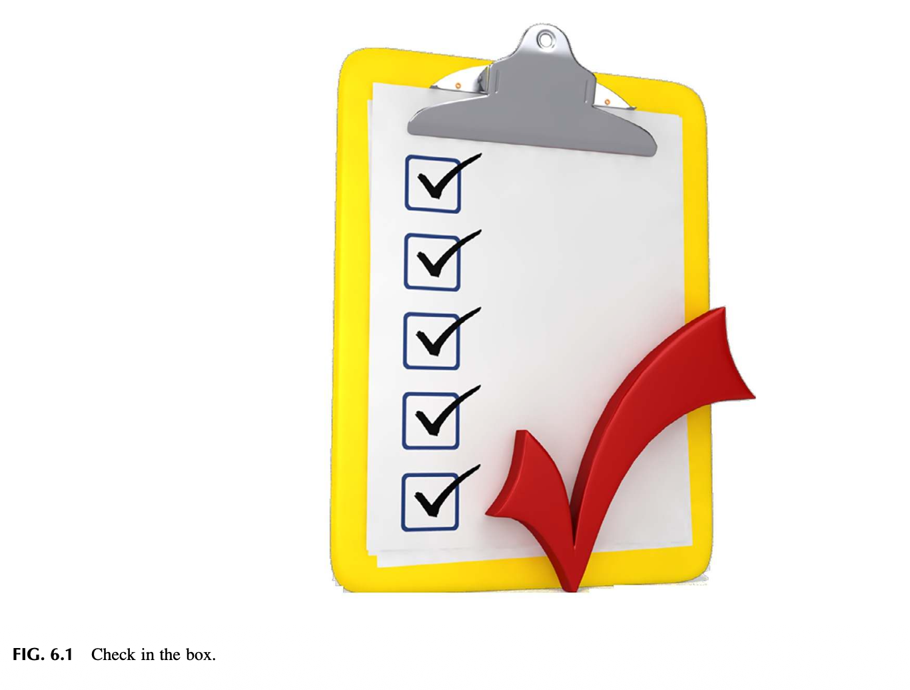
**그림 6.1 형식적 체크박스 컴플라이언스 (FIG. 6.1 Check in the box)**  
*(시스템적 실행 없이 단순히 서류상의 네모 칸에 체크 표시만 하고 실제 안전은 방치하는 관료적 안전의 전형)*

<!-- Block B14 -->
### 모든 안전경영시스템의 공통분모는 무엇인가? (What Do All Safety Management Systems Have in Common?)

<!-- Block B15 -->
제5장에서 상술한 바와 같이, 세계 각국의 다양한 안전경영시스템을 검토하고 그 세부 요소들을 나란히 비교 분석한 결과, 강력한 안전문화를 개발하고 유지하는 데 요구되는 본질적인 핵심 요소는 근본적으로 동일하다는 사실이 확인되었다.

영국 런던 왕립화학회(Royal Society of Chemistry, 2005)에서 발행한 연구 보고서에 따르면, 현존하는 유수의 경영시스템들 간에는 **어떠한 근본적인 차이점도 존재하지 않으며, 시스템 구성 요소 간에 막대한 수준의 중복이 존재하고 대부분이 공통된 요구사항을 공유하고 있다**는 결론을 내렸다 (Dababneh, 2007).

> "영국 표준 BS 8800과 품질경영 ISO 9001, 환경경영 ISO 14001 간의 차이점은 품질 및 환경 규격과 비교할 때 안전보건(OH&S)이 요구하는 적용 범위와 특화된 니즈에서 비롯될 뿐이다. 또한 BS 8800과 OHSAS 18001, 그리고 국제노동기구의 ILO-OSH 2001 간의 구별은 주로 구성 요소들이 다루어지는 기술적 순서상의 차이일 뿐이다. **이 세 가지 표준 문서가 지향하는 근본 의도와 핵심 요구사항은 완벽하게 공통적이다.**"  
> — 다밥네 (Dababneh, 2007)

만약 다밥네의 실증 연구가 옳다면, 요구되는 핵심 기준이 모두 대동소이하므로 **조직이 어떤 특정 안전경영시스템 규격을 선택하는가는 그리 중요하지 않다.** 진짜 중대한 핵심 과제이자 성패의 갈림길은, **"선택한 안전경영시스템을 얼마나 일관되고 지속적으로 현장에서 실천하고 활용하는가"**이다.

선택된 안전경영시스템은 조직의 전반적인 비즈니스 운영 구조 속에 매끄럽게 녹아들어야 한다. 안전경영시스템이 조직 전반에 효율적으로 통합될 때, 그것은 비로소 사내 최상위 주류 문화(Primary Culture)의 지극히 자연스럽고 실효성 있는 일상적 규범으로 확고히 자리 잡을 수 있다.

안전경영시스템은 기업의 '품질경영 프로세스(Quality Management Process)'와 완전히 평행을 이루거나 그 핵심 하위 집합(Subset)으로 간주될 수 있다. 조직의 품질 관리 시스템을 깊이 이해하는 것은 안전경영시스템에 막대한 시너지 혜택을 제공한다. 안전 프로그램과 절차들이 품질 관리와 유사한 표준 포맷을 활용하도록 설계될 수 있기 때문이다.

품질 관리와 유사한 친숙한 포맷을 사용할 때, 현장 구성원들은 안전 활동을 번거로운 외생적 규제가 아니라 조직 본연의 필수불가결한 일부분으로 자연스럽게 받아들이게 된다.

조직 네트워크 분석(ONA)과 조직도 분석은 품질 경영에 대한 직접적인 책임을 지고 있는 리더십과 현장 실무진의 역할을 정확히 식별해 내는 데 귀중한 통찰을 제공한다. 특성요인도(인과다이어그램/Fishbone), 관리도(Control Charts), 플로우차트(Flowcharting), 히스토그램(Histogram), 파레토 차트(Pareto Charts) 등 전통적인 품질 관리 핵심 도구들은 안전문화의 수준을 진단하고 안전경영시스템 내의 치명적인 공백(Gaps)을 찾아내는 데 탁월하게 활용될 수 있다. 이 도구들은 본 장의 [부록 6.1](#appendix-61)에서 상세히 다룰 것이다.

<!-- Block B16 -->
### 플랜-두-체크-액트(PDCA) 선순환 사이클 (The Plan-Do-Check-Act Cycle)

<!-- Block B17 -->
고객은 당신이 얼마나 열심히 노력했는가로 당신을 평가하지 않는다. 고객은 당신이 실제로 현장에 무엇을 전달해 냈는가(결과물)로 당신을 평가한다.  
— 스티브 잡스 (Steve Jobs)

다양한 안전경영시스템을 검토할 때, 기초적인 안전경영시스템의 핵심 요소들을 평가하고 실행하도록 돕는 가장 보편적인 불변의 테마는 다름 아닌 **'기획-실행-점검-개선(Plan-Do-Check-Act, PDCA)'**이다.

월터 슈하트(Walter Shewhart)의 이름을 따서 **'슈하트 사이클(Shewhart Cycle)'**로도 널리 알려진 이 간결하고도 강력한 PDCA 개념은 안전경영시스템 요소를 설계하고 현장에 안착시킬 때 완벽하게 적용될 수 있다 (Shewhart, 1980). PDCA는 수십 년간 현대 품질 통제 방법론의 확고한 뿌리 역할을 해왔으며, 오늘날 모든 안전 프로세스에서 가장 효과적인 혁신 프레임워크로 적극 옹호되고 있다. 슈하트 사이클은 미국국가표준협회의 ANSI Z10-2012 '직업안전보건 프로세스'를 비롯한 수많은 유수의 자발적 표준 프레임워크 속에 핵심 엔진으로 채택되었다 (그림 6.2 참조).

> **PDCA(Plan-Do-Check-Act 또는 Plan-Do-Check-Adjust)**란 비즈니스에서 프로세스와 제품의 지속적인 통제와 개선을 위해 활용되는 4단계 반복 관리 방법론으로, 데밍 휠/사이클, 슈하트 사이클, 통제 사이클, 혹은 PDSA(Plan-Do-Study-Act)라는 다양한 명칭으로 통용된다.  
> 영국 보건안전청(HSE)은 과거 안전보건 관리 모델로 활용하던 POPMAR(방침-조직화-기획-성과측정-감사-검토) 방식에서 탈피하여 현대적인 **'Plan, Do, Check, Act' 접근법**으로 전면 전환하였다 (HSG65, 2013).  
> HSE가 PDCA 접근법으로 전환한 결정적 이유는, **경영 관리의 '시스템적 측면'과 현장 작업자의 '행동적 측면' 사이의 완벽한 균형을 달성하기 위함**이었다. 또한 이를 통해 안전보건 관리를 고립된 단독 시스템이 아니라 조직의 훌륭한 일반 경영 관리의 떼려야 뗄 수 없는 본원적 핵심 일부로 다루도록 만들었다.

PDCA 프로세스는 안전경영시스템을 현장에 개발하고 적용할 때 흔들리지 않는 명확한 틀거리를 설계하는 데 활용된다. 표준화된 구체적 프로세스를 보유함으로써 조직은 모든 구성원이 일관되게 따라갈 수 있는 명확한 '안전 행동 로드맵(Map)'을 확보하게 된다.

<!-- Block B18 -->
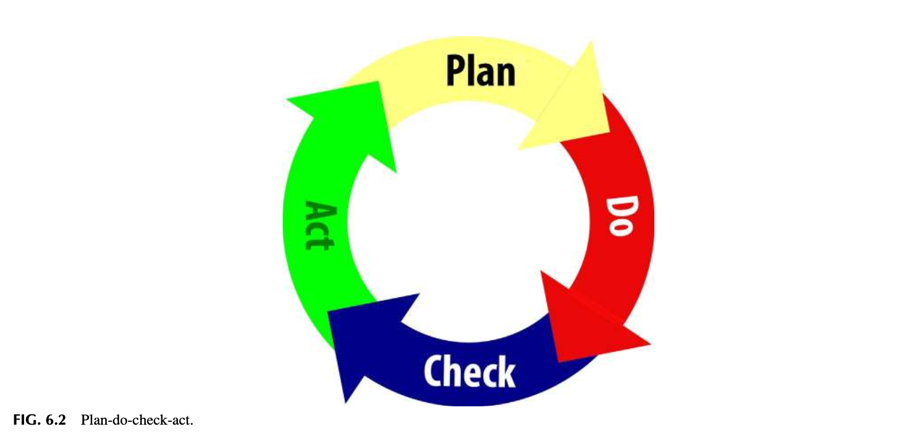
**그림 6.2 기획-실행-점검-개선 (FIG. 6.2 Plan-do-check-act)**  
*(프로세스가 멈추지 않고 끊임없는 자기 쇄신과 지속적 개선을 반복하는 역동적 나선형 발전 모델)*

PDCA는 안전 프로세스가 단발성 행사에 그치지 않고 지속적인 움직임과 끊임없는 자기 쇄신(Self-renewal) 속에 살아 숨 쉬는 역동적인 형태를 제공한다. PDCA를 활용하면 안전경영시스템의 각 요소를 다음의 4단계 프로세스를 통해 입체적으로 검토하고 발전시킬 수 있다:

<!-- Block B19 -->
* **1단계: 기획 (Step 1: Plan) — 안전경영시스템의 목표와 세부목표 정의**  
제4장 '안전문화를 위한 방향 설정'에서 논의한 바와 같이, 목표(Goals)와 세부목표(Objectives)는 안전경영시스템 요소들의 실행을 통해 달성하고자 하는 현장의 구체적인 안전 조건과 바람직한 안전 행동을 명확히 정의한다. 목표와 세부목표는 조직의 미래 비전에 기초하여 수립되며, 이를 통해 안전문화 내에 뿌리내리고자 하는 핵심 가치를 확립한다.  
이 단계에서는 기대되는 결과물이 정밀하게 정의되며, 리더십 팀과의 심도 있는 협의를 거쳐 공식 승인을 획득해야 한다. 조직이 대외적으로 천명한 가치(Espoused Values)와 현장 운영의 실제 현실(Current Reality)을 냉정하게 파악하기 위해서는 조직 내 모든 직급 계층의 가감 없는 의견 수렴과 참여가 필수적이다.

<!-- Block B20 -->
* **2단계: 실행 (Step 2: Do) — 안전경영시스템 목표와 세부목표의 현장 구현 착수**  
전체 근로자를 대상으로 안전경영시스템의 중대성을 전파하기 위한 교육, 훈련, 및 커뮤니케이션이 '누가, 무엇을, 언제, 어디서, 어떻게 완수할 것인가(5W1H)'에 맞추어 구체적으로 개발되고 실행되어야 한다.  
'실행(Do)' 단계는 과거의 낡은 관행으로부터 새로운 안전 프로세스와 표준 절차로의 본격적인 전환(Transition)이 이루어져야 함을 의미한다. 실행 단계에서는 무엇보다도 모든 근로자가 새로운 안전 방향의 근본적인 '이유(Why)'를 명확히 납득하고 그 중요성을 온전히 체감하도록 보장해야 한다.  
제11장에서 다룰 **활동기반 안전시스템(ABSS, Activity-Based Safety System)**은 안전경영시스템에 관한 정보를 현장에 신속히 전파하고, 모든 근로자가 어떤 영향을 받게 되며 구체적으로 어떠한 참여가 기대되는지를 알리는 데 대단히 유용한 핵심 기법이다.

<!-- Block B21 -->
* **3단계: 점검 및 학습 (Step 3: Check or Study) — 목표 및 세부목표 달성 상태의 면밀한 조사**  
안전경영시스템 요소들이 현장에 실행됨에 따라, 초기에 수립한 목표와 세부목표 기준선(벤치마크)에 조직의 노력이 제대로 도달하고 있는지를 확인하기 위한 정기적인 점검과 설문 진단 조사가 수행되어야 한다.  
일상적인 주기적 점검은 현장의 불안과 우려, 애로사항을 조기에 발굴하고 해결해 줌으로써 변화에 대한 구성원들의 저항(Resistance to change)을 대폭 줄여준다. 이 심층 조사(Study) 과정을 통해 현장 근로자의 지지와 수용성(Buy-in)을 어디서 더 보강해야 하는지 파악할 수 있으며, 시간적 요구와 예산 배분에 관한 현장의 불만을 해소하고, 안전경영시스템의 추진 현황 및 시정조치 결과에 대한 소통을 비약적으로 개선할 수 있다.  
이 단계에서는 품질 관리 기법과의 완벽한 평행이 돋보이는데, 통계적 공정 분석(SPC), 정밀 설문조사, 척도형 설문지, 심층 인터뷰 등을 활용함으로써 현재의 안전 프로세스가 실제로 어떠한 성과를 거두고 있는지에 대한 극도로 선명한 진단 그림을 확보할 수 있게 된다.

<!-- Block B22 -->
* **4단계: 개선 및 환류 (Step 4: Act on the Findings and Study) — 진단 결과와 조사에 기반한 과감한 시정 조치**  
'점검/학습(Check/Study)' 단계를 통해 도출된 핵심 발견점들은 안전경영시스템에 어떠한 수정과 보완이 요구되는지, 구체적으로 어디를 뜯어고쳐야 하는지를 명확히 기술해 준다.  
현장에서 탁월한 효과가 입증된 모범 관행들은 안전경영시스템의 공식 규정으로 확고히 제도화하고, 안전문화를 한 단계 더 고도화하기 위해 수정이 필요한 취약 영역에는 추가적인 개선 조치를 단행한다. 반면 실효성이 없거나 비효율적인 것으로 판명된 낡은 활동과 관행들은 과감히 폐기(Abandoned)하고, 그에 투입되던 소중한 인적·물적 자원을 더 시급하고 효과적인 안전 영역으로 즉시 재배분(Redirected)한다 (Shewhart, 1980).

<!-- Block B23 -->
## 정의-측정-분석-개선-관리 (DMAIC)

<!-- Block B24 -->
만약 해당 조직이 품질경영 기법으로 식스시그마(Six Sigma) 접근법을 채택하여 따르고 있다면, PDCA의 고도화된 변형 모델인 **'정의-측정-분석-개선-관리(DMAIC: Define, Measure, Analyze, Improve, and Control)'** 기법을 안전경영시스템에 탁월하게 접목하여 활용할 수 있다.

DMAIC은 전통적인 PDCA보다 훨씬 더 정밀하고 진보된 데이터 기반 접근법이다. PDCA와 DMAIC 두 개념 모두 안전경영시스템의 핵심 요소들을 보다 탁월하게 관리하고 운영할 수 있도록 기획, 세부목표, 실행 활동을 조직화하는 최적의 프레임워크를 제공한다. 사내에 이미 다른 경영 기법이 자리 잡고 있다면, 안전경영시스템을 사내에 이미 널리 쓰이고 있는 기존 기법의 포맷과 최대한 일치시키는 것이 현명한 전략이다 (그림 6.3 참조).

다음 섹션들에서는 안전경영시스템에 대한 식스시그마 유형의 심층 진단을 수행할 때 활용되는 **'DMAIC 15단계 실행 로드맵'**의 핵심 요약을 제시한다. 성공적인 안전경영시스템에 매핑된 기본 식스시그마 프로세스 모델 플로우 다이어그램은 그림 6.4를 참조하라.

<!-- Block B25 -->
* **1단계: 정의 (Step 1: Define) — 안전 프로세스의 범위(Scope) 설정**  
자사의 고유한 조직 문화와 현장 환경 속에서 가장 최적으로 작동할 안전 프로세스는 구체적으로 무엇이며, 어떠한 포맷이어야 하는가? 전체 프로젝트의 경계와 적용 범위를 명확히 획정한다.

<!-- Block B26 -->
* **2단계: 조직 문화의 현재 상태 정의(Define the current state of the organizational culture):**
 무엇을 어떤 형식으로 측정할 것인가? 안전에 대한 현재의 인지(지각, perception) 상태는 어떠한가?

<!-- Block B27 -->
* **3단계: 적절한 측정 지표 정의(Define the appropriate metrics):**
 안전문화와 안전보건경영시스템을 어떻게 연계하고 측정할 것인가?

<!-- Block B28 -->
* **4단계: 안전보건경영시스템의 목표 수립(Develop the objective of the safety management systems)**
 끊임없이 변화하는 조직 환경 속에서 시간의 시험을 견뎌낼 수 있는 생명력 있는 방법이자 상록수적(Evergreen: 타당성, 대중성, 유용성 등을 지속적으로 유지하는 불후의 속성, 2018)인 프로세스를 어떤 유형으로 개발할 수 있는가?
* **5단계: 안전보건경영시스템 팀 선정 및 조직화(Select and organize the safety management system team):**
 리더십 팀과의 협업을 통해 안전보건경영시스템이 성공하는 데 필요한 역할, 책임 및 권한(RAA)은 무엇인가? 직원의 참여(Employee Involvement)를 확대하거나 구축하는 최선의 방법은 무엇인가?

**프로젝트 측정 (Measuring the Project)**
* **6단계: 거시적 개요 개발(Develop a macro overview):**
 조직도, 네트워크 맵, 그리고 현재의 안전보건경영시스템 프로세스와 조직 구조를 보여주는 개요 흐름도를 활용하여 거시적 개요를 개발한다. 조직에서 사용 중인 차트와 네트워크 맵의 유형은 무엇인가? 이러한 서식을 안전보건경영시스템의 모니터링 및 평가, 또는 발견된 격차(Gap)를 해소하는 데 맞춤 적용할 수 있는가?
* **7단계: 차트를 통한 안전 프로젝트 정의(Define the safety project with charts):**
 "파레토(Pareto)" 차트, 위험성평가 그래프, 손실 이력 등을 활용하여 안전 프로젝트를 정의한다. 서식과 개념이 이미 이해되어 있는, 조직에서 기존에 사용 중인 차트 및 그래프와 유사한 형태를 사용한다. 파레토 차트는 사소한 다수(trivial many)로부터 극히 중요한 소수(vital few)를 분리해 내는 데 사용되는 막대 차트이다. 파레토 차트의 예시는 그림 6.5를 참조하라.

<!-- Block B29 -->
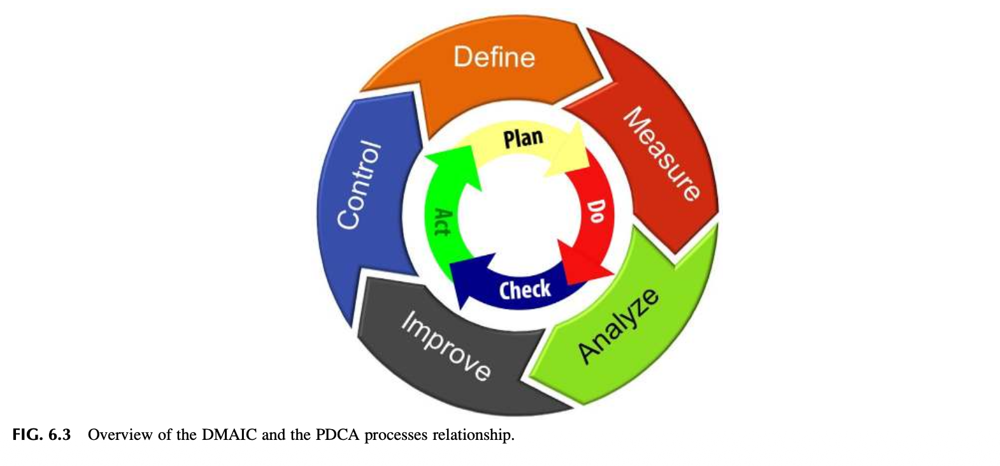
그림 6.3 DMAIC와 PDCA 프로세스 관계 개요.

<!-- Block B30 -->
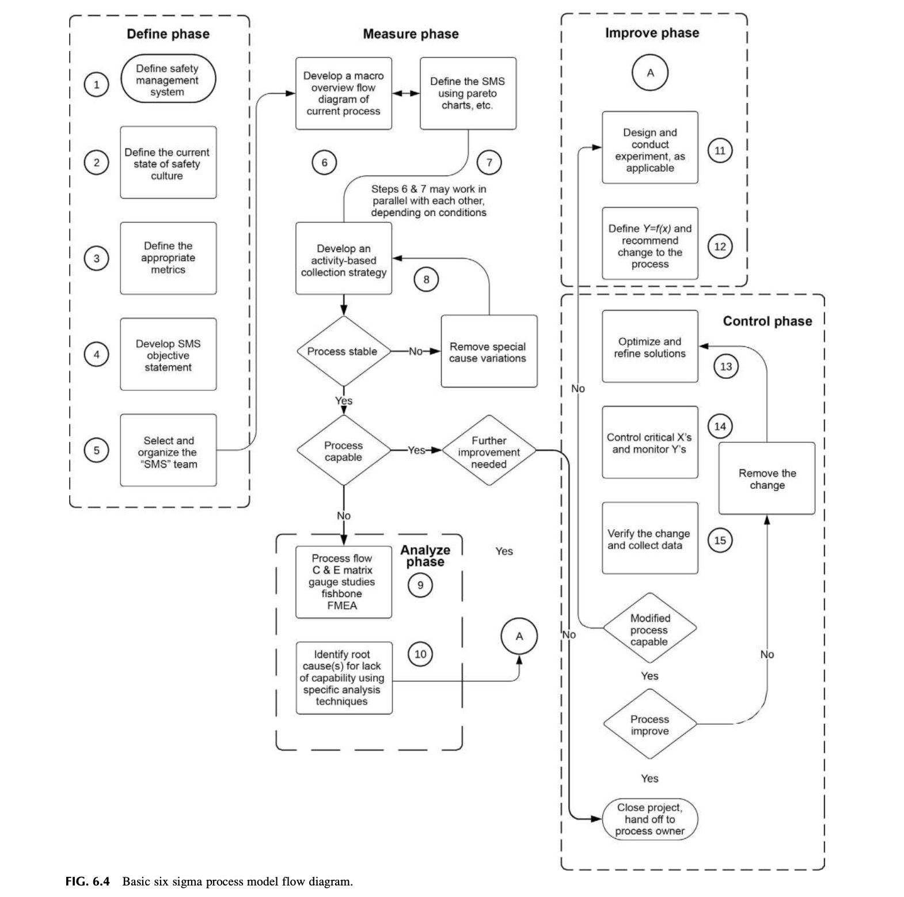
그림 6.4 기본 6시그마 프로세스 모델 흐름도.
파레토 법칙(Pareto Principle)은 "문제의 20%가 영향의 80%를 초래한다"는 경험칙(rule of thumb)으로 간주된다. 문제의 20%는 "극히 중요한 소수(vital few)"이며, 나머지 문제는 "사소한 다수(trivial many)"이다. 그 목표는 어떤 영역을 개선해야 하는지에 대한 정당성을 데이터를 통해 검증하는 것이다(미국 해안경비대 리더십 개발 센터, 2014).

<!-- Block B31 -->
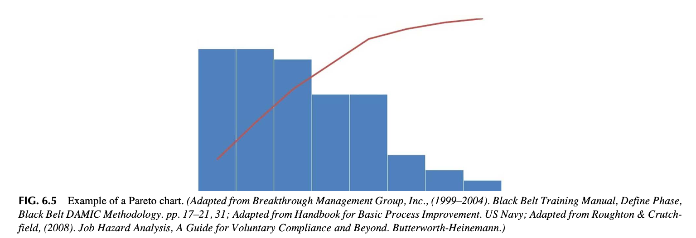
그림 6.5 파레토 차트 예시. (Breakthrough Management Group, Inc., 1999–2004, Black Belt Training Manual; US Navy, Handbook for Basic Process Improvement; Roughton & Crutchfield, 2008, Job Hazard Analysis 등 인용)

"효과적인 커뮤니케이션이란 아는 것이 20%이고, 아는 것에 대해 어떻게 느끼는지가 80%이다." – 짐 론(Jim Rohn)
수치상으로 볼 때, 이는 결과의 80%가 투입의 20%에서 나온다는 것을 의미한다(Baker, 2018). 파레토가 자신의 개념으로 증명했듯이, 이 "법칙"은 대략적인 의미에서 많은 경우 80/20 비율에 부합한다. 많은 경우 그 비율은 훨씬 더 극단적일 수 있으며, 때로는 99/1이 현실에 더 가까울 수도 있다(Starak, 2018). 80/20 법칙에 대한 개요는 그림 6.6을 참조하라.

* **8단계: 안전보건경영시스템 활동 수집 전략 수립(Develop a Strategy to collect safety management system Activities):**
 데이터 수집은 안전보건경영시스템 활동, 목표 및 세부목표, 유해·위험요인(hazards)과 관련 위험(associated risk) 및 손실 유발 사건을 줄이기 위해 사용된 통제 조치에 집중되어야 한다. 데이터 수집 및 표시에 대해 잘 설계된 전략을 사용하면 안전보건경영시스템을 안내하는 계기판(control panel)을 제공할 수 있다. 활동 관리 계기판의 예시는 그림 6.7을 참조하라.

**프로젝트 분석 (Analyzing the Project)**
* **9단계: 기본 품질 도구 및 기법을 통한 프로세스 개선(Refine the process using basic quality tools and methods):**
 프로세스 흐름, XY 매트릭스, 게이지 R&R(gauge studies), 어골도(Fishbone/Ishikawa Diagram), FMEA 등을 활용하여 프로세스를 정제한다. 안전보건경영시스템에 대한 분석은 무엇이 작동하고 무엇이 작동하지 않는지 통찰을 제공한다.

<!-- Block B32 -->

그림 6.6 80/20 법칙.

<!-- Block B33 -->
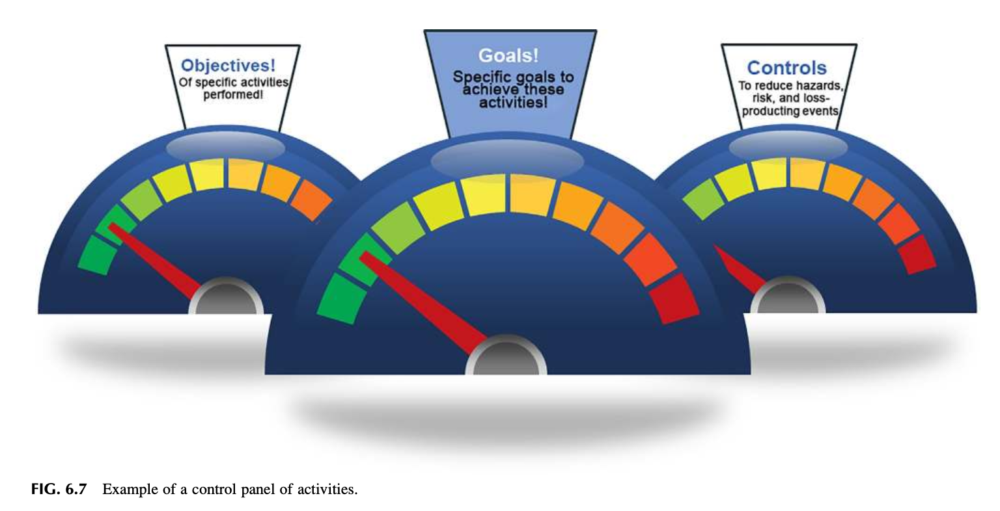
그림 6.7 활동 관리 계기판(Control panel of activities) 예시.

<!-- Block B34 -->
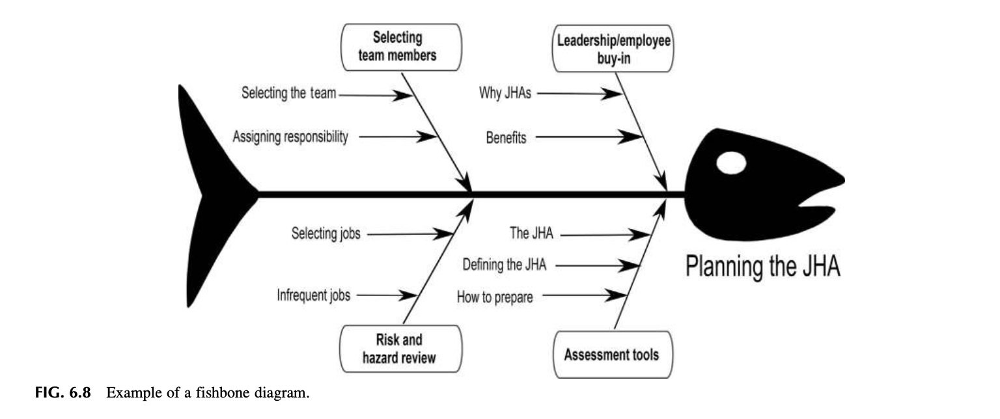
그림 6.8 어골도(Fishbone diagram) 예시.
무엇이 작동하고 무엇이 작동하지 않는지, 의사소통의 격차가 어디에 존재하는지, 실행상의 우려와 문제점이 무엇인지에 대한 통찰을 제공한다. 어골도의 예시는 그림 6.8을 참조하라.

* **10단계: 안전보건경영시스템 또는 그 구성요소 실행의 근본 문제 원인 파악(Identify cause(s) of underlying problems):**
 * 리더십 팀이나 직원을 참여시키는 데 문제가 있는가?
 * 자재나 데이터 수집의 필요성, 구체적인 데이터 수집 분석 및 의사소통의 결여 문제가 있는가?
 * 안전보건경영시스템을 지원하기 위한 수립된 목표와 세부목표, 시스템 활동, 권한과 책임, 예산 등에 문제가 있는가?
 * 시스템 요소 중 어느 하나의 완전한 적용을 가로막는 장애물은 무엇인가?
 * 실행 실패와 관련된 정보의 흐름을 가로막는 장애물이 조직 구조 내에 형성되었는가?

**프로젝트 개선 (Improving the Project)**
* **11단계: 해당되는 경우 "실험(experiment)" 설계 및 수행:**
 안전보건경영시스템은 전체 시스템과 그 하위 요소 간의 관계를 평가함으로써 분석된다. 분석 후 던져야 할 첫 번째 질문은 다음과 같다: 선택된 안전보건경영시스템 모델이 해당 조직에 적합한가? 의사소통, 요소별 활동, 교대 전 점검(preshift review), 위험 지침 카드(risk guidance card) 사용(제9장 '위험 지각의 정의' 참조), 회의, 점검, 체크리스트 등에 사용되는 측정치를 조사하는 것부터 시작하라. 작동하지 않는 것을 식별하고 프로세스를 조정하라. 이 평가는 주로 리더십 팀과 직원이 선택된 서식과 도구를 일상적으로 사용할 수 있는 역량을 테스트한다. 실험계획법(DOE, Design of Experiments)은 프로세스에 영향을 미치는 요인들과 그 프로세스의 결과물 사이의 관계를 규명하기 위한 체계적인 방법이다. 다시 말해 인과관계를 찾는 데 사용된다. 최적의 출력을 얻기 위해 프로세스 입력을 관리하려면 이 정보가 필요하다(What is design of experiments (DOE)?, 2017).
* **12단계: Y = f(x) 관점에서 요소와 활동 간의 관계 정의(여기서 Y는 X의 함수이자 결과물):**
 이 기법은 안전보건경영시스템 프로세스의 구성 요소들 간의 관계를 평가하기 위한 6시그마 도구이다. 예를 들어, 위험 지침 카드를 사용하는 경우 그것이 유해·위험요인의 회피, 감소 및 통제에 실질적인 영향을 미치는가? 카드를 도입하고 그 사용 현황을 모니터링한다. 만약 어떠한 관계도 규명할 수 없다면(즉, 위험이나 손실 유발 사고에 아무런 변화가 없다면), 위험 카드의 향후 사용을 재평가해야 한다.

**프로젝트 관리 및 통제 (Controlling the Project)**
* **13단계: 안전보건경영시스템 실행의 격차 해소를 위한 측정 지표 및 해결책의 재정의와 최적화:**
 조직의 경영 환경이나 여건은 끊임없이 진화하므로 지속적인 감사(audit)와 검토 프로세스가 필요하다. 안전보건경영시스템은 체계를 제공하지만, 기존의 모든 운영 프로세스와 마찬가지로 결코 영구적인 것으로 간주될 수 없다.
* **14단계: 핵심 X인자(Inputs) 제어 및 Y인자(Outputs) 모니터링을 통한 이슈 해결 효과성 제고:**
 안전관리 프로세스를 도식화함으로써 조직 내 관계를 명확히 정의하고 구획화할 수 있으며, 이를 통해 의사소통과 안전 활동의 방향성 흐름을 면밀히 검토할 수 있다. 안전보건경영시스템의 실행은 단순하지 않으며, 조직 내의 상호 관계를 가능한 한 많이 이해해야 한다. 안전 프로세스의 순서와 상호 관계가 명확히 정의될 때 시스템의 성공적인 실행 가능성이 높아진다(그림 6.9 참조).
* **15단계: 파악된 변경 사항 검증 및 시스템 효과성과 실행 이슈에 대한 데이터 지속 수집(The process improvement notebook, 1997).**

**표준화된 안전보건경영시스템 활용의 이점 (Benefits of Using a Standardized Safety Management System)**
제5장(기본 안전보건경영시스템 개요)에서 논의된 기본 안전보건경영시스템 요소들은 실행되었을 때 조직이 원하는 안전 프로세스의 범위와 수준을 결정할 수 있게 해준다. 기본 요소와 그 활동들은 고도화된 선진 안전보건경영시스템을 도입하기 전에 조직이 핵심 또는 기본기를 확실히 갖추도록 보장한다. 안전 프로세스의 장애물과 격차가 식별됨에 따라, 개선이 필요한 영역을 입증되고 수용된 지침에 비추어 더 잘 평가할 수 있다.
안전보건경영시스템은 단순히 다양한 안전 관련 프로그램을 나열하고 연결하는 것 이상의 역할을 수행한다. 사전 정의된 템플릿에서 개발된 구조화된 프로세스 요소 집합을 사용하여 따라갈 수 있는 로드맵을 제공한다. 정의된 비전과 미션의 일부로서, 안전보건경영시스템은 목표와 세부목표, 책임 할당, 요구되는 리더십의 의지를 명확하고 뚜렷하게 설명하는 프로세스를 구축한다.

**표준화된 안전보건경영시스템의 장단점 (Pros and Cons of a Standardized Safety Management System)**
올바른 안전보건경영시스템이 무엇이어야 하며 그것을 어떻게 개발하거나 구현해야 하는지에 대한 인지의 차이가 존재할 수 있다. 모든 조직은 서로 다른 구조, 역량, 법적 요구사항 및 예산 제약을 가지고 있으므로 다양한 접근 방식이 필요하다. 안전보건경영시스템은 국내 및 국제적으로 공인된 서식을 도입함으로써 조직 내에서 즉각적인 신뢰성을 확보할 수 있다.

<!-- Block B35 -->
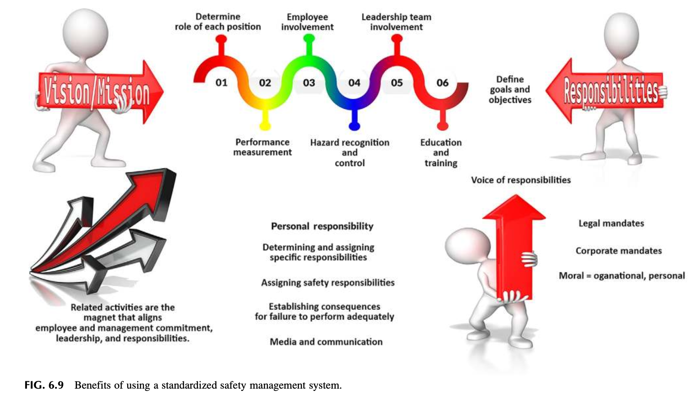
그림 6.9 표준화된 안전보건경영시스템 사용의 이점.
6시그마에서는 안전보건경영시스템을 도입하기 전에 "고객의 소리(Voice of the Customer, VOC)" 또는 그 변형인 "프로세스의 소리(Voice of the Process)"라는 개념을 활용할 수 있다. 6시그마 DMAIC 프로세스 정의 단계에서 고객의 소리(VOC) 포착: 고객의 소리란 논의 대상이 되는 제품이나 서비스에 대한 고객의 목소리, 기대, 선호도, 의견을 의미하며, 특정 제품이나 서비스에 대해 고객이 표현한 진술이다(Six Sigma DMAIC Process – Define Phase – Capturing Voice of Customer (VOC), 2017).

<!-- Block B36 -->
### 관찰 3 (Observation 3)

<!-- Block B37 -->
제임스가 참여했던 6시그마 안전 프로젝트 개발 과정에서, 팀은 고객의 소리(VOC) 개념을 차용하여 "직원의 소리(Voice of the Employee, VOE)"라는 용어를 사용했다. 이는 안전 프로젝트의 본질을 정의하는 데 도움이 되었으며, 직원의 참여는 프로젝트 성공의 필수 요건이었다.
조직 내에서 개별 부서는 안전보건경영시스템을 도입할 때 반드시 이해해야 하는 서로 다른 관심사와 요구사항을 가질 수 있다. 한 조직이 전사적인 문화를 공유하는 반면, 각 부서는 전문화로 인해 그 문화 안에서 "미세 기후(mini-climates)"를 형성할 수 있다. 안전보건경영시스템이 구현되고 관리되는 방식은 결코 "일률적인 단일 잣대(one size fits all)" 방식이 될 수 없다. 각 영역에서 안전보건경영시스템의 "이유(Why)"가 명확히 설명되어야 한다(Seidman & Clinton, 2011; Sinek, 2009).
예를 들어, 조직 내의 다양한 직종은 서로 다른 요구사항과 전문 영역을 가지고 있다. 각 분야는 서로 다른 프리즘을 통해 조직을 바라본다. 유지보수 부서는 생산 부서와 다른 관점을 가질 수 있으며, 마케팅 요구사항은 생산과 다르다. 앞서 논의한 바와 같이 각 영역은 자신의 전문성이 가장 필수적이라고 믿는다. 이로 인해 갈등이 쉽게 발생할 수 있다.

<!-- Block B38 -->
### 관찰 4 (Observation 4)

<!-- Block B39 -->
사업장 안전보건 관리자로서 마이크는 작업자들에 대한 여러 심각한 위험 노출로 인해 신제품 생산 라인의 가동을 중단하도록 최고경영진을 설득했다. 생산 중단은 기업의 마케팅 및 영업 부서에 딜레마를 안겨주었는데, 전국적인 광고를 통해 이미 신제품 출시일이 공표되었고 생산 중단은 막대한 비용이 투입된 대규모 미디어 캠페인과 상충되었기 때문이다. 마케팅 선임 이사는 출시 지연에 강력히 항의하며 공장 경영진이 안전 절차를 무시하고 라인을 재가동할 것을 요구했다. 그러나 마이크의 공장 경영진은 작업자의 위험 노출을 이해하고 생산 중단을 확고히 지지했다.
이러한 유형의 밀고 당기는 갈등(push-pull conflict)은 거의 대부분의 조직에서 보편적으로 발생하며, 이를 어떻게 처리하는지를 통해 그 조직의 안전문화의 깊이와 범위를 가늠할 수 있다. 안전보건경영시스템 구축의 목적은 무엇이 가장 효과적이며 조직의 구체적인 요구를 충족시키는지를 결정하는 것이다. 미션을 놓치지 않으면서 안전 프로세스를 맞춤화하고 그 요소를 유연하게 유지하는 것은 지속적인 과업이다.
다음 내용에서는 고려해야 할 잠재적 장단점을 다룬다.

**안전보건경영시스템의 "장점" (The “Pros” of the Safety Management Systems)**
특정 안전보건경영시스템을 도입함으로써 얻을 수 있는 장점은 다음을 포함하되 이에 국한되지 않는다:
* 독립된 일회성 프로그램이나 프로세스로 사용되지 않고, 다른 모든 경영 프로세스에 통합될 수 있는 체계화된 시스템을 제공한다.
* 프로세스를 안내하는 "나침반(compass)" 역할을 하여 리더십 팀과 직원에게 필요한 노력과 행동을 집중시키는 방법을 제공한다. 안전보건경영시스템은 조직의 모든 구성원이 동일한 방향을 바라보게(on the same page) 할 가능성을 높여준다.
* 시간 절약 효과가 중요하다. 이는 따라갈 수 있는 구조화된 맵이나 템플릿을 활용함으로써 달성될 수 있다. 이 프로세스는 안전 관련 활동의 지속적인 개선을 보장하고 조직의 안전문화 수준을 측정하는 방법을 제공하는 데 기여한다.
* 유사한 프로세스를 사용하는 다른 조직의 경험에서 나온 정보를 바탕으로 성과와 발전을 위한 벤치마크를 제공한다.
* 조직 내 모든 구성원에게 안전보건경영시스템의 현황을 공유하고 유해·위험요인 및 관련 위험 문제와 관심사에 대한 토론, 시정 조치 및 문제 해결을 장려하는 소통 수단을 제공한다.
* 소유주, 투자자 및 보험 인수자에게 유해·위험요인 및 관련 위험에 대한 관리가 지속적이고 공식화된 절차를 따르고 있으며, 조직의 전반적인 위험 통제 상태가 양호함을 설명하고 확신시키는 데 도움을 준다.
* 내부 및 외부 감사원(심사원)이 안전보건경영시스템을 검토할 때 동일한 기준을 사용하게 된다.

<!-- Block B40 -->
## 안전보건경영시스템의 "단점과 한계" (THE “CONS” OF THE SAFETY MANAGEMENT SYSTEMS)

<!-- Block B41 -->
안전 관리 시스템의 단점으로는 지속적인 프로세스가 유지되고 지속적으로 모니터링되어야 한다는 요구사항이 있다. 안전 관리 시스템은 다음과 같은 경우 문제가 발생할 수 있다:

* 적절하게 구현되지 않고 다른 관리 프로세스와 통합되지 않은 "기성품(canned)" 접근 방식으로 보일 경우, 즉 표방된 가치(espoused values)를 제공하지만 조직을 실제로 이끌지 못하는 경우.
* 그 범위가 너무 좁게 구현되어 상호 연결된 전체론적(holistic) 프로세스가 아닌 일련의 일회성(one-off) 프로그램으로 간주될 경우.
* 그 활동과 프로세스의 측정이 성실하고 일관되게 수행되지 않을 경우 안전에 대한 잘못된 인식(false sense of safety)이 발생할 수 있다. "연필 휘핑(pencil whipping)" 즉 허위 문서화(false documentation)가 발생하지 않도록 정직하고 포괄적이며 정기적인 평가 시스템이 마련되어야 한다.
* 우수한 구현과 미흡한 구현 모두에 대한 결과(consequences)가 마련되지 않은 경우. 어떤 형태로든 가치 있는 인정(valued recognition)이 존재하지 않으면 직원들은 해당 프로세스를 단지 또 다른 행정적 업무나 처리해야 할 서류 작업으로 간주할 수 있다.
* 시간이 너무 많이 소요되는 것으로 인식될 수 있으며 안전 관리 시스템의 이유(why)가 완전히 이해되지 않을 수 있다. 앞서 언급한 바와 같이 그리고 개념을 재강조하고자 하는데, 안전 프로그램 성공의 전통적 방법은 OSHA 기록 가능성(recordability)과 손실 발생 사건(loss-producing events)의 빈도에 의존한다. "손실 없으면 위험도 없다(no loss no risk)"는 인식이 존재하면 관련 위험이 높더라도 "우리는 이것을 할 필요가 없다!"라는 태도가 나타날 수 있다.
* 조직에 맞게 맞춤화(customized)되지 않고 조직 구조와 기존 문화를 고려하지 않아 해당 프로세스를 거부하거나, 더 나쁘게는 표방(espouse)하기만 하고 내재화(internalize)하지 않을 수 있는 경우.

정부 및 자발적 관련 안전 관리 시스템의 예시
안전 관리 시스템은 두 가지 유형으로 나뉜다. 정부-규제 관련(governmental-regulatory related) 시스템과 국가 및 국제적으로 인정된 표준 기관(standards agencies) 및 전문 학회(professional societies)에 의해 개발된 의무적(mandated) 또는 자발적(voluntary) 시스템이다. 정부 관련 프로그램은 규정의 행정(administration of regulations)을 강조한다. 이 절에서는 다양한 형식과 요소를 보여주기 위해 여러 안전 관리 시스템에 대한 개요를 제공한다. 형식에 대한 인식은 어떤 안전 관리 시스템이 조직에 가장 적합한지에 대한 결정에 도움이 될 수 있다. 안전 관리 시스템은 국제적(international), 국가적(national), 또는 주/도/시(state/province/city) 수준일 수 있다. 많은 주와 도에서 안전 관리 시스템을 제안하거나 의무화했다. 다양한 전문, 표준 또는 학제간 그룹 또는 학회에서 표준을 제공할 수 있다. 마지막으로, 조직이 자체적으로 프로세스를 개발하고 구현했을 수도 있다. 다음은 표준화된 정부 관련 지침 안전 관리 시스템의 몇 가지 예시이다:

* 연방 직업안전보건청(OSHA), 안전 및 보건 프로그램을 위한 권장 관행 (Recommended Practices for Safety and Health Programs General Industry and Construction, 2017)
* 연방 직업안전보건청 자발적 예방 프로그램 (Voluntary Protection Program (VPP), 2016)
* 미국 에너지부 자발적 보호 프로그램 (Voluntary Protection Program (DOE-VPP), 2016)

주 또는 도 시스템에는 다음이 포함된다:

* 캘리포니아 OSHA 상해 및 질병 예방 프로그램 Title 8-§3203 (Guide to developing your workplace injury and illness prevention program with checklists for self-inspection, 2016). 캘리포니아 OSHA는 안전 프로그램 관리에 대한 공식적인 접근 방식을 의무화한다.
* 효과적인 보건 및 안전 관리 시스템 구축 (Building an Effective Health and Safety management system, 2015), 상해 감소 파트너십(Partnerships in Injury Reduction), 앨버타(Alberta).
* 몬태나 주(State of Montana)가 의무적 몬태나 안전 문화법(Montana Safety Culture Act)으로 취한 흥미로운 접근 방식 (Job safety analysis, 2018; Safety Culture Act, 2015). 부록 6.2에서 의무적 안전 문화법 표준(Mandated Safety Culture Act standard)을 참조하라. 이는 다운로드하여 도서관에 사용할 수 있는 관련 공공 도메인 문서이다. 정부 안전 관리 시스템 모델은 규제 기반(regulation based)인 경향이 있지만 프로그램 관리를 위해 앞서 논의된 핵심 요소의 변형을 여전히 사용한다. 부록 6.3에서 정부 관련 안전 관리 시스템 프로세스 요소의 간략한 요약 비교(Brief Summary Comparison of Governmental-Related Safety Management Systems Process Elements)를 참조하라. 이는 다음과 같다: 표 6.6 다양한 직업안전보건청(OSHA) 안전 또는 연방 자발적 관행(Various Occupational Safety and Health Administration (OSHA) Safety or Federal Voluntary Practices), 표 6.7 선택된 도 또는 국제 표준(Selected Providence or International Standards), 표 6.8 OSHA의 공정 안전 관리(PSM)와 EPA 화학 위험 관리 프로그램(RMP) 비교. 다양한 규정에 대한 요약을 제공하기 위해 모든 노력이 기울여졌으며, 표 6.9 제안된 안전 관리 프로그램을 위한 오래된 표준의 역사(History of Older Standards for a Proposed Safety Management Programs)가 있다. 모든 규정은 변경될 수 있다. 제시된 정보는 현재 표준(current standard)을 기반으로 한다.

안전 및 보건 프로그램을 위한 권장 관행
직업안전보건청(OSHA)은 2017년에 안전 및 보건 프로그램을 위한 여러 지침을 업데이트하고 발표했으며 여기에는 다음이 포함된다:

* 일반 산업을 위한 안전 및 보건 프로그램을 위한 권장 관행 (Recommended Practices for Safety and Health Programs General Industry)
* 건설 분야의 안전 및 보건 프로그램을 위한 권장 관행 (Recommended Practices for Safety and Health Programs in Construction).

이러한 권장 관행은 이 책에서 논의된 7가지 핵심 요소를 사용하여 기본 안전 관리 시스템을 구현하기 위한 단계별 접근 방식을 제공한다. 부록 6.4에서 다운로드하여 도서관에 사용할 수 있는 이러한 관련 공공 도메인 문서를 참조하라.

자발적 보호 프로그램(VPP)
VPP는 심층적인 준수 기반 프로그램( compliance-based programs)을 수립하는 데 있어 OSHA 연구에 기반한 효과적인 프로그램이었다. 그 제목이 암시하듯이 VPP는 자발적인 노력(voluntary effort)이며, 그 일반적인 수용은 전국적으로 약 2200명의 참가자로 제한된다. 자발적 보호 프로그램(VPP)은 효과적인 작업장 기반 안전 및 보건을 촉진한다. VPP에서 경영진, 노동자, OSHA는 포괄적인 안전 및 보건 관리 시스템을 구현한 작업장에서 협력적 관계(cooperative relationships)를 구축한다. VPP 승인은 모범적인 직업 안전 및 보건을 달성한 고용주와 직원의 뛰어난 노력에 대한 OSHA의 공식적인 인정이다. VPP의 입법적 기반(legislative underpinning)은 1970년 직업안전보건법(Occupational Safety and Health Act of 1970) 제(2)(b)(1)조로, 이는 "가능한 한 국가의 모든 근로 남성과 여성에게 안전하고 건강한 작업 조건을 보장하고 우리의 인적 자원을 보존하기 위해 - (1) 고용주와 직원이 자신의 작업장에서 직업 안전 및 보건 위험 수를 줄이기 위한 노력을 장려하고, 고용주와 직원이 안전하고 건강한 작업 조건을 제공하기 위한 새로운 프로그램을 도입하고 기존 프로그램을 완성하도록 자극함으로써"라는 의회의 의도(Congress's intent)를 선언한다. VPP의 성공에 대한 통계적 증거(statistical evidence)는 인상적이다. 평균 VPP 작업장은 해당 산업 평균에 비해 52% 낮은 결근, 제한 또는 전보(Days Away Restricted or Transferred, DART) 사례율을 보인다. 이러한 사이트는 일반적으로 처음부터 그렇게 낮은 비율로 시작하지 않는다. 상해 및 질병 감소(reductions in injuries and illnesses)는 사이트가 안전 및 보건 관리에 대한 VPP 접근 방식과 도전적인 VPP 신청 프로세스(challenging VPP application process)에 전념할 때 시작된다. All About VPP (n.d.), Voluntary Protection Program (VPP) (2016). 조직이 작거나 강력한 안전 관리 시스템을 구현할 준비가 되지 않은 경우, VPP는 그 한계가 noted된 바와 같이 이해된다면 좋은 출발점이자 따를 가치가 있는 프로그램이 될 수 있다. VPP 프로그램 성공은 상해율 감소(injury rate reduction)와 준수 기반 노력(compliance-based efforts)에 기반한다. 필요한 노력이 프로그램 사용 조직 내에 안전 문화(safety culture)가 개발되었음을 의미하지는 않는다. "하류(downstream)" 측정은 위험 감소(risk reduction)가 개선되었는지에 대한 지표일 수도 있고 아닐 수도 있다.

에너지부 VPP 요소
에너지부 자발적 보호 프로그램(DOE-VPP)은 에너지부(DOE) 계약자 사이트에서 노동자, 경영진, 정부 간의 협력적 노력을 통해 안전 및 보건 우수성(safety and health excellence)을 촉진한다. DOE는 또한 다른 연방 기관 및 민간 부문과 파트너십을 형성하여 자발적 보호 프로그램(VPP) 경험을 발전시키고 공유하고 다음 세기의 프로그램 과제에 대비했다. 계약자 및 연방 직원의 안전 및 보건은 에너지부의 높은 우선순위이다. General Information of the DOE VPP Program (n.d.), Voluntary Protection Program (DOE-VPP) (2016), Worker health and safety (n.d.)

<!-- Block B42 -->
### 미국 자율안전보건프로그램 참가자 협회 (VPPPA, Voluntary Protection Programs Participants’ Association)

<!-- Block B43 -->
The Voluntary Protection Programs Participants’ Association, Inc. (VPPPA) - The Premier Global Safety and Health Organization은 협력적 직업 안전, 보건 및 환경 관리 시스템에 전념하는 선도적인 조직이다. VPPPA는 비영리 501(c)(3) 자선 단체로서 회원 기반 협회이며, 미국 노동부 산하 직업안전보건청(OSHA) 또는 미국 에너지부(DOE)의 자발적 보호 프로그램(VPP)을 달성했거나 이를 위해 노력하는 2,300개 이상의 기업 및 작업장으로 구성된 네트워크를 제공한다.

자발적 보호 프로그램(DOE-VPP), (2016) 미국 에너지부는 2009년에 "인간 수행 개선 핸드북(Human Performance Improvement Handbook)"이라는 포괄적인 2권 분량의 매뉴얼을 개발했다. 이 매뉴얼은 안전 관리 시스템 자체는 아니지만, 안전 관리 시스템 개발에 사용되는 다양한 개념과 기준을 제시한다. 매뉴얼에 포함된 이러한 개념과 기준은 인간 오류의 근본 원인과 안전 관리 문화 개발의 장애 요인에 대한 이해를 제공한다.

이 핸드북에서 다루는 인간 수행 개선(HPI)은 Six Sigma, 전사적 품질 관리(TQM) 등과 같은 프로그램 그 자체가 아니다. 오히려 이는 인간 수행의 조직적 맥락을 설명하는 수행 모델과 관련된 일련의 개념과 원칙이다. 이 모델은 인간 수행이 반복 가능한 결과를 산출하기 위해 함께 작동하는 요소들의 네트워크로 구성된 시스템이라고 주장한다. 이 시스템은 조직적 요인, 작업 현장 조건, 개인 행동 및 결과를 포괄한다. 시스템 접근법은 인간 오류에 대한 새로운 관점을 제시한다. 즉, 인간 오류는 실패의 원인이 아니라 시스템 내 더 깊은 문제의 결과 또는 증상이다. 인간 오류는 무작위가 아니며, 사람들이 사용하는 도구, 수행하는 작업, 그리고 작업하는 운영 환경의 특징과 체계적으로 연결되어 있다.

개인, 작업 팀 및 관리자를 위한 인간 수행 도구, 인간 수행 개선 핸드북(2009)

<!-- Block B44 -->
## 효과적인 안전보건경영시스템 구축 (BUILDING AN EFFECTIVE HEALTH AND SAFETY MANAGEMENT SYSTEM)

<!-- Block B45 -->
다음은 선진 안전 관리 시스템의 몇 가지 사례이다. 이러한 시스템들은 그 구조에서 유사한 형식과 개념을 공유한다. 이러한 공인된 자발적 표준들의 밑줄 친 기본 원리들을 연구하고 검토함으로써, 조직의 현행 시스템에 대한 검토를 수행하여 보다 구조화되고 포괄적이며 업계에서 인정받는 안전 관리 시스템을 위한 최선의 접근법을 결정할 수 있다(Building an Effective Health and Safety Management System, 2015). 제4장, 안전 문화의 방향 설정을 참조하라.

* 직업안전보건 관리 시스템, ANSI/ASSE Z10, 2012 (Occupational Health and Safety Systems, 2012)
* 직업안전보건 ISO 45001 (What is ISO 45001?, 2018)
* 직업안전보건 관리 표준(OHSAS 18001) (2007)
* 직업안전보건(OSH) 관리 시스템(직업안전보건 관리 시스템에 관한 지침, 2001)

**직업안전보건 관리, ANSI Z10-2012**
이 표준의 목적은 조직에 그들의 안전 및 보건 성과를 지속적으로 개선하기 위한 효과적인 도구를 제공하는 것이다. Z10은 지침 표준이지만, OSHA에 의한 시행은 요구되지 않으며, 이러한 지침의 사용은 미국 조직들 사이에서 직업안전보건의 향상을 가져올 것으로 기대된다. 직업안전보건 관리 시스템(2012) 그림 6.10과 ANSI Z10-2012를 활용한 안전 관리 시스템으로의 추진에 대한 개요 및 직업안전보건 관리 시스템 Z10-2012에 기술된 다섯 가지 주요 요소에 대한 개요를 위해 표 6.1을 참조하라(직업안전보건 관리 시스템, 2012). 그림 6.10은 Z10의 다양한 요소들 간의 상호관계에 대한 관점을 제공하며 그 구현에 대한 통찰을 제시한다(직업안전보건 시스템, 2012).

**지침 표준(Guidance Standard)** - 권고적이며 규제 요구사항이 아닌 표준. (용어집, 2010)

**직업안전보건 ISO 45001**
ISO 45001은 직업안전보건에 대한 국제 표준으로 갱신되어 2018년 3월 사용을 위해 발표되었다. ISO 45001은 완전히 구현될 경우 OHSAS 18001을 대체할 것이다. ISO 45001은 조직이 보건 및 안전 프로그램을 그들의 전반적인 운영 관리 시스템에 통합할 것을 권고하는 자발적 표준으로 남아 있다. 모든 안전 관리 시스템과 마찬가지로, 고위 경영진의 역할은 해당 표준에 대한 지원과 행정적 지원을 제공하는 것이다. ISO 45001은 조직이 OH&S 책임을 확대하고, 공급자와 계약자가 그들의 위험과 위해 요소를 어떻게 관리하는지 이해할 것을 요구한다(ISO 45001을 경쟁 우위로, 2018). ISO 45001의 이점은 변하지 않는다: 개선된 사업 성과, 운영 모범 사례의 일관된 적용, 감소된 부상 사고율, 그리고 증가된 직원 참여(ISO 45001을 경쟁 우위로, 2018). 공인된 국제 안전 관리 시스템 표준을 구현하는 것은 어떠한 ISO 또는 품질 관리 인증의 채택과 유사하다. 조직들이 그들의 문헌과 자료에서 안전과 보건을 표방하지만, 검증된 구조화된 프로세스를 사용하는 것은 조직이 그 노력에 추가적인 시간과 노력 및 예산을 기꺼이 투입하려 함을 보여준다(ISO 45001을 경쟁 우위로, 2018).

* 리더십과 근로자 참여
* 계획
* 지원
* 운영
* 성과 평가
* 개선

(새로운 직업안전보건 관리 시스템을 위한 국제 표준, 2017; ISO 45001로 인증 업그레이드, 2018)

<!-- Block B46 -->
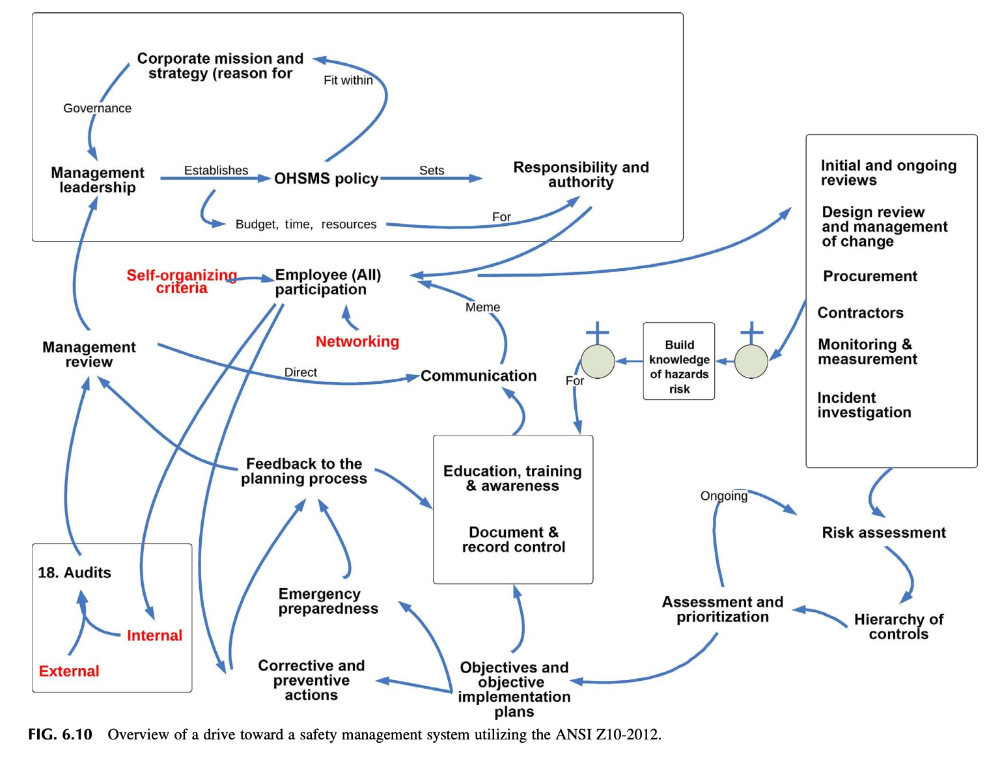
그림 6.10 안전보건경영시스템 추진 개요.

<!-- Block B47 -->
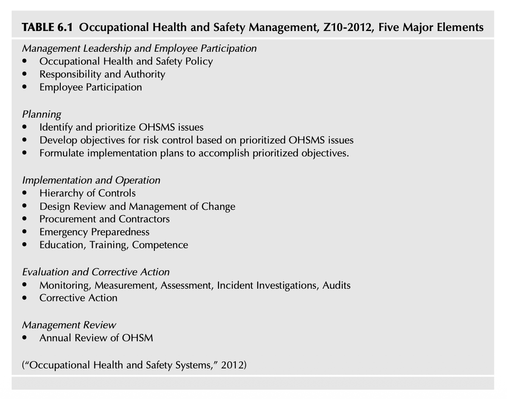
표 6.1 직업안전보건 관리, Z10-2012, 다섯 가지 주요 요소
관리 리더십 및 근로자 참여
직업안전보건 정책
책임과 권한
근로자 참여
계획
OHSMS 이슈 식별 및 우선순위 설정
우선순위가 설정된 OHSMS 이슈를 기반으로 위험 통제를 위한 목표 개발
우선순위가 설정된 목표 달성을 위한 이행 계획 수립
이행 및 운영
통제의 계층구조
설계 검토 및 변경 관리
조달 및 계약자
비상 대비
교육, 훈련, 역량
평가 및 시정조치
모니터링, 측정, 평가, 사건 조사, 감사
시정조치
경영 검토
OHSM 연례 검토 (“Occupational Health and Safety Systems,” 2012)
캐나다 직업안전보건 센터
“2006년 9월 6일, 캐나다 표준 협회(CSA)는 캐나다 최초의 합의 기반 작업장 건강 및 안전 관리 표준을 공개했다. CSA에 따르면, CSA Z1000-06 직업안전보건 관리라는 제목의 이 새로운 표준은 기업이 직업안전보건 관리 시스템을 개발하고 이행하기 위한 모델을 제공함으로써 작업장에서의 부상, 질병 및 사망을 줄이거나 예방하는 것을 목적으로 한다” (Occupational Safety and Health Management, 2006).
“CSA Z1000은 요구사항 텍스트 외에도 사용자가 관리 시스템을 이행하는 데 도움이 되는 광범위한 지침 자료를 포함한다. 이는 ISO 14001(What is ISO 45001?, 2018) 및 ISO 9001(품질 관리)과 같이 캐나다 전역의 조직에서 현재 사용 중인 다른 관리 시스템과 호환되도록 설계되었다” (Canada’s First Consensus-Based Occupational Health and Safety Management Standard, n.d.).
캐나다는 효과적인 건강 및 안전 관리 시스템이 다음 여덟 가지 구성 요소를 갖추는 것으로 설명한다:
* “작업 현장에서의 건강 및 안전 위해요소의 식별 및 분석.
* 위해요소로부터 근로자에 대한 위험을 제거 또는 줄이기 위한 통제 조치.
* 입증된 관리적 헌신 및 서면 회사 정책.
* 근로자 역량 및 훈련.
* 점검 프로그램.
* 비상 대응 계획.
* 사건 보고 및 조사.
* 관리 시스템 운영.”
(Building an Effective Health and Safety Management System, 2015)
Z1000-06에 기반한 직업안전보건 관리의 여섯 가지 주요 요소 개요는 표 6.2를 참조하라.
부상 감소 파트너십(Partnerships in Injury Reduction)은 고용주와 근로자 대표가 정부와 협력하여 효과적인 건강 및 안전 관리 시스템을 구축하는 자발적 프로그램이다. 건강 및 안전을 개선함으로써 작업장 부상 및 질병의 사회적 및 재정적 비용이 감소한다. 앨버타 근로자 보상 위원회(WCB)는 부처, 인증 파트너 및 고용주와 협력하여 부상 감소 파트너십 프로그램을 통해 WCB 보험료 인센티브를 제공한다. 예측 목표 이하로 청구 비용을 줄이고 COR(인증서)을 획득한 고용주는 업계 요율에서 최대 20% 할인을 받을 수 있다. 앨버타 근로자 보상 위원회 (n.d.)
이 프로그램이 근로자 보상 위원회와도 연계되어 있음에 유의하라.
직업안전보건 관리 표준 (OHSAS 18001)
영국 표준은 직업안전보건 관리 시스템에 대한 공식적인 합의 기준을 수립하였다. 이는 ISO 45001로 대체되고 있다. 직업안전보건 관리 표준 (OHSAS 18001) 개요는 표 6.3을 참조하라.
OHSAS 18001은 ISO 9001(품질) 및 ISO 14001(환경) 관리 시스템 표준과 호환되도록 개발되어, 조직이 원할 경우 품질, 환경 및 직업안전보건 관리 시스템의 통합을 용이하게 한다. (OHSAS) 사양은 조직이 OH&S 위험을 통제하고 성과를 개선할 수 있도록 직업안전보건(OH&S) 관리 시스템에 대한 요구사항을 제시한다. 이는 구체적인 OH&S 성과 기준을 명시하지 않으며, 관리 시스템 설계에 대한 상세한 사양도 제공하지 않는다. 직업안전보건 관리 표준 (OHSAS 18001) (2007)
직업안전보건(OSH) 관리 시스템, ILO-OSH 2001 지침
“국제노동기구(ILO)는 유엔(UN)의 전문 기관으로, 여성과 남성이 자유, 형평성, 안전 및 인간 존엄성의 조건에서 품위 있고 생산적인 작업을 얻을 수 있는 기회를 증진하는 것을 주요 목표로 한다.

<!-- Block B48 -->
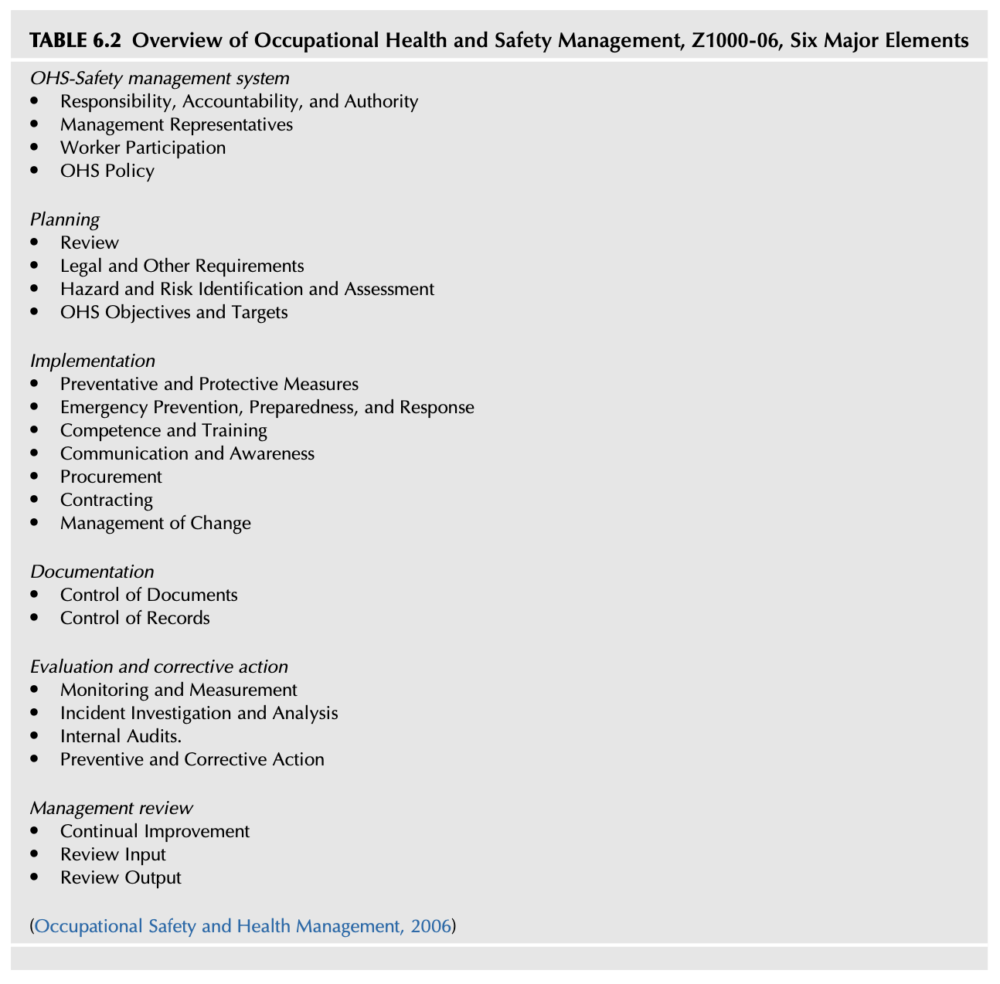
표 6.2 캐나다 산업안전보건경영시스템 CSA Z1000-06의 6대 핵심 요소 개요:

1. **안전보건경영시스템 기반 (OHS-Safety management system)**
 - 책임, 책무성 및 권한 (RAA, Responsibility, Accountability, and Authority)
 - 경영진 대리인 (Management Representatives)
 - 근로자 참여 (Worker Participation)
 - 안전보건 방침 (OHS Policy)
2. **기획 (Planning)**
 - 검토 (Review)
 - 법적 및 기타 요구사항 (Legal and Other Requirements)
 - 유해·위험요인 및 위험성 파악과 평가 (Hazard and Risk Identification and Assessment)
 - 안전보건 목표 및 세부목표 (OHS Objectives and Targets)
3. **실행 (Implementation)**
 - 예방 및 보호 조치 (Preventative and Protective Measures)
 - 비상사태 예방, 대비 및 대응 (Emergency Prevention, Preparedness, and Response)
 - 역량 및 훈련 (Competence and Training)
 - 의사소통 및 인지도 (Communication and Awareness)
 - 문서화 및 기록 관리 (Documentation and Records Control)
4. **평가 (Evaluation)**
 - 모니터링 및 측정 (Monitoring and Measurement)
 - 내부 감사 (Internal Audits)
 - 사고 및 사건 조사 (Incident and Accident Investigation)
5. **시정 조치 (Corrective Action)**
 - 시정 및 예방 조치 프로세스 (Corrective and Preventive Action Process)
6. **경영진 검토 및 지속적 개선 (Management Review and Continual Improvement)**
 - 경영진 검토 및 시스템 지속적 개선 수행

(ILO는 2001년에 산업안전보건(OSH) 경영시스템에 관한 자율 지침인 ILO-OSH 2001 Guidelines를 제정하였다. ILO-OSH 개요 및 역사 모듈 2, 레슨 1, 2001 인용)

<!-- Block B49 -->
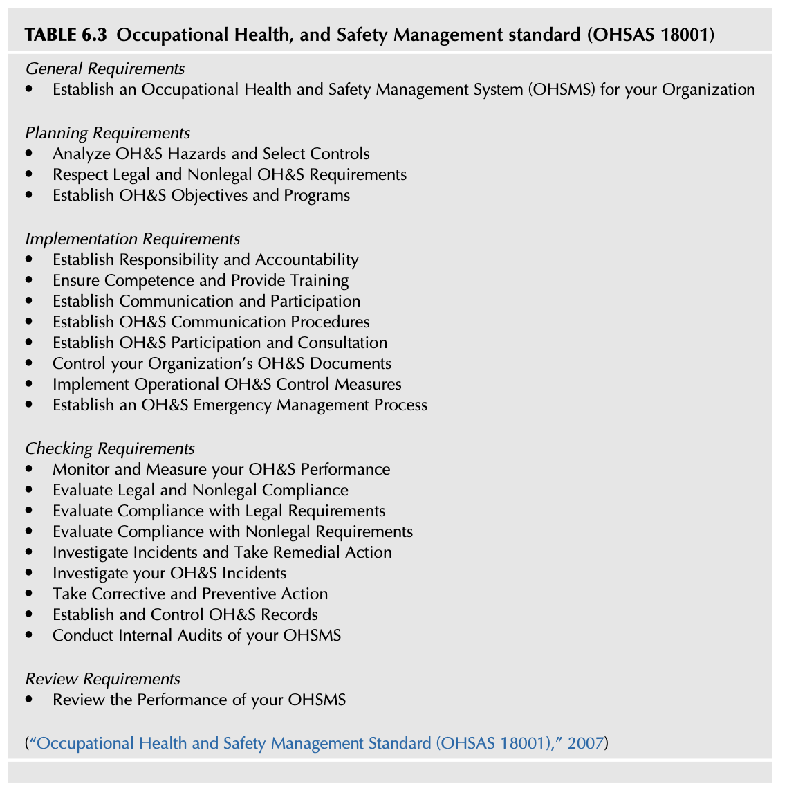
표 6.3 산업안전보건경영시스템 표준(OHSAS 18001) 핵심 요구사항:

1. **일반 요구사항 (General Requirements)**
 - 조직에 적합한 산업안전보건경영시스템(OHSMS) 구축
2. **기획 요구사항 (Planning Requirements)**
 - 안전보건 유해·위험요인 분석 및 통제 조치 선정 (Analyze OH&S Hazards and Select Controls)
 - 법적 및 기타 안전보건 요구사항 준수 (Respect Legal and Nonlegal OH&S Requirements)
 - 안전보건 목표 및 추진 프로그램 수립 (Establish OH&S Objectives and Programs)
3. **실행 요구사항 (Implementation Requirements)**
 - 책임과 책무성 수립 (Establish Responsibility and Accountability)
 - 역량 확보 및 훈련 제공 (Ensure Competence and Provide Training)
 - 의사소통 및 참여 체계 구축 (Establish Communication and Participation)
 - 문서 및 운영 통제 조치 이행 (Implement Operational OH&S Control Measures)
 - 비상사태 관리 프로세스 수립 (Establish an OH&S Emergency Management Process)
4. **점검 요구사항 (Checking Requirements)**
 - 안전보건 성과 모니터링 및 측정 (Monitor and Measure your OH&S Performance)
 - 법적 및 기타 요구사항 준수 평가 (Evaluate Compliance)
 - 사고 조사 및 시정 조치 수행 (Investigate Incidents and Take Remedial Action)
 - 내부 심사 실시 (Conduct Internal Audits)
5. **검토 요구사항 (Review Requirements)**
 - 최고경영진의 OHSMS 성과 검토 (Review the Performance of your OHSMS)

**원자력 분야의 ISO 19443:2018 품질경영시스템**
원자력 분야의 안전 향상을 위해 새롭게 발표된 ISO 19443 표준은 ISO 9001 품질 표준의 원칙을 원자력 부문에 적용하여, 품질의 모범 사례와 원자력 산업의 특정 요구사항을 결합하였다(New Standard to Improve Safety in the Nuclear Sector, 2018). 이 새로운 표준은 원자력 안전에 중요한 제품과 서비스를 공급하는 공급망 조직의 안전문화를 증진하고 공급업체 감사를 조화시키는 데 기여한다.
우리가 제시한 바와 같이, PDCA 사이클은 모든 프로세스와 품질경영시스템 전체에 일관되게 적용될 수 있다(Deming, 2018).

**린 6시그마 프로세스 도구 검토 (Lean Six Sigma Process Tools Review)**
6시그마는 많은 조직에서 활용되고 있는 강력한 비즈니스 개선 시스템으로, 조직의 성과, 관행 및 시스템을 측정, 분석 및 개선하기 위해 통계적 기반 도구를 사용한다(The environmental professional’s guide to lean & six sigma, 2009).
"6시그마는 결국 고객의 경험을 개선하고, 비용을 낮추며, 더 훌륭한 리더를 육성하는 품질 프로그램이다." – 잭 웰치(Jack Welch)

<!-- Block B50 -->
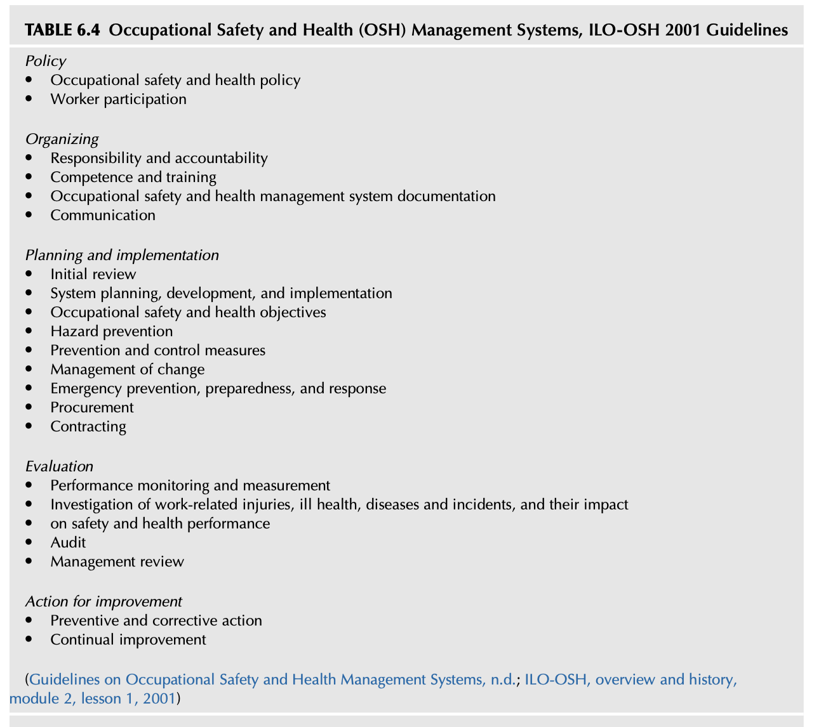
표 6.4 ILO-OSH 2001 지침에 따른 산업안전보건(OSH) 경영시스템 구조:

1. **방침 (Policy)**
 - 산업안전보건 방침 (Occupational safety and health policy)
 - 근로자 참여 (Worker participation)
2. **조직화 (Organizing)**
 - 책임과 책무성 (Responsibility and accountability)
 - 역량 및 훈련 (Competence and training)
 - 안전보건경영시스템 문서화 (OHS management system documentation)
 - 의사소통 (Communication)
3. **기획 및 실행 (Planning and implementation)**
 - 초기 검토 (Initial review)
 - 시스템 기획, 개발 및 실행 (System planning, development, and implementation)
 - 산업안전보건 목표 (OSH objectives)
 - 유해·위험요인 예방 및 통제 조치 (Hazard prevention and control measures)
 - 변경관리 (Management of change)
 - 비상사태 예방, 대비 및 대응 (Emergency prevention, preparedness, and response)
 - 조달 및 계약 (Procurement and Contracting)
4. **평가 (Evaluation)**
 - 성과 모니터링 및 측정 (Performance monitoring and measurement)
 - 직업성 부상, 질병, 건강 장해 및 사건 조사와 성과 영향 분석
 - 감사 (Audit)
 - 경영진 검토 (Management review)
5. **개선을 위한 조치 (Action for improvement)**
 - 예방 및 시정 조치 (Preventive and corrective action)
 - 지속적 개선 (Continual improvement)

6시그마 개념과 활동은 더 나은 안전보건경영시스템 결과를 창출하는 데 활용될 수 있다. 문제는 6시그마 전문성을 확보하려면 개선을 달성할 책임이 있는 지정된 인력을 교육하는 데 상당한 시간과 노력이 소요된다는 점이다. 조직이 이미 품질 분야에서 6시그마 접근법을 따르고 있다면, 안전보건경영시스템은 이를 다양한 요소에 통합함으로써 큰 혜택을 얻을 수 있다. 6시그마 도구는 비효과적이거나 낭비로 간주되는 활동을 제거함으로써 프로세스 개선을 달성하고 조직을 위한 가치를 창출하는 데 활용될 수 있다.
제7장에서는 리더가 되는 것과 관리자가 되는 것 사이의 균형이 요구되는 안전 책임에 대해 논의할 것이다. 안전보건경영시스템 기준을 구현할 때는 관리 기술(management skills)이 필수적이다. 관리자는 분석과 해결책 개발을 위해 문제를 기본 요소로 분해하는 "환원주의적(reductionist)" 접근 방식을 사용한다. 반면 리더십은 안전경영의 비전과 미션을 전달하고 직원들의 헌신을 고취한다.

<!-- Block B51 -->
## 요약 (SUMMARY)

<!-- Block B52 -->
안전보건경영시스템은 여러 해 동안 수많은 조직에 의해 활용되어 왔다. 이러한 시스템은 산업계나 동종 협회, 컨설팅 조직, 국제표준화기구가 수립한 자율 표준부터 법적으로 의무화된 규제 입법에 이르기까지 다양하다. 이 다양한 시스템들은 조직이 유해·위험요인과 관련 위험을 관리하고 통제하기 위한 프로세스를 어떻게 체계화하고 운영할 것인지 안내한다는 공통적이고 전반적인 목적을 지니고 있다.
안전보건경영시스템들을 검토하고 그 구성 요소들을 나란히 비교해 보면, 모든 시스템의 전반적인 핵심 토대를 형성하는 하나의 중심 주제가 드러난다. 이 핵심 토대는 바로 슈하트 사이클(Shewhart cycle, Shewhart, 1980)로도 알려진 "계획-실행-점검-조치(Plan-Do-Check-Act, PDCA)"라는 단순한 개념이다. 이 사이클은 거의 모든 안전보건경영시스템에서 발견되며 적용된다. PDCA는 품질 관리의 역사적 '뿌리'를 형성하며, 확장되어 안전 프로그램에도 동일하게 적용된다.
만약 어떤 조직이 품질 관리에 6시그마 접근법을 사용하고 있다면, PDCA의 변형이자 정의, 측정, 분석, 개선, 관리로 알려진 DMAIC(Define, Measure, Analyze, Improve, Control) 프로세스를 적용할 수 있다. DMAIC는 전통적인 PDCA보다 더 발전된 고도화된 접근 방식이다.
제5장(기본 안전보건경영시스템 개요)에서 논의된 기본 안전보건경영시스템 요소들이 성공적으로 구축되고 실행되면, 조직은 국내 또는 국제 표준 및 가이드라인을 도입하여 안전보건경영시스템을 지속적으로 확장하는 것이 유익하다는 점을 발견할 수 있다. 조직은 고도화된 안전경영시스템을 수용하기 전에 기초적인 기본기가 확실히 자리 잡고 있는지 확인해야 한다.
비록 국제적 합의를 통해 기초 가이드라인과 표준들이 확립되어 있지만, 각 조직은 자신이 속한 산업군, 조직 구조, 그리고 사업장 내 잠재적 유해·위험요인과 위험성을 고려하여 가장 적합한 접근 방식을 결정해야 한다. 6시그마 프로세스에서 강조하듯이 "고객의 소리(Voice of the Customer)"는 프로세스를 구현할 때 대단히 중요한 부분이다. 또는 그 변형으로서, "직원의 소리(Voice of the Employee)"가 모든 안전보건경영시스템에 반드시 반영되어야 한다. 직원들과 리더십 팀의 일상적인 관심사와 현실적인 우려는 항상 존재하며, 이는 시스템을 개선하는 데 도움이 될 수도 있고 반대로 개선을 가로막는 장애물이 될 수도 있다. 핵심은 안전보건경영시스템의 기획 단계에서 직원들의 질문과 우려사항에 진심으로 귀를 기울이는 것이다. 리더십의 비전과 명시된 미션은 변화하는 조직 환경 속에서 변화를 관리하고 적응해 나가는 데 필요한 지침을 제공한다.

<!-- Block B53 -->
## 장 복습 문제 (CHAPTER REVIEW QUESTIONS)

<!-- Block B54 -->
1. 안전보건경영시스템의 목적은 무엇인가?
2. 모든 안전보건경영시스템이 공통적으로 가지고 있는 프로세스 요소는 무엇인가? (힌트: 부록 6.3 안전보건경영시스템 프로세스 요소 비교 참조)
3. '계획-실행-점검-조치(Plan-Do-Check-Act, PDCA)' 사이클의 개념을 설명하라.
4. PDCA 사이클이 안전관리에 어떻게 적용되는가? 몇 가지 구체적인 사례를 제시하라.
5. 안전보건경영시스템은 품질경영 프로세스와 어떤 점에서 유사한가?
6. PDCA 사이클과 DMAIC(정의-측정-분석-개선-관리) 시스템을 비교하고 대조하라.
7. 표준화된 안전보건경영시스템을 사용할 때의 이점은 무엇인가?
8. 표준화된 안전보건경영시스템의 장단점을 규명하라.
9. 정부 주도형(규제형) 안전보건경영시스템과 민간 자율 안전보건경영시스템의 차이점은 무엇인가?
10. 미국 OSHA의 부상 및 질병 예방 프로그램(I2P2) 제안안, 자율안전보건프로그램(VPP), 그리고 에너지부의 DOE-VPP 간의 차이점을 규명하라.
11. ANSI/AIHA Z10 안전보건경영시스템을 개발·구축하는 것과 OSHA VPP 프로그램을 도입하는 것의 장단점을 비교하라.

<!-- Block B55 -->
## 부록 6.1 안전보건경영시스템 강화를 위한 주요 프로세스 도구 (SELECTED PROCESS TOOLS TO HELP ENHANCE THE SAFETY MANAGEMENT SYSTEM)

<!-- Block B56 -->
본 부록은 린 6시그마(Lean Six Sigma) 활동을 활용하여 어떻게 더 나은 운영 성과를 창출할 수 있는지 설명한다.

<!-- Block B57 -->
### 관찰 5 (Observation 5)

<!-- Block B58 -->
예를 들어, 수많은 안전보건경영시스템이 성공을 거두기 위한 방법으로서 "계획, 실행, 점검 및 조치(PDCA)"와 같은 지속적 개선 시스템을 활용하고 있다(Deming, 2018; HSG65, 2013). 상세한 논의는 제6장 본문의 그림 6.2 "Plan-Do-Check-Act", 그림 6.3 "DMAIC와 PDCA 프로세스 관계 개요", 그림 6.4 "기본 6시그마 프로세스 모델 흐름도"를 참조하라.

<!-- Block B59 -->
### 교훈 2 (Lesson Learned 2)

<!-- Block B60 -->
제임스는 6시그마 자격 인증을 취득하기 위해 매진했던 여정을 기억한다. 제임스는 자신의 안전 전문가 직무의 일환으로 이 프로세스를 배울 기회를 얻었다. 그는 모든 실무 업무를 수행하면서 6시그마의 모든 요구사항을 완수하는 것이 엄청난 도전이었음을 인정한다. 160시간의 강도 높은 강의실 교육과 전담 팀과 함께한 2년간의 프로젝트 과제를 완수한 결과는 그만한 노력을 기울일 가치가 충분했다.

**운영 성과 달성을 위해 왜 린 6시그마를 활용해야 하는가?**
린 6시그마는 프로세스에 가치를 더하지 않는 무가치한 활동을 줄이거나 제거하기 위한 문제 해결 도구의 집합이다(Hurley, 2017; Rastogi, 2018). 린 6시그마는 직원의 적극적 참여와 지속적인 개선 문화를 기반으로 운영된다.

<!-- Block B61 -->
### 관찰 6 (Observation 6)

<!-- Block B62 -->
제임스는 이 과정을 통해 모든 안전 전문가가 이러한 수준의 고급 교육을 받을 기회를 갖지는 못한다는 점을 배웠다. 그는 또한 안전 전문가가 지속적 개선 기법을 이해하기 위해 반드시 6시그마 전문가가 될 필요는 없다는 점도 깨달았다. 린 6시그마는 6시그마의 하위 집합이며, 그 도구 중 상당수는 복잡한 통계 지식 없이도 쉽게 현장에 적용할 수 있다.

<!-- Block B63 -->
### 교훈 1 (Lesson Learned 1)

<!-- Block B64 -->
제임스는 조직 내 구성원들로부터 "부족 지식(Tribal Knowledge)"이라는 용어를 들었던 기억이 있지만 당시에는 그 개념을 명확히 이해하지 못했다. 제임스가 6시그마 프로세스를 배우는 도전에 직면했을 때 비로소 그 깨달음이 찾아왔다. 부족 지식이란 "조직 내 특정 집단에 의해서만 구전으로 공유되고 다른 사람들에게는 일반적으로 알려지지 않은, 그러나 전반적인 품질에 결정적으로 기여하는 일련의 불문율이나 정보"를 의미한다(Johnson, 2018; Tribal knowledge, 2018).
그렇다면 의문이 생긴다: "부족 지식"과 진정한 "주제별 전문가(SME, Subject Matter Expert)"의 차이는 무엇인가? 이에 대한 상세한 논의는 제16장 "주제별 전문가로서의 안전 전문가"를 참조하라.

**안전 시스템 강화를 위한 주요 프로세스 도구**
본 부록은 비전문 안전 관리자도 조직의 안전 시스템을 개선하는 데 활용할 수 있는 엄선된 프로세스의 요약을 제공한다. 다른 많은 기법들도 사용될 수 있으나 본 부록의 범위를 벗어난다. 독자가 제시된 내용에 대해 더 자세한 정보를 얻을 수 있도록 관련 참고 자료가 제공된다.

**카이젠 (Kaizen)**
카이젠은 어떤 대상을 분해하고 그것이 어떻게 작동하는지 이해하여 더 낫게 개선한다는 원리에 기반한 지속적 개선(continual improvement)을 의미한다(The lean and environment toolkit, 2007; Hafey, 2009). 카이젠은 '분해하다'를 뜻하는 일본어 '카이(Kai)'와 '좋게 만들다'를 뜻하는 '젠(Zen)'에서 유래했다.
성공을 거두기 위해, 카이젠 이벤트(Kaizen Event)의 목적은 리더십 팀의 구성원과 직원들이 참여하여 프로세스 개선을 논의하는 소규모 행사를 여는 것이다(Kaizen Event, 2018). 카이젠은 낭비 제거, 생산성 향상, 목표 활동의 지속적이고 일관된 개선 달성에 중점을 두는 원칙으로 작동한다. 카이젠 이벤트는 일반적으로 조직이 직원들이 문제를 발견하고 해결할 수 있도록 권한을 부여받는 문화를 조성할 것을 요구한다. 카이젠 유형의 개선 프로세스를 구현한 대부분의 조직은 잘 소통되고 교육을 통해 강화되는 정립된 방법과 기본 규칙을 갖추고 있다.
카이젠 이벤트는 크게 세 단계로 구성된다:
* 1단계: 기획 및 준비 (Planning and Preparation)
* 2단계: 실행—이벤트 본행사 (Implementation—The Event)
* 3단계: 결과 발표 및 후속 조치 (Presentation and Follow-up)
(Kaizen for the shopfloor, 2002; 제8장 '안전보건경영시스템에 직원 참여시키기' 참조).

**카이젠 블리츠 이벤트 (Kaizen Blitz Event)**
카이젠 블리츠는 팀 기반의 집중적인 지속적 개선 활동이자 단기 프로젝트로서 프로세스 개선에 대한 열정을 불러일으키는 데 도움을 준다. 촉진자(퍼실리테이터)가 팀을 이끌며 통상 3~5일간 진행되는 신속하고 실천적인 현장 실습 이벤트이다. 팀은 프로세스 이슈와 관련된 개선 목표를 달성하기 위한 도전에 나선다. 카이젠 블리츠는 린 원칙에 대한 개인의 이해와 수용도를 신속하게 향상시킬 수 있는 실천 중심 학습(learn by doing) 활동이다(Hafey, 2009).
카이젠 블리츠 이벤트는 "짧은 시간 안에 하나의 특정한 교훈을 가르치는 것을 목표로 하는 마이크로러닝(microlearning) 세션"과 유사하다(Microlearning: Training for the millennial generation, 2018). 마이크로러닝은 세션 길이가 2분에서 5분 사이에 이르는 전통적 교육보다 훨씬 짧다. "마이크로러닝 교육 과정이 5분을 초과하여 길어지면 하나의 구체적인 학습 목표에 집중한다는 핵심 개념을 위반할 위험이 있다"(Microlearning: Training for the millennial generation, 2018).

**실행 계획 수립 (Action Planning)**
산업계에서 많은 프로젝트는 리더십 팀과 직원 간의 논의를 거쳐 개발된다. 이러한 회의는 논의된 내용이 실행되고 해결되도록 보장하는 실행 계획을 수립하는 데 필수적이다. 실행 계획 프로세스 접근 방식을 적용할 때, 바람직한 경험칙은 리더십 팀, 직원, 그리고 해당 프로젝트의 완수를 책임진 담당자들을 "원하는 결과를 달성하기 위한 단계"와 "언제 완수할 것인가"를 결정하는 과정에 적극 참여시키는 것이다. 계획을 공식적으로 문서화하고 직원들과 정기적으로 그 현황을 검토하라(미국 해안경비대 리더십 개발 센터, 2014). 샘플 실행 계획 서식은 부록 6.5를 참조하라.

**브레인스토밍 (Brainstorming)**
브레인스토밍은 모든 사람이 참여하도록 장려하는 자유롭고 개방적인 대화를 제공한다. 기발하고 엉뚱한 아이디어도 환영받으며 다른 아이디어의 발판이 된다. 모든 참가자가 기여하도록 독려하여 풍부하고 다양한 창의적 해결책을 개발할 수 있도록 돕는다(George & George, 2003; 미국 해안경비대 리더십 개발 센터, 2014).
"브레인스토밍은 집단 환경에서 특정 문제나 주제에 대해 신속하게 수많은 아이디어를 생성하기 위해 사용되는 기법이다." 이는 창의적 사고를 장려하고 열정을 불러일으키며 "분석 마비(paralysis of analysis)"를 방지하는 데 도움을 준다(미국 해안경비대 리더십 개발 센터, 2014).
분석 마비란 "...결정에 도달하지 못하는 무능 상태를 뜻한다. 정보를 수집하고 끝없는 회의와 토론을 여는 데 쏟은 노력 자체가 해당 주제에 대한 진전으로 착각되어 결과적으로 아무런 결정도 내려지지 않는 현상이다"(Analysis Paralysis, 2018). 표 6.5와 그림 6.11 브레인스토밍 세션 예시를 참조하라.

<!-- Block B65 -->
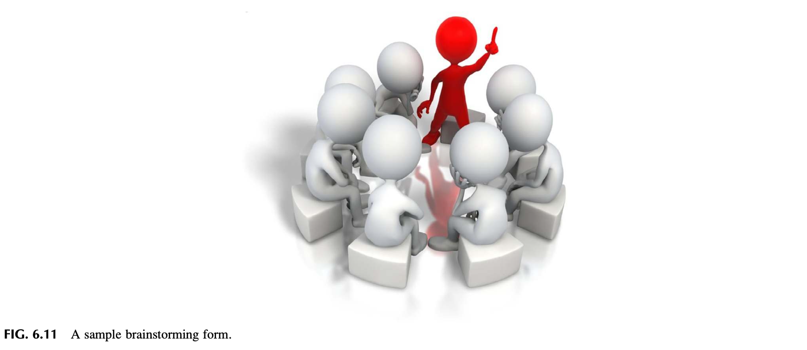
그림 6.11 브레인스토밍 양식 예시.

친화도 다이어그램(Affinity Diagram) 친화도 다이어그램은 언어적 논의를 시각적 패턴으로 체계화하는 데 도움을 준다. 친화도 다이어그램 과정은 구체적인 아이디어에서 시작하여 광범위한 범주로 나아가는 방식으로 진행된다. 친화도 다이어그램은 다음과 같은 도움을 줄 수 있다:
* 문제에 기여하는 요인 목록을 체계화한다.
* 개선이 가장 필요한 영역을 식별한다.
(U.S. Coast Guard Leadership Development Center, 2014)

친화도 다이어그램 예시 브레인스토밍 세션을 활용하여 프로젝트 내 오류 수, 문법, 구두점, 문장 구조를 줄이고 어휘 향상을 도모할 수 있다. 이는 표 6.5에 제시된 바와 같이 기준 목록을 개발함으로써 달성될 수 있으며, 이는 브레인스토밍 세션의 예시이다. 핵심은 논의 초기 단계에서 제안이나 아이디어를 제한하지 않음으로써 과정에 참여하는 모든 사람이 창의성을 발휘하도록 하는 것이다. 사람들에게 창의적으로 사고하도록 장려하라. “만약에(What if)?”라는 질문을 던지고, 원하는 대로 무엇이든 할 수 있다면 원하는 상태를 시각화하라 (U.S. Coast Guard Leadership Development Center, 2014).

<!-- Block B66 -->
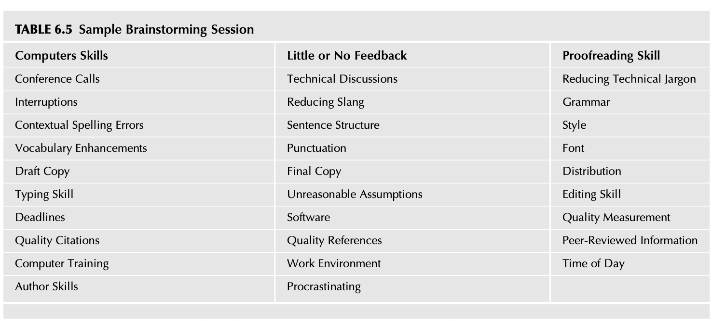
표 6.5 브레인스토밍 세션 샘플:
* 컴퓨터 기술 (Computers Skills)
* 피드백의 부재 또는 미흡 (Little or No Feedback)
* 교열 및 교정 능력 (Proofreading Skill)
* 전화 회의 (Conference Calls)
* 기술 토론 (Technical Discussions)
* 전문 기술 은어 줄이기 (Reducing Technical Jargon)
* 업무 방해 및 중단 (Interruptions)
* 속어 사용 줄이기 (Reducing Slang)
* 문법 (Grammar)
* 문맥상 맞춤법 오류 (Contextual Spelling Errors)
* 문장 구조 (Sentence Structure)
* 문체 및 스타일 (Style)
* 어휘력 향상 (Vocabulary Enhancements)
* 구두점 (Punctuation)
* 글꼴 및 폰트 (Font)
* 초안 작성 (Draft Copy)
* 최종본 (Final Copy)
* 배포 (Distribution)
* 타자 능력 (Typing Skill)
* 비합리적인 가정 (Unreasonable Assumptions)
* 편집 기술 (Editing Skill)
* 마감 기한 (Deadlines)
* 소프트웨어 품질 (Software Quality)
* 측정 품질 (Measurement Quality)
* 인용의 품질 (Citations Quality)
* 참고문헌 품질 (References Quality)
* 동료 심사 정보 (Peer-Reviewed Information)

<!-- Block B67 -->
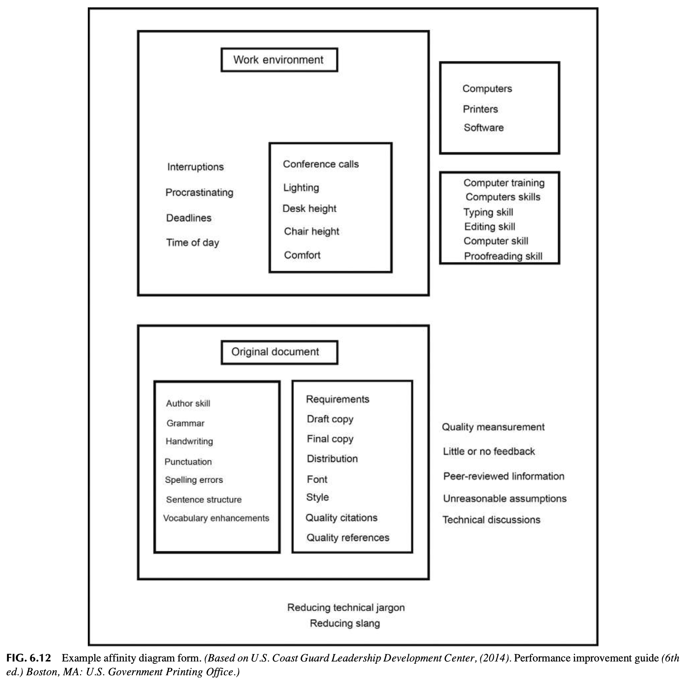
그림 6.12 친화도(어피니티 다이어그램) 서식 예시. (미국 해안경비대 리더십 개발 센터, 2014 기반)
핵심은 모든 구성원이 참여하여 개방적인 분위기를 조성하고, 집단적 합의(consensus)를 도출하기 위해 노력하며, 양질의 결정을 내리는 데 사용할 수 있는 수많은 아이디어를 도출하는 데 집중하는 것이다. 브레인스토밍 세션이 어떻게 구조화될 수 있는지 이해하려면 그림 6.12 친화도 예시를 참조하라.

**인과관계 다이어그램—어골도 (Cause-and-Effect Diagrams—Fishbone Diagram)**
인과관계 다이어그램은 주어진 결과와 그 결과에 영향을 미치는 모든 요인 사이의 관계를 그래픽으로 보여준다(미국 해안경비대 리더십 개발 센터, 2014). 이시카와(Ishikawa) 또는 "어골도(Fishbone)" 다이어그램이라고도 불리는 이 도구는 다음을 통해 부분(및 하위 부분)과 전체의 관계를 나타낸다:
* 문제의 근본 원인(root causes) 규명
* 불평이나 무관한 논쟁에 빠지지 않고 특정 핵심 문제에 집중
* 데이터가 부족한 영역의 식별 (Fishbone, 2018; 미국 해안경비대, 2014)
어골도는 "원인을 브레인스토밍하고 이를 가지별로 논리적으로 구조화하여 품질 문제를 해결하는 도구"이다(Fishbone, 2018). 예시는 그림 6.8을 참조하라.

**체크 시트 (Check Sheet)**
체크 시트는 패턴과 경향을 감지할 수 있도록 과거 자료나 현장 관찰로부터 데이터를 체계적으로 기록하고 편집할 수 있게 해주는 구조화된 양식이다(The process improvement notebook, 1997; What is a process flowchart?, 2018; Check sheets: Five basic types, 2013; 미국 해안경비대, 2014). 자동차 타이어 교체 방법에 대한 샘플 체크리스트는 부록 6.6을 참조하라.

**관리도 (Control Charts)**
관리도는 프로세스가 시간에 따라 어떻게 변화하는지를 보여주는 그래프이다. 관리도는 과거 데이터로부터 결정된 평균 중심선, 관리 상한선(UCL), 관리 하한선(LCL)을 갖는다. 현재 데이터를 이 기준선들과 비교함으로써 프로세스의 변동이 일관된 상태(관리 상태, in control)인지 아니면 예측 불가능한 상태(관리 이탈 상태, out of control)인지 결론을 내릴 수 있다(Control Charts, 2018; 미국 해안경비대, 2014). 관리도 예시는 그림 6.13을 참조하라.

**흐름도—프로세스 플로우 차트 (Flow Diagram—Process Flow Chart)**
흐름도는 현재 프로세스가 어떻게 작동하고 순차적 요소들이 어떻게 상호작용하는지 정의하는 데 도움을 준다(The process improvement notebook, 1997). 프로세스를 그래픽으로 표현하는 방법을 보여주기 위해 본서 전체에서 흐름도가 광범위하게 활용되었다. 예시는 그림 6.4를 참조하라.

**간트 차트 (Gantt Chart)**
간트 차트는 전체 프로젝트 타임라인을 묘사하고, 프로젝트 완료에 필요한 과업들을 나열하며, 과업 간의 의존성을 시각적으로 보여준다. 프로젝트 관리자는 과업 책임자(누가 완료를 책임지는가) 및 자원 요구사항과 같은 기타 핵심 정보를 포함하는 경우가 많다(Creating a Gantt Chart, 2017). 간트 차트 예시는 그림 6.14를 참조하라.

**파레토 차트 (Pareto Chart)**
파레토 차트는 막대그래프이다. 막대의 길이는 가장 긴 막대가 왼쪽에, 가장 짧은 막대가 오른쪽에 오도록 배열된다. 이 차트는 보다 중대한 상황을 시각적으로 묘사한다. 프로세스에서 문제나 원인의 빈도에 관한 데이터를 분석할 때, 또는 문제나 원인이 수없이 많아 가장 중대한 소수에 집중하고자 할 때 파레토 차트를 사용할 수 있다(Pareto chart, 2018). 예시는 그림 6.5를 참조하라.

<!-- Block B68 -->
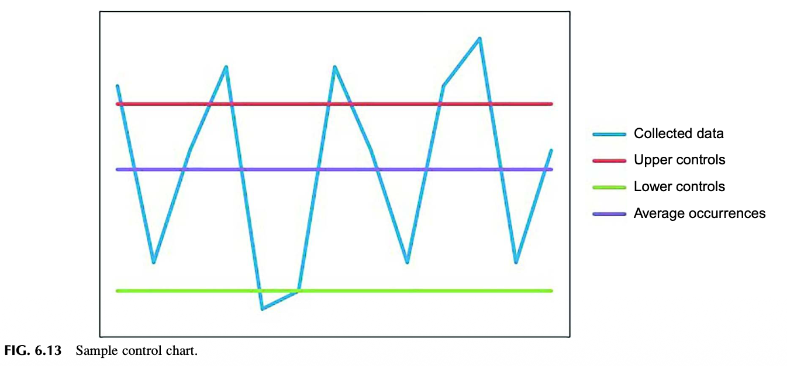
그림 6.13 표본 관리 도표.
작업 1 하위 작업 1 하위 작업 2 하위 작업 3 작업 2 하위 작업 1 하위 작업 2 하위 작업 3 하위 작업 4 간트 차트 (월간) 여기에 텍스트 삽입 주 1월 2월 3월 4월 5월 6월 7월 8월 9월 10월 11월 12월 xx 일 작업 위험 분석 x 일 활동 개발 x 일 2월 18일 직원과의 논의 x 일 2월 10일 xx 일 x 일 8월 15일 x 일 9월 1일 x 일 9월 29일 x 일 10월 13일 2018년 1월 15일 2018년 7월 8일 2015년 12월 1일 완료 예정 완료 미시작

<!-- Block B69 -->
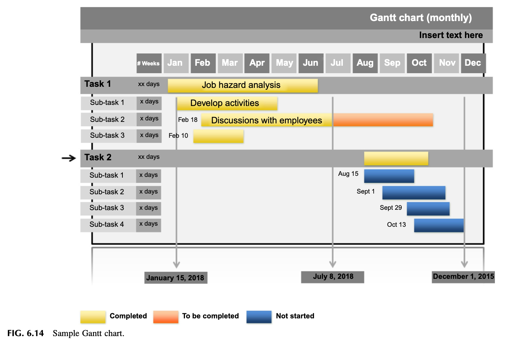
그림 6.14 샘플 간트 차트.
‘5 Why’ 기법 다섯 번의 ‘왜?’를 묻는 기법은 프로세스 내 결함의 근본 원인을 식별하고 이해하는 데 도움을 주며, 원인에 대한 잘못된 가정을 부각시키는 데 활용될 수 있는 강력한 도구이다. 반복적으로 “왜?”라고 질문함으로써 특정 문제를 야기하는 시스템의 증상들을 하나씩 벗겨내어 파악할 수 있다. 이 기법은 또한 문제의 다양한 원인들이 어떻게 서로 연관될 수 있는지를 식별하는 데에도 도움을 준다(Hafey, 2009). 다음은 몇 가지 핵심 개념이다.
* 문제를 구체적인 용어로 기술한다.
* 왜 발생하는지 질문한다.
* 답변이 근본 원인을 식별하지 못하면, 다시 왜라고 질문한다.
기억해야 할 주요 사항:
* 오직 사실에 근거하여만 작업한다—풍문은 배제한다.
* 관련된 개인의 성격보다는 문제의 프로세스/측면에 초점을 맞춘다. 희생양을 찾는 것은 문제를 해결하지 못한다!
* 연속적인 각 “왜?”에 대한 답변은 정보 수집을 필요로 할 수 있다.
(미국 해안경비대 리더십 개발 센터, 2014) 샘플 근본 원인 분석에 대해서는 제6장 “안전 프로세스 구축,” 그림 6.15를 참조하라. 가치 흐름 지도(VSM) 가치 흐름 지도 작성은 제품 또는 서비스를 전달하는 데 필요한 단계를 설명, 분석, 개선하기 위한 흐름도 기법이다(가치 흐름 지도 작성이란 무엇인가?, 2017). 가치 흐름 지도 작성은 린 방법론의 핵심 부분으로, 프로세스 단계와 정보의 흐름을 출발점에서 고객에게 전달되기까지 검토한다(가치 흐름 지도 작성이란 무엇인가?, 2017). 가치 흐름 지도는 정보 흐름 내 다양한 작업 활동을 묘사하기 위해 기호 체계를 사용한다. 프로세스 내 특정 요소들은 가치를 추가하는 것 또는 가치를 추가하지 않는 것으로 매핑되며, 그 목적은 가치를 추가하지 않는 요소들을 식별하고 제거하는 데 있다(가치 흐름 지도 작성이란 무엇인가?, 2017).

<!-- Block B70 -->
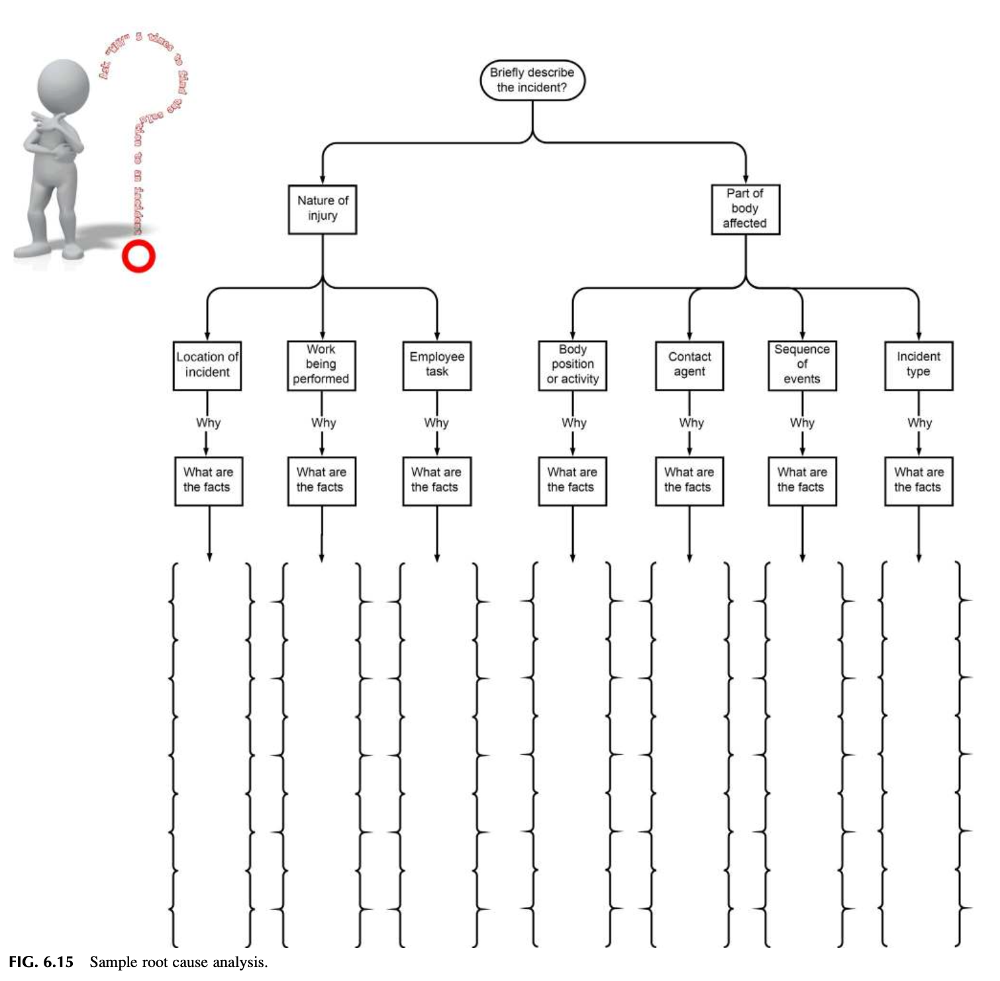
그림 6.15 근본 원인 분석(Root Cause Analysis) 샘플.
안전보건경영시스템의 지속적 개선 기회를 식별하는 가치 흐름 맵(Value Stream Map)은 그림 6.16을 참조하라.

**5S 접근법 (5S Approach)**
5S는 다음 요소에 기반하여 깨끗하고 질서 정연하며 안전한 작업 환경을 만들고 유지하기 위해 설계되고 내재화되어야 하는 문화이다:
* 정리 (Sort / Seiri): 필요한 것과 불필요한 것을 엄격히 구분하여 불필요한 것을 치운다.
* 정돈 (Set in order / Seiton): 작업 공간에 남은 필요한 물품을 쓰기 편하게 제자리에 배치한다.
* 청소 (Shine / Seiso): 작업 공간과 장비를 항상 깨끗하게 유지한다.
* 표준화 (Standardize / Seiketsu): 앞의 3S(정리·정돈·청소) 상태를 유지하고 표준화한다.
* 습관화 (Sustain / Shitsuke): 정해진 수칙을 올바르게 지키는 습관을 체질화한다.

<!-- Block B71 -->
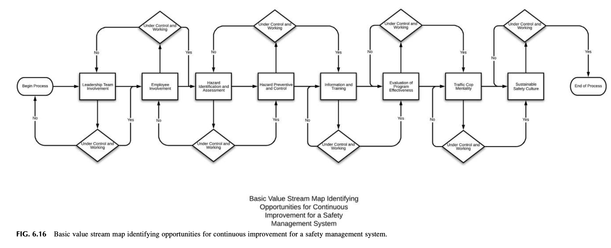
그림 6.16 안전 관리 시스템의 지속적 개선 기회를 식별하는 기본 가치 흐름 지도.
5S는 어떠한 프로세스의 성공적 구현에 필수적인 지속적 개선 및 직원 참여 문화를 조성한다(The lean and environment toolkit, 2007). 일부 조직은 5S 개념에 여섯 번째 구성 요소인 '안전(Safety)'을 추가하였다(The lean and environment toolkit, 2007). 격차 분석(Gap Analysis) 격차 분석은 조직이 현재 상태와 달성하고자 하는 목표 상태 간의 격차를 식별할 수 있게 하는 기법이다(Gap analysis, reaching your ideal future state, n.d.; Werde, 2015). 격차 분석은 다음으로 구성된다.
* 현재 상황('현재 상태')의 특성 요인(속성, 역량, 성과 수준 등) 목록화
* 미래 목표 달성에 필요한 요인('목표 상태') 목록화
* 존재하며 시정되어야 할 격차 강조(Gap analysis, 2018).
6장 '안전 프로세스 창출(Creating the Safety Process)'의 그림 6.12 부상 관리 및 통제 샘플 프로세스, 그리고 그림 6.13 연부 조직 손상 주장 보고서 샘플 개요를 참조하라. 히스토그램(Histogram) 히스토그램은 연속 구간 또는 특정 기간에 걸친 데이터 분포를 시각화할 수 있게 한다. 히스토그램은 값이 어디에 집중되는지, 극단값이 무엇인지, 그리고 어떠한 격차가 있는지에 대한 추정치를 제공하는 데 도움을 준다(U.S. Coast Guard Leadership Development Center, 2014). 히스토그램 예시는 그림 6.17을 참조하라.

<!-- Block B72 -->
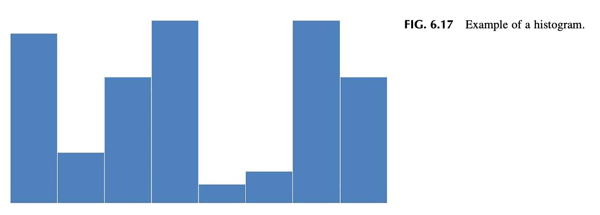
그림 6.17 히스토그램(Histogram) 예시.

**마인드 맵 (Mind Map)**
마인드 맵은 정보를 시각화하고 개략적으로 정리하는 데 사용되는 다이어그램으로, 보통 중앙에 단일 단어나 텍스트를 배치하고 그 주변에 연관된 아이디어, 단어 및 개념을 방사형으로 추가하여 작성된다(Earl, 2016; Mind map, 2017). 본 도서를 구조화하는 데 사용된 마인드 맵 샘플은 그림 6.18을 참조하라. 마인드 맵은 제3장 "네트워크 분석 및 활용"에서 설명한 네트워크 맵(Network Map)과도 유사하다.

**칸반 (Kanban)**
칸반은 워크플로우를 시각화하고 진행 중인 작업(WIP, Work In Progress)을 제한하여 효율성을 극대화하기 위해 시각적 카드나 신호판을 사용하는 기법이다. 안전 관리에서도 시정 조치 과업의 진행 상태나 위험 통제 조치의 이행 현황을 칸반 보드를 통해 실시간으로 추적·관리할 수 있다.

<!-- Block B73 -->
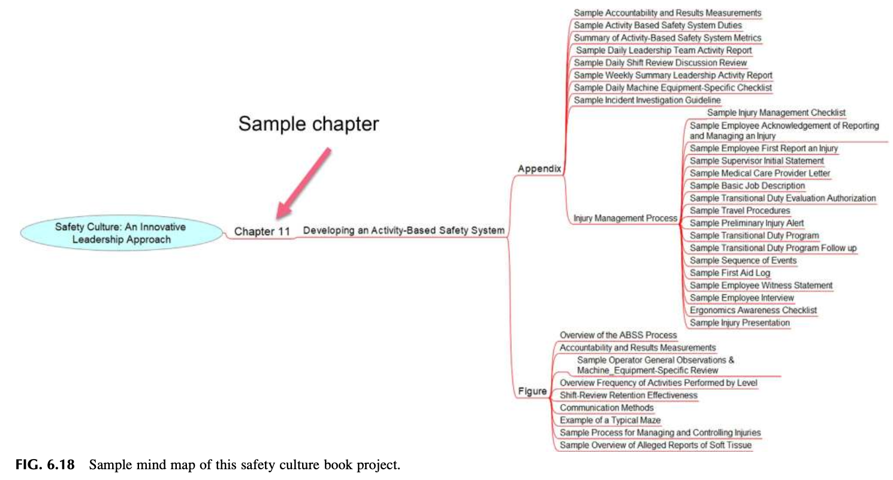
그림 6.18 본 안전문화 도서 프로젝트의 마인드 맵 샘플.
"전략을 수립하기 위해 조직의 내부적 강점(Strengths)과 약점(Weaknesses), 그리고 외부적 기회(Opportunities)와 위협(Threats)을 면밀히 검토하는 상황 분석 기법"(SWOT analysis, 2018). SWOT 분석은 강점이 기회와 정렬되고 일치하도록 보장한다. 그 핵심 아이디어는 강점을 활용하여 기회를 포착하고, 위협과 맞닿아 있는 약점을 파악하며, 약점을 보완하여 위협을 줄이는 목표를 수립하는 것이다(미국 해안경비대 프로세스 개선 가이드, 1994). SWOT 분석 샘플은 그림 6.19를 참조하라.

<!-- Block B74 -->
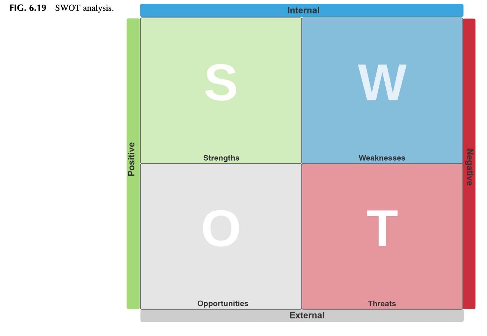
그림 6.19 SWOT 분석 매트릭스 (강점, 약점, 기회, 위협).

<!-- Block B75 -->
## 부록 6.2 몬태나주 안전문화법 (STATE OF MONTANA SAFETY CULTURE ACT)

<!-- Block B76 -->
본 부록은 라이브러리에 다운로드하여 활용할 수 있도록 몬태나주 안전문화법의 개요를 다룬 공개 자료(public domain document)를 제공한다.
"1993년 몬태나주 의회에서 제정된 안전문화법(Safety Culture Act)은 근로자와 고용주가 함께 협력하여 사업장 안전 철학을 창출하고 실행하도록 장려한다. 이 법의 취지는 모든 몬태나주 근로자와 고용주의 가슴속에 사업장 안전을 최우선적 위치(preeminent position)로 격상시키는 데 있다."
법률에는 "...모든 고용주가 반드시 준수해야 하는 6가지 요건과, 5인 이상의 근로자를 고용한 사업주가 몬태나주 안전문화법(MSCA)을 준수하기 위해 추가로 충족해야 하는 3가지 요건이 명시되어 있다... 노동산업부는 MSCA의 이행을 위한 가이드라인을 제공하였다"(Safety Culture Act, 2015).

<!-- Block B77 -->
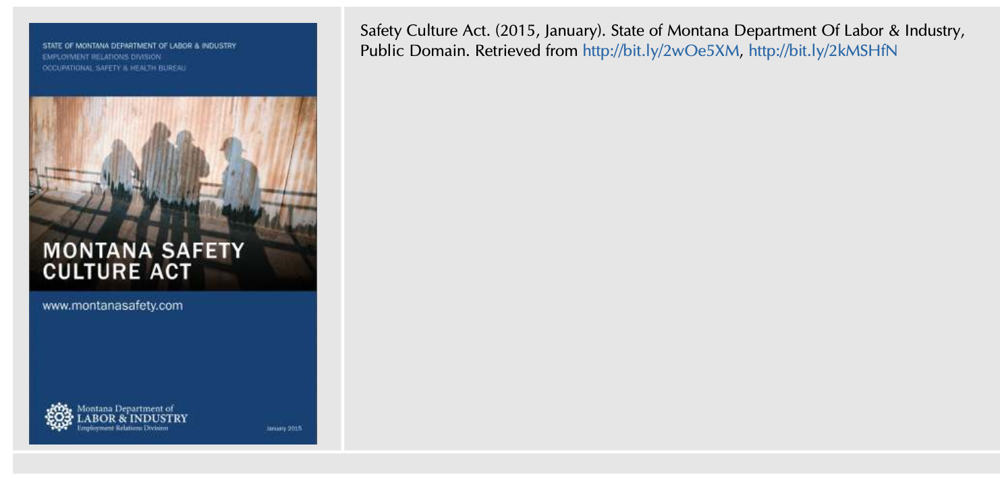
몬태나주 노동산업부 안전문화법 안내서 (2015년 1월 개정, 퍼블릭 도메인 자료). 출처: http://bit.ly/2wOe5XM, http://bit.ly/2kMSHfN

<!-- Block B78 -->
## 부록 6.3 요약 비교: 정부 및 공공 안전보건경영시스템 프로세스 요소 비교 (A BRIEF SUMMARY: COMPARISON OF GOVERNMENTAL-RELATED SAFETY MANAGEMENT SYSTEMS PROCESS ELEMENTS)

<!-- Block B79 -->
다양한 법규와 규정의 핵심 요약을 제공하기 위해 모든 노력을 기울였다. 모든 규정은 개정될 수 있다. 제시된 정보는 현재 표준에 근거한다(표 6.6 ~ 표 6.9 참조).

<!-- Block B80 -->
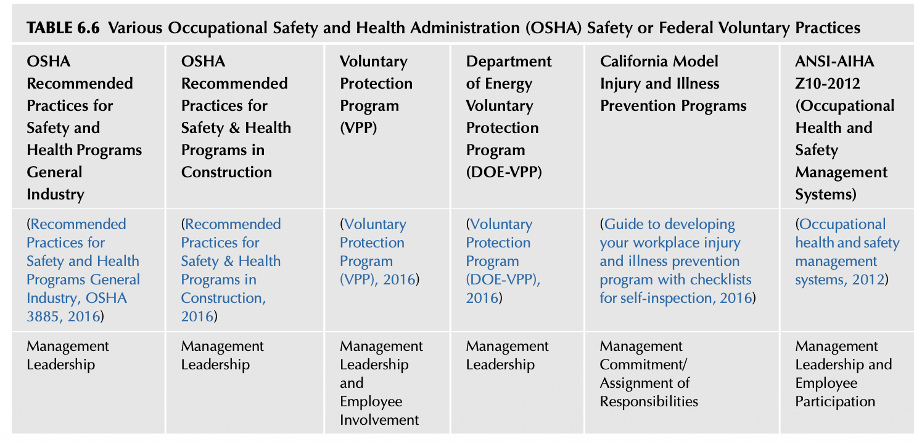
표 6.6 다양한 미국 산업안전보건청(OSHA) 및 연방정부 자율 안전 관행 비교 (1):

| 프로세스 요소 | OSHA 일반산업 권장관행 (2016) | OSHA 건설업 권장관행 (2016) | OSHA 자율안전보건프로그램 (VPP, 2016) | 에너지부 자율안전보건 (DOE-VPP, 2016) | 캘리포니아 IIPP 모델 프로그램 (2016) | ANSI-AIHA Z10-2012 표준 |
| :--- | :--- | :--- | :--- | :--- | :--- | :--- |
| **리더십 및 참여** | 경영 리더십 (Management Leadership) | 경영 리더십 (Management Leadership) | 경영 리더십 및 근로자 참여 | 경영 리더십 (Management Leadership) | 경영진 헌신 / 책임 할당 | 경영 리더십 및 근로자 참여 |
| **근로자 역할** | 근로자 참여 (Worker Participation) | 근로자 참여 (Worker Participation) | 근로자 참여 (Employee Involvement) | 근로자 참여 (Employee Involvement) | 안전 의사소통 (Safety Communications) | 기획 (Planning) |
| **위험성 파악** | 유해·위험요인 파악 및 평가 | 유해·위험요인 파악 및 평가 | 사업장 분석 (Worksite Analysis) | 사업장 분석 (Worksite Analysis) | 위험 평가 및 통제 | 실행 및 운영 (Implementation & Operation) |
(다음 표로 이어짐)

<!-- Block B81 -->
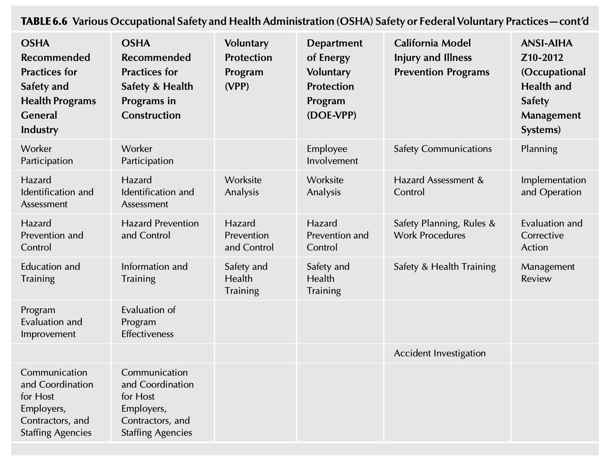
표 6.6 다양한 미국 산업안전보건청(OSHA) 및 연방정부 자율 안전 관행 비교 (2 - 계속):

| 프로세스 요소 | OSHA 일반산업 권장관행 | OSHA 건설업 권장관행 | OSHA VPP | DOE-VPP | 캘리포니아 IIPP | ANSI-AIHA Z10-2012 |
| :--- | :--- | :--- | :--- | :--- | :--- | :--- |
| **위험 통제** | 유해·위험요인 예방 및 통제 | 유해·위험요인 예방 및 통제 | 유해·위험요인 예방 및 통제 | 유해·위험요인 예방 및 통제 | 안전 기획, 규칙 및 작업 절차 | 평가 및 시정 조치 (Evaluation & Corrective Action) |
| **교육 훈련** | 교육 및 훈련 (Education & Training) | 정보 및 훈련 (Information & Training) | 안전보건 훈련 (Safety & Health Training) | 안전보건 훈련 (Safety & Health Training) | 안전보건 훈련 (Safety & Health Training) | 경영진 검토 (Management Review) |
| **평가 및 개선** | 프로그램 평가 및 개선 | 프로그램 효과성 평가 | 사고 조사 (Accident Investigation) | 사고 조사 (Accident Investigation) | 정기 점검 및 시정 조치 | 지속적 개선 프로세스 |
| **협력업체 관리** | 원청 고용주, 도급업체 및 파견업체 간 의사소통과 조정 | 원청 고용주, 도급업체 및 파견업체 간 의사소통과 조정 | 도급업체 안전 관리 | 도급업체 안전 관리 | 도급업체 안전 지침 | 조달 및 도급업체 요구사항 |

<!-- Block B82 -->
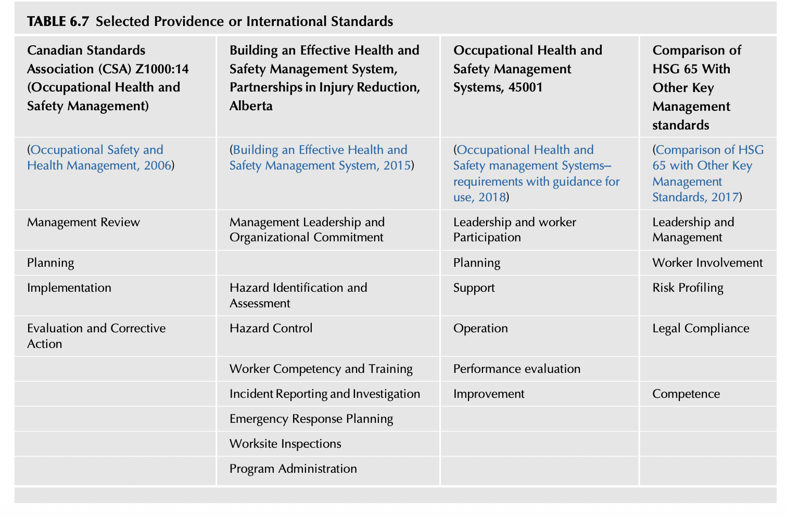
표 6.7 주요 주정부 및 국제 안전보건 표준 비교:

| 캐나다 CSA Z1000:14 | 앨버타주 효과적 안전보건시스템 구축 | ISO 45001:2018 | 영국 HSG 65 비교 |
| :--- | :--- | :--- | :--- |
| **경영진 검토 (Management Review)** | 경영 리더십 및 조직적 헌신 | 리더십 및 근로자 참여 | 리더십 및 관리 (Leadership & Management) |
| **기획 (Planning)** | 기획 (Planning) | 근로자 참여 (Worker Involvement) | 기획 (Planning) |
| **실행 (Implementation)** | 유해·위험요인 파악 및 평가 | 지원 (Support) | 위험 프로파일링 (Risk Profiling) |
| **평가 및 시정조치** | 유해·위험요인 통제 (Hazard Control) | 운용 (Operation) | 법적 준수 (Legal Compliance) |
| **근로자 역량 및 훈련** | 성과 평가 (Performance Evaluation) | 성과 평가 (Performance Evaluation) | 사건 보고 및 조사 |
| **비상사태 대응 기획** | 개선 (Improvement) | 개선 (Improvement) | 역량 (Competence) |
| **사업장 점검 및 관리** | 사업장 점검 및 프로그램 관리 | 지속적 개선 | 점검 및 감사 |

<!-- Block B83 -->
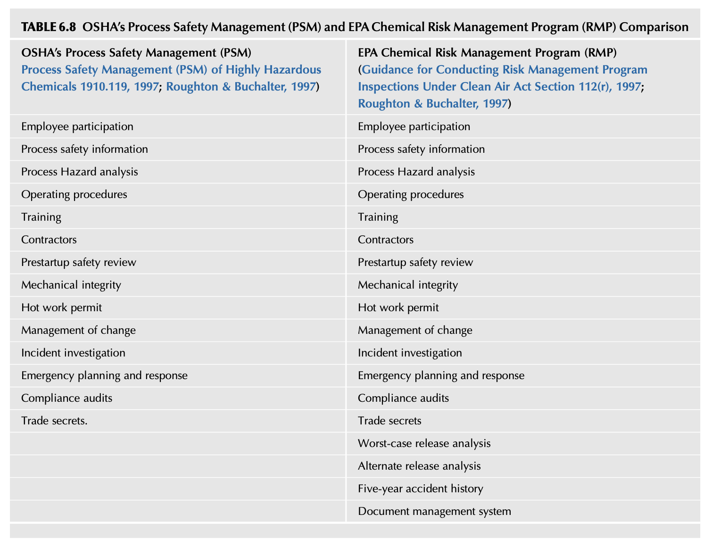
표 6.8 미국 OSHA 공정안전관리(PSM) 및 EPA 화학물질 위험관리계획(RMP) 비교:

| OSHA 공정안전관리(PSM, 29 CFR 1910.119) | EPA 화학물질 위험관리프로그램(RMP, CAA 112(r)) |
| :--- | :--- |
| 1. 근로자 참여 (Employee participation) | 1. 근로자 참여 (Employee participation) |
| 2. 공정안전자료 (Process safety information) | 2. 공정안전자료 (Process safety information) |
| 3. 공정위험성평가 (Process hazard analysis) | 3. 공정위험성평가 (Process hazard analysis) |
| 4. 운전절차 (Operating procedures) | 4. 운전절차 (Operating procedures) |
| 5. 교육훈련 (Training) | 5. 교육훈련 (Training) |
| 6. 도급업체 관리 (Contractors) | 6. 도급업체 관리 (Contractors) |
| 7. 가동 전 안전검토 (Prestartup safety review) | 7. 가동 전 안전검토 (Prestartup safety review) |
| 8. 기계적 건전성 확보 (Mechanical integrity) | 8. 기계적 건전성 확보 (Mechanical integrity) |
| 9. 화기작업 허가 (Hot work permit) | 9. 화기작업 허가 (Hot work permit) |
| 10. 변경관리 (Management of change) | 10. 변경관리 (Management of change) |
| 11. 사고조사 (Incident investigation) | 11. 사고조사 (Incident investigation) |
| 12. 비상기획 및 대응 (Emergency planning & response) | 12. 비상기획 및 대응 (Emergency planning & response) |
| 13. 자체감사 (Compliance audits) | 13. 자체감사 (Compliance audits) |
| 14. 영업비밀 (Trade secrets) | 14. 영업비밀 (Trade secrets) |
| - | 15. 최악의 누출 시나리오 분석 (Worst-case release analysis) |
| - | 16. 대안 누출 시나리오 분석 (Alternate release analysis) |
| - | 17. 5개년 사고 이력 (Five-year accident history) |
| - | 18. 문서관리 시스템 (Document management system) |

<!-- Block B84 -->
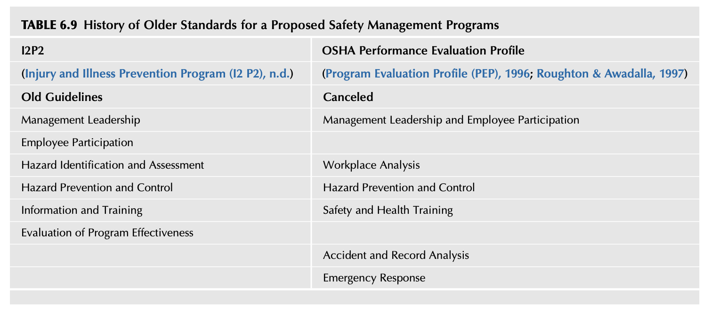
표 6.9 과거 제안되었던 안전경영 프로그램 표준의 역사:

| OSHA I2P2 제안안 (부상 및 질병 예방 프로그램) | OSHA 성과 평가 프로파일 (PEP, 1996) | 구 지침 현황 |
| :--- | :--- | :--- |
| **경영 리더십** | 경영 리더십 및 근로자 참여 | 구 지침 철회됨 |
| **근로자 참여** | 사업장 분석 (Workplace Analysis) | - |
| **유해·위험요인 파악 및 평가** | 유해·위험요인 예방 및 통제 | - |
| **유해·위험요인 예방 및 통제** | 안전보건 교육훈련 | - |
| **정보 및 교육훈련** | 사고 및 기록 분석 (Accident and Record Analysis) | - |
| **프로그램 효과성 평가** | 비상 대응 (Emergency Response) | - |

<!-- Block B85 -->
## 부록 6.4 안전보건 프로그램 권장관행 지침 문서 (RECOMMENDED PRACTICES FOR SAFETY AND HEALTH PROGRAMS GUIDANCE DOCUMENTS)

<!-- Block B86 -->
부록 6.4는 일반산업과 건설업을 위해 미국 OSHA의 "안전보건 프로그램을 위한 권장 관행(Recommended Practices for Safety and Health Programs)"에서 제공하는 두 가지 권장 관행을 수록하고 있다. 이 권장 관행은 안전보건 프로그램을 구축하기 위한 직관적이고 단계적인(step-by-step) 접근법을 제공한다. 이 접근법은 7가지 핵심 요소를 중심으로 구성되어 있으며, 각 요소는 여러 실행 항목을 완료함으로써 이행된다. 이 관련 공개 자료들은 라이브러리에 다운로드하여 활용할 수 있다.

<!-- Block B87 -->
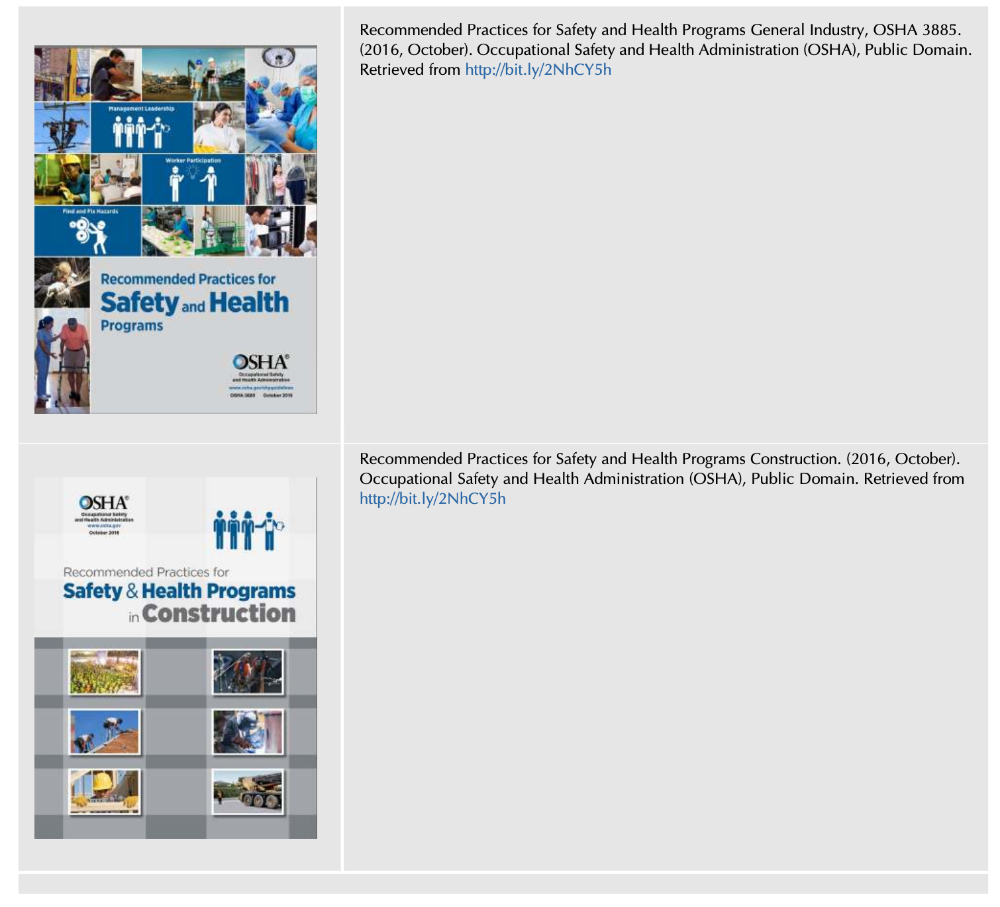
OSHA 안전보건 프로그램 가이드 문서 모음집.

<!-- Block B88 -->
## 부록 6.5 샘플 실행 계획 양식 (SAMPLE ACTION PLANNING FORM)

<!-- Block B89 -->
**목적 (Purpose):** 개선 노력 및 실행과 관련하여 달성하고자 하는 바를 짧게 정의하여 작성하라.
**문제 기술서 (Problem Statement):** 구체적인 문제 상황을 기술하라.
**성공의 증거 (What will be evidence of Success):** 진전이 이루어지고 있음을 어떻게 알 수 있는가? 당신의 벤치마크는 무엇인가?
**평가 프로세스 (Evaluation Process):** 목표가 달성되었음을 어떻게 판단할 것인가? 당신의 측정 척도는 무엇인가?

| 목표 결과/성과 (Goal Results/Accomplishments) | 조치 단계: 무엇을 할 것인가? (Action Steps: What Will Be Done?) | 책임자: 누가 할 것인가? (Responsibilities: Who Will Do It?) | 일정: 언제까지 할 것인가? (Time line: By When? Day/Month) | 잠재적 장애물 (Potential Barriers) | 의사소통 계획 (누가 참여하고, 어떤 방법으로, 얼마나 자주?) |
| :--- | :--- | :--- | :--- | :--- | :--- |
| 목표 1 | 조치 단계 1 | 담당자 A | 2026.XX.XX | 자원 제약 | 주간 진척 회의 / ONA 게시 |
| 목표 2 | 조치 단계 2 | 담당자 B | 2026.XX.XX | 부서 간 소통 부족 | 월간 안전보건위원회 보고 |

<!-- Block B90 -->
* **1단계, 2단계, 3단계, 4단계 추진 지침:**
 * 요구도 평가(needs assessment)를 통해 도출된 각 목표별 작업 계획을 수립하라.
 * 조직의 고유한 상황에 맞게 서식을 수정하여 활용하라.
 * 각 작업 계획서의 사본을 팀원들에게 배포하라.
 * 정기적으로 검토하고 갱신하기 위해 실행 계획서를 회의에 지참하라. 혁신 노력의 새로운 단계마다 새로운 작업 계획을 개발할 수 있다.

<!-- Block B91 -->
## 부록 6.6 샘플 체크리스트: 자동차 타이어 교체 방법 (SAMPLE CHECKLIST ON HOW TO CHANGE A TIRE ON A CAR)

<!-- Block B92 -->
자동차 타이어 교체 방법에 관한 샘플 체크리스트 (Job safety analysis, OSH answers fact sheets; Roughton & Crutchfield, 2016 인용):

| 단계 (Step) | 과업 내용 (Task) | 완료 여부 (Completed) |
| :---: | :--- | :---: |
| **1** | 교통 흐름에서 벗어나 차량을 도로변 안전한 곳에 정차시킨다. | [ ] |
| **2** | 평탄한 지면에 주차한다. | [ ] |
| **3** | 주차 브레이크를 확실히 체결하고 기어를 주차(P) 위치에 놓는다. | [ ] |
| **4** | 시동을 끄고 차량 키를 탈거한다. | [ ] |
| **5** | 비상경고등(비상등)을 점등한다. | [ ] |
| **6** | 주변 통행 차량을 확인한 후 안전하게 차에서 내린다. | [ ] |
| **7** | 뒷바퀴 교체 시 앞바퀴에, 앞바퀴 교체 시 뒷바퀴에 고임목을 받친다(차량 구름 방지). | [ ] |
| **8** | 차량 전후방 5대 차량 거리 위치에 안전 삼각대 또는 반사경을 설치한다. | [ ] |
| **9** | 트렁크를 열고 스페어 타이어를 꺼낼 준비를 한다. | [ ] |
| **10** | 스페어 타이어를 꺼낸다. | [ ] |
| **11** | 잭, 휠 너트 렌치 등 필요한 공구를 트렁크에서 꺼낸다. | [ ] |
| **12** | 휠 커버(있는 경우)를 탈거한다. | [ ] |
| **13** | 차량 하부 잭 포인트에 잭을 배치한다(차량 매뉴얼 위치 확인). | [ ] |
| **14** | 타이어가 아직 지면에 닿아 있는 상태까지 잭을 살짝 들어올린다. | [ ] |
| **15** | 휠 너트 렌치를 사용하여 휠 너트를 살짝 풀어둔다(완전히 풀지 않음). | [ ] |
| **16** | 타이어가 지면에서 완전히 떨어질 때까지 잭을 올린다. | [ ] |
| **17** | 볼트에서 휠 너트를 완전히 풀어 분리한다. | [ ] |
| **18** | 펑크 난 타이어를 차량에서 탈거한다. | [ ] |
| **20** | 스페어 타이어를 장착한다. | [ ] |
| **21** | 휠 너트를 손으로 먼저 체결한 후 렌치로 가볍게 조인다. | [ ] |
| **22** | 타이어가 지면에 닿을 때까지 잭을 내린 후, 모든 휠 너트를 대각선 방향으로 단단히 조인다. | [ ] |
| **23** | 모든 공구와 펑크 난 타이어를 정리하여 트렁크에 싣는다. | [ ] |
| **24** | 가능한 한 신속하게 펑크 난 원래 타이어를 수리하여 재장착한다. | [ ] |

<!-- Block B93 -->
## 참고문헌 (BIBLIOGRAPHY)

<!-- Block B94 -->
5S Implementation. (2017). 5S implementation, 2017, Toyota Production System (TPS). Retrieved from http://bit.ly/2nAs9Ak. Agarwal, A. (2015). How to get things done with trello. Digital Inspiration. Retrieved from http://bit.ly/2Duk6ea. Alberta Workers’ Compensation Board. (n.d.). Government of Alberta. Retrieved from http://bit.ly/2AnDusU. All About VPP. (n.d.). Occupational Safety & Health Administration, (OSHA). Public Domain. Retrieved from http://bit.ly/2CaYGBW. Analysis Paralysis. (2018). Urban Dictionary. Retrieved from http://bit.ly/2BSFjwR. Baker, J. (2018). The 80/20 rule and how it can transform your church. Sacred Structures. Retrieved from http://bit.ly/2DxMax5. Building an Effective Health and Safety Management System. (2015). Partnerships in Health and Safety Program, Partnerships in Injury Reduction (partnerships). Public Domain. Retrieved from http://bit.ly/WsHteC. Canada’s First Consensus-Based Occupational Health and Safety Management Standard. (n.d.). Canadian Centre for Occupational Health & Safety (CCOHS), Based on Information as Presented and Adapted for Use. Check Sheets: Five Basic Types. (2013). Six Sigma Daily. Retrieved from http://bit.ly/2BSyEmf. Comparison of HSG 65 with Other Key Management Standards. (2017). Health and Safety Executive. Retrieved from http://bit.ly/13fgmoX. Control Charts. (2018). Clare-Gladwin RESD, Michigan Algebra II KHauck. Retrieved from http://bit.ly/2FPO5y1. Creating a Gantt Chart. (2017). Microsoft, OfficeToolTips Team. Retrieved from http://bit.ly/2IqtbGA. Dababneh, A. J. (2007). Effective Occupational Safety and Health Management System: Integration of OHSAS 18001, ILO-OSH 2001, and OR-OSHA. Definition, PDCA (Plan-Do-Check-Act). (2018). TechTarget, Whatls.com. Retrieved from http://bit.ly/2DB8uFQ. Deming, W. E. (1986). Out of the crisis (p. 510). Cambridge, MA: Massachusetts Institute of Technology. Center for Advanced Engineering Study. Deming, W. E. (2018). Plan-Do-Check-Act. Wikipedia, the Free Encyclopedia. Retrieved from http://bit.ly/14FZb1H. Earl, P. G. (2016). What is the Difference Between a Mind map and a Flow Chart? Socratic. Retrieved from http://bit.ly/2CF3b9k. Evans, M. (2018). Marketing Strategy in Eight Steps, Creating a Roadmap for Success. Retrieved from http://bit.ly/2GTr5OO. Evergreen, Retaining Its Relevance, Popularity, Usefulness, etc.; Enduring. (2018). Dictionary.com. Retrieved from http://bit.ly/2Mbzlxo. Fishbone. (2018). iSixSigma. Retrieved from http://bit.ly/14v46Gn. Frederick Taylor and Scientific Management, Understanding Taylorism and Early Management Theory. (2017). MindTools. Retrieved from http://bit.ly/ 2igx9r0. Frederick Winslow Taylor, S. D. M. E. (1919). The Principes of scientific management. Haper and Brothers Publishers. Retrieved from http://bit.ly/ 2hsSBIE. Gap analysis. (2018). Business Dictionary. Retrieved from http://bit.ly/2nBdQuJ. Gap analysis, Reaching Your Ideal Future State. (n.d.). MindTools. General Information of the DOE VPP Program. (n.d.). Office of Environment, Health, Safety & Security, U.S. Department of Energy. Retrieved from http://bit.ly/2Co44m0. George, M. L., & George, M. (2003). Lean six sigma for service. New York, NY: McGraw-Hill. Glossary terms. (2010). North Carolina State University. Retrieved from http://bit.ly/XevTjx. Grover, J. (2012). 5S Workplaces: When Safety and Lean Meet. EHS Today. Retrieved from http://bit.ly/2BROT3h. Guidance for Conducting Risk Management Program Inspections Under Clean Air Act Section 112(r). (1997). United States Environmental Protection Agency. Retrieved from http://bit.ly/2GmbHhL. Guide to developing your workplace injury and illness prevention program with checklists for self-inspection. (2016). State of California, Department of and Industrial Relations. Public Domain. Retrieved from http://bit.ly/Xewi5m. Guidelines on Occupational Safety and Health Management Systems. (2001). (2nd ed.). International Labour Organization (ILO). Retrieved from http://bit.ly/2fmSqkU. Guidelines on Occupational Safety and Health Management Systems, ILO-OSH 2001, First published 2001, 2nd ed. 2009. (n.d.). International Labour Organization (ILO). Retrieved from http://bit.ly/2xDm6R8. Hafey, R. (2009). Lean safety: Transforming your safety culture with lean management. CRC Press. Retrieved from https://amzn.to/2KljCL9. Hart, R. (2016). Why 5S is the Key to a Successful CI Initiative. TRACC. Retrieved from http://bit.ly/2FPBgUy. Heinrich, H. (1931). 1959. Industrial accident prevention: A scientific approach. New York: McGraw Hill. Human performance improvement handbook: Vol. 1. 2009, Energy.gov, Office of Environment, Health, Safety, and Security. Retrieved from http://bit.ly/ 2j5OXWm. Human performance tools for individuals, work teams, and management, human performance improvement handbook. (Vol. 2). (2009). U.S. Department of Energy Public Domain. Hurley, B. (2017). Lean six sigma for good. Lean Publishing. Retrieved from http://bit.ly/2FQt1HF. ILO-OSH, overview and history, module 2, lesson 1. (2001). North Carolina Safety University. Retrieved from http://bit.ly/XOTbMM. Injury and Illness Prevention Program (I2 P2). (n.d.). Occupational Safety and Health Administration (OSHA), Public Domain, based on information as presented and adapted for use. Retrieved from http://1.usa.gov/lIszWK. ISO 45001 as a competitive advantage. (2018). Sospes LLC. Retrieved from http://bit.ly/2qEz6SB. Job safety analysis. (2018). Oregon Occupational Safety and Health (Oregon OSHA). is a division of the department of consumer & business services. Retrieved from http://bit.ly/2I3VXN0. Job safety analysis, OSH answers fact sheets, Reprinted with Permission. (n.d.). Canadian Centre for Occupational Health & Safety (CCOHS), based on information as presented and adapted for use. Retrieved from http://bit.ly/2nALGAP. Johnson, J. (2018). What is tribal knowledge and how do you capture it?. Tallyfy. Retrieved from http://bit.ly/2nVkhbY. Kaizen Event. (2018). iSixSigma. Retrieved from http://bit.ly/2BRlZjF. Kaizen for the shopfloor. (2002). Productivity Press. productivity press development team. Retrieved from http://amzn.to/2nomgGt. Lacey, J., & Jones, R. (2017). ISO 45001 and the evolution of occupational health and safety management systems. IOSH. Managing for health and safety (HSG65). (2013). Health and Safety Executive, Crown Publishing. Permission to reprint, based on information as presented and adapted for use. Retrieved from http://bit.ly/YKDzRk. Manuele, F. A. (2011). Heinrich dislodging two myths from the practice of safety. Professional Safety. Mark Twain (2018). Retrieved from http://bit.ly/2DBBoWB. Mateski, M. (2016). A belated review of stanley Mcchrystal’s team of teams. Red Team Journal. Retrieved from http://bit.ly/2hnSEcn. McChrystal, G. S., Fussell, C., Collins, T., & Silverman, D. (2015). Team of teams: New rules of engagement for a complex world. Penguin Publishing Group. Retrieved from http://amzn.to/2huRcRL. Microlearning: Training for the millennial generation. (2018). Industry Safe Safety Software. Retrieved from http://bit.ly/2tx9hHZ. Mind map. (2017). Business Dictionary. Retrieved from http://bit.ly/2IiT5w1. New International Standard for Occupational Health and Safety Management Systems. (2017). The British Standards Institution. Retrieved from http://bit. ly/2BpuPJ5. New Standard to Improve Safety in the Nuclear Sector. (2018). International Organization for Standardization. Retrieved from http://bit.ly/2KjA52m http://bit.ly/2Io27rG. Occupational Health & Safety Management Systems. (2012). The American Society of Safety Engineers. ANSI/AIHA/ASSE Z10. Retrieved from http:// bit.ly/1MsT6MG. Occupational Health and Safety Management Systems Requirements with guidance for use. (2018). International Organization for Standardization. Retrieved from http://bit.ly/2GovPjm. Occupational Health and Safety Management Standard (OHSAS 18001). (2007). Praxiom Research Group Limited. Translated into plain english. Occupational Health and Safety Systems. (2012). The American Industrial Hygiene Association ANSI/AIHA Z10. Occupational Safety and Health Management. (2006). Canadian Standards Association. CSA standard, Z 1000-06, based on information as presented and adapted for use. Pareto chart. (2018). American Society for Quality. Retrieved from http://bit.ly/2nIKLAD. Plan-Do-Study-Act (PDSA) Worksheet. (n.d.). Institute for Healthcare Improvement. Retrieved from http://bit.ly/2Dz5F8m Process Safety Management (PSM) of Highly Hazardous Chemicals 1910.119. (1997). Occupational Safety and Health Administration. Retrieved from http://bit.ly/2GpZRTG. Program Evaluation Profile (PEP). (1996). Occupational Safety and Health Administration (OSHA). public domain, based on information as presented and adapted for use. Retrieved from http://bit.ly/2xzfTpA. Rastogi, A. (2018). A brief introduction to lean, six sigma and lean six sigma. GreyCampus. Retrieved from http://bit.ly/2BQUSoR. Recommended Practices for Safety & Health Programs in Construction. (2016). Occupational Safety and Health Administration (OSHA). Public Domain. Retrieved from http://bit.ly/2ke6ZZM. Recommended Practices for Safety and Health Programs General Industry, OSHA 3885. (2016). Occupational Safety and Health Administration (OSHA). Public Domain. Retrieved from http://bit.ly/2NhCY5h. Recommended Practices for Safety and Health Programs General Industry and Construction. (2017). Occupational Safety and Health Administration (OSHA). Public Domain, based on informaton as presented and adapted for use. Retrieved from http://bit.ly/2y3lm4V. Roughton, J., & Crutchfield, N. (2016). Job hazard analysis: a guide for voluntary compliance and beyond. In Elsevier/Butterworth-Heinemann (Ed.), Chemical, petrochemical & process. (2nd ed.). Massachusetts: Elsevier/Butterworth-Heinemann Retrieved from http://amzn.to/VrSAq5. Roughton, J. E., & Awadalla, C. A. (1997). Program evaluation profile: OSHA’s new inspection strategy. Professional Safety, 42(7), 12. Roughton, J. E., & Buchalter, D. S. (1997). OSHA’s process safety management standard vs. EPA’s risk management plan: a comparison of requirements. Professional Safety, 42(1), 36. Safety Culture Act. (2015). State of Montana Department of Labor & Industry. Public Domain. Retrieved from http://1.usa.gov/ohJMKR. Seidman, D., & Clinton, B. (2011). How: Why how we do anything means everything. Wiley. Shewhart, W. A. (1980). Economic control of quality of manufactured product. Republished by Cleslesa, Michigan: BookCrafters, Inc. Sinek, S. (2009). Start with why: How great leaders inspire everyone to take action. Portfolio. Retrieved from http://bit.ly/2ugVro5. Six Sigma DMAIC Process Define Phase Capturing Voice of Customer (VOC). (2017). International Six Sigma Institutetm. Retrieved from http://bit.ly/ 2B52asA. Starak, Y. (2018). What is the 80/20 rule and why it will change your life?. Entrepreneurs Journey. Retrieved from http://bit.ly/2wmM8oS. SWOT analysis. (2018). BusinessDictionary.com. Retrieved from http://bit.ly/2kvYypQ. The environmental professional’s guide to lean & six sigma. (2009). United States Environmental Protection Agency (EPA). EPA-100-K-09-006. Public Domain. Retrieved from http://bit.ly/2npJ4pn. The lean and environment toolkit. (2007). United States Environmental Protection Agency (EPA). EPA-100-K-06-003. Public Domain. Retrieved from http://bit.ly/2npJ4pn. The process improvement notebook. (1997). Department of the Navy, Total quality leadership office. TQLO publication No. 97-01, Public Domain. Retrieved from http://1.usa.gov/Y7U2ZX. Tribal knowledge. (2018). iSixSigma. Retrieved from http://bit.ly/1JXFKTI. U.S. Coast Guard Leadership Development Center (2014). Performance improvement guide (6th ed.). Boston, MA: U.S. Government Printing Office. United States coast guard process improvement guide: Total quality tools for teams and individuals. (1994). United States. Coast Guard. Quality Center. Public Domain. Retrieved from http://books.google.com/books?id l7dxuAAACAAJ. Upgrade your certification to ISO 45001. (2018). The British Standards Institution. Retrieved from http://bit.ly/2BpuPJ5. Voluntary Protection Protection (DOE-VPP). (2016). Department of Energy (DOE). public domain. Retrieved from http://bit.ly/2x48e3y. Voluntary Protection Protection (VPP). (2016). Occupatonal Safety and Health Administration (OSHA). Public Domain, based on and adapted for use. Retrieved from http://1.usa.gov/T0j6EW. Werde, S. (2015). Early boomers + generation jones: Meet the two boomer subgroups. BridgeWorks. Retrieved from http://bit.ly/2KvldO4. What is a process flowchart?. (2018). American Society for Quality. Retrieved from http://bit.ly/2Iq5lL2. What is design of experiments (DOE)?. (2017). American Society for Quality. Retrieved from http://bit.ly/2jgQ8pv. What is ISO 45001?. (2018). TUV NORD GROUP. Retrieved from http://bit.ly/2nPzH51. What is kanban?. (2018). Leankit, by Planview. Retrieved from http://bit.ly/2CseBw5. What is value stream mapping?. (2017). Lucidchart. Retrieved from http://bit.ly/2ocNNu4. Worker health and safety. (n.d.). US Department of Energy. public domain. Retrieved from http://bit.ly/2DxO1Sz.

