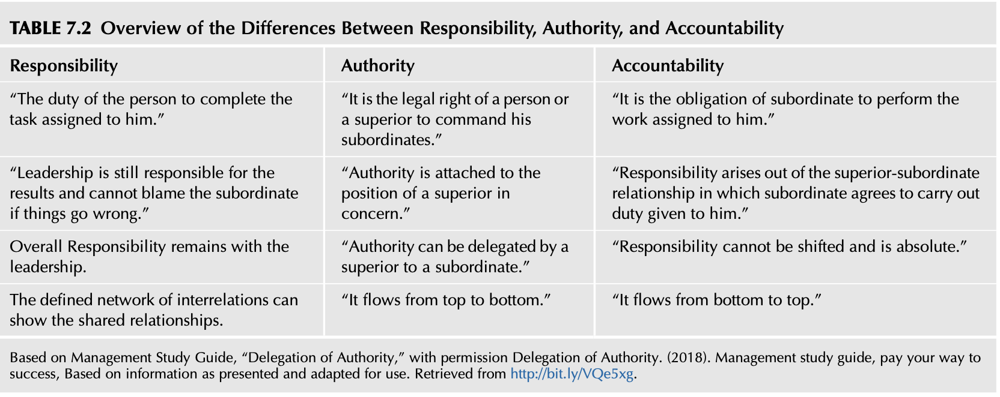
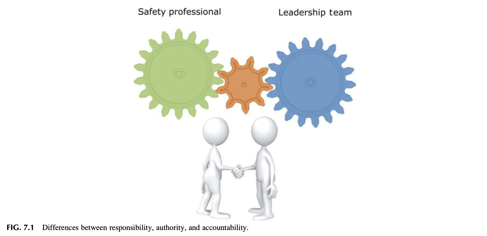
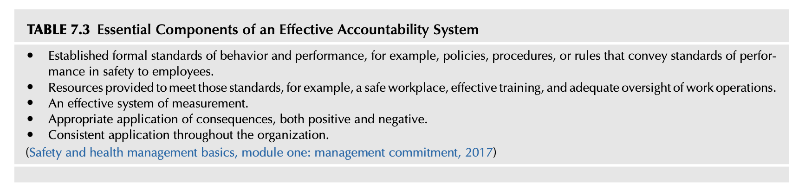

<!-- Block B01 -->
# 제7장: 리더십과 안전문화 평가 (Evaluating Leadership and the Safety Culture)

*Safety Culture. https://doi.org/10.1016/B978-0-12-814663-7.00007-8*  
문화와 리더십은 동전의 양면과 같다. 리더는 집단과 조직을 창설할 때 맨 처음 문화를 창조해 낸다. 그리고 일단 문화가 형성되고 나면, 그 문화가 리더십의 평가 기준을 결정하며, 결과적으로 누가 리더가 될 수 있고 누가 리더가 될 수 없는지를 규정하게 된다. — 에드거 샤인 (Edgar Schein, 2016).

<!-- Block B02 -->
## 서론 (INTRODUCTION)

안전 관련 책무는 '리더(Leader)'가 되는 것과 '관리자(Manager)'가 되는 것 사이를 끊임없이 오가는 균형 감각을 요구합니다. 안전 프로세스를 구축하고 실행할 때는 체계적인 관리 기술(Management skills)이 필수적입니다. 관리자는 문제를 개별 기본 요소로 잘게 분해하여 분석하고 해결책을 도출하는 "환원주의적(Reductionist)" 접근 방식을 사용합니다. 반면, 리더십은 안전보건경영시스템의 비전과 사명(미션)을 조직 구성원들에게 온전히 전달하는 데 반드시 필요합니다. 리더는 안전문화를 달성하고 지속하기 위해 직원들에게 무엇이 기대되는지를 가슴 깊이 영감(Inspire)으로 불어넣어 줍니다. 리더는 시스템적이고 전인적인 총체적(Holistic) 접근 방식을 취하며, 조직의 모든 부문이 어떻게 하나의 유기체처럼 협력해야 하는지를 조망합니다.

안전 전문가는 리더십 원칙에 대한 기초적인 이해를 갖추어야 하며, 안전문화를 유지하는 데 필요한 제반 활동들에 대해 경영진 리더십 및 일선 근로자들과 협의하고 소통할 때 이 원칙들을 어떻게 적용할 것인가를 숙지해야 합니다. 리더십 기술은 유전적이거나 타고나는 것이 아니며, 후천적으로 충분히 학습될 수 있습니다. 리더십 자질은 팀과 위원회를 성공적으로 육성하고, 집단 및 개인과 긴밀한 라포(Rapport, 신뢰 관계)를 형성하는 데 결정적으로 중요합니다.

우수한 조직은 훌륭한 관리자와 선견지명을 갖춘 리더십을 모두 보유할 때 비로소 탁월함을 발휘합니다. 관리 기술만으로도 조직은 단기적으로 생존할 수 있지만, 명확한 리더십 비전이 결여되어 있다면 시간이 흐름에 따라 조직 스스로를 유지할 수 있는 내적 역량을 상실하게 됩니다. 관리자는 자칫 관료주의에 빠져 원래의 사명과 비전을 망각하기 쉬운 반면, 리더는 언제나 전체 프로세스의 근본적인 목적에 초점을 맞춥니다.

본 장을 학습한 후 독자는 리더십의 기본 원칙을 논의하고, 경영진 리더십 팀 및 일선 직원들과 상호작용할 때 이 원칙들을 적용하는 방안을 설명할 수 있어야 합니다. 구체적으로 다음 사항을 수행할 수 있어야 합니다:
* 리더십에 관한 다양한 학술적 정의를 명확히 숙지한다.
* 안전 전문가가 조직 내에서 신뢰받는 진정한 리더로 인정받을 수 있고 또 인정받아야만 하는 구체적인 방법을 논의한다.
* 리더십이 안전보건경영시스템에 미치는 심대한 영향을 논의한다.
* 책임(Responsibility), 권한(Authority), 책무성(Accountability)의 상호 연계 관계를 체계적으로 이해한다.
* 안전 프로세스에서 왜 위임(Delegation)이 그동안 간과되어 왔는지를 논의한다.
* 안전보건경영시스템의 구축과 안전문화의 지속적 유지에 있어 책무성과 책임이 왜 절대적으로 필수적인지를 정의한다.
* 문서화된 직무기술서(Job Descriptions)의 장단점을 논의하고, 그것이 리더십에 왜 중요한지를 논의한다.
* 안전 직무 수행 성과에 대해 명확한 결과(Consequences, 신상필벌 및 피드백)를 수립해야 하는 당위성을 논의한다.

<!-- Block B03 -->
## 리더십의 정의 (LEADERSHIP DEFINED)

리더십은 수많은 정의와 상이한 인식을 지니고 있습니다. 개인은 확립된 리더십 원칙과 이론을 체계적으로 따름으로써 더 훌륭한 리더로 육성될 수 있습니다. 리더십은 명확히 한 문장으로 정의하기가 대단히 어려운 대표적인 개념 중 하나입니다. 40여 년 전 스톡딜(Stogdill)은 “이 개념을 정의하려 시도한 사람의 수만큼이나 많은 상이한 리더십 정의가 존재한다”고 단언했습니다 (Stogdill, 1974). 베니스(Bennis)는 지난 세기 말, 학술 문헌에 존재하는 리더십의 정의가 최소 650개 이상에 달한다고 추산한 바 있습니다 (Bennis & Townsend, 1995). 오래된 격언에 따르면 “리더십이란 눈으로 직접 볼 때 비로소 그것이 무엇인지 알 수 있는 그 무엇”이라고 합니다.

'리더'라는 단어는 대중의 맨 앞에 당당히 서서, 조직이 완수해야 할 사명이 무엇이며 그것을 어떻게 달성할 것인지를 명료하고 힘차게 소통하는 강단 있는 인물의 이미지를 즉각적으로 연상시킵니다. 그 사람은 공유된 비전을 향해 앞장서서 길을 개척합니다. 이러한 리더는 다른 이들이 불가능하다고 믿는 상황에서도 한계를 뛰어넘어 기대를 초과 달성하도록 집단 전체에 깊은 영감을 불어넣습니다. 리더는 온갖 난관과 역경 속에서도 달성 가능한 성과에 대한 확고한 비전과 나아갈 방향성을 결코 잃지 않고 유지합니다.

비즈니스, 군대, 교육, 종교, 정치 등 다양한 분야에서 리더로 공인받은 탁월한 인물들을 떠올려 보십시오. 그들의 핵심 속성은 무엇입니까? 사람들은 왜 그들을 리더로 바라봅니까? 그들은 어떻게 자신의 분야나 조직에서 리더의 위치에 오를 수 있었습니까? 리더로 인정받기 위해 그들은 구체적으로 무엇을 행동으로 실천했습니까? 그들이 남긴 유산(Legacy)은 무엇이며, 그것은 세월이 흘러도 지속되고 있습니까?

리더의 가시적인 존재감과 솔선수범하는 행동은 안전보건경영시스템을 구축하는 데 필수적인 '신뢰(Trust)'를 형성하는 데 결정적인 도움을 줍니다. 개인적인 리더십 목표는 자신에게 부여된 권한과 책임을 가장 최선의 방식으로 활용하는 지식을 증진하는 데 있어야 합니다. 모든 행동은 안전보건경영시스템을 조직문화 속에 씨줄과 날줄로 직조해 넣을 수 있는 최적의 해법을 경영진 리더십 팀에 자문하는 데 집중되어야 합니다.

안전 프로세스는 그 구성 요소들이 현장에서 실효성 있게 실행되고 지속되도록 철저히 관리되어야 합니다. 안전 전문가의 역할은 수많은 기술적·경영학적 분야에 걸친 광범위한 전문성을 요구합니다. 예를 들어, 안전 전문가는 직무 위험 분석(JHA)을 완성하는 방법을 완벽히 이해해야 하고, 지정된 직원들에게 JHA 작성법을 훈련시킬 수 있어야 하며, JHA 프로세스의 품질 관리를 보장해야 하고, JHA 활용의 중요성을 전사에 설득력 있게 소통해야 합니다. 이러한 각 조치는 안전 전문가가 단순한 '기술자(Technician)'에서 '교육 강사(Trainer)'로, 다시 '품질 관리자(Quality Control)'로, 마침내 '신뢰받는 리더(Trusted Leader)'로 성숙해 가는 역할의 대전환을 요구합니다. (우리는 제12장 '직무 위험 분석의 활용'에서 JHA를 더욱 상세히 논의할 것입니다.) 안전문화를 지속적으로 지탱하는 데 필요한 전폭적인 지지를 이끌어내기 위해서는 이와 같은 리더십 역량이 필수적입니다. 단편적인 프로그램 중심의 활동과 포괄적인 전사 시스템 및 프로세스 접근법 사이에서 유연하게 시야를 전환할 수 있는 능력은 안전 성공의 결정적 열쇠입니다.

<!-- Block B04 -->
## 리더십의 원칙 (PRINCIPLES OF LEADERSHIP)

리더십 개념은 안전보건경영시스템을 성공적으로 이끌기 위한 심오한 통찰을 제공합니다. 안전 프로세스가 가진 결정적 사명을 고려할 때, 단순히 사내 규정과 서류 프로그램을 관리하는 수준을 뛰어넘어 안전 프로세스가 당초 목표를 온전히 달성하려면 반드시 탁월한 리더십 역량이 발휘되어야 합니다. 비록 리더십을 정의하기란 쉽지 않지만, 리더십의 특성과 자질은 역사적으로 성공적이고 효과적인 리더들이 보여준 공통된 특성에 기반하여 충분히 규명될 수 있습니다.

미 육군 필드 매뉴얼(FM 6-22)에 따르면, 훌륭한 리더십은 “원칙(Principles)에 기초한 확고한 프레임워크”를 통해 개발될 수 있습니다. 리더십은 상하좌우 모든 방향으로 원활히 소통하고, 전체 맥락을 가감 없이 진실되게 설명할 수 있는 역량을 요구합니다 (Leadership development, field manual, 6-22, 2015). 다음의 논의들은 리더십의 본질이 무엇이며, 리더십이 어떻게 안전문화에 기여할 수 있는지, 그리고 개인의 강점과 약점을 객관적으로 평가하기 위한 자기 개선 프레임워크를 어떻게 구축할 수 있는지에 대한 다채로운 모자이크를 제공합니다:

* 오마 브래들리(Omar Bradley) 장군은 일찍이 다음과 같이 갈파했습니다: “리더십이란 가혹함(Harshness)이 아닌 확고함(Firmness)을 의미하며; 나약함(Weakness)이 아닌 깊은 이해(Understanding)를, 이기심(Selfishness)이 아닌 관대함(Generosity)을, 독선적 자만심(Egotism)이 아닌 당당한 긍지(Pride)를 의미한다” (Leadership development, FM 6-22, 2015). 브래들리 장군에 따르면, “리더십의 길을 걸어가는 동안 당신은 정직한 실수를 저지를 것이다. 당신은 극도로 어려운 결정과 딜레마에 끊임없이 직면하게 될 것이다. 이 모든 장애물은 리더십이라는 예술을 체득해 가는 필수불가결한 학습 과정의 일부이다.”
* “리더십은 조직적, 상황적, 그리고 부여된 임무의 요구가 복합적으로 얽혀 있는 다차원적 상황 속에서, 리더가 자신의 개인적 자질, 역량, 실무 경험을 총동원하여 조직과 그 구성원, 당면한 상황, 그리고 전개되는 임무에 긍정적인 영향력을 행사하는 과정으로 특징지어진다” (FM 6-22, 2015).
* “리더십과 그 숙련도는 후천적으로 얼마든지 개발될 수 있다. 근본적으로 리더십은 개인이 스스로 개선하고자 열망하고 노력을 쏟아부을 때, 직속 상관이 그의 성장을 진심으로 후원할 때, 그리고 조직의 분위기가 학습의 가치를 높이 인정할 때 비로소 꽃피운다. 진정한 리더가 되기 위해서는 리더십 지식의 습득, 그 지식을 현장에서 직접 적용해 보는 실전 경험, 그리고 객관적인 피드백이 반드시 결합되어야 한다” (FM 6-22, 2015).
* “리더십이란 사람들에게 명확한 목적(Purpose), 나아갈 방향(Direction), 그리고 내적 동기부여(Motivation)를 제공함으로써 부여된 임무를 완수하고 조직을 끊임없이 개선해 나가는 영향력 행사의 프로세스이다” (FM 6-22, 2015).
* “리더가 된다는 것은 일방적으로 명령을 내리는 것이 아니다. 그것은 타인의 존경을 획득하고, 솔선수범하여 모범을 보이며, 긍정적인 조직 분위기를 창출하고, 가용한 자원을 극대화하며, 타인에게 영감을 불어넣고, 탁월한 성과를 촉진하는 원팀(Team)을 구축하는 일이다” (FM 6-22, 2015).
* “훌륭한 리더가 되기 위해서는 자신에게 어떠한 유형의 권한이 부여되어 있는지, 그리고 그 권한의 법적·제도적 원천이 어디에서 비롯되었는지를 명확히 숙지해야 한다. 의문이 생길 때마다 주저 없이 상위 리더에게 질문하라. 자신의 권한 범위를 확신하게 되었다면, 사려 깊은 판단력(Sound judgment)을 발휘하여 그 권한을 현명하게 행사해야 한다” (Duties, responsibilities, and authority explained, 2017).
* “때때로 조직 내에는 '부정적 리더십(Negative Leadership)'이 발생하기도 한다. 부정적 리더십은 리더와 추종자 간의 관계가 시작되었을 때보다 사람들과 조직을 훨씬 더 피폐하고 악화된 상태로 전락시킨다. 부정적 리더십의 가장 극단적인 형태가 바로 '유독한 리더십(Toxic Leadership)'이다” (FM 6-22, 2015).
* “부정적인 리더는 구성원들의 자발적 헌신이 아닌 최하위 수준의 복종에 의존하여 단기적 요구사항만을 해결하려 든다. 이 경우 추종자들은 오직 리더가 가진 공식적 직위 권력(Positional power)에 굴복하여 최소한의 명령만을 이행한다. 이는 단기적으로는 가시적 성과를 낼지 모르나, 리더의 핵심 역량인 '지도하고 육성하는' 본질적 역량을 완전히 파괴한다. 추종자에게 영향력을 행사하기 위해 부정적 리더십을 장기간 지속하면 구성원의 자발적 의지와 주도성, 잠재력을 말살시키고 조직의 사기를 철저히 붕괴시킨다” (FM 6-22, 2015).
* “유독한 리더십(Toxic Leadership)이란 부하 직원, 조직 전체, 그리고 임무 완수에 파괴적인 악영향을 미치는 자기중심적 태도, 이기적 동기 및 역기능적 행동의 결합체이다. 이러한 독성 리더는 타인에 대한 배려와 조직의 정서적 풍토에 완전히 무관심하며, 이는 단기적 및 장기적으로 치명적인 결과를 낳는다. 독성 리더는 과도하게 부풀려진 자의식과 극단적인 자기 이익에 매몰되어 행동한다. 그들은 오직 자신의 개인적 영달과 욕망을 채우기 위해 타인을 속이고(Deceive), 협박하며(Intimidate), 강압하고(Coerce), 부당하게 처벌하는(Unfairly punish) 기능장애적 행동을 서슴지 않고 일삼는다” (FM 6-22, 2015).

살펴본 바와 같이, 리더십은 수많은 학술적 정의와 다양한 지각의 스펙트럼을 가지고 있습니다. 안전문화의 성공에 있어 가장 결정적인 요소는, 리더십이 조직 내에서 비전 제시, 투명한 의사소통, 사람에 대한 진심 어린 배려, 그리고 공정한 의사결정의 루프(Loop) 속에서 언제나 살아 숨 쉬며 능동적으로 작동하도록 유지하는 것입니다.

<!-- Block B05 -->
## 리더십에 관한 실무적 고찰 (THOUGHTS ON LEADERSHIP)

잠재적으로 극심한 고위험과 치명적인 유해위험요인을 상시 내포하고 있는 에너지 산업에서 정의하는 리더십이란, “자신의 개인적 직무 수행도와 시설 전체의 안전 운영 성과에 대해 전적인 개인적 책임을 기꺼이 짊어지며, 조직의 프로세스와 핵심 가치에 긍정적인 영향을 미치고자 주도적으로 노력하는 모든 사람”을 의미합니다 (Concepts and principles, human performance improvement handbook, 2009).

“일선 현장 근로자는 비록 관리직 책임을 맡고 있지 않다 하더라도, 현장에서 실질적으로 대단히 강력한 영향력을 행사하는 핵심 리더가 될 수 있으며 실제로 그러하다. 진정한 리더라는 칭호는 공식적인 직책에서 나오는 것이 아니라, 부하 직원, 동료, 그리고 상사들로부터 자발적으로 획득하는 것이다” (DOE HPI Handbook, 2009). 이는 특정 부서의 부서장이 공식적인 직무 권한과 법적 책임을 갖고 있을지라도, 현장에서 작업자들에게 실질적인 영감을 불어넣고 일상 행동을 변화시키는 '실제 리더'는 팀 리더, 노동조합 대의원, 혹은 현장의 베테랑 라인 작업자일 수 있음을 명확히 시사합니다.

<!-- Block B06 -->
## 리더십이 안전보건경영시스템에 미치는 영향 (LEADERSHIP IMPACT ON THE SAFETY MANAGEMENT SYSTEM)

안전보건경영시스템과 안전문화는 조직이 실제로 어떻게 관리되고 어떻게 영도되는가에 의해 지대한 영향을 받으며 형성됩니다. “관리자와 현장 관리감독자는 조직의 공식적인 책임 위치에 포진해 있으며, 따라서 그 자체로 조직의 핵심 리더이다” (DOE HPI Handbook, 2009).

예를 들어, 일선 직원들은 자신들이 하는 일의 진정한 의미(Meaning), 목적(Purpose), 나아갈 방향(Direction), 그리고 깊이 있는 통찰(Insight)을 얻기 위해 언제나 경영진 리더십 팀의 일거수일투족을 주시합니다. 만약 직원들이 조직의 리더들이 현장 작업에 진정한 가치와 의미를 부여하고 있고, 모든 직무가 고유한 존재 목적을 갖고 있음을 증명해 보이며, 조직이 나아가고자 하는 올바른 방향을 투명하게 공유하고 있다고 체감하고 눈으로 확인한다면, 직원들은 기꺼이 더 큰 개인적 책임을 떠맡고 일상적으로 요구되는 통상적 기대 수준을 뛰어넘는 자발적 노력을 발휘할 가능성이 훨씬 높아집니다. 반대로, 직원들이 리더십의 솔선수범하는 자질을 전혀 발견하지 못한다면, 그들은 안전 활동에 자발적으로 참여하기를 극도로 꺼리게 될 것입니다.

리더십은 시대에 따라 끊임없이 진화하는 개념이지만, 현대적 관점에서는 “특정 맥락 하에서 공통의 목표를 달성하기 위해 구성원들이 누군가를 자신들의 진정한 리더로 자발적으로 수용할 때 발생하는 '상호작용적 영향력의 프로세스(The process of interactive influence)'”로 가장 적절하게 정의될 수 있습니다. 실바(Silva, 2016)가 제시한 이 정의는 현대 리더십의 본질에 완벽히 부합하며, 리더 개인뿐만 아니라 추종자(Followers)와 그들이 처한 조직적 맥락(Context) 모두에게 리더십 프로세스 상의 결정적으로 중요한 역할을 부여합니다.

<!-- Block B07 -->
## 리더십과 조직 구조 (LEADERSHIP AND ORGANIZATION STRUCTURE)

시간의 모진 시험을 견뎌내고 지속 가능한 성공적인 안전문화를 확립하기 위해서는, 조직의 지배 구조(Organizational structure)가 안전보건경영시스템에 가장 적합한 수준의 제도적 지원을 확고히 뒷받침해 주어야 합니다. 일반적으로 조직 구조는 공식적인 조직도(Organizational chart)를 통해 정의되고 문서화됩니다. 전반적으로 볼 때, 조직이 실제로 어떻게 작동하고, 부서 간에 어떻게 소통하며, 일선 현장에 어느 정도의 자율적 유연성을 허용하거나 통제하는지를 파악하기 위한 종합적인 조직 진단 평가가 선행되어야 합니다.

<!-- Block B08 -->
### 현장 관찰 (Observation)

공동 저자인 제임스(James)는 기업 인수합병(M&A)으로 탄생한 복수 공장 운영 체제를 포함하여 대단히 다양한 산업 조직 환경에서 수십 년간 근무했습니다. 그가 현장에서 얻은 가장 소중한 교훈 중 하나는, 어떤 조직에 새로운 변화를 섣부르게 제안하기에 앞서 그 조직의 모든 측면을 먼저 깊이 경청하고 오감으로 관찰해야 한다는 점이었습니다. 그는 합병으로 인해 하나로 묶인 여러 사업장들이 각자 고유한 전통과 산업별 은어, 그리고 저마다의 독특한 경영 관리 방식을 가지고 있음을 깊이 이해하게 되었습니다.

합병 직후 새로운 제도적 구조가 도입되는 과정에서 필연적으로 발생하는 전사적 혼란과 불안 속에서, 제임스는 새로운 사업장 리더들의 안전 우선순위를 가늠하기 위해 매우 단순하면서도 강력한 실전 기법을 고안해 냈습니다. 그는 전국의 각 공장장들에게 전화를 걸어 메시지를 남긴 뒤, **“과연 누가 나에게 전화를 다시 걸어오는가(Call-back)?”**를 가만히 지켜보았습니다.

시간이 흐르면서 그는 명확한 패턴을 발견했습니다: 제임스의 전화에 즉시 혹은 상식적인 시간 내에 회신 전화를 걸어온 리더들은, 새로운 조직 구조와 통합된 안전 환경을 기꺼이 수용하고 적응하는 능력이 훨씬 탁월했습니다. 이 리더들은 새로운 전사적 안전문화가 구축되어야 한다는 당위성을 명확히 이해하고 있었으며, 변화에 저항하지 않고 외부의 제안에 열린 자세를 가진 진정한 팀 플레이어로 행동했습니다.

조직의 핵심 가치, 목표, 세부 추진 과제, 비즈니스 전략, 그리고 구성원들의 확고한 신념은 해당 조직의 리더십 스타일과 작업장 환경의 수준을 적나라하게 보여주는 바로미터입니다. 이러한 지표들은 조직 내에서 무엇이 진정으로 중요하게 여겨지는가에 대해 침묵의 강력한 메시지를 전파합니다. 이에 기초하여, 경영진 리더십 팀은 다음과 같은 행동을 실천할 때 조직 전체에 가장 강력하고 긍정적인 신호를 발신하게 됩니다:
* 작업 전 안전 점검(Preshift review), 주간/월간 안전 회의, 그리고 현장 작업자와의 1:1 대면 대화 등 정기적인 안전 활동에 가시적으로 적극 참여할 때.
* 전 임직원과 열린 쌍방향 의사소통(Two-way communication)을 상시 유지하고, 안전 문제, 유해위험요인 및 관련 위험성을 자유롭게 보고하는 데 방해가 되는 모든 물리적·심리적 장벽을 능동적으로 제거할 때.
* 손실을 유발하는 불안전한 작업 활동과 현장 위험 조건을 지체 없이 신속하게 시정 조치할 때.
* 주요 경영 회의의 공식 안건에 안전보건경영시스템 관련 현안을 최우선 순위로 정례 등재할 때.
* 모든 안전 기준과 절차가 신규 입사자 오리엔테이션 및 관련 직무 교육훈련에 누락 없이 완벽히 통합되도록 보장할 때.
* 사후 손실 지표(Lagging data)뿐만 아니라 사전 선행 지표(Pre-loss / Leading data)를 균형 있게 추적하고, 특히 선행 지표 관리에 강력한 무게중심을 둘 때.
* 안전 문제, 현장 유해위험요인 및 잠재적 위험성에 대해 근로자가 제기하는 모든 우려 사항을 지극히 진지하게 경청하고 수용할 때.

위 목록의 반대 상황(리더가 안전 회의에 불참하고, 위험 보고를 묵살하며, 시정 조치를 지연시키는 등)은 안전이 조직에서 무가치하다는 치명적인 부정적 신호를 사내에 즉각 퍼뜨립니다. 분권화된 조직 구조 하에서는 동일한 기업 내에서도 특정 사업장이 다른 사업장보다 훨씬 더 강력한 안전보건경영시스템과 우수한 안전문화를 꽃피우기도 합니다. 사업장마다 차이가 발생하는 주된 이유는, 특정 공장에 깊이 뿌리박힌 독성 리더십 스타일이 심층적인 안전문화의 정착을 가로막기 때문입니다. 그 대표적인 징후 중 하나가 바로 최소한의 법적 규제 준수에만 급급한 소극적 리더십 스타일입니다.

따라서 경영진 리더십 팀은 안전보건경영시스템을 운영할 때 지연 지표와 선행 지표를 균형 있게 결합하여 활용해야 합니다:
* **지연 지표(Lagging Indicator)**: 이미 발생한 최종 결과나 사고 손실의 크기를 사후 측정하는 지표 (예: 재해율, 손실일수).
* **선행 지표(Leading Indicator)**: 미래의 안전 성과를 선제적으로 예측하고 통제할 수 있도록 시스템의 현재 상태나 현장의 안전 행동을 측정하는 지표 (예: 위험성평가 참여율, 개선 조치 완료율, TBM 실시 횟수; DOE HPI Handbook, 2009).

<!-- Block B09 -->
### 리더십에 대한 기대치 (Leadership Expectations)

안전의 탁월성(Safety Excellence)을 달성하는 여정은 전통적으로 '리더십의 확고한 헌신(Leadership Commitment)'에서 출발한다고 여겨져 왔으며, 실제로 리더십 팀이 안전 프로세스에 대한 진정한 의지를 행동으로 보여주는 것은 절대적으로 필수적입니다. 이러한 헌신은 현장 안전 관련 활동에 리더가 눈에 보이게 직접 참여하는 가시적 솔선수범(Visible involvement)을 통해 매일 입증되어야 합니다.

기업 경영진의 일차적 관심사는 회사의 수익성을 방어하고 주주들의 기대 목표를 충족시키는 데 있습니다. 안전 전문가는 회사 내에서 한정된 예산과 자원을 배분받기 위해 경쟁하는 수많은 부서 중 '하나의 구성원'일 뿐입니다. 조직 리더십의 일원으로서 안전 전문가는 리더십의 기본 원리를 깊이 이해하고 자신의 것으로 내재화해야만, 경영진을 설득하고 사내에서 자신의 영향력을 확장할 수 있는 탄탄한 발판을 확보하게 됩니다. 만약 경영진이 안전에 대해 품고 있는 인식이 다른 생산이나 영업 활동에 비해 가치가 떨어지는 것으로 치부된다면, 안전에 배정되는 예산과 인력 자원은 언제나 최소한의 수준으로 삭감될 수밖에 없습니다.

<!-- Block B10 -->
### 교훈 (Lesson Learned)

제임스는 과거 한 굴지의 대기업에 근무하던 시절, 입사 수년 만에 일선 관리감독자 직책으로 고속 승진했습니다. 그는 관리감독자 입문 교육을 받는 동안 다음과 같은 회사의 냉혹한 경영 철학을 따르도록 주입받았습니다: **“만약 어떤 직원이 자신에게 배정된 일을 제대로 해내지 못해 생산 라인의 속도를 따라가지 못한다면, 그 즉시 해고해 버리고 새로운 사람을 뽑아라.”**

수년 동안 제임스는 회사가 정한 규칙에 충실히 따랐고, 회사의 기준에 부합하는 '유능한 관리자'로 인정받았습니다. 그러나 얼마 지나지 않아 심각한 문제가 터져 나왔습니다. 직원을 그런 방식으로 관리하도록 배웠기 때문에, 그의 팀에는 숙련된 인력이 단 한 명도 남아있지 않고 만성적인 인력난이 발생했던 것입니다. 그가 다른 생산 라인의 반장으로 발령을 받았을 때, 현장 라인 직원들의 첫 반응은 **“우리는 절대로 당신 밑에서는 일하고 싶지 않다!”**는 결사적인 거부였습니다. 부서 이동 후에도 높은 직원 이직률과 퇴사가 끊임없이 반복되었습니다.

그는 관리자(Supervisor)로서는 성공했을지 몰라도, 진정한 리더(Leader)로서는 철저히 실패했음을 뼈아프게 깨달았습니다. 가장 본질적인 문제는 현장 직원들로부터 잃어버린 '신뢰(Trust)'와 '존경(Respect)'을 어떻게 다시 회복할 것인가였습니다. 그는 “일을 못하면 제임스에게 가차 없이 잘린다”는 사내의 악명 높은 평판을 근본적으로 바꾸어야만 했습니다.

그는 현장의 모든 직원들과 1:1로 직접 마주 앉아 그들의 고충과 애로사항, 그리고 진정한 필요가 무엇인지를 경청하는 대면 면담을 시작함으로써 안정적인 조직을 새롭게 구축해 나갔습니다. 그는 일대일 개별 면담뿐만 아니라 소그룹 대화, 그리고 전체 팀 미팅을 끈기 있게 지속하면서 자신이 기대하는 새로운 기준을 솔직하게 소통했습니다. 그가 진정으로 원했던 것은 구성원 누구나 출근하여 자신이 맡은 일을 정해진 품질과 안전 기준에 맞추어 보람차게 완수하는 것이었습니다.

그는 자신의 대인관계 네트워크를 “내 방식대로 하든가, 아니면 나가라!(My way or the highway!)”라는 식의 일방적이고 폭압적인 소통에서 벗어나, 현장에서 일을 올바르게 완수하는 데 걸림돌이 되는 장애물이 무엇인지를 찾아내는 긍정적인 '쌍방향 열린 의사소통'으로 180도 전환했습니다.

직원들은 제임스의 새로운 리더십 스타일이 진심으로 변화했음을 체감하기 시작했습니다. 그는 말한 바를 반드시 지켰고, 자신이 내린 약속과 결정을 끝까지 책임졌습니다. 직원들이 그가 공정하고 정직하며, 언제든 새로운 아이디어와 안전 고충을 들고 편안하게 다가갈 수 있는 사람임을 온전히 신뢰하게 되자, 직원 이직률은 극적으로 안정되었고 마침내 모든 직원이 “제임스와 함께 일하고 싶다”며 자원하게 되었습니다.

리더십 원칙을 겸허히 수용하여 스스로를 변화시키고자 했던 그의 결단은, 그를 다가가기 두려운 '부정적인 관리자'에서 현장의 모든 이가 의지하는 '신뢰받는 조언자(Trusted Advisor)'로 완전히 탈바꿈시켰습니다. 이 생생한 사례 연구는 다음과 같은 리더십의 본질적 통찰을 반영합니다:
* “진실성(Integrity)을 갖춘 리더는 자신의 정체성을 이루는 핵심 가치를 굳건히 고수하며, 추종자들이 본받고 따를 수 있는 확고한 행동 기준을 솔선수범하여 제시한다. 정체성(Identity)이란 한 인간의 자아 개념이며, 스스로를 누구로 정의하는가이다. 구성원들에게 진정한 영향력을 발휘하는 탁월한 리더는 리더라는 역할과 그에 따르는 기대를 자신의 정체성과 완벽히 일치시킨다; 그들은 리더에게 요구되는 책임을 주도적으로 짊어지며, 리더다운 행동을 온몸으로 실천한다. 반면 스스로에 대해 확신이 없는 지도자는 리더로서의 자신의 정체성에 대해 확고한 신념을 세우지 못한다” (미 육군 리더십 매뉴얼 FM 6-22, 2015).

<!-- Block B11 -->
## 전사적 안전 우선순위의 확립 (ESTABLISHING ORGANIZATIONAL SAFETY PRIORITIES)

조직의 경영진과 관리자들은 때때로 안전의 진정한 전략적 가치에 대해 피상적이고 기초적인 수준의 이해만을 가지고 있을 수 있습니다. 그들의 안전에 대한 인식 수준은 주요 경영 회의의 정식 안건에 안전이 포함되어 있는지, 그리고 안전 관련 현안, 현장 예방 활동, 위험성 평가, 그리고 안전보건경영시스템에 관한 논의에 사내에서 과연 어느 정도의 시간과 비중이 허용되고 있는가에 고스란히 투영됩니다.

경영진 리더십 팀은 유해위험요인(Hazard), 관련 위험성(Associated Risk), 실효성 있는 통제(Control), 그리고 안전보건경영시스템 행정 운영의 중요성을 깊이 이해하지 못할 수도 있습니다. 이때 안전 전문가의 핵심 역할은 경영진의 낡은 지각과 부족한 지식을 획기적으로 개선하는 데 필요한 전문적 통찰과 탁월한 리더십 자질을 적극 발휘하여 그들을 올바른 방향으로 이끄는 것입니다. 다음 절들은 경영진 리더십 팀을 더 효과적으로 설득하고 자문하기 위한 실천적 방법론들을 제시합니다.

<!-- Block B12 -->
### 현장 순회 경영 (Management by Walking Around - MBWA)

앞선 장들에서 논의했듯이, '현장 순회 경영(MBWA)'은 톰 피터스(Peters)와 로버트 워터만(Waterman)이 그들의 경영학 고전인 《초우량 기업의 조건(In Search of Excellence)》에서 최초로 제창한 핵심 경영 기법입니다. 이 기법을 올바르게 적용한다는 것은, 경영진 리더십 팀이 자신의 안락한 집무실을 벗어나 정기적이고 일관되게 현장 작업장을 두루 순회하며, 작업 실태를 직접 관찰하고, 일선 근로자들과 1:1 대화를 나누면서 현장의 생생한 분위기와 정서적 기류를 온몸으로 느끼는 것을 의미합니다.

훌륭한 리더십은 자신의 직속 부하나 관리자들에게만 모습을 드러내는 데 그치지 않고, 조직 내 최하위 직급을 포함한 모든 계층의 구성원들에게 자신의 존재를 가시적으로 드러냅니다. 피터스와 워터만은 경영진이 현장과의 교감을 상실하고 고립되어 버린 수많은 실패 사례들을 경고했으며, 이러한 단절은 오늘날 수많은 기업 조직에서도 여전히 고질적인 병폐로 남아 있습니다 (Peters & Waterman, 2004).

MBWA는 리더들이 현장 직원들의 절실한 고충과 그들이 매일 마주하는 위험 요인에 대한 깊은 통찰을 얻을 수 있게 해줌으로써, 사내 소통 네트워크를 비약적으로 발전시키는 데 크게 기여합니다. 이러한 현장 대화를 통해 기존 네트워크에 존재하던 치명적인 소통의 단절과 공백(Gaps)을 명확히 식별해 낼 수 있습니다. 저자들의 오랜 실무 경험에 비추어 볼 때, 공장이나 사업장을 점검하다 보면 경영진 리더십 팀의 일원이 단 한 번도 발걸음하지 않았던 소외된 현장 구역들이 수두룩하게 발견되곤 합니다. 이는 특히 경영진이 주간 1교대 근무 시간에만 잠시 상주하고, 2교대나 야간 3교대 근무 시에는 관리자의 손길이 완전히 끊겨버리는 교대근무 사업장에서 대단히 심각하게 나타납니다.

제3장(네트워크 분석 및 활용)에서 다루었듯이, 인간의 영향력은 3단계의 접촉 거리(3도 분리)를 거치면서 점차 희석됩니다. 이전에 경영진의 현장 참여가 전무했던 조직이라면, MBWA를 추진할 때 매우 세심한 주의를 기울여 점진적으로 정착시켜야 합니다. 만약 리더가 현장을 순회하면서 안전 규칙을 스스로 위반하거나, 사소한 실수를 한 작업자를 거칠게 질타하는 등 현장 방문을 잘못 관리하여 역효과를 낸다면, 리더십에 대한 신뢰와 영향력은 회복할 수 없을 정도로 파괴되고 맙니다.

저자들은 현장 소통에 탁월했던 훌륭한 경영진과 함께 일한 풍부한 경험이 있습니다. 공동 저자인 네이선(Nathan)은 한 대형 카펫 제조업체를 보험 인수 실사차 방문했던 적이 있었습니다. 평가 질문 중 하나는 최고경영진이 실제 현장 운영에 얼마나 가시적으로 참여하고 있는가를 묻는 것이었습니다. 현장 안내를 맡은 공장 직원은 자부심에 찬 목소리로, 최고경영자(CEO이자 소유주)가 광대한 제조 시설 전체를 수시로 직접 순회한다는 사실을 들려주었습니다.

어느 날 공장을 둘러보던 CEO는 한 직원이 빗자루로 먼지를 쓸고 있는 모습을 목격했습니다. CEO는 그 직원에게 다가가 “왜 지급된 진공청소기를 사용하지 않고 빗자루로 쓸고 있습니까?”라고 다정하게 물었습니다. 직원은 “청소기가 고장 났는데, 새로 신청한 청소기가 아직 구매 승인이 나지 않아 배송되지 않았습니다”라고 답했습니다. CEO는 직원에게 “내가 돌아올 때까지 잠시만 기다리십시오”라고 말한 뒤 공장 문을 나섰고, 잠시 후 인근 공구 상점에 직접 가서 사비로 구매한 최신형 진공청소기를 양손에 들고 현장으로 돌아왔습니다!

이 놀라운 사건은 순식간에 공장 전체에 퍼져나갔고, 현장의 모든 관리자들과 중간감독자들은 자신들이 관리하는 직원들이 적절하게 작동하는 필수 안전 장비와 공구를 차질 없이 갖추고 있는지를 즉각 전수 점검하여 조치했습니다. 진정한 리더십이란 공허한 말이 아니라 '행동'과 '소통'이며, MBWA는 리더의 가시성을 극대화하고 작업 현장에서 직원들과 가슴으로 직접 소통할 수 있는 가장 확실한 길을 열어줍니다.

<!-- Block B13 -->
### 열린 문 정책 (Open Door Policy)

'열린 문 정책(Open Door Policy)'은 복잡한 보고 체계를 단축하고 필요할 때 통상적인 공식 소통 채널을 유연하게 우회할 수 있는 비상구를 제공한다는 점에서 대단히 필수적입니다. 열린 문 정책은 그 명칭이 시사하듯, 리더가 집무실 문을 언제나 활짝 열어둠으로써 직원들이 언제든 찾아올 수 있도록 상시 개방성을 유지하는 것을 의미합니다.

여기서 반드시 명심해야 할 핵심 고려사항은, 열린 문 정책이 기존의 지휘 보고 체계나 관리감독자의 정당한 권한을 무력화하기 위한 수단이 결코 아니라는 점입니다. 열린 문은 통상적인 경로로 해결되지 않는 깊은 통찰, 조언, 또는 절박한 위험 정보를 구하고자 하는 모든 이들에게 활짝 열려 있는 일종의 안전 '릴리프 밸브(안전 배출 밸브)' 역할을 수행합니다.

그러나 상시 접근 가능한 열린 문을 유지한다는 것은, 직속 관리감독자와의 정상적인 업무 관계를 훼손하지 않으면서도 직원들의 자유로운 소통을 장려해야 하는 대단히 섬세하고 미묘한 균형 감각을 요구합니다. 안전 전문가는 타 부서 관리자나 리더들과 긴밀한 사전 조율을 거침으로써, 권한과 책임을 둘러싼 불필요한 영역 다툼이나 감정적 충돌이 발생하지 않도록 각별히 유의해야 합니다.

열린 문 정책은 리더가 특정 요일이나 시간대를 정해 안전 고충이나 제안을 가진 직원들의 방문을 공식적으로 접수하는 제도화된 형태로 운영될 수도 있습니다. 또한 컴퓨터나 모바일 인트라넷을 활용하는 현대 조직에서는 온라인 메신저나 전용 건의 채널을 통해 상시 접속 가능한 디지털 형태로 구현되기도 합니다. 열린 문 정책은 조직 내에서 인적 접촉 네트워크를 끊임없이 확장해 나가는 살아 숨 쉬는 프로세스의 핵심 부분입니다.

> "만약 나에게 어떤 절체절명의 문제를 해결할 수 있는 단 1시간이 주어지고 내 목숨이 그 해결책에 달려 있다면, 나는 올바른 질문이 무엇인지를 규명하는 데 처음 55분을 온전히 쏟아부을 것이다. 왜냐하면 일단 올바른 핵심 질문을 찾아내기만 한다면, 그 문제는 단 5분도 채 안 되어 해결할 수 있기 때문이다."  
> — 알베르트 아인슈타인 (Albert Einstein)

<!-- Block B14 -->
## 역할, 책임, 위임, 권한 및 책무성의 정의 (DEFINING ROLES, RESPONSIBILITY, DELEGATION, AUTHORITY, AND ACCOUNTABILITY)

비즈니스의 규모가 복잡해지고 임직원 수와 공정 운영이 확대됨에 따라, 단 한 사람의 안전 전문가가 안전보건경영시스템의 모든 세부 업무를 전담하는 것은 현실적으로 불가능하며 감당할 수 없는 과중한 짐이 됩니다. 시스템이 본연의 잠재력을 온전히 발휘하기 위해서는, 안전 관련 직무 배정에 있어 각자의 역할(Roles), 책임(Responsibilities), 권한의 위임(Delegation) 및 실질적 권한(Authority)이 명확히 정의되어야 하며, 이는 공정한 책무성(Accountability) 구조와 빈틈없이 결합되어야 합니다.

이는 전사적 안전 활동들을 조직 본연의 경영 목표 및 세부 전략과 긴밀히 정렬(Align)시킴으로써 완벽히 달성될 수 있습니다. 안전보건경영시스템의 구조는 안전에 관한 구체적인 책임이 여러 경영진 리더십 팀 구성원들에게 적절히 분산되고 위임될 때 훨씬 더 효율적이고 실용적으로 작동합니다. 한 명의 관리자가 자신에게 배정된 모든 과업을 단독으로 완수할 수는 없습니다. 설정된 안전 목표를 달성하기 위해 관리자는 마땅히 부하 직원에게 권한을 위임해야 합니다.

'권한의 위임(Delegation of Authority)'이란 관리자가 가진 권한과 힘을 하위 부하 직원에게 하향식으로 나누어 부여하는 것을 의미합니다. 위임이란 당신의 직무 중 일부분을 믿을 수 있는 타인에게 온전히 신임하여 맡기는 일입니다. 권한의 위임은 조직이 기대하는 실질적인 성과를 달성하기 위해 부하 직원에게 권한을 세분화하고 재배분하는 전략적 행위로 정의될 수 있습니다 (Delegation of Authority, 2018).

<!-- Block B15 -->
## 안전 관련 책임에 대한 조직 전반의 재검토 (REVIEW THE ORGANIZATION FOR SAFETY-RELATED RESPONSIBILITIES)

진정한 안전문화를 정착시키고자 할 때, 안전에 연계된 책임의 깊이와 범위, 그리고 그 다양성은 대단히 광범위해질 수 있습니다. 안전 관련 책임은 과거의 구태의연한 단순 재해 건수 통제나 최소한의 법적 규제 준수 수준을 훨씬 뛰어넘어야 합니다. 안전 책임이 다루어야 할 필수 영역에는 다음 사항들이 포함되며 결코 이에 국한되지 않습니다:
* 전사 안전보건 방침 및 운영 매뉴얼의 개발; 최고경영진을 향한 정기 안전 성과 보고.
* 안전보건경영시스템 기준, 정기 감사(Audits) 및 시정 조치(Corrective Actions)에 대한 체계적인 문서화 및 데이터 큐레이션.
* 산업안전, 보건위생, 환경보전(EHS)을 총망라한 현장 표준작업절차(SOP); 차량 및 운송 장비 운용 안전, 사내 도급업체 및 외부 방문객 안전 통제, 사업장 보안, 제조물 배상책임(PL), 산재 보상 보험 및 배상 청구 행정 관리.
* 위험 및 유해위험요인의 선제적 통제, 안전 장비·공구·원자재 및 화학물질의 안전 조달, 인간공학적 작업 환경 개선, 신규 설비 설계 안전성 검토(PtD), 직무 위험 분석(JHA).
* 임직원 안전 교육, 훈련, 신규 채용 오리엔테이션 프로그램 개발 및 전사적 의사소통.
* 비상 대응 및 위기 관리 준비, 사고 및 아차사고 조사와 근본 원인 분석 (ANSI/AIHA Z10-2012 OHSMS).

이러한 책임을 정립하기 위해 가장 먼저 완수해야 할 작업은 공식적인 조직 구조를 전면 재검토하여 경영진 리더와 일선 근로자들에게 구체적으로 어떠한 과업들이 배정될 수 있는지, 그리고 그 역할들이 안전에 어떻게 가장 탁월하게 기여할 수 있는지를 판별하는 것입니다. 이 검토를 통해 전사 안전문화의 유지에 결정적인 핵심 직무들이 식별됩니다. 조직 분석은 사내 내부 및 외부를 아우르는 의사소통 네트워크와 인적 연결망을 모두 면밀히 고려해야 합니다.

조직 구조에 대한 정확한 이해는 각 직위가 안전보건경영시스템을 어떻게 가장 강력하게 후원할 수 있는지를 파악하는 열쇠가 됩니다. 조직 내에 책무성과 책임을 명확히 정의하고 통합하는 첫걸음은, 안전 프로세스에서 중추적인 역할을 수행할 수 있는 구체적인 직함(Job titles)과 직무기술서(Descriptions)의 목록을 도출하는 데서 출발합니다. 이러한 핵심 직위들이 안전 활동에 적극 관여하는 모습은, 최고경영진이 지속 가능한 안전문화를 구현하기 위해 현장의 제반 안전 활동을 얼마나 강력하게 지지하고 장려하는지를 증명하는 가장 확실한 눈에 보이는 증거가 됩니다.

이렇게 식별된 핵심 직무 담당자들은 다시 안전 프로세스에 긴밀히 연계되어 일상적으로 참여해야 할 추가적인 대상자들을 위한 세부 직무기술서를 개발하는 소중한 자원이 됩니다. 모든 계층의 리더와 근로자는 안전보건경영시스템 내에서 명확히 규정된 고유의 안전 활동과 책임을 부여받아야 합니다. 직급과 직무 특성에 따라 어떤 직책은 더 광범위한 안전 활동과 무거운 책임을 맡게 됩니다. 배정되는 과업은 현장 일상 순회 점검, 안전 데이터 수집 및 정밀 분석, 안전 관련 프레젠테이션 발표, 사내 안전보건위원회 참여, 손실 유발 사고 조사, 위험성 평가 수행 등 대단히 다채롭게 구성될 수 있습니다.

<!-- Block B16 -->
## 직무기술서의 개발 및 실행 (DEVELOPING AND IMPLEMENTING JOB DESCRIPTIONS)

개별 직무기술서(Job description)는 특정 직책이 수행해야 할 가장 중요한 핵심 직무 특성과 책임을 기술합니다 (A reference for developing a basic occupational safety and health program for small businesses, 2008). 직무기술서는 특정 직위에 요구되는 업무 자격 요건, 기술 수준, 일반적인 책무, 일상 활동, 구체적인 책임, 그리고 부여된 실질적 권한(Authority)을 명문화하여 정의합니다.

많은 기업 조직에서 나타나는 심각한 취약점 중 하나는, 안전보건경영시스템에 관한 구체적인 책임과 권한을 공식적인 서면 직무기술서에 직접 명시하지 않고 누락한다는 점입니다. 많은 경우 직무기술서에 규정된 안전 역할은 극히 제한적이며, 기껏해야 "OSHA 규정 준수 또는 관련 법령 준수"와 같은 형식적인 선언적 문구 한 줄에 그치고 맙니다. 안전보건경영시스템에 관한 구체적인 직무, 책임, 그리고 권한은 반드시 개인의 공식 직무기술서 내에 제도적으로 명문화되어야 합니다.

인사(HR) 부서는 조직의 공식 직무기술서를 제정하고 유지 관리하는 총괄 책임을 맡고 있으며, 이미 사내에 확립된 공식 프로세스를 보유하고 있을 수 있습니다. 따라서 안전 전문가는 직무기술서의 개정을 요청하기에 앞서 현재 인사 부서의 개정 프로세스를 먼저 깊이 이해해야 합니다. 안전 전문가는 단독으로 직무 요건을 변경할 수 있는 인사적 권한을 가지고 있지 않을 수 있습니다. 직무 요건에 어떠한 변경을 가하려 할 때에도 인사 부서와의 긴밀하고 신뢰할 수 있는 협력 관계를 구축하고 논리적으로 강력한 당위성을 제시해야 합니다.

인사 부서 담당자들과의 원활한 조율과 탄탄한 라포(Rapport) 형성은 기존 직무기술서에 구체적인 안전경영 직무, 책임, 그리고 권한을 새롭게 추가하여 개정할 수 있는 결정적인 기회를 열어줍니다. 잘 작성된 직무기술서는 사내 다양한 직위 간의 의사소통과 업무 조율을 획기적으로 향상시킵니다. 정교한 직무기술서는 다음과 같은 구체적인 이점을 제공합니다:
* 각 직위별 책임과 권한의 한계선에 대한 모든 의구심과 혼선을 완벽히 제거한다.
* 조직 내에서 수행되어야 할 모든 안전 책임이 누락 없이 배정되었는지를 명확히 판별한다.
* 새롭게 발생하는 과업과 책임을 누구에게 배정해야 할지를 논리적으로 식별한다.
* 구체적인 직무 수행 목표를 개발하고 객관적인 성과 측정 기준을 수립한다.
* 조직 전반에 걸친 의사소통과 협업을 실질적으로 개선하고 촉진한다.
* 조직 내의 모든 책임이 빈틈없이 규명되었는지, 새로운 과업과 책임이 적재적소에 배분되었는지를 지속적으로 평가한다.
* 정량적·정성적 직무 성과 목표를 도출하고 공정한 성과 측정 지표를 확립한다.  
*(Managing worker safety and health, 2016; Sample assignment of safety and health responsibilities, 2018)*

<!-- Block B17 -->
### 기초 직무기술서의 작성 요령 (Writing the Basic Job Description)
먼저 해당 직위의 구체적인 안전 책임을 명확히 정의하는 짧은 “총괄 기술문(General Statement)”을 작성하는 것부터 출발하십시오. 명시된 안전 목표와 세부 추진 과제를 달성하는 데 필요한 직무상의 실질적 권한과 자원(Resources)을 구체적으로 기술해야 합니다. 사내 안전 기대치를 문서화하기 위한 출발점으로 즉시 활용할 수 있는 표준 안전 책임 워크시트는 부록 7.1을 참조하십시오. 이 워크시트는 서랍 속에 갇힌 박제된 문서가 아니라 살아 숨 쉬는 '살아있는 문서(Living document)'로서, 현장 안전 활동의 변화에 발맞추어 정기적으로 검토되고 개정되어야 합니다.

<!-- Block B18 -->
### 목표와 세부 추진 과제에 대한 합의 도출 (Gaining Agreement on Goals and Objectives)
조직의 모든 부서와 구성원은 하나의 유기체로 긴밀히 협력해야 하며, 조직 내 모든 직원은 안전경영 프로세스를 지탱하는 고유의 역할을 분담해야 합니다. 특정 직책이 원하는 안전경영시스템 성과에 대해 구체적으로 어떻게 책무성(Accountability)을 짊어질 것인가 사이에는 반드시 논리적인 연결고리가 존재해야 합니다.

변화를 위한 총괄 기획 과정에 일선 근로자와 현장 리더들이 더 많이 참여하여 토론할수록, 목표와 세부 추진 과제가 공식 수용되고 현장에 실행되기 전에 진정한 공감과 수용(Buy-in)을 이끌어낼 확률이 비약적으로 높아집니다. 예를 들어, 한 관리감독자가 설비 유지보수, 신규 인력 채용, 교육훈련 시간 배정, 부서 예산, 납기 일정, 품질 기준 등에 대해 실질적인 통제권을 거의 갖지 못하고 있다면, 그 관리감독자는 잠재적 손실 사고를 유발하는 핵심 요소들에 대해 어떠한 통제력이나 영향력도 행사할 수 없는 처지인 것입니다.

이러한 상황에서 만약 현장에서 발생한 재해 건수만을 기준으로 관리감독자에게 일방적인 책임을 묻는다면, 그것은 관리감독자의 통제 범위를 완전히 벗어난 상위 경영진의 잠재적 의사결정 결함(Latent management decisions)과 인간의 인지적 오류에 대해 무고하게 책임을 전가하는 것에 불과합니다 (DOE HPI Handbook, 2009).

훨씬 더 우수하고 올바른 접근법은, 관리감독자와 근로자가 현장에서 '직접 통제 가능한 사전 선행 활동(Pre-loss activities)'에 기초하여 명확한 책임을 부여하는 것입니다. 순전히 사고 재해율이나 손실률과 같은 지연 지표만을 바탕으로 설정된 안전 목표를 통해 책무성을 묻는 방식은, 작업자의 숙련도 수준, 인력 이직률, 총 작업 시간, 생산 공정의 결함 등 현장 리더십 팀이 결코 통제할 수 없는 외생적 조건들을 전혀 고려하지 못하는 치명적인 결함을 안고 있습니다. 책무성은 특정 직무기술서와 역할의 '직접 통제 범위 내에 있는 구체적인 안전 활동'에 초점을 맞출 때 비로소 타당하고 강력한 리더십 도구로 거듭납니다.

<!-- Block B19 -->
### 명확한 목표 설정과 책임의 배정 (Defining Clear Goals and Assign Responsibilities)
개인의 직무 수행을 위한 목표와 세부 과제는 통상 매년 연 단위로 수립되며, 이는 조직의 전사적 전략 목표 및 안전 목표와 일관되게 정렬(Aligned)되어야 합니다. 따라서 연간 개인 성과 목표는 해당 개인의 공식 직무기술서와 유기적으로 결합되어야 합니다.

목표와 세부 추진 과제가 모호할 경우, 해당 직위가 실제로 무엇을 달성해야 하는지에 대한 심각한 업무 공백과 인식의 격차(Gaps)가 발생하게 됩니다. 모호한 목표는 직무 수행이 미흡한지 우수한지를 객관적으로 판정할 수 없게 만듭니다. 제4장(안전문화의 방향 설정)에서 다루었던 구체적이고(Specific), 측정 가능하며(Measurable), 달성 가능하고(Achievable), 타당하며(Relevant), 기한이 정해진(Time-bound) 'SMART' 기법을 목표 수립에 적극 활용해야 합니다. SMART 개념을 적용하면 배정된 책임이 전사적 의도를 명확히 반영하고 있는지, 그리고 실제 현장 운영 환경 속에서 실현 가능하고 현실적으로 달성할 수 있는 목표인지를 사전에 철저히 검증할 수 있습니다.

<!-- Block B20 -->
### 직위별 목표 및 세부 추진 과제의 문서화 (Writing Job Position Goals and Objectives)
목표와 세부 추진 과제를 서면으로 명확히 문서화하는 것은 달성해야 할 과업의 진정한 의미와 의도를 명료하게 정립해 줍니다. 목표와 세부 과제는 결코 돌에 새겨진 불변의 것이 아니며, 그것이 수립되었던 당시의 현장 운영 조건이 변화함에 따라 마땅히 수정되고 최적화되어야 합니다. 상황에 맞추어 유연하게 조율하기 위해서는 리더십 팀과 근로자 간의 지속적이고 열린 대화가 필수적입니다.

일단 목표가 서면으로 확립되고 나면, 비록 작성 과정에서 가능한 한 많은 인원을 참여시키기 위해 광범위한 노력을 기울였다 할지라도, 문서의 구체적인 기대치에 대한 질문과 의문이 현장에서 발생할 수 있습니다. 이때 잘 정문화된 문서는 질문에 명확히 답하고, 현장에서 잘못 이해되고 있는 부분을 신속하게 바로잡아 주는 신뢰할 수 있는 가이드라인 역할을 수행합니다. 실효성 있는 목표와 세부 과제를 개발하기 위한 표준 실행 프로세스의 예시는 다음과 같습니다:
* 정해진 시간에 전 작업자가 참여하는 매일의 '작업 전 안전 미팅(Preshift review)'을 개최하여 안전 프로세스의 작동 방식을 소통하고 현장에 필요한 사항에 대한 피드백을 실시간 수렴한다.
* 각 근로자와 개별적으로 1:1 대면 면담을 실시하여 현장의 안전 고충, 잠재 위험 및 개선 니즈를 심층 논의한다.
* 주간 및 월간 정기 안전 회의를 운영하여 안전 프로세스의 진행 경과를 전 임직원에게 투명하게 공유하고 최신 상태로 유지한다.
* 정기 현장 순찰 점검, 사고 조사, 주간 계획 점검 등을 통해 식별된 유해위험요인이 현장에서 완전히 제거되고 통제되는 과정을 체계적으로 추적하고 전사에 공지한다.
* 설비 및 기계별 특화 안전 체크리스트를 작업자들과 함께 정밀 검토하고, 그것이 현장 목표 달성을 위해 어떻게 실제로 활용되고 있는지를 지속 평가한다.

<!-- Block B21 -->
### 일반 근로자(비관리직)의 안전 책임 (Nonsupervisory Employees)
일반 작업자(비관리직)를 위한 안전 책임을 개발할 때, 이는 단순한 사내 작업 수칙과 안전 수칙 준수에만 머물러서는 안 됩니다. 유해위험요인을 발견 즉시 보고하고, 관련 안전 규칙과 작업 절차를 올바르게 이해하며 충실히 준수해야 할 근로자 개인의 책임을 명확히 규정해야 합니다. 일반 근로자의 필수 안전 책임에는 다음 사항들이 포함될 수 있습니다:
* 매일 정해진 시간에 개최되는 작업 전 안전 회의(TBM)에 솔선하여 참석한다.
* 주간 또는 월간 안전 회의에 적극적으로 참여하고 발언한다.
* 현장에서 식별된 유해위험요인을 신속히 보고하고 이를 제거하는 데 적극 협력한다.
* 불안전한 상태나 위험 요인을 목격했을 때 지체 없이 관리자에게 보고한다.
* 손실 유발 사고의 근본 원인 조사 및 주간 현장 안전 점검에 자발적으로 참여한다.
* 단위 작업별 직무 위험 분석(JHA) 수립 및 개정 작업에 실무 지식을 제공한다.
* 비정상적인 작업 조건이나 새로운 유해위험요인이 발생했을 때 '위험 가이던스 카드(Risk Guidance Card)'를 적극 활용한다. (위험 가이던스 카드의 실무 활용에 관한 상세 내용은 제9장 '위험 지각의 정의'를 참조하십시오; Managing worker safety and health, 2016).

<!-- Block B22 -->
## 배정된 안전 활동의 정기적 검토 (REVIEW ASSIGNED ACTIVITIES REGULARLY)

현장 관리자나 감독자가 서류상에 명시된 서면 목표를 겉으로는 완벽히 달성했음에도 불구하고, 정작 그가 관할하는 현장 구역에서는 위험 관련 문제와 아차사고가 끊이지 않거나 위험 조건이 실질적으로 개선되지 않는 기현상이 발생할 수 있습니다.

이러한 상황은 현장의 실질적 개선을 가로막고 있는 보이지 않는 근본 장애물이 제대로 식별되지 않았거나 잘못 다루어졌음을 웅변합니다. 당초 설정된 목표와 세부 과제가 과연 현장에서 달성 가능한 것인지를 검증하기 위해 해당 구역에 대한 심층적인 재평가가 반드시 실시되어야 합니다. 이 진단 평가는 해당 부서의 모든 운영 측면에 대한 전면적인 재검토와 주요 핵심 작업자들과의 심층 인터뷰를 포함해야 합니다. 평가는 서면상의 안전 기준이 현장의 실제 운영 조건과 모순 없이 완벽히 일치하도록 조율하는 데 집중되어야 합니다.

<!-- Block B23 -->
### 현장 관찰 사례 (Observation)

제임스는 과거 한 사업장에서 5개의 연간 안전 목표를 부여받아 그중 4개를 성공적으로 완수한 어느 공장장의 사례를 또렷이 기억합니다. 연말 성과 평가 면담에서 상부 경영진과의 논의는 칭찬 대신 "왜 달성하지 못한 단 1개의 목표를 실패했는가?"에 온통 집중되었습니다.

그 공장장은 달성하지 못한 그 1개의 목표가 실상 자신의 권한이나 통제 범위에 속하지 않는 본사 차원의 설비 투자 문제였음을 논리적으로 입증했습니다. 심층 면담을 거치면서, 현실적으로 통제 불가능했던 목표를 공장장이 현장에서 직접 통제할 수 있는 새로운 실천 과제로 대체하기로 합의가 이루어졌습니다. 새롭게 조정된 목표는 훌륭하게 완수되었고, 해당 사업장의 안전 상태는 비약적으로 개선되었습니다.

특정 직무에 무거운 책임을 부여할 때는, 그 책임을 실질적으로 완수할 수 있도록 반드시 그에 상응하는 '필요한 권한(Authority)'을 위임하고 '충분한 자원(Resources)'을 투입해야 합니다. 아무런 권한과 수단도 주어지지 않은 채 무리한 과업만을 떠맡게 될 때, 성실하고 양심적인 직원일수록 극심한 무력감과 사기 저하(Demoralized)에 빠지게 됩니다.

구성원들이 자신의 역할을 조직 내에서 무가치하거나 모욕적인 것으로 인식할 때 치명적인 부정적 스트레스가 폭발합니다. **"권한이 결여된 일방적 책임 부과"**, 너무 과도하거나 혹은 너무 쉬워서 무의미한 과업, 적절한 교육훈련과 건설적인 피드백이 전무한 상태에서 일방적으로 강요되는 높은 성과 기대치는 현장 구성원을 파멸로 몰아넣는 대표적인 시스템 결함입니다 (Petraeus & Amos, 2006).

<!-- Block B24 -->
### 위임의 핵심 요소 (Elements of Delegation)

'위임(Delegation)'은 리더십의 결정적인 핵심 방법론이며, 부하 직원에게 “알아서 네가 해야 할 일을 하라”며 책임을 전가하고 발을 빼는 '책임 떠넘기기(Passing the buck)'가 결코 아닙니다. 리더는 최종 결과에 대해 여전히 전적인 책임을 져야 하며, 일이 잘못되었을 때 결코 부하 직원을 희생양 삼아 비난할 수 없습니다.

리더는 위임한 과업의 진행 상태를 객관적으로 파악하기 위해 정기 보고를 챙기고, 성과 검토를 진행하며, 대면 대화에 지속적으로 관여해야 합니다. 제3장(네트워크 분석 및 활용)에서 다루었던 조직 네트워크 분석(ONA)을 적용하면, 공식 부여된 책무성과 권한에 따라 책임이 사내에서 어디로 어떻게 이동하고 있는지를 한눈에 파악할 수 있습니다. 네트워크 검토는 안전 활동이 조직 전체로 파급되어 내려갈 때 배정된 책임의 실제 위치와 그것이 네트워크 내 다른 구성원들에게 미치는 상호 영향을 명확히 추적해 줍니다.

> "원리(Principles)를 꿰뚫고 있는 사람은 자신만의 독창적인 방법(Methods)을 성공적으로 선택할 수 있다. 그러나 원리를 무시한 채 오직 기교와 방법에만 매달리는 사람은 반드시 곤경에 처하게 된다."  
> — 랠프 월도 에머슨 (Ralph Waldo Emerson)

**책임(Responsibility), 권한(Authority), 책무성(Accountability)이라는 삼원조(Triad)**는 결코 개별적으로 분리될 수 없으며, 이들의 상호 영향력은 상호 연결된 하나의 완전한 전체로서 다루어져야 합니다. 다음의 논의는 이 삼원조의 본질과 중요성을 명확히 정의합니다:

* **책임(Responsibility)**이란 자신에게 부여된 과업을 성실히 완수해야 할 인간 본연의 의무를 의미합니다. 책임을 부여받은 사람은 자신에게 맡겨진 과업이 반드시 완수되도록 보장해야 합니다. 만약 과업이 완수되지 못했다면 구차한 변명이나 핑계를 대서는 안 됩니다. 적절한 권한이 수반되지 않은 일방적 책임 부과는 조직 구성원에게 깊은 불만과 좌절만을 안겨줍니다. 책임은 조직의 바닥에서부터 상부를 향해 상향식(Bottom to top)으로 흐릅니다. 중간 관리자와 일선 감독자는 최고경영진보다 더 많은 일상적 실천 책임을 직접 짊어집니다. 어떤 직무에 대해 책임을 진 사람은 그 일에 대해 공식적인 답변을 내놓아야 합니다(Answerable). 만약 기대한 대로 훌륭히 과업을 완수했다면 마땅히 칭찬과 보상이 뒤따라야 하며, 반대로 완수하지 못했다면 결함의 원인을 규명하고 시정 조치를 취해야 합니다.
* **권한(Authority)**이란 상급자가 부하 직원에게 합법적으로 명령을 내리고 조직의 자원을 통제할 수 있는 공식적인 법적·제도적 권리입니다. 권한은 상위 직위에서 하위 직위로 하향식(Top to bottom)으로 흐릅니다. 권한은 상급자로부터 하급자에게 성공적으로 위임될 수 있습니다.
* **책무성(Accountability)**이란 자신에게 맡겨진 직무의 최종 완수 여부에 대해 직속 상급자에게 공식 보고하고 결과를 해명해야 하는 절대적인 의무입니다. 책임은 타인에게 위임할 수 있지만, 책무성은 결코 타인에게 전가할 수 없는 절대적인 성격을 지닙니다.

<!-- Block B25 -->
## 책임, 권한, 책무성의 삼각 관계 (THE RELATIONSHIP BETWEEN RESPONSIBILITY, AUTHORITY, AND ACCOUNTABILITY)

책임(Responsibility), 권한(Authority), 책무성(Accountability) 간의 본질적인 개념 차이에 대한 간결한 개요는 표 7.2를 참조하십시오. 이 세 요소 간의 상호작용과 차이점을 시각화한 구조도는 그림 7.1을 참조하십시오.

<!-- Block B26 -->
### 권한의 올바른 배정 (Assigning Authority)
부여된 권한의 범위와 법적 한계를 정의하는 명확한 기준이 관리자와 현장 감독자의 공식 직무기술서 내에 확고히 내재화되어야 합니다. 특히 위험하거나 급박한 고위험 작업을 목격했을 때 즉각 작업을 중단시킬 수 있는 '작업중지권(Stop Work Authority)'은 모든 현장 관리자와 일선 근로자에게 제도적으로 보장되어야 할 가장 대표적인 안전 권한의 형태입니다.

잠재적인 유해위험요인은 부실한 경영 관리, 비현실적인 기획, 부족한 예산 등 조직의 시스템적 결함 속에 깊숙이 숨겨져 있을 수 있습니다. 이러한 취약점들은 현장 운영에 대한 지속적인 진단 평가를 통해서만 비로소 가시화될 수 있으며, 행정적·운영적 요소들의 과감한 개선을 통해서만 근본적으로 해결될 수 있습니다. 안전을 보장하기 위한 명확하고 모호함이 없는 권한과 책임의 지휘선은 조직 내 모든 계층에 걸쳐 확고히 수립되고 유지되어야 합니다 (DOE HPI Handbook, 2009).

<!-- Block B27 -->

### 표 7.2 책임, 권한, 책무성의 본질적 차이 비교 (TABLE 7.2 Overview of the Differences Between Responsibility, Authority, and Accountability)

| 구분 | 책임 (Responsibility) | 권한 (Authority) | 책무성 (Accountability) |
| :--- | :--- | :--- | :--- |
| **정의** | 자신에게 배정된 과업을 성실히 완수해야 하는 구성원의 직무상 의무 | 부하 직원에게 명령을 내리고 의사결정을 내릴 수 있는 상급자의 공식적·법적 권리 | 자신에게 배정된 과업의 수행 결과에 대해 상급자에게 궁극적인 해명을 해야 하는 절대적 의무 |
| **리더십의 본질** | 전반적인 최종 책임은 언제나 경영진 리더십에게 귀속됨 | 상급자로부터 하급자에게 직무와 함께 공식 위임(Delegated)될 수 있음 | 결과가 잘못되었을 때 리더는 부하 직원에게 책임을 전가할 수 없음 (리더의 무한 책임) |
| **원천 및 발생** | 상사와 부하 간의 관계에서 발생하며, 부하는 부여된 직무를 수행하기로 동의함 | 조직 내 상급자의 공식적인 직위와 직책에 결부되어 발생함 | 권한의 수락과 직무 위임으로부터 필연적으로 파생됨 |
| **전가 가능 여부** | 과업의 실행 자체는 위임할 수 있으나, 완전한 전가는 불가함 | 명확한 규정에 따라 하위자에게 분할 위임 가능 | **결코 타인에게 전가할 수 없으며 절대적(Absolute)임** |
| **흐름의 방향** | **하향식에서 상향식으로 흐름 (Bottom to Top)** | **상향식에서 하향식으로 흐름 (Top to Bottom)** | **하향식에서 상향식으로 흐름 (Bottom to Top)** |

*(출처: Management Study Guide, “Delegation of Authority”, 2018; 미국 에너지부 DOE HPI Handbook, 2009)*

<!-- Block B28 -->

### 그림 7.1 책임, 권한, 책무성의 삼원조 상호작용 (FIG. 7.1 Differences between responsibility, authority, and accountability)

밥 프로스트(Bob Frost)의 성과 측정 연구에 따르면, “권한(Authority)이란 상위 경영진의 사전 승인을 일일이 받지 않고도, 동료 관리자들의 이의 제기에 휘둘리지 않고 독립적으로 행동할 수 있는 정당한 권리이다. 권한은 공식적으로 '배정(Assigned)'되는 것이다. 반면, 책임(Responsibility)은 타인에게 '위임(Delegated)'되는 것이다” (The performance-based management handbook, 2017).

**권한과 자원(Authority and Resources)**: 책임을 맡은 인력은 부여된 과업을 성공적으로 완수할 수 있는 적절한 권한과 함께 충분한 자원을 확보해야 합니다. 작업장의 안전과 보건을 지키기 위한 필수 자원의 배정은 사내에 공식 문서화되어야 하며, 구체적으로 정원 인력, 안전 작업 공간, 설비 장비, 직무 훈련 및 인사 평가 승진 체계를 명확히 다루어야 합니다. 안전보건 개선을 위한 정기 예산과 시설 투자 자본 지출(CAPEX) 또한 반드시 공식 포함되어야 합니다 (미국 에너지부 자율안전프로그램 DOE-VPP, 2016).

<!-- Block B29 -->
### 책무성의 정의 (Defining Accountability)

삼원조의 마지막 핵심 요소는 책임과 권한을 비로소 행동으로 점화시키는 '책무성(Accountability)'입니다. 책무성이 결여되어 있다면, 제아무리 강력한 권한이 부여되고 막중한 책임이 위임되었다 할지라도 아무런 일도 일어나지 않으며, 안전 조치는 흐지부지되고, 조직 내 그 누구도 안전 성과에 대해 눈곱만큼도 신경 쓰지 않게 됩니다. 책무성이 작동하지 않는 안전보건경영시스템은 100% 붕괴하고 맙니다.

책무성이란 “자신이 수행한 활동에 대해 전후 사정을 명확히 설명하고, 그 결과에 대해 전적인 책임을 수용하며, 도출된 성과를 전사적으로 투명하게 공개해야 하는 개인 또는 조직의 절대적 의무”로 정의됩니다 (Accountability, 2017).

현장 관리자와 일선 직원들이 자신의 안전 책임에 대해 공정한 책무성을 지니게 될 때, 그들은 안전 문제를 회피하거나 핑계를 대기보다는 문제 해결을 위해 발 벗고 나서게 됩니다. 확고한 책무성 시스템을 구축함으로써 안전보건경영시스템에 대한 구성원의 자발적이고 긍정적인 참여가 비로소 창출됩니다 (Geigle, 2017).

책무성의 배정과 수락은 반드시 책무를 지는 당사자 개인과 명확히 연결되어야 합니다. 당사자는 자신이 왜, 그리고 어떤 기준에 의해 책무성을 지게 되는지를 사전에 완벽히 이해하고 동의해야 합니다. 이러한 과업 배정은 책임과 권한을 확립하기 전에 사전에 명확히 이루어져야 합니다. **책무성은 결코 사후에 소급 적용(Retroactive)될 수 없습니다.**

<!-- Block B30 -->

### 표 7.3 효과적인 책무성 시스템의 5대 필수 구성 요소 (TABLE 7.3 Essential Components of an Effective Accountability System)

1. **공식 행동 및 성과 표준의 확립**: 직원들에게 요구되는 안전 성과의 절대적 기준을 명확히 전달하는 사내 정책, 표준작업절차서(SOP), 작업 안전 수칙의 제정.
2. **표준 달성을 위한 충분한 자원 제공**: 안전한 작업 환경, 실효성 있는 안전 교육훈련, 현장 작업 운영에 대한 관리감독자의 적절한 지도와 배려.
3. **효과적인 성과 측정 시스템 구축**: 선행 지표와 후행 지표를 균형 있게 측정하는 객관적 평가 도구 가동.
4. **결과에 대한 공정한 신상필벌 적용**: 뛰어난 안전 성과에 대한 가시적 칭찬과 보상(Positive consequences), 그리고 고의적 위반에 대한 단호하고 합당한 제재(Negative consequences)의 균형 있는 집행.
5. **전사적 일관성 유지**: 특정 부서나 직급에 편중되지 않고 최고경영자부터 일선 작업자에 이르기까지 예외 없이 공평하게 적용.

*(출처: Safety and health management basics, module one: management commitment, 2017)*

> "...많은 사람들은 일이 잘못 터졌을 때나, 혹은 누군가에게 책임을 떠넘기고 손가락질(Finger-pointing)하기 위해 문제의 원인을 억지로 색출하려 할 때에만 비로소 '책무성'이라는 단어가 불쑥 튀어나온다고 착각한다."  
> — 코너스 & 스미스 (Connors & Smith, 2004)

<!-- Block B31 -->
## 구체적 책임의 배정 (ASSIGNING SPECIFIC RESPONSIBILITIES)

안전보건경영시스템은 책임, 권한, 그리고 책무성을 명확히 확립할 수 있는 표준화된 체계적 요소를 제공합니다. 안전보건경영시스템은 조직이 유해위험요인 및 관련 위험성과 결합된 다양한 오류를 선제적으로 줄여나가도록 안내합니다. 손실을 유발하는 사건은 특정 기폭 행동(Initiating action)에 의해 촉발되며, 이러한 기폭 행동은 직접적인 인간의 오류에 기인할 수도 있고 그렇지 않을 수도 있습니다.

오류는 결코 하위 직급의 일선 작업자가 물리적으로 무언가를 잘못 수행하여 촉발되는 것만을 의미하지 않으며, 조직 시스템 내에 이미 뿌리 깊게 내재되어 있던 '잠재적 오류(Latent errors)'로부터 비롯될 수 있습니다 (DOE HPI Handbook, 2009). 안전보건경영시스템을 지탱하는 데 필요한 리더십 역량의 유형은 조직 구성원에게 배정된 공식 역할과 책임에 의해 구체적으로 규정됩니다. 그리고 이러한 역할과 책임은 현장의 유해위험요인과 위험성을 어떻게 식별하고 통제할 것인가를 규정합니다. 현장의 위험 요인들은 다시 안전보건경영시스템의 방향을 정밀하게 다듬고 인도합니다. 조직의 계층별로 배정되는 대표적인 안전 역할의 예시는 다음과 같습니다:

<!-- Block B32 -->
### 최고경영진 리더십 팀 (Leadership Team)
안전 총괄 리더를 포함한 최고경영진 리더십 팀은 전사 안전보건 방침과 목표, 그리고 안전보건경영시스템의 세부 추진 과제를 실행하기 위한 지침을 확립하고 충분한 예산과 자원을 배정할 책임을 집니다. 리더십 팀의 핵심 구성원으로서 안전 총괄 리더는 현재의 안전보건경영시스템 행정 운영 실태, 유해위험요인 및 위험성 통제 현황, 그리고 연간 안전 목표의 달성 진행 상태에 대해 최고경영진에게 전문적으로 자문할 막중한 책임을 갖습니다.

최고경영진에게 올바르고 설득력 있게 자문하기 위해, 안전 전문가는 조직 내에 확립된 고유의 의사소통 스타일, 경영 보고 프레젠테이션 양식, 그리고 최고경영진의 전반적인 비즈니스 전략 목표를 깊이 이해하고 능숙하게 활용해야 합니다. 최고경영진은 안전보건경영시스템을 위한 예산과 자원을 최종 확정하고 배분합니다. 안전 전문가는 자신에게 배정된 자원을 빈틈없이 관리하고, 추가적인 투자와 자원이 필요할 때 그 정당한 사유를 논리적으로 입증하여 소통할 책임을 집니다. 안전 전문가는 조직이 사내 자원 배분을 결정하는 재무적 메커니즘을 완벽히 꿰뚫고 있어야 합니다. (최고경영진 리더십 팀을 위한 구체적인 책임 예시는 부록 7.2를 참조하십시오.)

<!-- Block B33 -->
### 부서장 및 공장장 (Managers and Superintendents)
부서장, 공장장 및 중간관리자들은 자신이 관할하는 현장 책임 구역 내에서 안전한 작업 조건을 유지하기 위해, 최고경영진이 설정한 안전 목표와 세부 추진 과제를 충실히 이행할 책무를 부여받습니다. 이 계층은 해당 부서의 안전 방침과 목표를 달성하는 데 필요한 일선 리더십을 발휘하고, 부서 예산과 자원을 적재적소에 집행합니다. 부서장들은 복수의 현장 관리감독자(반장, 직장)를 지휘 통솔하며, 최고경영진과 현장 감독자 사이를 연결하는 결정적인 가교 역할을 수행합니다. (공장장 및 부서장을 위한 구체적인 책임 예시는 부록 7.3을 참조하십시오.)

<!-- Block B34 -->
### 일선 관리감독자 (Supervisors)
현장 관리감독자(조장, 반장, 직장)는 제품을 생산하고 서비스를 제공하는 현장 작업 활동을 직접 수행하는 일선 근로자들과 중간관리자 사이를 잇는 가장 직접적인 현장 연결고리입니다. 관리감독자는 자신이 관할하는 특정 작업 구역 내에서 상시 안전한 작업 조건과 절차가 철저히 유지되도록 보장해야 합니다. (일선 관리감독자를 위한 구체적인 책임 예시는 부록 7.4를 참조하십시오.)

<!-- Block B35 -->
### 일선 근로자 (Employees)
현장의 작업 유해위험요인과 관련 위험성에 매일 직접 노출되는 근로자들은 사소한 기폭 사건(Initiating event) 하나만으로도 파국적인 손실 사고에 직면할 수 있는 최전선에 서 있습니다. 가장 알기 쉽게 표현하자면, 근로자는 작업장에서 발견한 유해위험요인을 즉시 보고하고, 식별된 위험을 안전하게 시정하기 위한 실무 개선 아이디어를 적극 제안함으로써 사내 안전 노력에 주도적으로 기여할 책임을 지닙니다. (근로자를 위한 구체적인 직무 책임 목록은 부록 7.5를 참조하십시오.)

센더스와 모레이(Senders & Moray, 1991, p. 20; DOE HPI Handbook, 2009)에 따르면, “기폭 행동(Initiating action)이란 특정 개인이 수행한 행동으로서—그것이 올바른 행동이었든, 단순 오류였든, 혹은 의도적 위반이었든 간에—최종적으로 사업장 시설의 사건(Incident)을 촉발시키는 도화선이 된 물리적 행동”으로 정의됩니다.

<!-- Block B36 -->
## 직무 성과에 대한 공정한 결과의 확립 (ESTABLISH CONSEQUENCES FOR PERFORMANCE)

직무 수행 성과에 대해 어떠한 '결과(Consequences, 피드백·보상 및 제재)'를 확립하고 실행하는가에 따라 조직의 안전문화는 비약적으로 고양될 수도 있고 반대로 심각하게 황폐화될 수도 있습니다. 만약 구성원들이 안전에 대한 결과를 오직 징계와 처벌 같은 부정적인 것으로만 인식한다면, 조직의 전반적인 문화는 안전 노력 전체를 회피하고 싶은 부정적인 관점으로 바라보게 됩니다. 따라서 긍정적 인정과 보상을 중심에 두고, 긍정적 결과와 부정적 결과를 조화롭게 결합하는 균형 감각이 절대적으로 필수적입니다.

새롭게 부여된 안전 책임을 완수하기 위해 직원들은 새로운 직무 기술과 새로운 안전 행동 양식, 그리고 올바른 작업 습관을 체득하는 학습 프로세스(Learning process)를 필연적으로 거쳐야 합니다. 새롭거나 변경된 시스템을 처음 도입할 때는 불완전한 직무 수행에 대해 처벌을 가하지 않거나 최소화하는 '학습 유예 기간(Period of learning)'을 제도적으로 보장해야 합니다. 일방적인 징계 대신 1:1 개인 코칭, 처벌 없는 즉각적인 시정 조치, 그리고 심도 있는 대면 대화를 통해 특정 작업이 “왜(WHY)” 그렇게 수행되어야 하며 “어떻게(HOW)” 안전하게 완수해야 하는지를 온전히 깨닫도록 이끌어주어야 합니다.

안전 관련 활동에서 고품질의 성과를 보장하기 위해서는 충분한 시간과 예산, 그리고 현장 상황에 대한 경영진의 깊은 이해가 선행되어야 합니다. 모든 책무성 시스템의 궁극적 목표는 행동에 대한 합당한 결과를 규명하고, 구성원이 자신의 책임과 결과를 기꺼이 수용하도록 만드는 데 있습니다. 리더십과 근로자 모두 우수한 성과에 따르는 긍정적 결과와 미흡한 성과에 따르는 부정적 결과를 명확히 인지하고 있어야 합니다. 명확한 결과의 제시는 과거의 나쁜 습관을 과감히 버리고 바람직한 안전 행동을 형성하도록 강력히 동기부여하며, 노사가 합의한 안전 목표 달성의 중요성을 각인시켜 줍니다.

결과는 현장 상황에 비추어 지극히 공정하고 적절해야 하며, 사전에 합의된 표준에 대비하여 '직무 수행 실패의 본질'을 면밀히 분석하는 객관적 평가 방법에 기초하여 결정되어야 합니다. 긍정적이든 부정적이든 감정적으로 과민반응(Overreacting)하는 것은 조직 전체에 치명적인 왜곡된 신호를 보냅니다. 성과 문제에 대한 대표적인 과민반응 사례는, 사고 조사를 철저히 완수하지 못했다는 이유만으로 현장 관리감독자를 성급하게 징계 처분하는 것입니다.

해당 감독자가 사고 조사 기법과 지식을 제대로 숙지하고 있었는지를 먼저 따져보지도 않은 채 징벌을 가하는 것은, 향후 가치 있는 안전 정보와 열린 소통의 기회를 영원히 박탈해 버리는 치명적인 악수입니다. 그 감독자가 조사를 제대로 수행하지 못한 근본 원인은 사내 절차의 작동 방식을 제대로 교육받지 못했기 때문일 수 있습니다. 맥락에 대한 깊은 이해 없는 성급한 징계는 조직 구성원들에게 “경영진으로부터 질책과 불이익을 피하려면, 앞으로 아차사고나 손실 사건이 발생했을 때 무조건 은폐하라!”는 끔찍한 신호를 발신하게 됩니다.

결과적으로 닫혀버린 의사소통은 현장의 잠재적 위험 요인과 취약점, 그리고 미래에 닥쳐올 거대한 참사의 징후를 파악하는 것을 원천 차단해 버립니다. 안전 리더십의 절대적 핵심 요소는 상호 신뢰를 공고히 유지하고, 조직 내에서 안전 정보가 투명하고 신속하게 흐르도록 소통의 길을 활짝 열어두는 것입니다. 직무 성과 문제의 근본 원인을 분석하는 고도화된 방법론에 대해서는 로버트 메이거와 피터 파이프의 명저인 《직무 수행 결함의 분석(Analyzing Performance Problems)》(Mager & Pipe, 1983)을 참조하십시오.

<!-- Block B37 -->
## 요약 (SUMMARY)

* '리더'라는 단어는 집단의 맨 앞에 서서, 구성원들이 무엇을 해야 하는지를 명쾌하게 소통하고, 통상적인 기대치를 뛰어넘는 탁월한 성과를 발휘하도록 영감을 불어넣으며, 다른 이들이 불가능하다고 믿었던 비전을 함께 달성해 내는 당당한 인물을 연상시킵니다.
* 리더십 팀은 현장에서의 눈에 보이는 가시적 존재감과 솔선수범하는 행동을 통해 안전보건경영시스템을 구축하고 이끌어가는 조직의 기조를 확립합니다.
* 안전 관리자의 리더십 목표는 검증된 리더십 원칙을 준수함으로써 조직 내에서 자신의 개인적 영향력을 끊임없이 확장하는 데 있습니다. 이를 통해 안전 관리자는 안전보건경영시스템 개선에 필요한 조치들을 경영진에게 훨씬 더 효과적으로 자문할 수 있는 탄탄한 위상을 확보합니다.
* 안전보건경영시스템과 안전문화는 조직이 최고경영진에 의해 실제로 어떻게 관리되고, 조직화되며, 지도되는가에 의해 지대한 영향을 받으며 형성됩니다. 전사적으로 잘 정비된 참여형 안전보건경영시스템은 심층적인 안전문화를 꽃피우는 최고의 표준 모델입니다.
* 안전의 탁월성을 달성하는 첫걸음은 리더십의 확고한 헌신에서 출발합니다. 대다수 조직의 리더들은 안전의 가치에 대해 일반적인 인식을 갖고 있습니다. 그러나 성공적인 조직이 되기 위해서는 한정된 예산과 자원을 배분함에 있어 안전을 모든 운영 영역의 최우선 순위로 명확히 설정해야 합니다.
* 안전 리더십은 반드시 가시적이어야 하며, 조직의 최하위 직급부터 모든 계층의 근로자들과 언제나 긴밀히 접촉하고 소통해야 합니다.
* 안전보건경영시스템의 전사적 구축은 최고경영진의 가장 근본적인 책무입니다. 시스템이 조직의 모든 부서와 현장 구석구석까지 뿌리내리도록 하기 위해 리더십 팀은 전 임직원을 안전 프로세스에 능동적으로 참여시켜야 합니다.
* 안전에 관련된 직무, 역할, 책임, 권한의 위임 및 실질적 권한이 명확히 정의되어야 하며, 이는 공정한 책무성 구조와 빈틈없이 결합되어야 합니다.
* 조직의 지배 구조와 소통의 흐름을 정확히 이해하고 나면, 경영진과 근로자를 위한 구체적인 안전 과업을 정밀하게 개발할 수 있습니다. 각 직책이 안전문화 유지에 기여할 수 있는 핵심 역할들이 객관적으로 식별됩니다.
* 위임(Delegation)은 부하 직원에게 “알아서 하라”며 책임을 떠넘기는 행위가 결코 아닙니다. 리더는 정의상 최종 결과에 대해 전적인 책임을 져야 하며, 상황이 잘못되었을 때 결코 부하 직원을 비난할 수 없습니다.
* 책임(Responsibility), 권한(Authority), 책무성(Accountability)의 리더십 삼원조는 결코 개별적으로 분리될 수 없으며, 상호 밀접하게 연결된 하나의 완전한 전체로서 다루어져야 합니다.
* 성과에 따르는 결과(Consequences)는 그것이 어떻게 수립되고 집행되는가에 따라 안전문화를 고양시킬 수도 있고 파괴할 수도 있습니다. 만약 결과가 근로자들에게 오직 처벌 위주의 부정적인 것으로만 인식된다면, 조직문화 전체는 안전 활동을 기피하고 싶은 부정적인 관점으로 바라보게 됩니다.

<!-- Block B38 -->
## 장 검토 복습 질문 (CHAPTER REVIEW QUESTIONS)

1. '리더'라는 단어는 당신의 마음속에 어떠한 이미지를 불러일으키는가? 그 이미지는 본 장에서 제시한 리더십 기준과 어떻게 비교되는가?
2. 오마 브래들리 장군은 일찍이 “리더십이란 가혹함이 아닌 확고함을, 나약함이 아닌 깊은 이해를, 이기심이 아닌 관대함을, 자만심이 아닌 당당한 긍지를 의미한다”고 강조했다. 안전 전문가는 안전보건경영시스템을 운영할 때 브래들리 장군의 이러한 리더십 개념을 어떻게 구체적으로 적용할 수 있는가?
3. 책무성(Accountability), 권한(Authority), 책임(Responsibility)의 세 가지 요소는 어떻게 상호 긴밀하게 연계되어 있는가? (표 7.2 참조)
4. 리더십 개념에 대한 깊은 이해가 안전보건경영시스템에 구체적으로 어떠한 실질적 유익을 가져다주는가?
5. '현장 순회 경영(MBWA)'이란 무엇을 의미하는가? 그것은 안전보건경영시스템의 발전에 어떻게 기여하는가?
6. '열린 문 정책(Open Door Policy)'이란 무엇이며, 안전보건경영시스템을 개선하는 데 어떻게 활용될 수 있는가? 만약 이러한 정책이 조직 내에 제대로 구현되지 않는다면 어떠한 부작용이 발생하는가?
7. 경영진과 직원을 위한 안전보건경영시스템 활동과 과업을 개발하기에 앞서, 왜 조직 본연의 생산 및 운영 현실을 먼저 철저히 이해해야 하는가?
8. 공식 직무기술서(Job Descriptions)를 개발하는 근본적인 목적은 무엇인가?
9. 기초적인 직무기술서를 작성하기 위해 반드시 포함되어야 할 핵심 정보는 무엇인가?
10. 경영진과 직원에게 안전 책임을 배정할 때, 왜 정교하게 설계된 목표와 세부 추진 과제(SMART 목표)가 필수적인가?
11. 목표와 세부 과제를 확정하기 전에 구성원들과의 사전 합의(Agreement)를 도출하는 것이 왜 그토록 중요한가?
12. 공식 직무기술서 내에 명문화하여 포함시킬 수 있는 구체적인 안전보건경영시스템 활동에는 어떠한 것들이 있는가?
13. 진정한 위임(Delegation)을 구성하는 핵심 요소들을 상세히 기술하시오.
14. 조직 내에서 권한과 책임의 지휘 보고선이 명확하게 이해되도록 보장하는 것이 왜 결정적으로 중요한가?
15. 구성원에게 부여된 역할과 책임은 안전보건경영시스템을 지탱하는 데 요구되는 리더십 기술의 유형을 어떻게 구체적으로 규정하는가?

<!-- Block B39 -->
## 부록 7.1 안전 책임 워크시트 표준 서식 (APPENDIX 7.1 SAMPLE SAFETY RESPONSIBILITIES WORKSHEET)

조직의 모든 구성원은 안전문화와 안전보건경영시스템을 적극 지지하고, 조직에 적용되는 안전 방침, 목표 및 세부 추진 과제의 제반 규정을 성실히 이행할 책임을 집니다. 본 워크시트에 제시된 책임 항목들은 현장에서 준수해야 할 최소한의 기본 기대치입니다.

* **직위명 (Job Title)**:
* **리더십 기대치에 대한 총괄 기술문 (General Statement about Leadership Expectations)**:
  * 역할, 책임, 위임, 권한 및 책무성의 구체적 범위와 한계 (포함 항목 예시: 가용 예산 및 자원 배정 범위, 안전 지출 승인 권한, 유해위험요인 보고 처리 권한, 위험 설비 및 작업에 대한 즉각 가동 중지 권한 등)
* **세부 목표 및 과제 목록 (List of specific goals and objectives)**:
  * 해당 직무 담당자가 부여받은 구체적인 안전 과업에 대해 어떻게 책임을 지며, 어떠한 측정 기준에 따라 최종 책무성을 평가받을 것인가에 대한 상세 명세.  
*(출처: Managing worker safety and health, 2016; Roughton & Crutchfield, 2013)*

<!-- Block B40 -->
## 부록 7.2 최고경영진 리더십 팀의 안전 책임 표준 예시 (APPENDIX 7.2 SAMPLE RESPONSIBILITIES FOR THE LEADERSHIP TEAM)

최고경영진 리더십 팀 구성원은 다음의 활동을 통해 전사 안전보건 방침, 목표 및 세부 추진 과제를 완수하기 위한 확고한 리더십, 예산 및 자원을 솔선하여 확립하고 제공해야 합니다:
* 조직이 적용 가능한 모든 사내 규정, 업계 모범 경영 실무(BMP), 정부 규제 법규 요구사항을 완벽히 준수하도록 보장하는 공식 안전보건 방침을 수립한다.
* 전 임직원을 위해 안전하고 쾌적한 작업 환경과 물리적 작업 조건을 제공한다.
* 안전 방침과 절차를 현장에서 완벽히 실현할 수 있도록 필요한 리더십과 충분한 자원을 배정한다.
* 생산 납기 우선순위와 안전이 충돌하는 모든 상황에서, 안전을 최우선으로 하여 갈등을 단호하게 해결한다.
* 명확한 전사적 안전 비전, 사명(미션), 연간 목표 및 세부 추진 과제를 확립한다.
* 효과적인 안전 프로세스를 개발하는 데 필요한 정보, 교육훈련, 외부 전문 서비스, 시설 개선, 공구 및 안전 장비 요청에 대해 안전 전문가와 현장 직원들의 요구를 적극 지원한다.
* 안전 프로세스의 다양한 영역에 걸쳐 명확하고 이해하기 쉬운 구체적 책임을 배정한다. 책임을 부여받은 직원이 직무를 완수할 수 있도록 충분한 자원과 실질적 권한을 반드시 함께 부여한다.
* 부서장, 현장 감독자, 근로자가 부여받은 안전 책임을 다하고 있는지를 상시 점검하고, 탁월한 성과를 보인 자를 적절히 포상하고 인정함으로써 확고한 책무성을 집행한다.
* 안전 프로세스 실행에 관한 관리자와 감독자의 유효성을 정기적으로 공정하게 평가한다.
* 안전 활동을 수행하는 모든 임직원, 사내 도급 협력업체 인력들과 상시 긴밀한 접촉과 소통을 유지한다.
* 특정 안전 활동에 대한 명확한 방향성과 권한을 부여하고, 현장 활동에 눈에 보이게 직접 참여함으로써 솔선수범을 과시한다.
* 스스로 안전 규칙과 안전 작업 절차를 철저히 준수함으로써 전사적인 모범을 보인다.
* 모든 자재 공급업체, 고객, 도급업체 및 외부 방문객이 회사의 안전 방침을 철저히 준수하도록 보장한다.
* 직원들이 노출될 수 있는 모든 잠재적 유해위험요인과 관련 위험성을 철저히 파악하고, 포괄적인 예방 및 통제 프로그램이 수립되어 현장에서 완벽히 작동하도록 보장한다.
* 근로자가 현장의 위험한 상태나 의심스러운 상황을 불이익 없이 즉시 보고할 수 있는 신뢰성 있는 위험 보고 시스템을 제공하며, 접수된 보고에 대해 시의적절하고 적절한 조치를 취한다.
* 모든 직원이 전사 안전문화 발전에 적극적으로 참여하도록 강력히 장려한다.

<!-- Block B41 -->
## 부록 7.3 공장장 및 부서장의 안전 책임 표준 예시 (APPENDIX 7.3 SAMPLE RESPONSIBILITIES PLANT/SITE SUPERINTENDENTS/MANAGERS)

공장장, 현장 소장 및 부서장들은 자신이 관할하는 현장 책임 구역 내에서 다음 활동을 실천함으로써 안전한 작업 조건을 유지할 책임을 집니다:
* 모든 사업 운영의 가장 기본적이고 타협할 수 없는 핵심 가치로서 전사 안전 방침을 유지하는 데 필수적인 리더십과 올바른 방향성을 제공한다.
* 모든 임직원이 안전하고 쾌적한 환경에서 근무할 수 있도록 완벽한 작업 환경과 조건을 제공한다.
* 유해위험요인을 사전에 선제적으로 식별하고 제거하기 위한 정기적인 현장 순찰 점검을 직접 수행한다.
* 사업장 내 모든 유해위험요인과 불안전한 행동이 발견 즉시 통제되거나 제거되도록 신속한 시정 조치를 지휘한다.
* 생산 목표를 달성하는 과정에서 안전이 결코 타협되거나 뒷전으로 밀리지 않도록 철저히 통제한다.
* 일선 관리감독자가 현장 작업자들에게 올바른 안전 지시와 지도를 내릴 수 있도록 확고한 권한과 자원을 부여한다.
* 관리감독자 및 근로자가 안전 규정을 충실히 이행하고 있는지를 일상적으로 감독하고, 안전 성과를 공정하게 평가하여 책무성을 확립한다.
* 발생한 모든 사고와 아차사고에 대해 즉각적인 조사를 실시하도록 지시하고, 재발 방지 대책이 현장에 완벽히 적용되었는지를 직접 확인한다.
* 현장 근로자들의 안전 교육훈련 이수 실태를 정기적으로 점검하고 미이수자가 작업에 투입되지 않도록 엄격히 통제한다.
* 사내 안전보건위원회에 적극적으로 참석하여 현장의 위험 개선 안건을 신속히 의결하고 예산을 지원한다.
* 현장 순회 경영(MBWA)을 주기적으로 실천하여 일선 작업자들과 1:1 안전 대화를 나누고 고충을 직접 해결한다.
* 법적 규제 기준 및 기업 내부 안전 표준이 관할 사업장의 모든 공정에 100% 누락 없이 적용되도록 보장한다.

<!-- Block B42 -->
## 부록 7.4 일선 관리감독자의 안전 책임 표준 예시 (APPENDIX 7.4 SAMPLE RESPONSIBILITIES FOR SUPERVISION)

현장 관리감독자(조장, 반장, 직장)는 자신이 담당하는 구체적인 작업 구역 내에서 다음의 행동을 실천함으로써 안전에 대한 헌신을 입증하고 안전한 작업 조건을 유지해야 합니다:
* 모든 안전 작업 절차와 안전 수칙을 스스로 철저하고 양심적으로 준수함으로써 모범을 보인다.
* 매일 작업을 시작하기 전에 작업 전 안전 회의(TBM)를 개최하여 당일 작업의 유해위험요인과 필수 안전 대책을 전 작업자에게 명확히 전달한다.
* 작업자들이 작업에 적합한 올바른 개인보호구(PPE)를 완벽하게 착용하고 있는지를 작업 착수 전 및 작업 중에 상시 확인한다.
* 작업에 투입되는 모든 기계, 설비, 공구 및 방호 장치가 정상적으로 작동하고 결함이 없는지를 사전 점검한다.
* 불안전한 행동이나 위험한 조건을 목격했을 때 즉시 작업을 중지시키고 올바른 안전 작업 방법을 코칭한다.
* 신규 배치 근로자나 전입 근로자에 대해 해당 공정의 직무 위험 분석(JHA) 내용을 상세히 교육하고 밀착 지도한다.
* 관할 구역 내에서 발생한 모든 부상, 사고, 아차사고 및 시설 파손을 관리자에게 즉시 보고하고 근본 원인 조사에 적극 참여한다.
* 작업자가 현장의 위험을 보고했을 때 이를 경청하고, 즉시 시정 조치하거나 자체 해결이 불가능할 경우 상급 관리자에게 지체 없이 에스컬레이션한다.
* 작업장 내 통로 구획, 5S 정리정돈 및 청결 상태를 상시 유지하여 전도 및 낙하 위험을 사전에 차단한다.

<!-- Block B43 -->
## 부록 7.5 일선 근로자의 안전 과업 책임 표준 목록 (APPENDIX 7.5 SAMPLE LIST OF TASK RESPONSIBILITIES EMPLOYEES)

일선 근로자는 일상 업무를 수행하는 과정에서 자신과 동료의 부상을 예방하기 위해 다음과 같은 세심한 주의와 안전 책임을 다해야 합니다:
* 모든 안전 작업 규칙과 절차를 완벽히 숙지하고, 어떠한 경우에도 위험한 편법이나 지름길(Shortcuts)을 택하지 않는다.
* 사내에 게시되거나 배포된 모든 안전 교육 자료와 작업 표준을 정독하고 검토한다. 만약 이해되지 않는 부분이 있다면 반드시 관리감독자에게 질문하여 명확히 확인한다.
* 자신과 동료, 그리고 취급하는 모든 기계 설비를 위험으로부터 안전하게 지키기 위해 개인적인 책임감을 갖고 주인의식을 발휘한다.
* 새로운 작업이나 비일상 작업을 시작하기 전에 작업 지침과 안전 수칙을 완벽히 이해했는지를 스스로 확인한다.
* 자신이 취급하는 모든 유해화학물질 및 위험 원자재에 대한 물질안전보건자료(MSDS/GHS) 정보를 사전에 확인하여, 잠재된 유해성과 비상 대처 요령, 그리고 자신을 보호하는 방법을 완벽히 숙지한다.
* 특정 작업의 안전성에 대해 조금이라도 의문이나 확신이 서지 않는다면, 즉시 작업을 일시 멈추고 계속 진행하기 전에 직속 감독자로부터 명확한 안전 지시를 받는다. 작업을 시작하기 전에 지침을 100% 이해했는지를 반드시 확인한다.
* 현장의 안전 위험을 줄이기 위한 창의적인 개선 아이디어를 적극 제안하고 감독자와 함께 논의한다.
* 화재, 폭발, 가스 누출 등 비상사태가 발생했을 때 자신이 수행해야 할 비상 대응 역할과 대피 경로를 명확히 숙지한다.
* 응급 상황 발생 시 의료 지원과 구급 처치를 어디서 어떻게 받을 수 있는지를 평소에 정확히 알아둔다.
* 현장에서 발생한 모든 손실 유발 사고, 부상, 아차사고 및 불안전한 상태를 직속 감독자에게 지체 없이 즉시 보고하거나 사내 안전 제보 시스템을 통해 공식 보고한다.  
*(출처: Managing worker safety and health, 2016; Roughton & Crutchfield, 2013)*

<!-- Block B44 -->
## 참고 문헌 (BIBLIOGRAPHY)

* A reference for developing a basic occupational safety and health program for small businesses. (2008). State of Alaska Department of Labor and Workforce Development. Public domain.
* Accountability. (2017). Merriam-Webster.
* Bennis, W., & Townsend, R. (1995). Reinventing leadership: Strategies to empower the organization. New York: William Morrow and Company. Inc.
* Concepts and principles, human performance improvement handbook: (Vol. 1). (2009). U.S. Department of Energy.
* Connors, R., & Smith, T. (2004). Create a culture of accountability. Executive Excellence, 21(6), 10.
* Delegation of Authority. (2018). Management study guide, pay your way to success.
* Duties, responsibilities, and authority explained. (2017). Army Study Guide.
* Geigle, S. J. (2017). Safety responsibility and accountability: What’s the difference?. OSHAcademy (TM) Course 703 Study Guide.
* Human performance tools for individuals, work teams, and management, human performance improvement handbook: Vol. 2 (2009). U.S. Department of Energy. Public domain.
* Leadership development, field manual, 6-22. (2015). Headquarters, Department of the Army. Public domain.
* Mager, R. F., & Pipe, P. (1983). Analyzing performance problems; or you really oughta wanna.
* Managing worker safety and health Illinois. (2016). OSHA Onsite Safety & Health Consultation Program. Public domain.
* Managing worker safety and health, sample assignment of safety and health responsibilities. (2018). Missouri OSHA, Office of Cooperative Programs. Public domain.
* Occupational Health & Safety Management Systems. (2012). The American Society of Safety Engineers. ANSI/AIHA/ASSE Z10.
* Peters, T. J., & Waterman, R. H. (2004). In search of excellence: Lessons from America’s best-run companies. HarperBusiness.
* Petraeus, D., & Amos, J. F. (2006). The US army/marine corps counterinsurgency field manual. FM 3-24, MCWP 3-33.5. Headquarters Department of The Army. Public domain.
* Roughton, J., & Crutchfield, N. (2013). Safety culture: An innovative leadership approach. Massachusetts: Butterworth Heinemann.
* Safety and health management basics, module one: management commitment. (2017). In OSHA’s voluntary safety and health program management guidelines.
* Schein, E. H. (2016). Organizational culture and leadership (5th ed.). John Wiley & Sons, Inc.
* Silva, A. (2016). What is leadership? Journal of Business Studies Quarterly, 8(1).
* Senders, J. W., & Moray, N. P. (1991). Human error: Cause, prediction, and reduction. Lawrence Erlbaum Associates.
* Stogdill, R. M. (1974). Handbook of leadership: A survey of theory and research. New York, NY: Free Press.
* The performance-based management handbook, Vol. 3, Establishing Accountability for Performance. (2017). U.S. Department of Energy (DOE), Oak Ridge Institute for Science and Education.
* Voluntary Protection Program (DOE-VPP). (2016). Department of Energy (DOE), Public domain.

