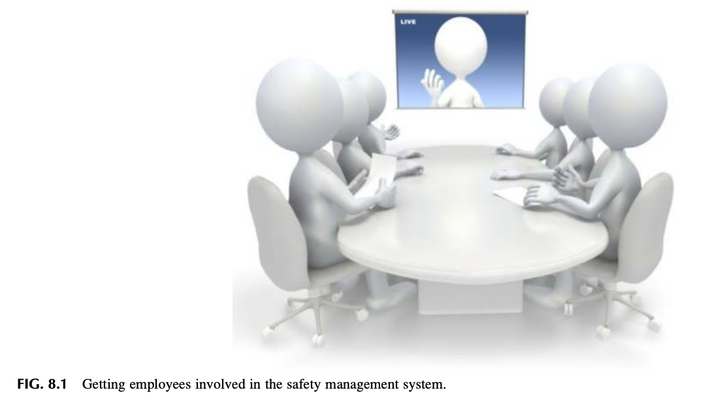
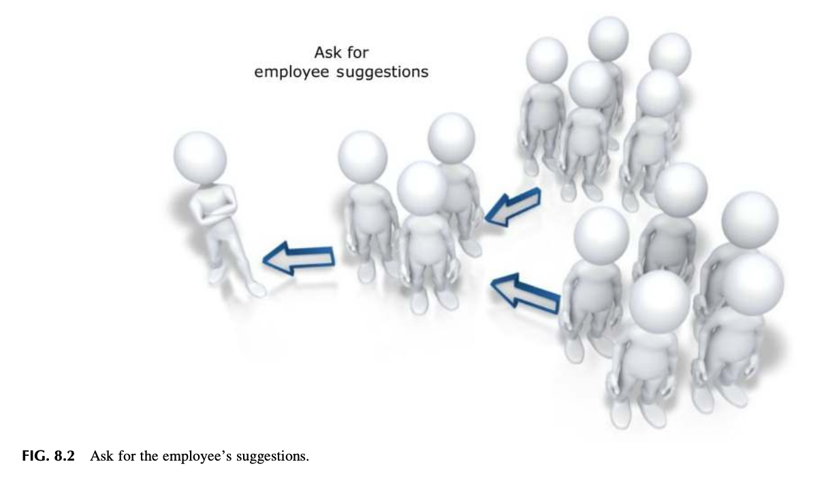
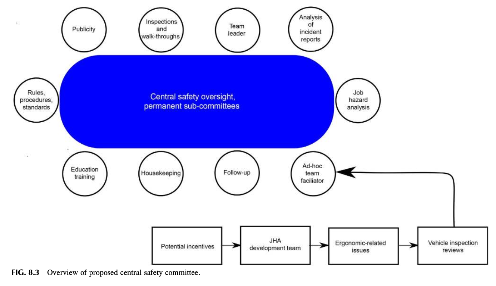
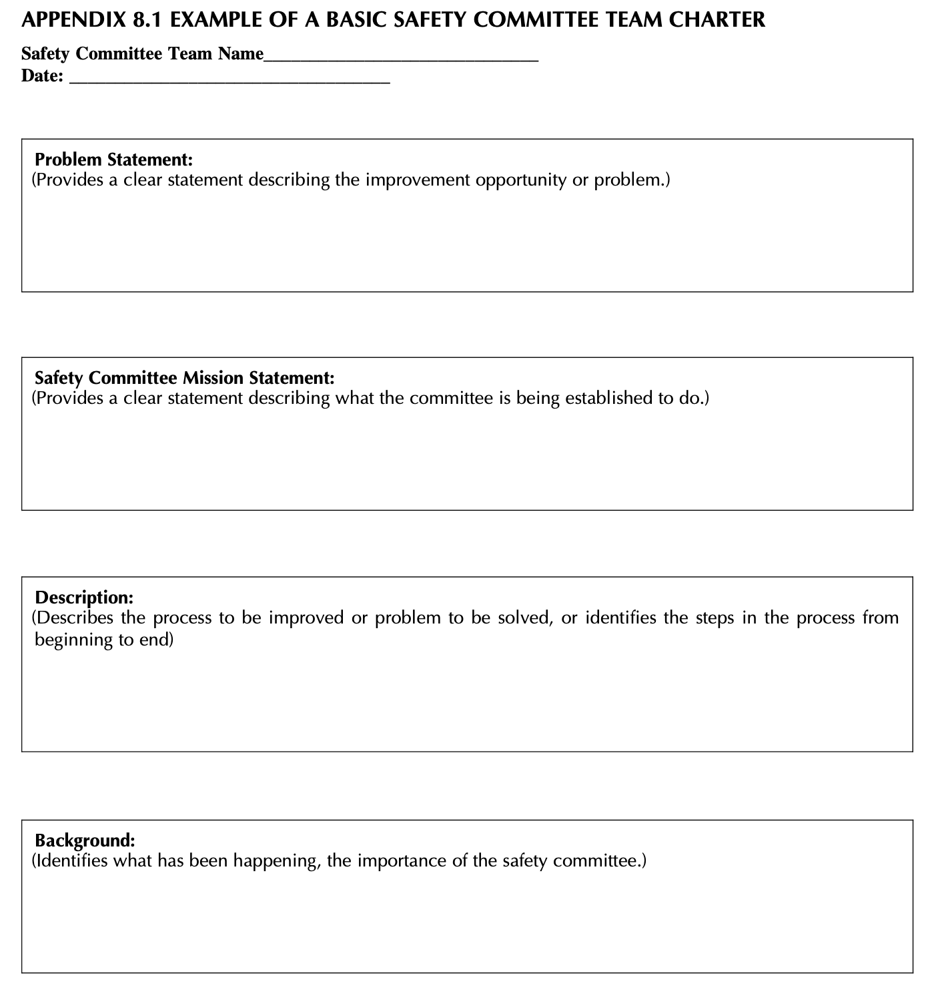
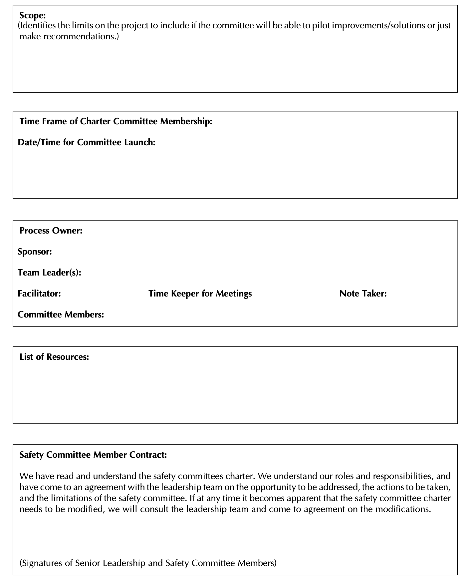
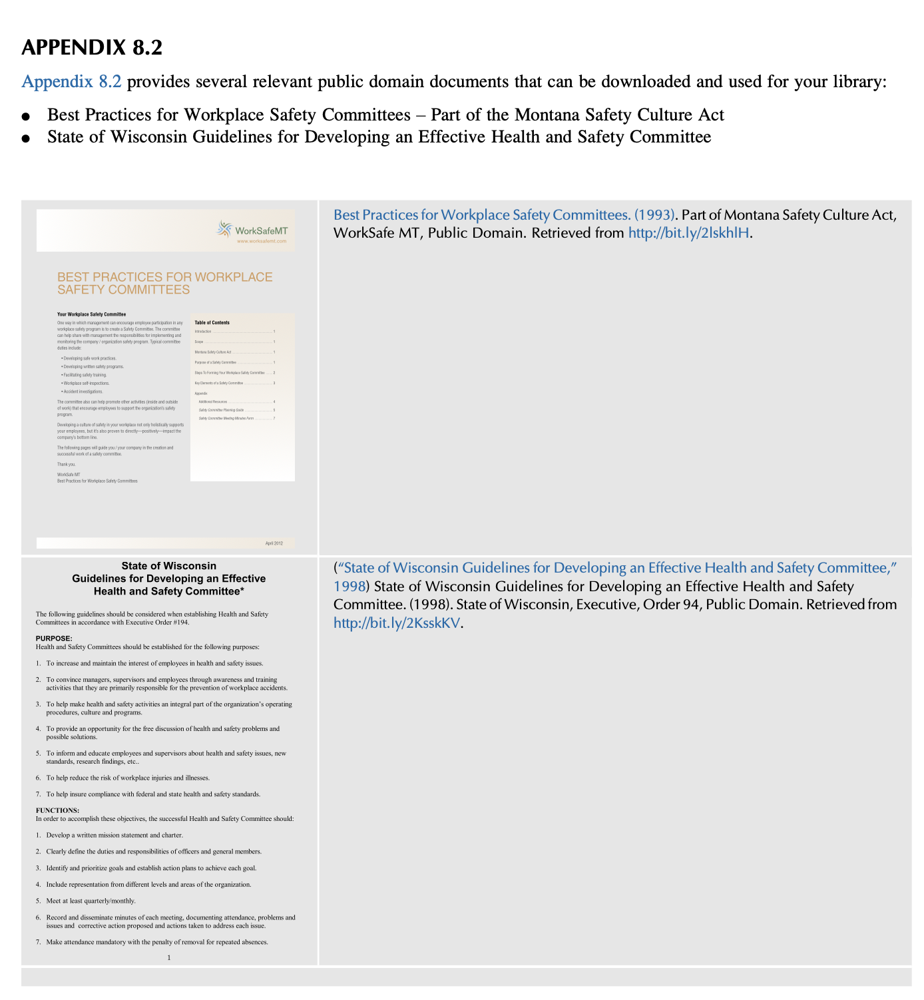

<!-- Block B01 -->
# 제8장: 안전보건경영시스템에 근로자 참여 유도하기 (Getting Employee Involvement in the Safety Management System)

훌륭한 인재들과 함께 출발하십시오. 명확한 규칙을 제시하고, 직원들과 솔직하게 소통하며, 그들에게 동기를 부여하고, 탁월한 성과에 대해 아낌없이 보상하십시오. 이 모든 것들을 효과적으로 실천한다면 당신은 결코 실패하지 않을 것입니다. — 리 아이아코카 (Lee Iacocca)

<!-- Block B02 -->
## 서론 (INTRODUCTION)

안전 전문가가 조직의 나머지 구성원들로부터 고립된 채 홀로 안전보건경영시스템이나 안전문화의 당면 과제들을 해결해야 할 이유는 전혀 없습니다. 실효성 있는 안전문화의 가장 핵심적인 초석은 바로 안전보건경영시스템에 대한 '근로자의 자발적 참여(Employee involvement)'입니다 (*Safety Culture, DOI: 10.1016/B978-0-12-814663-7.00008-X*).

현장 업무에 몰입하고 적극적으로 참여할 때, 풍부한 현장 경험을 가진 숙련 근로자들은 대체 불가능한 최고의 '문제 해결사(Problem-solvers)'가 됩니다. 왜냐하면 그들이야말로 작업장의 실제적·잠재적 유해위험요인과 그에 수반되는 위험성에 가장 가까이 밀착되어 있는 당사자들이기 때문입니다. 현장에 잠재된 숨은 위험과 통제되지 않은 위험이 상존한다는 점을 고려할 때, 위험 요인을 찾아내고 소통하는 데 근로자를 참여시키는 것은 안전보건경영시스템의 성패를 가르는 절대적 요소입니다.

안전보건경영시스템은 경영진 리더십 팀을 포함한 전 임직원 간의 끊임없는 상호작용(Interaction)에 의해 지탱됩니다. 이러한 상호작용의 일차적 목표는 위험 요인을 식별하는 실효성 있는 방법론을 개발하고, 위험 노출을 줄이거나 통제하는 프로세스를 현장에 확고히 정착시키는 데 있습니다. 열린 긍정적 소통을 통한 활발한 상호작용은 식별된 안전 문제에 대해 훨씬 더 탁월하고 현실적인 해결책을 도출하고 실행할 수 있는 가능성을 비약적으로 높여줍니다.

조직의 모든 계층에서 직원들을 가장 잘 참여시킬 수 있는 방안에 대한 면밀한 진단 평가가 선행되어야 합니다. 직원들이 문제 해결의 주체적인 일원으로 참여하고, 더 이상 안전에 무관심하거나 운영 문제에 대한 통찰력이 부족한 존재로 치부되지 않을 때, 형성된 긍정적인 신뢰 관계는 전사적 안전문화를 획기적으로 고양시킵니다.

본 장을 학습한 후 독자는 다음 사항을 논의하고 수행할 수 있어야 합니다:
* 직원들이 안전보건경영시스템에 반드시 적극 참여해야 하는 이유를 논의한다.
* 근로자 참여를 촉진하기 위한 구체적인 가이드라인과 지침을 논의한다.
* 안전 프로세스의 실효성에 대한 일선 직원들의 생생한 통찰을 수집하는 가장 최선의 방법을 식별한다.
* 직원들이 안전 프로세스 참여를 꺼리거나 주저하게 만드는 근본 이유들을 심층 논의한다.
* 사내 안전보건위원회의 제도적 구조와 산하 영구 분과위원회의 구성을 논의한다.
* '특별 임시 분과위원회(Ad Hoc subcommittees)'의 개념이 무엇이며, 이를 현장에 어떻게 실효성 있게 가동할 것인가를 논의한다.

<!-- Block B03 -->
## 왜 직원이 참여해야 하는가? (WHY SHOULD EMPLOYEES BE INVOLVED?)

경영진 리더십 팀은 조직을 가장 올바르게 인도한다고 믿는 전략적 목표와 세부 추진 과제와 함께 회사의 전반적인 비전과 사명(미션)을 제시합니다. 그러나 수많은 경영상 의무와 거시적 현안에 쫓기는 경영진은, 현장 근로자들이 매일 자신의 업무를 완수하기 위해 체득해 온 세부 작업 단계와 과업에 대한 정밀한 실무 지식과 현장의 고충을 쉽게 간과할 수 있습니다.

저자들은 수많은 기업의 직무 위험 분석(JHA) 수립을 자문하면서 이러한 괴리를 무수히 목격했습니다. 다양한 사례에서 경영진이 "현장에서 이렇게 작업하고 있을 것"이라고 믿는 바와, 현장 근로자들이 "실제로 일하고 있는 방식" 사이에는 엄청난 차이가 존재했습니다.

안전 프로세스에 근로자를 참여시키는 것은 눈에 보이지 않게 숨겨진 위험 요인과 취약점을 수면 위로 끌어올리는 데 절대적으로 중요합니다. 근로자들은 정해진 작업 단계와 단위 과업을 수행하는 동안 생산 설비와 현장의 작업 위험에 매일 직접 노출됩니다. 근로자들은 비록 어떤 과업을 완수하기 위해 무엇이 필요한지는 정확히 알고 있을지라도, 조직 시스템 내에 내재된 구체적인 유해위험요인과 그에 수반되는 공학적·통계적 위험성을 학술적인 언어로 설명하는 데는 익숙하지 않을 수 있습니다.

오랜 현장 경험과 작업자들 간의 '구전(Word of mouth)'을 통해, 근로자들은 손실 사고를 회피하거나 위험을 피하기 위한 자신들만의 비공식적인 작업 요령을 자체적으로 개발해 왔을 수 있으며, 이는 경영진이나 안전 전문가에게 공식적으로 공유되지 않는 경우가 많습니다. 심지어 많은 경우, 현장 작업자들은 통제되지 않은 위험 요인을 그저 "이 일을 하려면 어쩔 수 없이 감수해야 하는 당연한 직무의 일부"로 체념하고 받아들이고 있기도 합니다.

근로자의 참여를 장려하기 위한 핵심적인 기본 조치들은 다음과 같습니다:
* 전사적 안전 노력에 직원들을 파트너로 동등하게 참여시킨다.
* 숙련된 현장 근로자들을 안전 관련 문제 해결, 위험성평가, 사고 조사 등의 '문제 해결사(Problem-solvers)'로 공식 초빙한다.
* 직무 위험 분석(JHA)을 검토하고 완성하는 전 과정에 일선 근로자를 주도적으로 참여시킨다.
* 직원들이 자신의 창의적인 아이디어와 개선 제안을 자유롭게 개진하도록 적극 장려한다 (Managing Worker Safety and Health, 2016).

(그림 8.1은 안전 프로세스에 근로자를 참여시키는 표준 흐름을 보여줍니다. 그림 8.2는 조직의 안전문화를 개선하기 위해 직원들의 개선 제안을 직접 묻고 경청하는 것에서 참여가 출발할 수 있음을 제시합니다.)

<!-- Block B04 -->
## 직원이 안전 프로세스에 참여하지 않는 이유 (REASONS EMPLOYEES ARE NOT INVOLVED IN THE SAFETY PROCESS)

어떠한 안전 프로세스에서든 근로자의 실질적 참여를 이끌어내기 위해서는, 먼저 한 걸음 물러서서 "직원들이 왜 참여할 수 없거나, 혹은 왜 참여하기를 원하지 않는가?"에 대한 근본적인 원인을 냉정하게 들여다보아야 합니다. 직원들이 참여를 꺼리는 가장 명백하고 충격적인 이유 중 하나는, 역설적이게도 **조직 내에 구성원의 참여를 허용하고 보장하는 공식적인 안전 참여 프로세스 자체가 아예 존재하지 않는다**는 사실입니다.

<!-- Block B05 -->

직원들이 왜 안전 활동에 참여하지 않는지를 이해하기 위한 출발점은, 조직이 평소 "안전(Safety)"을 어떠한 시각으로 바라보고 인식하고 있는가를 분석하는 데 있습니다. 만약 조직이 안전을 '생산성을 저해하는 성가신 방해물'로 보거나, '근로자의 본업이 아닌 부차적인 겉치레'로 인식하고 있다면, 모든 안전 활동은 그저 법적 규제 요건에 맞추기 위한 형식적인 물리적 시설 점검에만 국한되고 정작 작업자들이 매일 수행하는 실제 작업과는 완전히 겉돌게 됩니다. 안전에 대한 이러한 왜곡된 편견은 일선 직원의 참여 필요성을 원천적으로 차단해 버립니다.

**그림 8.1 안전보건경영시스템에 근로자 참여 유도하기 (Getting employees involved in the safety management system)**

<!-- Block B06 -->

**그림 8.2 직원의 개선 제안을 직접 묻고 경청하라 (Ask for the employee’s suggestions)**

저자들은 안전에 대한 부정적인 인식이 팽배한 사업장일수록, 개인보호구(PPE)의 선정이 그저 구매 부서의 단가 절감 예산 논리에 종속되어 버리는 안타까운 현실을 수없이 목격했습니다. 어떤 보호구를 구매해야 하는지, 그것이 작업자의 신체 치수에 맞는지, 올바른 착용법과 유지관리 교육이 이루어지는지에 대해서는 거의 아무런 고민도 하지 않습니다.

올바른 안전보건경영시스템 하에서는, 개인보호구를 선정하고, 지급하며, 착용하고, 점검 및 교체하기에 앞서, 유해위험요인이 실제로 존재하며 그것이 다른 상위 통제 대책으로 완전히 제거될 수 없는지를 검증하는 포괄적인 사전 평가가 반드시 선행되어야 합니다.

강력하고 긍정적인 안전문화를 가진 선진 조직에서는, 보호구가 실제 현장의 위험 통제 필요성을 충족하는지, 작업자가 불편함 없이 제대로 착용할 수 있는지를 판별하기 위해 **선정 단계에서부터 일선 근로자들을 직접 참여**시킵니다. 보호구의 올바른 착용은 형식적 강요가 아니라 깊이 내재화된 문화적 신념에 의해 지탱되는 표명된 핵심 가치로 자리 잡습니다. (보호구 선정에 관한 심층적인 논의는 제12장 '직무 위험 분석의 활용'에서 다룰 것입니다.)

관리자들은 종종 작업자들에게 적절한 개인보호구를 착용하게 하거나 안전 작업 절차를 준수하도록 유도하는 것이 너무나 어렵다고 불평하곤 합니다 (Managing Worker Safety and Health, 2016). 현장 위험 요인을 점검할 때 작업자가 보호구를 제대로 착용하지 않고 있는 모습이 관찰된다면, 이는 작업자가 안전 프로세스에 적극적으로 참여하거나 몰입하지 못하고 있음을 직접적으로 증명하는 명백한 피드백입니다.

이러한 단순한 관찰 하나만으로도 안전 프로세스의 모든 측면에 대해 수많은 본질적인 질문들이 쏟아져 나오게 됩니다. 안전보건경영시스템이 제공하는 구조와 위험 통제에 대한 전반적 진단은, 구체적인 안전 프로그램들이 현장에서 어떻게 실행되고 소통되는지에 존재하는 심각한 괴리와 공백을 드러냅니다. 예를 들어, 개인보호구는 안전 프로세스가 강력히 옹호하는 **'위험 통제 계층구조(제거 > 대체 > 공학적 대책 > 관리적 대책 > PPE)'**의 모든 상위 단계들을 면밀히 검토하고 난 후에야 비로소 제공되는 '최후의 방어선'이어야 합니다.

<!-- Block B07 -->
### 주의 사항 (Caution)

기억하십시오: 개인보호구(PPE)는 고유한 방어 역할을 수행하지만, 현장의 모든 안전 문제를 해결해 주는 만병통치약이 결코 아닙니다. 현장에는 우리가 너무나 쉽게 간과하곤 하는, 반드시 근원적으로 해결되어야 할 훨씬 더 많은 유해위험요인들이 존재합니다.

유해위험요인을 근원적으로 통제하고 제거하는 것은 결코 쉬운 작업이 아니지만, 보호구를 구매하여 지급하는 것은 관리자 입장에서 가장 손쉽고 간편한 조치입니다. 그렇기 때문에 대부분의 사업장에서 보호구 지급은 수많은 위험 상황에 대한 가장 손쉬운 '기본 디폴트 해결책'으로 남용되곤 합니다. 보호구는 훌륭한 안전보건경영시스템을 구성하는 작은 일부에 불과함을 명심하십시오. 우리는 많은 상황에서 보호구를 넘어서서 설비 개선과 공학적 통제를 해법으로 모색하도록 강력히 권장합니다.

<!-- Block B08 -->
### 현장 관찰 1 (Observation 1)

제임스는 과거 한 공장에서 작업자의 눈에 이물질이 들어간 사건을 직접 겪었습니다. 비록 그 공장은 과거 안구 부상 사고 이력이 전무했던 사업장이었음에도 불구하고, 경영진 리더십 팀은 즉각 공장의 모든 안구 보호구 규정과 프로그램을 뜯어고치기로 결정했습니다. 현재 사용 중이던 모든 보안경을 전량 폐기 처분하고 새로운 유형의 고글로 전면 교체해 버렸습니다.

그러나 눈에 들어갔던 이물질은 생산 작업상의 위험에서 튄 파편이 아니라, 바람에 날린 단순한 일반 먼지 한 조각에 불과했습니다. 이 사건을 검토하고 대책을 수립하는 과정에서 일선 근로자들은 완전히 배제되었습니다. 작업 환경에 대한 과학적 위험성평가도, 근로자들과의 심층 대화도, 작업장 분석도 전혀 이루어지지 않았습니다. 애초에 안전 문제가 아니었던 사안에 대해 엉뚱한 강제 처방이 일방적으로 내려진 것입니다.

두 번째 사례는, 어떤 수공구로 인해 부상이 발생하기만 하면 해당 도구를 사내에서 무조건 사용 금지 처분하는 안전 지침을 가진 어느 조직의 이야기입니다. 한 작업자가 다목적 커터칼(Utility knife)을 사용하다가 허벅지를 베이는 상처를 입자, 경영진은 사고의 '근본 원인(Root cause)'을 규명하기 위한 어떠한 조사도 거치지 않은 채, 그 즉시 회사 내에 존재하는 모든 커터칼의 사용을 전면 금지시켰습니다.

그러나 금지된 커터칼은 특정 제조 및 포장 작업에 절대적으로 필수적인 도구였으며, 칼을 빼앗아 버리자 생산 공정 전체에 치명적인 차질이 발생했습니다. 안전에 대한 사내 구성원들의 인식은 극도로 냉소적이고 부정적으로 변질되었습니다.

이 두 가지 사례를 통해 볼 때, 과연 해당 조직의 안전 노력에 대해 직원들이 품게 된 인식은 무엇이겠습니까? 두 시나리오 모두 작업 방식의 근본적 개선 없이, 그저 일선 작업자들의 일만 훨씬 더 어렵고 고통스럽게 만드는 억지 조치들로 귀결되었습니다.

이 사례들의 공통된 비극은, 억압적인 강제 처방이 일방적으로 강요되기 전에 **평가 과정에 일선 근로자를 전혀 참여시키지 않았고 그들의 전문적 통찰을 묻지 않았다**는 점입니다. 이러한 접근법은 독재적이고 권위주의적이며, 결코 참여적인 조직문화라 부를 수 없습니다. 만약 문제에 대한 대응이 구성원과의 대화나 합리적 분석도 없이 일방적으로 이루어진다면, 과연 어느 직원이 회사의 안전 문제를 해결하는 데 자발적으로 참여하고 싶어 하겠습니까? 문제에 대응하는 조직의 방식이야말로 안전문화와 안전 프로세스의 성숙도를 적나라하게 폭로하는 가장 확실한 척도입니다.

<!-- Block B09 -->
### 직원의 목소리에 귀 기울여라 (Listen to Employees)

모든 안전보건경영시스템을 개발할 때 가장 강력하고 효과적인 접근법은 직원들이 하는 이야기에 **“그저 진심으로 귀를 기울이는 것(Just listen)”**입니다. 대단히 단순해 보이는 이 원칙이야말로 현재 안전 프로세스의 실질적인 생명력—즉 현재 조건에서 무엇이 진정으로 작동하고 무엇이 비현실적인지—을 파악할 수 있는 가장 직접적이고 정직한 길입니다.

그러나 이러한 경청의 태도는 전통적인 하향식 권위주의 스타일에 안주해 온 경영진이나 관리자들에게는 자신의 기득권을 내려놓아야 하는 대단히 어렵고 고통스러운 과제일 수 있습니다. 조직의 기존 문화가 “우리가 시키는 대로 군말 없이 따르라”며 어떠한 질문이나 현장 피드백도 허용하지 않는 왜곡된 가치 체계에 갇혀 있을 수 있습니다. 경영진 리더십 팀은 공장의 기계적 운영 측면은 잘 알고 있을지 몰라도, 직원들을 안전 프로세스에 능동적으로 참여시키는 진정한 리더십 개념에 대해서는 지극히 무지할 수 있습니다.

<!-- Block B10 -->
### 교훈 1 (Lesson Learned 1)

제임스는 사고 조사나 안전 면담을 진행할 때 매우 단순한 '경험칙(Rule of thumb)'을 철칙으로 삼았습니다. 그는 인터뷰 시간의 **“80%는 오직 경청하는 데 쓰고, 말하는 데는 20%만 사용”**하려 노력했습니다. 자신이 먼저 질문을 쏟아내기 전에 현장의 모든 객관적 사실을 진심으로 경청함으로써, 손실 사건의 잠재적 근본 원인에 가장 정확하게 도달할 수 있음을 깨달았던 것입니다. (80/20 법칙에 대한 상세한 논의는 제6장 '안전 프로세스 구축'을 참조하십시오.)

너무나 많은 경영진이 직원들을 모아놓고 일방적인 **“정보 쏟아붓기(Information Dump)”**를 남용합니다. 불행하게도 정보 쏟아붓기란 리더가 타인의 질문과 고충을 경청하고 인식하려 하기보다는, 자신이 얼마나 많은 것을 알고 있는지를 청중에게 일방적으로 과시하느라 소중한 대화 시간을 낭비하는 것을 의미합니다. 일방적 정보 투하는 리더 자신에게는 "내가 아는 것을 남들에게 다 알려주었다"는 자기만족을 줄지 모르지만, 상호 학습을 즉각 차단하고 직원의 참여를 가로막기 때문에 조직에 그 어떠한 가치 있는 지식도 전달하지 못합니다.

세계적인 베스트셀러 작가 대니얼 핑크(Daniel Pink)는 직원들과 대화를 나눌 때 그들이 사용하는 인칭대명사가 **“우리(We)”**인지 아니면 **“그들(They)”**인지를 주의 깊게 들으라고 조언합니다. 그는 이 탁월한 통찰을 전 미국 노동부 장관 로버트 라이시(Robert Reich)의 연구에서 인용했습니다. 만약 직원들이 대화 중에 “우리”라는 단어를 자연스럽게 사용한다면, 그것은 그들이 “자신이 중요하고 의미 있는 무언가의 당당한 일원이라고 체감하고 있음”을 증명합니다. 반대로 직원들이 회사를 지칭할 때 “그들”이라는 단어를 쓴다면, 그것은 현장 조직 내에 “상당한 수준의 단절감, 불신, 혹은 소외감(Alienation)”이 팽배해 있음을 알리는 위험 신호입니다 (Pink, 2011).

<!-- Block B11 -->
## 안전 프로세스에 직원 참여 유도하기 (GETTING EMPLOYEES INVOLVED IN THE SAFETY PROCESS)

일반적으로 “내 방식대로 따르지 않으려면 당장 나가라!(My way or the highway)”라는 식의 억압적 접근법은 직원들의 '보이지 않는 은밀한 저항(Hidden resistance)'이나 '수동적 복종(Passive acceptance)'만을 낳을 뿐입니다. 은밀한 저항은 사보타주(태업)나 전달된 지침을 뒤에서 묵살하는 행위로 나타납니다. 수동적 복종은 비록 지시 내용이 명백히 틀렸음을 알면서도 그저 시키는 시늉만 기계적으로 흉내 내는 결과를 초래합니다. 두 가지 반응 모두 안전 문제나 잠재 위험에 대한 건설적인 대화의 가능성을 원천 차단해 버립니다.

출발점으로서, 현재 현장 근로자들과 경영진 리더십 팀 사이에 과연 어느 정도의 신뢰가 존재하는지를 파악하려는 노력이 선행되어야 합니다. 안전에 대한 직원들의 부정적인 인식은 과거 혹은 현재, 자신들이 안전 개선을 건의했다가 도리어 질책을 받거나 무시당했던 쓰라린 경험에 뿌리를 두고 있을 수 있습니다. 이러한 불신을 극복하기 위해서는 리더십 팀과 근로자 사이에 가로놓인 오해와 불신의 벽을 허물기 위한 진정성 있는 노력이 선행되어야 합니다.

경영진 리더십 팀은 다음과 같은 눈에 보이는 가시적이고 긍정적인 행동을 실천함으로써 직원들과의 신뢰 소통을 온전히 회복할 수 있습니다:
* 안전하고 건강한 작업 환경을 확고히 유지하겠다는 공식 안전 방침을 서면으로 천명하고, 그 방침을 뒷받침하는 구체적인 경영진의 실천 행동을 솔선수범하여 뒤이어 보여줄 때.
* 안전한 일터를 유지하기 위해 직원들이 무엇을 기대하고 있는지를 경청하기 위해 현장 작업자들과 1:1 심층 대화를 주기적으로 실시할 때.
* 직원들에게 구체적이고 실현 가능한 고유의 안전 책임을 공식 부여할 때.
* 배정된 안전 책임을 완수할 수 있도록 충분한 작업 시간, 예산, 그리고 안전 장비와 자원을 아낌없이 지원할 때.
* 현장의 안전 관련 제안과 위험 요인 보고를 경영진이 지극히 진지하게 수용하고 즉각 검토할 때.
* 직원의 안전 제안을 체계적으로 수집하고 처리 결과를 신속히 피드백하는 제도화된 제안 시스템을 가동할 때. 이 시스템은 모든 제안이 지체 없이 검토되고 신속히 개선에 반영되도록 보장해야 하며, 만약 제안이 지연되거나 채택되지 못할 경우 그 구체적인 이유를 제안자에게 투명하게 설명해 주어야 한다 (Managing Worker Safety and Health, 2016).

<!-- Block B12 -->
## 직원 참여를 위한 기본 가이드라인 (GUIDELINES FOR EMPLOYEE INVOLVEMENT)

현장의 안전 수칙과 작업 절차를 수립하는 과정에 직접 참여하도록 요청받은 근로자들은 안전 프로세스에 대해 강력한 주인의식(Personal stake)을 갖게 됩니다. 작업자들은 자신이 직접 개발하고 제안하는 데 기여한 안전 아이디어를 현장에서 훨씬 더 열정적으로 지지하고 철저히 준수합니다 (Recommended practices for safety and health programs in construction, 2016).

직원들에게 참여할 수 있는 최선의 기회를 제공하기 위해 조직 운영 방식에 과감한 변화가 이루어져야 합니다. 조직의 모든 계층에서 실질적인 근로자 참여를 촉진하기 위한 표준 핵심 지침들은 다음과 같습니다:
* 작업장 안전보건 현안의 진행 상태와 최신 개선 동향을 전 임직원에게 정기적으로 투명하게 소통한다.
* 각 직무 과업에 특화된 세부 안전보건 프로그램 및 관련 정보에 대해 직원들이 언제든 자유롭게 100% 접근할 수 있도록 보장한다.
* 유해위험요인을 식별하고 평가하는 방법론, 위험성평가 결과에 따른 우선순위 판정 기준, 직무 교육훈련 기준, 그리고 안전보건경영시스템 평가 결과에 대해 전 직원을 친숙하게 교육하고 숙지시킨다.
* 산업재해 부상, 구급 처치 사례, 아차사고(Near misses), 손실 유발 사건, 그리고 현장에서 새롭게 대두되는 유해위험요인과 위험성을 누구나 즉시 보고할 수 있는 무비난 공식 보고 체계를 확립한다.
* 직원이 제안한 안전 개선 권고사항에 대해 지체 없이 신속하고 명확한 공식 답변과 조치 계획을 피드백한다.
* 현장의 구체적인 위험 요인을 식별하는 방법을 정의하고, 작업자가 직접 통제할 수 있는 범위 내의 위험을 스스로 개선할 수 있도록 현장 직원을 주도적으로 참여시킨다.
* 작업장의 안전 작업 수칙을 새롭게 제정하거나 기존 절차를 개정할 때 일선 근로자를 반드시 참여시킨다.
* 기존 재직자, 신규 채용자, 전보 발령자 및 숙련 근로자 모두에게 사업장 특화 맞춤형 안전 교육훈련을 체계적으로 제공한다.
* 사내 안전 회의에서 다루어질 안전 관련 콘텐츠와 발표 자료를 개발하고 직접 발표하는 과정에 현장 근로자를 주도적으로 참여시킨다.
* 대인관계적 배려와 상호 확인(Peer-checking)을 통해 직원들이 서로의 안전을 지켜주는 원팀 접근법(Team approach)을 강력히 장려한다.
* 현장 합동안전점검, 안전 순찰 워크스루 등에 경영진과 근로자가 한 조를 이루어 함께 참여하도록 제도화한다.
* 근로자가 경영진 리더십 팀 및 전문 안전 자문위원회, 특별 태스크포스 등에 참여하는 데 필요한 공식적인 작업 시간과 자원을 차질 없이 보장한다.
* 기업의 전사적 공정 운영 전반에 걸친 모든 안전 관련 의사결정 프로세스에 근로자의 목소리가 실질적으로 반영되도록 보장한다.  
*(출처: 미국 직업안전보건청 OSHA 건설업 안전보건 프로그램 권장 실무 지침, 2016)*

<!-- Block B13 -->
## 직원들에게 참여를 “그저 정중하게 요청하라” (“JUST ASK” EMPLOYEES TO GET INVOLVED)

가장 단순하면서도 대다수 조직에서 가장 어처구니없이 간과되는 최고의 비결은 바로, **“직원들에게 안전 프로세스에 참여하고 싶은지를 그저 정중하게 직접 물어보는 것(Just ask the employees)”**입니다. 직접 요청을 받게 되면 직원들은 마지못해 끌려온 동원자가 아니라 스스로 결단한 자발적인 '자원봉사자(Volunteers)'가 되며, 그들의 헌신은 결코 위에서 강제된 의무적 복종이 아니게 됩니다.

<!-- Block B14 -->
### 교훈 2 (Lessons Learned 2)

제임스는 과거 한 공장장에게 왜 직원들이 안전 프로세스에 적극적으로 참여하지 않는지를 물었습니다. 그 공장장은 직원들을 참여시키기 위해 자신이 알고 있는 모든 수단과 방법을 다 써보았지만, 도대체 왜 아무도 참여하려 들지 않는지 도무지 이해할 수 없다며 깊은 좌절감을 토로했습니다.

제임스는 공장장에게 결정적인 한마디를 던졌습니다: **“공장장님, 직원들에게 직접 참여해 달라고 직접 물어보신 적이 있습니까?”** 공장장의 대답은 놀랍게도 “아니오, 누구에게도 직접 물어본 적은 없습니다”였습니다.

알고 보니 그 공장은 다문화 인력으로 구성되어 있었고, 영어를 유창하게 구사하지 못하는 외국인 이주 노동자들이 다수 근무하고 있었습니다. 공장장은 자신이 그들의 언어를 할 줄 모른다는 지레짐작 때문에 직원들에게 안전 참여를 직접 권유하기를 주저해 왔던 것입니다.

제임스와 공장장은 현장으로 내려가 작업자들과 직접 대면하여, 현장의 안전 문제를 함께 해결하는 데 동참해 주겠느냐고 정중하게 요청하기 시작했습니다. 직원들의 반응은 놀랍게도 압도적인 **“네, 기꺼이 참여하겠습니다!(YES)”**였습니다. 직원들은 현장 안전에 대해 소통하기에 충분한 기본 영어를 이미 구사할 줄 알았습니다. 직접 다가가 요청하는 것만으로도 참여율은 극적으로 개선되었습니다.

<!-- Block B15 -->
## 소박한 출발이 거대한 파급효과를 창출한다 (SIMPLE BEGINNINGS CAN GENERATE AN IMPACT)

근로자의 참여를 사내 인적 '네트워크(Network)'를 구축해 나가는 과정으로 바라볼 때, 경영진은 직원 참여가 고도화된 안전보건경영시스템으로 나아가는 가장 결정적인 연결고리임을 훨씬 더 명확히 이해하게 됩니다.

의사소통을 네트워크의 연결망을 따라 흐르는 것으로 이해한다면, 비록 초기에는 참여하는 적극적인 핵심 근로자의 수가 소수에 불과할지라도 그들의 긍정적인 영향력이 조직 전체로 어떻게 급속히 확산되어 나가는지를 객관적으로 평가할 수 있습니다.

현장의 위험 요인들이 실질적으로 해결되고 그 성과가 투명하게 소통됨에 따라, 다른 동료 근로자들은 경영진이 직원 참여를 지극히 진지하게 대우하고 있으며 안전 참여가 자신들의 생명과 건강에 직접적인 혜택을 가져다준다는 사실을 두 눈으로 똑똑히 목격하게 됩니다. 이를 통해 조직 내에는 강력한 상호 신뢰와 긍정적인 평판의 문화적 '밈(Meme)'이 자생적으로 번져나가게 됩니다.

<!-- Block B16 -->
### 안전위원회 (Safety Committees)

안전위원회(산업안전보건위원회)는 사내에서 근로자의 자발적 참여를 이끌어내는 가장 중심적인 구심점(Focal point)입니다. 안전위원회는 전통적인 안전 프로그램의 핵심 축으로 오랫동안 인정받아 왔습니다. 효과적으로 운영되는 안전위원회는 안전 관련 활동과 긍정적인 메시지를 조직 전체로 신속하게 전파하는 강력한 촉매제 역할을 합니다.

실효성 있는 안전위원회를 구축하기 위해서는 위원회의 권한과 조직 구조를 규정하는 '헌장(Charter)'의 제정, 생산적인 회의 진행을 위한 기초 교육, 그리고 위원회의 지속가능성을 담보하기 위한 안전보건경영시스템 핵심 역량 교육이 반드시 병행되어야 합니다.

불행하게도 수많은 사업장에서 안전위원회의 존재 목적이 무엇이며 구체적으로 무엇을 달성해야 하는지에 대한 깊은 고민 없이 주먹구구식으로 위원회를 발족시키곤 합니다. 위원회를 어떻게 구성하고, 어떻게 활용하며, 어떻게 운영할 것인가에 대한 치밀한 사전 기획이 실행 전에 반드시 선행되어야 합니다.

만약 위원회가 올바르게 설계되거나 운영되지 못한다면, 위원회는 안전문화를 고양시키기는커녕 사소한 불평불만을 토로하는 '비생산적인 푸념의 장(Gripe session)'으로 변질되어 조직의 안전문화를 도리어 심각하게 갉아먹는 치명적인 역효과를 낳게 됩니다. 이러한 상황이 발생하면 안전위원회는 애초의 숭고한 취지에서 완전히 탈선해 버립니다.

안전위원회 위원을 선발하는 것은 결코 쉬운 일이 아니며, 종종 사내의 따가운 비판과 냉소에 직면하기도 합니다. 현실에서 안전위원회가 맞닥뜨리는 대표적인 문제점과 장애 요인들은 다음과 같습니다:
* 팀에 명확한 나아갈 방향이 없으며, 왜 존재해야 하는지에 대한 가시적인 이유를 찾지 못한다. 구체적인 실행 계획, 부여된 임무, 조직 구조, 혹은 정기 회의 일정이 전혀 수립되어 있지 않다.
* 경영진 리더들이 다른 업무로 너무 바쁘다는 핑계로 정기 회의에 거의 참석하지 않는다.
* 회의 의제(Agenda)가 사전에 준비되지 않아 중구난방으로 귀중한 회의 시간을 낭비한다.
* 회의가 진부하고 지루하게 흘러가 구성원들에게 어떠한 새로운 학습이나 성장의 기회도 제공하지 못한다.
* 안전 관련 논의가 구체적인 의사결정이나 실행 계획(Action plan)으로 이어지지 못하고 공허한 말잔치로 끝난다.
* 안전에 전혀 관심이 없거나 팀워크 경험이 전무한 직원들이 마지못해 억지로 위원으로 차출된다.
* 위원들이 회의에 상습적으로 불참하거나, 회의에 참석해서도 묵묵부답으로 일관하며 참여하지 않는다.
* 위원회를 이끄는 위원장이 성공적인 회의를 진행하는 데 필요한 필수적인 리더십과 퍼실리테이션 기술을 갖추지 못했다.
* 회의 안건이나 회의록 결과가 사내 전 임직원에게 신속하고 투명하게 공유되지 않는다.

새로운 안전위원회를 설립하거나 기존 위원회를 재정비하기 전에, 조직 내 다른 부서에서 이미 성공적으로 가동 중인 다른 위원회가 있는지를 먼저 면밀히 살펴보십시오. 만약 사내 다른 부문에서 탁월한 회의 진행 양식과 훌륭한 헌장을 갖춘 모범적인 위원회가 운영되고 있다면, 안전위원회를 그 성공 모델에 맞추어 벤치마킹하여 설계하십시오.

예를 들어, 사내에 성공적인 '품질 혁신 위원회(Quality Committee)'가 이미 정착되어 있다면, 그 위원회의 운영 구조, 팀 헌장, 그리고 행정 관리 방식은 이미 경영진과 직원들에게 매우 친숙할 것입니다. 안전위원회는 그 구조를 바탕으로 안전 특성에 맞게 약간의 내용만 수정함으로써, 조직과 운영 방식을 밑바닥부터 새로 발명하느라 쓸데없이 바퀴를 재발명(Reinvent the wheel)하는 우를 범하지 않을 수 있습니다.

집단 의사결정은 안전위원회 위원들이 가진 다양한 관점과 다채로운 현장 실무 경험의 융합으로부터 막대한 혜택을 얻습니다 (Managing Worker Safety and Health, 2016). 비록 위원회가 결정을 내리는 가장 빠르고 효율적인 수단은 아닐지라도, 안전 관련 현안에 대해 일선 직원들의 진정한 공감과 수용(Buy-in)을 이끌어내는 데 있어서는 집단 의사결정이야말로 언제나 최선의 선택입니다.

만약 안전위원회가 사내의 모든 부서와 계층을 아우르는 대표성 있는 인력으로 균형 있게 구성된다면, 이러한 다양성(Diversity)은 위원회의 노력을 조직 전반에 훨씬 더 설득력 있게 전파할 뿐만 아니라, 위원회의 현장 문제 해결 역량을 비약적으로 향상시켜 줍니다.

다만, 안전위원회가 생명과 건강에 즉각적인 위험(IDLH)을 초래하는 긴급 비상 상황을 다루는 의사결정 기구는 결코 아닙니다. 이러한 급박한 상황에서는 즉각적인 현장 작업 중지와 시정 조치가 단행되어야 하며, 안전위원회는 사후에 "왜 그러한 위험 상황이 발생했는가?"를 분석하고 안전보건경영시스템의 잠재적 결함을 규명하는 역할을 수행해야 합니다.

안전위원회가 존재한다고 해서 안전한 작업 환경을 보장해야 할 경영진 리더십 팀의 법적 책임과 책무성이 결코 면제되거나 대체되는 것은 아닙니다. 안전위원회는 본질적으로 자문 기구(Advisory team)이지만, 유해위험요인과 관련 위험성을 통제하는 데 현장 직원들의 창의적인 에너지와 전문성을 집중시키는 거대한 확성기 역할을 합니다. 위원회가 사내 전반적인 사회적 네트워크 속에 탄탄히 뿌리내리게 되면, 통상적인 보고 체계에서는 관료주의나 기타 이유로 차단되기 십상이었던 핵심 안전 정보들을 경영진과 일선 근로자 양측에 신속하고 가감 없이 직통으로 전달하는 고속도로 역할을 수행합니다. 안전위원회는 조직 내부의 관료적 장벽을 단숨에 뛰어넘는 강력한 바이패스 통로입니다.

<!-- Block B17 -->
## 팀 헌장의 제정 (ESTABLISHING THE TEAM CHARTER)

안전위원회의 활동 범위, 권한 및 조직 구조를 명확히 규정하기 위해 공식적인 '팀 헌장(Team Charter)'을 제정할 것을 강력히 권장합니다. 헌장이란 위원회의 존속 기간 동안 위원회의 나아갈 방향을 안내하고, 위원회가 왜 설립되었는지에 대한 근본적인 존재 이유를 천명하는 최고 수준의 공식 규범 문서입니다.

프로젝트 관리(Project Management) 분야에서 '프로젝트 헌장'이란 특정 프로젝트의 구체적인 범위, 목표, 그리고 참여자를 공식 선언하는 기준 문서입니다. 헌장은 역할과 책임의 경계를 명확히 설정하고, 프로젝트의 핵심 목표를 개괄하며, 주요 이해관계자를 식별하고, 프로젝트 리더의 실질적 권한을 정의합니다. 헌장은 향후 프로젝트가 나아갈 모든 공식 권한의 확고한 준거 기준선 역할을 수행합니다 (Charter, 2018).

팀 헌장은 경영진 리더십 팀과 초기 안전위원회 위원들이 동등한 파트너로서 함께 참여하는 공동의 협력을 통해 작성되어야 합니다. 헌장은 박제된 문서가 아니라 상황의 변화에 발맞추어 정기적으로 검토되고 개정되는 '살아있는 문서(Living document)'여야 합니다. 다만, 위원회의 핵심 사명과 기본 골격은 가능한 한 영구적이고 흔들림 없이 유지되어야 합니다.

안전위원회의 설립 절차는 본질적으로 일반 기업의 전문 프로젝트 팀을 구축하는 절차와 완벽히 동일합니다. 효과적인 위원회 헌장을 제정하기 위해서는, 위원회가 수행할 잠재적 직무, 공식 책무성 및 실질적 권한을 평가하기 위해 사전에 다음의 핵심 질문들에 대해 명확한 합의를 도출해야 합니다:
* “이 안전위원회의 근본적인 설립 목적은 무엇인가?
* 안전위원회에 부여되는 구체적인 권한, 책임 및 책무성은 무엇인가?
* 안전위원회는 자신의 성공 여부를 어떠한 객관적 지표로 측정할 것인가?
* 안전위원회를 경영진 차원에서 후원하고 지원할 최고위 임원(스폰서/챔피언)은 누구인가?
* 위원은 구체적으로 누구이며, 각 위원의 공식 임기는 몇 년으로 할 것인가?
* 안전위원회의 위원장 리더십은 어떻게 선출하며, 어떠한 주기로 순환(Rotate)할 것인가?
* 안전위원회가 반드시 엄수해야 할 구체적인 마감 시한과 목표 일정은 무엇인가?
* 안전위원회는 얼마나 자주 회의를 개최하며, 위원들에게 회의 참여를 위한 작업 시간이 공식적으로 얼마나 허용되는가?
* 안전위원회가 회의를 개최하기에 가장 이상적인 요일과 시간대는 언제인가?
* 안전위원회는 사업장 내 어디에서 모일 것인가?
* 안전위원회를 운영하기 위한 독립적인 예산은 얼마나 배정되는가?
* 위원회의 활동에 필요한 전문 자원과 외부 자문 전문가는 누구인가?
* 안전위원회의 활동 보고서와 의결 사항은 경영진과 일선 직원들에게 구체적으로 어떻게 전달될 것인가? 어떠한 소통 매체를 활용할 것인가?” (Turner & Turner, 1998)

기본 헌장 초안이 마련되면, 첫 번째 킥오프 공식 회의에서 안전위원회 위원 전체와 이를 투명하게 공유합니다. 첫 회의는 향후 모든 미래 회의의 분위기를 결정짓는 중대한 분수령입니다. 위원들은 첫 회의에서 헌장 내용을 꼼꼼히 검토하고, 토론하며, 의문을 제기하고, 필요한 수정 사항을 자유롭게 제안해야 합니다. 헌장에 대한 최종 승인은 경영진 리더십 팀과 안전위원회 위원들의 상호 합의에 의해 공식적으로 체결됩니다.

첫 단추를 꿰는 작업은 훌륭한 팀을 육성하는 데 있어 가장 결정적인 단계입니다. 팀 헌장은 팀의 존재 목적, 권한과 활동의 명확한 경계선, 그리고 구성원 자격을 명문화합니다.

수많은 팀들이 실패하는 가장 치명적인 근본 원인 중 하나는 **초기 팀 헌장이 지나치게 모호하게 작성되었다**는 점입니다. 헌장이 모호하면 팀이 본래 의도하지 않았던 영역까지 무분별하게 침범하는 '사명 일탈(Mission creep)' 현상이 발생하거나, 자신들에게 어느 정도의 권한이 있는지 혼란에 빠져 일선 관리감독자나 타 부서와 심각한 영역 다툼과 갈등을 빚게 됩니다 (Roughton & Crutchfield, 2016).

안전위원회는 자신이 조직에 진정한 실질적 가치를 더하고 있음을 지속적으로 입증해 보여야 합니다. 만약 위원회의 존재 가치가 증명되지 못한다면, 경영진도 직원들도 위원회 활동이 자신들의 소중한 시간을 낭비하는 헛수고라고 느끼게 되어 참여를 철회하고 외면하게 될 것입니다. (기본 안전위원회 팀 헌장의 표준 서식 예시는 부록 8.1을 참조하십시오.)

<!-- Block B18 -->
## 안전위원회 위원의 선발 (CHOOSING SAFETY COMMITTEE MEMBERS)

성공적인 안전위원회를 운영하기 위해서는 다양한 부서와 직무 계층을 고루 아우르는 공정하고 대표성 있는 위원 선발 프로세스가 구축되어야 합니다.

<!-- Block B19 -->
### 현장 관찰 2 (Observation 2)

제임스가 안전위원회를 구축할 때 매우 효과적이라고 검증한 실전 방법 중 하나는, 현장 직원들로 하여금 **“훌륭한 안전위원이 될 수 있는 믿음직한 동료를 서로 추천하도록 유도하는 방식”**이었습니다.

추천을 받은 직원은 다시 자신이 신뢰하는 또 다른 동료를 추천하도록 권유받으며, 이러한 과정을 거쳐 사내에 자연스럽게 동료 간 추천의 사슬이 형성됩니다. 이 방식을 적용하면 관리자가 일방적으로 위원을 임명할 때 발생하는 거부감과 불만을 완벽히 불식시킬 수 있으며, 현장 동료들로부터 실질적인 신망을 받는 진정한 비공식 리더들을 안전위원회로 자연스럽게 영입할 수 있습니다.

<!-- Block B20 -->
### 안전위원회의 위상과 구조 (The Safety Committee)

기업 조직의 규모와 공정의 복잡성에 따라, 전사 안전 프로세스를 체계적으로 지원하기 위해 중앙 안전위원회가 설립됩니다. 이 위원회는 기업에 따라 '안전보건 경영위원회(Executive Committee)' 또는 노사 합동 '산업안전보건위원회(Joint Health and Safety Committee)' 등으로 불리기도 합니다.

규모가 큰 대형 사업장에서는 중앙 안전위원회 산하에 특정 안전 전문 영역을 전담하는 전문 분과위원회를 설치하여 운영하는 것이 대단히 효과적입니다.

<!-- Block B21 -->

**그림 8.3 제안된 중앙 안전위원회 및 영구 분과위원회 구조 (Overview of proposed central safety committee)**

안전위원회의 리더십은 위원들 간의 상호 호선을 통해 선출되거나 경영진과의 협의를 통해 결정되며, 이 직책은 정기적으로 위원들 간에 순환(Rotate)될 수 있습니다. 이러한 순환 보직을 통해 안전위원회 리더십은 소수의 독점이 아닌 전 위원이 함께 나누어 짊어지는 '공동의 책임'으로 확립됩니다.

위원회가 원활하게 가동되기 위해서는 다음의 핵심적인 리더십 역할들이 반드시 공식 임명되어 작동해야 합니다:
* **위원장(Chair)**: 회의를 주재하고 원활히 이끌며, 사전에 정해진 의제가 충실히 준수되고 결정된 과업이 적재적소에 위임되도록 총괄 조율한다.
* **간사 / 서기(Secretary or Notes Keeper)**: 매 회의마다 공식 배정되어 모든 논의 사항을 꼼꼼히 기록하고, 모든 프로젝트와 결정 사항을 추적 관리할 수 있는 공식 회의록을 작성하여 배포한다.
* **타임키퍼(Time Keeper)**: 회의가 정시에 시작되고 약속된 시간 내에 칼같이 종료되도록 회의 시간을 엄격히 관리한다. 위원들이 회의를 위해 설정된 정해진 시간 제약을 철저히 준수하는 것은 구성원의 신뢰를 유지하는 데 결정적으로 중요합니다.

이러한 위원장, 간사, 타임키퍼의 표준 삼각 체제는 중앙 안전위원회뿐만 아니라 산하의 모든 영구 분과위원회 및 특별 임시위원회에서도 동일하게 확립되어야 합니다. (그림 8.3은 본 장에서 제안하는 표준 안전위원회의 총괄 조직 구조도를 보여줍니다.)

<!-- Block B22 -->
### 영구 분과위원회 (Permanent Sub-Committees)

중앙 안전위원회 하나만으로 방대한 전사 안전 활동 전체를 모두 직접 도맡아 처리하는 것은 불가능합니다. 중앙 위원들의 과도한 시간적 부담과 피로를 덜어주기 위해, 구체적인 안전 과업들을 세부 분과위원회로 분산 위임하고 각 분과위원회를 전담 위원들이 책임지고 이끌도록 구조화해야 합니다.

각 분과위원회는 상호 긴밀한 정보 공유와 조율을 통해 전사적 일관성을 유지하며, 분과 간에 어떠한 안전 공백도 발생하지 않도록 긴밀히 협력합니다. 상설 운영되는 영구 분과위원회에는 다음의 핵심 분과들이 포함될 수 있습니다:
1. 안전 홍보 분과위원회 (Publicity)
2. 현장 점검 및 순찰 분과위원회 (Inspections and Walk-Throughs)
3. 사건·사고 조사 보고 분과위원회 (Incident Reports)
4. 직무 위험 분석 분과위원회 (Job Hazard Analysis - JHA)
5. 안전 수칙, 절차 및 표준 분과위원회 (Rules, Procedures, and Standards)
6. 안전 교육 및 훈련 분과위원회 (Education and Training)
7. 5S 정리정돈 분과위원회 (Housekeeping)
8. 개선 후속 조치 분과위원회 (Follow-up)

<!-- Block B23 -->
### 안전 홍보 분과위원회 (Publicity Sub-Committee)

안전 홍보 분과위원회의 주된 임무는 안전보건경영시스템을 전사적으로 널리 소통하고 적극적으로 프로모션하는 데 있습니다. 이 분과위원회는 전사적으로 활용될 홍보 스타일과 시청각 매체를 기획하고, 모든 직원에게 안전 메시지가 막힘없이 전달될 수 있는 효과적인 소통 네트워크를 구축합니다.

홍보 분과는 다른 모든 분과위원회들이 추진하고 있는 다양한 프로젝트와 현장 개선 활동의 최신 동향을 전 임직원에게 발 빠르게 업데이트해 줍니다. 이 분과위원회는 안전문화를 고양하기 위해 설정된 사내 목표와 비전에 대해 밝고 명확하며 긍정적인 메시지가 전사에 상시 전파되도록 보장하는 데 대단히 중대한 역할을 수행합니다.

<!-- Block B24 -->
### 현장 점검 및 순찰 분과위원회 (Inspections and Walk-Throughs Sub-Committee)

현장 안전 점검, 관리감독자 관찰 및 순찰 워크스루는 안전보건경영시스템의 가장 핵심적인 뼈대입니다. 이 분과위원회는 사업장 시설과 공정 운영에 대해 수행되는 다양한 유형의 안전 진단, 정기 점검, 그리고 테마별 현장 순찰을 총괄 조정합니다.

이 분과는 점검 체크리스트와 현장 관찰 서식이 언제나 최신 상태를 유지하고, 공정의 현실과 일치하며, 일관성을 갖고 정기적으로 실행되도록 서식을 정기 재검토합니다. 또한 다양한 점검 서식을 현장에서 올바르게 활용할 수 있도록 일선 작업자 교육을 지원합니다. 이 분과는 개선 후속 조치 분과위원회와 긴밀히 공조하여, 점검 중 발견된 위험 상태와 문제점들이 완전히 개선되거나 실효성 있는 대체 대책이 즉각 가동되도록 끝까지 추적 관리합니다.

<!-- Block B25 -->
### 사건·사고 조사 보고 분과위원회 (Incident Reports Sub-Committee)

이 분과위원회는 손실을 유발한 사고 및 아차사고에 대한 철저한 조사를 수행하는 사내 프로세스를 개발하고 운영하도록 지원합니다. 사고의 복잡성과 중대성에 따라 해당 사고만을 집중 조사하기 위한 특별 태스크포스(Ad hoc committee)를 구성하여 경영진과 함께 조사를 주도할 수도 있습니다.

이 분과는 사내에서 작성된 모든 사고 조사 보고서가 형식적 오류 없이 완결성과 일관성을 갖추었는지를 철저히 검토합니다. 그들은 사고의 근본 원인이 명확히 규명되었는지, 그리고 실행 가능한 최선의 재발 방지 대책이 빈틈없이 수립되었는지를 엄격히 판정합니다. 또한 이 분과는 최고경영진뿐만 아니라 사내 위험관리(Risk Management) 부서, 보험사 및 법률 자문단과 긴밀히 협력하여 산재 보상 및 법적 배상 책임 요건이 철저히 준수되도록 조율합니다.

<!-- Block B26 -->
### 직무 위험 분석 분과위원회 (Job Hazard Analysis Sub-Committee)

직무 위험 분석(JHA) 분과위원회는 현장의 모든 단위 작업에 대한 JHA를 개발하고 주기적으로 검토하여, 작업 안전 기준이 언제나 최신성을 유지하고 현장에서 실효성 있게 작동하도록 보장하는 데 활용됩니다.

이 분과위원회는 사업장 내에서 직무 위험 분석 프로세스가 일회성 서류 작업으로 끝나지 않고 살아 숨 쉬는 일상 활동으로 지속 유지되도록 만드는 절대적인 핵심 조직입니다. JHA는 작업 단계별 유해위험요인, 관련 위험성의 심각도, 그리고 잔여 위험이 현장에서 일관되게 통제되고 있는지를 검증하는 가장 정밀한 방법론을 제공합니다. (세부 사항은 제12장 '직무 위험 분석의 개발'을 참조하십시오.)

<!-- Block B27 -->
## 안전 수칙, 지침 및 표준 분과위원회 (RULES, GUIDELINES, AND STANDARDS SUB-COMMITTEE)

이 분과위원회는 안전보건경영시스템을 지탱하고 안전한 공정 운영과 쾌적한 작업 환경을 확립하는 데 필수적인 사내 안전 수칙, 작업 지침 및 안전 기술 표준을 제정하고, 주기적으로 개정하며, 전사적 일관성을 유지하도록 체계적으로 지원합니다.

<!-- Block B28 -->
### 현장 관찰 3 (Observation 3)

저자 중 한 명은 과거 어느 제조 기업과 함께 일했던 적이 있었는데, 그 회사는 직원이 부상을 입을 때마다 사고와 관련된 모든 원인 요소를 낱낱이 기록하여 이른바 **“사내 안전 수칙집(Book of Safety Rules)”**이라는 두꺼운 책자에 계속해서 추가해 나가는 기괴한 방식을 고수하고 있었습니다.

수년에 걸쳐 이 수칙집은 온갖 사고 원인들과 함께 무려 35페이지가 넘는 빽빽한 강제 금지 규정들로 눈덩이처럼 불어났습니다. 현장에서 새로운 부상 사고가 발생하기만 하면, 관리자들은 즉시 이 수칙집을 펼쳐 들고 다친 작업자가 과연 35페이지 중 "어떤 규칙을 위반했는가?"를 혈안이 되어 뒤졌습니다.

과거의 사고에 기반하여 수칙집에 등재된 규칙이 발견되기만 하면, 관리자들은 그 조항을 이번 사고에 기계적으로 적용하여 부상당한 피해 근로자에게 즉각 가혹한 징계 처분을 내렸습니다. 끝없이 팽창하는 안전 수칙집은 현장에서 괴물처럼 변질되어 스스로 생명력을 얻었습니다. 그 책은 오직 작업자들을 처벌하고 징계하기 위한 '징벌의 바이블'로 악용되었으며, 현장 근로자들은 35페이지에 달하는 복잡한 규칙들을 달달 외우도록 강요받았습니다.

<!-- Block B29 -->
### 교육 및 훈련 분과위원회 (Education and Training Sub-Committee)

교육 및 훈련 분과위원회는 사내 안전 관련 직무 교육을 총괄 기획하고 지원하며, 새로운 교육 아이디어, 시청각 교재, 최신 참고 문헌 및 멀티미디어 자원을 발굴하여 공급합니다.

이 분과위원회는 안전 교육이 형식적 일회성에 그치지 않고 사내에서 일관되게 제공되며, 최신 법규와 공정 변화에 맞추어 상시 업데이트되고, 조직의 실제 현장 니즈를 충실히 반영하도록 보장합니다. 교육 분과는 교육훈련 상의 사각지대와 공백을 해소하기 위한 개선 권고사항을 자문하고, 안전 교육의 전반적인 품질과 전달 방식을 철저히 감독합니다.

이 분과위원회에는 사내 전담 전문 강사진과 함께 신규 입사자 오리엔테이션 및 직무 특화 교육을 직접 담당하는 인사(HR) 부서 담당자가 반드시 포함되어야 하며, 이를 통해 구체적인 교육 요건, 교육 시간 배정, 그리고 전용 예산의 편성이 유기적으로 공조되도록 보장합니다.

<!-- Block B30 -->
### 5S 정리정돈 분과위원회 (Housekeeping Sub-Committee)

어수선하지 않고 깔끔하게 정리정돈된 쾌적한 작업 환경은 안전보건경영시스템의 가장 기초적인 토대입니다. 올바른 하우스키핑(정리·정돈·청소·청결·습관화의 5S) 관리는 생산 공정, 공구류, 설비 장비, 자재 보관소, 부품 공급품, 그리고 폐기물 보관 구역을 질서정연하게 정돈된 배열 상태로 상시 유지시켜 줍니다.

정리정돈 분과위원회는 현장의 정리정돈 상태를 상시 모니터링하여 전도(넘어짐), 낙하, 충돌 등 작업 환경의 위험 조건을 획기적으로 줄여나갑니다. 이 분과는 구성원들이 높은 수준의 정리정돈 상태를 일관되게 유지할 수 있도록 긍정적인 안전 행동, 올바른 작업 습관, 그리고 솔선수범하는 태도를 장려합니다.

정리정돈 분과는 작업장 환경을 지속적으로 순찰하여 취약 구역을 모니터링하고, 경영진이 잠재적인 정리정돈 위험 요인을 신속히 식별하도록 조력하며, 표준에 미달하는 환경이 발생하는 근본 원인을 찾아내어 시정 조치를 이끌어냅니다. 이 분과위원회의 활동 영역에는 사내 자산 보호뿐만 아니라 외부 방문객이나 도급업체 인력의 안전에 영향을 미치는 통로와 시설 환경까지 폭넓게 포함됩니다.

<!-- Block B31 -->
### 개선 후속 조치 분과위원회 (Follow-Up Sub-Committee)

개선 후속 조치 분과위원회는 안전과 관련된 정비 보수 요청 및 설비 작업의뢰서(Work orders)의 처리 전 과정을 철저히 감독합니다. 이 분과위원회는 고도의 기계적·공학적 전문성을 요구하므로, 전문 정비 기술자, 현장 경험이 풍부한 베테랑 근로자, 그리고 설비 개선에 대한 실질적인 시정 조치 권한을 가진 관리감독자로 엄선되어 구성되어야 합니다.

후속 조치 분과위원회는 일정 기간 내에 발행되고, 일정이 잡히며, 완료되었거나 혹은 여전히 미결 상태로 남아 있는 모든 안전 관련 정비 작업의뢰서를 편견 없이 객관적으로 검토합니다. 이 조직의 핵심 목표는 정비 부서가 위험성에 기초한 우선순위(Risk-related priorities)를 올바르게 설정하도록 지원하고, 결정된 안전 시정 조치가 현장에 100% 완벽하게 실행되도록 보장하는 데 있습니다.

이 분과위원회는 발행된 각 정비 작업의뢰서를 해당 의뢰서를 최초 작성하여 제출한 현장 근로자와 함께 1:1로 직접 검토합니다. 현장 실사를 통해 위험성평가를 완료하고 시정 조치의 우선순위를 확정하거나, 추가 예산이 필요한 경우 상위 의사결정권자에게 신속히 에스컬레이션합니다.

정비 부서에서 해당 작업의뢰서가 현장에서 '완료(Completed)'되었다고 전산에 등록하면, 후속 조치 분과위원회의 위원이 해당 개선 현장을 방문하여 최초 의뢰를 제기했던 현장 근로자와 함께 개선 상태를 직접 확인하고 심층 대화를 나눕니다. 관찰되었던 위험 문제가 완벽하게 해결되었다는 점에 대해 의뢰 근로자와 분과위원이 상호 합의에 도달했을 때에만, **근로자와 분과위원이 최종 시정 조치 완료 문서에 공동으로 공식 승인 서명(Sign-off)**을 날인합니다.

<!-- Block B32 -->
### 특별 임시위원회 (Ad Hoc Committees)

안전위원회 운영과 관련하여 현장에서 자주 표출되는 주된 우려 중 하나는, 직원들이 다년간 지속되는 장기적인 고정 위원직을 맡는 것에 대해 상당한 시간적 부담과 심리적 압박감을 느낀다는 점입니다.

중앙 안전위원회에서 다양한 개선 프로젝트들이 도출됨에 따라, 특정 분야의 전문성과 현장 실무 경험을 갖춘 다양한 직원들에게는 오히려 '단기 프로젝트(Short-term projects)'가 훨씬 더 매력적인 참여 기회가 될 수 있습니다. 어떤 직원은 행정 기획과 조직화 능력을 발휘할 수 있는 영구 상설 안전위원회를 선호하는 반면, 또 다른 직원은 자신이 평소 깊은 관심을 가지고 있던 특정 안전 현안 프로젝트에만 집중적으로 기여하기를 원합니다.

'특별 임시위원회(Ad Hoc Committees)'는 특정한 단일 프로젝트를 완수하기 위해 한시적으로 결성되며, 사전에 명확히 설정된 한정된 활동 기간을 갖습니다. 이 임시위원회들은 배정된 과업을 신속히 완수하기 위해 필요한 만큼 탄력적으로 자주 모임을 갖습니다. 임시위원회 위원장은 정해진 일정에 따라 중앙 안전위원회에 프로젝트 진행 경과를 공식 보고하며, 그룹의 개선 권고사항을 주기적으로 공유합니다.

단기 프로젝트를 해결하기 위해 성공적으로 구성될 수 있는 대표적인 특별 임시위원회의 예시는 다음과 같습니다:
* 근골격계 질환 및 인간공학(Ergonomics) 개선 프로젝트 팀
* 효과적인 사내 안전 인센티브 및 포상 제도 설계 팀
* 사내 운송 차량 및 지게차 정기 점검 체계 혁신 팀
* 직무 위험 분석(JHA) 표준 작성 태스크포스 팀
* 공장 화재 예방 및 소방 설비 집중 점검 팀
* 특정 고위험 공정에 대한 심층 위험성평가 팀
* 안전보건경영시스템 규정 및 지침 개정 팀

<!-- Block B33 -->
## 사업장 안전위원회의 모범 실무 관행 (BEST PRACTICES FOR WORKPLACE SAFETY COMMITTEES)

잘 관리되고 실효성 있게 가동되는 안전위원회는 산하의 다채로운 전문 분과위원회들과 함께 경영진과 현장 근로자 사이의 안전 소통을 이어주는 가장 강력한 고속도로 역할을 수행합니다.

위원회를 운영함으로써 얻을 수 있는 가장 본질적인 가치는, 안전 관련 지식과 긍정적인 메시지가 조직 전반에 걸쳐 막힘없이 선순환하도록 유지해 주는 막강한 잠재력에 있습니다. 조직의 전 부서와 다양한 계층에서 골고루 위원을 영입함으로써, 근로자의 자발적 참여는 안전보건경영시스템의 행정 운영에 헤아릴 수 없이 풍부한 실무 가치와 깊이 있는 현장 경험을 더해줍니다.

<!-- Block B34 -->
### 모범 실무 자료 (Best Practices)
귀사의 사내 안전 라이브러리에 다운로드하여 벤치마킹 자료로 즉시 활용할 수 있는 정부 공인 및 공개 도메인 공식 표준 지침서 목록은 부록 8.2를 참조하십시오.

<!-- Block B35 -->
## 요약 (SUMMARY)

* 조직의 모든 계층에서 직원들을 안전 활동에 능동적으로 참여시키는 것은 강력한 안전문화를 꽃피우기 위한 절대적이고 타협할 수 없는 핵심 요소입니다.
* 경영진 리더십 팀은 지속적인 안전 개선을 위해 조직을 가장 올바르게 이끌어줄 수 있는 명확한 비전과 사명, 그리고 연간 안전 목표를 제시해야 합니다.
* 모든 안전보건경영시스템을 개발할 때 가장 직접적이고 효과적인 접근법은 직원들이 현장에서 털어놓는 생생한 목소리에 **“그저 진심으로 귀를 기울이는 것(Listen)”**입니다. 이는 안전 시스템의 실질적인 유효성을 검증하는 가장 정직한 길입니다.
* 이러한 경청의 태도는 근로자 참여를 경험해 보지 못했거나 그 가치를 수용하지 못하는 권위적인 리더들에게는 매우 어렵고 도전적인 과제일 수 있습니다.
* 경영진이 안전 프로세스에 직원들의 참여를 요청하는 데 있어 얼마나 진정성 있는 태도를 보이고 있는가에 대해, 일선 근로자들이 진정한 '신뢰'를 품고 있는지를 파악하는 것이 무엇보다 중요합니다.
* 조직문화를 평가할 때 구성원들 사이에 형성된 신뢰의 수준은 향후 안전보건경영시스템이 성공을 거둘 수 있을지를 미리 가늠해 주는 가장 확실한 지표입니다.
* 참여를 사내 소통 네트워크의 관점에서 바라볼 때, 경영진은 직원들의 참여가 우수한 안전경영시스템을 완성하는 데 왜 가장 결정적인 연결고리인지를 훨씬 더 깊이 이해하게 됩니다.
* 안전위원회가 장기적인 실효성을 유지하기 위해서는 위원회의 권한과 활동 범위를 명시한 '팀 헌장(Charter)', 회의 진행에 관한 기본 교육, 그리고 안전보건경영시스템에 관한 핵심 역량 교육이 필수적으로 수반되어야 합니다.
* 헌장은 안전위원회의 활동 범위와 조직 구조를 공식 규정하며, 위원회의 존속 기간 동안 명확한 방향성을 안내해 주는 최고 규범 문서입니다.
* 안전위원회는 자문 기구이지만, 유해위험요인과 관련 위험성을 통제하는 데 현장 직원들의 창의적인 에너지와 전문성을 집중시키는 거대한 구심점 역할을 합니다.
* 안전위원회가 사내 사회적 네트워크 속에 견고히 자리 잡게 되면, 기존의 관료적 보고 체계에 가로막혀 있던 안전 정보들을 경영진과 근로자에게 신속하게 전달하는 고속 직통로 역할을 수행합니다.
* 특정 전문 영역과 단기 과제를 해결하기 위해 전문 분과위원회와 특별 임시위원회(Ad Hoc)를 적극 가동함으로써, 근로자 참여의 폭과 깊이를 비약적으로 확장할 수 있습니다.
* 제9장 '위험 지각의 정의(Defining Risk Perception)'에서는 다음의 핵심 주제들을 심도 있게 탐구할 것입니다:
  * 심층적인 안전문화를 확립하고 지속하기 위해서는 위험에 대한 올바른 이해와 그 통제 기법이 조직 전체에 막힘없이 스며들어야 한다는 점.
  * 안전 프로세스는 경영진에게 조직이 직면한 총체적인 위험 프로파일에 대한 완전한 진단 평가와 깊이 있는 통찰을 제공해야 한다는 점.
  * 오직 물리적 순찰 점검과 체크리스트에만 의존하여 위험 요인을 찾는 안전시스템은, 그 결과를 현장의 잠재적 운영 위험 및 유해위험요인과 직접 결합하지 못한다면 치명적인 대형 재해의 잠재력을 결코 선제적으로 예측하고 방어할 수 없다는 점.

<!-- Block B36 -->
## 장 검토 복습 질문 (CHAPTER REVIEW QUESTIONS)

1. 왜 현장 근로자가 안전보건경영시스템에 반드시 주도적으로 참여해야만 하는가?
2. 직원들이 안전보건경영시스템 참여를 꺼리거나 기피하게 만드는 현실적인 근본 원인들은 무엇인가?
3. 작업장에서 근로자의 자발적인 안전 참여를 실질적으로 촉진하고 개선하기 위해 어떠한 구체적 조치들을 취할 수 있는가?
4. 안전위원회 회의를 시간 낭비 없이 생산적으로 운영하기 위해 반드시 확립되어야 할 위원회의 3대 핵심 리더십 역할(위원장, 간사, 타임키퍼)은 무엇인가?
5. 안전보건경영시스템을 효과적으로 지원하기 위해 중앙 안전위원회 산하에 설치할 수 있는 영구 상설 분과위원회들의 주요 유형을 열거하고 설명하시오.
6. 특별 임시 분과위원회(Ad Hoc Committees)란 무엇이며, 이들이 존재하는 근본 목적은 무엇인가?
7. 현장 안전 문제와 고충에 대해 일선 근로자의 의견을 진심으로 경청하는 것이 왜 그토록 결정적으로 중요한가?
8. '근로자 참여를 위한 기본 가이드라인'에서 제시된 핵심 실천 요소들을 구체적으로 나열하시오.

<!-- Block B37 -->
## 부록 8.1 기본 안전위원회 팀 헌장 표준 서식 예시 (APPENDIX 8.1 EXAMPLE OF A BASIC SAFETY COMMITTEE TEAM CHARTER)

<!-- Block B38 -->

<!-- Block B39 -->

**안전위원회 팀 명칭 (Safety Committee Team Name)**: ______________________________  
**작성 일자 (Date)**: ___________________________________  

* **문제 정의서 (Problem Statement)**: (해결하고자 하는 안전 문제 또는 달성하고자 하는 구체적인 개선 기회를 명확하고 간결하게 서술한다.)
* **안전위원회 사명 선언문 (Safety Committee Mission Statement)**: (본 위원회가 구체적으로 무엇을 수행하기 위해 설립되었는지를 명확히 기술한다.)
* **세부 설명 (Description)**: (개선해야 할 구체적인 프로세스나 해결해야 할 문제를 기술하고, 해당 프로세스의 처음부터 끝까지의 전체 단계를 명시한다.)
* **설립 배경 (Background)**: (과거에 현장에서 어떠한 안전 문제들이 발생해 왔으며, 왜 이 안전위원회의 설립이 조직에 절대적으로 중요한가를 설명한다.)
* **활동 범위 및 한계 (Scope)**: (위원회가 수행할 수 있는 권한의 한계를 명확히 설정한다. 위원회가 독자적으로 시범 개선 조치를 현장에 직접 적용할 수 있는지, 아니면 오직 경영진에 대한 권고안 제시에만 국한되는지를 명시한다.)
* **헌장 효력 기간 (Time Frame of Charter)**:
* **위원회 출범 일시 (Date/Time for Committee Launch)**:
* **프로세스 소유자 (Process Owner)**:
* **경영진 후원자/챔피언 (Sponsor)**:
* **팀 리더/위원장 (Team Leader)**:
* **전문 진행자 (Facilitator)**:
* **회의 타임키퍼 (Time Keeper for Meetings)**:
* **회의록 작성 간사 (Note Taker)**:
* **위원회 위원 명단 (Committee Members)**:
* **소요 자원 및 지원 예산 목록 (List of Resources)**:

---

### 안전위원회 위원 서약서 (Safety Committee Member Contract)
우리는 본 안전위원회 헌장의 내용을 충분히 정독하고 완벽히 이해했습니다. 우리는 우리에게 부여된 고유한 역할과 책임을 깊이 자각하고 있으며, 해결해야 할 핵심 과제, 취해야 할 구체적 조치, 그리고 안전위원회에 부여된 권한의 한계에 대해 경영진 리더십 팀과 상호 완전한 합의에 도달했습니다. 만약 활동 중 본 안전위원회 헌장을 수정하거나 보완해야 할 필요성이 명백해질 경우, 우리는 즉시 경영진 리더십 팀과 협의하여 수정안에 대해 상호 합의할 것을 엄숙히 서약합니다.

**(최고경영진 및 안전위원회 위원 전원 서명란)**  
*(출처: Managing Worker Safety and Health, 2016; Roughton & Crutchfield, 2013)*

<!-- Block B40 -->
## 부록 8.2 안전위원회 모범 실무 가이드 공식 자료 (APPENDIX 8.2)

<!-- Block B41 -->

부록 8.2는 사내 안전 라이브러리에 내려받아 즉시 활용할 수 있는 정부 및 공공 도메인의 매우 유용한 모범 실무 공식 문서들을 제공합니다:
* **몬태나주 안전문화법(Montana Safety Culture Act) 사업장 안전위원회 모범 실무 가이드라인**
* **위스콘신주 효과적인 산업안전보건위원회 구축 및 운영 표준 지침서**

*(자료 출처: Best Practices for Workplace Safety Committees, WorkSafe MT, 1993; State of Wisconsin Guidelines for Developing an Effective Health and Safety Committee, Executive Order 94, 1998)*

<!-- Block B42 -->
## 참고 문헌 (BIBLIOGRAPHY)

* Best Practices for Workplace Safety Committees. (1993). Part of Montana Safety Culture Act. WorkSafe MT. Public Domain.
* Best Practices for Workplace Safety Committees. (2018). State of Montana.
* Charter. (2018). Dictionary.com.
* Managing Worker Safety and Health. (2016). Illinois OSHA Onsite Safety & Health Consultation Program, Public Domain.
* Pink, D. H. (2011). Drive: the surprising truth about what motivates us. Penguin Group US.
* Recommended Practices for Safety & Health Programs in Construction. (2016). Occupational Safety and Health Administration (OSHA), Public domain.
* Roughton, J., & Crutchfield, N. (2013). Safety culture: an innovative leadership approach. Massachusetts: Butterworth Heinemann.
* Roughton, J., & Crutchfield, N. (2016). Job hazard analysis: a guide for voluntary compliance and beyond. Chemical, petrochemical & process (2nd ed.). Elsevier/Butterworth-Heinemann.
* State of Wisconsin Guidelines for Developing an Effective Health and Safety Committee. (1998). State of Wisconsin, Executive order 94, public domain.
* Turner, L., & Turner, R. (1998). How to grow effective teams and run meetings that aren’t a waste of time. Ends of the Earth Learning Group.

