<!-- Block B01 -->
# 제9장 위험 지각의 정의 (Chapter 9 Defining Risk Perception)

"사람은 오직 자신이 아는 것만을 본다." – 괴테 (Goethe)
"주사위는 기억력이 없다. 그것은 매 순간 완전히 새롭게 변할 뿐이다." – CSI TV 시리즈
Safety Culture. https://doi.org/10.1016/B978-0-12-814663-7.00009-1

<!-- Block B02 -->
## 서론 (INTRODUCTION)

깊이 있는 안전문화를 지속 가능하게 유지하려면 위험(Risk)에 대한 이해와 그 통제가 조직 전체에 깊이 스며들어야 한다.
안전 전문가는 최고경영진(리더십 팀)에게 조직의 잠재적 위험에 대한 완전한 평가와 깊은 이해를 제공해야 한다. 이러한 이해에는 유해·위험요인을 식별하기 위해 단순한 현장 점검과 표면적 관찰에만 의존하는 안전보건경영시스템은, 그 결과를 잠재적인 운영 및 위험성과 체계적으로 연결하지 못한다면 부상과 손실의 잠재력을 온전히 파악할 수 없다는 인식이 반드시 포함되어야 한다.

본 장을 마친 후 당신은 다음을 수행할 수 있어야 한다:
* 유해·위험요인(Hazard)과 위험(Risk)의 학술적 차이를 명확히 구분할 수 있다.
* 위험이 무엇인지, 그리고 위험 평가(Risk Assessment)가 무엇을 의미하는지 정의할 수 있다.
* 왜 작업자들이 현장에서 불필요한 위험을 무릅쓰는지 근본 원인을 설명할 수 있다.
* "질문하는 태도(Questioning Attitude)"의 개념과 그 실천 방법을 논의할 수 있다.
* 위험성평가 도구(위험 지침 카드, Risk Guidance Card)의 구조와 활용 방안을 설명할 수 있다.
* 발생 가능성(빈도)과 결과의 중대성(심각성)을 결합하여 위험 점수를 도출하는 척도를 이해할 수 있다.

<!-- Block B03 -->
## 위험관리의 개념 (RISK MANAGEMENT CONCEPTS)

위험관리(Risk Management) 개념은 고위험 산업군(원자력, 항공, 석유화학 등)에서 수년 동안 강력히 주창되고 활용되어 왔다.
그러나 대부분의 일반 산업 안전 프로그램은 여전히 법적 규제 준수(compliance)를 중심으로 설계되어 있으며, 제한적인 선행 활동만을 동반한 채 과거의 사고 데이터(사후 손실 데이터, lag data)에 주로 의존하고 있다.
단순히 과거에 발생한 사고를 수습하는 사후 대응적 패러다임에서 벗어나, 작업 개시 전에 잠재된 위험을 선제적으로 예측하고 평가하는 사전 예방적 위험관리 체계로의 전환이 절대적으로 요구된다.

<!-- Block B04 -->
## 위험의 학술적 정의 (RISK)

미국 국가표준 ANSI/AIHA/ASSE Z10에 정의된 위험(Risk)이란 **"유해·위험 사건 또는 위험 노출의 발생 가능성(likelihood/probability)과, 그 사건 또는 노출로 인해 초래될 수 있는 부상이나 질병의 중대성(severity)의 결합에 대한 추정치"**를 의미한다.
위험 분석은 시스템이나 작업 공정 내에 존재하는 위험의 크기와 성격을 체계적으로 규명하고, 그것이 허용 가능한 수준(acceptable risk)인지 판단하기 위한 논리적 기초를 제공한다.

<!-- Block B05 -->
## 작업자들은 왜 불필요한 위험을 무릅쓰는가? (WHY ARE UNNECESSARY RISK TAKEN?)

위험은 무형(intangible)이며 작업 환경의 일상적 구조 속에 교묘히 숨겨져 있다.
모든 유해·위험 상태와 관련 위험을 다룰 때, 인간은 본능적으로 과거의 경험이나 이력에 기반하여 현재의 환경을 바라보려는 내재된 친화성(affinity)을 가지고 있다. 위험한 상황이 엄연히 존재함에도 불구하고 과거에 유사한 상황에서 아무런 사고가 발생하지 않았다면, 작업자는 무의식적으로 "이번에도 안전할 것"이라고 낙관적으로 추론한다.

이러한 행동은 다음과 같은 심리적 편향에서 기인한다:
* **정상화의 덫 (Normalization of Deviance):** 사소한 위험 수칙 위반이나 불안전 행동이 사고로 이어지지 않고 반복되면서 그것이 암묵적인 표준 작업 관행으로 둔갑한다.
* **과거 성공 경험의 오류:** "나는 지난 10년 동안 이 방식으로 작업했지만 한 번도 다친 적이 없다"는 잘못된 확신이 치명적인 위험 지각의 마비를 부른다.
* **시간 절약과 생산 압박:** 위험한 편법(shortcuts)을 통해 작업을 더 빨리 끝낼 수 있다는 보상이 안전 수칙 준수보다 더 즉각적이고 매력적으로 다가온다.

<!-- Block B06 -->
## 교훈 1 (LESSON LEARNED 1)

한 동료가 신문 인쇄기를 청소하던 한 직원의 일화를 들려주었다. 그 직원은 손에 헝겊 걸레를 칭칭 감은 채 고속으로 회전하는 인쇄 롤러에 걸레를 직접 갖다 대며 잉크를 닦아내고 있었다.
관리자가 위험성을 지적하자 직원의 대답은 이러했다: **"난 수년 동안 이렇게 작업해 왔지만 롤러에 말려들어 간 적이 단 한 번도 없어요!!"**
그러나 그 호언장담이 나온 지 얼마 지나지 않아, 직원의 손은 회전하는 롤러에 순식간에 말려들어가 으스러지는 심각한 중상을 입었다.

"주사위는 기억력이 없다"는 명언처럼, 과거에 사고가 나지 않았다는 사실이 다음 순간에도 사고가 나지 않을 것이라는 수학적 보증이 될 수 없다. 위험한 상태가 지속되는 한, 확률의 법칙은 언젠가 반드시 치명적인 손실 사고로 나타난다.

<!-- Block B07 -->
## 질문하는 태도 (QUESTIONING ATTITUDE)

"가장 중요한 것은 질문을 멈추지 않는 것이다. 호기심은 그 자체만으로도 존재할 이유를 가지고 있다." – 알베르트 아인슈타인 (Albert Einstein)

어떤 작업 활동이 진정으로 안전한지, 혹은 유해·위험요인이 제대로 통제되고 있는지 조금이라도 의심이 든다면, 작업자 스스로 안전하지 않다고 믿을 때 작업을 멈추고 질문을 던질 수 있도록 허용하는 강력한 문화적 밈(Meme)이자 행동 규범이 조직 내에 확립되어야 한다.
**질문하는 태도(Questioning Attitude)**는 "모든 것이 정상적으로 보일 때조차 이상 징후를 경계하고 의심하는 건전한 편집증(healthy paranoia)"이자 고신뢰 조직(HRO)의 핵심 안전 역량이다.

<!-- Block B08 -->
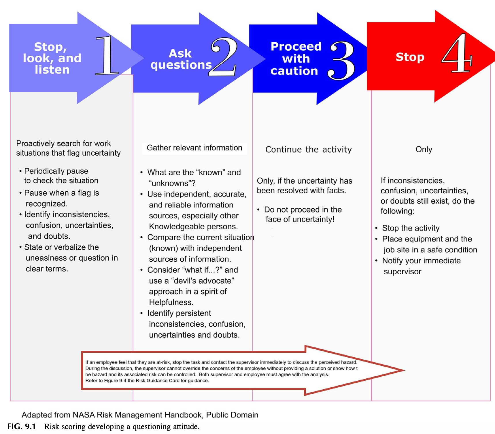
그림 9.1 위험 점수화와 질문하는 태도의 발달.

<!-- Block B09 -->
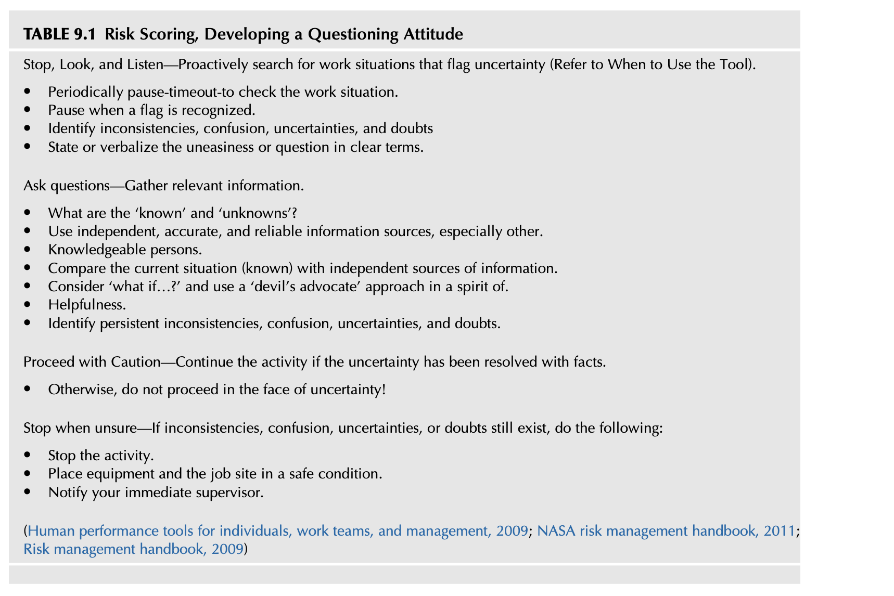
**표 9.1 위험 점수화 및 질문하는 태도의 단계적 실천 (Risk Scoring, Developing a Questioning Attitude)**

1. **멈추고, 보고, 경청하라 (Stop, Look, and Listen):**
 - 불확실성을 알리는 작업 상황을 선제적으로 탐색하라.
 - 작업 상황을 점검하기 위해 주기적으로 잠시 멈춤(Pause / Time-out)을 실행하라.
 - 이상 징후나 경고 깃발(flag)이 인지되면 즉시 작업을 멈추어라.
2. **불일치, 혼란, 불확실성 및 의구심을 명확히 식별하라:**
 - 불안감이나 의문점을 동료 및 관리자에게 소리 내어 명확히 진술하라(말하라).
 - 무엇이 정상과 다르고, 무엇이 불확실한지 구체적으로 짚어내라.
3. **질문에 대한 답을 찾을 때까지 작업을 멈추고 진행하지 마라:**
 - 작업의 불확실성이 해소되지 않았다면 절대 독자적으로 가정(assumption)에 의존하지 마라.
 - 감독자 및 전문가에게 즉각 문의하여 명확한 안전 지침을 확보하라.
4. **위험을 재평가하고 검증된 통제 조치를 확인한 후 안전하게 작업을 재개하라.**

(출처: DOE Human Performance Improvement Handbook, 2009 등 기반)

<!-- Block B10 -->
## 위험 지각을 위한 기반 구축 (BUILDING THE FOUNDATION FOR RISK PERCEPTION)

일반 산업계에서 사용되는 전통적인 위험성평가 도구들은 최고경영진이나 안전 부서의 고차원적 관리 도구로만 취급되는 경향이 있어 현장 근로자를 즉각적으로 참여시키지 못했다.
그러나 진정한 안전문화를 정착시키기 위해서는, 모든 개별 근로자가 현장에서 작업 직전에 스스로 위험을 자가 진단할 수 있는 **개인용 위험 평가 도구(Personal Risk Assessment Tool)**가 제공되어야 한다. 이는 작업자의 위험 지각 능력을 근본적으로 향상시키는 가장 효과적인 방법이다.

<!-- Block B11 -->
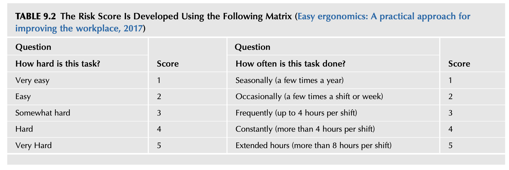
**표 9.2 직무 난이도와 작업 빈도를 활용한 기초 위험 점수 매트릭스 (Easy Ergonomics, 2017 기반):**

| 질문 1: 이 작업은 얼마나 힘든가? (How hard is this task?) | 점수 | 질문 2: 이 작업을 얼마나 자주 하는가? (How often is this task done?) | 점수 |
| :--- | :---: | :--- | :---: |
| 매우 쉬움 (Very Easy) | 1 | 거의 하지 않음 (Rarely, 연간 수회) | 1 |
| 쉬움 (Easy) | 2 | 가끔 함 (Occasionally, 월 1~2회) | 2 |
| 보통 (Moderate) | 3 | 주기적으로 함 (Periodically, 주 1~2회) | 3 |
| 힘듦 (Hard) | 4 | 자주 함 (Frequently, 매일 수회) | 4 |
| 매우 힘듦 (Very Hard) | 5 | 지속적으로 반복함 (Constantly, 하루 종일) | 5 |

<!-- Block B12 -->
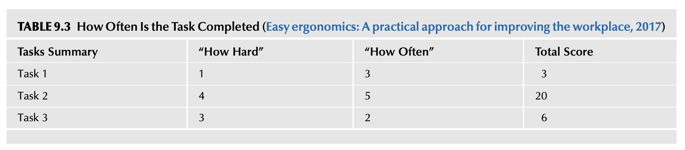
**표 9.3 작업별 위험 점수 합산 요약 예시 (Tasks Summary):**

| 과업명 (Tasks) | 난이도 점수 ("How Hard") | 빈도 점수 ("How Often") | 총 위험 점수 (Total Score = 난이도 × 빈도) |
| :--- | :---: | :---: | :---: |
| 과업 1 (Task 1) | 1 | 3 | **3** (낮은 위험) |
| 과업 2 (Task 2) | 4 | 5 | **20** (극히 높은 위험 - 즉시 개선 필요) |
| 과업 3 (Task 3) | 3 | 2 | **6** (보통 위험) |

이러한 직관적인 수치화는 작업자가 어떤 작업이 가장 위험하고 개선이 시급한지 한눈에 파악할 수 있게 해준다.

<!-- Block B13 -->
## 유해·위험요인 인식 도구 (HAZARD RECOGNITION TOOLS)

유해·위험요인을 식별하기 위해 직무 유해·위험요인 분석(JHA), 표준 작업 절차서(SOP), 위험 사냥(Hazard Hunting), 과업 분석(Task Analysis) 등 다양한 도구가 활용될 수 있다.
노출 빈도와 잠재적 손실의 심각성에 근거하여 각 위험의 우선순위가 체계적으로 매겨져야 한다.

<!-- Block B14 -->
## 위험성평가 도구의 정의 (RISK ASSESSMENT TOOL DEFINED)

본서에서 제안하는 위험성평가 도구(Risk Assessment Tool)는 근로자가 내재적 위험을 지닌 과업을 수행하기 직전에 스스로 자가 진단을 수행하기 위해 사용하는 실천 도구이다.
이 도구는 모든 직원이 작업복 주머니에 항상 휴대할 수 있는 작은 **포켓 카드(위험 지침 카드, Risk Guidance Card)**의 형태로 제공된다.

이 도구의 목표는 최고경영진을 포함한 전 직원이 다음을 수행할 수 있도록 역량을 갖추는 데 있다:
* 작업장 내 숨겨진 유해·위험요인을 즉시 인식(Recognize)한다.
* 해당 작업의 위험 수준(발생 확률과 결과 심각성)을 스스로 점수화(Score)한다.
* 위험이 허용 기준을 초과할 경우 즉시 작업을 중단하고 질문(Question)을 던진다.
* 적절한 엔지니어링 및 관리적 통제 대책을 확인한 후 안전하게 작업을 이행한다.

<!-- Block B15 -->
## 인식의 전환 (CHANGING PERCEPTIONS)

앞서 논의한 바와 같이, 종합재해지수(TCIR, Total Case Incident Rates)나 기타 사후 손실 비율을 사용하는 '손실 기반(Loss-based) 프로세스'에서 '위험 기반(Risk-based) 프로세스'로의 전환은 오랫동안 강력히 주창되어 왔다. TCIR은 가치 있는 지표일 수 있지만, 조직의 전반적인 안전 성과를 평가하는 유일한 요소가 될 수는 없다.
기초적인 측정 시스템을 개발하기 위해 제11장에서 논의될 '활동 기반 안전 시스템(Activity-Based Safety System)'의 요소들이 훌륭한 출발점이 될 수 있다.

"어떤 위험이 일반 대중에게 수용될 수 있을 때, 그 위험은 비로소 허용 가능한(acceptable) 위험이 된다." (Fewtrell & Bartram, 2001)
그러나 일반 대중에게 수용되는 위험 수준이 조직 내부에서도 그대로 수용될 수 있는 것은 아니며, 때로는 안전문화에 치명적일 수 있다. 법률 시스템과 판례법은 통제되지 않은 유해·위험요인 및 위험성에 관한 법적 책임을 다루기 위해 조직이 반드시 준수해야 하는 엄격한 법규를 확립해 두었다.
예를 들어, 직원은 근무 외 개인 시간에 스카이다이빙이나 암벽 등반과 같은 극단적인 고위험 스포츠를 즐기거나 주말에 안전벨트를 매지 않고 운전할 수도 있다. 심각한 우려는 이러한 개인적 '위험 수용(risk acceptance)' 심리 상태가 작업장 안으로 그대로 유입될 수 있다는 점이며, 허용 불가능한 위험을 사전에 차단하는 제도적 메커니즘이 조직 내에 반드시 구축되어 있어야 한다.

<!-- Block B16 -->
## 지속 가능성에 도달하기 위한 기준 (MEETING AND GETTING TO SUSTAINABILITY)

개인은 각자의 과거 경험에 기반하여 위험을 완전히 다르게 지각(인식)하므로, 위험의 심각성 수준을 제대로 분석하지 못할 수 있는 주관적인 개인의 의견 대신 **객관적이고 공식화된 도구**가 절대적으로 필요하다.
개인용 위험 평가 도구는 작업자 개개인이 지닌 주관적 편차를 표준화된 위험 척도로 보정해 주는 결정적 역할을 한다.

<!-- Block B17 -->
## 조직의 위험 지각 식별 (IDENTIFYING RISK PERCEPTION)

위험 평가 도구의 성공적인 현장 정착 가능성을 높이기 위해, 조직 환경을 평가하기 위한 다음의 일련의 질문들을 면밀히 검토해야 한다:
* 조직의 표방 가치(espoused values)는 무엇이며, 그것이 현장에서 실제로 실천되고 있는가?
* 직원들은 회사가 생산보다 안전을 진정으로 우선시한다고 믿고 있는가?
* 위험을 보고했을 때 불이익이나 비난을 받지 않을 것이라는 심리적 안전감이 존재하는가?
* 과거의 사고 사례들이 은폐되지 않고 조직의 집단적 학습 기회로 투명하게 공유되고 있는가?
* 부서 간에 위험 정보가 장벽 없이 자유롭게 소통되는가, 아니면 사일로(silo)에 갇혀 있는가?

<!-- Block B18 -->
## 관찰—주의 사항 (OBSERVATION—CAUTIONARY NOTES)

한 조직에서 제임스는 프로젝트에 대해 "롤아웃(rollout, 신규 전개)"이라는 용어를 사용했을 때 대부분의 직원들에게 극히 부정적인 뉘앙스로 받아들여진다는 사실을 발견했다.
현장 직원들에게 '롤아웃'이란 곧 사라질 또 하나의 단기 전시성 프로그램이나 "이달의 유행(flavor of the month)"이 시작되었음을 의미했기 때문이다.
화려한 수식어나 일방적인 전개 선언 대신, 현장의 언어로 소통하고 실질적인 실천 도구를 제공하는 진정성이 뒷받침되어야 한다.

<!-- Block B19 -->
## 위험성평가 도구의 현장 적용 (IMPLEMENTING THE RISK ASSESSMENT TOOL)

위험은 아무리 일상적인 작업일지라도 모든 과업, 훈련, 임무, 운영 및 개인 활동에 본질적으로 내재되어 있다. 근본적인 목표는 이 도구를 사용할 리더십 팀과 현장 직원들에게 불필요한 업무 부담을 가중시키지 않는 것이다. 도구의 도입은 프로세스를 강화하기 위해 현재의 안전보건경영시스템에 자연스럽게 통합되어야 한다.
현재 사용 중인 안전 서식과 지침을 검토하여 효과가 없는 것으로 드러난 항목을 찾아내고 이를 새로운 위험성평가 도구로 대체하라. 비효과적이거나 진부한 서식을 폐기하는 것은 리더십과 직원 모두에게 환영받는 변화가 될 수 있으며, 새로운 개념에 대한 수용성을 획기적으로 높여준다.

도구의 도입은 그것이 구체적으로 어떻게 사용되고 의도된 가치가 무엇인지 보여주는 현장 시연(demonstration)에서 출발한다. 도입 교육은 최소한 다음 요소를 포함해야 한다:
1. 위험성평가 도구의 목적과 취지에 대한 거시적 개요
2. "유해·위험요인(Hazard)"과 "관련 위험(Associated Risk)"의 명확한 정의 및 위험 평가 매트릭스 소개
3. 도구를 구체적으로 언제 어떻게 사용할 것인지에 대한 단계별 설명
4. 개인적 위험 지각의 기본 원칙 설정 및 리더십 팀과 안전 전문가의 개입이 필요한 기준선 정의

성공적인 도입과 지속적 프로세스 유지를 위해 다음 조치들이 권장된다:
* 신규 입사자 및 부서 이동자의 오리엔테이션과 온보딩 과정에 위험성평가 도구 교육을 필수로 포함한다.
* 도입 설명회는 안전 전문가뿐만 아니라 반드시 최고경영진 중 최소 1명 이상이 직접 참석하여 지지를 표명해야 한다.
* 부서 간 장벽(사일로 효과)을 허물기 위해 경영진, 관리직, 생산운영직, 정비보전직 등 전사 인원이 함께 교육에 참석한다.
* 경영진은 현장 순회나 회의 시 도구의 사용 현황과 발견 사항에 대해 지속적으로 질문함으로써 강력한 지원 의지를 보여주어야 한다.
* 직원들은 허용 불가능한 위험에 노출되었다고 판단되는 모든 활동에 대해 두려움 없이 의문을 제기할 수 있어야 한다.
"우리가 항상 해왔던 일 중 더 이상 허용 가능한 위험이 아닌 것은 무엇인가?", "어떤 일상 및 비일상 과업에 보다 정밀한 재검토가 필요한 특정 위험이 존재하는가?"라는 질문이 항상 직원들의 마음속에 자리 잡아야 한다.
판단은 시간의 흐름에 따라 변화한다. 어제 허용 가능했던 위험이 오늘과 내일에는 결코 허용될 수 없다(Mullai, 2006).

<!-- Block B20 -->
## 유해·위험요인과 위험의 학술적 정의 (HAZARD AND RISK DEFINED)

* **유해·위험요인 (Hazard):** "부상, 질병 또는 사망을 초래할 수 있는 잠재적 잠재력을 지닌 조건, 일련의 환경 또는 고유한 물리적·화학적·생물학적 속성" (ANSI/AIHA Z10, 2012). 또한 설비 파손이나 모든 유형의 손실 유발 사고를 초래할 수 있는 잠재력도 포함된다.
* **위험 / 위험성 (Risk):** "유해·위험 사건 또는 위험 노출의 발생 가능성(likelihood/probability)과, 그 사건 또는 노출로 인해 초래될 수 있는 부상이나 질병의 중대성(severity)의 결합에 대한 추정치."
* **위험성평가 (Risk Assessment):** "유해·위험요인 및 시스템 이슈와 관련된 위험의 수준을 체계적으로 측정하고 평가하는 전체 프로세스." 

<!-- Block B21 -->
## 위험의 수용성 (RISK ACCEPTANCE)

위험관리는 아무런 통제를 적용하지 않는 상태부터 최고 수준의 통제 조치를 도입하는 것에 이르기까지, 다양한 통제 수준의 가능한 이점(효익)과 손실의 잠재적 비용을 비교 형량하는 논리적인 프로세스이다.
그러나 우리는 기업의 이익이나 편의를 위해 인간의 생명과 안전을 위협하는 위험을 무분별하게 수용해서는 결코 안 되며, 윤리적·법적 경계를 엄격히 준수해야 한다.

<!-- Block B22 -->
## 교훈 2: 포드 핀토(Ford Pinto) 사건 (LESSON LEARNED 2)

포드 자동차 회사(Ford Motor Company)는 소형차 '핀토(Pinto)'의 연료탱크 설계 결함과 관련하여, 설계를 개선하는 비용보다 화재 폭발 사고로 인한 잠재적 소송 배상금을 지불하는 것이 회사에 더 이득이라는 냉혹한 비용-편익 분석(Cost-Benefit Analysis)을 바탕으로 치명적인 위험 결정을 내렸다.
포드는 그 결정으로 인해 천문학적인 배상금은 물론 돌이킬 수 없는 대가를 치렀다. 포드는 인간의 생명을 위협하는 결함에 대한 냉혈한 결정이 기업 브랜드에 미칠 파괴적인 영향과 대중의 극심한 분노를 전혀 헤아리지 못했다(The top automotive engineering failures: the ford pinto fuel tanks, 2011).

<!-- Block B23 -->
## 교훈 3: 다카타(Takata) 에어백 사태 (LESSON LEARNED 3)

다카타(Takata) 사는 특정 차종이 초기 리콜 대상에 명시적으로 포함되지 않았다는 이유로, 폭발 파편으로 탑승자를 살상하는 결함 에어백에 대한 리콜을 오랜 기간 지연시키는 무책임한 위험 결정을 내렸다(Clifford Atiyeh, 2015). 결국 다카타는 파산에 이르렀다.

"과거에 아무런 손실 사고가 발생하지 않았으므로 위험도 전혀 존재하지 않는다"는 치명적인 착각을 타파하기 위해, 리더십 팀은 각 직무 기능에 대해 다음 질문들을 던져야 한다:
* 특정 유해·위험요인에 대한 노출이 얼마나 자주 발생하는가?
* 해당 작업이 수행되거나 완료되어야 하는 빈도는 어떠한가?
* 작업의 각 단계와 세부 과업을 수행하는 동안 손실 유발 사건이 발생할 확률은 얼마인가?
* 사람, 작업 활동, 공구, 장비, 자재 및 작업 환경의 결합을 고려할 때 노출로 인한 최종 결과(consequences)는 무엇인가?
* 작업을 완료함으로써 얻는 이익 대비, 모든 부정적 결과를 고려한 손실 사고의 잠재적 비용은 얼마인가?
* 과연 그 위험을 감수할 진정한 정당성이 존재하는가? (Mishap Prevention Program, 2011)

<!-- Block B24 -->
## 왜 위험 분석과 위험 감소가 중요한가? (WHY ARE RISK ANALYSIS AND RISK REDUCTION IMPORTANT?)

위험에 대한 평가는 단순히 인명 부상을 초래하는 영역을 파악하는 수준을 훨씬 뛰어넘는다. 유해·위험요인은 모든 개연성 속에서 공장 운영의 중단, 제3자에 대한 피해, 그리고 심각한 환경 오염을 유발할 수 있는 막대한 파괴력을 지니고 있다.
위험을 사전에 분석하고 선제적으로 낮추는 것은 기업의 지속 가능한 생존과 비즈니스 연속성(BCP)을 담보하는 필수적인 전략이다.

<!-- Block B25 -->
## 위험 지각을 위한 기반 구축: 유해·위험요인 인식 도구 (HAZARD RECOGNITION TOOLS)

위험 매트릭스(Risk Matrix)는 수년 동안 운영상의 위험을 이해하기 위해 사용되어 온 대표적인 위험 평가 도구이다. 미군은 임무 수행 전 위험을 체계적으로 평가하기 위해 운용위험관리(ORM, Operational Risk Management) 도구를 공식 채택했다.
전통적인 위험 매트릭스를 현장 실무자가 쉽게 활용할 수 있는 직관적인 형태로 단순화·표준화하는 작업이 필요하다.

<!-- Block B26 -->
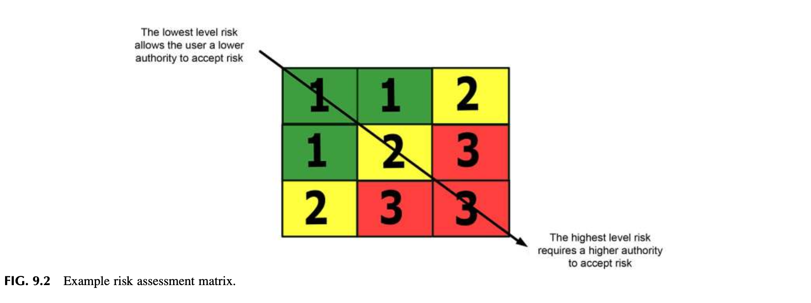
**그림 9.2 위험 평가 매트릭스 예시 (Example Risk Assessment Matrix).**
산업계에서 사용되는 전통적 위험성평가 도구들은 매트릭스 개념을 경영진의 관리 도구로만 취급하여 현장 근로자를 직접 참여시키지 못했다.
현장 풀뿌리 수준(grassroots level)에서 위험을 즉각 다루고 즉각적인 안전 조치를 취하기 위해서는 **개인용 위험 평가 도구(Personal Risk Assessment Tool)**의 활용이 대단히 효과적이다.
위험성평가를 수행할 때는 평가 대상 위험의 결과(Consequence) 또는 '얼마나 심각한지(how bad)'를 측정해야 한다. 여기서 결과는 사건의 최종 결과 또는 잠재적 결과를 의미하며, 단 하나의 사건에도 여러 가지 복합적인 결과가 수반될 수 있다(A risk matrix for risk managers, 2008).
표준화된 개인용 위험 평가 도구의 활용은 개인별 위험 지각의 주관적 차이와 변동성을 메워주는 튼튼한 가교가 된다. 직원과 리더십 팀이 함께 잠재적 위험을 논의하는 협력적 접근이 위험 지각 문제를 해결하는 최선의 방법이다.

<!-- Block B27 -->
## 개인적 위험 감수 성향—우리는 무엇이 위험한지 어떻게 결정하는가? (PERSONAL RISK TOLERANCE—HOW DO WE DECIDE WHAT IS A RISK?)

위험에 대한 지각(Perception)은 사람마다 극적으로 다를 수 있다. 위험을 평가하는 객관적인 기준선(baseline) 방법이 없다면, 개인의 주관적인 '위험 감수 성향(Risk Tolerance)'이나 안일한 위험 수용으로 인해 안전 평가 전체가 왜곡될 수 있다. 위험 평가 도구의 활용은 "무엇이 위험인가"에 대해 특정 한 사람의 주관적 의견에만 의존하는 위험성을 획기적으로 줄여준다.

컴퓨터 게임, 액션 영화 및 드라마는 무의식중에 일반 대중에게 "위험을 무릅쓰고 결과는 무시해도 된다"는 왜곡된 관념을 학습시켜 왔다. 상식을 정면으로 거부하고 물리 법칙이나 인체가 견딜 수 있는 한계를 비웃는 극단적 위험 행위가 미디어를 통해 끊임없이 미화된다. 흥미진진하긴 하지만, 주인공이 고층 빌딩에서 뛰어내려 아스팔트에 충돌하고도 털고 일어나 추격을 계속하는 장면, 상황을 전혀 모르는 '답답하고 깐깐한 안전 담당자'를 무시하고 위험을 강행하여 결국 영웅이 되는 서사가 대중의 뇌리에 매일 주입된다. 엔터테인먼트 산업은 위험을 무릅쓰는 것이 멋진 일이며 그 결과는 항상 긍정적이라는 착각을 대중에게 심어주었다. 이러한 사고방식은 최고경영진부터 현장 작업자에 이르기까지 모든 임직원에게 무의식적인 악영향을 미친다.

그러나 현실은 냉혹하다. 화이트와 보웬(White & Bowen, Hammer & Price, 2001 인용)의 정밀 연구에 따르면:
**"시속 18마일(초당 27피트 = 시속 29km)의 속도로 단단한 표면에 부딪히는 모든 사람의 50%는 그 자리에서 사망한다. 이는 단 11피트(약 3.3미터) 높이에서의 자유 낙하 충격과 동일하다!"**
엔터테인먼트 산업은 극적인 장면 이면에 숨겨진 수많은 스턴트 안전 장치와 안전망을 보여주지 않지만, 현장 근로자들에게는 높은 곳에서 떨어져도 찰과상 하나 없이 일어날 수 있다는 치명적인 왜곡된 위험 지각을 남길 수 있다.

<!-- Block B28 -->
## 위험 지침 카드: 잠재적 해결책 (THE RISK GUIDANCE CARD, A POTENTIAL SOLUTION)

안전보건경영시스템이 구축되어 있다면 유해·위험요인 통제 프로그램이 이미 실행되어 일반적인 안전 기준들을 다루고 있을 것이다.
안전 프로세스를 실질적으로 강화하기 위해, 모든 직원에게 배포되는 작은 휴대용 카드인 **위험 지침 카드(Risk Guidance Card)**는 직원들이 일상적으로 품을 수 있는 주관적이고 왜곡된 위험 지각을 객관적으로 보정하는 데 결정적인 도움을 준다.
이 카드는 복잡한 문서 작업 없이도 현장 작업자가 1분 이내에 스스로 위험 수준을 평가하고 작업 진행 여부를 결정할 수 있도록 설계된다.

<!-- Block B29 -->
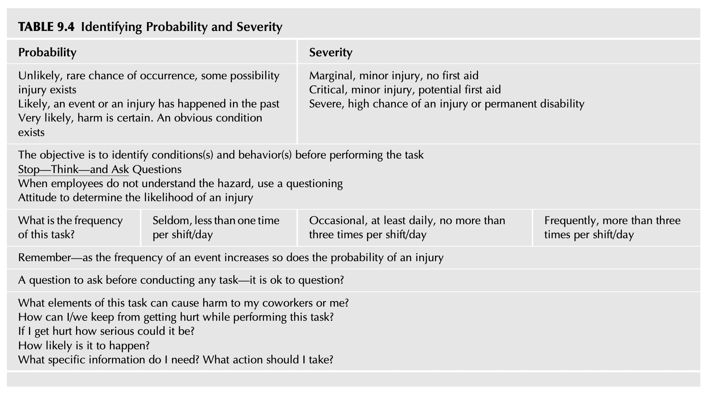
**표 9.4 발생 가능성과 심각성의 식별 기준 (Identifying Probability and Severity)**

| 구분 | 발생 가능성 (Probability / Likelihood) | 심각성 (Severity / Consequence) |
| :---: | :--- | :--- |
| **낮음 (1점)** | **희박함 (Unlikely):** 발생할 가능성이 극히 드묾, 부상 가능성이 낮음 | **경미함 (Marginal):** 경미한 상처, 단순 구급처치 불필요 또는 자가 치료 가능 |
| **보통 (2점)** | **가능성 있음 (Likely):** 과거에 유사 사건이나 부상이 발생한 이력이 있음 | **중대함 (Critical):** 의료기관 치료가 필요한 부상, 설비 파손 발생 |
| **높음 (3점)** | **매우 높음 (Very likely):** 피해 발생이 확실시됨, 명백한 위험 상태 방치 | **치명적 (Severe):** 영구 장애, 사망, 시설의 전면 가동 중단 초래 |

<!-- Block B30 -->
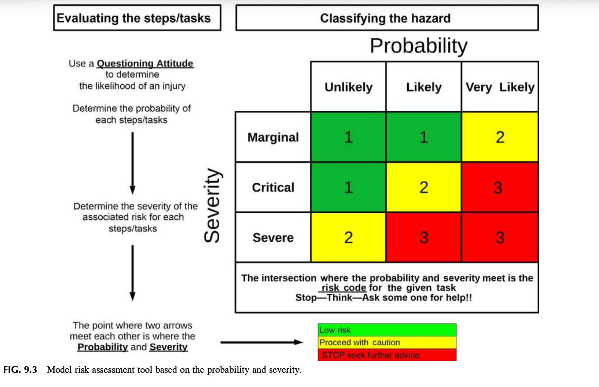
그림 9.3 발생 가능성과 심각성에 기초한 모델 위험성평가 도구 (3×3 매트릭스).

<!-- Block B31 -->
## 위험 지침 카드의 활용 (USING THE RISK GUIDANCE CARD)

그 목적은 유해·위험요인과 그 위험 수준으로부터 발생할 수 있는 부정적인 결과에 관한 잠재적 피해를 명시적으로 규명하는 것이다.
현장 근로자가 쉽게 이해하고 적용할 수 있도록 발생 가능성과 결과 심각성에 대해 간결하고 직관적인 정의를 사용한다. 카드의 뒷면에는 작업중지권(Stop-Work Authority)의 발동 요령과 비상 연락망이 함께 인쇄되어야 한다.

<!-- Block B32 -->
## 위험 점수화 체계 (RISK SCORING)

발생 가능성(Probability)과 결과 심각성(Severity)은 각각 1점에서 3점까지 점수가 매겨진다. 매트릭스 상에서 두 점수가 교차하는 지점이 바로 **"위험 등급(Risk Rating)"**이다. (표 9.7 참조).
예를 들어, 직원이 위험 지침 카드를 사용하여 작업을 평가했을 때 발생 가능성이 2점이고 심각성이 3점이라면, 위험 등급은 즉각적인 작업 중지가 요구되는 적색(Red) 경고 단계에 도달한다.

<!-- Block B33 -->
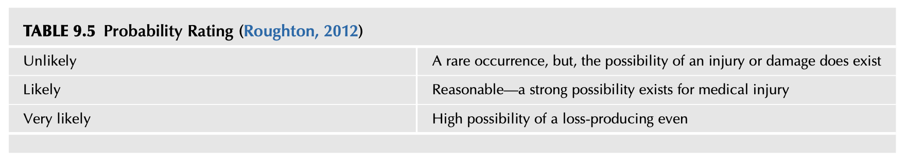
**표 9.5 발생 가능성 평가 척도 (Probability Rating, Roughton, 2012):**
* **희박함 (Unlikely):** 드물게 발생하는 사건이지만 부상이나 손실의 가능성이 존재함.
* **가능성 있음 (Likely):** 합리적 개연성—의학적 치료가 필요한 부상으로 이어질 강력한 가능성이 있음.
* **매우 높음 (Very likely):** 높은 개연성—통제 조치가 즉시 적용되지 않으면 사고 발생이 불가피함.

<!-- Block B34 -->
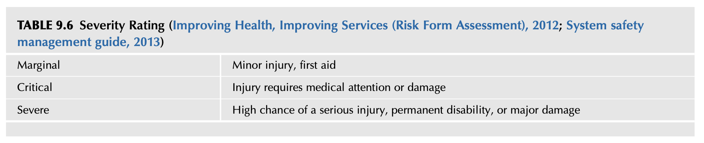
**표 9.6 결과 심각성 평가 척도 (Severity Rating, 육군 시스템 안전 관리 지침, 2013):**
* **경미 (Marginal):** 경미한 부상, 단순 응급처치 수준.
* **중대 (Critical):** 전문 의학적 치료가 필요한 중상, 상당한 설비 피해.
* **치명적 (Severe):** 사망, 영구적 전신 장애, 시설의 파멸적 붕괴.

<!-- Block B35 -->
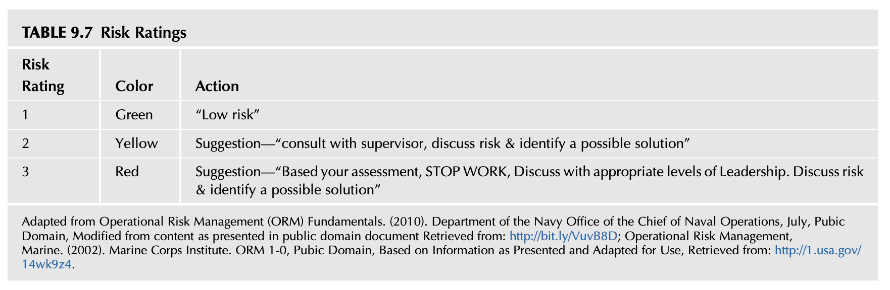
**표 9.7 위험 등급 및 행동 조치 기준 (Risk Ratings & Actions):**

| 위험 등급 | 색상 구분 | 행동 조치 지침 (Action Required) |
| :---: | :---: | :--- |
| **1등급 (Low)** | **녹색 (Green)** | **"낮은 위험"** — 정상 작업 진행, 기존 표준 작업 절차 준수. |
| **2등급 (Medium)** | **황색 (Yellow)** | **"주의/상담 필요"** — 관리감독자와 즉시 상의하고, 위험을 논의하여 추가적인 위험 저감 해결책을 도출한 후 작업 진행. |
| **3등급 (High)** | **적색 (Red)** | **"작업 중지 (STOP WORK)"** — 자가 진단 평가에 근거하여 작업을 즉시 중지하라! 상위 관리자에게 즉시 보고하고 위험 해결책이 검증될 때까지 절대 작업 재개 금지. |

(미 해군 운용위험관리 ORM 지침 등 인용)

<!-- Block B36 -->
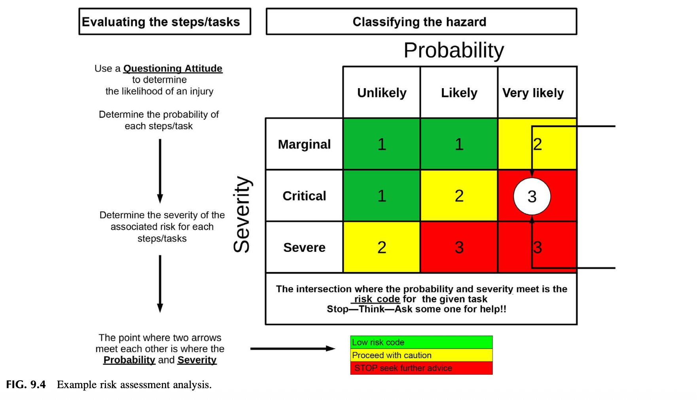
그림 9.4 위험성평가 분석 및 에스컬레이션 프로세스 예시.
만약 현장 감독자와 근로자 사이에 특정 위험의 통제 여부에 대해 합의에 도달하지 못할 경우, 해당 우려 사항은 차상위 리더십(공장장, 안전 임원 등)으로 즉시 상정(에스컬레이션)된다.
이 논의에는 해당 근로자, 직속 관리감독자, 차상위 관리자 및 안전 전문가가 모두 참여하며, 위험이 합리적으로 통제 가능한 수준으로 낮아질 때까지 논의와 작업 중지가 유지된다.

<!-- Block B37 -->
## 전사적 위험관리 책임 (OVERALL RISK MANAGEMENT RESPONSIBILITIES)

효과적인 위험관리는 리더십 팀의 구체적인 책임과 권한 수준을 다음과 같이 명시하고 규정한다:
* 무엇이 조직에서 허용 불가능한 위험(unacceptable risk)인지를 명확히 정의하고, 전사적인 공통 이해를 보장한다.
* 작업장 내 유해·위험요인을 최소화하고 통제하기 위해 필요한 인적·물적 자원을 충분히 배정한다.
* 현장 근로자의 위험 제안과 작업중지권 행사를 강력히 지지하고 보호한다.
* 위험성평가 결과를 설비 개선 및 투자 계획과 유기적으로 연계한다.

<!-- Block B38 -->
## 리더십의 위험관리 책임 (LEADERSHIP’S RISK RESPONSIBILITIES)

리더십의 구체적 책임은 다음을 포함한다:
* 손실 유발 사건의 잠재력을 식별하기 위해 위험성평가 및 관리 개념을 일관되게 적용한다.
* 근로자들이 배정된 적절한 위험 통제 절차를 철저히 따르도록 보장한다.
* 생산 압박 속에서도 안전 우선 원칙을 일관되게 고수한다.
* 위험 감소를 위한 개선 조치들의 이행 현황을 끝까지 추적 관리한다.

<!-- Block B39 -->
## 교훈 4 (LESSON LEARNED 4)

관리감독자들과의 사고 조사 세션 중에, 초기 사고 조사 보고서는 부상당한 작업자에게 표준 작업 절차(SOP)를 재교육하라는 판에 박힌 권고사항만을 담고 있었다.
논의 대상이 된 서면 절차서 사본을 직접 검토해 본 결과, 해당 절차서는 무려 8년 전에 작성된 구버전이었으며 현장의 신규 기계 설비나 변경된 공정 조건을 전혀 반영하지 못하고 있었다!
작업자를 탓하기 전에 시스템과 절차서 자체가 현실적인 위험을 제대로 통제하고 있는지 먼저 의심하고 검증해야 한다는 뼈아픈 교훈을 남겼다.

<!-- Block B40 -->
## 직원의 위험관리 책임 (EMPLOYEE’S RISK RESPONSIBILITIES)

직원의 구체적인 책임과 역할은 다음을 포함한다:
* 유해·위험요인 및 위험 통제 조치가 존재하는 이유를 명확히 이해하고, 통제 수칙을 철저히 준수하고 유지한다.
* 작업 환경 내의 특정 유해·위험요인과 변화하는 조건에 대해 상시적인 위험 경각심(constant awareness)을 유지한다.
* 위험 지침 카드(Risk Guidance Card)를 활용하여 작업 전 위험 자가 진단을 충실히 수행한다.
* 안전하지 않다고 판단되거나 위험 등급이 높을 경우 작업을 중지하고 즉시 관리자에게 보고한다.
* 위험을 줄이기 위한 개선 제안에 적극 참여한다.

<!-- Block B41 -->
## 요약, 복습 문제 및 참고문헌 (SUMMARY, REVIEW QUESTIONS & BIBLIOGRAPHY)

**요약 (Summary):**
깊이 있는 안전문화를 유지하려면 위험에 대한 이해와 그 통제가 조직 전체에 깊이 스며들어야 한다. 유해·위험요인을 식별하기 위해 단순 점검과 표면적 관찰에만 의존하는 안전보건경영시스템은 잠재적 위험성과 연계되지 않는 한 부상과 손실의 잠재력을 온전히 파악할 수 없다.
모든 유해·위험 조건과 관련 위험을 다룰 때 과거의 경험에 근거하여 현재를 안일하게 판단하려는 인간의 본능적 편향이 존재한다. 과거에 사고가 나지 않았다고 해서 미래에도 안전할 것이라는 착각을 깨부수어야 한다.
질문하는 태도(Questioning Attitude)와 포켓용 위험 지침 카드(Risk Guidance Card)는 현장 풀뿌리 수준에서 작업자가 주도적으로 위험을 측정하고 작업중지권을 발동할 수 있는 가장 강력한 실천 도구이다.

**장 복습 문제 (Review Questions):**
1. 유해·위험요인(Hazard)과 위험(Risk)의 학술적 정의를 비교하고 대조하라.
2. 왜 작업자들은 현장에서 불필요한 위험을 감수하는가? 심리적 원인을 설명하라.
3. '질문하는 태도(Questioning Attitude)'의 핵심 단계(Stop, Look, Listen)를 설명하라.
4. 포드 핀토와 다카타 에어백 사건이 위험 결정에 주는 교훈은 무엇인가?
5. 위험 지침 카드의 3×3 매트릭스와 색상별(녹색, 황색, 적색) 행동 지침을 요약하라.
6. 위험 지각에서 엔터테인먼트 미디어가 미치는 부정적 영향과 물리적 현실(낙하 충격 연구)을 비교하라.

**참고문헌 (Bibliography):**
A risk matrix for risk managers. (2008). Risk Management Institute.
ANSI/AIHA/ASSE Z10-2012. Occupational Health and Safety Management Systems.
Clifford Atiyeh. (2015). Massive Takata Airbag Recall: What You Need to Know. Car and Driver.
Fewtrell, L., & Bartram, J. (2001). Water Quality: Guidelines, Standards and Health. IWA Publishing.
Hammer, W., & Price, D. (2001). Occupational Safety Management and Engineering (5th ed.). Prentice Hall.
Mishap Prevention Program. (2011). U.S. Air Force Instruction 91-202.
Mullai, A. (2006). A Risk Analysis Framework for Maritime Transport. Lund University.
Occupational Health & Safety Management Systems. (2012). ANSI/AIHA Z10.
Roughton, J. (2012). Developing a Risk Perception Card for Industry. Safety Professional Journal.
System Safety Management Guide. (2013). Department of the Army Pamphlet 385-16.
The top automotive engineering failures: The Ford Pinto fuel tanks. (2011). Popular Mechanics.

