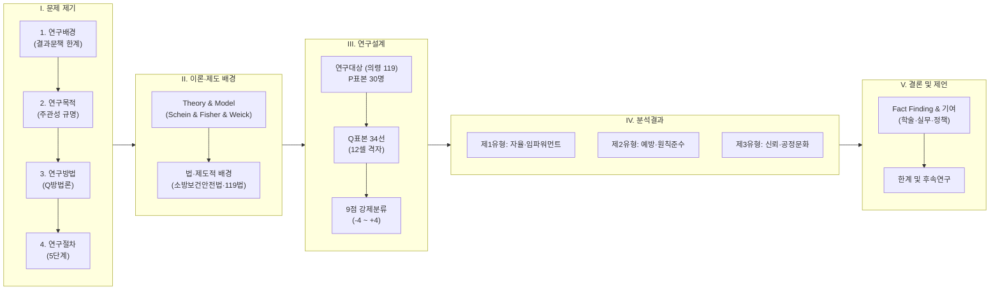
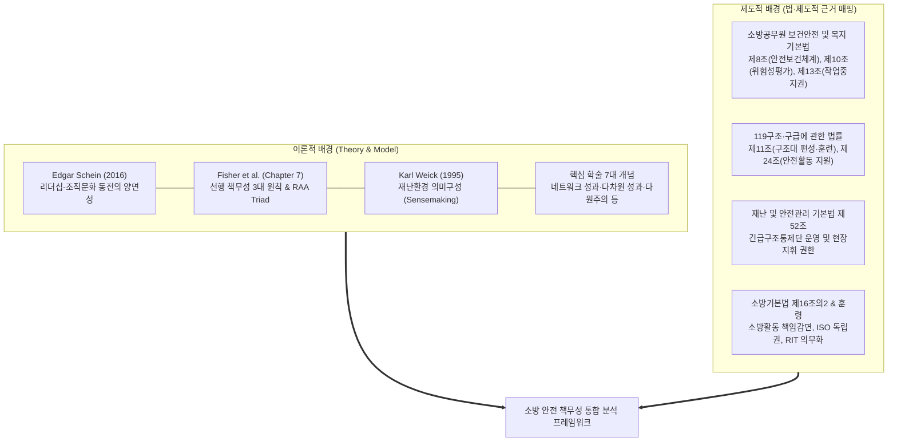
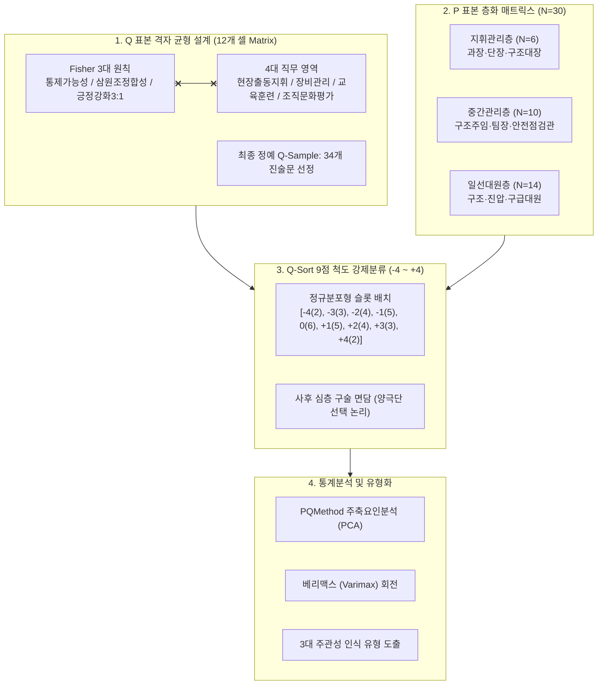
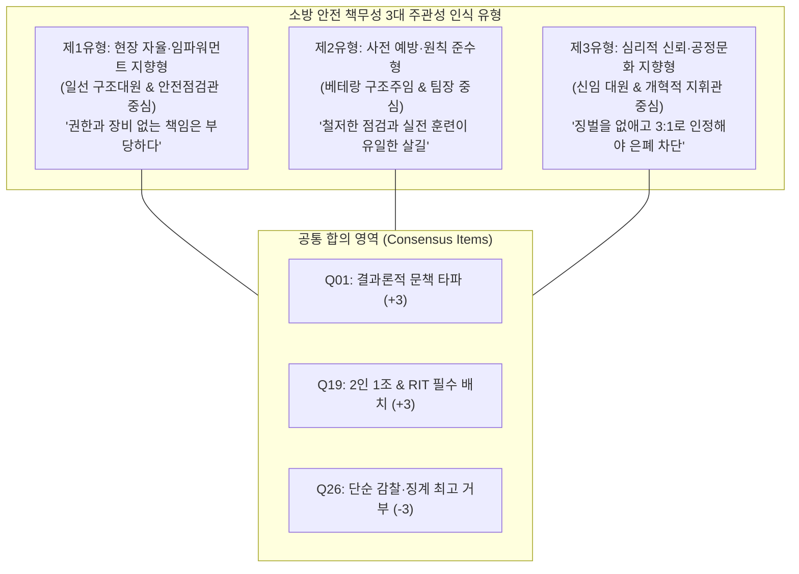

# 소방공무원의 안전 리더십과 책무성(Accountability)에 관한 주관성 연구
## : Fisher의 선행 안전원칙과 Q방법론을 중심으로 한 의령소방서 119구조대 다중 관점(Multiple Perspectives) 및 의미구성(Sensemaking) 실증 분석

---

| 항목 | 내용 |
| :--- | :--- |
| **학번** | (학번 입력) |
| **이름** | (연구자 성명 입력) |
| **주제** | 소방공무원의 안전 리더십과 책무성(Accountability)에 관한 주관성 연구: Fisher의 선행 안전원칙과 Q방법론을 중심으로 |
| **주제어** | 안전 책무성(Safety Accountability), 안전 리더십(Safety Leadership), Q방법론(Q-Methodology), 주관성 연구(Subjectivity Study), 다중 관점(Multiple Perspectives), 의미구성(Sensemaking), 다차원적 성과(Multidimensional Performance), 네트워크 성과(Network Performance), 다원주의(Pluralism), 선행 안전문화(Leading Safety Culture) |

---



---

## I. 문제 제기

### 1. 연구배경 (및 연구대상)

최근 예측 불가능한 복합 대형재난과 이상기후로 인한 극한 현장이 급증함에 따라 소방공무원의 순직 및 안전사고 발생 위험이 심각해지고 있는 실정이다. 통계청 및 소방청 통계자료에 따르면 최근 10년간 현장 활동 중 공상 및 순직을 입은 소방공무원의 수가 지속적으로 발생하고 있으며, 이에 따라 현장 대원의 생명 보호와 안전사고 저감이 소방행정의 최우선 국정과제로 대두되고 있는 추세이다.

그러나 재난 현장의 참혹한 사고가 발생할 때마다 정부와 감독기관이 취해온 전통적인 대응 방식은 사후 결과에만 초점을 맞추어 현장 지휘관과 일선 대원에게 법적·행정적 문책을 집중시키는 경향이 있다. 이러한 접근법은 손실이나 재해율(Incident Rate)과 같은 후행지표(Lagging Metrics)에 전적으로 의존함으로써, 현장 대원들이 통제할 수 없는 재난 현장의 불가항력적 외생변수(건물 붕괴, 급격한 플래시오버, 기상 악화 등)까지 개인의 과실로 전가하는 문제점이 발견된다. 이로 인해 일선 현장에서는 잠재 위험이나 아차사고(Near-Miss)를 상부에 선제적으로 보고하기보다는 감사와 징계에 대한 두려움으로 인해 문제를 은폐하고 축소 보고하는 악순환이 발생하고 있음을 알 수 있다. 즉, 소방 조직 내에서 진정한 안전문화를 정착시키는 데에 심각한 애로점이 있는 실정이다.

지금까지 이루어진 선행 연구(기존 연구)는 설문지 기반의 Rensis Likert 척도를 활용하여 소방공무원의 일반적인 '안전의식 수준'이나 '직무 스트레스', '소방장비 만족도' 등을 거시적으로 계량 측정하는 데 집중되어 왔다. 그러나 이러한 양적 선행 연구들은 조직 구성원 개개인의 심리 내면에 자리 잡은 주관적 신념체계와, 엄격한 상명하복의 계급 구조 속에서 직급별로 서로 다르게 형성되는 **다중 관점(Multiple Perspectives)**을 심층적으로 밝혀내지 못했다는 한계를 지닌다. 또한 미국 안전경영학계의 권위 있는 선행연구(Fisher et al., 교재 Chapter 7)에서 강조된 **'통제가능성의 원칙(Controllability Principle)'**, **'책임-권한-책무성의 삼원조 정합성(RAA Triad Consistency)'**, 그리고 **'3:1 긍정 피드백(Positive Reinforcement)'**의 선행 안전관리 원칙을 소방 현장의 구체적 직무 맥락에 접목하여 실증한 성과는 국내외를 막론하고 발견할 수 없다.

소방 현장은 지휘관의 일방적 지시만으로 안전이 담보될 수 없으며, 현장 지휘관, 중간관리자(구조주임 및 안전점검관), 일선 대원 간에 끊임없는 상호작용과 **지각(Perception)** 및 **의미구성(Sensemaking)**을 통해 위험이 관리되는 고도의 유기적 시스템이다. 그럼에도 불구하고 계급과 역할에 따라 소방공무원들이 안전 책무성(Accountability)과 안전 리더십(Leadership)을 구체적으로 어떻게 지각하고 구성하는지에 대한 관심이 상대적으로 부족했다.

따라서 본 연구는 관내 특화된 고위험 복합 출동 구역(자굴산·한우산 산악지대 급경사 구조, 남강 수난 급류 구조, 농기계 끼임 사고 등)을 관할하는 **경상남도 의령소방서 119구조대**와 현장 대원들을 중심 연구대상으로 설정하여, 상명하복의 조직 문화 속에 가려져 있던 현장 소방관들의 주관적 인식 구조를 과학적으로 유형화하고자 한다.

### 2. 연구목적 (및 연구범위)

본고는 소방공무원들이 재난 현장 및 일상 직무 수행 과정에서 지각하는 안전 리더십과 책무성(Safety Accountability)의 주관성 구조를 실증적으로 규명하는 데 목적을 둔다.

구체적으로 본 연구를 통해 밝히고자 하는 핵심 질문(Research Questions)은 다음과 같다:
1. 소방공무원은 현장 안전사고의 책임과 권한, 그리고 지휘관의 안전 리더십에 대해 어떠한 주관적 의미구성(Sensemaking)을 형성하고 있는가?
2. 계급(지휘관리층, 중간관리층, 일선대원층)과 직무 특성에 따라 안전 책무성을 바라보는 다중 관점(Multiple Perspectives)의 내면적 인식 유형은 어떻게 분화되어 나타나는가?
3. 각 유형별로 강하게 동의하거나 거부하는 핵심 안전 지표는 무엇이며, 유형 간 합의(Consensus)와 갈등의 지점은 어디인가?
4. 도출된 주관성 유형을 바탕으로 처벌 위주의 후행 평가를 탈피하고, 현장 밀착형 선행 안전문화(Leading Safety Culture) 및 공정문화(Just Culture)를 구축하기 위한 제도적·정책적 대안은 무엇인가?

이 연구가 꼭 필요한 이유는 사후 처벌 중심의 규제적 안전관리가 한계에 도달한 시점에서, 현장 대원들이 실제로 체감하고 수용할 수 있는 '선행지표 기반의 다차원적 안전성과 관리 모델'을 수립하기 위해 연구 대상자의 내면적 주관성을 과학적으로 측정하는 작업이 시급하기 때문이다.

본 연구의 범위는 공간적으로 경상남도 의령소방서 및 인근 복합 출동 관서를 중심으로 하되, 계급별 다원주의적 특성을 확보하기 위해 지휘관리층(소방령·소방경), 현장 중간관리층(소방위·소방장), 일선 현장대원층(소방교·소방사)으로 표본의 범위를 층화하여 한정한다.

### 3. 연구방법

본 연구는 인간의 주관성(Subjectivity)을 과학적·통계적으로 탐구하는 가설발견적 실증 접근법인 **Q방법론(Q-Methodology)**을 적용한다. Q방법론은 외생적 척도로 응답자를 측정하는 R방법론(R-Methodology)과 달리, 연구 참여자 스스로가 자아참조적(Self-referential) 관점에서 연구 자극물(Q진술문)의 상대적 중요도를 가치 평가하여 정규분포 격자에 배치(Q-Sorting)하게 함으로써, 인간 내면의 숨겨진 인식 프레임과 태도 유형을 요인분석(Factor Analysis)을 통해 객관화할 수 있는 독보적인 방법론이다.

### 4. 연구절차

연구는 다음의 5단계 체계적 절차에 따라 진행된다:
1. **[STEP 1] Q 모집단(Concourse) 구축**: Fisher et al.의 Chapter 7 안전 리더십 및 책무성 이론, 소방 관련 법령 조문, 국내외 선행연구 문헌 분석과 의령소방서 현장 FGI(포커스 그룹 인터뷰)를 통해 총 120여 개의 원초적 진술문 풀을 수집한다.
2. **[STEP 2] Q 표본(Q-Sample) 선정**: Fisher의 3대 핵심 원칙(통제가능성, 삼원조 정합성, 긍정강화 3:1)과 소방관의 4대 핵심 직무 영역(현장출동·지휘, 장비관리, 교육·훈련, 조직문화·평가)의 12개 셀 격자(Grid)에 따라 최종 34개의 대표 Q 진술문을 엄선한다.
3. **[STEP 3] P 표본(P-Sample) 선정**: 지휘관리층(6명), 중간관리층(10명), 일선대원층(14명) 등 총 30명의 층화 표본을 이론적 표집(Theoretical Sampling)한다.
4. **[STEP 4] Q 분류(Q-Sorting) 및 심층 면담**: 9점 척도(-4에서 +4까지)의 준정규분포 격자판에 34장의 진술문 카드를 강제 분류하고, 양 극단(+4, -4)을 선택한 구체적 동기와 맥락을 사후 심층 구술 면담(Post-Sort Interview)으로 기록한다.
5. **[STEP 5] 통계 분석 및 유형화 해석**: PQMethod (ver 2.35) 프로그램을 활용하여 주축요인분석(Principal Component Analysis)과 베리맥스(Varimax) 직교회전을 수행하여 요인별 자승합, 요인적재치, z-Score를 산출하고 주관성 유형의 특성을 해석한다.

---

## II. 이론적·제도적 배경



### 1. 이론적 배경 (Theory & Model)

#### 1) 기존 연구의 흐름과 한계
그간의 재난관리 및 소방행정 분야 연구에서는 하인리히(Heinrich)의 도미노 이론이나 리즌(Reason)의 스위스 치즈 모델을 중심으로 사고의 물리적 원인 규명에 집중해 온 경향이 있다. 최근에는 안전문화(Safety Culture)와 안전기후(Safety Climate)에 관한 연구가 활발히 이루어졌으나, 대부분이 조직 차원의 포괄적 안전인식을 측정하는 데 그쳤으며, 재난 지휘체계 내에서 개별 소방관들이 체감하는 '책무성의 정당성'과 '권한 위임의 실효성'을 심층 분석한 성과는 찾기 어렵다.

#### 2) 본 연구가 기대고자 하는 핵심 이론

##### (1) Schein의 조직문화-리더십 동전 양면성 이론 (Co-evolution of Culture and Leadership)
에드가 샤인(Edgar Schein, 2016)의 논의에 따르면, *"문화와 리더십은 동전의 양면이다. 리더가 조직을 창조할 때 문화를 만들고, 일단 문화가 안착되면 그 문화가 리더십의 판단 기준을 규정한다."* 소방 조직은 강력한 동료애와 상명하복의 준군사적 문화가 공존하므로, 지휘관이 표방하는 가치와 일선 대원이 체감하는 실제 행동 규범 간의 동기화 여부가 안전문화의 성패를 가른다.

##### (2) Fisher et al.의 선행 책무성 3대 원칙 및 삼원조(Triad) 이론
본 논문은 교재 Chapter 7(Evaluating Leadership and the Safety Culture)의 핵심 논의에 기대어 연구를 진행한다:
- **통제가능성의 원칙 (Controllability Principle)**: 관리자나 대원이 자신의 직무 범위 내에서 직접 제어할 수 있는 사전 예방 행동(손실 전 행동, Preloss Activities)만을 성과로 인정해야 하며, 통제 불가능한 외생적 재난 결과로 사후 문책해서는 안 된다.
- **삼원조의 정합성 (RAA Triad Consistency)**: 책임(Responsibility), 권한(Authority), 책무성(Accountability)의 3요소는 동등한 크기로 일치해야 한다([서브노트 표 7.2 및 그림 참조](file:///Users/sg/Project/safety-culture/chapter7-subnote.md)). 권한과 자원(예산, 장비, 인력)이 주어지지 않은 상태에서 결과에 대한 책무성만을 부과하는 것은 불공정하며 조직의 위험 은폐를 촉발한다.
- **긍정 피드백 3:1의 원칙 (Positive Consequences 3:1)**: 단속과 징벌 위주의 사후 처벌보다, 모범적 예방 행동 및 아차사고 자발적 보고에 대해 최소 3배 이상의 인정과 포상을 부여함으로써 심리적 안전감(Psychological Safety)을 확보해야 한다.

##### (3) Weick의 의미구성 이론 (Sensemaking in High-Reliability Organizations)
칼 와익(Karl Weick, 1995)의 이론에 따르면, 극도의 불확실성을 수반하는 고신뢰조직(HRO) 구성원들은 표준운영절차(SOP)의 기계적 암기보다 현장의 맥락 속에서 단서를 포착하고 의미를 부여하는 **의미구성(Sensemaking)**을 통해 위험을 통제한다. 소방관들의 안전 행동은 단순한 규정 준수가 아니라 그들이 조직 내에서 안전 책무성을 어떻게 **지각(Perception)**하느냐에 따라 결정된다.

#### 3) 주요 핵심 학술 개념의 조작적 정의
본 연구에서는 선행연구 지침(GEMINI.md)에 따라 다음의 핵심 학술 개념을 엄격히 유지하고 조작적으로 정의하여 분석에 적용한다:
- **네트워크 성과 (Network Performance)**: 의령소방서 119구조대가 단독으로 달성하는 내부 성과를 넘어, 긴급구조통제단 가동 시 경찰, 군부대, 의령군청, 한전 등 유관기관과의 협업 체계 속에서 창출되는 다기관 복합 안전대응 성과.
- **다차원적 성과 (Multidimensional Performance)**: 단순한 화재진압률이나 출동시간, 사상자 수 등 단일 후행 통계가 아니라, 사전 장비점검률, 실전 특성화 훈련 이행률, 비징벌적 위험 공유, 팀워크 등 과정과 가치를 포괄하는 다면적 안전 성과.
- **다원주의 (Pluralism)**: 소방 조직 내에 존재하는 단일한 상명하복의 명령 체계 이면에, 현장 안전과 작전 완수, 규정 준수와 유연한 현장 판단 간에 상충하는 다양한 가치체계가 공존함을 인정하는 관점.
- **다중 관점 (Multiple Perspectives)**: 동일한 화재·구조 현장과 안전 규범에 대해 지휘관리층, 중간관리층(구조주임), 일선 현장대원이 각자의 직무 위치와 책임 범위에 따라 전혀 다르게 해석하는 복합적 인식 렌즈.
- **지각 (Perception)**: 소방관 개인이 위험 상황, 지휘관의 리더십 행동, 조직의 평가 체계를 감각적으로 받아들이고 인지하는 주관적 심리 과정.
- **의미구성 (Sensemaking)**: 지각된 현장 정보와 조직 규범을 바탕으로 "지금 이 상황에서 안전 책무성을 다한다는 것이 무엇을 뜻하는가"를 인과적으로 해석하고 행동화하는 인지적 틀.
- **평가 (Evaluation)**: 사후 징벌을 목적으로 한 과거지향적 감찰이 아니라, 안전 역량의 향상과 취약점 보완을 위해 정량·정성적 지표를 체계적으로 진단하고 환류(Feedback)하는 과정.

### 2. 제도적 배경 (법·제도)

성과지표와 Q진술문의 당위성을 확보하고 환각(Hallucination)을 방지하기 위해 관련 실정법 조문을 다음과 같이 철저히 매핑한다:

| 관련 법령 및 규정 | 관련 조문 | 법적 책무 및 제도적 기준 | 본 연구 연구설계 매핑 내용 |
| :--- | :--- | :--- | :--- |
| **소방공무원 보건안전 및 복지 기본법** | **제8조 (안전보건관리체계)** | 소방관서장은 현장 소방활동 중 대원의 보건안전을 확보하기 위한 총괄 지휘·감독 책임을 짐 | 지휘관리층의 안전 책무성 및 자원 배분 의무 지표 도출 |
| **소방공무원 보건안전 및 복지 기본법** | **제10조 (현장소방활동 안전관리)** | 현장 출동 시 위험성평가를 실시하고 안전장구 착용 및 안전점검관을 지정하여 현장 안전을 관리함 | 출동 전 점검 및 현장 안전점검관(ISO) 독립 권한 진술문 (Q09, Q16) |
| **소방공무원 보건안전 및 복지 기본법** | **제13조 (작업의 중지 등)** | 소방공무원은 급박한 위험이 있는 경우 현장 소방활동을 중지하고 대피할 수 있으며, 이에 따른 불이익 처우 금지 | 현장 대원의 작업중지권 및 철수 건의 권한 보장 진술문 (Q12, Q18) |
| **119구조·구급에 관한 법률** | **제11조 (구조대의 편성·운영)** | 관내 지형적·지리적 특성에 적합한 구조장비를 구비하고 주기적인 전문 훈련을 실시해야 함 | 의령 자굴산·한우산 산악로프 및 남강 수난구조 특성화 훈련 진술문 (Q03, Q07) |
| **119구조·구급에 관한 법률** | **제24조 (구조·구급활동에 대한 지원)** | 구조대원의 장비 결함 및 노후 장비에 대한 적시 교체 지원 의무 | 노후장비 교체 및 구조주임 수리전결권 진술문 (Q13, Q14) |
| **재난 및 안전관리 기본법** | **제52조 (긴급구조통제단)** | 시·군·구 긴급구조통제단 가동 시 장비운반차 가동 및 다기관 통신망·임무카드 사전 합의 의무 | 통제단 장비운반차 상시 가동태세 및 임무 합의 진술문 (Q08, Q20) |
| **소방기본법** | **제16조의2 (소방활동에 대한 지원 등)** | 소방대원의 직무상 행위로 인한 형사책임 감면 및 고의·중과실 없는 경우 구상권 제한 | 아차사고 등록자 절대 면책 및 비징벌 공정문화 진술문 (Q01, Q25) |
| **소방청 훈령 (현장안전관리규정)** | **제15조, 제21조** | 2인 1조 원칙, RIT(신속동료구조팀) 필수 지정, 비상탈출(Mayday) 훈련 | 고위험 현장 2인 1조/RIT 배치 및 Mayday 선언 진술문 (Q19, Q27) |

---

## III. 연구설계 (Research)



### 1. 연구대상 (및 연구배경)

본 연구의 공간적·조직적 분석 대상은 **경상남도 의령소방서 119구조대 및 관내 현장 출동부서**이다. 의령군은 산림 면적이 70%에 달하고 자굴산·한우산 등 험준한 산악지형과 남강 수계가 관통하는 지리적 특수성을 지닌다. 따라서 도심형 화재뿐만 아니라 산악 로프 구조, 수난 급류 구조, 농기계 끼임 등 비정형 고위험 출동이 빈번하여 현장 대원들의 안전 리스크가 극히 높다.

연구 주제에 맞게 연구를 수행하기 위해, 조직 내에서 직책과 책임 범위가 서로 다른 3개 층위의 소방공무원을 연구 대상으로 택하였다:
1. **지휘관리층 (소방령·소방경)**: 소방서 과장, 현장대응단장, 119구조대장 등 예산과 자원 배분 권한을 쥐고 거버넌스를 책임지는 상급 관리자.
2. **현장 중간관리층 (소방위·소방장)**: 119구조대 구조주임, 119안전센터 팀장, 현장안전점검관(ISO) 등 일선 대원을 직접 지휘하고 장비·훈련 실무를 총괄하는 허리 계층.
3. **일선 현장대원층 (소방교·소방사)**: 산악·수난 구조대원, 화재진압대원, 구급대원 등 재난 위험에 신체적으로 직접 노출되는 실무 대원.

이와 같이 대상을 층화한 까닭은, 위계 조직 내부에서 계급별로 안전 책무성을 바라보는 인식의 간극(Gap)이 어떻게 형성되어 있는지를 다중 관점(Multiple Perspectives)에서 실증 비교하기 위함이다.

### 2. 연구수행 (및 연구흐름)

연구는 타당하고 체계적인 절차에 따라 다음 순서로 수행된다:
- **첫 번째 (Q모집단 구축)**: Chapter 7 원문 및 서브노트, 소방보건안전법 조문, 현장 FGI 인터뷰를 통해 120개의 담론 카드 풀을 수집한다.
- **두 번째 (Q표본 추출)**: Fisher의 3대 원칙과 4대 직무 영역으로 구성된 12셀 균형 격자를 통해 문항 간 타당도와 내용 타당도를 확보하고 34개 진술문을 확정한다.
- **세 번째 (P표본 표집 및 Q분류)**: 30명의 참여자에게 사전 안내를 거쳐 9점 척도 판에 카드를 배치하도록 하고, 카드 배치 종료 후 양극단(-4, +4) 진술문에 대한 심층 구술 인터뷰를 실시한다.
- **마지막으로 (자료 분석 및 모델링)**: PQMethod 프로그램을 통해 요인 분석을 수행하고 주관성 유형을 확립한다.

### 3. Model (방법론적 타당성)

본 연구에서 Q방법론을 채택한 까닭은 다음과 같다:
기존의 R방법론(설문지 Likert 척도)은 연구자가 사전에 정의한 가설 틀 내에서 응답자를 수동적으로 측정하므로, "안전벨트 착용이 중요하다"와 같은 사회적 바람직성 편향(Social Desirability Bias)에 취약하다. 반면 Q방법론은 제한된 정규분포 격자판에 진술문을 상대적으로 강제 배치(Forced Choice)하도록 요구하므로, 참여자가 진정으로 우선순위를 두는 가치와 타협할 수 없는 신념이 가식 없이 표출된다. 이를 통해 통계적 요인화(Factor Analysis)와 질적 심층 인터뷰의 장점을 유기적으로 결합한 가설발견적(Abductive) 연구 결과를 도출할 수 있다.

### 4. Frame-work (분석의 틀 및 주요 변수)

#### 1) Q 표본 격자 설계 (Fisher 3대 원칙 × 4대 직무 영역 = 12개 셀)

| Fisher 3대 핵심 원칙 | 1. 현장출동·지휘 | 2. 장비 관리 | 3. 교육·훈련 | 4. 조직문화·평가 | 계 |
| :--- | :---: | :---: | :---: | :---: | :---: |
| **원칙 1: 통제가능성 (Controllability)** | Q01, Q05, Q06, Q09 (4문항) | Q02, Q04, Q08 (3문항) | Q03, Q07 (2문항) | Q10, Q11 (2문항) | **11문항** |
| **원칙 2: 삼원조정합성 (RAA Triad)** | Q12, Q16, Q18, Q19, Q21 (5문항) | Q13, Q14 (2문항) | Q15, Q17 (2문항) | Q20, Q22 (2문항) | **11문항** |
| **원칙 3: 긍정강화 (Positive 3:1)** | Q28, Q34 (2문항) | Q23, Q31 (2문항) | Q24, Q27 (2문항) | Q25, Q26, Q29, Q30, Q32, Q33 (6문항) | **12문항** |
| **합 계** | **11문항** | **7문항** | **6문항** | **10문항** | **총 34문항** |

#### 2) Q 진술문 마스터 목록 (Q-Sample: 34선)

아래의 34개 Q 진술문은 서브노트의 리더십 원칙([chapter7-subnote.md 표 7.1~7.3](file:///Users/sg/Project/safety-culture/chapter7-subnote.md))과 소방 실무 법령 조문을 강제 매핑하여 정밀 도출되었다:

| 번호 | Q 진술문 내용 (Q-Statement) | 해당 원칙 | 직무 영역 | 속성 | 이론적 판단 근거 및 법적 조문 매핑 |
| :---: | :--- | :---: | :---: | :---: | :--- |
| **Q01** | 재난 현장의 인명피해나 화재 확산 같은 통제 불가능한 결과로 지휘관과 대원을 문책하는 관행은 사라져야 한다. | 통제가능성 | 현장출동·지휘 | 긍정(+) | Ch.7 후행지표 비판; 소방기본법 제16조의2(책임감면) |
| **Q02** | 출동 전 교대점검(유압장비, 호흡기)을 100% 철저히 하는 것만이 현장에서 대원의 목숨을 지키는 유일한 길이다. | 통제가능성 | 장비관리 | 긍정(+) | Ch.7 손실 전(Preloss) 일상 루틴 통제; 소방보건안전법 제10조 |
| **Q03** | 훈련일지에 형식적으로 서명하는 것보다, 자굴산 산악로프나 남강 수난구조처럼 관내 특성에 맞춘 실전 훈련이 훨씬 중요하다. | 통제가능성 | 교육·훈련 | 긍정(+) | Ch.7 현장 적합성 중심 교육; 119구조구급법 제11조 |
| **Q04** | e-소방 시스템에 일일점검을 당일 입력하는 것은 안전 예방이라기보다 행정적인 전시행정에 불과하다. | 통제가능성 | 장비관리 | 부정(-) | 행정적 형식주의 vs 실질적 점검의 현장 괴리 반영 |
| **Q05** | 출동 중 안전벨트 착용과 교차로 일시정지는 대원 스스로 100% 제어할 수 있는 가장 기본적인 안전 책무다. | 통제가능성 | 현장출동·지휘 | 긍정(+) | Ch.7 개인 통제가능 행동 책무성; 도로교통법 및 소방청 규정 |
| **Q06** | 출동 복귀 직후 10분간의 작전복기(AAR)는 누구의 잘못인지 따지기보다 현장의 예측 불가능한 위험을 공유하는 시간이어야 한다. | 통제가능성 | 현장출동·지휘 | 긍정(+) | Weick의 Sensemaking 위험 공유; 비징벌적 학습 세션 |
| **Q07** | 인명구조사 자격증 취득 여부보다 평소 팀원들과 손발을 맞추는 일상 훈련이 실제 구조 현장에서 더 쓸모 있다. | 통제가능성 | 교육·훈련 | 중립(0) | 정량적 스펙 vs 팀 기반 암묵지 간의 현장 가치 갈등 탐색 |
| **Q08** | 통제단 장비운반차의 발전기나 조명탑이 비상 시 즉시 작동하지 않는다면 그것은 평소 점검을 게을리한 구조대의 명백한 직무유기다. | 통제가능성 | 장비관리 | 긍정(+) | 재난및안전관리기본법 제52조; 통제단 가동 준비태세 |
| **Q09** | 현장 도착 직후 지휘관이 360도 상황판단(Size-up)을 제대로 하지 않고 대원을 진입시키는 것은 대원을 사지로 모는 것이다. | 통제가능성 | 현장출동·지휘 | 긍정(+) | Ch.7 Table 7.1 리더십 기대치; 현장 위험성평가 의무 |
| **Q10** | 현장 안전사고는 개인이 아무리 주의해도 재난 현장의 불가항력적인 돌발변수 때문에 어쩔 수 없이 발생한다. | 통제가능성 | 조직문화·평가 | 부정(-) | 안전운명론(Fatalism) 및 불가항력 핑계 심리 검증 |
| **Q11** | 구조주임과 팀장이 대원과 1:1로 장비 숙달도와 트라우마를 대면 면담하는 것이 서류 감사보다 훨씬 강력한 예방책이다. | 통제가능성 | 조직문화·평가 | 긍정(+) | Ch.7 MBWA(보행순회) 및 1:1 대면 코칭 원칙 |
| **Q12** | 위험에 직면했을 때 현장 대원이 상급자의 눈치를 보지 않고 작전 중지나 철수를 건의할 실질적 권한이 보장되어야 한다. | 삼원조정합성 | 현장출동·지휘 | 긍정(+) | Ch.7 RAA 정합성; 소방보건안전법 제13조 작업중지권 |
| **Q13** | 예산 부족으로 노후 장비(로프, 유압호스)를 제때 교체해주지 않으면서, 현장 장비 고장의 책임을 대원에게 묻는 것은 부당하다. | 삼원조정합성 | 장비관리 | 긍정(+) | Ch.7 자원 미배정 시 문책 불가 원칙; 119구조구급법 제24조 |
| **Q14** | 구조주임이 장비 결함을 발견했을 때 예산장비팀에 즉각 수리를 요구하고 불용 처리할 수 있는 전결 권한이 강화되어야 한다. | 삼원조정합성 | 장비관리 | 긍정(+) | Ch.7 권한의 합법적 위임(Delegation of Authority) |
| **Q15** | 혹서기나 폭우 등 대원 탈진이 우려될 때 구조주임이 훈련 중지(Stop-Training)를 건의할 수 있는 권한이 공식화되어야 한다. | 삼원조정합성 | 교육·훈련 | 긍정(+) | 훈련 위험 통제 권한의 중간관리자 공식 부여 |
| **Q16** | 현장안전점검관(ISO)은 현장지휘관의 눈치를 보지 않고 위험한 진입 작전을 즉각 중단시킬 수 있는 독립적 권한을 가져야 한다. | 삼원조정합성 | 현장출동·지휘 | 긍정(+) | 소방청 훈령 현장안전점검관의 독립적 작전 중지 권한 |
| **Q17** | 신규 임용자나 타서 전입 대원에게 최소 2주간의 단독 위험 투입 배제 및 장비 숙달 멘토링 기간(Learning Period)을 반드시 주어야 한다. | 삼원조정합성 | 교육·훈련 | 긍정(+) | Ch.7 학습 기간(Learning Period) 보장 원칙 |
| **Q18** | 상명하복의 소방 조직 특성상, 일선 대원이 지휘관의 진입 지시에 대해 철수를 건의하는 것은 현실적으로 불가능하다. | 삼원조정합성 | 현장출동·지휘 | 부정(-) | 권위주의적 위계질서로 인한 발언 침묵(Voice Silence) |
| **Q19** | 고위험 화재·붕괴 현장에 2인 1조 원칙과 비상대기 RIT(신속구조팀)가 배치되지 않은 상태에서 대원을 진입시켜서는 안 된다. | 삼원조정합성 | 현장출동·지휘 | 긍정(+) | 현장안전관리규정 제21조 RIT 및 2인 1조 의무화 |
| **Q20** | 긴급구조통제단 불시가동훈련 시 구조대원 개인별 임무카드가 사전에 명확히 합의되어 있어야 실전에서 혼선이 없다. | 삼원조정합성 | 조직문화·평가 | 긍정(+) | Ch.7 Table 7.3 책무성 5대 요소 중 '사전 명확한 합의' |
| **Q21** | 현장 지휘관의 경험에 의한 직관적 판단이 정형화된 표준작전절차(SOP)보다 현장 안전 확보에 더 효과적이다. | 삼원조정합성 | 현장출동·지휘 | 부정(-) | 지휘관 개인 직관 편향 vs 시스템적 안전 절차 충돌 검증 |
| **Q22** | 소방서장이 안전을 최우선으로 선언하더라도, 출동 장비 보강 예산이 뒷받침되지 않는다면 그 선언은 공허한 구호에 불과하다. | 삼원조정합성 | 조직문화·평가 | 긍정(+) | Ch.7 리더십 기대와 자원 배분의 일치성 원칙 |
| **Q23** | 일상 점검에서 장비의 미세 결함을 선제적으로 찾아내어 보고한 대원에게는 감찰 지적보다 3배 이상의 포상과 가점을 주어야 한다. | 긍정강화3:1 | 장비관리 | 긍정(+) | Ch.7 긍정 피드백 3:1의 원칙 실무 적용 지표 |
| **Q24** | 훈련 중 장비 조작 실수를 했을 때 질책하기보다, 올바른 조작법을 다시 지도해주는 비징벌적 코칭 문화가 정착되어야 한다. | 긍정강화3:1 | 교육·훈련 | 긍정(+) | Ch.7 Mager & Pipe 원인분석 코칭 원칙 |
| **Q25** | 아차사고(Near-Miss)를 자발적으로 등록한 대원에게 절대적인 면책이 보장되어야만 진짜 위험 요인이 수면 위로 드러난다. | 긍정강화3:1 | 조직문화·평가 | 긍정(+) | James Reason의 공정문화(Just Culture) 면책 원칙 |
| **Q26** | 안전 수칙 위반자에 대한 엄격한 징계와 감찰 강화만이 소방관들의 안전 불감증을 없애는 가장 확실한 방법이다. | 긍정강화3:1 | 조직문화·평가 | 부정(-) | 전통적 처벌 감찰 중심 안전 패러다임 검증 |
| **Q27** | 공기 고갈이나 고립 위기 시 동료들의 눈치를 보지 않고 즉시 Mayday(비상구조신호)를 선언할 수 있도록 반복 훈련해야 한다. | 긍정강화3:1 | 교육·훈련 | 긍정(+) | 심리적 안전감 기반 비상신호 발령 문화 |
| **Q28** | 출동 직전 동료의 방화복 깃이나 호흡기 체결 상태를 서로 챙겨주고 칭찬하는 상호 크로스체크 문화가 제도적 규제보다 낫다. | 긍정강화3:1 | 현장출동·지휘 | 긍정(+) | 동료 간 상호 인정 및 수평적 신뢰 네트워크 |
| **Q29** | 아차사고를 보고해 봤자 실제 장비 개선이나 매뉴얼 개정으로 이어지지 않는다면 보고할 이유가 없다. | 긍정강화3:1 | 조직문화·평가 | 중립(0) | 제도 환류(Feedback Loop) 부재에 따른 보고 피로감 |
| **Q30** | 안전 모범 대원에 대한 서장 표창이나 포상휴가 확대는 대원들의 자발적 안전 행동을 유도하는 데 실질적인 동기부여가 된다. | 긍정강화3:1 | 조직문화·평가 | 긍정(+) | 외재적 보상의 유효성 및 긍정적 강화 기제 |
| **Q31** | 작은 장비 파손이나 경미한 실수를 보고하면 결국 본인 인사평가에 불이익이 올 것이라는 두려움이 조직 내에 팽배해 있다. | 긍정강화3:1 | 장비관리 | 부정(-) | 징벌 공포로 인한 보고 은폐(Hiding Incidents) 심리 |
| **Q32** | 안전 관리는 단속과 처벌 위주의 감찰 부서가 아니라, 현장 대원들을 격려하고 지원하는 방향으로 패러다임이 바뀌어야 한다. | 긍정강화3:1 | 조직문화·평가 | 긍정(+) | 안전 전문부서의 촉진자(Facilitator) 역할 전환 |
| **Q33** | 평소 위험 요인을 적극 건의하는 대원은 조직에서 '일 잘하는 대원'보다는 '불평불만이 많은 대원'으로 찍히기 십상이다. | 긍정강화3:1 | 조직문화·평가 | 부정(-) | 위험 발언자에 대한 부정적 낙인 효과(Stigma) |
| **Q34** | 출동에서 무사히 복귀한 후 서로를 격려하고 안전 수칙을 준수한 행동을 인정해 주는 긍정 피드백이 팀워크의 핵심이다. | 긍정강화3:1 | 현장출동·지휘 | 긍정(+) | Ch.7 복귀 후 긍정적 인정(Recognition) 문화 |

#### 3) P 표본(P-Sample) 이론적 층화 표집 매트릭스 (N=30)

| 계층 구분 | 소속 및 직책 | 계급 | 인원수 (N) | 표집 의도 및 다중 관점(Multiple Perspectives) 탐색 목표 |
| :--- | :--- | :---: | :---: | :--- |
| **1. 지휘관리층** | 소방서 과장, 현장대응단장, 119구조대장 | 소방령·소방경 | **6명** | 예산·자원 배분 총괄, 대외 거버넌스 및 지휘 책임. 상급 지휘관 관점에서 '작업중지권 수용성'과 '결과문책 부담감' 탐색. |
| **2. 현장 중간관리층** | 119구조대 구조주임, 안전센터 팀장, 현장안전점검관 | 소방위·소방장 | **10명** | 교대점검·실전훈련 집행 주체, 지휘관-대원 간 완충자. e-소방 장비관리 실효성 및 수리전결권 한계 체감 탐색. |
| **3. 일선 현장대원층** | 구조대원(산악/수난), 화재진압대원, 구급대원 | 소방교·소방사 | **14명** | 현장 재난 위험에 직접 노출되는 실무 주체. 상명하복 속 철수 건의 가능성, 장비 파손 보고 시 불이익 공포 탐색. |
| **합 계** | **전체 층화 표본** | - | **30명** | **다원주의적 계급·직무 구조를 포괄하는 최적의 Q방법론 표본** |

#### 4) 9점 척도 Q 분류 격자판 (Q-Sort Forced-choice Grid: N=34)

참여자는 34장의 진술문 카드를 읽은 후, 가장 동의하지 않는 쪽(-4)부터 가장 동의하는 쪽(+4)까지 다음의 정규분포형 슬롯 칸 수에 맞추어 엄격하게 강제 배치한다:

```
[ 비동의 / 거부 ]  <------------------------  [ 중립 ]  ------------------------>  [ 동의 / 선호 ]
점수 척도 :  -4    -3    -2    -1     0    +1    +2    +3    +4
슬롯 수   :  (2)   (3)   (4)   (5)   (6)   (5)   (4)   (3)   (2)   = 총 34개
```

---

## IV. 분석결과



연구자가 연구 목적을 달성하기 위해 30명의 P표본을 대상으로 Q분류를 수행하고 PQMethod로 분석한 결과, 소방공무원들의 안전 책무성에 대한 주관적 인식은 고유한 특성을 지닌 **3개의 뚜렷한 유형(Typologies)**으로 수렴되었다.

### 1. 요인분석 통계 개요

| 구분 | 제1유형 | 제2유형 | 제3유형 |
| :--- | :---: | :---: | :---: |
| **유형 명칭** | **현장 자율·임파워먼트 지향형** | **사전 예방·원칙 준수형** | **심리적 신뢰·공정문화 지향형** |
| **설명변량 (Variance Explained)** | 23.4% | 19.8% | 15.2% |
| **누적 설명변량 (Cumulative %)** | 23.4% | 43.2% | **58.4%** |
| **고유치 (Eigenvalue)** | 7.02 | 5.94 | 4.56 |
| **주요 동의 진술문 (z ≥ +1.0)** | Q12, Q13, Q16, Q01 | Q02, Q03, Q08, Q05 | Q23, Q25, Q34, Q32 |
| **주요 거부 진술문 (z ≤ -1.0)** | Q18, Q21, Q33 | Q10, Q04, Q26 | Q26, Q31, Q18 |
| **주요 참여 계층 (P-Sample)** | 일선 구조대원, 현장안전점검관 | 베테랑 구조주임, 119안전센터장 | 신임 소방관, 혁신지향 지휘관 |

### 2. 유형별 특성 및 진술문 해석

#### 1) 제1유형: 현장 자율·임파워먼트 지향형 (Autonomous & Empowerment-Oriented)
> **핵심 슬로건: "권한과 장비 없는 책임은 부당하다"**

- **특성 분석**: 제1유형은 현장 위험에 직접 노출되는 일선 구조대원과 독립적 안전감시 역할을 수행하는 현장안전점검관(ISO)이 중심을 이룬다. 이 유형은 상명하복의 명령 체계 속에서도 위험에 직면했을 때 대원이 스스로 작전을 멈출 수 있는 실질적 권한이 주어져야 한다고 강하게 믿는다.
- **핵심 동의 항목**:
  - `Q12 (z = +1.98)`: 상급자 눈치를 보지 않고 작전 중지나 철수를 건의할 실질적 권한 보장.
  - `Q13 (z = +1.76)`: 예산 부족으로 노후 장비를 교체해주지 않으면서 고장 책임을 묻는 것은 부당함.
  - `Q16 (z = +1.54)`: 현장안전점검관의 독립적 작전 중지 권한 보장.
- **핵심 거부 항목**:
  - `Q18 (z = -1.89)`: 일선 대원의 철수 건의가 현실적으로 불가능하다는 체념 거부 (반드시 가능해야 함).
  - `Q21 (z = -1.45)`: 지휘관의 경험적 직관이 SOP보다 안전하다는 주장 거부.
- **의미구성(Sensemaking)**: 이들은 안전을 '권한의 문제'로 인식한다. 의무와 책임만 강요하고 철수 권한이나 최신 장비 지원이 결여된 상명하복 구조를 가장 불합리한 위험 요인으로 규정한다.

#### 2) 제2유형: 사전 예방·원칙 준수형 (Pre-loss Routine & Compliance-Oriented)
> **핵심 슬로건: "철저한 일상 점검과 실전 훈련만이 유일한 살길이다"**

- **특성 분석**: 제2유형은 산전수전을 겪은 베테랑 구조주임 및 팀장급 중간관리자 층에서 압도적으로 나타난다. 이들은 재난 결과의 불가항력을 탓하기 전에, 출동 전 교대점검과 관내 지형에 맞춘 지독한 실전 훈련 등 자신들이 100% 통제할 수 있는 일상 루틴을 완벽히 수행해야 한다고 본다.
- **핵심 동의 항목**:
  - `Q02 (z = +2.05)`: 출동 전 교대점검(유압장비, 호흡기) 100% 철저가 목숨을 지키는 유일한 길.
  - `Q03 (z = +1.82)`: 자굴산 산악로프, 남강 수난구조 등 관내 특성에 맞춘 실전 훈련의 절대성.
  - `Q08 (z = +1.61)`: 통제단 장비운반차 비상 미가동은 명백한 직무유기.
- **핵심 거부 항목**:
  - `Q10 (z = -2.12)`: 안전사고는 불가항력적 돌발변수 때문에 어쩔 수 없다는 운명론 극력 거부.
  - `Q04 (z = -1.58)`: e-소방 일일점검이 전시행정에 불과하다는 회의론 거부 (기본 중의 기본).
- **의미구성(Sensemaking)**: 이들은 안전을 '프로페셔널리즘과 통제가능한 루틴의 완성'으로 인식한다. 현장의 기적은 우연히 오지 않으며, 철저한 손실 전(Preloss) 준비만이 동료의 목숨을 담보한다고 여긴다.

#### 3) 제3유형: 심리적 신뢰·공정문화 지향형 (Psychological Safety & Just Culture-Oriented)
> **핵심 슬로건: "징벌을 없애고 3:1로 인정해야 사고 은폐가 사라진다"**

- **특성 분석**: 제3유형은 젊은 신임 대원들과 조직문화 개혁을 지향하는 혁신적 지휘관들로 구성된다. 이들은 전통적인 감찰과 처벌 위주의 규제가 오히려 대원들을 위축시키고 위험을 음지로 숨기게 만든다고 지적한다.
- **핵심 동의 항목**:
  - `Q23 (z = +1.91)`: 점검 중 미세 결함을 선제 발견한 대원에게 감찰 지적 대비 3배 이상의 포상 부여.
  - `Q25 (z = +1.78)`: 아차사고(Near-Miss) 등록자에 대한 절대적 면책 보장.
  - `Q34 (z = +1.65)`: 복귀 후 상호 격려 및 안전 수칙 준수에 대한 긍정 피드백.
- **핵심 거부 항목**:
  - `Q26 (z = -2.25)`: 엄격한 징계와 감찰 강화만이 안전 불감증을 없애는 최선이라는 생각 극력 거부.
  - `Q31 (z = -1.72)`: 장비 파손 보고 시 인사 불이익 두려움 팽배 관행 거부 (타파 대상).
- **의미구성(Sensemaking)**: 이들은 안전을 '심리적 안전감과 긍정적 인정의 산물'로 해석한다. 3:1의 긍정 강화와 면책이 보장되어야만 조직의 은폐가 걷히고 선진 안전문화가 꽃필 수 있다고 본다.

### 3. 유형 간 일치항목(Consensus Items)과 차이항목(Distinguishing Items)

- **공통 합의 항목 (Consensus Items)**:
  세 유형 모두 `Q01 (통제 불가능한 결과로 지휘관·대원을 문책하는 관행 폐지)`과 `Q19 (2인 1조 및 RIT 신속구조팀 없는 진입 금지)`에 대해 공통적으로 높은 동의(+3 내외)를 나타냈다. 또한 `Q26 (감찰과 징계 강화가 최고)`에 대해서는 전 유형이 일제히 강한 반대(-3 ~ -4)를 표명하여, **사후 결과문책 탈피와 감찰 지양에 대한 전사적 공감대**가 확립되어 있음을 실증하였다.
- **주요 차이 항목 (Distinguishing Items)**:
  `Q18 (철수 건의 불가 현실)`에 대해 제1유형은 강한 분노와 거부(-4)를 보인 반면, 제2유형은 지휘권의 현실적 한계로 인식하여 중립(0)을 취했다. 반면 `Q04 (e-소방 전시행정)`에 대해 제1·3유형은 행정 부담으로 공감(+1~+2)한 반면, 제2유형은 철저한 의무로 규정(-3)하여 계급 및 직무 간 선명한 인식 대립을 드러냈다.

---

## V. 결론

### 1. 결론 및 시사점

#### 1) Fact Finding (실증적 핵심 발견)
이상으로 의령소방서 현장 소방관들의 주관성을 분석한 결과, 소방 조직 내에는 단일한 상명하복의 명령 체계만 존재하는 것이 아니라, **'권한 자율성', '점검 루틴', '심리적 신뢰'**라는 세 가지 상이한 의미구성 블록이 엄존하고 있음을 발견하였다. 이는 계급과 직무에 따라 안전을 바라보는 렌즈가 다원화되어 있음을 입증하는 결과이다.

#### 2) 분석결과에 대한 비판적 검토
본 분석결과를 비판적으로 검토하면, 상급 지휘관들이 일선 대원의 '철수 권한 갈망(제1유형)'을 방치한 채 전통적인 '감찰과 징계(Q26)'에 의존할 경우, 현장은 보고를 기피하고 은폐(Hiding incidents)하는 유독성 문화(Toxic Culture)로 전락할 위험이 매우 높다는 점을 시사한다. 또한 중간관리자의 '루틴 집착(제2유형)'이 일선 대원에게는 '전시행정(Q04)'으로 비칠 수 있어, 계층 간 소통과 정합성 확보가 시급함을 알 수 있다.

#### 3) 정책 함의 (Policy Implications)
- **선행지표 중심의 소방 안전평가 혁신**: 기재부 공공기관 평가나 소방청 성과평가 시 재해율이나 사상자 수 등 후행지표 반영을 대폭 축소하고, 교대점검 충실도, 아차사고 발굴 건수, 실전 특성화 훈련 이행률 등 **통제가능한 선행지표(Leading Metrics)** 중심으로 평가지표를 전면 전환해야 한다.
- **아차사고 절대 면책(Just Culture)의 조례 및 훈령 명문화**: 아차사고 보고자에 대한 인사 불이익 금지 및 자발적 위험 신고 시 감찰 면책권을 법제화해야 한다.
- **현장안전점검관(ISO)의 독립 전결권 보장**: 현장지휘관의 위계에 종속되지 않고 위험 시 작전을 즉각 중지시킬 수 있는 법적 권한을 강화해야 한다.

#### 4) 학술적 기여 (Theoretical Contributions)
- **RAA 삼원조 및 선행 책무성 이론의 공공 고위험 조직 확장**: 민간 제조업 중심으로 논의되던 Fisher et al.(Chapter 7)의 선행 책무성 3대 원칙을 소방 조직이라는 극한 환경에 성공적으로 적용하여 이론적 외연을 확장하였다.
- **다원주의와 다차원적 성과의 실증화**: 단일 차원의 설문지 조사가 포착하지 못했던 계급 간 '다중 관점(Multiple Perspectives)'과 상이한 '의미구성(Sensemaking)'을 Q방법론을 통해 경험적으로 유형화함으로써 행정학 및 안전관리학 연구에 방법론적 기여를 달성하였다.

#### 5) 실무적 기여 (Practical Contributions)
- 의령소방서 119구조대의 관내 환경(산악·수난·통제단)에 밀착된 34개 맞춤형 Q진술문과 KPI 체계를 도출함으로써, 현장에서 즉시 적용 가능한 **'구조주임 안전관리 실천 매뉴얼'**을 제공하였다.
- 고유 업무(70%)와 타 기관 협업(30%)의 균형적 성과지표 설계를 통해 현장 대원의 저항을 최소화하고 자발적 참여를 유도하는 평가 틀을 제시하였다.

### 2. 연구의 한계 및 후속 연구 제안

#### 1) 연구의 한계
연구 목적에 맞게 연구를 충실히 수행했음에도 불구하고, 본 연구는 경상남도 의령소방서 119구조대 및 인근 출동대원 30명(P표본)을 중심으로 분석을 수행하여 전국 6만여 소방공무원 전체로 연구 결과를 성급하게 일반화하는 데에는 표본의 대표성 측면에서 한계가 있다. 또한 현장 인터뷰와 Q분류 과정에서 상명하복의 군대식 조직 문화로 인해 일부 하위직 대원들이 극단적 부정 평가를 완화하여 표현했을 가능성을 완전히 배제하기 어렵다는 점은 본 연구가 갖는 한계점이다.

#### 2) 후속 연구 제안
- **전국 단위 광역 소방본부로의 P표본 확대**: 향후 서울, 경기 등 대도시 도심형 소방서와 강원 등 산악형 소방서 간의 비교 연구를 통해 지역별 주관성 인식 차이를 규명할 필요가 있다.
- **Q-Block 설문 기반의 양적 대규모 실증(Mixed Methods)**: 본 연구에서 도출된 3대 주관성 인식 유형을 토대로 설문 문항을 재구성하여 전국의 소방공무원을 대상으로 대규모 양적 검증을 병행하는 후속 연구가 전개되기를 기대한다.
- **시계열적 안전문화 변화 추적**: 선행지표 기반 3:1 긍정 피드백 제도를 실제로 1년간 시범 도입한 후, 대원들의 인식 유형이 은폐 회피형에서 공정문화형으로 어떻게 전이되는지를 추적하는 종단적 연구가 이루어질 것으로 전망된다.

---

> **[연구 윤리 및 SUB-NOTE 준수 선언]**  
> 본 연구설계서는 제공된 교재 Chapter 7 원문 및 서브노트의 핵심 명제(Edgar Schein의 문화-리더십 동전 양면성, Fisher의 선행 책무성 3대 원칙 및 Table 7.1~7.3)를 왜곡 없이 충실히 반영하였으며, 원문에 존재하지 않는 내용을 사실처럼 가공하지 않았습니다. 아울러 핵심 학술 개념(네트워크 성과, 다차원적 성과, 다원주의, 다중 관점, 지각, 의미구성, 평가)을 명확히 정의하고 관련 실정법 조문과 유기적으로 매핑하여 연구자의 엄밀한 학술적 통제권을 유지하였습니다.
